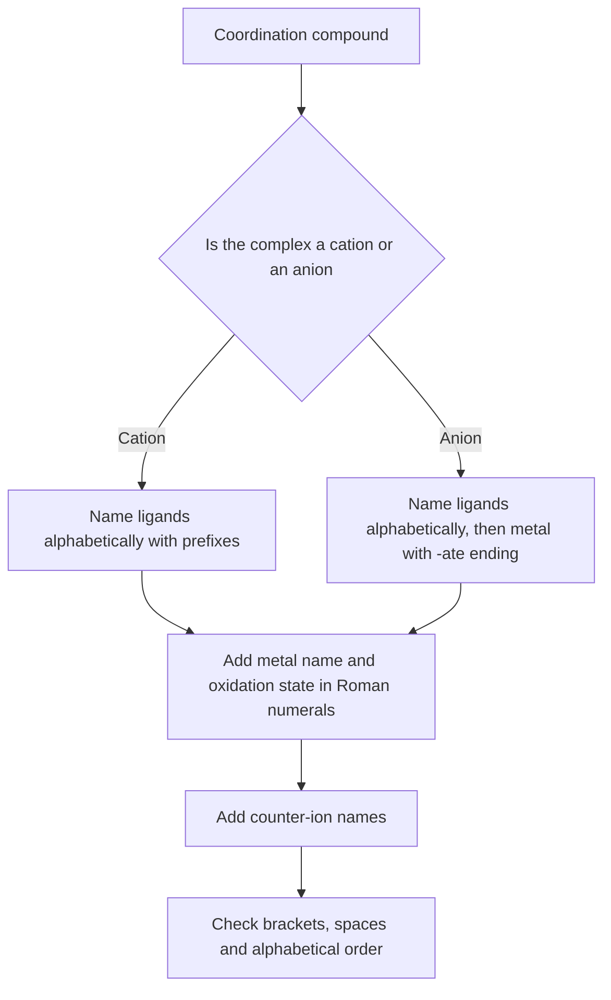
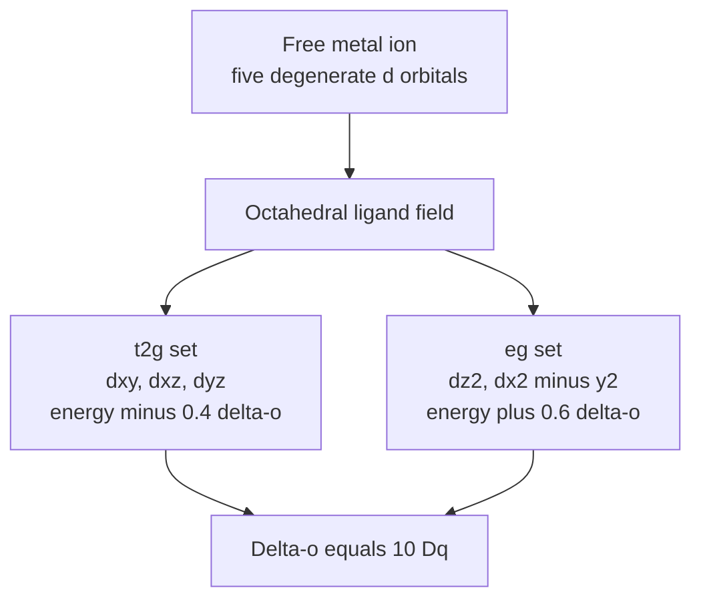
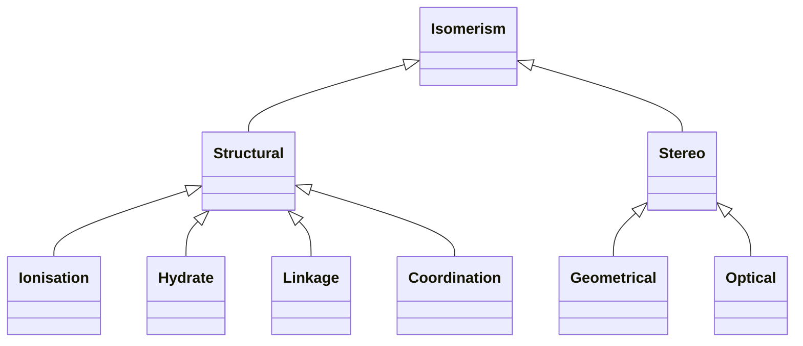
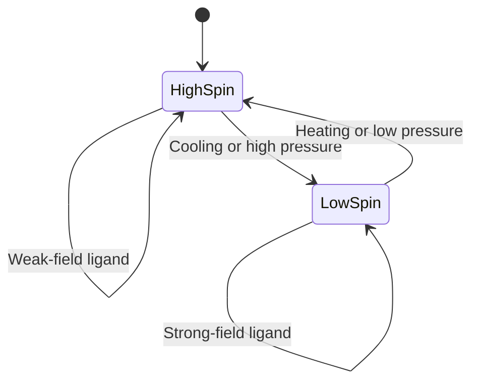

# Chapter 9 — Coordination Chemistry, Crystal Field and Ligand Field Theory

> **Level:** Advanced (Level 3 — Advanced Chemistry)
> **Estimated study time:** 10 hours (7 h reading + 3 h exercises)
> **Prerequisites:** [Atomic orbitals and quantum numbers](02-atomic-orbitals-and-quantum-numbers.md); [molecular orbital theory](03-molecular-orbital-theory.md); redox and oxidation states (Level 2); thermodynamics of complex formation ([Ch. 4](04-chemical-thermodynamics.md) and [Ch. 7](07-advanced-equilibrium-buffers-and-solubility-product.md))
> **Difficulty:** ★★★★★ (5/5)
> **Related chapters:** [Level 3 module index](README.md); [Atomic Orbitals](02-atomic-orbitals-and-quantum-numbers.md); [Molecular Orbital Theory](03-molecular-orbital-theory.md); [Advanced Spectroscopy](10-advanced-spectroscopy.md); [Curriculum map](../CURRICULUM.md)

---

## 1. Learning Objectives

After working through this chapter you will be able to:

- Explain Werner's coordination theory and the evidence that established the distinction between primary and secondary valence.
- Classify ligands by charge, donor atom and denticity, and name common ligands correctly.
- Predict the coordination number and geometry of a complex from its metal and ligands.
- Name coordination compounds systematically, including cations, anions, bridging ligands and oxidation states.
- Identify and draw the types of structural and stereoisomerism found in coordination compounds.
- Describe octahedral, tetrahedral and square-planar crystal field splitting and calculate crystal field stabilisation energies.
- Explain how oxidation state, metal identity and ligand identity affect $\Delta_o$, using the spectrochemical series.
- Decide whether a complex is high-spin or low-spin, and calculate spin-only magnetic moments.
- Explain Jahn–Teller distortion and its structural consequences.
- Use ligand field theory to describe $\sigma$-donation, $\pi$-donation and $\pi$-back-donation, and explain the colour of complexes.
- Account for the chelate effect thermodynamically and use stability constants quantitatively.
- Relate coordination chemistry to haemoglobin, cisplatin, MRI contrast agents and catalysis.

---

## 2. Introduction

A solution of cobalt(II) chloride is pink. Add ammonia, and it becomes blue; add excess ammonia in the presence of air, and it turns deep red-brown. The colour changes are not due to the cobalt itself but to the molecules and ions attached to it. These attached species are **ligands**, and the metal–ligand assembly is a **coordination compound**. The field began with Alfred Werner's demonstration, in the 1890s, that metal ions have a second kind of valence beyond their oxidation state — a fixed capacity to bind a certain number of ligands in a definite spatial arrangement.

Coordination chemistry is where inorganic chemistry becomes structural and quantitative. The shape of a complex determines its reactivity; the energy gaps between its d orbitals determine its colour and magnetism; the strength of metal–ligand binding determines whether a metal is available in solution or sequestered in a solid or a protein. The same ideas explain why haemoglobin binds oxygen reversibly, why cisplatin kills cancer cells, why gadolinium complexes are used as MRI contrast agents, and why a rhodium complex can catalyse the hydroformylation of an alkene with exquisite selectivity.

Two models are used, and the relationship between them matters. **Crystal field theory** treats ligands as point charges and the metal as a free ion, and it predicts the splitting of the d orbitals with remarkable success for a model that ignores covalent bonding. **Ligand field theory** treats the metal–ligand bond as a molecular orbital problem and explains the features that crystal field theory cannot: the spectrochemical series, charge-transfer spectra and the covalent character of even "ionic" complexes. This chapter develops crystal field theory first because it is quantitative and easy to apply, then replaces it with the more complete ligand field picture and states exactly what each model can and cannot explain.

The chapter assumes that you can write electron configurations, draw d orbitals, and use the relation between energy, wavelength and frequency. Chapter 2 supplies the orbitals, Chapter 3 supplies the molecular orbital language, and Chapter 10 applies the spectroscopic selection rules introduced here.

---

## 3. Fundamental Concepts

### 3.1 Werner's coordination theory

Alfred Werner proposed in 1893 that a metal ion has two types of valence. The **primary valence** is the oxidation state, satisfied by anions that are not necessarily coordinated. The **secondary valence** is the coordination number, satisfied by ligands bound directly to the metal in a definite geometry. The proposal was controversial because it required atoms to be arranged in three-dimensional space around a metal, but it explained a series of compounds that defeated earlier theories.

The evidence came from conductivity and precipitation. Werner studied a series of cobalt(III) chloride ammines and measured the number of chloride ions precipitated by silver nitrate per formula unit:

| Historical formula | Modern formulation | Chloride ions precipitated | Conductivity type |
|---|---|---|---|
| $\ce{CoCl3.6NH3}$ | $\ce{[Co(NH3)6]Cl3}$ | 3 | 1:3 electrolyte |
| $\ce{CoCl3.5NH3}$ | $\ce{[Co(NH3)5Cl]Cl2}$ | 2 | 1:2 electrolyte |
| $\ce{CoCl3.4NH3}$ | $\ce{[Co(NH3)4Cl2]Cl}$ | 1 | 1:1 electrolyte |
| $\ce{CoCl3.3NH3}$ | $\ce{[Co(NH3)3Cl3]}$ | 0 | non-electrolyte |

The pattern is decisive. As ammonia is replaced by chloride, one chloride moves from the outer sphere into the coordination sphere, and the number of free chloride ions falls. The cobalt(III) ion has a coordination number of six in every member of the series, and its oxidation state remains +3. The square brackets in the modern formulas mark the **coordination sphere**: everything inside is bound to the metal, everything outside is a counter-ion.

### 3.2 Ligands and denticity

A **ligand** is an ion or molecule that donates one or more electron pairs to a metal centre. The atom that donates the pair is the **donor atom**, and the bond is a coordinate or dative bond. Ligands are classified by the number of donor atoms they use.

A **monodentate** ligand uses one donor atom. Examples are water, ammonia, chloride, cyanide, carbon monoxide and triphenylphosphine.

A **bidentate** ligand uses two donor atoms and forms a ring with the metal. Ethane-1,2-diamine (ethylenediamine, en) binds through two nitrogen atoms; oxalate binds through two carboxylate oxygen atoms; 2,2'-bipyridine and 1,10-phenanthroline bind through two aromatic nitrogen atoms.

A **polydentate** or **multidentate** ligand uses three or more donor atoms. Diethylenetriamine (dien) is tridentate; triethylenetetramine (trien) is tetradentate; EDTA is hexadentate, using four carboxylate oxygens and two nitrogen atoms; porphyrins are tetradentate through four pyrrole nitrogen atoms.

A ligand that can bind through two different donor atoms is **ambidentate**. Thiocyanate, $\ce{SCN-}$, can bind through sulfur (thiocyanato-S) or nitrogen (thiocyanato-N); nitrite, $\ce{NO2-}$, can bind through nitrogen (nitrito-N) or oxygen (nitrito-O).

A ligand that forms a ring with the metal is a **chelating ligand**, and the ring size is usually five or six atoms. Chelation substantially increases the stability of the complex, an effect discussed in Section 4.6.

### 3.3 Coordination number and geometry

The **coordination number** is the number of donor atoms bound to the metal. The geometry is determined by the metal, its oxidation state, the ligand size and the electronic configuration, but a few patterns are reliable.

| Coordination number | Geometry | Typical examples |
|---|---|---|
| 2 | Linear | $\ce{[Ag(NH3)2]+}$, $\ce{[CuCl2]-}$, $\ce{[Au(CN)2]-}$ |
| 3 | Trigonal planar | $\ce{[HgI3]-}$ (rare) |
| 4 | Tetrahedral | $\ce{[ZnCl4]^2-}$, $\ce{[FeCl4]-}$, $\ce{[CoCl4]^2-}$, $\ce{[NiCl4]^2-}$ |
| 4 | Square planar | $\ce{[Pt(NH3)2Cl2]}$, $\ce{[Ni(CN)4]^2-}$, $\ce{[PdCl4]^2-}$, $\ce{[AuCl4]-}$ |
| 5 | Trigonal bipyramidal or square pyramidal | $\ce{[Fe(CO)5]}$, $\ce{[Ni(CN)5]^3-}$ |
| 6 | Octahedral | $\ce{[Co(NH3)6]^3+}$, $\ce{[Fe(CN)6]^3-}$, $\ce{[Cu(H2O)6]^2+}$ |
| 7 | Pentagonal bipyramidal or capped octahedral | $\ce{[ZrF7]^3-}$ (rare) |
| 8 | Square antiprismatic or dodecahedral | $\ce{[Mo(CN)8]^4-}$, $\ce{[Zr(C2O4)4]^4-}$ |

Octahedral coordination dominates for 3d metals with six monodentate ligands. Tetrahedral coordination is favoured when ligands are large or when the metal has a $d^{10}$ or high-spin $d^5$ configuration, because the crystal field stabilisation of the octahedral geometry is then small. Square planar coordination is strongly favoured for $d^8$ ions, especially $\ce{Pt(II)}$, $\ce{Pd(II)}$, $\ce{Ni(II)}$ with strong-field ligands, and $\ce{Au(III)}$.

### 3.4 Nomenclature of coordination compounds

IUPAC nomenclature for coordination compounds follows a fixed order.

1. Name the cation before the anion.
2. Within the coordination sphere, name the ligands in alphabetical order, ignoring prefixes such as di-, tri- and bis-.
3. Use the ligand names: aqua, ammine, carbonyl, nitrosyl, hydroxido, chlorido, cyanido, oxalato, ethylenediamine, and so on.
4. Indicate the number of each ligand with di-, tri-, tetra-, penta- or hexa-. Use bis-, tris-, tetrakis- when the ligand name already contains a numerical prefix or is complex.
5. Name the metal, with its oxidation state in Roman numerals in parentheses.
6. If the complex is an anion, change the metal ending to -ate (ferrate, cuprate, cobaltate, platininate).
7. Use square brackets for the coordination sphere and separate counter-ions by spaces.

Examples:

- $\ce{[Co(NH3)5Cl]Cl2}$: pentaamminechloridocobalt(III) chloride.
- $\ce{[Cu(NH3)4]SO4}$: tetraamminecopper(II) sulfate.
- $\ce{K3[Fe(CN)6]}$: potassium hexacyanidoferrate(III).
- $\ce{K4[Fe(CN)6]}$: potassium hexacyanidoferrate(II).
- $\ce{[Pt(NH3)2Cl2]}$: diamminedichloridoplatinum(II).
- $\ce{[Cr(H2O)4Cl2]Cl}$: tetraaquadichloridochromium(III) chloride.

Note that the 2005 IUPAC recommendations use chlorido, cyanido and hydroxido rather than the older chlorido/cyano/hydroxo forms; the older names are still widely encountered.

### 3.5 Isomerism in coordination compounds

Coordination compounds display a rich variety of isomerism because the ligands can be arranged in different ways around a fixed metal centre.

**Structural isomerism** includes ionisation isomerism, hydrate isomerism, linkage isomerism and coordination isomerism.

- **Ionisation isomerism** arises when the counter-ion can itself act as a ligand. $\ce{[Co(NH3)5Br]SO4}$ and $\ce{[Co(NH3)5SO4]Br}$ are ionisation isomers: they give different ions in solution and different precipitates with $\ce{Ba^2+}$ or $\ce{Ag+}$.
- **Hydrate isomerism** arises when water can be inside or outside the coordination sphere. $\ce{[Cr(H2O)6]Cl3}$, $\ce{[Cr(H2O)5Cl]Cl2.H2O}$ and $\ce{[Cr(H2O)4Cl2]Cl.2H2O}$ are hydrate isomers with different numbers of ionic chloride ions.
- **Linkage isomerism** arises from ambidentate ligands. $\ce{[Co(NH3)5(NO2)]^2+}$ can be nitrito-N (bound through nitrogen) or nitrito-O (bound through oxygen); the two have different colours and reactivities.
- **Coordination isomerism** arises when both cation and anion are complexes and the ligands can be distributed differently. $\ce{[Co(NH3)6][Cr(CN)6]}$ and $\ce{[Cr(NH3)6][Co(CN)6]}$ are coordination isomers.

**Stereoisomerism** includes geometrical and optical isomerism.

- **Geometrical isomerism** arises from different spatial arrangements of ligands. In square-planar $\ce{[Pt(NH3)2Cl2]}$, the two ammonia ligands can be adjacent (cis) or opposite (trans). In octahedral $\ce{[Co(NH3)3Cl3]}$, the three ammonia ligands can occupy one face (fac) or a meridian (mer). In octahedral $\ce{[Co(NH3)4Cl2]+}$, the chlorides can be cis or trans.
- **Optical isomerism** arises when a complex is not superimposable on its mirror image. $\ce{[Co(en)3]^3+}$ exists as $\Delta$ and $\Lambda$ enantiomers, and cis-$\ce{[Co(en)2Cl2]+}$ is optically active whereas the trans isomer is not.

### 3.6 The 18-electron rule

The **18-electron rule** states that transition metal complexes are often most stable when the metal has 18 valence electrons, corresponding to a filled set of five d, one s and three p orbitals. The rule works best for organometallic complexes of metals in low oxidation states with strong-field ligands.

For a carbonyl complex, each CO donates two electrons and the metal contributes its group number:

- $\ce{Ni(CO)4}$: Ni is group 10, so $10 + 4(2) = 18$.
- $\ce{Fe(CO)5}$: Fe is group 8, so $8 + 5(2) = 18$.
- $\ce{Cr(CO)6}$: Cr is group 6, so $6 + 6(2) = 18$.

The rule is a useful bookkeeping device but not a law. Square-planar $d^8$ complexes such as $\ce{[PtCl4]^2-}$ are stable with 16 electrons, and many early transition metal complexes are electron-deficient. A full treatment belongs to Level 5, where the rule is derived from molecular orbital theory and its exceptions are classified.

### 3.7 Crystal field theory: octahedral splitting

**Crystal field theory** (CFT) models the metal–ligand interaction as purely electrostatic. The ligands are point negative charges, and the metal d electrons repel them. In an octahedral complex the six ligands approach along the $\pm x$, $\pm y$ and $\pm z$ axes. The two d orbitals that point along the axes — $d_{z^2}$ and $d_{x^2-y^2}$ — experience stronger repulsion than the three orbitals that point between the axes — $d_{xy}$, $d_{xz}$ and $d_{yz}$.

The five d orbitals therefore split into two sets:

- the **$t_{2g}$ set** ($d_{xy}$, $d_{xz}$, $d_{yz}$), lower in energy by $0.4\Delta_o$;
- the **$e_g$ set** ($d_{z^2}$, $d_{x^2-y^2}$), higher in energy by $0.6\Delta_o$.

The separation is the **crystal field splitting parameter** $\Delta_o$ (also written $10Dq$), and the weighted average of the two sets is the **barycentre**, which is taken as the zero of energy. The labels $t_{2g}$ and $e_g$ are symmetry labels: $t$ means triply degenerate, $e$ doubly degenerate, and the subscript $g$ means *gerade* (inversion symmetry).

The **crystal field stabilisation energy** (CFSE) is the net energy of the d electrons in this field:

$$
\mathrm{CFSE} = \left(-0.4n_{t_{2g}} + 0.6n_{e_g}\right)\Delta_o + n_\text{pairs}P
$$

where $n_{t_{2g}}$ and $n_{e_g}$ are the electron counts in each set, $P$ is the pairing energy and $n_\text{pairs}$ is the number of electron pairs. The first term is the orbital contribution; the second accounts for the repulsion between electrons paired in the same orbital.

### 3.8 Tetrahedral and square-planar splitting

In a **tetrahedral** complex the four ligands approach along the diagonals of a cube, so none of them points directly at a d orbital. The splitting pattern is inverted relative to octahedral: the $e$ set ($d_{z^2}$, $d_{x^2-y^2}$) is lower and the $t_2$ set ($d_{xy}$, $d_{xz}$, $d_{yz}$) is higher. The splitting is smaller:

$$
\Delta_t \approx \frac{4}{9}\Delta_o
$$

for the same metal and ligands at the same distance. Because $\Delta_t$ is small, tetrahedral complexes are almost always high-spin, and their CFSE is small. This is why tetrahedral coordination is common for $d^{10}$ ions, which have no CFSE preference, and for large ligands that cannot pack around an octahedron.

In a **square-planar** complex the four ligands lie in the $xy$ plane. The $d_{x^2-y^2}$ orbital points directly at the ligands and is strongly destabilised, while $d_{xy}$ is also raised; $d_{z^2}$ is intermediate and $d_{xz}$, $d_{yz}$ are lowest. The resulting splitting is large, which is why $d^8$ square-planar complexes are usually low-spin and diamagnetic. The ordering is approximately

$$
d_{x^2-y^2} > d_{xy} > d_{z^2} > d_{xz} \approx d_{yz}
$$

and the large gap between $d_{x^2-y^2}$ and the lower orbitals makes square-planar $\ce{Pt(II)}$ and $\ce{Au(III)}$ complexes stable and substitution-inert.

### 3.9 Factors affecting $\Delta_o$

Three factors control the size of the octahedral splitting.

**Oxidation state of the metal.** A higher oxidation state increases the charge on the metal and pulls the ligands closer, increasing $\Delta_o$. The trend is roughly a factor of 1.5–2 per unit charge: $\ce{[Co(NH3)6]^3+}$ has a much larger $\Delta_o$ than $\ce{[Co(NH3)6]^2+}$.

**Identity of the metal.** For the same ligand and oxidation state, $\Delta_o$ increases down a group: $3d < 4d < 5d$. The 4d and 5d orbitals are more diffuse and overlap more strongly with ligands, so $\ce{[Rh(NH3)6]^3+}$ has a larger splitting than $\ce{[Co(NH3)6]^3+}$, and 5d complexes are almost always low-spin.

**Identity of the ligand.** Ligands can be arranged in the **spectrochemical series**, an empirical ordering by the size of the splitting they produce:

$$
\ce{I- < Br- < S^2- < SCN- < Cl- < NO3- < F- < OH- < H2O < NH3 < en < NO2- < CN- \approx CO}
$$

Ligands to the left are **weak-field** and produce small splittings; ligands to the right are **strong-field** and produce large splittings. The series cannot be explained by electrostatics alone, because neutral CO and anionic $\ce{Cl-}$ lie at opposite ends; it is explained by ligand field theory (Section 4.5).

### 3.10 High-spin and low-spin complexes

For $d^4$ to $d^7$ octahedral complexes, the fourth electron faces a choice: enter the higher $e_g$ set, paying $\Delta_o$, or pair with an electron in the lower $t_{2g}$ set, paying $P$. The outcome depends on the ratio $\Delta_o/P$.

- If $\Delta_o < P$, the complex is **high-spin**: electrons occupy all five orbitals singly before pairing, maximising the number of unpaired electrons.
- If $\Delta_o > P$, the complex is **low-spin**: electrons pair in the $t_{2g}$ set before entering $e_g$.

The switch occurs at $\Delta_o \approx P$ for $d^4$–$d^7$. Strong-field ligands and higher oxidation states favour low spin; weak-field ligands and lower oxidation states favour high spin.

| $d^n$ | High-spin configuration | $n$ unpaired | Low-spin configuration | $n$ unpaired |
|---|---|---|---|---|
| $d^4$ | $t_{2g}^3e_g^1$ | 4 | $t_{2g}^4$ | 2 |
| $d^5$ | $t_{2g}^3e_g^2$ | 5 | $t_{2g}^5$ | 1 |
| $d^6$ | $t_{2g}^4e_g^2$ | 4 | $t_{2g}^6$ | 0 |
| $d^7$ | $t_{2g}^5e_g^2$ | 3 | $t_{2g}^6e_g^1$ | 1 |

### 3.11 Magnetic moments

The magnetic moment of a complex is measured with a Gouy balance or a SQUID magnetometer. For a complex with $n$ unpaired electrons and no orbital contribution, the **spin-only magnetic moment** is

$$
\mu = \sqrt{n(n+2)}\ \mu_\mathrm{B}
$$

where $\mu_\mathrm{B}$ is the Bohr magneton, $9.274 \times 10^{-24}\ \mathrm{J\ T^{-1}}$. The formula predicts $0, 1.73, 2.83, 3.87, 4.90$ and $5.92\ \mu_\mathrm{B}$ for $n = 0$–$5$. Measured moments often exceed these values because of spin–orbit coupling, which mixes orbital angular momentum into the ground state; the deviation is largest for heavy metals and for ions with orbitally degenerate ground states.

Magnetic measurements are the standard way to distinguish high-spin from low-spin complexes. A $d^6$ $\ce{Fe(II)}$ complex with $\mu \approx 5.1\ \mu_\mathrm{B}$ is high-spin; one with $\mu \approx 0$ is low-spin.

### 3.12 Jahn–Teller distortion

The **Jahn–Teller theorem** states that a non-linear molecule with a degenerate electronic ground state is unstable with respect to a distortion that removes the degeneracy. In octahedral complexes, the effect is strongest when the $e_g$ orbitals are unequally occupied, because these orbitals point directly at the ligands.

The classic case is $d^9$ $\ce{Cu(II)}$, with the configuration $t_{2g}^6e_g^3$. The single hole in $e_g$ can be in $d_{x^2-y^2}$ or $d_{z^2}$, and the complex distorts by elongating the two axial bonds and shortening the four equatorial bonds. The result is a tetragonally distorted octahedron, often described as square-planar with two loosely bound axial ligands. $\ce{[Cu(H2O)6]^2+}$ is the standard example.

Jahn–Teller distortion also occurs for high-spin $d^4$ ($t_{2g}^3e_g^1$), as in $\ce{Cr(II)}$ and $\ce{Mn(III)}$ complexes, and for low-spin $d^7$ ($t_{2g}^6e_g^1$). It is weak or absent for $d^3$, $d^5$ high-spin, $d^6$ low-spin and $d^8$, which have non-degenerate ground states.

### 3.13 Ligand field theory: $\sigma$-donation, $\pi$-donation and $\pi$-back-donation

Crystal field theory treats the metal–ligand bond as purely electrostatic, but the spectrochemical series shows that covalent interactions matter. **Ligand field theory** (LFT) combines crystal field splitting with molecular orbital theory. Each ligand donates a lone pair into a metal-based $\sigma$ orbital, forming a bonding combination localised mainly on the ligand and an antibonding combination localised mainly on the metal. The metal $e_g$ orbitals ($d_{z^2}$, $d_{x^2-y^2}$) point at the ligands and mix strongly with the ligand $\sigma$ orbitals; the $t_{2g}$ orbitals point between the ligands and are non-bonding in a pure $\sigma$ complex.

The $t_{2g}$ orbitals can, however, interact with ligand $\pi$ orbitals.

- **$\pi$-Donor ligands** such as $\ce{Cl-}$, $\ce{Br-}$, $\ce{I-}$, $\ce{OH-}$ and $\ce{O^2-}$ have filled p orbitals that donate into the metal $t_{2g}$ orbitals. This raises the $t_{2g}$ level and reduces $\Delta_o$, which is why halides are weak-field ligands.
- **$\pi$-Acceptor ligands** such as $\ce{CO}$, $\ce{CN-}$, $\ce{NO+}$, bipyridine and phosphines have empty $\pi^*$ orbitals that accept electron density from the metal $t_{2g}$ orbitals. This lowers the $t_{2g}$ level and increases $\Delta_o$, which is why CO and $\ce{CN-}$ are strong-field ligands.
- **$\sigma$-Only ligands** such as $\ce{NH3}$ and water have no low-lying $\pi$ orbitals of either type and produce an intermediate splitting.

The ligand field picture also explains why the metal–ligand bond in carbonyl complexes is synergistic: the ligand donates σ electron density to the metal, and the metal back-donates d electron density into the ligand $\pi^*$ orbital. The back-donation strengthens the bond, lowers the CO stretching frequency and stabilises low oxidation states.

### 3.14 Colour, d–d transitions and charge transfer

Most transition metal complexes are coloured because they absorb visible light. The energy of the absorbed photon corresponds to the promotion of an electron from a lower to a higher d orbital:

$$
\Delta_o = E_\text{photon} = \frac{hc}{\lambda}
$$

The colour observed is the complement of the colour absorbed. A complex that absorbs at 500 nm (green) appears red or purple; one that absorbs at 600 nm (orange) appears blue.

Two selection rules govern the intensity of d–d transitions.

- The **Laporte rule** states that transitions between orbitals of the same parity are forbidden. In an octahedral complex, which has a centre of inversion, all d orbitals are *gerade*, so d–d transitions are Laporte-forbidden and only weakly allowed by vibronic coupling. Molar absorptivities are typically $1$–$100\ \mathrm{dm^3\ mol^{-1}\ cm^{-1}}$.
- The **spin selection rule** states that transitions with $\Delta S \neq 0$ are forbidden. A high-spin $d^5$ complex such as $\ce{[Mn(H2O)6]^2+}$ has no spin-allowed d–d transition and is very pale.

Tetrahedral complexes lack a centre of inversion, so the Laporte rule does not apply and their d–d bands are more intense. **Charge-transfer** transitions, in which an electron moves from a ligand-based orbital to a metal-based orbital (LMCT) or vice versa (MLCT), are fully allowed and give very intense colours: molar absorptivities of $10^3$–$10^5\ \mathrm{dm^3\ mol^{-1}\ cm^{-1}}$. The deep purple of permanganate, $\ce{MnO4-}$, is an LMCT transition in a $d^0$ complex, not a d–d transition.

### 3.15 The chelate effect and stability constants

The **chelate effect** is the observation that complexes with chelating ligands are more stable than those with comparable monodentate ligands. It is primarily entropic: when a bidentate ligand replaces two monodentate ligands, the number of independent particles increases, so $\Delta S$ is positive and $\Delta G$ becomes more negative.

The thermodynamic origin can be written as

$$
\Delta G^\circ = \Delta H^\circ - T\Delta S^\circ
$$

For the replacement of six ammonia ligands by three ethylenediamine ligands,

$$
\ce{[Ni(NH3)6]^2+ + 3en <=> [Ni(en)3]^2+ + 6NH3}
$$

the number of particles increases from four to seven, so $\Delta S^\circ$ is positive and $T\Delta S^\circ$ is large and favourable.

**Stability constants** quantify the thermodynamics. For the stepwise formation of a complex,

$$
\ce{M + L <=> ML} \qquad K_1 = \frac{[\ce{ML}]}{[\ce{M}][\ce{L}]}
$$

and so on, the overall **formation constant** is

$$
\beta_n = K_1K_2\cdots K_n = \frac{[\ce{ML}_n]}{[\ce{M}][\ce{L}]^n}
$$

with

$$
\Delta G^\circ = -RT\ln\beta_n
$$

Large $\beta$ values correspond to strong binding. The Irving–Williams series describes the approximate order of stability for high-spin divalent first-row metal ions with a given ligand:

$$
\ce{Mn^2+ < Fe^2+ < Co^2+ < Ni^2+ < Cu^2+ > Zn^2+}
$$

The series reflects the increase in effective nuclear charge across the period and the extra stabilisation of $\ce{Cu^2+}$ by Jahn–Teller distortion, followed by the drop at $\ce{Zn^2+}$ where the d shell is full.

### 3.16 Applications

**Haemoglobin and myoglobin.** These proteins contain an iron(II) porphyrin complex. In deoxyhaemoglobin the iron is five-coordinate and high-spin; on binding dioxygen it becomes six-coordinate and low-spin, and the change in ionic radius pulls the iron into the porphyrin plane. This movement triggers a conformational change that propagates to the other subunits, producing cooperative oxygen binding. Carbon monoxide binds much more strongly than oxygen and shifts the equilibrium towards the low-spin form, which is why CO poisoning is so effective.

**Cisplatin.** cis-$\ce{[Pt(NH3)2Cl2]}$ is an anticancer drug. In the bloodstream the chloride ligands are partly replaced by water, giving a reactive cation that binds to the N7 atom of guanine in DNA. The resulting intrastrand cross-link distorts the double helix and triggers apoptosis. The trans isomer is inactive because its geometry cannot form the same cross-link.

**MRI contrast agents and catalysis.** Gadolinium(III) is $d^7$ with seven unpaired electrons and a large magnetic moment; it shortens the spin–lattice relaxation time of nearby water protons and is administered as a kinetically stable chelate such as Gd-DOTA. Coordination compounds are also ubiquitous catalysts: Wilkinson's catalyst $\ce{[RhCl(PPh3)3]}$ hydrogenates alkenes, Ziegler–Natta titanium centres polymerise olefins, and palladium phosphine complexes couple aryl halides.

---

## 4. Detailed Scientific Explanation

### 4.1 Crystal field splitting and the barycentre

The splitting of the d orbitals in an octahedral field is a consequence of symmetry. The six ligands generate a field with $O_h$ symmetry. The five d orbitals span a five-dimensional representation that reduces to $t_{2g} \oplus e_g$. The $e_g$ orbitals point at the ligands and are destabilised; the $t_{2g}$ orbitals point between them and are stabilised.

The barycentre condition requires that the weighted average of the two levels is zero:

$$
3(-0.4\Delta_o) + 2(+0.6\Delta_o) = 0
$$

so the $t_{2g}$ set lies at $-0.4\Delta_o$ and the $e_g$ set at $+0.6\Delta_o$. If the ligands are removed, the five orbitals are degenerate again. The splitting is therefore a property of the ligand field, not of the free ion.

For a $d^n$ ion, the CFSE is computed by filling the two sets according to Hund's rules and the high-spin/low-spin choice, then adding the pairing energy. The result explains many trends: $d^3$ and low-spin $d^6$ are strongly stabilised in octahedral fields, $d^5$ high-spin and $d^{10}$ have zero CFSE, and $d^4$ high-spin and $d^9$ are Jahn–Teller active.

### 4.2 Why tetrahedral splitting is smaller

The tetrahedral splitting is smaller than the octahedral splitting for two reasons. First, there are four ligands rather than six, so the total electrostatic field is weaker. Second, none of the ligands points directly at a d orbital; the closest approach is along the cube diagonals, which reduces the overlap with the metal orbitals. The geometric factor is $4/9$, so

$$
\Delta_t = \frac{4}{9}\Delta_o
$$

for the same metal–ligand distance and the same ligands. In practice the metal–ligand distance is slightly different in the two geometries, so the relation is approximate.

The small value of $\Delta_t$ has two consequences. Tetrahedral complexes are almost always high-spin, because $\Delta_t$ is rarely larger than the pairing energy. And the CFSE of a tetrahedral complex is small, so the geometry is often determined by ligand packing and steric effects rather than by electronic preferences.

### 4.3 Magnetism and the spin-only formula

The magnetic moment of a paramagnetic complex arises from unpaired electron spins and, in some cases, from orbital angular momentum. The spin-only formula assumes that the orbital contribution is quenched by the ligand field, which is a good approximation for complexes with non-degenerate ground states.

The formula is derived from the spin angular momentum quantum number $S = n/2$:

$$
\mu_\text{spin} = g\sqrt{S(S+1)}\ \mu_\mathrm{B}
$$

with $g = 2.0023$ for a free electron. Substituting $S = n/2$ gives $\mu = \sqrt{n(n+2)}$, the expression used in Section 3.11.

Measured moments deviate from the spin-only value when the ground state is orbitally degenerate ($t_{2g}^1$, $t_{2g}^2$, $t_{2g}^4$, $t_{2g}^5$) or when spin–orbit coupling is large, as for 4d and 5d metals. For example, $\ce{[Co(H2O)6]^2+}$ ($d^7$ high-spin) has a spin-only moment of $3.87\ \mu_\mathrm{B}$ but a measured moment of about $4.8\ \mu_\mathrm{B}$ because of orbital contribution.

### 4.4 Selection rules and band intensities

The intensity of an electronic transition is proportional to the square of the transition dipole moment. Symmetry determines whether this integral is zero. In an octahedral complex with a centre of inversion, the d orbitals are all *gerade*, and the electric dipole operator is *ungerade*. The product $g \times u \times g$ is *ungerade*, so the integral over all space is zero: the transition is Laporte-forbidden.

Vibronic coupling — the mixing of electronic and vibrational motion — relaxes the rule enough to give weak bands. The intensity increases when the complex is distorted, when the ligands are asymmetric, or when the complex lacks a centre of inversion. Tetrahedral complexes are therefore more intensely coloured than octahedral complexes with the same ligands.

The spin selection rule $\Delta S = 0$ is also relaxed by spin–orbit coupling, but the relaxation is small for light metals. High-spin $d^5$ $\ce{Mn(II)}$ is nearly colourless because every d–d transition requires a spin flip; the pale pink colour of $\ce{[Mn(H2O)6]^2+}$ is due to weak spin-forbidden bands.

**Beyond this chapter.** A full assignment of d–d spectra requires **Tanabe–Sugano diagrams**, which plot the energies of the terms of a $d^n$ ion as a function of $\Delta_o/B$, where $B$ is the Racah interelectronic repulsion parameter. They explain the multiple bands observed for $d^2$, $d^3$, $d^7$ and $d^8$ complexes and the nephelauxetic effect. They are not required for this chapter and are treated in Level 5.

### 4.5 Ligand field molecular orbital diagram

In an octahedral complex, the metal 3d, 4s and 4p orbitals and the ligand σ orbitals combine to form molecular orbitals. The six ligand σ orbitals transform as $a_{1g} + e_g + t_{1u}$. The metal orbitals transform as $t_{2g}$ (d), $e_g$ (d), $a_{1g}$ (s) and $t_{1u}$ (p). The $a_{1g}$ and $t_{1u}$ combinations form strongly bonding orbitals localised on the ligands; the $e_g$ combination forms a bonding/antibonding pair with the metal $e_g$ orbitals.

The metal $t_{2g}$ orbitals have no σ partner and remain non-bonding in a pure σ complex. They lie between the ligand-based bonding orbitals and the metal–ligand antibonding $e_g^*$ orbitals. The gap between $t_{2g}$ and $e_g^*$ is $\Delta_o$.

Ligand π orbitals modify this picture. A π-donor ligand has filled p orbitals of $t_{2g}$ symmetry; they interact with the metal $t_{2g}$ orbitals, forming a bonding combination below and an antibonding combination above. The metal $t_{2g}$ level is pushed up, so $\Delta_o$ decreases. A π-acceptor ligand has empty $\pi^*$ orbitals of $t_{2g}$ symmetry; they interact with the metal $t_{2g}$ orbitals, forming a bonding combination below and an antibonding combination above. The metal $t_{2g}$ electrons occupy the bonding combination, which is lowered, so $\Delta_o$ increases.

This is the molecular orbital explanation of the spectrochemical series. It also explains why CO and $\ce{CN-}$ stabilise low oxidation states: back-donation transfers electron density from the metal to the ligand, relieving the metal of negative charge.

### 4.6 The chelate effect quantitatively

The chelate effect is driven mainly by entropy. Consider the replacement of two monodentate ligands by one bidentate ligand:

$$
\ce{[M(H2O)6]^2+ + en <=> [M(en)(H2O)4]^2+ + 2H2O}
$$

The number of particles increases from two to three, so $\Delta S^\circ$ is positive. The enthalpy change is often small because the metal–nitrogen bonds are similar in strength to the metal–oxygen bonds they replace. The free energy change is therefore negative even when $\Delta H^\circ \approx 0$.

For the nickel complexes in Section 3.15, the overall formation constants differ by about ten orders of magnitude:

$$
\log\beta_3(\ce{[Ni(en)3]^2+}) \approx 18.3,
\qquad
\log\beta_6(\ce{[Ni(NH3)6]^2+}) \approx 8.6
$$

The difference corresponds to $\Delta\Delta G^\circ \approx -55\ \mathrm{kJ\ mol^{-1}}$. If the enthalpy terms are similar, the entropy difference must be about $+185\ \mathrm{J\ K^{-1}\ mol^{-1}}$ per mole of complex, which is large but plausible for a reaction that increases the number of particles.

The **macrocyclic effect** is an additional stabilisation observed when the chelating ligand is a ring rather than an open chain. It has both entropic and enthalpic contributions: the pre-organised ring loses less conformational entropy on binding and fits the metal more precisely. Cyclic ligands such as crown ethers, cryptands and porphyrins exploit this effect.

### 4.7 Stability constants and competing equilibria

Formation constants are conditional quantities that depend on ionic strength, temperature and competing ligands; in a buffer or biological fluid the free metal concentration is often controlled by a chelator rather than by the simple formation equilibrium. For a metal that can form hydroxo complexes, the conditional formation constant with a ligand L is

$$
\beta_n' = \frac{\beta_n}{\alpha_\mathrm{M}\alpha_\mathrm{L}^n}
$$

where $\alpha_\mathrm{M}$ is the fraction of metal not hydrolysed and $\alpha_\mathrm{L}$ is the fraction of ligand not protonated. This is the same conditional-constant formalism used for solubility in Chapter 7. It explains why EDTA is an effective chelator only above a certain pH: at low pH the carboxylate groups are protonated and the effective binding constant collapses.

### 4.8 Model limits

Crystal field theory successfully predicts d-orbital splitting patterns, magnetic moments and broad spectroscopic trends, but it fails to explain the spectrochemical series itself, the intensity of charge-transfer bands and the covalent character of metal–ligand bonds; it also predicts that ligands of the same charge should produce similar splittings, which is false.

Ligand field theory corrects these deficiencies by treating the metal–ligand interaction as a molecular orbital problem, explaining the spectrochemical series through π-donation and π-back-donation and accounting for the nephelauxetic effect — the reduction of interelectronic repulsion caused by delocalisation onto the ligands. It remains a one-electron model and does not treat electron correlation explicitly, so quantitative spectroscopy and magnetism require multiconfigurational or density functional methods.

---

## 5. Visual Diagrams

**Figure 9.1 — Nomenclature algorithm for coordination compounds.** The order of operations matters: ligands are named before the metal, and the metal ending changes to -ate only when the complex itself is an anion. The oxidation state is always given in Roman numerals, even when it is zero. The final check catches the most common errors: a missing counter-ion, a prefix that has been included in the alphabetical ordering, or a metal name that has not been changed to its -ate form.

**Figure 9.2 — Crystal field splitting in an octahedral complex.** The barycentre of the five d orbitals is unchanged by the ligands, but the set splits into a lower $t_{2g}$ trio and an upper $e_g$ pair. The labels are symmetry labels, not orbital shapes; the figure is a simplification because it shows the energy levels without the ligand orbitals that produce them. The splitting is what makes d–d colour, high-spin/low-spin behaviour and Jahn–Teller distortion possible.

**Figure 9.3 — Taxonomy of isomerism in coordination compounds.** Structural isomers differ in which atoms are bonded to the metal; stereoisomers have the same connectivity but a different spatial arrangement. Geometrical isomerism includes cis/trans and fac/mer; optical isomerism includes the $\Delta$ and $\Lambda$ enantiomers of octahedral complexes. The diagram is a classification, not a mechanism: a given compound may exhibit more than one type of isomerism simultaneously.

**Figure 9.4 — Spin crossover between high-spin and low-spin states.** For a $d^4$–$d^7$ octahedral complex near the crossover point $\Delta_o \approx P$, a small change in temperature, pressure or ligand field can switch the ground state. The diagram is schematic: in a real sample the transition is gradual and may involve cooperative interactions between complexes, giving hysteresis. Spin-crossover materials are studied for molecular switches and memory devices.

---

## 6. Mathematical Formulas

**Crystal field splitting and CFSE.**

$$
\Delta_o = 10Dq,
\qquad
\mathrm{CFSE} = \left(-0.4n_{t_{2g}} + 0.6n_{e_g}\right)\Delta_o + n_\text{pairs}P
$$

**Tetrahedral and square-planar splittings.**

$$
\Delta_t = \frac{4}{9}\Delta_o
$$

**Spin-only magnetic moment.**

$$
\mu = \sqrt{n(n+2)}\ \mu_\mathrm{B},
\qquad
\mu_\mathrm{B} = 9.274 \times 10^{-24}\ \mathrm{J\ T^{-1}}
$$

**Energy of a d–d transition.**

$$
\Delta_o = \frac{hc}{\lambda} = hc\tilde{\nu}
$$

**Formation constant and Gibbs energy.**

$$
\beta_n = \frac{[\ce{ML}_n]}{[\ce{M}][\ce{L}]^n},
\qquad
\Delta G^\circ = -RT\ln\beta_n = \Delta H^\circ - T\Delta S^\circ
$$

**Conditional formation constant.**

$$
\beta_n' = \frac{\beta_n}{\alpha_\mathrm{M}\alpha_\mathrm{L}^n}
$$

| Symbol | Meaning | SI unit |
|---|---|---|
| $\Delta_o$ | Octahedral crystal field splitting | J mol$^{-1}$ or cm$^{-1}$ |
| $\Delta_t$ | Tetrahedral splitting | J mol$^{-1}$ or cm$^{-1}$ |
| $Dq$ | Crystal field parameter, $\Delta_o/10$ | J mol$^{-1}$ or cm$^{-1}$ |
| $\mu$ | Magnetic moment | J T$^{-1}$ (usually $\mu_\mathrm{B}$) |
| $\lambda$ | Wavelength | m |
| $\tilde{\nu}$ | Wavenumber | m$^{-1}$ (usually cm$^{-1}$) |
| $\beta_n$ | Overall formation constant | depends on $n$; dimensionless if activities used |
| $\Delta G^\circ$ | Standard Gibbs energy of formation | J mol$^{-1}$ |
| $\Delta S^\circ$ | Standard entropy of formation | J K$^{-1}$ mol$^{-1}$ |

**Assumptions.** Crystal field theory assumes point-charge ligands, a free metal ion and no covalent bonding; it is a one-electron model that neglects interelectronic repulsion except through the pairing energy $P$. The spin-only formula assumes that orbital angular momentum is quenched. The formation constant assumes ideal solution behaviour; conditional constants absorb activity coefficients and competing equilibria.

---

## 7. Chemical Equations

**Formation of a copper ammine complex.**

$$
\ce{[Cu(H2O)6]^2+(aq) + 4NH3(aq) <=> [Cu(NH3)4(H2O)2]^2+(aq) + 4H2O(l)}
$$

**Formation of a nickel ethylenediamine complex.**

$$
\ce{[Ni(H2O)6]^2+(aq) + 3en(aq) <=> [Ni(en)3]^2+(aq) + 6H2O(l)}
$$

**Formation of a thiocyanatoiron(III) complex.**

$$
\ce{Fe^3+(aq) + SCN-(aq) <=> [Fe(SCN)]^2+(aq)}
$$

**Synthesis of nickel tetracarbonyl.**

$$
\ce{Ni(s) + 4CO(g) -> Ni(CO)4(l)}
$$

**Hydrolysis and DNA binding of cisplatin (schematic).**

$$
\ce{Pt(NH3)2Cl2(aq) + 2H2O(l) -> Pt(NH3)2(H2O)2^2+(aq) + 2Cl-(aq)}
$$

**Formation of a calcium–EDTA chelate.**

$$
\ce{Ca^2+(aq) + EDTA^4-(aq) <=> [Ca(EDTA)]^2-(aq)}
$$

**Oxygen binding by haemoglobin (schematic).**

$$
\ce{Hb(aq) + 4O2(aq) <=> Hb(O2)4(aq)}
$$

The equation is a stoichiometric summary, not a mechanism: the four oxygen molecules bind cooperatively to the four haem groups, and the equilibrium is modulated by pH, $\ce{CO2}$ and 2,3-bisphosphoglycerate.

**Precipitation of silver chloride and its dissolution in ammonia.**

$$
\ce{Ag+(aq) + Cl-(aq) -> AgCl(s)}
$$

$$
\ce{AgCl(s) + 2NH3(aq) -> [Ag(NH3)2]+(aq) + Cl-(aq)}
$$

---

## 8. Worked Examples

### Worked Example 8.1 — Oxidation states, d counts and magnetic moments

**Problem.** For each of $\ce{[Co(NH3)6]Cl3}$, $\ce{[Fe(CN)6]^3-}$ and $\ce{[FeF6]^3-}$, determine the oxidation state of the metal, the d-electron count, the spin state and the spin-only magnetic moment.

**Strategy.** Use the overall charge and the ligand charges to find the metal oxidation state. Count the d electrons. Use the spectrochemical series and the metal to decide high or low spin, then apply $\mu = \sqrt{n(n+2)}$.

**Solution.** In $\ce{[Co(NH3)6]Cl3}$, three chloride ions give $-3$, so the complex cation is $+3$ and cobalt is +3. $\ce{Co^3+}$ is $d^6$. Ammonia is a strong-field ligand for cobalt(III), so the complex is low-spin, $t_{2g}^6$, with $n = 0$ and $\mu = 0$.

In $\ce{[Fe(CN)6]^3-}$, the complex carries $-3$ and six cyanides contribute $-6$, so iron is +3. $\ce{Fe^3+}$ is $d^5$. Cyanide is a strong-field ligand, so the complex is low-spin, $t_{2g}^5$, with $n = 1$ and

$$
\mu = \sqrt{1(1+2)} = 1.73\ \mu_\mathrm{B}
$$

In $\ce{[FeF6]^3-}$, iron is again +3 and $d^5$. Fluoride is a weak-field ligand, so the complex is high-spin, $t_{2g}^3e_g^2$, with $n = 5$ and

$$
\mu = \sqrt{5(5+2)} = 5.92\ \mu_\mathrm{B}
$$

**Check.** The two iron complexes have the same metal and oxidation state but different magnetic moments, which is exactly the signature of a high-spin/low-spin switch driven by the ligand field. The cobalt complex is diamagnetic, consistent with a low-spin $d^6$ configuration.

### Worked Example 8.2 — Crystal field stabilisation energy and the high-spin/low-spin decision

**Problem.** For an octahedral $d^6$ complex, write the CFSE for the high-spin and low-spin configurations, including the pairing energy. Determine which is favoured when $\Delta_o = 20\,000\ \mathrm{cm^{-1}}$ and $P = 25\,000\ \mathrm{cm^{-1}}$, and when $\Delta_o = 35\,000\ \mathrm{cm^{-1}}$ and $P = 20\,000\ \mathrm{cm^{-1}}$.

**Strategy.** Fill the $t_{2g}$ and $e_g$ sets according to Hund's rules. High spin has $t_{2g}^4e_g^2$ (one pair); low spin has $t_{2g}^6$ (three pairs). Add the orbital CFSE and the pairing term.

**Solution.** High spin:

$$
\mathrm{CFSE}_\text{HS} = \left[-0.4(4) + 0.6(2)\right]\Delta_o + P
= -0.4\Delta_o + P
$$

Low spin:

$$
\mathrm{CFSE}_\text{LS} = \left[-0.4(6)\right]\Delta_o + 3P
= -2.4\Delta_o + 3P
$$

The low-spin state is favoured when

$$
-2.4\Delta_o + 3P < -0.4\Delta_o + P
\quad\Longrightarrow\quad
\Delta_o > P
$$

For $\Delta_o = 20\,000\ \mathrm{cm^{-1}}$ and $P = 25\,000\ \mathrm{cm^{-1}}$, $\Delta_o < P$, so the high-spin state is favoured. For $\Delta_o = 35\,000\ \mathrm{cm^{-1}}$ and $P = 20\,000\ \mathrm{cm^{-1}}$, $\Delta_o > P$, so the low-spin state is favoured.

**Check.** The crossover condition $\Delta_o = P$ is the same as the one derived in Section 3.10. The numerical example shows why $\ce{[Fe(H2O)6]^2+}$ is high-spin ($\Delta_o$ for water is moderate) while $\ce{[Fe(CN)6]^4-}$ is low-spin (cyanide is strong-field).

### Worked Example 8.3 — Calculating $\Delta_o$ from an absorption maximum

**Problem.** The complex $\ce{[Ti(H2O)6]^3+}$ has an absorption maximum at $500\ \mathrm{nm}$. Calculate the energy of the transition in joules, kilojoules per mole and wavenumber. Identify the likely colour of the complex.

**Strategy.** Use $E = hc/\lambda$ for a single photon, multiply by the Avogadro constant for a mole, and convert to wavenumber with $\tilde{\nu} = 1/\lambda$. The observed colour is complementary to the absorbed colour.

**Solution.**

$$
E = \frac{hc}{\lambda} = \frac{(6.626 \times 10^{-34})(2.998 \times 10^{8})}{500 \times 10^{-9}}
= 3.97 \times 10^{-19}\ \mathrm{J}
$$

$$
E_\text{molar} = (3.97 \times 10^{-19})(6.022 \times 10^{23})
= 2.39 \times 10^{5}\ \mathrm{J\ mol^{-1}}
= 239\ \mathrm{kJ\ mol^{-1}}
$$

$$
\tilde{\nu} = \frac{1}{500 \times 10^{-9}} = 2.00 \times 10^{6}\ \mathrm{m^{-1}}
= 20\,000\ \mathrm{cm^{-1}}
$$

The complex absorbs green light, so it appears purple or violet.

**Check.** The value of $20\,000\ \mathrm{cm^{-1}}$ is typical for a first-row transition metal with water ligands, and it is close to the value usually quoted for $\ce{[Ti(H2O)6]^3+}$. The calculation assumes that the absorption maximum corresponds to the full $\Delta_o$; in a $d^1$ complex this is a good approximation because there is only one d–d transition.

### Worked Example 8.4 — Stability constant and free metal concentration

**Problem.** The overall formation constant of $\ce{[Cu(NH3)4]^2+}$ is $\beta_4 = 2.1 \times 10^{13}$. Calculate $\Delta G^\circ$ for complex formation at $298\ \mathrm{K}$. Then calculate the free $\ce{Cu^2+}$ concentration in a solution with total copper $0.010\ \mathrm{M}$ and free ammonia $0.10\ \mathrm{M}$, assuming the tetraammine complex dominates.

**Strategy.** Use $\Delta G^\circ = -RT\ln\beta_4$. For the free metal concentration, write $\beta_4 = [\ce{Cu(NH3)4^2+}]/([\ce{Cu^2+}][\ce{NH3}]^4)$ and assume $[\ce{Cu(NH3)4^2+}] \approx 0.010\ \mathrm{M}$.

**Solution.**

$$
\Delta G^\circ = -(8.314)(298)\ln(2.1 \times 10^{13})
= -(2477.6)(30.67)
= -7.60 \times 10^{4}\ \mathrm{J\ mol^{-1}}
= -76.0\ \mathrm{kJ\ mol^{-1}}
$$

$$
[\ce{Cu^2+}] = \frac{0.010}{(2.1 \times 10^{13})(0.10)^4}
= \frac{0.010}{2.1 \times 10^{9}}
= 4.8 \times 10^{-12}\ \mathrm{M}
$$

**Check.** The free copper concentration is picomolar, so essentially all the copper is complexed. The large negative $\Delta G^\circ$ is consistent with a formation constant of $10^{13}$. The calculation assumes that the free ammonia concentration is not depleted by complexation, which is valid here because $0.10\ \mathrm{M} \gg 4 \times 0.010\ \mathrm{M}$.

### Worked Example 8.5 — The chelate effect from stability constants

**Problem.** For $\ce{[Ni(NH3)6]^2+}$, $\log\beta_6 = 8.6$; for $\ce{[Ni(en)3]^2+}$, $\log\beta_3 = 18.3$. Calculate the difference in standard Gibbs energy of formation and estimate the entropy difference, assuming the enthalpy terms are equal.

**Strategy.** Convert each log β to $\Delta G^\circ = -2.303RT\log\beta$. The difference is the chelate effect. If $\Delta H^\circ$ is the same for the two complexes, the difference is entirely entropic.

**Solution.**

$$
\Delta G^\circ(\ce{NH3}) = -2.303(8.314)(298)(8.6)
= -4.91 \times 10^{4}\ \mathrm{J\ mol^{-1}}
= -49.1\ \mathrm{kJ\ mol^{-1}}
$$

$$
\Delta G^\circ(\ce{en}) = -2.303(8.314)(298)(18.3)
= -1.044 \times 10^{5}\ \mathrm{J\ mol^{-1}}
= -104.4\ \mathrm{kJ\ mol^{-1}}
$$

$$
\Delta\Delta G^\circ = -104.4 - (-49.1) = -55.3\ \mathrm{kJ\ mol^{-1}}
$$

If $\Delta\Delta H^\circ \approx 0$, then

$$
-T\Delta\Delta S^\circ = -55\,300\ \mathrm{J\ mol^{-1}}
\quad\Longrightarrow\quad
\Delta\Delta S^\circ = +186\ \mathrm{J\ K^{-1}\ mol^{-1}}
$$

**Check.** The entropy increase is large and positive, as expected for a reaction that replaces six monodentate ligands with three bidentate ligands and thereby increases the number of independent particles. The assumption of equal enthalpies is an approximation; in reality the Ni–N bonds in the two complexes differ somewhat, so part of the difference is enthalpic.

### Worked Example 8.6 — Naming coordination compounds

**Problem.** Name the following compounds: (a) $\ce{[Co(NH3)5Cl]Cl2}$, (b) $\ce{K3[Fe(CN)6]}$, (c) $\ce{[Pt(NH3)2Cl2]}$, (d) $\ce{[Cr(H2O)4Cl2]Cl}$.

**Strategy.** Apply the nomenclature rules in order: cation before anion, ligands alphabetically, prefixes for ligand count, metal with oxidation state, and -ate ending for anionic complexes.

**Solution.** (a) The complex cation has five ammine ligands and one chlorido ligand, with cobalt in oxidation state +3: pentaamminechloridocobalt(III) chloride. (b) The complex anion has six cyanido ligands and iron in +3: potassium hexacyanidoferrate(III). (c) The complex has two ammine and two chlorido ligands and platinum in +2: diamminedichloridoplatinum(II). (d) The complex cation has four aqua and two chlorido ligands and chromium in +3: tetraaquadichloridochromium(III) chloride.

**Check.** In (a) and (d), the chloride counter-ions are named separately from the coordinated chlorides. In (b), the metal ending changes to -ate because the complex is an anion, but the oxidation state remains +3. In (c), the name does not distinguish cis from trans; the stereochemistry must be specified separately if it matters.

---

## 9. Real-World Applications

**Oxygen transport and storage.** Haemoglobin and myoglobin are iron–porphyrin complexes that bind dioxygen reversibly. The high-spin/low-spin change on binding is a textbook example of how a ligand field change can drive a large structural and functional response. Synthetic analogues — iron and cobalt porphyrins, picket-fence porphyrins and metal–organic frameworks — are studied as artificial oxygen carriers and as models of metalloenzyme active sites.

**Medicinal inorganic chemistry.** Cisplatin and its analogues (carboplatin, oxaliplatin) are used against testicular, ovarian, lung and colorectal cancers. The square-planar $d^8$ geometry of $\ce{Pt(II)}$ is central to their activity: it allows the cis chloride ligands to be replaced by water and the resulting cation to bind two adjacent guanine bases. Ruthenium arene complexes and gold thiolate complexes are under investigation for anticancer and anti-inflammatory activity.

**MRI contrast agents.** Gadolinium(III) chelates shorten the relaxation time of water protons and are used in magnetic resonance imaging. The design problem is to combine a high magnetic moment, kinetic stability towards dissociation, and rapid renal clearance. Macrocyclic ligands such as DOTA and linear ligands such as DTPA are the main scaffolds.

**Catalysis.** Coordination compounds catalyse a large fraction of industrial organic chemistry. Wilkinson's catalyst hydrogenates alkenes; hydroformylation uses rhodium phosphine complexes; Ziegler–Natta and metallocene catalysts polymerise olefins; palladium complexes couple aryl halides; and metalloenzymes catalyse oxidations, reductions and hydrolyses with selectivities that synthetic catalysts rarely match.

**Chelation therapy and environmental chemistry.** EDTA and related chelators are used to treat heavy-metal poisoning, to prevent scale in boilers, and to remediate contaminated soils. The same chelating ability makes EDTA a persistent environmental contaminant because it mobilises metals in natural waters.

---

## 10. Common Mistakes

| Mistake | Why it happens | Correct approach |
|---|---|---|
| Using the metal's group number as its oxidation state. | The two are confused in electron counting. | Determine the oxidation state from the overall charge and the ligand charges. |
| Assuming that all $d^4$–$d^7$ complexes are high-spin. | Hund's rule is applied without considering the ligand field. | Compare $\Delta_o$ with the pairing energy $P$; strong-field ligands and high oxidation states favour low spin. |
| Multiplying $\Delta_o$ by the number of electrons to get CFSE. | The two energy levels have opposite signs. | Use $-0.4n_{t_{2g}} + 0.6n_{e_g}$ and add the pairing energy separately. |
| Using the spin-only formula for every complex. | The formula is simple and easy to apply. | It is reliable only when orbital angular momentum is quenched; heavy metals and orbitally degenerate ground states deviate. |
| Thinking that a $d^0$ complex cannot be coloured. | Colour is assumed to require d–d transitions. | Charge-transfer transitions, as in $\ce{MnO4-}$, can give intense colour in $d^0$ complexes. |
| Assuming that the trans isomer of a square-planar drug will be as active as the cis isomer. | The formulas are the same and only the geometry differs. | Geometry controls the distance and orientation of the binding sites; cisplatin is active and transplatin is not. |

---

## 11. Chapter Summary

- Werner's coordination theory distinguishes primary valence (oxidation state) from secondary valence (coordination number) and explains the cobalt(III) ammine series.
- Ligands are classified by donor atom and denticity; chelating ligands form rings and greatly increase stability.
- IUPAC nomenclature orders ligands alphabetically, uses prefixes for ligand count, and gives the metal oxidation state in Roman numerals.
- Coordination compounds exhibit ionisation, hydrate, linkage, coordination, geometrical and optical isomerism.
- Crystal field theory splits the d orbitals into $t_{2g}$ and $e_g$ sets in an octahedral field, with $\Delta_o$ as the splitting parameter.
- $\Delta_o$ increases with metal oxidation state, with heavier metals and with strong-field ligands in the spectrochemical series.
- High-spin and low-spin configurations are determined by the competition between $\Delta_o$ and the pairing energy $P$.
- The spin-only magnetic moment $\mu = \sqrt{n(n+2)}\ \mu_\mathrm{B}$ distinguishes high-spin from low-spin complexes.
- Jahn–Teller distortion removes electronic degeneracy and is strongest for $d^9$ and high-spin $d^4$ octahedral complexes.
- The chelate effect is mainly entropic, and stability constants quantify the thermodynamics of complex formation.

---

## 12. Exercises

### 12.1 Conceptual questions

1. Explain how the conductivity and precipitation data for the cobalt(III) ammine series support Werner's distinction between primary and secondary valence.
2. Why is $\ce{[Ni(CN)4]^2-}$ square planar and diamagnetic, while $\ce{[NiCl4]^2-}$ is tetrahedral and paramagnetic?
3. Why are d–d transitions weak in octahedral complexes but stronger in tetrahedral complexes, and why are charge-transfer transitions much more intense than either?

### 12.2 Basic problems

4. Give the oxidation state and $d^n$ configuration of the metal in $\ce{[Cr(H2O)6]^3+}$, $\ce{[Fe(CN)6]^4-}$ and $\ce{[CoCl4]^2-}$.
5. Calculate the spin-only magnetic moment for $d^3$, high-spin $d^5$, low-spin $d^6$ and $d^9$ complexes.
6. Name $\ce{[Co(NH3)5Cl]Cl2}$ and $\ce{K4[Fe(CN)6]}$.

### 12.3 Intermediate problems

7. Calculate the CFSE of $\ce{[Cr(H2O)6]^3+}$ in units of $\Delta_o$, ignoring pairing energy.
8. An octahedral $d^6$ complex has $\Delta_o = 20\,000\ \mathrm{cm^{-1}}$ and $P = 25\,000\ \mathrm{cm^{-1}}$. Is it high-spin or low-spin? What if $\Delta_o = 30\,000\ \mathrm{cm^{-1}}$?
9. $\ce{[Ni(en)3]^2+}$ has a much larger formation constant than $\ce{[Ni(NH3)6]^2+}$. Explain the origin of the difference in terms of enthalpy and entropy.

### 12.4 Advanced problems

10. Explain the Jahn–Teller distortion of $\ce{[Cu(H2O)6]^2+}$ and describe how it affects the d-orbital energy levels and the visible absorption spectrum.
11. Cisplatin is an active anticancer drug, whereas transplatin is inactive. Explain the structural and mechanistic reasons for the difference.

### 12.5 Calculation problems

12. A complex has an absorption maximum at $600\ \mathrm{nm}$. Calculate $\Delta_o$ in joules per photon, kilojoules per mole and wavenumber, and state the colour of the complex.

### 12.6 Answers

1. The number of chloride ions precipitated falls from three to zero as ammonia is replaced by chloride, showing that some chlorides are ionic and some are coordinated; the coordination number remains six and the oxidation state remains +3, which is Werner's secondary valence.
2. $\ce{Ni^2+}$ is $d^8$; cyanide is a strong-field ligand, so the square-planar arrangement gives a large splitting and a diamagnetic $d_{x^2-y^2}^2d_{xy}^2d_{z^2}^2$ configuration. Chloride is weak-field, so the tetrahedral complex is high-spin with two unpaired electrons.
3. Octahedral complexes have a centre of inversion, so d–d transitions are Laporte-forbidden and only vibronically allowed; tetrahedral complexes lack the centre, so the rule is relaxed. Charge-transfer transitions are symmetry- and spin-allowed and have much larger transition dipole moments.
4. $\ce{Cr^3+}$, $d^3$; $\ce{Fe^2+}$, $d^6$; $\ce{Co^2+}$, $d^7$.
5. $d^3$: $3.87\ \mu_\mathrm{B}$; high-spin $d^5$: $5.92\ \mu_\mathrm{B}$; low-spin $d^6$: $0$; $d^9$: $1.73\ \mu_\mathrm{B}$.
6. Pentaamminechloridocobalt(III) chloride; potassium hexacyanidoferrate(II).
7. $t_{2g}^3$, so $\mathrm{CFSE} = 3(-0.4\Delta_o) = -1.2\Delta_o$.
8. First case: $\Delta_o < P$, high-spin. Second case: $\Delta_o > P$, low-spin.
9. The chelate effect is mainly entropic: three bidentate en ligands replace six monodentate ammonia ligands, increasing the number of independent particles and the entropy. The enthalpy difference is usually small.
10. $\ce{Cu^2+}$ is $d^9$ with a single hole in the $e_g$ set; elongation of the two axial bonds lowers the $d_{z^2}$ orbital and splits the $e_g$ degeneracy. The $d_{x^2-y^2}$ orbital is strongly destabilised, so the d–d absorption shifts to lower energy and the broad visible band accounts for the pale blue colour.
11. Cisplatin has the two labile chloride ligands adjacent, so hydrolysis gives a cation that can bind two adjacent guanine N7 atoms on the same DNA strand, forming an intrastrand cross-link that distorts the helix. The trans isomer cannot form the same cross-link and is rapidly deactivated.
12. $E = hc/\lambda = 3.31 \times 10^{-19}\ \mathrm{J}$; $199\ \mathrm{kJ\ mol^{-1}}$; $\tilde{\nu} = 16\,700\ \mathrm{cm^{-1}}$. The complex absorbs orange light and therefore appears blue.

---

## 13. Further Reading

- Cotton, F. A.; Wilkinson, G.; Murillo, C. A.; Bochmann, M. *Advanced Inorganic Chemistry*, 6th ed. Wiley, 1999. Chapters on coordination chemistry and ligand field theory.
- Housecroft, C. E.; Sharpe, A. G. *Inorganic Chemistry*, 4th ed. Pearson, 2012. Chapters on coordination compounds and d-metal complexes.
- Miessler, G. L.; Fischer, P. J.; Tarr, D. A. *Inorganic Chemistry*, 5th ed. Pearson, 2014.
- Figgis, B. N.; Hitchman, M. A. *Ligand Field Theory and Its Applications*. Wiley-VCH, 2000.
- IUPAC. *Nomenclature of Inorganic Chemistry: IUPAC Recommendations 2005* (the "Red Book"). Royal Society of Chemistry, 2005.
- IUPAC. *Compendium of Chemical Terminology* ("Gold Book"), 2nd ed. (the "corrected" version), entries "coordination compound", "ligand", "crystal field theory" and "chelate effect". <https://goldbook.iupac.org/>
- Tanabe, Y.; Sugano, S. "On the absorption spectra of complex ions." *Journal of the Physical Society of Japan* 1954, 9, 753.
- See [REFERENCES.md](../REFERENCES.md) for the full source list used across this repository.

---

**Navigation:** [Level 3 index](README.md) · [Curriculum map](../CURRICULUM.md) · Electrochemical Cells and the Nernst Equation (Ch. 8) · Advanced Spectroscopy (Ch. 10)
