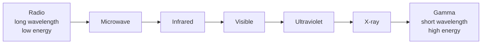
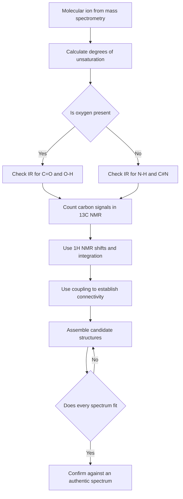
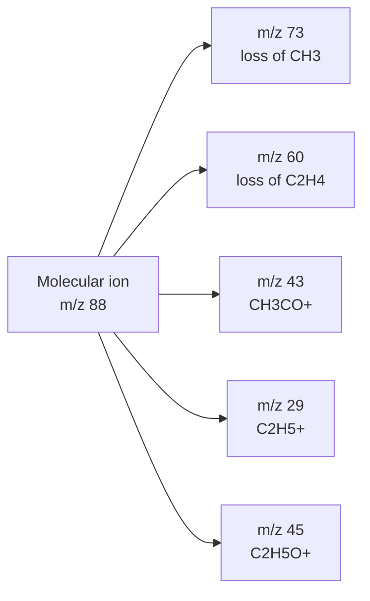
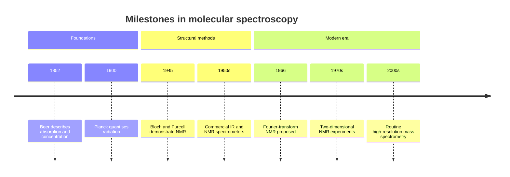

# Chapter 10 — Advanced Spectroscopy: UV–Vis, IR, NMR and Mass Spectrometry

> **Level:** Advanced (Level 3 — Advanced Chemistry)
> **Estimated study time:** 10 hours (7 h reading + 3 h exercises)
> **Prerequisites:** [Atomic orbitals and electronic transitions](02-atomic-orbitals-and-quantum-numbers.md); [molecular orbital theory](03-molecular-orbital-theory.md); chemical shift and basic NMR from Level 2; organic functional groups from Level 2
> **Difficulty:** ★★★★★ (5/5)
> **Related chapters:** [Level 3 module index](README.md); [Atomic Orbitals](02-atomic-orbitals-and-quantum-numbers.md); [Molecular Orbital Theory](03-molecular-orbital-theory.md); [Coordination Chemistry](09-coordination-chemistry-and-crystal-field-theory.md); [Curriculum map](../CURRICULUM.md)

---

## 1. Learning Objectives

After working through this chapter you will be able to:

- Relate wavelength, frequency, wavenumber and photon energy across the electromagnetic spectrum.
- State and apply the Beer–Lambert law, and identify the conditions under which it fails.
- Assign the main types of electronic transition and explain how conjugation shifts absorption to longer wavelength.
- Describe the instrumentation used for UV–Vis, IR and NMR spectroscopy and the information each technique provides.
- Identify the vibrational modes of simple molecules and use the characteristic group frequency table to assign an IR spectrum.
- Explain the effects of hydrogen bonding, conjugation and ring strain on vibrational frequencies.
- Interpret a $^1$H NMR spectrum in terms of chemical shift, integration and spin–spin coupling, and apply the $n+1$ rule.
- Interpret $^{13}$C NMR spectra and explain the role of decoupling.
- Identify molecular ions, isotope patterns and common fragment losses in mass spectra, and apply the nitrogen rule.
- Determine a molecular formula from high-resolution mass and calculate degrees of unsaturation.
- Solve a complete structure-elucidation problem by combining IR, NMR and MS data.

---

## 2. Introduction

A single spectroscopic technique rarely determines a structure. Infrared spectroscopy says which functional groups are present. Ultraviolet–visible spectroscopy reports on conjugation and colour. NMR maps the connectivity of hydrogen and carbon atoms. Mass spectrometry gives the molecular mass, the molecular formula and a fragmentation fingerprint. The skill of structure elucidation lies in combining these partial answers into a consistent structure, and in recognising when two techniques disagree.

The physical principles are unified. All spectroscopy measures the absorption or emission of electromagnetic radiation as a molecule moves between quantised energy levels. The energy scale determines which transition is probed: nuclear spin flips require radio frequencies, vibrational transitions require infrared radiation, and electronic transitions require visible or ultraviolet light. Mass spectrometry is the exception: it is not an absorption technique at all, but a method for measuring the mass-to-charge ratio of ions.

This chapter is deliberately practical. It develops the minimum theory needed to interpret spectra correctly, then spends most of its space on the interpretation itself: how to read a Beer–Lambert plot, how to distinguish an ester carbonyl from a ketone carbonyl, how to count neighbours from a multiplet, how to recognise a chlorine isotope pattern, and how to assemble all of this into a structure. The final worked example and the decision flowchart in Section 5 are the templates for that process.

The chapter assumes that you can draw Lewis structures, identify functional groups, and use the concepts of molecular orbitals from Chapter 3. Chapter 9 supplies the d–d and charge-transfer transitions that explain the colour of coordination compounds; this chapter treats the organic chromophores and the instrumentation in more detail.

---

## 3. Fundamental Concepts

### 3.1 The electromagnetic spectrum and the energy scale

Electromagnetic radiation is characterised by its wavelength $\lambda$, frequency $\nu$ and wavenumber $\tilde{\nu}$. The three are related by

$$
c = \lambda\nu,
\qquad
\tilde{\nu} = \frac{1}{\lambda} = \frac{\nu}{c}
$$

where $c = 2.998 \times 10^{8}\ \mathrm{m\ s^{-1}}$ is the speed of light in vacuum. Wavenumbers are conventionally quoted in $\mathrm{cm^{-1}}$, so a wavelength of $10\ \mu\mathrm{m}$ corresponds to $\tilde{\nu} = 1000\ \mathrm{cm^{-1}}$. The photon energy is

$$
E = h\nu = \frac{hc}{\lambda} = hc\tilde{\nu}
$$

with $h = 6.626 \times 10^{-34}\ \mathrm{J\ s}$. The energy of one mole of photons is $E_\text{molar} = N_\mathrm{A}hc\tilde{\nu} = 11.96\ \mathrm{kJ\ mol^{-1}}$ per $1000\ \mathrm{cm^{-1}}$.

| Region | Wavelength range | Wavenumber / cm$^{-1}$ | Typical transition |
|---|---|---|---|
| Radio | $> 1\ \mathrm{m}$ | $< 0.01$ | Nuclear spin flip (NMR) |
| Microwave | $1\ \mathrm{mm}$–$1\ \mathrm{m}$ | $0.01$–$10$ | Molecular rotation |
| Infrared | $700\ \mathrm{nm}$–$1\ \mathrm{mm}$ | $10$–$14\,000$ | Molecular vibration |
| Visible | $400$–$700\ \mathrm{nm}$ | $14\,000$–$25\,000$ | Valence electron excitation |
| Ultraviolet | $10$–$400\ \mathrm{nm}$ | $25\,000$–$10^{6}$ | Valence electron excitation, ionisation |
| X-ray | $0.01$–$10\ \mathrm{nm}$ | $10^{6}$–$10^{9}$ | Core electron excitation |
| Gamma | $< 0.01\ \mathrm{nm}$ | $> 10^{9}$ | Nuclear transitions |

The useful conversion factors are $1\ \mathrm{eV} = 96.485\ \mathrm{kJ\ mol^{-1}} = 8065.5\ \mathrm{cm^{-1}}$ and $1\ \mathrm{cm^{-1}} = 0.1240\ \mathrm{meV}$. A visible photon of $500\ \mathrm{nm}$ carries about $2.5\ \mathrm{eV}$, enough to excite a valence electron but not to break a typical covalent bond; an ultraviolet photon of $200\ \mathrm{nm}$ carries about $6.2\ \mathrm{eV}$, enough to break many bonds and to ionise molecules.

### 3.2 Absorption, transmission and the Beer–Lambert law

When radiation passes through a sample, the intensity falls from $I_0$ to $I$. The **transmittance** is

$$
T = \frac{I}{I_0}
$$

and the **absorbance** is

$$
A = -\log_{10}T = \log_{10}\frac{I_0}{I}
$$

The **Beer–Lambert law** relates absorbance to concentration:

$$
A = \varepsilon b c
$$

where $\varepsilon$ is the molar absorption coefficient (molar absorptivity) in $\mathrm{dm^3\ mol^{-1}\ cm^{-1}}$, $b$ is the path length in cm, and $c$ is the concentration in $\mathrm{mol\ dm^{-3}}$. The law is the product of two independent relations: the fraction of light absorbed is proportional to the number of absorbing species in the path (Beer's law) and to the path length (Lambert's law).

The law rests on four assumptions:

1. The incident radiation is monochromatic.
2. The absorbing species are independent and non-interacting.
3. The sample is homogeneous and does not scatter light.
4. The beam is collimated and the detector responds linearly to intensity.

Real instruments violate all four to some degree. **Deviations** occur at high concentration (above about $0.01\ \mathrm{M}$), where solute–solute interactions change the absorptivity and the refractive index; when the sample fluoresces or scatters; when the bandwidth of the monochromator is comparable to the width of the absorption band; and when stray light reaches the detector. Chemical equilibria — acid–base, dimerisation, complexation — also produce apparent deviations, because the concentration of the absorbing species is not the analytical concentration.

### 3.3 UV–Vis instrumentation and electronic transitions

A **UV–Vis spectrophotometer** consists of a light source, a monochromator, a sample compartment, a detector and a data system. The UV source is usually a deuterium lamp, the visible source a tungsten–halogen lamp, and the detector a photodiode array or a photomultiplier. Double-beam instruments split the beam between the sample and a reference cuvette, which compensates for source fluctuations and solvent absorption. The solvent must be transparent over the range of interest: water cuts off below about $190\ \mathrm{nm}$, ethanol below about $210\ \mathrm{nm}$, and acetone below about $330\ \mathrm{nm}$.

Electronic transitions in organic molecules are classified by the orbitals involved.

- **$\sigma \to \sigma^*$** transitions require high energy and occur below about $150\ \mathrm{nm}$, in the vacuum ultraviolet. Alkanes are therefore transparent in the ordinary UV region.
- **$n \to \sigma^*$** transitions of lone pairs (alcohols, amines, halides) occur around $150$–$250\ \mathrm{nm}$.
- **$\pi \to \pi^*$** transitions of alkenes and arenes occur around $190$–$250\ \mathrm{nm}$ and are strongly allowed ($\varepsilon \approx 10^{4}\ \mathrm{dm^3\ mol^{-1}\ cm^{-1}}$).
- **$n \to \pi^*$** transitions of carbonyls occur around $250$–$350\ \mathrm{nm}$ and are weak ($\varepsilon \approx 10$–$100$), because the transition is symmetry-forbidden.
- **Charge-transfer** transitions involve electron transfer between a donor and an acceptor, either within a molecule or between a metal and a ligand. They are fully allowed and very intense ($\varepsilon \approx 10^{3}$–$10^{5}$).

Conjugation lowers the HOMO–LUMO gap, so the absorption shifts to longer wavelength and often becomes more intense. Ethene absorbs at $165\ \mathrm{nm}$, 1,3-butadiene at $217\ \mathrm{nm}$, and $\beta$-carotene, with eleven conjugated double bonds, at about $450\ \mathrm{nm}$ — which is why it is orange. The same principle explains the colours of pH indicators, the deep colour of many dyes, and the shift of absorption on protonation or deprotonation.

### 3.4 Infrared spectroscopy: vibrational modes and selection rules

Infrared spectroscopy probes vibrational transitions. A non-linear molecule with $N$ atoms has $3N - 6$ normal modes of vibration ($3N - 5$ for a linear molecule). Each normal mode is a collective motion with a characteristic frequency.

Vibrations are classified as **stretches**, which change bond lengths, and **bends**, which change bond angles. Stretches may be symmetric or asymmetric; bends include scissoring, rocking, wagging and twisting. The number of modes grows rapidly with molecular size, which is why the IR spectrum of a large molecule is complex.

A vibrational mode is **IR-active** only if it produces a change in dipole moment. Homonuclear diatomics such as $\ce{N2}$ and $\ce{O2}$ have no dipole moment and are IR-inactive; $\ce{CO2}$ has a symmetric stretch that is IR-inactive but an asymmetric stretch and a bend that are active. The **Raman** effect, by contrast, depends on a change in polarisability, so the two techniques are complementary.

The frequency of a stretching vibration is modelled by a harmonic oscillator:

$$
\tilde{\nu} = \frac{1}{2\pi c}\sqrt{\frac{k}{\mu}},
\qquad
\mu = \frac{m_1m_2}{m_1+m_2}
$$

where $k$ is the force constant of the bond and $\mu$ is the reduced mass of the two atoms. Stronger bonds and lighter atoms vibrate at higher wavenumber. A $\ce{C=O}$ bond (force constant about $1200\ \mathrm{N\ m^{-1}}$) absorbs near $1700\ \mathrm{cm^{-1}}$, while a $\ce{C-O}$ single bond absorbs near $1100\ \mathrm{cm^{-1}}$. The isotope effect is also predicted: replacing $\ce{^1H}$ by $\ce{^2H}$ roughly halves the reduced mass of a $\ce{X-H}$ bond and lowers its stretching frequency by a factor of about $\sqrt{2}$.

### 3.5 IR instrumentation and the fingerprint region

Modern IR spectrometers are **Fourier-transform** instruments. A Michelson interferometer modulates the beam, and the detector records an interferogram that is Fourier-transformed into a spectrum. FT instruments have high throughput, precise wavenumber calibration and rapid acquisition, which makes signal averaging and difference spectroscopy practical.

Samples are measured as a thin film, a KBr pellet, a Nujol mull, a solution in a transparent solvent, or by attenuated total reflectance (ATR). ATR is convenient for solids and aqueous solutions because it requires minimal sample preparation, but the effective path length depends on the wavelength and the refractive index, so band intensities are not directly comparable with transmission spectra.

The region above about $1500\ \mathrm{cm^{-1}}$ contains **group frequencies** that are characteristic of functional groups and relatively insensitive to the rest of the molecule. The region below $1500\ \mathrm{cm^{-1}}$ is the **fingerprint region**, dominated by coupled vibrations that are characteristic of the whole molecule. A match between the fingerprint region of an unknown and that of an authentic sample is strong evidence of identity, even when the group frequencies are ambiguous.

### 3.6 Characteristic group frequencies

The following table gives the approximate ranges for common groups. The values shift with hydrogen bonding, conjugation, ring strain and inductive effects.

| Group | Assignment | Wavenumber / cm$^{-1}$ | Typical appearance |
|---|---|---|---|
| O–H (alcohol) | O–H stretch | $3200$–$3600$ | Broad, strong |
| O–H (carboxylic acid) | O–H stretch | $2500$–$3300$ | Very broad, often overlaps C–H |
| N–H (amine) | N–H stretch | $3300$–$3500$ | Medium, one or two bands |
| N–H (amide) | N–H stretch | $3150$–$3350$ | Medium |
| C–H (sp$^3$) | C–H stretch | $2850$–$2960$ | Strong |
| C–H (sp$^2$) | C–H stretch | $3000$–$3100$ | Medium |
| C–H (sp) | C–H stretch | $3250$–$3330$ | Sharp, strong |
| C$\equiv$C | C$\equiv$C stretch | $2100$–$2260$ | Weak unless terminal |
| C$\equiv$N | C$\equiv$N stretch | $2220$–$2260$ | Medium |
| C=O (ketone) | C=O stretch | $1705$–$1725$ | Strong |
| C=O (aldehyde) | C=O stretch | $1720$–$1740$ | Strong, two bands for Fermi resonance |
| C=O (ester) | C=O stretch | $1735$–$1750$ | Strong |
| C=O (amide) | C=O stretch | $1630$–$1690$ | Strong |
| C=O (carboxylic acid) | C=O stretch | $1700$–$1725$ | Strong, with broad O–H |
| C=C (alkene) | C=C stretch | $1620$–$1680$ | Medium to weak |
| C=C (aromatic) | C=C stretch | $1450$–$1600$ | Medium, often several bands |
| C–O (alcohol, ether, ester) | C–O stretch | $1000$–$1300$ | Strong |
| N–O (nitro) | N–O stretch | $1500$–$1560$ and $1340$–$1380$ | Two strong bands |

### 3.7 Effects of hydrogen bonding, conjugation and strain

**Hydrogen bonding** broadens and lowers the O–H or N–H stretching frequency, because the hydrogen bond weakens the covalent X–H bond and introduces a distribution of environments. A free O–H stretch is sharp and appears near $3600\ \mathrm{cm^{-1}}$; a hydrogen-bonded O–H stretch is broad and centred near $3300\ \mathrm{cm^{-1}}$. Carboxylic acids form strong dimers, so their O–H absorption is extremely broad and extends from $2500$ to $3300\ \mathrm{cm^{-1}}$.

**Conjugation** lowers the frequency of a double-bond stretch, because the double bond acquires some single-bond character. A conjugated ketone absorbs about $20$–$30\ \mathrm{cm^{-1}}$ lower than an isolated ketone, and an aromatic C=C stretch appears near $1600\ \mathrm{cm^{-1}}$ rather than the $1650\ \mathrm{cm^{-1}}$ of an isolated alkene.

**Ring strain** raises the frequency of a carbonyl stretch, because the bond is forced to have more p character and becomes stronger. Cyclopentanone absorbs near $1745\ \mathrm{cm^{-1}}$, cyclohexanone near $1715\ \mathrm{cm^{-1}}$, and cyclobutanone near $1780\ \mathrm{cm^{-1}}$.

**Inductive effects** shift frequencies in the opposite direction: electron-withdrawing substituents increase the carbonyl frequency by withdrawing electron density and strengthening the bond.

### 3.8 Raman spectroscopy

In **Raman spectroscopy**, monochromatic laser light is scattered by the sample. Most of the scattered light has the same frequency as the incident light (Rayleigh scattering), but a small fraction is shifted by the vibrational frequencies of the molecule (Raman scattering). The Stokes shift corresponds to a molecule gaining vibrational energy; the anti-Stokes shift corresponds to a molecule losing it. The Raman shift is reported in $\mathrm{cm^{-1}}$ relative to the laser line and is independent of the laser wavelength.

Raman activity requires a change in polarisability, so symmetric vibrations of non-polar bonds are strong in Raman and weak in IR. The two techniques are complementary, and for a centrosymmetric molecule the **mutual exclusion rule** states that a mode cannot be both IR-active and Raman-active. Raman is particularly useful for aqueous samples, since water is a weak Raman scatterer, and for inorganic materials, polymers and minerals.

### 3.9 Nuclear magnetic resonance: nuclear spin and chemical shift

Nuclei with non-zero spin have a magnetic moment and can absorb radio-frequency radiation in a magnetic field. The proton, $^1$H, has spin $I = 1/2$ and is the most commonly observed nucleus; $^{13}$C, $^{19}$F and $^{31}$P also have $I = 1/2$. Nuclei with $I = 0$, such as $^{12}$C and $^{16}$O, are NMR-inactive.

In a magnetic field $B_0$, the nuclear spin states have different energies, and resonance occurs when

$$
\Delta E = h\nu = \gamma\hbar B_0
$$

where $\gamma$ is the magnetogyric ratio. The population difference between the states is small — of the order of $10^{-5}$ at room temperature in a typical spectrometer — which is why NMR is intrinsically insensitive compared with UV–Vis or IR.

The resonance frequency depends on the local electronic environment. Electrons circulate in the applied field and generate a small opposing field, **shielding** the nucleus. The effective field is $B_\text{eff} = B_0(1-\sigma)$, where $\sigma$ is the shielding constant. Shielded nuclei resonate at lower frequency; deshielded nuclei at higher frequency. The **chemical shift** is defined relative to tetramethylsilane, $\ce{Si(CH3)4}$ (TMS), which is assigned $\delta = 0$:

$$
\delta = \frac{\nu_\text{sample} - \nu_\text{TMS}}{\nu_\text{TMS}} \times 10^{6}\ \mathrm{ppm}
$$

Chemical shifts are reported in parts per million because the absolute frequency depends on the spectrometer field, while the relative shift does not.

| Environment | Typical $\delta$ / ppm |
|---|---|
| Alkyl $\ce{CH3}$ | $0.8$–$1.0$ |
| Alkyl $\ce{CH2}$ | $1.2$–$1.5$ |
| Allylic or benzylic $\ce{CH}$ | $2.0$–$2.5$ |
| $\ce{CH}$ next to C=O | $2.0$–$2.6$ |
| $\ce{OCH3}$ or $\ce{OCH2}$ | $3.3$–$4.0$ |
| $\ce{NCH3}$ | $2.2$–$2.9$ |
| Vinylic $\ce{CH}$ | $4.5$–$6.5$ |
| Aromatic $\ce{CH}$ | $6.5$–$8.0$ |
| Aldehyde $\ce{CHO}$ | $9.0$–$10.0$ |
| Carboxylic acid $\ce{COOH}$ | $10$–$13$ (broad) |

### 3.10 Integration and spin–spin coupling

The area under an NMR peak is proportional to the number of equivalent nuclei giving rise to it. Modern instruments report the integral as a stepped curve or a numerical ratio. Integration gives the relative number of protons in each environment, not the absolute number; the absolute count comes from the molecular formula.

**Spin–spin coupling** arises when a nucleus feels the magnetic field of a neighbouring nucleus through the intervening bonds. For a proton with $n$ equivalent neighbouring protons, the signal is split into $n+1$ lines, with relative intensities given by the binomial coefficients (Pascal's triangle). This is the **$n+1$ rule**. A proton with no neighbours is a singlet; one neighbour gives a doublet; two give a triplet; three give a quartet.

The spacing between the lines of a multiplet is the **coupling constant** $J$, measured in hertz. Coupling constants are independent of the applied field, which distinguishes them from chemical shift differences. Vicinal couplings ($^3J_\mathrm{HH}$) are typically $6$–$8\ \mathrm{Hz}$ for free rotation, $8$–$12\ \mathrm{Hz}$ for trans-alkenes, and $2$–$4\ \mathrm{Hz}$ for cis-alkenes. Geminal couplings ($^2J_\mathrm{HH}$) are usually $12$–$15\ \mathrm{Hz}$ and are often not resolved in flexible molecules.

The $n+1$ rule applies to **first-order** spectra, in which the chemical shift difference between coupled nuclei is much larger than $J$ (roughly $\Delta\nu/J > 10$). When the shift difference is comparable to $J$, the spectrum becomes **second-order**: the multiplets distort, the outer lines grow, and the simple $n+1$ pattern breaks down. The roof effect — the inner lines of two coupled multiplets leaning towards each other — is a symptom of second-order behaviour.

**Exchangeable protons** such as O–H, N–H and S–H often appear as broad singlets whose position depends on concentration, temperature and hydrogen bonding. They may disappear on shaking with $\ce{D2O}$ because deuterium replaces hydrogen and the deuterated proton is not observed. This **D2O shake** is a useful test for exchangeable protons.

### 3.11 Carbon-13 NMR

$^{13}$C has a natural abundance of only $1.1\ \%$, so $^{13}$C NMR is about $6000$ times less sensitive than $^1$H NMR for the same number of nuclei. The low abundance is also an advantage: coupling between adjacent $^{13}$C nuclei is negligible, so each carbon gives a single line.

In a **proton-decoupled** $^{13}$C spectrum, irradiation at the proton frequency removes the $^{13}$C–$^1$H couplings, so each inequivalent carbon appears as a sharp singlet. The number of signals gives the number of inequivalent carbon environments; the chemical shifts identify the type of carbon (alkyl, oxygenated, vinylic, aromatic, carbonyl). The intensity of a $^{13}$C signal is not reliably proportional to the number of carbons, because relaxation times and nuclear Overhauser enhancements differ.

**DEPT** (distortionless enhancement by polarisation transfer) experiments distinguish $\ce{CH3}$, $\ce{CH2}$, $\ce{CH}$ and quaternary carbons. In a DEPT-135 spectrum, $\ce{CH3}$ and $\ce{CH}$ carbons point up, $\ce{CH2}$ carbons point down, and quaternary carbons are absent. DEPT-90 shows only $\ce{CH}$ carbons.

**Two-dimensional NMR** correlates nuclei through bonds or space. COSY shows which protons are coupled to which, HSQC correlates each proton with the carbon to which it is directly attached, and HMBC correlates protons with carbons two or three bonds away. These experiments are routine in modern structure determination but are beyond the scope of this chapter.

### 3.12 Mass spectrometry: ionisation, molecular ion and isotopes

In **electron ionisation** (EI), the sample is vaporised and bombarded with electrons at $70\ \mathrm{eV}$. The molecule loses an electron to form a radical cation, the **molecular ion** $\ce{M^{+\bullet}}$. The molecular ion is often unstable and fragments into smaller ions, which are separated by their mass-to-charge ratio $m/z$ and detected.

The molecular ion gives the molecular mass. Its $m/z$ value is the **nominal mass**; the exact mass, measured with a high-resolution instrument, gives the molecular formula because the exact masses of the isotopes are not integers. The **base peak** is the most intense peak in the spectrum; it need not be the molecular ion.

**Isotope patterns** are diagnostic. Chlorine has two isotopes, $^{35}\mathrm{Cl}$ and $^{37}\mathrm{Cl}$, in a ratio of about $3:1$. A compound with one chlorine therefore shows an $\mathrm{M}:\mathrm{M}+2$ pattern of $3:1$; a compound with two chlorines shows $9:6:1$; a compound with three shows $27:27:9:1$. Bromine has $^{79}\mathrm{Br}$ and $^{81}\mathrm{Br}$ in a ratio of about $1:1$, so a compound with one bromine shows an $\mathrm{M}:\mathrm{M}+2$ pattern of $1:1$. A compound containing both chlorine and bromine shows a more complex pattern that can be calculated from the binomial distribution.

**Fragmentation** is controlled by bond strength and by the stability of the resulting ions and radicals. Common neutral losses include:

| Loss | Mass loss / u | Typical origin |
|---|---|---|
| $\ce{CH3}$ | $15$ | Methyl group |
| $\ce{OH}$ | $17$ | Alcohol |
| $\ce{H2O}$ | $18$ | Alcohol, carboxylic acid |
| $\ce{CO}$ or $\ce{C2H4}$ | $28$ | Carbonyl, alkyl chain |
| $\ce{CHO}$ or $\ce{C2H5}$ | $29$ | Aldehyde, ethyl group |
| $\ce{CH3O}$ | $31$ | Methoxy group |
| $\ce{CO2}$ | $44$ | Carboxylic acid, ester |
| $\ce{COOH}$ | $45$ | Carboxylic acid |
| $\ce{NO2}$ | $46$ | Nitro group |

**High-resolution mass spectrometry** measures $m/z$ to within a few parts per million, which is enough to distinguish formulas that have the same nominal mass but different exact masses. For example, $\ce{C2H6N}$ and $\ce{C3H8O}$ both have nominal mass 44, but their exact masses differ by about $0.036\ \mathrm{u}$.

The **nitrogen rule** states that a neutral molecule with an odd number of nitrogen atoms has an odd molecular mass, and a molecule with an even number of nitrogen atoms (including zero) has an even molecular mass. The rule applies to the neutral molecule and to the molecular ion, not to fragment ions.

### 3.13 Degrees of unsaturation

The **degrees of unsaturation** (also called the index of hydrogen deficiency) of a formula $\ce{C_cH_hN_nO_oX_x}$ is

$$
\mathrm{DoU} = \frac{2c + 2 + n - h - x}{2}
$$

Each degree corresponds to one ring or one double bond; a triple bond counts as two. The formula assumes that oxygen and sulfur do not affect the count and that halogens are treated like hydrogen. A DoU of 4 or more suggests an aromatic ring, and a DoU of 5 with two oxygens is consistent with an aromatic ester such as methyl benzoate.

---

## 4. Detailed Scientific Explanation

### 4.1 Why the Beer–Lambert law works and when it fails

Consider a thin slice of solution of thickness $\mathrm{d}b$ containing $n$ absorbing molecules per unit volume, each with an absorption cross-section $\sigma$. The fraction of light absorbed in the slice is $\sigma n\,\mathrm{d}b$, so

$$
\frac{\mathrm{d}I}{I} = -\sigma n\,\mathrm{d}b
$$

Integrating over the path gives $I = I_0\exp(-\sigma n b)$, which becomes the Beer–Lambert law after converting to base-10 logarithms and molar concentration. The derivation assumes that the absorbing species are independent and that the beam is parallel and monochromatic.

The law fails when the absorbing species interact. At high concentration, the average distance between molecules becomes comparable to the molecular size, and the absorptivity changes. It also fails when the analyte participates in a concentration-dependent equilibrium, such as dimerisation or protonation, because the concentration of the absorbing form is not proportional to the analytical concentration. Polychromatic radiation produces a negative deviation when the absorptivity varies across the band; stray light produces a negative deviation at high absorbance; and scattering produces an apparent absorbance that is not due to the analyte.

### 4.2 Electronic transitions and colour

The energy of an electronic transition is the difference between the energies of the initial and final molecular orbitals. In the molecular orbital picture, the HOMO–LUMO gap decreases as the conjugated system extends, because the molecular orbitals spread over more atoms and their energies become closer. This is why longer conjugated systems absorb at longer wavelengths.

The intensity of an electronic transition depends on the overlap between the initial and final orbitals and on the change in dipole moment. Symmetry-forbidden transitions, such as $n \to \pi^*$ in a carbonyl, have small molar absorptivities. Allowed transitions, such as $\pi \to \pi^*$ in a conjugated diene, have large ones. Charge-transfer transitions are strongly allowed because the electron moves over a large distance, producing a large transition dipole moment.

The colour observed is the complement of the absorbed colour. A substance that absorbs at $400$–$450\ \mathrm{nm}$ (violet-blue) appears yellow; one that absorbs at $500$–$550\ \mathrm{nm}$ (green) appears red; one that absorbs at $600$–$650\ \mathrm{nm}$ (orange-red) appears blue-green. A substance that absorbs uniformly across the visible spectrum appears black; one that absorbs no visible light appears white or colourless.

### 4.3 Vibrational frequencies and force constants

The harmonic oscillator model predicts that the stretching frequency increases with the square root of the force constant and decreases with the square root of the reduced mass. The model explains the main trends:

- $\ce{C-H}$ stretches appear at higher wavenumber than $\ce{C-C}$ stretches because hydrogen is lighter.
- $\ce{C\equiv C}$ stretches appear at higher wavenumber than $\ce{C=C}$ stretches because the triple bond is stronger.
- $\ce{C=O}$ stretches appear at higher wavenumber than $\ce{C-O}$ stretches for the same reason.
- $\ce{O-H}$ stretches appear at higher wavenumber than $\ce{O-D}$ stretches by a factor of about $\sqrt{2}$.

The harmonic model fails at high vibrational excitation, where the potential becomes anharmonic and the levels converge. It also fails to predict the intensities of IR bands, which depend on the change in dipole moment and on the transition moment integral. Anharmonicity is responsible for the overtones and combination bands that appear as weak features in real spectra.

### 4.4 Reading an IR spectrum

A systematic reading of an IR spectrum proceeds from left to right.

1. **High-frequency region ($> 3000\ \mathrm{cm^{-1}}$).** Look for O–H, N–H and C–H stretches. A broad band near $3300\ \mathrm{cm^{-1}}$ suggests an alcohol or amine; a very broad band extending from $2500$ to $3300\ \mathrm{cm^{-1}}$ suggests a carboxylic acid; a sharp band near $3300\ \mathrm{cm^{-1}}$ suggests a terminal alkyne.
2. **Carbonyl region ($1650$–$1800\ \mathrm{cm^{-1}}$).** A strong band here is almost always a C=O stretch. The exact position distinguishes ketones, aldehydes, esters, amides and acids.
3. **Double-bond region ($1500$–$1680\ \mathrm{cm^{-1}}$).** C=C stretches of alkenes and aromatics appear here. Aromatic rings often show several bands between $1450$ and $1600\ \mathrm{cm^{-1}}$.
4. **Fingerprint region ($400$–$1500\ \mathrm{cm^{-1}}$).** The pattern is characteristic of the whole molecule and is used for identification by comparison with a library spectrum.

The absence of a band is often as informative as its presence. A molecule with no O–H or N–H stretch and no C=O stretch is unlikely to be an alcohol, amine, acid, ester or amide. A molecule with a carbonyl stretch but no O–H stretch is unlikely to be a carboxylic acid.

### 4.5 The origin of chemical shift and coupling

The chemical shift arises from the local magnetic environment of the nucleus. The applied field induces electron circulation, which generates a secondary field opposed to the applied field. The extent of shielding depends on the electron density around the nucleus and on the anisotropy of nearby groups.

- **Electronegative substituents** withdraw electron density and deshield the nucleus, shifting it to higher $\delta$.
- **Anisotropic groups** such as aromatic rings, alkenes and carbonyls create local fields that depend on orientation. Aromatic protons are deshielded because the ring current generates a field that reinforces the applied field at the periphery of the ring; aldehyde protons are strongly deshielded by the carbonyl anisotropy and by the inductive effect of the oxygen.
- **Hydrogen bonding** deshields the proton and shifts it to higher $\delta$; the effect is concentration-dependent for intermolecular hydrogen bonds.

Spin–spin coupling is transmitted through the bonding electrons by the Fermi contact interaction. The coupling constant depends on the number and type of intervening bonds, the dihedral angle (Karplus relation), and the electronegativity of substituents. Vicinal couplings are largest for dihedral angles near $0^\circ$ and $180^\circ$ and smallest near $90^\circ$.

### 4.6 Carbon-13 NMR and decoupling

The low natural abundance of $^{13}$C means that most molecules contain no $^{13}$C at all, and the probability of two $^{13}$C atoms in the same molecule is negligible. As a result, $^{13}$C–$^{13}$C coupling is not observed, and the spectrum consists of single lines.

Without decoupling, each $^{13}$C signal is split by the protons attached to it: a $\ce{CH3}$ carbon appears as a quartet, a $\ce{CH2}$ as a triplet, a $\ce{CH}$ as a doublet, and a quaternary carbon as a singlet. Proton decoupling collapses all of these multiplets to singlets, simplifying the spectrum but losing the multiplicity information. DEPT experiments restore the multiplicity information in a controlled way.

The **nuclear Overhauser effect** (NOE) enhances the intensity of $^{13}$C signals when protons are decoupled, but the enhancement depends on the distance between the carbon and the protons and on molecular motion. This is why $^{13}$C peak intensities are not quantitatively reliable.

### 4.7 Mass spectrometry: fragmentation and structure

The fragmentation of a molecular ion is a unimolecular decomposition of an excited radical cation. The most common pathways are:

- **$\alpha$-cleavage** next to a heteroatom or a carbonyl, which gives an oxonium or acylium ion.
- **Inductive cleavage** of a bond next to an electronegative atom, which gives a carbocation.
- **McLafferty rearrangement**, a hydrogen transfer from the $\gamma$-position to the carbonyl oxygen, which gives an alkene and an enol radical cation.
- **Retro-Diels–Alder** fragmentation of cyclohexenes.
- **Loss of a stable neutral molecule** such as $\ce{H2O}$, $\ce{CO2}$ or $\ce{CO}$.

The stability of the fragment ion determines its abundance. Acylium ions ($\ce{R-C#O+}$) are particularly stable, which is why carbonyl compounds often show a strong peak at $m/z\ 43$ ($\ce{CH3CO+}$) or $m/z\ 29$ ($\ce{CHO+}$). Benzylic and allylic cations are stabilised by resonance and give strong peaks at $m/z\ 91$ ($\ce{C7H7+}$) and $m/z\ 77$ ($\ce{C6H5+}$) for aromatic compounds.

High-resolution mass spectrometry distinguishes isobaric formulas. The exact mass of $\ce{^12C}$ is $12.0000\ \mathrm{u}$, of $\ce{^1H}$ is $1.00783\ \mathrm{u}$, of $\ce{^14N}$ is $14.00307\ \mathrm{u}$ and of $\ce{^16O}$ is $15.99491\ \mathrm{u}$. The mass defect — the difference between the exact mass and the nominal mass — is small for carbon and hydrogen but larger for nitrogen and oxygen, which is why the exact mass identifies the formula.

### 4.8 A strategy for structure elucidation

Structure elucidation is iterative. The following sequence works for most small organic molecules.

1. **Molecular formula.** Use high-resolution MS or combustion analysis. Calculate the degrees of unsaturation.
2. **Functional groups.** Use IR to identify C=O, O–H, N–H, C$\equiv$C, C$\equiv$N and C=C. Use the UV–Vis spectrum to confirm conjugation.
3. **Carbon skeleton.** Use $^{13}$C NMR to count inequivalent carbons and DEPT to assign $\ce{CH3}$, $\ce{CH2}$, $\ce{CH}$ and quaternary carbons.
4. **Hydrogen environments.** Use $^1$H NMR chemical shifts to identify the type of proton, integration to count protons, and coupling to establish connectivity.
5. **Connectivity.** Assemble the fragments into a structure that is consistent with every piece of data. Check the molecular formula, the degrees of unsaturation and the symmetry implied by the number of NMR signals.
6. **Confirmation.** Compare the proposed structure with an authentic spectrum or with a database, or synthesise a derivative.

The most common error is to stop at the first plausible structure. Always check that the proposed structure explains the number of NMR signals, the integration ratio, the multiplicity pattern and the fragmentation pathway.

### 4.9 Model limits

The Beer–Lambert law is a limiting law for dilute, non-interacting, non-scattering samples; it is not a fundamental law and should be calibrated rather than assumed. The harmonic oscillator model predicts frequencies but not intensities, and it neglects anharmonicity and mode coupling. The $n+1$ rule is a first-order approximation that fails when chemical shift differences are comparable to coupling constants.

NMR chemical shifts are empirical: they depend on solvent, concentration and temperature, and the assignment of a shift to a functional group is a correlation, not a proof. Mass spectrometry is destructive and depends on ionisation conditions; EI spectra are reproducible but often lack a molecular ion, while soft ionisation methods such as ESI and MALDI give the molecular ion but little fragmentation. No single technique is sufficient; the structure is the hypothesis that explains all the data.

---

## 5. Visual Diagrams

**Figure 10.1 — The electromagnetic spectrum and the transitions it probes.** Moving from left to right, wavelength decreases and photon energy increases. NMR uses radio frequencies, IR uses vibrational frequencies, and UV–Vis uses electronic transitions. The boundaries between regions are conventional, not sharp. The figure is not to scale: the wavelength range spans more than fifteen orders of magnitude.

**Figure 10.2 — A decision flowchart for structure elucidation.** The order is chosen to minimise wasted effort: the molecular formula constrains the degrees of unsaturation, the IR spectrum identifies the functional groups, and the NMR spectra establish the carbon skeleton and the connectivity. The loop back from the consistency check is essential; a candidate that fails one spectrum is rejected even if it fits the others.

**Figure 10.3 — Fragmentation map for ethyl acetate.** The molecular ion at $m/z\ 88$ loses a methyl group to give $m/z\ 73$, loses ethylene by a McLafferty-type pathway to give $m/z\ 60$, and cleaves on either side of the carbonyl to give the acylium ion at $m/z\ 43$ and the ethyl cation at $m/z\ 29$. The base peak is usually $m/z\ 43$. The map is a summary of the main pathways, not a complete mechanism.

**Figure 10.4 — A selective timeline of spectroscopic methods.** The dates mark the introduction of the technique or its commercial adoption, not every subsequent refinement. The progression from simple absorption measurements to multidimensional NMR and high-resolution mass spectrometry mirrors the increasing demand for structural information from smaller samples.

---

## 6. Mathematical Formulas

**Photon energy and wavelength.**

$$
E = h\nu = \frac{hc}{\lambda} = hc\tilde{\nu},
\qquad
\tilde{\nu} = \frac{1}{\lambda}
$$

**Beer–Lambert law and transmittance.**

$$
A = \varepsilon b c = -\log_{10}T,
\qquad
T = 10^{-A}
$$

**Harmonic oscillator frequency.**

$$
\tilde{\nu} = \frac{1}{2\pi c}\sqrt{\frac{k}{\mu}},
\qquad
\mu = \frac{m_1m_2}{m_1+m_2}
$$

**Chemical shift.**

$$
\delta = \frac{\nu_\text{sample} - \nu_\text{TMS}}{\nu_\text{TMS}} \times 10^{6}\ \mathrm{ppm}
$$

**Spin–spin splitting.**

$$
\text{number of lines} = n + 1
$$

**Degrees of unsaturation.**

$$
\mathrm{DoU} = \frac{2c + 2 + n - h - x}{2}
$$

**Mass-to-charge ratio and resolution.**

$$
\frac{m}{z},
\qquad
R = \frac{m}{\Delta m}
$$

| Symbol | Meaning | SI unit |
|---|---|---|
| $\lambda$ | Wavelength | m (usually nm or $\mu$m) |
| $\nu$ | Frequency | Hz (s$^{-1}$) |
| $\tilde{\nu}$ | Wavenumber | m$^{-1}$ (usually cm$^{-1}$) |
| $E$ | Photon energy | J (usually eV or kJ mol$^{-1}$) |
| $h$ | Planck constant, $6.626 \times 10^{-34}$ | J s |
| $c$ | Speed of light, $2.998 \times 10^{8}$ | m s$^{-1}$ |
| $A$ | Absorbance | dimensionless |
| $T$ | Transmittance | dimensionless |
| $\varepsilon$ | Molar absorption coefficient | dm$^3$ mol$^{-1}$ cm$^{-1}$ |
| $b$ | Path length | cm |
| $c$ | Amount concentration | mol dm$^{-3}$ |
| $k$ | Force constant | N m$^{-1}$ |
| $\mu$ | Reduced mass | kg |
| $\delta$ | Chemical shift | ppm |
| $J$ | Coupling constant | Hz |
| $n$ | Number of equivalent neighbouring nuclei | dimensionless |
| $m/z$ | Mass-to-charge ratio | u per unit charge |
| $R$ | Mass resolution | dimensionless |

**Assumptions.** The Beer–Lambert law assumes monochromatic radiation, dilute non-interacting absorbers, a homogeneous non-scattering sample and a linear detector. The harmonic oscillator assumes a parabolic potential and small displacements. The $n+1$ rule assumes first-order coupling between equivalent nuclei. The nitrogen rule assumes a neutral molecule containing only the common elements and applies to the molecular ion, not to fragments.

---

## 7. Chemical Equations

**Electron ionisation.**

$$
\ce{M(g) + e- -> M^{+\bullet}(g) + 2e-}
$$

The molecular ion is a radical cation. Its stability determines whether it appears in the spectrum or fragments completely.

**Electrospray ionisation.**

$$
\ce{M(aq) + H+ -> [M+H]+(aq)}
$$

Electrospray is a soft ionisation method: it produces protonated molecules with little fragmentation, which is ideal for determining molecular mass but less useful for structural fragmentation.

**General fragmentation.**

$$
\ce{M^{+\bullet}(g) -> F+(g) + R^{\bullet}(g)}
$$

The fragment ion $\ce{F+}$ is detected; the neutral radical $\ce{R^{\bullet}}$ is not. The abundance of $\ce{F+}$ depends on its stability and on the activation energy of the cleavage.

**Keto–enol tautomerism.**

$$
\ce{CH3COCH3(aq) <=> CH2=C(OH)CH3(aq)}
$$

The enol form has a C=C stretch and an O–H stretch that the keto form lacks; the equilibrium lies far towards the keto form, so the enol bands are weak.

**Acid–base equilibrium of an indicator.**

$$
\ce{HIn(aq) <=> H+(aq) + In-(aq)}
$$

The acidic and basic forms have different conjugation and therefore different colours. The ratio $[\ce{In-}]/[\ce{HIn}]$ is controlled by pH, which is the basis of indicator colour changes.

**Reference standard for NMR.**

$$
\ce{Si(CH3)4}
$$

Tetramethylsilane is inert, volatile, soluble in organic solvents and gives a single sharp $^1$H signal and a single $^{13}$C signal, which is why it is the universal reference at $\delta = 0$.

---

## 8. Worked Examples

### Worked Example 8.1 — Concentration from absorbance

**Problem.** A solution of a dye has an absorbance of $0.450$ in a $1.00\ \mathrm{cm}$ cell at its absorption maximum, where $\varepsilon = 1.50 \times 10^{4}\ \mathrm{dm^3\ mol^{-1}\ cm^{-1}}$. Calculate the concentration and the transmittance.

**Strategy.** Rearrange the Beer–Lambert law to $c = A/(\varepsilon b)$, then use $T = 10^{-A}$.

**Solution.**

$$
c = \frac{0.450}{(1.50 \times 10^{4})(1.00)}
= 3.00 \times 10^{-5}\ \mathrm{mol\ dm^{-3}}
$$

$$
T = 10^{-0.450} = 0.355
$$

**Check.** A transmittance of 35.5 % corresponds to an absorbance of $-\log(0.355) = 0.450$, as required. The concentration is in the dilute regime where the Beer–Lambert law is reliable; at $3 \times 10^{-5}\ \mathrm{M}$ the average distance between dye molecules is large compared with their size.

### Worked Example 8.2 — Photon energy at 254 nm

**Problem.** A mercury lamp emits at $254\ \mathrm{nm}$. Calculate the energy of one photon in joules and electronvolts, the energy of one mole of photons in kilojoules, and the wavenumber.

**Strategy.** Use $E = hc/\lambda$, convert joules to electronvolts with $1\ \mathrm{eV} = 1.602 \times 10^{-19}\ \mathrm{J}$, multiply by $N_\mathrm{A}$ for the molar energy, and use $\tilde{\nu} = 1/\lambda$.

**Solution.**

$$
E = \frac{(6.626 \times 10^{-34})(2.998 \times 10^{8})}{254 \times 10^{-9}}
= 7.82 \times 10^{-19}\ \mathrm{J}
$$

$$
E = \frac{7.82 \times 10^{-19}}{1.602 \times 10^{-19}} = 4.88\ \mathrm{eV}
$$

$$
E_\text{molar} = (7.82 \times 10^{-19})(6.022 \times 10^{23})
= 4.71 \times 10^{5}\ \mathrm{J\ mol^{-1}}
= 471\ \mathrm{kJ\ mol^{-1}}
$$

$$
\tilde{\nu} = \frac{1}{254 \times 10^{-9}} = 3.94 \times 10^{6}\ \mathrm{m^{-1}}
= 39\,400\ \mathrm{cm^{-1}}
$$

**Check.** A $254\ \mathrm{nm}$ photon carries about $4.9\ \mathrm{eV}$, which is enough to break a typical C–C bond (about $3.6\ \mathrm{eV}$) and to ionise many organic molecules. This is why $254\ \mathrm{nm}$ radiation is used for sterilisation and for photochemical reactions.

### Worked Example 8.3 — Degrees of unsaturation and a candidate structure

**Problem.** A compound has the molecular formula $\ce{C8H8O2}$. Its IR spectrum shows a strong band at $1720\ \mathrm{cm^{-1}}$ and no broad O–H absorption. Its $^1$H NMR spectrum shows a singlet at $\delta\ 3.9$ (3H), a multiplet at $\delta\ 7.4$–$8.1$ (5H) and no other signals. Calculate the degrees of unsaturation and propose a structure.

**Strategy.** Calculate DoU from the formula. Use the IR band to identify the functional group, the integration to count protons, and the chemical shifts to assign the environments.

**Solution.**

$$
\mathrm{DoU} = \frac{2(8) + 2 - 8}{2} = 5
$$

Five degrees of unsaturation are consistent with an aromatic ring (four) plus one carbonyl (one). The IR band at $1720\ \mathrm{cm^{-1}}$ is a carbonyl stretch; the absence of a broad O–H stretch rules out a carboxylic acid. The singlet at $\delta\ 3.9$ integrating to three protons is a methoxy group attached to an sp$^3$ carbon adjacent to oxygen. The multiplet at $\delta\ 7.4$–$8.1$ integrating to five protons is a monosubstituted benzene ring.

The structure is methyl benzoate, $\ce{C6H5COOCH3}$.

**Check.** The formula is $\ce{C8H8O2}$, the DoU is 5, the ester carbonyl absorbs near $1720\ \mathrm{cm^{-1}}$, and the two types of proton (aromatic and methoxy) account for all eight hydrogens. The methoxy singlet is at the expected shift for an ester, not an ether, because the ester carbonyl deshields it slightly.

### Worked Example 8.4 — Isotope patterns

**Problem.** A compound shows a molecular ion at $m/z\ 122$ and a peak at $m/z\ 124$ of equal intensity. A second compound shows peaks at $m/z\ 146$, $148$ and $150$ in the ratio $9:6:1$. Identify the halogen content of each compound.

**Strategy.** Use the natural isotope abundances: $^{35}\mathrm{Cl}:^{37}\mathrm{Cl} \approx 3:1$ and $^{79}\mathrm{Br}:^{81}\mathrm{Br} \approx 1:1$. For two chlorines, expand $(3+1)^2 = 9+6+1$.

**Solution.** The first compound has an $\mathrm{M}:\mathrm{M}+2$ pattern of $1:1$, which is the signature of one bromine atom. The second has an $\mathrm{M}:\mathrm{M}+2:\mathrm{M}+4$ pattern of $9:6:1$, which is the signature of two chlorine atoms.

**Check.** A single chlorine would give $3:1$, and a single bromine would give $1:1$. The observed patterns match the binomial expansions for one Br and two Cl respectively. The nominal mass difference of 2 between the isotope peaks corresponds to the mass difference between $^{79}\mathrm{Br}$ and $^{81}\mathrm{Br}$, or between $^{35}\mathrm{Cl}$ and $^{37}\mathrm{Cl}$.

### Worked Example 8.5 — Complete structure elucidation of ethyl acetate

**Problem.** An unknown liquid has the molecular formula $\ce{C4H8O2}$ from high-resolution MS. Its IR spectrum shows a strong band at $1740\ \mathrm{cm^{-1}}$ and no O–H absorption. Its $^1$H NMR spectrum shows a triplet at $\delta\ 1.26$ (3H), a quartet at $\delta\ 4.12$ (2H) and a singlet at $\delta\ 2.04$ (3H). Its mass spectrum shows $\mathrm{M}^{+\bullet}$ at $m/z\ 88$ and major fragments at $m/z\ 43$ (base peak), $60$, $45$ and $29$. Determine the structure.

**Strategy.** Calculate DoU, identify the functional group from IR, assign the NMR signals from shift, integration and multiplicity, and confirm with the fragmentation pattern.

**Solution.** The degrees of unsaturation are

$$
\mathrm{DoU} = \frac{2(4) + 2 - 8}{2} = 1
$$

One degree of unsaturation with two oxygens and a strong IR band at $1740\ \mathrm{cm^{-1}}$ is consistent with an ester carbonyl. The absence of O–H absorption rules out a carboxylic acid.

The $^1$H NMR data are assigned as follows. The triplet at $\delta\ 1.26$ (3H) is a methyl group coupled to a $\ce{CH2}$; the quartet at $\delta\ 4.12$ (2H) is a $\ce{CH2}$ coupled to a $\ce{CH3}$ and attached to oxygen; the singlet at $\delta\ 2.04$ (3H) is a methyl group attached to a carbonyl carbon with no neighbouring protons. The ethyl group $\ce{CH3CH2-O}$ and the acetyl group $\ce{CH3CO-}$ together account for all eight hydrogens and for both oxygens.

The structure is ethyl acetate, $\ce{CH3COOCH2CH3}$.

The mass spectrum supports the assignment. The molecular ion at $m/z\ 88$ matches the formula. Loss of a methyl group gives $m/z\ 73$; loss of ethylene gives $m/z\ 60$; $\alpha$-cleavage gives the acylium ion $\ce{CH3CO+}$ at $m/z\ 43$, which is the base peak; and the ethyl cation $\ce{C2H5+}$ appears at $m/z\ 29$.

**Check.** The formula, DoU, IR band, NMR shifts, integrations and multiplicities, and the principal fragments are all consistent with ethyl acetate. The alternative methyl propanoate, $\ce{CH3CH2COOCH3}$, would give a triplet and a quartet in the same ratio but the singlet would be at $\delta\ 3.7$ (methoxy) rather than $\delta\ 2.0$ (acetyl), so the shifts distinguish the two isomers.

### Worked Example 8.6 — Multiplicity and coupling in 1-bromopropane

**Problem.** The $^1$H NMR spectrum of $\ce{C3H7Br}$ shows three signals: a triplet at $\delta\ 1.02$ (3H), a sextet at $\delta\ 1.85$ (2H) and a triplet at $\delta\ 3.40$ (2H). Assign the signals and explain the multiplicities.

**Strategy.** Use the integration to identify the three proton environments, the chemical shifts to assign them, and the $n+1$ rule to count the neighbouring protons.

**Solution.** The triplet at $\delta\ 1.02$ (3H) is the terminal $\ce{CH3}$, coupled to two equivalent protons of the adjacent $\ce{CH2}$. The sextet at $\delta\ 1.85$ (2H) is the central $\ce{CH2}$, coupled to three protons of the methyl group and two protons of the $\ce{CH2Br}$ group, giving $3+2+1 = 6$ lines. The triplet at $\delta\ 3.40$ (2H) is the $\ce{CH2Br}$, coupled to the two protons of the central $\ce{CH2}$.

The structure is 1-bromopropane, $\ce{CH3CH2CH2Br}$.

**Check.** The integration ratio $3:2:2$ matches the formula. The chemical shifts follow the expected order: the $\ce{CH2Br}$ protons are most deshielded because bromine is electronegative, and the terminal methyl is most shielded. A 2-bromopropane isomer would show a doublet for the two equivalent methyl groups and a septet for the $\ce{CH}$, which is not observed.

---

## 9. Real-World Applications

**Pharmaceutical analysis.** Spectroscopic methods are used throughout drug development: UV–Vis for concentration and dissolution testing, IR for polymorph identification, NMR for structure confirmation and impurity profiling, and mass spectrometry for metabolite identification and quantitative bioanalysis. Regulatory submissions require full spectroscopic characterisation of every new drug substance.

**Forensic science.** Mass spectrometry and IR spectroscopy identify drugs, explosives, paints and polymers from trace evidence. NMR is used for the identification of counterfeit medicines and for the analysis of novel psychoactive substances. Isotope-ratio mass spectrometry can link a sample to its geographic origin.

**Environmental monitoring.** GC–MS and LC–MS detect pesticides, pharmaceuticals and industrial pollutants at trace concentrations. IR spectroscopy monitors greenhouse gases and atmospheric composition. UV–Vis spectroscopy is used for water-quality parameters such as nitrate, phosphate and dissolved organic matter.

**Medical imaging.** Magnetic resonance imaging is based on the NMR signal of water protons in a magnetic field gradient. The contrast depends on the relaxation times $T_1$ and $T_2$, which are influenced by tissue composition and by contrast agents such as gadolinium chelates.

**Materials and cultural heritage.** Raman spectroscopy identifies pigments, gemstones and corrosion products non-destructively, which makes it invaluable for art conservation. IR and Raman spectroscopy characterise polymers, coatings and semiconductors. Solid-state NMR determines the structure of catalysts, glasses and battery materials.

**Process analytical technology.** In-line UV–Vis, IR and Raman probes monitor reactions and crystallisations in real time, allowing control of composition, polymorph form and particle size without sampling. This is a central element of continuous manufacturing in the pharmaceutical industry.

---

## 10. Common Mistakes

| Mistake | Why it happens | Correct approach |
|---|---|---|
| Using the Beer–Lambert law at high concentration without calibration. | The law is treated as exact. | Calibrate over the working range; deviations appear above about $0.01\ \mathrm{M}$ and when the analyte interacts or equilibrates. |
| Assigning every strong band near $1700\ \mathrm{cm^{-1}}$ to a ketone. | The carbonyl region is crowded. | Use the exact position and the other bands: esters absorb near $1740$, amides near $1650$–$1690$, acids near $1700$–$1725$ with a broad O–H. |
| Reporting a broad O–H stretch as a sharp peak. | Hydrogen bonding is overlooked. | Hydrogen-bonded O–H is broad and lowered; a sharp O–H near $3600\ \mathrm{cm^{-1}}$ indicates a free hydroxyl. |
| Applying the $n+1$ rule to second-order spectra. | The rule is memorised without its conditions. | Check that $\Delta\nu/J > 10$; otherwise analyse the full coupling pattern or use simulation. |
| Confusing integration with multiplicity. | Both describe a signal. | Integration gives the relative number of protons; multiplicity gives the number of neighbouring protons. |
| Assuming the molecular ion is always the base peak. | The tallest peak is assumed to be M$^{+\bullet}$. | The base peak may be a fragment; identify the molecular ion from the highest-mass peak and the isotope pattern. |
| Misreading a $1:1$ $\mathrm{M}:\mathrm{M}+2$ pattern as one chlorine. | The chlorine pattern is $3:1$, not $1:1$. | A $1:1$ pattern indicates one bromine; a $3:1$ pattern indicates one chlorine. |
| Ignoring the solvent in UV–Vis. | The solvent is assumed transparent. | Check the solvent cutoff; acetone absorbs below about $330\ \mathrm{nm}$ and cannot be used for a $280\ \mathrm{nm}$ measurement. |
| Treating a library match as proof of structure. | The fingerprint region match is over-interpreted. | Use the match as supporting evidence and confirm with an authentic standard or an independent method. |

---

## 11. Chapter Summary

- Spectroscopic transitions are quantised; the energy scale runs from radio frequencies for NMR through infrared for vibrations to ultraviolet and visible light for electronic excitations.
- The Beer–Lambert law, $A = \varepsilon bc$, is valid for dilute, non-interacting, non-scattering samples and monochromatic radiation; deviations are diagnostic of chemical or instrumental problems.
- UV–Vis spectroscopy probes $\sigma \to \sigma^*$, $n \to \sigma^*$, $\pi \to \pi^*$, $n \to \pi^*$ and charge-transfer transitions; conjugation lowers the transition energy and shifts absorption to longer wavelength.
- IR spectroscopy probes vibrational modes that change the dipole moment; group frequencies identify functional groups and the fingerprint region identifies the whole molecule.
- Hydrogen bonding broadens and lowers X–H stretches; conjugation lowers double-bond stretches; ring strain raises carbonyl stretches.
- $^1$H NMR gives chemical shifts (environment), integrals (number of protons) and multiplicities (number of neighbours through the $n+1$ rule).
- $^{13}$C NMR gives the number of inequivalent carbons; decoupling simplifies the spectrum and DEPT distinguishes carbon types.
- Mass spectrometry gives the molecular mass, the molecular formula from high-resolution data, isotope patterns from halogens, and fragmentation pathways that reveal connectivity.
- The nitrogen rule and the degrees of unsaturation constrain the molecular formula before any structure is proposed.
- Structure elucidation combines all four techniques; the correct structure must explain every peak, not merely most of them.

---

## 12. Exercises

### 12.1 Conceptual questions

1. Explain why UV–Vis spectroscopy is less informative than NMR for determining the connectivity of an organic molecule, even though it is often more sensitive.
2. Why does extending a conjugated system shift the absorption maximum to longer wavelength? Use a molecular orbital argument.
3. Explain why $^{13}$C NMR is much less sensitive than $^1$H NMR, and why proton decoupling is used routinely.

### 12.2 Basic problems

4. A solution with $\varepsilon = 2.0 \times 10^{4}\ \mathrm{dm^3\ mol^{-1}\ cm^{-1}}$ and $c = 5.0 \times 10^{-5}\ \mathrm{M}$ is measured in a $1.00\ \mathrm{cm}$ cell. Calculate the absorbance and the transmittance.
5. Calculate the energy in $\mathrm{kJ\ mol^{-1}}$ and the wavenumber of a photon of wavelength $400\ \mathrm{nm}$.
6. Calculate the degrees of unsaturation of aspirin, $\ce{C9H8O4}$.

### 12.3 Intermediate problems

7. A compound shows a broad IR band at $3300\ \mathrm{cm^{-1}}$, a sharp band at $2120\ \mathrm{cm^{-1}}$ and no carbonyl absorption. Identify the functional group and propose a structure.
8. The $^1$H NMR spectrum of $\ce{C3H7Br}$ consists of a triplet at $\delta\ 1.02$ (3H), a sextet at $\delta\ 1.85$ (2H) and a triplet at $\delta\ 3.40$ (2H). Assign the signals and name the compound.
9. A mass spectrum shows a molecular ion at $m/z\ 122$ with an $\mathrm{M}+2$ peak of equal intensity. What halogen is present, and what does this imply about the molecular formula?

### 12.4 Advanced problems

10. A compound of formula $\ce{C7H6O2}$ shows a broad IR absorption from $2500$ to $3300\ \mathrm{cm^{-1}}$, a strong band at $1680\ \mathrm{cm^{-1}}$, aromatic protons at $\delta\ 7.5$–$8.0$ (5H) and a broad singlet at $\delta\ 10.0$ (1H). Identify the compound and explain each observation.
11. Explain why carboxylic acids commonly show a fragment at $\mathrm{M}-44$ and alcohols a fragment at $\mathrm{M}-18$, and why the molecular ion of a carboxylic acid is often weak.

### 12.5 Calculation problems

12. A $1.00 \times 10^{-5}\ \mathrm{M}$ solution in a $1.00\ \mathrm{cm}$ cell has a transmittance of $0.500$. Calculate the absorbance and the molar absorption coefficient.

### 12.6 Answers

1. UV–Vis gives broad absorption bands that report on chromophores and conjugation, not on the number or connectivity of atoms; NMR resolves individual nuclei and their coupling relationships, which directly constrain connectivity.
2. Conjugation delocalises the $\pi$ electrons over more atoms, which lowers the HOMO and raises the LUMO, reducing the gap; a smaller gap corresponds to a lower-energy photon and a longer wavelength.
3. $^{13}$C has a natural abundance of only $1.1\ \%$, so the signal is about $6000$ times weaker than for $^1$H at the same concentration; decoupling collapses the $^{13}$C–$^1$H multiplets into singlets, improving sensitivity and simplifying the spectrum.
4. $A = (2.0 \times 10^{4})(1.00)(5.0 \times 10^{-5}) = 1.0$; $T = 10^{-1.0} = 0.10$.
5. $E = hc/\lambda = 4.97 \times 10^{-19}\ \mathrm{J}$ per photon, or $299\ \mathrm{kJ\ mol^{-1}}$; $\tilde{\nu} = 25\,000\ \mathrm{cm^{-1}}$.
6. $\mathrm{DoU} = (18 + 2 - 8)/2 = 6$.
7. The broad $3300\ \mathrm{cm^{-1}}$ band is an O–H or N–H stretch, and the sharp $2120\ \mathrm{cm^{-1}}$ band is a C$\equiv$C stretch; the absence of a carbonyl and the sharp C$\equiv$C suggest a terminal alkyne. A likely structure is prop-2-yn-1-ol, $\ce{HC#C-CH2OH}$.
8. Triplet at $\delta\ 1.02$ is the terminal $\ce{CH3}$; sextet at $\delta\ 1.85$ is the central $\ce{CH2}$ coupled to five neighbours; triplet at $\delta\ 3.40$ is the $\ce{CH2Br}$. The compound is 1-bromopropane.
9. A $1:1$ $\mathrm{M}:\mathrm{M}+2$ pattern indicates one bromine. If the rest of the molecule is a hydrocarbon, the formula is consistent with $\ce{C3H7Br}$ ($M = 122$).
10. The broad $2500$–$3300\ \mathrm{cm^{-1}}$ absorption is a carboxylic acid O–H; the $1680\ \mathrm{cm^{-1}}$ band is the conjugated C=O of an aromatic acid; the aromatic multiplets and the exchangeable proton at $\delta\ 10.0$ identify benzoic acid, $\ce{C6H5COOH}$.
11. Carboxylic acids lose $\ce{CO2}$ (44 u) from the molecular ion, and alcohols lose $\ce{H2O}$ (18 u); the molecular ion of a carboxylic acid is weak because the acid readily loses $\ce{CO2}$ and because the molecular ion is unstable towards $\alpha$-cleavage.
12. $A = -\log_{10}(0.500) = 0.301$; $\varepsilon = A/(bc) = 0.301/(1.00 \times 1.00 \times 10^{-5}) = 3.01 \times 10^{4}\ \mathrm{dm^3\ mol^{-1}\ cm^{-1}}$.

---

## 13. Further Reading

- Pavia, D. L.; Lampman, G. M.; Kriz, G. S.; Vyvyan, J. R. *Introduction to Spectroscopy*, 5th ed. Cengage, 2015.
- Silverstein, R. M.; Webster, F. X.; Kiemle, D. J.; Bryce, D. L. *Spectrometric Identification of Organic Compounds*, 8th ed. Wiley, 2014.
- Atkins, P.; de Paula, J.; Keeler, J. *Atkins' Physical Chemistry*, 11th ed. Oxford University Press, 2018. Chapters on spectroscopy.
- Harris, D. C. *Quantitative Chemical Analysis*, 9th ed. W. H. Freeman, 2016. Chapters on spectrophotometry.
- Gross, J. H. *Mass Spectrometry: A Textbook*, 3rd ed. Springer, 2017.
- Derome, A. E. *Modern NMR Techniques for Chemistry Students*. Pergamon, 1987.
- IUPAC. *Compendium of Chemical Terminology* ("Gold Book"), 2nd ed. (the "corrected" version), entries "absorbance", "chemical shift" and "mass spectrometry". <https://goldbook.iupac.org/>
- NIST. *NIST Chemistry WebBook, SRD 69*. <https://webbook.nist.gov/chemistry/>
- See [REFERENCES.md](../REFERENCES.md) for the full source list used across this repository.

---

**Navigation:** [Level 3 index](README.md) · [Curriculum map](../CURRICULUM.md) · Coordination Chemistry (Ch. 9)
