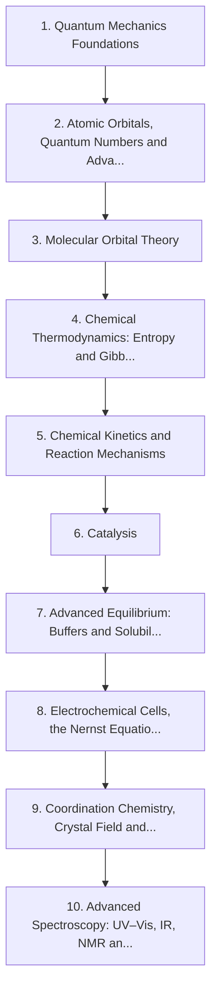

# Level 3 — Advanced Chemistry

> **Audience:** Undergraduate chemistry  
> **Chapters:** 10  
> **Estimated study time:** ≈ 89 h  
> **Difficulty:** ★★★★☆ – ★★★★★

The undergraduate core: quantum mechanics and orbitals, molecular orbital theory, chemical thermodynamics, kinetics and mechanisms, catalysis, advanced equilibria, electrochemistry, coordination chemistry and spectroscopy.

Level 3 is the undergraduate core. It replaces the Bohr picture with the Schrödinger equation, replaces 'energy is released' with Gibbs energy, and replaces 'the rate goes up' with a rate law and a mechanism. Expect calculus and linear algebra to appear; the chapters flag where they are used and why.

---

## Chapters

| # | Chapter | Difficulty | Hours | Prerequisites |
|---|---|---|---|---|
| 1 | [Quantum Mechanics Foundations](01-quantum-mechanics-foundations.md) | ★★★★★ | 10 | Level 2 Ch. 11; calculus |
| 2 | [Atomic Orbitals, Quantum Numbers and Advanced Configurations](02-atomic-orbitals-and-quantum-numbers.md) | ★★★★☆ | 8 | Ch. 1 |
| 3 | [Molecular Orbital Theory](03-molecular-orbital-theory.md) | ★★★★★ | 9 | Ch. 2; Level 1 Ch. 6 |
| 4 | [Chemical Thermodynamics: Entropy and Gibbs Energy](04-chemical-thermodynamics.md) | ★★★★☆ | 10 | Level 2 Ch. 8 |
| 5 | [Chemical Kinetics and Reaction Mechanisms](05-chemical-kinetics-and-reaction-mechanisms.md) | ★★★★☆ | 9 | Level 2 Ch. 9 |
| 6 | [Catalysis](06-catalysis.md) | ★★★★☆ | 6 | Ch. 5 |
| 7 | [Advanced Equilibrium: Buffers and Solubility Product](07-advanced-equilibrium-buffers-and-solubility-product.md) | ★★★★☆ | 8 | Level 2 Ch. 10–11, 13 |
| 8 | [Electrochemical Cells, the Nernst Equation and Electrolysis](08-electrochemical-cells-nernst-equation-and-electrolysis.md) | ★★★★☆ | 9 | Level 2 Ch. 12; Ch. 4 |
| 9 | [Coordination Chemistry, Crystal Field and Ligand Field Theory](09-coordination-chemistry-and-crystal-field-theory.md) | ★★★★★ | 10 | Ch. 2–3 |
| 10 | [Advanced Spectroscopy: UV–Vis, IR, NMR and Mass Spectrometry](10-advanced-spectroscopy.md) | ★★★★★ | 10 | Ch. 2; Level 2 Ch. 6 |

---

## Knowledge map

The chain is the *recommended* order. Chapters that share prerequisites can be
read out of order; the table above tells you what each one actually needs.

---

## Study routine for this level

1. Read the chapter once without taking notes, to see the shape of the argument.
2. Re-read with the chapter's learning objectives in front of you and answer them in writing.
3. Reproduce every Mermaid diagram from memory, then check it.
4. Do the exercises **before** opening the solutions file.
5. Record every mistake in a log; re-test yourself on those specific items a week later.

---

## Practice

- Exercise set: [`exercises/level-3-exercises.md`](exercises/level-3-exercises.md)
- Worked solutions: [`solutions/level-3-solutions.md`](solutions/level-3-solutions.md)

---

## Navigation

- Level index: [CURRICULUM.md](../CURRICULUM.md)
- Study methods: [00-learning-guide](../00-learning-guide/learning-path.md)
- Terminology: [GLOSSARY.md](../GLOSSARY.md)
- Sources: [REFERENCES.md](../REFERENCES.md)
