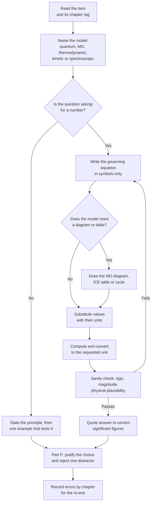

# Level 3 — Exercise Bank

> **Level:** Advanced (Level 3 — Undergraduate core)
> **Estimated time:** 210 minutes
> **Items:** 60
> **Covers:** [Ch. 1](../01-quantum-mechanics-foundations.md), [Ch. 2](../02-atomic-orbitals-and-quantum-numbers.md), [Ch. 3](../03-molecular-orbital-theory.md), [Ch. 4](../04-chemical-thermodynamics.md), [Ch. 5](../05-chemical-kinetics-and-reaction-mechanisms.md), [Ch. 6](../06-catalysis.md), [Ch. 7](../07-advanced-equilibrium-buffers-and-solubility-product.md), [Ch. 8](../08-electrochemical-cells-nernst-equation-and-electrolysis.md), [Ch. 9](../09-coordination-chemistry-and-crystal-field-theory.md), [Ch. 10](../10-advanced-spectroscopy.md)
> **Solutions:** [`../solutions/level-3-solutions.md`](../solutions/level-3-solutions.md)

Each item names its chapter. The quantitative items are written so that the data
needed are stated in the question or in the data sheet; no item depends on a value
you are expected to recall from memory. All pH values are at 25 °C and all standard
potentials at 298 K unless stated otherwise.

**Figure 1 — Working order for this bank.** The model is chosen before the equation:
a spectroscopic item solved with a thermodynamic relation wastes time and marks.

---

## Data sheet

| Constant | Value |
|---|---|
| Molar gas constant, $R$ | $8.314\ \text{J mol}^{-1}\ \text{K}^{-1}$ |
| Faraday constant, $F$ | $96\,485\ \text{C mol}^{-1}$ |
| Avogadro constant, $N_{\text{A}}$ | $6.022\times10^{23}\ \text{mol}^{-1}$ |
| Planck constant, $h$ | $6.626\times10^{-34}\ \text{J s}$ |
| Speed of light, $c$ | $2.998\times10^{8}\ \text{m s}^{-1}$ |
| Boltzmann constant, $k_{\text{B}}$ | $1.381\times10^{-23}\ \text{J K}^{-1}$ |
| Electron mass, $m_e$ | $9.109\times10^{-31}\ \text{kg}$ |
| Elementary charge, $e$ | $1.602\times10^{-19}\ \text{C}$ |
| Energy conversion | $1\ \text{eV} = 96.485\ \text{kJ mol}^{-1}$ |
| Wavenumber conversion | $1000\ \text{cm}^{-1} = 11.96\ \text{kJ mol}^{-1}$ |

Thermodynamic data at 298 K:

| Species | $\Delta H^{\circ}_{\text{f}}$ / kJ mol⁻¹ | $S^{\circ}$ / J K⁻¹ mol⁻¹ |
|---|---|---|
| $\ce{CaCO3(s)}$ | −1206.9 | 92.9 |
| $\ce{CaO(s)}$ | −635.1 | 39.8 |
| $\ce{CO2(g)}$ | −393.5 | 213.8 |
| $\ce{N2(g)}$ | 0 | 191.6 |
| $\ce{H2(g)}$ | 0 | 130.7 |
| $\ce{NH3(g)}$ | −46.1 | 192.8 |

Acid dissociation constants at 298 K: $\ce{CH3COOH}$ $\mathrm{p}K_a = 4.76$;
$\ce{H2CO3}$ $\mathrm{p}K_{a1} = 6.35$; $\ce{HCO3-}$ $\mathrm{p}K_{a2} = 10.33$.

Solubility product at 298 K: $\ce{Mg(OH)2}$ $K_{sp} = 5.6\times10^{-12}$.

Standard reduction potentials at 298 K: $\ce{Ag+}/\ce{Ag}$ $+0.80\ \text{V}$;
$\ce{Cu^2+}/\ce{Cu}$ $+0.34\ \text{V}$; $\ce{Zn^2+}/\ce{Zn}$ $-0.76\ \text{V}$.

---

## Part A — Conceptual questions

1. **[Ch. 1]** Explain what the wavefunction $\psi$ represents, why $\psi$ itself is
   not an observable, and what a node in $\psi$ implies for measurement.

2. **[Ch. 2]** Explain why the $4s$ orbital fills before the $3d$ orbitals in
   potassium and calcium, yet the $4s$ electrons are the first to be removed when a
   first-row transition metal is ionised.

3. **[Ch. 3]** Explain how molecular orbital theory accounts for the paramagnetism of
   $\ce{O2}$, and why the Lewis structure of $\ce{O2}$ fails to predict it.

4. **[Ch. 4]** Distinguish $\Delta G$ from $\Delta G^{\circ}$, and explain how a
   reaction with $\Delta G^{\circ} > 0$ can still proceed in a particular direction.

5. **[Ch. 5]** Explain what is meant by the rate-determining step, and state the
   difference between the steady-state approximation and the pre-equilibrium
   approximation.

6. **[Ch. 6]** Explain why a catalyst cannot change $\Delta G^{\circ}$ or $K$, and
   distinguish turnover frequency from turnover number.

7. **[Ch. 7]** Define buffer capacity and state its maximum. Explain why the
   Henderson–Hasselbalch equation becomes unreliable at high ionic strength.

8. **[Ch. 8]** Explain why $E^{\circ}$ is an intensive quantity while $\Delta G^{\circ}$
   is extensive, and why doubling a half-reaction does not double $E^{\circ}$.

9. **[Ch. 9]** Explain the competition between $\Delta_o$ and the pairing energy $P$,
   and use it to account for the low-spin configuration of
   $\ce{[Fe(CN)6]^3-}$ compared with $\ce{[Fe(H2O)6]^3+}$.

10. **[Ch. 10]** Explain why tetramethylsilane is used as the NMR reference, why
    $^{13}\mathrm{C}$ spectra are normally recorded with proton decoupling, and why
    $\ce{CO2}$ is infrared active in its asymmetric stretch but not in its symmetric
    stretch.

---

## Part B — Basic problems

11. **[Ch. 1]** Calculate the energy of a photon of wavelength $400\ \text{nm}$ in
    joules and in $\text{kJ mol}^{-1}$.

12. **[Ch. 1]** Calculate the de Broglie wavelength of an electron travelling at
    $1.00\times10^{6}\ \text{m s}^{-1}$.

13. **[Ch. 2]** (a) State which of the following sets of quantum numbers are allowed:
    $(n,l,m_l) = (3,2,-1)$; $(2,2,0)$; $(4,0,0)$; $(3,3,-2)$. (b) How many orbitals
    are there in the $n = 3$ shell?

14. **[Ch. 3]** Give the bond order of $\ce{N2}$, $\ce{O2}$, $\ce{O2-}$ and
    $\ce{N2+}$.

15. **[Ch. 4]** State the sign of $\Delta S$ for each process. (a) The decomposition

    $$
    \ce{CaCO3(s) -> CaO(s) + CO2(g)}
    $$

    (b) the synthesis

    $$
    \ce{N2(g) + 3H2(g) -> 2NH3(g)}
    $$

    (c) water freezing at $-10\ ^\circ\text{C}$.

16. **[Ch. 4]** For a reaction with $\Delta H^{\circ} = +50.0\ \text{kJ mol}^{-1}$ and
    $\Delta S^{\circ} = +150\ \text{J K}^{-1}\ \text{mol}^{-1}$, calculate
    $\Delta G^{\circ}$ at $298\ \text{K}$, state whether the reaction is spontaneous
    under standard conditions, and calculate the crossover temperature.

17. **[Ch. 5]** For the rate law $v = k[\ce{A}][\ce{B}]^{2}$, state the order with
    respect to each reactant, the overall order, and the units of $k$.

18. **[Ch. 6]** A surface adsorbs a gas with Langmuir constant
    $K_{\text{A}} = 2.0\times10^{-4}\ \text{Pa}^{-1}$. Calculate the fractional coverage
    at $p_{\text{A}} = 1.0\times10^{4}\ \text{Pa}$.

19. **[Ch. 7]** Calculate the pH of a buffer containing
    $0.100\ \text{mol dm}^{-3}$ of a weak acid ($\mathrm{p}K_a = 4.20$) and
    $0.050\ \text{mol dm}^{-3}$ of its sodium salt.

20. **[Ch. 8]** Calculate $E^{\circ}_{\text{cell}}$ for a cell combining the
    $\ce{Ag+}/\ce{Ag}$ and $\ce{Zn^2+}/\ce{Zn}$ half-cells, and state which electrode
    is the cathode.

21. **[Ch. 9]** Calculate the spin-only magnetic moment of a high-spin $d^{5}$
    complex and state the number of unpaired electrons.

22. **[Ch. 10]** A solution in a $1.00\ \text{cm}$ cell has absorbance $0.60$ at a
    wavelength where $\varepsilon = 1.5\times10^{4}\ \text{dm}^{3}\ \text{mol}^{-1}\ \text{cm}^{-1}$.
    Calculate the concentration.

---

## Part C — Intermediate problems

23. **[Ch. 1]** Treat hexatriene as a one-dimensional box of length
    $0.84\ \text{nm}$ containing six $\pi$ electrons. Calculate the energy gap between
    the highest occupied and lowest unoccupied levels and the wavelength of the
    corresponding absorption.

24. **[Ch. 1]** Caesium has a work function of $2.14\ \text{eV}$. (a) Calculate the
    threshold wavelength for photoemission. (b) Calculate the maximum kinetic energy
    of the photoelectrons, in joules and electronvolts, when light of $400\ \text{nm}$
    is used.

25. **[Ch. 2]** (a) State the number of radial and angular nodes in a $3d$ orbital
    and in a $4p$ orbital. (b) Use Slater's rules to calculate $Z_{\text{eff}}$ for a
    $3p$ electron of chlorine.

26. **[Ch. 3]** Construct the molecular orbital description of $\ce{NO}$. State the
    bond order, the number of unpaired electrons, and whether the molecule is
    paramagnetic. Compare with $\ce{NO+}$.

27. **[Ch. 4]** For the decomposition

    $$
    \ce{CaCO3(s) -> CaO(s) + CO2(g)}
    $$

    calculate $\Delta H^{\circ}$, $\Delta S^{\circ}$ and $\Delta G^{\circ}$ at
    $298\ \text{K}$ from the data sheet, and calculate the temperature above which the
    decomposition becomes spontaneous under standard conditions.

28. **[Ch. 4]** A reaction has $K = 1.0\times10^{-5}$ at $298\ \text{K}$ and
    $\Delta H^{\circ} = +50.0\ \text{kJ mol}^{-1}$. Calculate $K$ at $350\ \text{K}$,
    stating the assumption made.

29. **[Ch. 5]** A first-order reaction has $k = 4.5\times10^{-3}\ \text{s}^{-1}$ at
    $300\ \text{K}$ and $E_a = 75.0\ \text{kJ mol}^{-1}$. Calculate $k$ at
    $320\ \text{K}$ and the time required for $90\,\%$ conversion at $320\ \text{K}$.

30. **[Ch. 5]** For the mechanism

    $$
    \ce{2A(g) <=>[k_1][k_{-1}] A2(g)}
    $$

    followed by the slow step

    $$
    \ce{A2(g) + B(g) ->[k_2] P(g)}
    $$

    derive the steady-state rate law, show that it reduces to second order in
    $\ce{A}$ and first order in $\ce{B}$ when $k_{-1} \gg k_2[\ce{B}]$, and evaluate
    the rate for $k_1 = 2.0\times10^{-2}$, $k_{-1} = 5.0\times10^{-3}$,
    $k_2 = 1.0\times10^{-3}$, $[\ce{A}] = 0.10$ and $[\ce{B}] = 0.050$ in consistent
    units.

31. **[Ch. 6]** An enzyme has $V_{\text{max}} = 2.0\times10^{-6}\ \text{mol dm}^{-3}\ \text{s}^{-1}$,
    $K_{\text{M}} = 5.0\times10^{-3}\ \text{mol dm}^{-3}$ and
    $[\ce{E}]_0 = 2.0\times10^{-8}\ \text{mol dm}^{-3}$. Calculate the rate at
    $[\ce{S}] = 2.0\times10^{-3}\ \text{mol dm}^{-3}$, the catalytic constant
    $k_{\text{cat}}$, and the catalytic efficiency.

32. **[Ch. 7]** Prepare $500.0\ \text{cm}^{3}$ of an acetate buffer of pH 5.00 with a
    total acetate concentration of $0.200\ \text{mol dm}^{-3}$. Calculate the mass of
    sodium acetate ($M = 82.034\ \text{g mol}^{-1}$) and the mass of acetic acid
    ($M = 60.052\ \text{g mol}^{-1}$) required.

33. **[Ch. 7]** Calculate the molar solubility of $\ce{Mg(OH)2}$ at pH 9.50 and 25 °C,
    and compare it with the solubility in pure water.

34. **[Ch. 8]** For the cell
    $\ce{Zn(s) | Zn^2+(aq, 0.010\ mol dm^{-3}) || Cu^2+(aq, 0.100\ mol dm^{-3}) | Cu(s)}$,
    calculate the cell potential at $298\ \text{K}$ using
    $E^{\circ}_{\text{cell}} = 1.10\ \text{V}$.

35. **[Ch. 9]** $\ce{[Ti(H2O)6]^3+}$ has a single $d$–$d$ absorption maximum at
    $500\ \text{nm}$. Calculate $\Delta_o$ in $\text{cm}^{-1}$ and in
    $\text{kJ mol}^{-1}$.

36. **[Ch. 10]** The $\ce{C=O}$ stretching vibration of a carbonyl compound appears at
    $1700\ \text{cm}^{-1}$. Treating the bond as a harmonic oscillator, calculate the
    force constant. Take $m(^{12}\mathrm{C}) = 12.011\ \text{u}$ and
    $m(^{16}\mathrm{O}) = 15.999\ \text{u}$, with $1\ \text{u} = 1.661\times10^{-27}\ \text{kg}$.

---

## Part D — Advanced problems

37. **[Ch. 2]** (a) Write the ground-state electron configuration of $\ce{Fe^3+}$.
    (b) Give its term symbol. (c) State the number of unpaired electrons and calculate
    the spin-only magnetic moment. (d) Repeat the unpaired-electron count and magnetic
    moment for high-spin $\ce{Fe^2+}$.

38. **[Ch. 3]** Compare $\ce{O2}$, $\ce{O2+}$ and $\ce{O2-}$. For each, state the bond
    order, the number of unpaired electrons, and whether it is paramagnetic. Arrange
    the three in order of increasing bond length and justify the order.

39. **[Ch. 4]** A reaction has $\Delta G^{\circ} = -25.0\ \text{kJ mol}^{-1}$ at
    $298\ \text{K}$. (a) Calculate $K$. (b) Calculate $\Delta G$ when the reaction
    quotient is $Q = 10.0$. (c) State the direction of spontaneous change under those
    conditions.

40. **[Ch. 5]** A unimolecular reaction has $k = 1.0\times10^{-3}\ \text{s}^{-1}$ at
    $298\ \text{K}$. Using transition-state theory with a transmission coefficient of
    unity, calculate $\Delta G^{\ddagger}$ at $298\ \text{K}$.

41. **[Ch. 6]** A catalyst lowers the activation Gibbs energy by
    $\Delta\Delta G^{\ddagger} = 30.0\ \text{kJ mol}^{-1}$ at $298\ \text{K}$.
    (a) Calculate the ratio $k_{\text{cat}}/k_{\text{uncat}}$. (b) A catalyst converts
    $0.500\ \text{mol}$ of substrate in $2.00\ \text{h}$ using
    $1.00\times10^{-4}\ \text{mol}$ of active sites; calculate the turnover frequency.

42. **[Ch. 7]** At 25 °C, a buffer is $0.100\ \text{mol dm}^{-3}$ in $\ce{HA}$
    ($\mathrm{p}K_a = 5.00$) and $0.150\ \text{mol dm}^{-3}$ in $\ce{NaA}$, volume
    $250.0\ \text{cm}^{3}$. Calculate the pH after $10.0\ \text{cm}^{3}$ of
    $1.00\ \text{mol dm}^{-3}$ $\ce{HCl}$ is added, and compare with the pH change
    expected in pure water.

43. **[Ch. 8]** For the half-cell

    $$
    \ce{Ag+(aq) + e- -> Ag(s)}
    $$

    $E^{\circ} = +0.80\ \text{V}$. (a) Calculate $E$ when
    $[\ce{Ag+}] = 1.0\times10^{-3}\ \text{mol dm}^{-3}$ at $298\ \text{K}$.
    (b) Calculate $\Delta G$ for the reduction under those conditions. (c) Calculate
    the potential of the concentration cell
    $\ce{Ag(s) | Ag+(1.0\times10^{-3}\ mol dm^{-3}) || Ag+(1.0\ mol dm^{-3}) | Ag(s)}$.

44. **[Ch. 9]** For $\ce{[Fe(CN)6]^3-}$, $\Delta_o = 24\,000\ \text{cm}^{-1}$; for
    $\ce{[Fe(H2O)6]^3+}$, $\Delta_o = 14\,000\ \text{cm}^{-1}$; take
    $P = 21\,000\ \text{cm}^{-1}$ for $\ce{Fe^3+}$. (a) Decide whether each complex is
    high-spin or low-spin. (b) Calculate the CFSE of each, including pairing energy.
    (c) Calculate $\lambda_{\max}$ for the cyanide complex and state the colour
    observed.

45. **[Ch. 10]** A solution of a coloured compound gives an absorbance of $0.450$ in a
    $1.00\ \text{cm}$ cell. A fivefold dilution gives an absorbance of $0.090$.
    (a) Show that the dilution obeys the Beer–Lambert law. (b) If
    $\varepsilon = 2.50\times10^{4}\ \text{dm}^{3}\ \text{mol}^{-1}\ \text{cm}^{-1}$,
    calculate the concentration of the original solution. (c) Calculate the mass of
    compound in $250.0\ \text{cm}^{3}$ of the original solution, taking
    $M = 180\ \text{g mol}^{-1}$.

46. **[Ch. 8]** Aluminium is produced by electrolysis of alumina dissolved in cryolite:

    $$
    \ce{2Al2O3(l) -> 4Al(l) + 3O2(g)}
    $$

    A cell operates at $5.00\ \text{A}$ for $3.00\ \text{h}$ and $5.0\ \text{V}$.
    (a) Calculate the mass of aluminium produced, taking $z = 3$. (b) Calculate the
    electrical energy consumed. (c) Calculate the energy per kilogram of aluminium and
    comment on the industrial significance of the figure.

---

## Part E — Calculation problems

47. **[Ch. 1]** An electron is confined to a region of width $1.0\times10^{-10}\ \text{m}$.
    Use the Heisenberg uncertainty relation to estimate the minimum uncertainty in
    momentum and the corresponding uncertainty in speed.

48. **[Ch. 2]** Calculate the energy and wavelength of the $n = 2 \to n = 1$ transition
    of $\ce{He+}$, taking $R_{\text{H}} = 2.1799\times10^{-18}\ \text{J}$.

49. **[Ch. 4]** For the synthesis

    $$
    \ce{N2(g) + 3H2(g) -> 2NH3(g)}
    $$

    calculate $\Delta S^{\circ}$ from the data sheet, $\Delta G^{\circ}$ at
    $298\ \text{K}$ using $\Delta H^{\circ} = -92.4\ \text{kJ mol}^{-1}$, and the
    crossover temperature.

50. **[Ch. 5]** A reaction has $k = 2.0\times10^{-4}\ \text{s}^{-1}$ at
    $298\ \text{K}$ and $E_a = 80.0\ \text{kJ mol}^{-1}$. Calculate the
    pre-exponential factor and $\Delta G^{\ddagger}$ at $298\ \text{K}$.

51. **[Ch. 6]** A Langmuir–Hinshelwood reaction has
    $K_{\text{A}} = 5.0\times10^{-5}\ \text{Pa}^{-1}$,
    $K_{\text{B}} = 2.0\times10^{-5}\ \text{Pa}^{-1}$,
    $k = 1.5\times10^{-3}\ \text{mol m}^{-2}\ \text{s}^{-1}$ and
    $p_{\text{A}} = p_{\text{B}} = 1.0\times10^{4}\ \text{Pa}$. Calculate the fractional
    coverages and the rate.

52. **[Ch. 7]** Calculate the pH of a $0.100\ \text{mol dm}^{-3}$ sodium hydrogen
    carbonate solution at 25 °C, stating the approximation used.

53. **[Ch. 8]** Water is electrolysed at $10.0\ \text{A}$ for $2.00\ \text{h}$ with an
    applied voltage of $2.00\ \text{V}$. (a) Calculate the amount and the volume at STP
    of hydrogen produced. (b) Calculate the electrical energy consumed. (c) Calculate
    the energy efficiency relative to $\Delta H = 285.8\ \text{kJ mol}^{-1}$ for liquid
    water.

54. **[Ch. 9]** An octahedral complex has $\Delta_o = 22\,000\ \text{cm}^{-1}$.
    Calculate the wavelength of the $d$–$d$ absorption maximum, its energy in
    $\text{kJ mol}^{-1}$, and the colour observed, given that the absorbed colour is
    blue.

---

## Part F — Multiple-choice self-check

55. **[Ch. 1]** For a particle in a one-dimensional box, the ratio $E_3/E_1$ is:
    - A. 3
    - B. 6
    - C. 9
    - D. 27

56. **[Ch. 3]** The bond order of the superoxide ion $\ce{O2-}$ is:
    - A. 1.0
    - B. 1.5
    - C. 2.0
    - D. 2.5

57. **[Ch. 5]** Which statement about the rate-determining step is correct?
    - A. It is always the first step of a mechanism.
    - B. It is the step with the largest equilibrium constant.
    - C. It is the slowest step and controls the overall rate.
    - D. It is the step that releases the most energy.

58. **[Ch. 7]** Adding $0.001\ \text{mol}$ of $\ce{HCl}$ to $1.00\ \text{dm}^{3}$ of an
    acetate buffer at pH 4.76 will:
    - A. lower the pH by several units
    - B. leave the pH unchanged exactly
    - C. lower the pH slightly, by less than 0.1 unit
    - D. raise the pH slightly

59. **[Ch. 8]** For the cell
    $\ce{Zn(s) | Zn^2+(aq) || Cu^2+(aq) | Cu(s)}$, increasing $[\ce{Zn^2+}]$ while
    holding $[\ce{Cu^2+}]$ constant will:
    - A. increase $E$
    - B. decrease $E$
    - C. leave $E$ unchanged
    - D. reverse the cell reaction

60. **[Ch. 9]** The crystal-field stabilisation energy of an octahedral $d^{3}$ complex,
    ignoring pairing energy, is:
    - A. $-1.2\Delta_o$
    - B. $-0.8\Delta_o$
    - C. $-0.4\Delta_o$
    - D. $0$

---

## Marks

| Part | Type | Items | Marks per item | Total |
|---|---|---|---|---|
| A | Conceptual | 10 | 2 | 20 |
| B | Basic problems | 12 | 3 | 36 |
| C | Intermediate problems | 14 | 6 | 84 |
| D | Advanced problems | 10 | 10 | 100 |
| E | Calculation problems | 8 | 7 | 56 |
| F | Multiple-choice | 6 | 2 | 12 |
| **Total** | | **60** | | **308** |

**Total marks: 308**

**Solutions:** [`../solutions/level-3-solutions.md`](../solutions/level-3-solutions.md)
