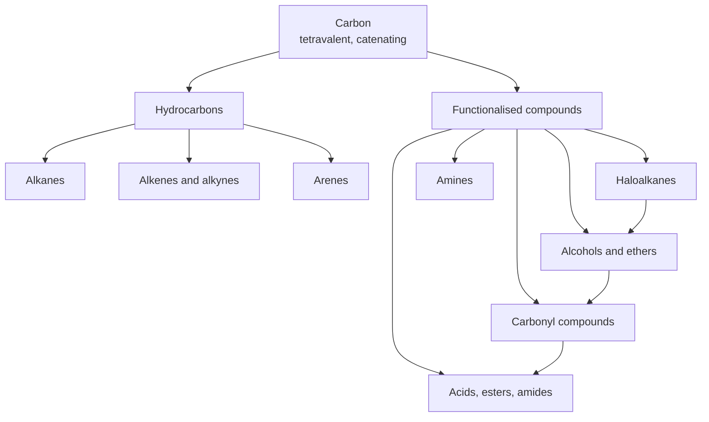
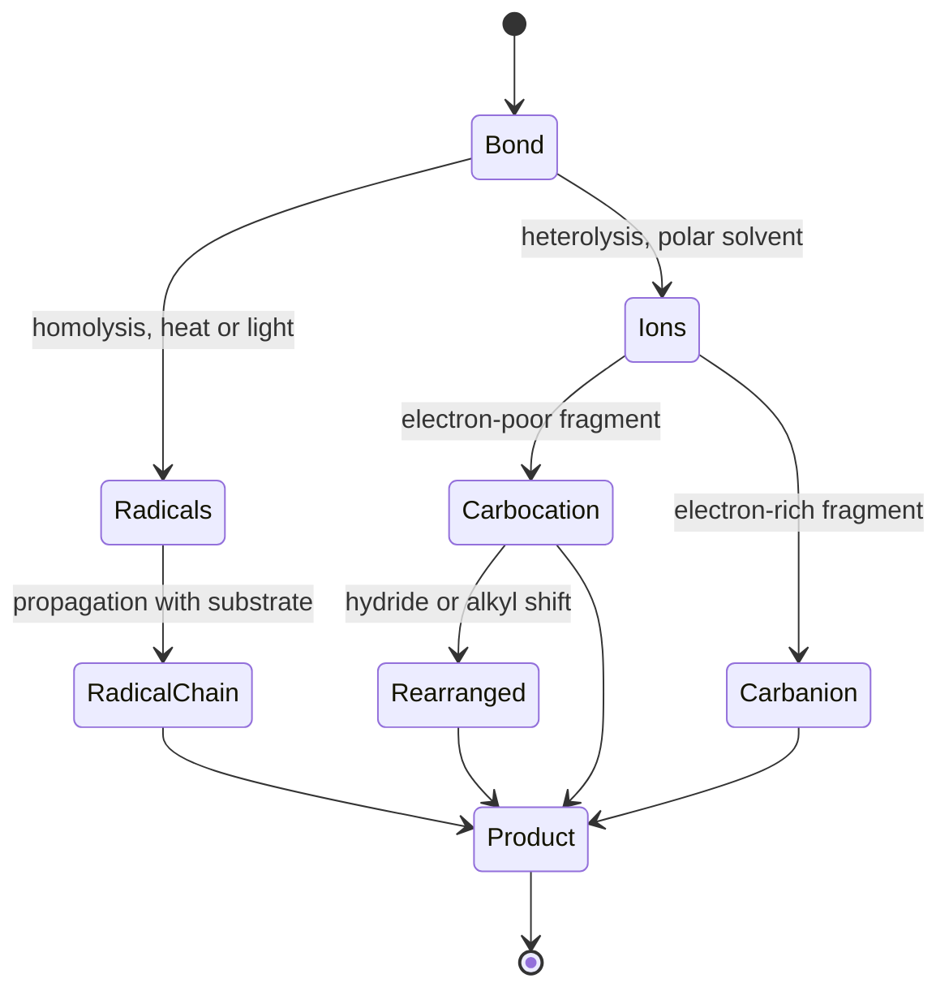
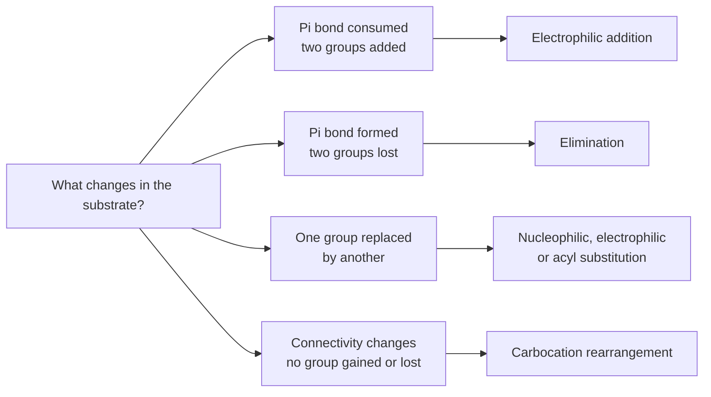
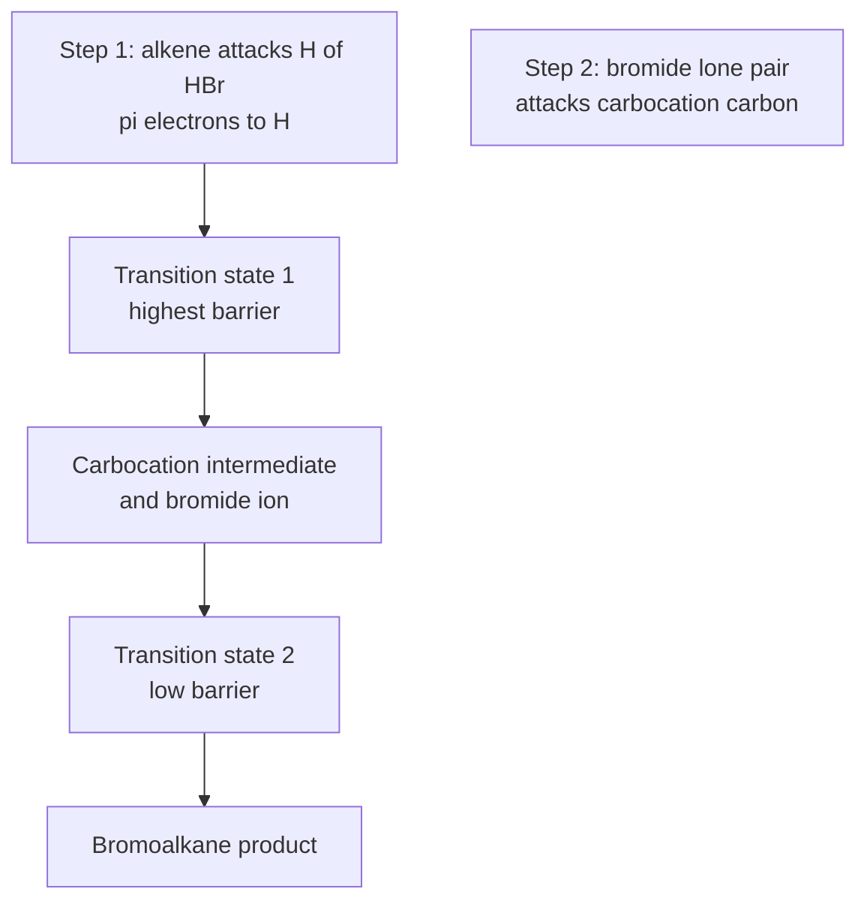

# Chapter 1 — Introduction to Organic Chemistry

> **Level:** Level 4 — Organic Chemistry
> **Estimated study time:** 5 hours (3.5 h reading + 1.5 h exercises)
> **Prerequisites:** [What Is Chemistry?](../01-foundations/01-what-is-chemistry.md); [Atomic Structure](../02-elementary-chemistry/01-atomic-structure.md); [Lewis Structures and Chemical Formulas](../02-elementary-chemistry/06-lewis-structures-and-chemical-formulas.md)
> **Related chapters:** [Functional Groups and IUPAC Nomenclature](02-functional-groups-and-iupac-nomenclature.md), [Isomerism and Stereochemistry](03-isomerism-and-stereochemistry.md), [Alkanes](05-alkanes.md)
> **Difficulty:** ★★★☆☆ (1–5)

---

## 1. Learning Objectives

After working through this chapter you will be able to:

- Explain, in electronic and thermodynamic terms, why carbon forms more stable compounds than any other element.
- Convert a molecular formula into a skeletal, condensed or fully displayed structure, and read wedges and dashes correctly.
- Recognise the major functional groups that organise the rest of this level and place them on a reactivity map.
- Distinguish homolysis from heterolysis, and predict which pathway a given bond is likely to follow.
- Rank radicals, carbocations and carbanions by stability, and describe the geometry and lifetime of each.
- Use curved arrows with the correct conventions, identifying the electron source and the electron sink in every step.
- Classify an unfamiliar reaction as an addition, elimination, substitution or rearrangement.
- Describe the evidence-based study habits that make organic chemistry learnable rather than memorisable.

---

## 2. Introduction

In 1828 Friedrich Wöhler heated ammonium cyanate, an inorganic salt, and obtained urea — a compound that until then had been isolated only from living organisms. The result is often presented as the death of the "vital force" theory, the idea that organic compounds required a living organism to synthesise them. The historical record is more nuanced: Wöhler himself did not frame the experiment as a refutation, and the philosophical debate continued for decades. What the experiment did establish beyond dispute was that a compound previously associated with life could be prepared from a mineral starting material by ordinary laboratory chemistry. The artificial boundary between "organic" and "inorganic" chemistry began to dissolve.

The boundary is now drawn by structure, not by origin. **Organic chemistry** is the chemistry of carbon compounds, with a working exclusion for the simple oxides and carbonates that are conventionally treated as inorganic. Carbon is the only element that forms long, stable chains and rings with itself while also bonding strongly to hydrogen, oxygen, nitrogen, sulfur, phosphorus and the halogens. That combination produces an estimated several hundred million possible structures of modest size, of which more than two hundred million have been registered in chemical databases. No other element comes close.

This abundance has a practical consequence that shapes the whole discipline. A subject with an effectively unlimited inventory of objects cannot be taught as a catalogue. It has to be taught as a *grammar*: a small set of bonding patterns, a small set of reactive intermediates, and a small set of electron-flow motifs that recur in reaction after reaction. The student who learns the grammar can analyse a molecule they have never seen. The student who memorises reactions one by one will run out of memory before the syllabus runs out of reactions.

This chapter lays out that grammar. It begins with the electronic reasons for carbon's versatility, then establishes the drawing conventions that are the written language of the subject, then surveys functional groups as the vocabulary, and finally introduces the mechanistic ideas — bond polarity, reactive intermediates, curly arrows and reaction types — that the remaining thirteen chapters will use continuously. No reaction is treated in detail here. The aim is orientation: to show what kind of subject organic chemistry is before asking you to learn its contents.

---

## 3. Fundamental Concepts

### 3.1 The electronic case for carbon

Carbon is element 6, with the ground-state configuration $1s^2\,2s^2\,2p^2$. It has four valence electrons and four vacancies in its valence shell, so it can form four covalent bonds. This is **tetravalency**, and it is the first requirement for a rich chemistry: an element that forms only one or two bonds produces small molecules, whereas an element that forms four can branch.

| Element | Valence configuration | Typical number of covalent bonds |
|---|---|---|
| Carbon | $2s^2\,2p^2$ | 4 |
| Nitrogen | $2s^2\,2p^3$ | 3 |
| Oxygen | $2s^2\,2p^4$ | 2 |
| Fluorine | $2s^2\,2p^5$ | 1 |
| Silicon | $3s^2\,3p^2$ | 4 |
| Hydrogen | $1s^1$ | 1 |

Silicon has the same valence configuration as carbon and also forms four bonds, yet silicon chemistry is dominated by silicates, silicones and a comparatively small number of hydrides. The contrast is instructive: tetravalency is necessary but not sufficient. The remaining requirements are catenation, multiple bonding and a small atomic radius.

### 3.2 Catenation

**Catenation** is the ability of an element to bond to itself in extended chains and rings. Carbon catenates because the carbon–carbon bond is strong and because carbon forms stable bonds to the elements that terminate chains.

| Bond | Mean bond enthalpy / kJ mol⁻¹ | Mean bond length / pm |
|---|---|---|
| $\ce{C-C}$ | 348 | 154 |
| $\ce{C=C}$ | 612 | 134 |
| $\ce{C#C}$ | 837 | 120 |
| $\ce{C-H}$ | 412 | 109 |
| $\ce{C-O}$ | 360 | 143 |
| $\ce{C=O}$ | 743 | 122 |
| $\ce{Si-Si}$ | 222 | 235 |
| $\ce{Si-O}$ | 452 | 163 |
| $\ce{Ge-Ge}$ | 167 | 245 |
| $\ce{Sn-Sn}$ | 146 | 281 |

Two features of this table matter. First, the carbon–carbon bond is strong: 348 kJ mol⁻¹ is enough to survive normal thermal and photochemical conditions, so chains persist. Second, and less obvious, the silicon–silicon bond is weak *relative to the silicon–oxygen bond*. For silicon, oxidation to a silicate network is thermodynamically far more favourable than chain formation; for carbon, the carbon–oxygen bond is strong but the carbon–carbon bond is strong enough to compete. That competition is why the stable form of carbon under ordinary conditions is a solid or a molecular compound, whereas silicon is almost always found as silica or a silicate.

### 3.3 Multiple bonding

Carbon forms double and triple bonds to itself and to other elements. This multiplies structural possibilities in two ways: it changes geometry, and it creates sites of electron density that attract electrophiles.

A double bond consists of one σ bond and one π bond. The σ bond is cylindrically symmetrical about the internuclear axis; the π bond is formed by side-on overlap of p orbitals and has electron density above and below the molecular plane. The consequence is that the atoms at a double bond are coplanar and cannot rotate freely: rotation would require breaking the π overlap. The barrier to rotation in ethene is about 270 kJ mol⁻¹, far above thermal energy at room temperature. Restricted rotation is the physical basis of *cis–trans* and *E/Z* isomerism, developed in Chapters 3 and 6.

Triple bonds consist of one σ bond and two orthogonal π bonds. The atoms are linear, and the cylindrical sheath of π density makes alkynes attractive to electrophiles and, at a terminal carbon, acidic.

### 3.4 Small size

Carbon is a small atom: its covalent radius is about 77 pm, compared with 117 pm for silicon and 140 pm for tin. Small atoms approach closely, so their orbitals overlap efficiently and their bonds are short and strong. Short bonds also enforce geometry: a C–C–C angle of 109.5° in an alkane brings substituents close together, which is why conformational analysis (Chapter 4) matters so much in carbon chemistry. In silicon chains the larger radius and longer bonds allow much greater flexibility and much weaker steric communication between distant parts of a molecule.

The combination of tetravalency, strong catenation, multiple bonding and small size is unique to carbon. Nitrogen forms strong multiple bonds but only short chains, because the N–N bond is weak and lone-pair repulsion destabilises chains. Oxygen forms no stable chains of more than a few atoms. Boron forms clusters rather than chains. Carbon sits at the intersection of the periodic trends that make a rich molecular chemistry possible.

### 3.5 The scale of the discipline

Organic chemistry is large in every direction. More than 200 million substances are registered in the CAS Registry, the majority of them organic or organometallic. Global production of polyethylene alone exceeds 100 million tonnes per year. The pharmaceutical industry, the polymer industry, the agrochemical industry and the dye and fragrance industries are all built on organic synthesis. Every protein, nucleic acid, carbohydrate and lipid in a living cell is an organic molecule, so biochemistry is a branch of organic chemistry with a biological accent.

The scale has a pedagogical implication. A curriculum cannot cover the field; it can only cover the patterns. The chapters that follow are chosen to maximise transfer: functional groups, stereochemistry, conformations, then the reactivity of the principal functional groups, then synthesis. A student who understands why an alkene reacts with HBr can predict why an enol ether reacts with HBr, and can often predict what a completely unfamiliar alkene will do.

### 3.6 Drawing conventions

Organic molecules are large and three-dimensional, and no single drawing style serves every purpose. Four conventions are in routine use, and fluency in all four is assumed from this point onward.

**Fully displayed (Lewis) structures.** Every atom and every bond is drawn, including every C–H bond and every lone pair. This style is unambiguous and is used when discussing mechanism at the level of individual electrons. It is slow to draw and visually noisy for large molecules.

**Condensed structures.** Carbon–hydrogen bonds are omitted and the formula is written as a sequence of groups: $\ce{CH3CH2OH}$, $\ce{(CH3)3COH}$, $\ce{CH3COCH3}$. Parentheses indicate branching. Condensed formulas are compact but can be ambiguous: $\ce{C4H10}$ has two isomers, and writing $\ce{CH3CH2CH2CH3}$ specifies only one of them.

**Skeletal (line–angle) structures.** Carbon atoms are represented by the vertices and ends of lines; hydrogen atoms attached to carbon are omitted; heteroatoms and the hydrogens attached to them are drawn explicitly. A line segment is a bond. This is the working language of the subject and the style used in almost every research paper.

The conventions of skeletal drawing are strict enough to state as rules:

1. Each vertex and each line end is a carbon atom unless another element is written there.
2. Carbon atoms carry enough hydrogen atoms to make four bonds. These hydrogens are not drawn.
3. A double bond is two parallel lines; a triple bond is three.
4. Heteroatoms — O, N, S, P, halogens — are always written out, together with the hydrogens bonded to them.
5. Charges are written explicitly, as in $\ce{NH4+}$ or $\ce{CH3O-}$.
6. Aromatic rings are drawn with alternating double bonds or with a circle; both conventions are used in this book, and the circle is a reminder of delocalisation, not a distinct species.

**Wedges and dashes.** A solid wedge indicates a bond projecting out of the plane towards the viewer; a hashed wedge or a series of short parallel lines indicates a bond projecting away from the viewer. A plain line lies in the plane of the paper. Wedges and dashes are used only when stereochemistry is being specified. Drawing a wedge where no stereocentre exists is not merely untidy; it asserts a fact that is not true.

### 3.7 Functional groups: the map

A **functional group** is an atom or group of atoms that behaves in a characteristic way across many different molecules. Functional groups are the vocabulary of organic chemistry: they determine solubility, boiling point, acidity, spectroscopic signature and, above all, reactivity.

| Class | General structure | Characteristic behaviour |
|---|---|---|
| Alkane | $\ce{R-H}$ | Radical substitution; combustion |
| Alkene | $\ce{C=C}$ | Electrophilic addition; polymerisation |
| Alkyne | $\ce{C#C}$ | Addition; terminal C–H acidity |
| Haloalkane | $\ce{R-X}$ | Nucleophilic substitution; elimination |
| Alcohol | $\ce{R-OH}$ | Brønsted acid and base; substitution; oxidation |
| Ether | $\ce{R-O-R'}$ | Relatively inert; solvation |
| Amine | $\ce{R-NH2}$ | Base; nucleophile |
| Aldehyde | $\ce{R-CHO}$ | Nucleophilic addition; oxidation |
| Ketone | $\ce{R-CO-R'}$ | Nucleophilic addition; reduction |
| Carboxylic acid | $\ce{R-COOH}$ | Acid–base; acyl substitution |
| Ester | $\ce{R-COOR'}$ | Hydrolysis; transesterification |
| Amide | $\ce{R-CONH2}$ | Hydrolysis; H-bond donor and acceptor |
| Nitrile | $\ce{R-CN}$ | Addition; hydrolysis to acid |
| Arene | $\ce{Ar-H}$ | Electrophilic aromatic substitution |

The map is not a list to be memorised in isolation; it is a set of related families. An alcohol, an amine and a carboxylic acid are all Brønsted acids of decreasing strength and all nucleophiles of increasing softness. An aldehyde, a ketone, an ester and an amide all contain a carbonyl group and all react by nucleophilic addition or acyl substitution; the difference between them is what is attached to the carbonyl carbon, and therefore how electrophilic that carbon is. Chapter 2 formalises this map, and Chapters 6 to 12 fill it in.

### 3.8 Homolysis and heterolysis

A covalent bond can break in two ways, and the distinction determines the entire mechanistic character of a reaction.

**Homolysis** is symmetric cleavage: the bonding pair is divided equally, one electron to each fragment. It produces two **radicals**, species with an unpaired electron. Homolysis requires energy — typically the full bond dissociation enthalpy — and is favoured by heat or ultraviolet light, and by non-polar bonds between atoms of similar electronegativity.

$$
\ce{Cl-Cl ->[h\nu] 2Cl^{.}}
$$

**Heterolysis** is asymmetric cleavage: the bonding pair goes entirely to one fragment. It produces a **carbocation** (or other cation) and a **carbanion** (or other anion). Heterolysis is favoured by polar bonds, by polar solvents that solvate the resulting ions, and by the formation of stabilised ions.

$$
\ce{(CH3)3C-Cl -> (CH3)3C+ + Cl-}
$$

The two pathways are summarised by the arrow conventions. A **full-headed curved arrow** shows the movement of an electron *pair*; it is used for heterolysis and for every polar mechanism. A **half-headed curved arrow** (a "fish hook") shows the movement of a single electron and is used only for radical processes. Mixing the two conventions is a common and consequential error: a full arrow where a half arrow belongs describes a two-electron process that is not happening.

### 3.9 Electronegativity and bond polarisation

**Electronegativity** is the tendency of an atom in a bond to attract the shared electrons. On the Pauling scale the values most often needed are:

| Atom | $\chi$ | Atom | $\chi$ |
|---|---|---|---|
| F | 3.98 | C | 2.55 |
| O | 3.44 | H | 2.20 |
| N | 3.04 | Si | 1.90 |
| Cl | 3.16 | Mg | 1.31 |
| Br | 2.96 | Li | 0.98 |
| S | 2.58 | Na | 0.93 |

A bond between atoms of different electronegativity is **polarised**: the bonding electrons lie closer to the more electronegative atom, which acquires a partial negative charge $\delta^-$ and leaves the other atom with $\delta^+$. The dipole moment $\mu$ measures the magnitude of that separation.

Polarisation has a mechanistic consequence that runs through the whole subject. The $\delta^+$ atom is an electrophile — literally, an electron lover — and the $\delta^-$ atom is a nucleophile, or a base. A reaction between them is the default event in polar organic chemistry. The carbonyl group is the archetype: the C=O bond is strongly polarised towards oxygen, leaving the carbonyl carbon electrophilic and the oxygen basic. Nearly all of carbonyl chemistry in Chapters 10 and 11 follows from that one fact.

Electronegativity is a qualitative, averaged property. It does not by itself predict bond length, molecular geometry or reaction rate, and it should not be used where a quantitative quantity such as a bond dissociation enthalpy or a pKa is available.

### 3.10 Reactive intermediates

Most organic reactions proceed through short-lived species that are present at low concentration and cannot be isolated under ordinary conditions. Three families dominate.

**Radicals.** A radical has one unpaired electron. The carbon radical centre is approximately planar ($sp^2$-like) with the unpaired electron in a p orbital. Radicals are stabilised by alkyl substitution and by resonance, in the order methyl < primary < secondary < tertiary < allyl ≈ benzyl. They are generated by homolysis, usually photochemically or thermally, and they react by abstracting an atom or adding to a π bond.

**Carbocations.** A carbocation has a positively charged, electron-deficient carbon with six valence electrons. It is planar ($sp^2$) with an empty p orbital perpendicular to the plane. Carbocations are stabilised by electron donation from adjacent σ bonds (hyperconjugation) and from lone pairs or π systems (resonance). The stability order is methyl < primary < secondary < tertiary < allyl ≈ benzyl, and the same order governs the regioselectivity of electrophilic addition in Chapter 6. The lifetime of a simple carbocation in solution ranges from nanoseconds to seconds depending on structure and solvent.

**Carbanions.** A carbanion has a negatively charged carbon with eight valence electrons and a lone pair. It is pyramidal ($sp^3$-like) and usually inversionally labile. Carbanions are destabilised by alkyl groups, which donate electron density into an already electron-rich centre, so the stability order is the reverse of that for carbocations: methyl > primary > secondary > tertiary. They are strongly stabilised by adjacent carbonyl, ester, nitro or nitrile groups, which delocalise the negative charge by resonance. That stabilisation is the basis of enolate chemistry.

| Intermediate | Electrons on carbon | Geometry | Stability order |
|---|---|---|---|
| Radical | 7 | Trigonal planar | 3° > 2° > 1° > methyl |
| Carbocation | 6 | Trigonal planar | 3° > 2° > 1° > methyl |
| Carbanion | 8 | Trigonal pyramidal | methyl > 1° > 2° > 3° |

### 3.11 Curly arrows

Curly arrows are the notation of mechanism. They encode one claim only: *a pair of electrons moves from where the arrow starts to where the arrowhead points*. Everything else — charges, bonds broken, bonds formed — follows from that claim.

The conventions are:

1. The tail of the arrow is at the electron source: a lone pair, a π bond, a σ bond, or a negative charge.
2. The head of the arrow is at the electron sink: an atom, an empty orbital, or a bond that is forming.
3. An arrow from a bond to an atom means that bond breaks heterolytically and both electrons end up on that atom.
4. Arrows never start at a positive charge, because a positive charge indicates the *absence* of electrons.
5. Arrows never start at a hydrogen atom, because a C–H or O–H σ bond is not a source of electron density in the same way as a lone pair or a π bond. An arrow may start at the bond, not the atom.
6. The total charge is conserved in every step.

A worked application makes the conventions concrete. In the addition of HBr to propene, the first arrow runs from the π bond to the hydrogen of HBr; the second runs from the H–Br bond to bromine. The result is a secondary carbocation and bromide ion. The third arrow runs from a lone pair on bromide to the carbocation carbon. Each arrow moves one pair; each step conserves charge.

---

## 4. Detailed Scientific Explanation

### 4.1 Why carbon and not silicon: an energy argument

The periodic table offers an obvious alternative to carbon. Silicon sits directly below carbon, has the same valence configuration and forms four bonds. Why is there no silicon-based equivalent of biochemistry, and no silicon analogue of the petrochemical industry?

The answer is a competition between bond enthalpies. In Group 14 the M–M bond weakens sharply down the group: 348 kJ mol⁻¹ for C–C, 222 for Si–Si, 167 for Ge–Ge and 146 for Sn–Sn. Meanwhile the M–O bond remains strong: 360 for C–O, 452 for Si–O. For carbon, the C–C bond is comparable to the C–O bond, so a carbon chain is not automatically destroyed by exposure to oxygen; oxidation requires a mechanism and an activation energy. For silicon, Si–O is about twice as strong as Si–Si, so any silicon chain is thermodynamically desperate to become a silicate. Silicon chemistry in air and water is therefore the chemistry of Si–O networks: silica, silicates, silicones.

The same argument explains why carbon dioxide is a gas and silicon dioxide is a refractory solid. In $\ce{CO2}$ the two C=O bonds (about 799 kJ mol⁻¹ each in the molecule) more than compensate for the loss of C–C bonding, so discrete molecules are favoured. In $\ce{SiO2}$ the Si–O bond is so strong and the Si–Si bond so weak that an extended three-dimensional network of Si–O–Si linkages is favoured instead. The formula is the same shape; the structure could hardly be more different.

A third factor is size. The small carbon atom permits efficient side-on p–p overlap, so π bonds are strong: 612 kJ mol⁻¹ for C=C against roughly 200 kJ mol⁻¹ for Si=Si in the few compounds where it has been characterised. Strong π bonding is what makes alkenes, alkynes, arenes, carbonyls, nitriles and imines stable functional groups. Silicon forms double bonds only with difficulty and with bulky substituents.

The conclusion is not that carbon is "special" in a mystical sense. It is that carbon is the only element for which chain formation, multiple bonding and heteroatom bonding are all thermodynamically competitive at ordinary temperatures. That coincidence is contingent on nuclear charge and atomic radius, and it happens once in the periodic table.

### 4.2 Hybridisation as a model

The geometry of carbon compounds is usually described by **hybridisation**, the mixing of atomic orbitals to produce a set of equivalent hybrid orbitals directed towards the vertices of a polyhedron.

| Hybridisation | s:p mixing | Geometry | Ideal angle | Example |
|---|---|---|---|---|
| $sp^3$ | one s, three p | Tetrahedral | 109.5° | Methane |
| $sp^2$ | one s, two p | Trigonal planar | 120° | Ethene |
| $sp$ | one s, one p | Linear | 180° | Ethyne |

Hybridisation is a *model*, not an observable. It rationalises bond angles, bond lengths and the equivalence of the four C–H bonds in methane, and it gives a convenient bookkeeping scheme for counting σ and π bonds. The more complete description comes from molecular orbital theory, in which the four C–H bonds of methane are described by delocalised orbitals of $a_1$ and $t_2$ symmetry, not by four equivalent $sp^3$ hybrids. For most of the organic curriculum the two descriptions make identical predictions about structure and reactivity, and hybridisation is used because it is faster to apply.

Two warnings are worth stating now. First, hybridisation is not a physical process that an atom "undergoes" before bonding; it is a mathematical description of the shape of the final wavefunction. Second, real bond angles deviate from ideal values: the H–C–H angle in methane is 109.5°, but in methanol the C–O–H angle is about 108.5° and in propene the C–C–C angle at the $sp^2$ carbon is about 124°, not 120°. These deviations are small but chemically significant, and they are explained by VSEPR arguments rather than by hybridisation alone.

### 4.3 How organic reactions are classified

Every reaction in this book belongs to one of four mechanistic families, plus a small number of redox and acid–base processes that cut across them.

**Addition.** Two reactants combine to give a single product, with no atoms lost. Addition to a π bond is the characteristic reaction of alkenes and alkynes.

$$
\ce{CH2=CH2 + HBr -> CH3CH2Br}
$$

**Elimination.** A single molecule loses two groups from adjacent atoms to form a π bond. Elimination is the reverse of addition and is the standard route to alkenes.

$$
\ce{CH3CH2Br + KOH ->[ethanol, \Delta] CH2=CH2 + KBr + H2O}
$$

**Substitution.** One group is replaced by another. Substitution at an $sp^3$ carbon is nucleophilic; substitution at an $sp^2$ aromatic carbon is electrophilic; substitution at a carbonyl carbon is acyl substitution.

$$
\ce{CH3CH2Br + OH- -> CH3CH2OH + Br-}
$$

**Rearrangement.** The connectivity of the skeleton changes without any group entering or leaving. Carbocation rearrangements — hydride and alkyl shifts — are the commonest examples, and they matter because they can change the product of an addition reaction.

$$
\ce{CH3CH2CH2+ -> CH3CH+CH3}
$$

A reaction may combine families: an elimination followed by an addition is a common two-step sequence, and a substitution that proceeds through a carbocation may be accompanied by rearrangement. Classification is a tool for recognising the dominant electron flow, not a taxonomy with fixed boundaries.

### 4.4 Mechanisms, transition states and energy profiles

A **mechanism** is a sequence of elementary steps that accounts for the overall reaction. Each elementary step has a **transition state**, the highest-energy configuration along the reaction coordinate for that step. Transition states are not intermediates: they are not minima, they cannot be isolated, and they exist only at the top of an energy barrier. **Intermediates**, by contrast, sit in local minima and may sometimes be observed spectroscopically.

The rate of a reaction is governed by the height of the highest barrier, not by the overall energy difference between reactants and products. A reaction can be strongly exergonic and still be immeasurably slow if the barrier is high; this is why thermodynamics and kinetics must be discussed separately, and why the same reaction can give different products under kinetic and thermodynamic control.

The **Hammond postulate** links the structure of a transition state to the species on either side of it. If the step is endothermic, the transition state resembles the products; if exothermic, it resembles the reactants. The postulate is used constantly to explain selectivity: bromination of alkanes is highly selective because the hydrogen-abstraction step is endothermic and the transition state is product-like, so the stability of the developing radical is reflected in the barrier height.

### 4.5 How to study organic chemistry honestly

Organic chemistry rewards a particular kind of study and punishes another. The subject is often attempted by reading notes and highlighting reactions; that method produces a feeling of familiarity without the ability to reproduce anything. The following practices are more effective, and each is supported by general evidence from cognitive science rather than by folklore.

**Draw from memory, then check.** Reading a mechanism creates recognition; drawing it creates recall. Close the book, draw the structure and the arrows, then compare. The gap between what you drew and what is correct is the material you actually need to learn.

**Explain the arrow, not the outcome.** For every step, state the electron source, the electron sink and the reason the step is favourable. A student who can say "the π bond attacks the proton because the resulting carbocation is secondary rather than primary" understands the reaction; a student who says "HBr adds Markovnikov" has memorised a label.

**Predict before looking.** When a new reaction is introduced, cover the product and predict it from the mechanism you already know. Being wrong is more informative than being shown.

**Separate the three representations.** Every molecule should be translatable between name, condensed formula and skeletal structure. Most examination errors in this subject are translation errors, not chemistry errors.

**Space the practice.** Six sessions of twenty minutes over two weeks outperform one three-hour session, for the same total time. The reactions must be retrieved, not merely reviewed.

**Keep an error log.** Record every mistake with the reason it happened — misread a wedge, forgot a lone pair, numbered from the wrong end. Errors cluster, and the log makes the clusters visible.

There is one further honesty requirement. Organic chemistry contains simplifications that are taught as if they were facts, and a good student should know which is which. "Hybridisation" is a model. "Curly arrows show electron movement" is a representation of a quantum-mechanical process that cannot be observed directly. "Markovnikov's rule" is a summary of a mechanism, not a law of nature. Labelling these as models is not pedantry; it prevents the kind of overconfident reasoning that fails when a reaction deviates from the rule.

---

## 5. Visual Diagrams

The four diagrams in this section are maps rather than structures. Mermaid cannot draw chemical structures, so the diagrams encode relationships — which group belongs to which family, which bond-breaking pathway leads to which intermediate, and which question identifies which reaction class.

**Figure 1.1 — The functional-group map of organic chemistry.** The arrows trace the standard synthetic relationships: alkanes and alkenes are the hydrocarbon feedstocks; halogenation converts them into haloalkanes; substitution converts haloalkanes into alcohols and ethers; oxidation converts alcohols into carbonyl compounds; further oxidation and condensation produce acids, esters and amides. The map is not a complete reaction graph — many other transformations exist — but it shows why the chapters are ordered as they are. Each arrow is a family of reactions, not a single reaction, and each will be examined mechanistically in its own chapter.

**Figure 1.2 — Two fates of a covalent bond.** A bond between carbon and a heteroatom can break symmetrically, giving two radicals, or unsymmetrically, giving a carbocation and a carbanion or a neutral leaving group. The pathway taken depends on bond polarity, solvent and the stability of the resulting species. Note that a carbocation can rearrange before it is captured; this is why the product of an addition reaction is not always the one predicted by the simplest regiochemical rule.

**Figure 1.3 — A decision tree for classifying a reaction.** The first question is always what happens to the skeleton and to the π system. Addition consumes a π bond, elimination creates one, substitution replaces one group with another, and rearrangement alters connectivity without changing the molecular formula. The tree is deliberately coarse: it classifies the overall change, not the mechanism, and a full mechanistic classification requires the arrow-pushing analysis developed in later chapters.

**Figure 1.4 — An energy landscape for a two-step addition.** The first step is endothermic and rate-determining: it forms a high-energy carbocation. The second step is strongly exothermic and fast. The overall rate depends on the first barrier, which is why the stability of the carbocation controls the regiochemistry. This shape — a slow, endothermic ionisation followed by a fast capture — recurs in the substitution and elimination mechanisms of Chapter 8.

---

## 6. Mathematical Formulas

Organic chemistry uses less algebra than physical chemistry, but a small number of formulas recur in every chapter and must be automatic.

### 6.1 Formal charge

$$
\text{formal charge} = V - \left(N + \frac{B}{2}\right)
$$

| Symbol | Meaning | Unit |
|---|---|---|
| $V$ | valence electrons of the free atom | — |
| $N$ | non-bonding electrons on the atom | — |
| $B$ | bonding electrons around the atom | — |

The formula counts electrons, so the result is a pure number and is usually written with an explicit sign, as in $+1$ or $-1$. Formal charge is a bookkeeping device that assumes electrons in a bond are shared equally, irrespective of electronegativity. It is therefore *not* the same as partial charge: the carbon of a C=O bond has formal charge 0 but carries a substantial $\delta^+$. Formal charge is used to check that a Lewis structure is reasonable; partial charge is used to predict reactivity.

### 6.2 Degree of unsaturation

$$
\text{DBE} = \frac{2C + 2 + N - H - X}{2}
$$

| Symbol | Meaning |
|---|---|
| $C$ | number of carbon atoms |
| $N$ | number of nitrogen atoms |
| $H$ | number of hydrogen atoms |
| $X$ | number of halogen atoms |

Oxygen and sulfur are ignored because they are divalent and do not change the hydrogen count. Each DBE corresponds to one ring or one π bond; a triple bond counts as two, and an aromatic ring counts as four (three π bonds plus one ring). The formula assumes a neutral, closed-shell molecule of the elements listed; it fails for radicals, ions and boron-containing compounds unless adjusted.

### 6.3 Bond order and hybridisation bookkeeping

For a bond between atoms A and B, the bond order is the number of electron pairs shared:

$$
\text{bond order} = \frac{\text{bonding electrons}}{2}
$$

A single bond has bond order 1, a double bond 2, a triple bond 3. In a delocalised system the bond order is fractional: the C–C bonds of benzene have bond order 1.5, which is why all six are 139 pm long, between the 154 pm of a single bond and the 134 pm of a double bond.

### 6.4 Gibbs energy, equilibrium and rate

$$
\Delta G^\circ = -RT \ln K
\qquad\text{and}\qquad
\Delta G^\ddagger = -RT \ln\left(\frac{k h}{k_\text{B} T}\right)
$$

| Symbol | Meaning | SI unit |
|---|---|---|
| $\Delta G^\circ$ | standard Gibbs energy change | J mol⁻¹ |
| $\Delta G^\ddagger$ | standard Gibbs energy of activation | J mol⁻¹ |
| $R$ | gas constant | J K⁻¹ mol⁻¹ |
| $T$ | thermodynamic temperature | K |
| $K$ | equilibrium constant | — |
| $k$ | rate constant | s⁻¹ |
| $h$ | Planck constant | J s |
| $k_\text{B}$ | Boltzmann constant | J K⁻¹ |

The first relation says whether a reaction is favourable; the second, the Eyring equation, says how fast it is. The two are independent. A reaction with $\Delta G^\circ = -100\ \text{kJ mol}^{-1}$ may still be slow if $\Delta G^\ddagger = +120\ \text{kJ mol}^{-1}$, and such a reaction is a useful synthetic intermediate rather than a spontaneous hazard.

### 6.5 Yield, selectivity and atom economy

$$
\text{percentage yield} = \frac{n_\text{product}}{n_\text{limiting}} \times 100\%
\qquad
\text{atom economy} = \frac{M_\text{product}}{M_\text{reactants}} \times 100\%
$$

Percentage yield measures how much of the limiting reagent ends up as product. Atom economy measures how much of the reactant mass is incorporated into the desired product, and therefore how much waste is generated by design. A reaction can have 100% yield and 20% atom economy: every molecule of starting material is converted, but four-fifths of its mass leaves as a by-product. The distinction is central to green chemistry, discussed in Section 9.

---

## 7. Chemical Equations

The equations below are the ones used in this chapter's arguments. Conditions are written above and below the arrow in the conventional way, and phases are given where they affect the interpretation.

### 7.1 Complete combustion of an alkane

$$
\ce{C3H8(g) + 5O2(g) -> 3CO2(g) + 4H2O(l)}
\qquad \Delta H^\circ = -2220\ \text{kJ mol}^{-1}
$$

Propane burns with a clean blue flame when oxygen is plentiful. The enthalpy is quoted per mole of propane. In a restricted supply of oxygen the combustion is incomplete and produces carbon monoxide and soot, which is both an energy loss and a toxicity hazard; the balanced equation above describes only the complete case.

### 7.2 Homolysis of chlorine

$$
\ce{Cl2(g) ->[h\nu] 2Cl^{.}}
\qquad \Delta H^\circ \approx +243\ \text{kJ mol}^{-1}
$$

The chlorine–chlorine bond enthalpy is 243 kJ mol⁻¹. Ultraviolet light of wavelength shorter than about 490 nm supplies more than this per mole of photons, so sunlight is sufficient to initiate the reaction. The product is two chlorine atoms, each with an unpaired electron; the dot in $\ce{Cl^{.}}$ denotes that unpaired electron and is not a charge.

### 7.3 Heterolysis of tert-butyl chloride

$$
\ce{(CH3)3C-Cl -> (CH3)3C+ + Cl-}
$$

This ionisation is strongly solvent-dependent. In water or aqueous ethanol the polar solvent stabilises the ions and the reaction is fast; in hexane the ions are not solvated and the reaction is negligible. The carbocation is tertiary and therefore comparatively stable, which is why *tert*-butyl halides ionise far more readily than primary halides. The equation is a mechanism in one step, not a redox process: the oxidation state of carbon is unchanged.

### 7.4 Electrophilic addition of hydrogen bromide to propene

$$
\ce{CH3CH=CH2 + HBr -> CH3CHBrCH3}
$$

The product is 2-bromopropane, not 1-bromopropane. The regiochemistry follows from the mechanism: protonation at C1 gives a secondary carbocation at C2, whereas protonation at C2 would give a primary carbocation at C1. The secondary cation is lower in energy, so the pathway through it is faster. This is the mechanistic content of Markovnikov's rule, which Chapter 6 develops fully.

### 7.5 Radical substitution of methane

$$
\ce{CH4 + Cl2 ->[h\nu] CH3Cl + HCl}
$$

Chlorination does not stop at chloromethane. The product still contains C–H bonds, and further substitution gives $\ce{CH2Cl2}$, $\ce{CHCl3}$ and $\ce{CCl4}$. In industrial practice the mixture is separated by distillation, and the ratio is controlled by the methane-to-chlorine ratio. The equation above represents the first substitution only.

### 7.6 Elimination of water from ethanol

$$
\ce{CH3CH2OH ->[H2SO4, 170\ ^\circ C] CH2=CH2 + H2O}
$$

This is the industrial route to ethene and the laboratory demonstration of elimination. The acid protonates the hydroxyl group, converting it into a good leaving group, and a base removes a β-hydrogen. At lower temperatures (about 140 °C) the same reagents give diethyl ether by substitution instead, which illustrates how conditions, not just reagents, determine the reaction class.

### 7.7 A note on conventions

Three conventions in these equations are worth stating explicitly. First, $\ce{->[conditions]}$ places the conditions on the arrow; conditions written above and below the arrow are equivalent to a note beside it. Second, a dot superscript denotes an unpaired electron, not a radical charge, and a radical is not an ion. Third, a formula such as $\ce{(CH3)3C-Cl}$ is a condensed structure; the bond drawn explicitly is the one that breaks, and the parentheses indicate that three methyl groups are attached to the same carbon.

---

## 8. Worked Examples

### Worked Example 8.1 — Formal charge and resonance

**Problem.** The acetate ion is usually drawn as $\ce{CH3-C(=O)-O-}$. A second resonance structure places the double bond on the other oxygen. Assign formal charges to every atom in both structures and decide which description is better.

**Strategy.** Apply the formal-charge formula to each atom, count the total charge, and compare the structures using electronegativity and octet completeness.

**Solution.** For the carbon of the methyl group, $V = 4$, $N = 0$ and $B = 8$, so the formal charge is $4 - (0 + 4) = 0$. For the carbonyl carbon, $V = 4$, $N = 0$ and $B = 8$, so the formal charge is 0. For the doubly bonded oxygen, $V = 6$, $N = 4$ and $B = 2$, so the formal charge is $6 - (4 + 1) = +1$ — unless, as is usual, the structure is drawn with two lone pairs on a neutral oxygen, in which case $N = 4$ and $B = 4$ give $6 - (4 + 2) = 0$. For the singly bonded oxygen, $V = 6$, $N = 6$ and $B = 2$, so the formal charge is $6 - (6 + 1) = -1$. The total is $-1$, matching the charge of the ion.

The second resonance structure is obtained by moving the π electrons from the C=O bond onto the oxygen and a lone pair from the singly bonded oxygen into the C–O bond. The formal charges swap: the oxygen that was double bonded becomes $-1$, and the oxygen that was $-1$ becomes neutral. The two structures are therefore identical in energy, and the true ion is a resonance hybrid in which each C–O bond has bond order 1.5 and each oxygen carries a charge of $-0.5$.

**Check.** The total charge is $-1$ in both structures, and every atom has a complete octet. If either structure had a carbon with only six electrons, it would be an incomplete and therefore minor contributor. Acetate is a good illustration of a general rule: when two or more resonance structures are equivalent by symmetry, none of them is the structure, and the hybrid must be used for prediction.

### Worked Example 8.2 — Degree of unsaturation

**Problem.** Benzaldehyde has the molecular formula $\ce{C7H6O}$. Calculate its degree of unsaturation and propose a structure consistent with the result.

**Strategy.** Apply the DBE formula with $C = 7$, $H = 6$, $N = 0$ and $X = 0$; oxygen is ignored.

**Solution.**

$$
\text{DBE} = \frac{2(7) + 2 + 0 - 6 - 0}{2} = \frac{16 - 6}{2} = 5
$$

Five degrees of unsaturation correspond, for example, to a benzene ring (four: three π bonds and one ring) plus one carbonyl group. That gives the structure $\ce{C6H5-CHO}$, benzaldehyde, which has exactly one aldehyde group attached to a phenyl ring. The formula is consistent with the structure and with the known chemistry of the compound.

**Check.** Count the hydrogens in the proposed structure: five on the ring plus one on the aldehyde carbon gives six, matching the formula. Count the degrees of unsaturation in the drawing: three C=C bonds, one ring and one C=O bond give five. A structure with a triple bond and two rings would give the same DBE and the same formula, so DBE narrows the possibilities but does not determine the structure; spectroscopy or chemical tests are needed to choose between isomers.

### Worked Example 8.3 — Classifying four reactions

**Problem.** Classify each reaction as addition, elimination, substitution or rearrangement, and identify the functional group in the product.

(a) $\ce{CH3CH2Br + NaCN -> CH3CH2CN + NaBr}$

(b) $\ce{CH3CH2OH ->[H2SO4, 170\ ^\circ C] CH2=CH2 + H2O}$

(c) $\ce{CH2=CH2 + Br2 -> CH2BrCH2Br}$

(d) $\ce{CH3CH2CH2+ -> CH3CH+CH3}$

**Strategy.** Ask what happens to the skeleton and to the π system: is a π bond consumed, created, is a group exchanged, or does the connectivity change?

**Solution.** (a) The bromide is replaced by cyanide; the carbon skeleton gains a carbon and the leaving group departs. This is a nucleophilic substitution, and the product is a nitrile. (b) A molecule loses water and forms a C=C bond; this is an elimination, and the product is an alkene. (c) Two bromine atoms are added across a π bond with no atoms lost; this is an addition, and the product is a vicinal dibromide. (d) The positive charge moves from the end of the chain to the middle; no group enters or leaves, so this is a rearrangement, and the product is a secondary carbocation.

**Check.** In (a) and (b) the molecular formula changes by the groups gained or lost, as substitution and elimination require. In (c) the formula is the sum of the two reactants, as addition requires. In (d) the formula is unchanged, which is the signature of a rearrangement. A reaction that both consumes a π bond and exchanges a group is classified by its overall change; the mechanism may involve more than one family.

### Worked Example 8.4 — From condensed formula to skeletal structure

**Problem.** The condensed formula $\ce{(CH3)2CHCH2COCH2CH3}$ describes a ketone. Draw the skeletal structure, count the carbon atoms, and verify the molecular formula.

**Strategy.** Expand the parentheses first, identify the principal functional group, then convert each C–C bond into a line segment and omit the hydrogens on carbon.

**Solution.** Expanding gives $\ce{CH3-CH(CH3)-CH2-CO-CH2-CH3}$. The longest chain containing the carbonyl is six carbons: $\ce{C1-C2-C3-C4(=O)-C5-C6}$, with a methyl branch at C2. In skeletal form the chain is a zigzag of six vertices, a double line to oxygen at the fourth vertex, and a branch line at the second vertex. The compound is 2-methylhexan-4-one, although the systematic name is not needed for this exercise.

Counting carbons: two methyls in the branch plus six in the chain gives seven, so $C = 7$. Counting hydrogens: $3 + 3$ on the two methyls of the isopropyl group, $1$ on the CH, $2$ on the CH2, $2$ on the CH2 next to the carbonyl and $3$ on the terminal methyl gives $3 + 3 + 1 + 2 + 2 + 3 = 14$. The formula is $\ce{C7H14O}$.

**Check.** The DBE is $(14 + 2 - 14)/2 = 1$, matching the single carbonyl group and confirming that the structure is acyclic and saturated apart from the ketone. A skeletal drawing that shows a six-carbon chain and one branch must contain seven vertices in total; miscounting vertices is the most common error in this conversion, and the DBE check catches it.

### Worked Example 8.5 — Choosing between homolysis and heterolysis

**Problem.** Predict whether each bond is more likely to break by homolysis or by heterolysis under the stated conditions, and name the intermediates formed.

(a) $\ce{Br-Br}$ in boiling tetrachloromethane under ultraviolet light.

(b) $\ce{(CH3)3C-Br}$ in aqueous ethanol at 50 °C.

(c) $\ce{CH3-CH3}$ in a non-polar solvent at room temperature.

**Strategy.** Compare the electronegativities of the bonded atoms, consider the stability of the possible ions, and consider whether the conditions supply energy for homolysis.

**Solution.** (a) The Br–Br bond is non-polar ($\chi$ values are equal), so heterolysis is not favoured. Ultraviolet light supplies energy in excess of the 193 kJ mol⁻¹ bond enthalpy, so homolysis occurs and two bromine radicals are formed. (b) The C–Br bond is polar ($\chi(\ce{Br}) = 2.96$, $\chi(\ce{C}) = 2.55$), and the solvent is polar and ion-solvating. Heterolysis gives a tertiary carbocation and bromide ion; the tertiary cation is stabilised by hyperconjugation from nine C–H bonds. (c) The C–C bond is non-polar and very strong (348 kJ mol⁻¹), and room temperature supplies only about 2.5 kJ mol⁻¹ of average thermal energy. Neither pathway occurs at a measurable rate; the bond is inert under these conditions.

**Check.** In (a) the product is a radical, so the arrow convention must be a half-headed fish hook. In (b) the product is an ion pair, so the convention is a full-headed arrow. In (c) the prediction is "no reaction", which is a legitimate chemical prediction and should be stated as such rather than forced into one of the two categories.

---

## 9. Real-World Applications

**Pharmaceuticals.** Nearly every drug is an organic molecule, and its synthesis is a sequence of the reaction types introduced here. Aspirin is made by acetylating salicylic acid; atorvastatin, one of the most prescribed drugs in the world, requires a multi-step synthesis with at least two stereocentres that must be set correctly. The stereochemistry chapters that follow are not academic: an incorrect configuration can make a drug inactive or toxic, as Chapter 3 discusses.

**Polymers.** Polyethylene, polypropylene, polystyrene, polyvinyl chloride and poly(ethylene terephthalate) are produced on the scale of tens to hundreds of millions of tonnes per year. Each is made by addition or condensation polymerisation of small organic molecules derived from petroleum. The mechanistic difference between the two polymerisation modes determines whether the process produces a by-product — condensation polymerisation does, addition polymerisation does not — and therefore determines the atom economy of the process.

**Energy and fuels.** Natural gas, petrol, diesel, kerosene and fuel oil are mixtures of hydrocarbons whose boiling ranges are set by chain length and branching. Combustion chemistry, cracking and reforming are the subjects of Chapter 5. The transition away from fossil fuels is partly a problem of finding organic molecules that can store energy — batteries use organic electrolytes, and hydrogen storage is often mediated by organic carriers.

**Agrochemicals and food.** Herbicides, insecticides and fungicides are organic compounds designed to interact with a specific enzyme or receptor. Their environmental persistence depends on the same reactivity principles: a molecule that is easily hydrolysed or photolysed degrades quickly, whereas a chlorinated aromatic compound may persist for decades. Flavour and fragrance chemistry is applied organic chemistry at its most direct: vanillin, limonene and menthol are all small organic molecules whose smell depends on shape as well as functional group.

**Materials and electronics.** Organic light-emitting diodes, liquid crystals, conducting polymers and organic photovoltaics are all built from conjugated organic molecules. The delocalised π systems that make these materials work are introduced with benzene in Chapter 7 and extended to pericyclic chemistry in Chapter 13.

**Green chemistry.** Atom economy, catalytic rather than stoichiometric reagents, safer solvents and the design of degradable materials are all organic-chemistry problems. The choice between a chlorinated solvent and water, or between a stoichiometric oxidant and a catalytic one, is a mechanistic choice with environmental consequences. A student who understands the mechanism can often see a greener route that a student who memorises conditions cannot.

---

## 10. Common Mistakes

| Mistake | Why it happens | Correct approach |
|---|---|---|
| Treating organic chemistry as a list of named reactions | Examinations often reward recall, and textbooks are organised by reaction | Learn the electron-flow pattern behind each reaction; a name is a label for a mechanism |
| Counting a vertex twice in a skeletal structure | Line ends and junctions both represent carbons, and the eye skips junctions | Trace the longest chain explicitly and number every vertex; check the total with the molecular formula |
| Omitting the hydrogen on a heteroatom | Skeletal conventions hide C–H but not O–H or N–H | Write every hydrogen attached to O, N or S explicitly |
| Drawing a wedge with no stereocentre | Wedges are visually striking and get used decoratively | Use a wedge only when the configuration at a stereocentre is being specified |
| Using a full-headed arrow for a radical step | Both arrow styles look similar at a glance | A full arrow moves an electron pair; a half arrow moves one electron |
| Starting a curly arrow at a positive charge | The arrow is drawn from the atom rather than from the electrons | Start at a lone pair, a π bond or a σ bond; a cation has no electrons to give |
| Assuming a favourable reaction is a fast one | The distinction between thermodynamics and kinetics is not intuitive | Separate $\Delta G^\circ$ from $\Delta G^\ddagger$ and state which one is being discussed |
| Believing a structure is its resonance hybrid | Resonance structures are drawn as if they were separate molecules | Draw all contributors and describe the hybrid with fractional bond orders and charges |

---

## 11. Chapter Summary

- Carbon is uniquely suited to molecular diversity because it is tetravalent, catenates strongly, forms stable multiple bonds and is small enough for efficient orbital overlap.
- The carbon–carbon bond (348 kJ mol⁻¹) is strong enough to survive ordinary conditions, whereas the silicon–silicon bond (222 kJ mol⁻¹) is not competitive with Si–O bond formation (452 kJ mol⁻¹).
- Skeletal, condensed, displayed and wedge–dash drawings are complementary conventions; each encodes different information, and fluency in all four is assumed.
- Functional groups are the vocabulary of the subject: twelve families account for most of the reactivity in this level.
- Homolysis produces radicals and is favoured by non-polar bonds, heat and light; heterolysis produces ions and is favoured by polar bonds and polar solvents.
- Electronegativity differences polarise bonds, creating electrophilic and nucleophilic sites; carbon–heteroatom bonds are the main source of polarity in organic molecules.
- Radicals and carbocations are stabilised by alkyl substitution; carbanions are destabilised by it and stabilised by adjacent π acceptors.
- Curly arrows encode electron-pair movement from source to sink; half-headed arrows are reserved for single-electron radical steps.
- Reactions are classified as addition, elimination, substitution or rearrangement, and the classification follows from what happens to the skeleton and the π system.
- Organic chemistry is learnable through retrieval, prediction and mechanism, not through memorisation of named reactions.

---

## 12. Exercises

### 12.1 Conceptual questions

1. Explain why silicon, despite having the same valence electron configuration as carbon, does not form long stable chains under ordinary conditions. Refer to at least two bond enthalpies.
2. Why is a double bond unable to rotate freely at room temperature, and what structural consequence does that have for the number of possible isomers of $\ce{C4H8}$?

### 12.2 Basic problems

3. Convert each condensed formula into a skeletal structure and state the functional group: (a) $\ce{CH3CH2OCH2CH3}$; (b) $\ce{CH3COCH2CH3}$; (c) $\ce{CH3CH2CH2NH2}$; (d) $\ce{CH3CH=CHCH2OH}$.
4. Assign the formal charge to each atom in (a) $\ce{NH4+}$, (b) $\ce{CH3O-}$, (c) $\ce{H3O+}$, (d) $\ce{BF3}$.

### 12.3 Intermediate problems

5. Calculate the degree of unsaturation for each formula and propose one structure consistent with it: (a) $\ce{C5H8}$; (b) $\ce{C6H5Cl}$; (c) $\ce{C4H9N}$; (d) $\ce{C8H8O}$.
6. Ethane has a C–C bond enthalpy of 348 kJ mol⁻¹ and a C–H bond enthalpy of 412 kJ mol⁻¹. Use these values to estimate the enthalpy of the reaction $\ce{C2H6 -> 2CH3^{.}}$ and explain why the reaction does not occur spontaneously at room temperature.

### 12.4 Advanced problems

7. A compound of formula $\ce{C6H12O}$ reacts with sodium metal to release hydrogen, and is oxidised by acidified potassium dichromate to a ketone. Deduce the functional group and propose two possible structures.
8. The $\ce{C-Cl}$ bond in chloromethane has a bond enthalpy of 339 kJ mol⁻¹, and the $\ce{C-Cl}$ bond in *tert*-butyl chloride is similar in strength. Nevertheless *tert*-butyl chloride solvolyses thousands of times faster. Explain why bond enthalpy alone does not predict the rate of heterolysis.

### 12.5 Mechanism-drawing questions

9. Draw the complete mechanism for the addition of $\ce{HCl}$ to 2-methylpropene, showing every curly arrow and the structure of the intermediate. Explain why the major product is 2-chloro-2-methylpropane.
10. Draw the mechanism of the radical chlorination of ethane, labelling the initiation, propagation and termination steps, and state which step is rate-determining.

### 12.6 Further mechanism and reasoning questions

11. The ion $\ce{CH3-CH=CH-CH2+}$ can be written with two resonance structures. Draw both, assign formal charges, and explain which carbon–carbon bond lengths you would expect in the real ion.
12. A student writes the heterolysis of bromoethane as $\ce{CH3CH2Br -> CH3CH2+ + Br^{.}}$. Identify two errors in the equation and correct them.

### 12.7 Answers

1. The Si–Si bond (222 kJ mol⁻¹) is much weaker than the Si–O bond (452 kJ mol⁻¹), so silicon chains are oxidised to silicates; carbon's C–C bond (348 kJ mol⁻¹) is comparable to C–O (360 kJ mol⁻¹), so chains survive. Silicon's larger radius also weakens π bonding.
2. Rotation would require breaking the π overlap; the barrier in ethene is about 270 kJ mol⁻¹. $\ce{C4H8}$ therefore has constitutional isomers (but-1-ene, but-2-ene, 2-methylpropene) as well as *cis* and *trans* forms of but-2-ene, and a cyclic isomer.
3. (a) ether; (b) ketone; (c) primary amine; (d) alkene and primary alcohol. Each skeletal structure follows the rules in Section 3.6: vertices for carbon, heteroatoms written out.
4. (a) N $+1$, each H 0; (b) O $-1$, carbon 0, each H 0; (c) O $+1$, each H 0; (d) B 0 and each F 0 in the conventional structure, although boron has only six electrons.
5. (a) 2; (b) 4; (c) 1; (d) 5. Example structures: (a) pent-1-yne or cyclopentane; (b) chlorobenzene; (c) butan-1-amine; (d) benzaldehyde or methyl benzoate.
6. $\Delta H \approx +348\ \text{kJ mol}^{-1}$ for the C–C bond alone, and the average thermal energy at 298 K is about $2.5\ \text{kJ mol}^{-1}$, far below the barrier; the reaction requires light or a catalyst.
7. The compound is a secondary alcohol. Two structures: hexan-2-ol and hexan-3-ol, both of which give ketones on oxidation; cyclohexanol is also consistent with the data.
8. Heterolysis rate depends on the stability of the carbocation and on solvation of the transition state, not only on the bond broken. The *tert*-butyl cation is tertiary and strongly stabilised, and the transition state is product-like, so the barrier is much lower even though the bond enthalpy is similar.
9. Arrow from the π bond to the proton; arrow from H–Cl bond to chlorine; gives the tertiary carbocation $\ce{(CH3)3C+}$; arrow from a chloride lone pair to the cation. Protonation at the terminal carbon gives the tertiary cation; the alternative gives a primary cation.
10. Initiation: $\ce{Cl2 ->[h\nu] 2Cl^{.}}$; propagation: $\ce{Cl^{.} + C2H6 -> HCl + C2H5^{.}}$ and $\ce{C2H5^{.} + Cl2 -> C2H5Cl + Cl^{.}}$; termination: combination of two radicals. Hydrogen abstraction is rate-determining.
11. The two structures place the positive charge on C1 and C3 respectively, with the π bond between C2–C3 or C1–C2. The hybrid has bond order 1.5 for both C–C bonds and a positive charge distributed over C1 and C3; C2 carries the smallest positive charge.
12. The products are charge-imbalanced — a cation and a radical do not conserve charge or electrons — and a radical is not formed by heterolysis. The correct equation is $\ce{CH3CH2Br -> CH3CH2+ + Br-}$.

> Worked solutions for this level are maintained in the `solutions/` directory of the level.

---

## 13. Further Reading

- Clayden, J.; Greeves, N.; Warren, S. *Organic Chemistry*, 2nd ed. Oxford University Press, 2012. Chapter 1 introduces the scope of the subject and Chapters 2–4 establish bonding, shape and mechanism.
- Smith, M. B. *March's Advanced Organic Chemistry*, 7th ed. Wiley, 2013. Part 1 covers bonding and the classification of reaction types in more depth than this chapter.
- Carey, F. A.; Sundberg, R. J. *Advanced Organic Chemistry*, Part A, 5th ed. Springer, 2007. Chapter 1 treats chemical bonding and molecular structure at a more advanced level.
- IUPAC. *Nomenclature of Organic Chemistry: IUPAC Recommendations and Preferred Names 2013* (the "Blue Book"). Royal Society of Chemistry, 2014. The authoritative source for the naming rules introduced in Chapter 2.
- IUPAC. *Compendium of Chemical Terminology* (the "Gold Book"), 2nd ed. (the "corrected" version). <https://goldbook.iupac.org/> Definitions of *catenation*, *electrophile*, *nucleophile*, *carbocation* and *radical*.
- Anslyn, E. V.; Dougherty, D. A. *Modern Physical Organic Chemistry*. University Science Books, 2006. Chapters 1–2 give the quantitative treatment of bonding and stability that this chapter simplifies.
