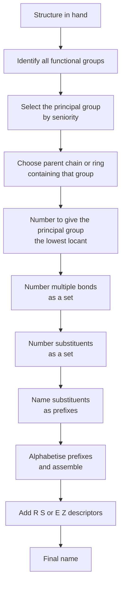
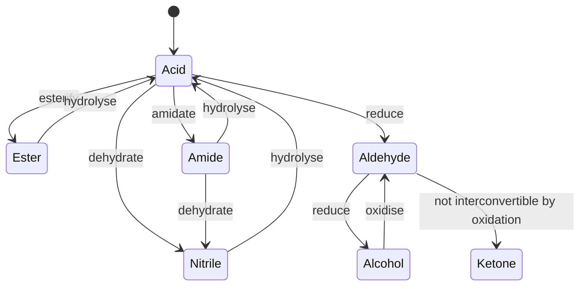
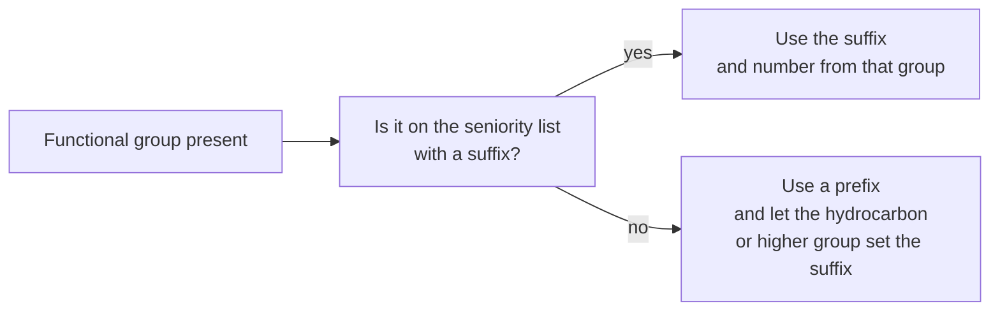
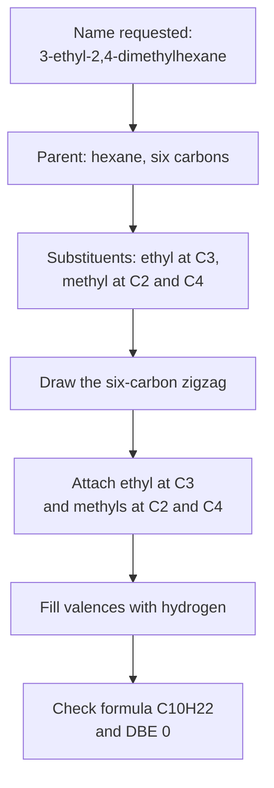

# Chapter 2 — Functional Groups and IUPAC Nomenclature

> **Level:** Level 4 — Organic Chemistry
> **Estimated study time:** 7 hours (5 h reading + 2 h exercises)
> **Prerequisites:** [Introduction to Organic Chemistry](01-introduction-to-organic-chemistry.md)
> **Related chapters:** [Isomerism and Stereochemistry](03-isomerism-and-stereochemistry.md), [Alkanes](05-alkanes.md), [Alkenes, Alkynes and Electrophilic Addition](06-alkenes-alkynes-and-electrophilic-addition.md)
> **Difficulty:** ★★★☆☆ (1–5)

---

## 1. Learning Objectives

After working through this chapter you will be able to:

- Identify every major functional group from its structure, and write its suffix, its prefix and one representative example.
- State the IUPAC seniority order of functional groups and explain why only one group can be expressed as a suffix.
- Apply the full naming algorithm to an unfamiliar structure: choose the parent chain, number it, assemble locants, alphabetise substituents and add stereodescriptors.
- Convert a systematic name into a structure, including branched chains, rings, esters, amides and nitriles.
- Use retained common names correctly and recognise when a common name is ambiguous.
- Distinguish a preferred IUPAC name from a permissible systematic name and from a trivial name.
- Introduce *(R)/(S)* and *(E)/(Z)* descriptors in the correct position in a name, while deferring their assignment to Chapter 3.
- Avoid the standard nomenclature errors that make a name ambiguous or simply wrong.

---

## 2. Introduction

A chemical name is a lossless description of a structure written in words. Given the name 3-ethyl-2,4-dimethylhexane, a competent chemist can draw exactly one constitution: a six-carbon chain, methyl groups at positions 2 and 4, an ethyl group at position 3, and hydrogens filling the remaining valences. No picture is needed, no database is consulted, and no ambiguity remains. That property — invertibility — is the whole point of systematic nomenclature.

The need is practical before it is aesthetic. A research compound may be one of millions of possible isomers, and a trivial name such as "butyl alcohol" identifies at least four different substances depending on whether the butyl group is *n*-butyl, *sec*-butyl, isobutyl or *tert*-butyl. Regulatory filings, patents, safety data sheets and database searches all depend on names that map to one structure and only one. The International Union of Pure and Applied Chemistry (IUPAC) has maintained the rules for organic nomenclature since 1919, and the current definitive statement is the 2013 Blue Book, which introduced the concept of a **preferred IUPAC name (PIN)** for each structure.

Systematic names are nevertheless not the only names in use. Acetic acid, phenol, aniline, toluene and acetone are retained because they are embedded in industry, literature and everyday language, and IUPAC explicitly permits many of them. A student therefore needs three competences, not one: to construct a systematic name, to interpret a trivial name, and to know which is which. Pretending that systematic names have replaced all others is as misleading as pretending that common names are sufficient.

This chapter builds those competences. It surveys the functional groups that define the rest of the level, establishes the seniority order that decides which group gets the suffix, sets out the naming algorithm step by step, and works through a substantial set of examples in both directions. Stereochemical descriptors are introduced here because they belong in the name, but their assignment is the subject of Chapter 3.

---

## 3. Fundamental Concepts

### 3.1 What a functional group is

A **functional group** is an atom or grouping of atoms that confers a characteristic set of physical and chemical properties on the molecule that contains it. The definition is deliberately behavioural: a hydroxyl group is a functional group because every molecule containing an $\ce{-OH}$ bonded to saturated carbon shows broadly similar acidity, hydrogen bonding and substitution chemistry, regardless of the rest of the structure.

Three structural features generate most functional groups:

- **A heteroatom** — O, N, S, P or a halogen — with lone pairs and, usually, a bond polarity.
- **A π bond** — C=C, C=O, C≡N — which provides electron density and a defined geometry.
- **A polarised σ bond** — C–X, C–O, C–N — which provides an electrophilic carbon and a leaving group.

A molecule may contain several functional groups, and then the naming problem becomes a problem of *priority*: which group is expressed as the suffix, and which are demoted to prefixes. That question is settled by the seniority order in Section 3.3.

### 3.2 The functional-group inventory

The table below is the working inventory for this level. The suffix column gives the ending used when the group is the principal functional group; the prefix column gives the form used when it is a substituent. A dash indicates that the group is normally cited only as a prefix, or that it has no simple suffix.

| Class | General structure | Suffix | Prefix | Example | Name |
|---|---|---|---|---|---|
| Carboxylic acid | $\ce{R-CO2H}$ | -oic acid | carboxy | $\ce{CH3COOH}$ | ethanoic acid |
| Ester | $\ce{R-CO2R'}$ | -oate | alkoxycarbonyl | $\ce{CH3COOCH2CH3}$ | ethyl ethanoate |
| Amide | $\ce{R-CONH2}$ | -amide | carbamoyl | $\ce{CH3CONH2}$ | ethanamide |
| Nitrile | $\ce{R-CN}$ | -nitrile | cyano | $\ce{CH3CN}$ | ethanenitrile |
| Aldehyde | $\ce{R-CHO}$ | -al | oxo, formyl | $\ce{CH3CHO}$ | ethanal |
| Ketone | $\ce{R-CO-R'}$ | -one | oxo | $\ce{CH3COCH3}$ | propan-2-one |
| Alcohol | $\ce{R-OH}$ | -ol | hydroxy | $\ce{CH3CH2OH}$ | ethanol |
| Thiol | $\ce{R-SH}$ | -thiol | sulfanyl | $\ce{CH3SH}$ | methanethiol |
| Amine | $\ce{R-NH2}$ | -amine | amino | $\ce{CH3NH2}$ | methanamine |
| Alkene | $\ce{C=C}$ | -ene | — | $\ce{CH2=CH2}$ | ethene |
| Alkyne | $\ce{C#C}$ | -yne | — | $\ce{HC#CH}$ | ethyne |
| Alkane | $\ce{C-C}$ | -ane | alkyl | $\ce{CH3CH3}$ | ethane |
| Ether | $\ce{R-O-R'}$ | — | alkoxy | $\ce{CH3OCH3}$ | methoxymethane |
| Haloalkane | $\ce{R-X}$ | — | fluoro, chloro, bromo, iodo | $\ce{CH3Cl}$ | chloromethane |
| Arene | $\ce{Ar-H}$ | — | phenyl, aryl | $\ce{C6H6}$ | benzene |
| Acyl chloride | $\ce{R-COCl}$ | -oyl chloride | chloroformyl | $\ce{CH3COCl}$ | ethanoyl chloride |
| Anhydride | $\ce{(RCO)2O}$ | -oic anhydride | — | $\ce{(CH3CO)2O}$ | ethanoic anhydride |
| Sulfonic acid | $\ce{R-SO3H}$ | -sulfonic acid | sulfo | $\ce{CH3SO3H}$ | methanesulfonic acid |

Two conventions in the table need comment. First, an ester is named as an *alkyl alkanoate*: the group attached to oxygen is cited first as a separate word, and the acyl part carries the suffix. Second, a nitrile carbon is counted as part of the parent chain, so $\ce{CH3CN}$ has a two-carbon parent and is ethanenitrile, not methanenitrile.

### 3.3 Seniority

When several functional groups are present, exactly one is chosen as the **principal functional group** and expressed as the suffix. The others appear as prefixes. The seniority order used in this level is:

| Rank | Group | Suffix when principal |
|---|---|---|
| 1 | Carboxylic acid | -oic acid |
| 2 | Ester | -oate |
| 3 | Amide | -amide |
| 4 | Nitrile | -nitrile |
| 5 | Aldehyde | -al |
| 6 | Ketone | -one |
| 7 | Alcohol | -ol |
| 8 | Amine | -amine |
| 9 | Alkene and alkyne | -ene, -yne |
| 10 | Alkane | -ane |
| 11 | Ether | prefix only |
| 12 | Halide | prefix only |

The order is a ranking of oxidation level and of the number of heteroatom bonds at the group carbon, not a ranking of reactivity. A carboxylic acid outranks an alcohol because its carbon is bonded to two oxygens; a ketone outranks an alcohol because its carbon is bonded to one oxygen twice rather than once. Ethers and halides are never principal because they have no characteristic suffix in the standard system; they are always cited as prefixes.

The order above is a teaching simplification. The full IUPAC seniority table also includes anhydrides, acyl halides, sulfonic acids and their derivatives, and places thiols between alcohols and amines. Those groups are introduced here only where the curriculum needs them; the Blue Book is the authority when a genuinely unusual combination appears.

Two consequences follow immediately. First, the suffix determines the numbering: the principal group receives the lowest possible locant. Second, a molecule may contain a high-priority group that is *not* principal only if another group of even higher priority is present — for example, a hydroxy acid is named as an acid, with the hydroxyl cited as "hydroxy".

### 3.4 The naming algorithm

The following algorithm applies to all acyclic and cyclic compounds in this level. It is written as a sequence because the steps interact: a poor choice at step 2 usually makes steps 4 and 5 impossible to complete correctly.

1. **Identify the principal functional group** using the seniority table. If none of the suffix-bearing groups is present, the parent is a hydrocarbon and the suffix is *-ane*, *-ene* or *-yne*.
2. **Select the parent chain or ring.** The parent must contain the principal functional group, the maximum number of multiple bonds, and then the maximum number of carbon atoms. Between chains of equal length, choose the one with the greatest number of substituents.
3. **Number the parent.** Give the principal group the lowest locant; then give multiple bonds the lowest locants as a set; then give substituent prefixes the lowest locants as a set. Compare locant sets term by term, and at the first point of difference choose the lower number.
4. **Name the substituents** as prefixes, using the correct multiplying prefix (*di*, *tri*, *tetra*) and the correct structural prefix (*sec-*, *tert-*, *iso*, *neo*, *cyclo*).
5. **Assemble the name.** Cite prefixes in alphabetical order, ignoring multiplying prefixes but including *iso*, *neo* and *cyclo*. Insert locants before each prefix and before the suffix, separated by hyphens. Close up the whole name as one word.
6. **Add stereodescriptors** at the front of the name in parentheses, in the order *(R)/(S)* then *(E)/(Z)*, each attached to its locant where necessary.

Step 3 contains the only genuinely tricky rule. **Lowest locant set** is not the same as "smallest sum of locants". The set $\{2,3,5\}$ is lower than $\{2,4,5\}$ because the second term is lower, even though both sum to 10 and 11 respectively; the comparison is lexicographic, term by term. Summing locants is a common error that occasionally gives the same answer and sometimes gives the wrong one.

### 3.5 Alkanes and alkyl groups

The unbranched alkanes are named with the stems meth-, eth-, prop-, but-, pent-, hex-, hept-, oct-, non- and dec-, followed by *-ane*. The first four stems are retained historical names with no numerical meaning; from five onward the stems are Greek numerals.

An **alkyl group** is an alkane minus one hydrogen, and is named by replacing *-ane* with *-yl*. Branched alkyl groups require parentheses and locants of their own:

| Substituent | Structure | Name |
|---|---|---|
| Methyl | $\ce{-CH3}$ | methyl |
| Ethyl | $\ce{-CH2CH3}$ | ethyl |
| Propyl | $\ce{-CH2CH2CH3}$ | propyl |
| Propan-2-yl | $\ce{-CH(CH3)2}$ | propan-2-yl, or isopropyl |
| Butyl | $\ce{-CH2CH2CH2CH3}$ | butyl |
| Butan-2-yl | $\ce{-CH(CH3)CH2CH3}$ | butan-2-yl, or *sec*-butyl |
| 2-Methylpropyl | $\ce{-CH2CH(CH3)2}$ | 2-methylpropyl, or isobutyl |
| 2-Methylpropan-2-yl | $\ce{-C(CH3)3}$ | 2-methylpropan-2-yl, or *tert*-butyl |

The prefixes *sec-* and *tert-* are retained but are not recommended in PINs, because they describe the point of attachment rather than the structure of the group. They remain common in laboratory usage and in the names of reagents, so they must be recognised. *Iso* and *neo* are part of the parent name and are not italicised or hyphenated.

### 3.6 Multiple bonds and locants

A double bond takes the suffix *-ene* and a triple bond the suffix *-yne*. When both are present, the suffix is *-enyne*, with the locant of the double bond cited first and the locant of the triple bond second. The final *e* of the parent stem is retained before a consonant and dropped before a vowel: *but-2-ene* becomes *but-2-en-1-ol* when a hydroxyl is added.

Two multiple bonds of the same kind are indicated by *di*: buta-1,3-diene. A double bond at position 1 is normally cited, even though a locant of 1 could be inferred: but-1-ene, not butene. Omitting the locant when the position is unambiguous is permitted for ethene and propene, where only one position exists.

Multiple bonds are numbered *after* the principal functional group. In pent-4-en-1-ol the hydroxyl at C1 takes precedence, and the double bond is placed at the lowest remaining position consistent with the parent chain.

### 3.7 Rings, spiro compounds and bicyclic systems

A ring is indicated by the prefix *cyclo-* before the parent stem: cyclohexane, cyclopent-2-en-1-ol. In a substituted ring the principal group takes position 1 and the substituents are numbered to give the lowest locant set, with alphabetical order breaking ties.

Two-ring systems use the **spiro** descriptor when the rings share one atom, and the **bicyclo** descriptor when they share two or more. Bicyclo names take the form bicyclo[*a.b.c*]alkane, where *a*, *b* and *c* are the numbers of atoms in the three bridges connecting the bridgehead atoms, cited in descending order, and the total carbon count is *a + b + c + 2*. Bicyclo[2.2.1]heptane, for example, has two bridges of two atoms, one bridge of one atom and two bridgeheads, giving seven carbons.

### 3.8 Retained common names

IUPAC retains a substantial list of trivial names for compounds of commercial or historical importance. The following are expected knowledge:

| Structure | Retained name | Systematic equivalent |
|---|---|---|
| $\ce{HCOOH}$ | Formic acid | Methanoic acid |
| $\ce{CH3COOH}$ | Acetic acid | Ethanoic acid |
| $\ce{CH3CH2COOH}$ | Propionic acid | Propanoic acid |
| $\ce{C6H5COOH}$ | Benzoic acid | Benzenecarboxylic acid |
| $\ce{HOOC-COOH}$ | Oxalic acid | Ethanedioic acid |
| $\ce{C6H5OH}$ | Phenol | Benzenol |
| $\ce{C6H5NH2}$ | Aniline | Benzenamine |
| $\ce{C6H5CH3}$ | Toluene | Methylbenzene |
| $\ce{CH3COCH3}$ | Acetone | Propan-2-one |
| $\ce{HCHO}$ | Formaldehyde | Methanal |
| $\ce{CH3CHO}$ | Acetaldehyde | Ethanal |
| $\ce{HOCH2CH2OH}$ | Ethylene glycol | Ethane-1,2-diol |
| $\ce{HOCH2CH(OH)CH2OH}$ | Glycerol | Propane-1,2,3-triol |

Retained names are not a licence to invent new trivial names. A name that is not on the retained list and is not systematic is simply wrong, however familiar it sounds. "Ethyl methyl ketone" and "methyl ethyl ketone" are laboratory usages, not IUPAC names; the systematic name is butan-2-one.

### 3.9 Stereodescriptors in names

Two kinds of stereochemical descriptor appear in organic names, and both are placed at the front of the name in parentheses.

*(R)* and *(S)* describe the configuration at a **stereocentre** — usually a carbon bearing four different groups. They are assigned by the Cahn–Ingold–Prelog (CIP) priority rules, which are set out in full in Chapter 3. The descriptor is cited with its locant when more than one stereocentre is present: (2*R*,3*S*)-2,3-dihydroxybutanal.

*(E)* and *(Z)* describe the configuration of a double bond. They replace the older *cis* and *trans* descriptors when the double bond carries three or four different substituents. Priority at each end of the double bond is again assigned by CIP rules; if the higher-priority groups are on the same side, the descriptor is *(Z)* (from German *zusammen*), and if on opposite sides it is *(E)* (from *entgegen*).

The descriptors belong in the name because they are part of the structure. Two molecules with the same constitution but opposite configuration at a stereocentre are different compounds with different physical properties and, often, different biological activity. A name without the descriptor is incomplete whenever the stereochemistry is known.

---

## 4. Detailed Scientific Explanation

### 4.1 Why the longest chain

The parent chain is chosen to be as long as possible for three reasons: it minimises the number of substituent prefixes, it keeps the parent name as simple as possible, and it ensures that the same structure cannot be named in two different ways by two different chemists. The rule is a convention, not a chemical law, but it is a convention that makes names reproducible.

The rule has a corollary that surprises beginners: the longest chain is not necessarily the one drawn horizontally. In $\ce{CH3-CH(CH2CH3)-CH2-CH2-CH3}$ the horizontal chain has five carbons, but the chain that runs through the ethyl branch also has five; the correct choice is the one with more substituents, and if both give the same number, the lower locant set decides. Rotating the page does not change the molecule, and it must not change the name.

### 4.2 Numbering: the lexicographic rule in practice

Numbering is decided by comparing locant sets term by term, after sorting each set in ascending order. Consider a chain bearing substituents at positions that could be described as $\{2,4,5\}$ or $\{2,3,6\}$. Both sets have the same sum, 11. The first terms are equal, the second terms are 3 and 4, and 3 is lower, so the set $\{2,3,6\}$ is preferred. A student who sums locants would call this a tie and choose arbitrarily.

The order of precedence within step 3 is also strict. The principal functional group is numbered first, even if that forces a higher locant on a double bond. Multiple bonds are numbered next, as a set, and substituents last. In 5-hydroxyhex-4-en-2-one, the ketone fixes C2, the double bond takes the lowest remaining position, and the hydroxyl takes what is left.

### 4.3 Alphabetical order

Substituent prefixes are cited in alphabetical order of their names, ignoring the multiplying prefixes *di*, *tri*, *tetra* and the structural prefixes *sec-* and *tert-*, but including *iso*, *neo* and *cyclo*. Thus "ethyl" precedes "methyl", "dimethyl" is alphabetised under *m*, and "isopropyl" is alphabetised under *i*.

| Correct order | Incorrect order | Reason |
|---|---|---|
| 3-ethyl-2-methylpentane | 2-methyl-3-ethylpentane | Ethyl precedes methyl |
| 2,3-dimethylbutane | 3,2-dimethylbutane | Locants ascending within a prefix |
| 1-bromo-2-chloroethane | 2-chloro-1-bromoethane | Bromo precedes chloro |
| 2-methyl-3-(propan-2-yl)hexane | 2-methyl-3-isopropylhexane | PIN uses propan-2-yl; alphabetise under p |

The entire name is written as one word, with hyphens between locants and letters and no spaces except in esters and acid derivatives, where the alkyl group is a separate word.

### 4.4 Polyfunctional compounds

Only one group can be the suffix. The others become prefixes, and their locants are cited in alphabetical order of the prefix. Two worked structures show the principle.

**Example.** $\ce{HOCH2CH2CH(CH3)CH2COOH}$. The carboxylic acid outranks the alcohol, so the parent is pentanoic acid and the hydroxyl is a prefix. Numbering from the carboxyl carbon gives C1 to C5; the methyl is at C3 and the hydroxyl at C5. The name is 5-hydroxy-3-methylpentanoic acid. Alphabetically, *hydroxy* precedes *methyl*, so it is cited first even though its locant is higher.

**Example.** $\ce{CH3COCH2CH(OH)CH3}$. The ketone outranks the alcohol. The parent is pentan-2-one, numbered to give the ketone the lowest locant: C1 is the methyl adjacent to the carbonyl, C2 the carbonyl, C3 the CH2, C4 the CHOH and C5 the terminal methyl. The name is 4-hydroxypentan-2-one. Numbering from the other end would give pentan-4-one, which is wrong because the principal group must receive the lowest locant.

### 4.5 Carboxylic acid derivatives

Esters, amides, nitriles, acyl chlorides and anhydrides each have their own naming pattern, and each pattern encodes the point of attachment.

- **Esters** are named as alkyl alkanoates. The alkyl group attached to oxygen is cited first as a separate word, and the acyl fragment carries the suffix: $\ce{CH3COOCH2CH3}$ is ethyl ethanoate; $\ce{HCOOCH3}$ is methyl methanoate.
- **Amides** take the suffix *-amide*. Substituents on nitrogen are cited with the locant *N*: $\ce{CH3CONHCH3}$ is *N*-methylethanamide; $\ce{CH3CON(CH3)2}$ is *N*,*N*-dimethylethanamide.
- **Nitriles** take the suffix *-nitrile*, and the nitrile carbon is C1: $\ce{CH3CH2CN}$ is propanenitrile.
- **Acyl chlorides** take the suffix *-oyl chloride*: $\ce{CH3CH2COCl}$ is propanoyl chloride.
- **Anhydrides** take the suffix *-oic anhydride*, with the parent repeated if the two acyl groups differ: $\ce{CH3COOCOCH3}$ is ethanoic anhydride.

The pattern is consistent: the suffix names the acyl fragment, and everything else is a prefix or a separate word. Once the pattern is understood, the individual names do not need to be memorised.

### 4.6 Preferred names, systematic names and trivial names

Three categories of name coexist. A **trivial name** is historical and may be ambiguous: "butyl alcohol" could mean any of four isomers. A **systematic name** follows the IUPAC rules completely and is unambiguous, but may be more than one valid construction. A **preferred IUPAC name (PIN)** is the single name that IUPAC designates as preferred for a structure; it is the name used in patents, regulatory documents and databases.

For most simple compounds the PIN is the systematic name. For some, the PIN is a retained trivial name: toluene rather than methylbenzene, phenol rather than benzenol, acetic acid rather than ethanoic acid. A name that is systematic but not preferred is still correct chemistry; it is simply not the name a database will index. In this book, systematic names are used in mechanistic discussion, and retained names are flagged when they appear in the literature.

### 4.7 Fourteen name–structure pairs

The table below is the working set for this chapter. Each row converts a condensed structure into a name and identifies the feature that decides the name.

| Structure | Name | Decisive feature |
|---|---|---|
| $\ce{CH3CH2CH2CH2CH3}$ | Pentane | Five-carbon unbranched chain |
| $\ce{CH3CH(CH3)CH2CH3}$ | 2-Methylbutane | Four-carbon parent, methyl at C2 |
| $\ce{CH3C(CH3)2CH2CH3}$ | 2,2-Dimethylbutane | Two methyls on the same carbon |
| $\ce{CH3CH=CHCH3}$ | But-2-ene | Double bond at C2; *E/Z* needed in Ch. 3 |
| $\ce{CH2=CHCH2CH3}$ | But-1-ene | Double bond at C1 |
| $\ce{CH3CH2C#CH}$ | But-1-yne | Triple bond at C1 |
| $\ce{CH3CH(OH)CH2CH3}$ | Butan-2-ol | Hydroxyl at C2 |
| $\ce{CH3CH2COCH3}$ | Butan-2-one | Ketone at C2 |
| $\ce{CH3CH2CH2COOH}$ | Butanoic acid | Four-carbon acid |
| $\ce{CH3COOCH2CH3}$ | Ethyl ethanoate | Ethyl on oxygen, ethanoate acyl group |
| $\ce{CH3CONHCH3}$ | *N*-Methylethanamide | Methyl on nitrogen |
| $\ce{CH3CH2CH2CN}$ | Butanenitrile | Nitrile carbon included in the chain |
| $\ce{ClCH2CH2CH2OH}$ | 3-Chloropropan-1-ol | Chlorine as prefix, hydroxyl as suffix |
| $\ce{C6H5CH2CH3}$ | Ethylbenzene | Ethyl substituent on benzene |

Four of these rows deserve a second look. But-2-ene requires a stereodescriptor once the configuration is known; without it the name describes a mixture or an unspecified geometry. *N*-Methylethanamide shows that locants may be letters, not only numbers. Butanenitrile shows that the nitrile carbon is part of the parent chain even though it carries no hydrogen. 3-Chloropropan-1-ol shows the rule that the suffix group takes the lowest locant, not the first substituent alphabetically.

### 4.8 Names in the literature

Research papers use systematic names in experimental sections and trivial names in discussion. A synthesis of a natural product may be described throughout as "the acid" or "the ketone", with the systematic name given once. Reading the literature therefore requires the ability to move in both directions, and to recognise when an author is using a shorthand that is not a valid name. A good habit is to draw the structure from the name the first time it appears, and to check that the drawing matches the formula given.

---

## 5. Visual Diagrams

Nomenclature is a decision procedure, and decision procedures are best shown as diagrams. The figures below encode the algorithm, the seniority ladder and the suffix/prefix choice. They are not a substitute for the rules in Section 3.4; they are a way of holding the rules in mind while working.

**Figure 2.1 — The naming algorithm as a decision sequence.** Each box is a decision that constrains the next. The critical step is C: once the principal group is chosen, the parent chain must contain it, and the numbering must give it the lowest locant. A name assembled without fixing the principal group first will usually have to be rebuilt from the beginning.

**Figure 2.2 — Seniority is not a reaction pathway.** The diagram shows the oxidation-level relationships that underlie the seniority order. Carboxylic acids sit at the top of the oxidation ladder in this series, nitriles and amides are derived from them, aldehydes and alcohols are lower, and ketones are a branch rather than a rung. The arrows are illustrative conversions, not a claim that every step is a single reaction; the actual reagents appear in Chapters 9 to 12.

**Figure 2.3 — Suffix or prefix.** Only groups on the seniority ladder can be suffixes. Ethers and halides are always prefixes, so a molecule containing only an ether and a halogen is named as a substituted alkane. A molecule containing an alcohol and a halogen is named as an alcohol, with the halogen as a prefix.

**Figure 2.4 — From name to structure.** Reading a name is the reverse of building one. The parent fixes the skeleton, the locants fix the positions, and the valences fix the hydrogens. The final formula check is not optional: a drawing that implies the wrong number of hydrogens is a different molecule from the one named.

---

## 6. Mathematical Formulas

Nomenclature is qualitative, but three quantitative relationships are used constantly to check that a name and a structure agree.

### 6.1 General formulas of homologous series

$$
\ce{C_nH_{2n+2}}\ \text{(alkane)}
\qquad
\ce{C_nH_{2n}}\ \text{(alkene or cycloalkane)}
\qquad
\ce{C_nH_{2n-2}}\ \text{(alkyne or diene)}
$$

| Series | General formula | Example | $n$ |
|---|---|---|---|
| Alkane | $\ce{C_nH_{2n+2}}$ | $\ce{C5H12}$ | 5 |
| Alkene, one ring | $\ce{C_nH_{2n}}$ | $\ce{C5H10}$ | 5 |
| Alkyne, two rings, diene | $\ce{C_nH_{2n-2}}$ | $\ce{C5H8}$ | 5 |
| Saturated alcohol | $\ce{C_nH_{2n+2}O}$ | $\ce{C4H10O}$ | 4 |
| Saturated amine | $\ce{C_nH_{2n+3}N}$ | $\ce{C3H9N}$ | 3 |
| Saturated carboxylic acid | $\ce{C_nH_{2n}O2}$ | $\ce{C4H8O2}$ | 4 |

The formulas assume acyclic, saturated structures apart from the stated unsaturation. Each ring or π bond reduces the hydrogen count by two relative to the alkane, which is exactly what the degree of unsaturation counts.

### 6.2 Degree of unsaturation as a name check

$$
\text{DBE} = \frac{2C + 2 + N - H - X}{2}
$$

For a name-to-structure conversion, the DBE computed from the name's formula must equal the number of rings and π bonds implied by the name. If a name implies one ring and no π bonds but the formula gives $\text{DBE} = 2$, either the drawing or the formula is wrong. This is the fastest available check on a nomenclature exercise.

### 6.3 Comparing locant sets

Let $L_1 = (l_1, l_2, \ldots, l_k)$ and $L_2 = (m_1, m_2, \ldots, m_k)$ be locant sets sorted in ascending order. $L_1$ is preferred if, at the first index $i$ where $l_i \neq m_i$, $l_i < m_i$.

$$
(2,3,6) \prec (2,4,5)
\qquad\text{because}\qquad
3 < 4
$$

The relation is lexicographic, exactly like alphabetical order in a dictionary, and it is not equivalent to comparing the sums. The formal statement matters because it removes the ambiguity that would otherwise arise whenever two numbering schemes give the same total.

### 6.4 Counting constitutional isomers

The number of constitutional isomers of the acyclic alkanes $\ce{C_nH_{2n+2}}$ grows rapidly with $n$:

| $n$ | 1 | 2 | 3 | 4 | 5 | 6 | 7 | 8 | 9 | 10 |
|---|---|---|---|---|---|---|---|---|---|---|
| Isomers | 1 | 1 | 1 | 2 | 3 | 5 | 9 | 18 | 35 | 75 |

The sequence is not given by a simple closed formula; it is generated by a recursive enumeration of rooted trees. The practical lesson is that a molecular formula does not identify a compound once $n \ge 4$, which is why a name — or a structure — is always required. For $\ce{C4H10}$ there are two isomers, butane and 2-methylpropane, and the name distinguishes them completely.

---

## 7. Chemical Equations

The equations below connect systematic names to structures. Each is a standard transformation in which the functional group changes, and therefore the suffix changes.

### 7.1 Oxidation of a primary alcohol to a carboxylic acid

$$
\ce{CH3CH2OH ->[K2Cr2O7,\ H2SO4] CH3COOH}
$$

Ethanol (an *-ol*) is oxidised to ethanoic acid (an *-oic acid*). The change of suffix records a real change of oxidation level: the carbon bearing the oxygen gains a bond to oxygen and loses a bond to hydrogen. In the laboratory the aldehyde is an intermediate and is usually not isolated unless the oxidant is mild and the distillation is controlled.

### 7.2 Esterification

$$
\ce{CH3COOH + CH3CH2OH <=>[H2SO4] CH3COOCH2CH3 + H2O}
$$

Ethanoic acid and ethanol give ethyl ethanoate. The name of the product encodes the two fragments: *ethyl* from the alcohol, *ethanoate* from the acid. The reaction is reversible, and the equilibrium is driven to the right by removing water or by using an excess of one component.

### 7.3 Hydrolysis of an ester

$$
\ce{CH3COOCH2CH3 + NaOH -> CH3COONa + CH3CH2OH}
$$

Base-catalysed hydrolysis is irreversible because the carboxylic acid is deprotonated to the carboxylate, which is not attacked by the alcohol. The organic product names show the reverse of the esterification logic: sodium ethanoate and ethanol.

### 7.4 Hydrolysis of an amide

$$
\ce{CH3CONH2 + H2O ->[H+,\ \Delta] CH3COOH + NH4+}
$$

Ethanamide hydrolyses to ethanoic acid and ammonium ion under acid catalysis. The amide suffix *-amide* and the acid suffix *-oic acid* differ by the replacement of $\ce{-NH2}$ with $\ce{-OH}$; the carbon skeleton is unchanged.

### 7.5 Hydrolysis of a nitrile

$$
\ce{CH3CN + 2H2O ->[H+,\ \Delta] CH3COOH + NH4+}
$$

Ethanenitrile hydrolyses through the amide to ethanoic acid. The nitrile carbon becomes the carboxyl carbon, which is why the parent chain of a nitrile includes that carbon. Partial hydrolysis stops at the amide and is a standard route to amides that are difficult to prepare directly.

### 7.6 Formation of a primary amine from a haloalkane

$$
\ce{CH3CH2Br + 2NH3 -> CH3CH2NH2 + NH4Br}
$$

Bromoethane is converted into ethanamine. The suffix changes from none, because a haloalkane has no suffix, to *-amine*. The reaction is an example of nucleophilic substitution and is treated mechanistically in Chapters 8 and 9; here it serves only to show how the name changes with the functional group.

### 7.7 Acyl substitution

$$
\ce{CH3COCl + CH3CH2OH -> CH3COOCH2CH3 + HCl}
$$

Ethanoyl chloride reacts with ethanol to give ethyl ethanoate and hydrogen chloride. Acyl chlorides are more reactive than carboxylic acids and are used when the ester must be formed under mild conditions. The by-product is $\ce{HCl}$, not water, which is why the atom economy differs from direct esterification.

---

## 8. Worked Examples

### Worked Example 8.1 — Naming a branched alkane

**Problem.** Name the structure $\ce{CH3-CH(CH3)-CH2-CH(CH2CH3)-CH2-CH3}$.

**Strategy.** Find the longest chain, then the chain with the most substituents, then number to give the lowest locant set.

**Solution.** The horizontal chain contains six carbons. The chain that starts at the ethyl branch and runs through the substituted carbon also contains six carbons, so the two candidates are of equal length. The horizontal chain carries two substituents (methyl and ethyl); the alternative carries two as well, so the tie is broken by locants.

Numbering the horizontal chain from left to right gives substituents at positions 2 and 4. Numbering from right to left gives positions 3 and 5. The set $\{2,4\}$ is lower than $\{3,5\}$, so the left-to-right numbering is correct. Alphabetically, ethyl precedes methyl, so the name is 4-ethyl-2-methylhexane.

**Check.** Count carbons: six in the chain, one methyl and two ethyl carbons give nine, so the formula is $\ce{C9H20}$ and the DBE is $(20 - 20)/2 = 0$. The name implies an acyclic saturated alkane, which matches. A common error is to choose the chain that looks horizontal; the rule is longest first, then most substituted, then lowest locants.

### Worked Example 8.2 — Naming an alkene with a stereodescriptor

**Problem.** A structure is drawn as $\ce{CH3-CH=C(CH3)-CH2-CH3}$, with the methyl group on C2 and the ethyl group on C3 on opposite sides of the double bond. Name the compound completely.

**Strategy.** Identify the parent chain containing the double bond, number to give the double bond the lowest locant, then assign *E/Z* using CIP priorities at each alkene carbon.

**Solution.** The longest chain containing the double bond has five carbons, so the parent is pent-2-ene. The double bond is between C2 and C3, and a methyl group is attached at C3. The name without stereochemistry is 3-methylpent-2-ene.

At C2 the substituents are $\ce{H}$ and $\ce{CH3}$; carbon outranks hydrogen, so the higher-priority group is the methyl. At C3 the substituents are $\ce{CH3}$ and $\ce{CH2CH3}$; the ethyl group has a carbon attached to C, H, H, whereas the methyl carbon is attached to H, H, H, so ethyl outranks methyl. The two higher-priority groups lie on opposite sides, so the descriptor is *(E)*. The full name is (E)-3-methylpent-2-ene.

**Check.** The formula is $\ce{C6H12}$, giving DBE 1, which matches one double bond. The descriptor is assigned from priorities, not from the size of the groups: the ethyl group outranks the methyl group because of the atoms attached to the first carbon, not because it is larger.

### Worked Example 8.3 — A hydroxy acid

**Problem.** Name $\ce{HOCH2CH2CH(CH3)CH2COOH}$.

**Strategy.** Identify the highest-priority group, choose the parent, number from the principal group, and alphabetise the prefixes.

**Solution.** The carboxylic acid outranks the alcohol, so the parent is pentanoic acid: C1 is the carboxyl carbon, C2 the adjacent $\ce{CH2}$, C3 the $\ce{CH}$ bearing the methyl, C4 the next $\ce{CH2}$ and C5 the $\ce{CH2OH}$. The methyl is at C3 and the hydroxyl at C5. Both are prefixes, cited alphabetically: *hydroxy* before *methyl*. The name is 5-hydroxy-3-methylpentanoic acid.

**Check.** The formula is $\ce{C6H12O3}$, giving DBE 1, matching the carboxyl group. Numbering from the other end would give 1-hydroxy-3-methylpentanoic acid, which is wrong because the carboxyl carbon must be C1. The locants in the name are not in numerical order (5 before 3) because alphabetical order governs the sequence of prefixes.

### Worked Example 8.4 — Naming an ester

**Problem.** Name $\ce{CH3CH2COOCH(CH3)2}$.

**Strategy.** Split the ester at the acyl–oxygen bond. The acyl fragment supplies the alkanoate name; the alkyl fragment supplies the first word.

**Solution.** The acyl fragment is $\ce{CH3CH2CO-}$, which is propanoyl, so the alkanoate is propanoate. The alkyl fragment is $\ce{-CH(CH3)2}$, which is propan-2-yl, commonly called isopropyl. The name is propan-2-yl propanoate, or isopropyl propanoate in laboratory usage.

**Check.** The formula is $\ce{C6H12O2}$, giving DBE 1, matching the ester carbonyl. A common error is to name the ester as "isopropyl propionic acid", which mixes a retained acid name with an ester suffix; the correct ending is *-oate*.

### Worked Example 8.5 — From name to structure

**Problem.** Draw 3-ethyl-2,4-dimethylhexane and verify its formula.

**Strategy.** Build the six-carbon parent, attach the substituents at the stated positions, fill the valences, then compute the formula and the DBE.

**Solution.** Draw a zigzag of six vertices and number them C1 to C6. Attach an ethyl group at C3 and a methyl group at C2 and at C4. Each carbon now has four bonds once hydrogen is added: C1 has three hydrogens, C2 has one hydrogen and two methyls plus C1 and C3, C3 has one hydrogen, C4 has one hydrogen and two methyls, C5 has two hydrogens and C6 has three.

The carbon count is $6 + 1 + 1 + 2 = 10$, and the hydrogen count is $3 + 1 + 1 + 1 + 2 + 3$ for the chain plus $3 + 3$ for the two methyl branches plus $2 + 3$ for the ethyl branch, giving 22. The formula is $\ce{C10H22}$, and the DBE is $(22 - 22)/2 = 0$.

**Check.** A saturated acyclic alkane with ten carbons must have $\ce{C10H22}$ by the general formula, so the drawing is consistent. If the structure had been drawn with a five-carbon parent, the name would not match the drawing, because the longest chain would actually be six carbons long.

### Worked Example 8.6 — A prefix that needs parentheses

**Problem.** Name $\ce{HOCH2CH2NHCH3}$.

**Strategy.** Determine which group is senior. The alcohol outranks the amine, so the parent is an alcohol and the amine is a prefix. Identify the substituent on nitrogen.

**Solution.** The parent chain is ethan-1-ol: C1 bears the hydroxyl and C2 bears the nitrogen. The nitrogen carries a methyl group, so the substituent is *methylamino*. The locant is 2, and the substituent itself contains a locant, so it is enclosed in parentheses: 2-(methylamino)ethan-1-ol.

**Check.** The formula is $\ce{C3H9NO}$, and the DBE is $(6 + 2 + 1 - 9)/2 = 0$, consistent with an acyclic saturated compound. Without the parentheses, "2-methylaminoethan-1-ol" would be read as a methyl group at C2 and an amino group somewhere else, which is a different structure.

---

## 9. Real-World Applications

**Pharmaceutical names.** Every approved drug has an International Nonproprietary Name (INN), and the INN system is built on systematic nomenclature with a defined stem that identifies the pharmacological class. Paracetamol is *N*-(4-hydroxyphenyl)ethanamide; the systematic name identifies the acetamide group and the para-hydroxyl, while the common name identifies nothing. Regulatory approval requires a single unambiguous name for each substance, and the IUPAC PIN or the INN supplies it.

**Patents and databases.** A patent claim must cover a structure, and a structure is defined by its name as well as by its drawing. Chemical databases index compounds by systematic name, by CAS Registry Number, by SMILES and by InChI. A compound with an ambiguous common name may be indexed under several entries or under none, which is why systematic names are the working language of cheminformatics.

**Safety and regulation.** Safety data sheets, transport classifications and REACH registrations all use systematic names. "Xylene" covers three isomers with different toxicological profiles; "1,2-dimethylbenzene" identifies one. The difference is not pedantic when the substance is being transported or stored.

**Materials and polymers.** Polymer nomenclature follows the same principles: poly(ethene) rather than polyethylene in systematic usage, poly(vinyl chloride) or poly(chloroethene) depending on the convention. Block copolymers and branched polymers require additional descriptors, and the conventions are set out in IUPAC recommendations rather than in the Blue Book.

**Flavour and fragrance chemistry.** Vanillin is 4-hydroxy-3-methoxybenzaldehyde; eugenol is 4-allyl-2-methoxyphenol. The systematic names tell a chemist which positions are substituted and therefore which reactions are possible, while the trivial names carry the commercial identity. Both are needed in an industry where the same molecule may be a flavour, a fragrance and a pharmaceutical intermediate.

**Teaching and examination.** A nomenclature question is the cheapest available test of structural understanding. A student who can name an unfamiliar structure has demonstrated that they can identify functional groups, count chains, apply priority and check a formula — four skills that every later chapter assumes.

---

## 10. Common Mistakes

| Mistake | Why it happens | Correct approach |
|---|---|---|
| Choosing the longest chain without checking that it contains the principal group | The longest chain is visually obvious, so the constraint is forgotten | The parent must contain the principal functional group first, then the maximum number of multiple bonds, then the maximum number of carbons |
| Numbering to give substituents the lowest locants | Substituents are the most visible feature of a branched structure | Number the principal group first, then multiple bonds as a set, then substituents |
| Comparing locant sets by their sums | Summing is arithmetically natural and often gives the same answer | Compare term by term and stop at the first difference |
| Alphabetising "dimethyl" under *d* | The prefix is part of the written name | Ignore *di*, *tri*, *tetra*, *sec-* and *tert-*; include *iso*, *neo* and *cyclo* |
| Naming an ester as an acid with an alkyl prefix | The ester contains an acid-derived fragment | Name it as alkyl alkanoate: the alkyl group is a separate word and the acyl group carries *-oate* |
| Omitting the locant for a double bond that is not at position 1 | Ethene and propene need no locant, so the habit spreads | Cite the locant whenever more than one position is possible: but-2-ene, not butene |
| Treating a trivial name as systematic | Trivial names are familiar and appear in laboratories | Check the retained list; if a name is not retained and not systematic, do not use it |
| Forgetting that the nitrile carbon is part of the parent chain | The nitrile carbon carries no hydrogen and is easily overlooked | Count the nitrile carbon as C1: $\ce{CH3CH2CN}$ is propanenitrile |

---

## 11. Chapter Summary

- A functional group is defined by its characteristic chemistry, not by its position in a particular molecule.
- The seniority order runs carboxylic acid > ester > amide > nitrile > aldehyde > ketone > alcohol > amine > alkene/alkyne > alkane, with ethers and halides always cited as prefixes.
- The naming algorithm is: principal group, parent chain, numbering, substituent names, alphabetical assembly, stereodescriptors.
- The parent chain must contain the principal group; among candidates it must maximise multiple bonds and then carbon count, and then maximise substituents.
- Numbering gives the principal group the lowest locant, then multiple bonds as a set, then substituents as a set; locant sets are compared lexicographically.
- Multiplying prefixes are ignored in alphabetisation; *iso*, *neo* and *cyclo* are not.
- Esters are alkyl alkanoates; amides use *N*-locants for substituents on nitrogen; nitriles include the nitrile carbon in the parent.
- Retained trivial names are permitted but limited; a name that is neither retained nor systematic is wrong.
- *(R)/(S)* and *(E)/(Z)* are part of a complete name and are assigned by CIP rules, which Chapter 3 develops.
- A name must be checked against the molecular formula and the degree of unsaturation, because a drawing error and a naming error produce the same symptom.

---

## 12. Exercises

### 12.1 Conceptual questions

1. Explain why only one functional group can be expressed as a suffix, using a molecule that contains both a hydroxyl and a carboxyl group as your example.
2. A student numbers a chain to give a double bond the locant 2 and a methyl group the locant 3, rather than giving the double bond 3 and the methyl 2. Is the student correct? Justify your answer with the rule.

### 12.2 Basic problems

3. Name each compound: (a) $\ce{CH3CH2CH2CH2CH2CH3}$; (b) $\ce{(CH3)3CH}$; (c) $\ce{CH3CH2CH=CHCH3}$; (d) $\ce{CH3CH2CH2OH}$; (e) $\ce{CH3COCH2CH2CH3}$; (f) $\ce{CH3CH2COOCH3}$.
4. Draw the structure of each compound: (a) 2-methylpentane; (b) but-2-yne; (c) 3-bromopropanoic acid; (d) *N*-ethylethanamide.

### 12.3 Intermediate problems

5. Name $\ce{CH3CH(OH)CH(CH3)COOH}$.
6. Name each compound: (a) $\ce{CH3CH(Cl)CH2CH3}$; (b) $\ce{CH3C6H4NO2}$ with the nitro group *para* to the methyl; (c) $\ce{CH3OCH2CH3}$; (d) $\ce{(CH3)2CHNH2}$.

### 12.4 Advanced problems

7. A compound of formula $\ce{C4H8O2}$ is a carboxylic acid. Draw and name every structure consistent with this description.
8. A compound is $\ce{HOCH2CH2CH=C(CH3)CH2CH3}$, drawn with the hydroxymethyl group and the ethyl group on the same side of the double bond. Give its full name including the stereodescriptor.

### 12.5 Mechanism-drawing questions

9. Draw the mechanism of the acid-catalysed esterification of ethanoic acid with methanol, showing every curly arrow and naming each intermediate. State which step is rate-determining.
10. Draw the mechanism of the acid-catalysed hydrolysis of ethanamide, showing every curly arrow and naming the species formed at each stage.

### 12.6 Further reasoning questions

11. Name $\ce{CH3CH2CH(CH3)CH2CH2CHO}$.
12. Correct each invalid name and explain the error: (a) 3,3-dimethylbutane; (b) 2-ethylpropane; (c) 2-methylbutan-4-ol.

### 12.7 Answers

1. Only the senior group supplies the suffix; the others are demoted to prefixes so that the name has one ending and one numbering origin. In $\ce{HOCH2COOH}$ the acid is senior, so the name is 2-hydroxyethanoic acid, not "hydroxyacetic alcohol".
2. Correct. Multiple bonds are numbered before substituents, so the double bond takes the lower locant even though the methyl group is cited first in the name.
3. (a) Hexane; (b) 2-methylpropane; (c) pent-2-ene; (d) propan-1-ol; (e) pentan-2-one; (f) methyl propanoate.
4. (a) A five-carbon zigzag with a methyl at C2; (b) $\ce{CH3-C#C-CH3}$; (c) $\ce{BrCH2CH2COOH}$; (d) $\ce{CH3CONHCH2CH3}$.
5. 3-Hydroxy-2-methylbutanoic acid.
6. (a) 2-Chlorobutane; (b) 1-methyl-4-nitrobenzene; (c) methoxyethane; (d) propan-2-amine.
7. Butanoic acid, $\ce{CH3CH2CH2COOH}$, and 2-methylpropanoic acid, $\ce{(CH3)2CHCOOH}$. Both have DBE 1 and a carboxyl group; the other $\ce{C4H8O2}$ isomers are esters.
8. (Z)-4-methylhex-3-en-1-ol. The priorities are $\ce{CH2CH2OH}$ over $\ce{H}$ at C3 and $\ce{CH2CH3}$ over $\ce{CH3}$ at C4; the two higher-priority groups are on the same side, so the descriptor is *(Z)*.
9. Protonation of the carbonyl oxygen by $\ce{H+}$; attack of the methanol oxygen lone pair on the carbonyl carbon; proton transfer to the hydroxyl; loss of water from the tetrahedral intermediate; deprotonation to give methyl ethanoate. The nucleophilic attack is rate-determining.
10. Protonation of the carbonyl oxygen; attack of water on the carbonyl carbon to give a tetrahedral intermediate; collapse with expulsion of ammonia; deprotonation of the acid and protonation of ammonia to give ammonium ion. The tetrahedral intermediate is not isolated.
11. 4-Methylhexanal.
12. (a) 2,2-Dimethylbutane: the structure is the same, but numbering from the other end gives the lower locant set, and the lowest locant set is required. (b) 2-Methylbutane, because the longest chain is butane. (c) 3-Methylbutan-1-ol, because the hydroxyl must receive the lowest locant.

> Worked solutions for this level are maintained in the `solutions/` directory of the level.

---

## 13. Further Reading

- Clayden, J.; Greeves, N.; Warren, S. *Organic Chemistry*, 2nd ed. Oxford University Press, 2012. Chapters 1–2 introduce structure drawing, functional groups and the logic of nomenclature.
- Favre, H. A.; Powell, W. H. *Nomenclature of Organic Compounds: Principles and Practice*, 2nd ed. Oxford University Press, 2014. A readable guide to the Blue Book rules, written by two of the principal authors of the recommendations.
- IUPAC. *Nomenclature of Organic Chemistry: IUPAC Recommendations and Preferred Names 2013* (the "Blue Book"). Royal Society of Chemistry, 2014. The authoritative rule set, including the seniority tables and the preferred-name system.
- Leigh, G. J.; Favre, H. A.; Metanomski, W. V. *Principles of Chemical Nomenclature: A Guide to IUPAC Recommendations*. Blackwell Science, 1998. A short introduction to the principles behind the rules.
- IUPAC. *Compendium of Chemical Terminology* (the "Gold Book"), 2nd ed. (the "corrected" version). <https://goldbook.iupac.org/> Definitions of *functional group*, *parent structure*, *preferred IUPAC name* and *stereodescriptor*.
- Smith, M. B. *March's Advanced Organic Chemistry*, 7th ed. Wiley, 2013. The introductory chapters summarise the nomenclature of the major functional classes in the context of their reactions.
