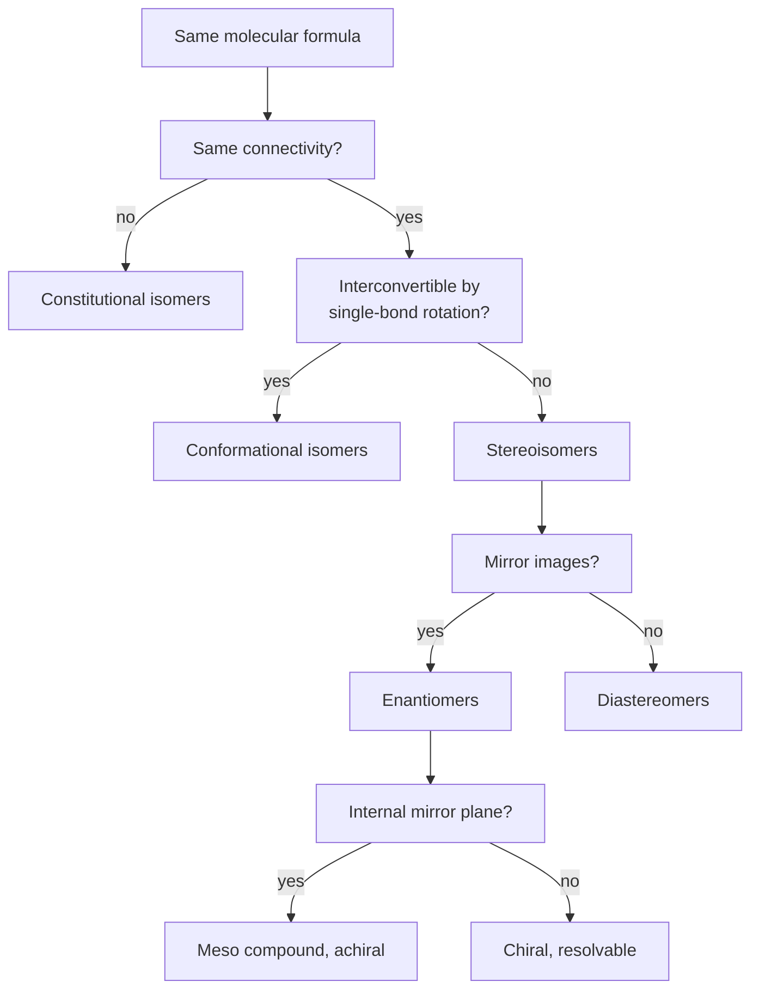
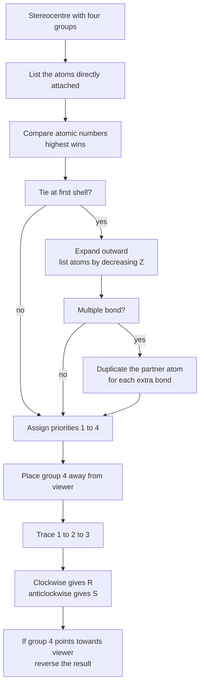
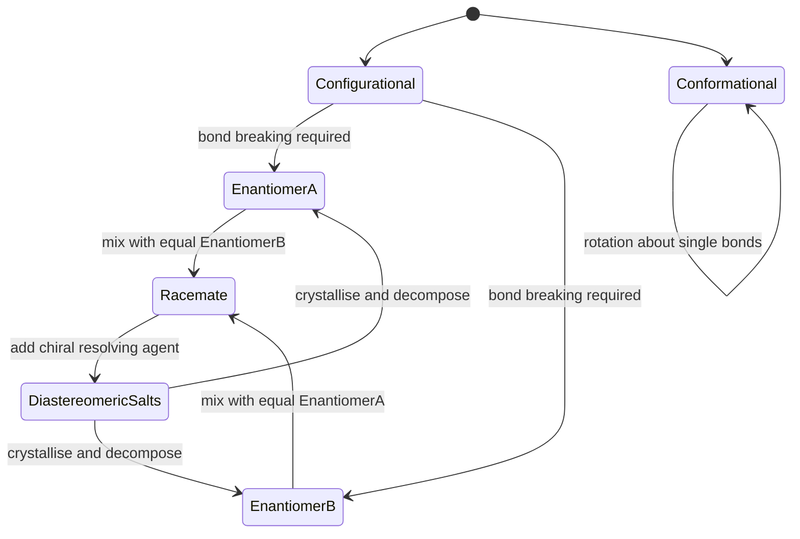
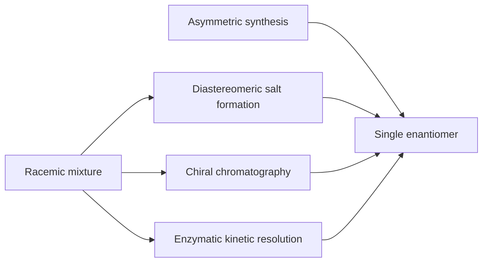

# Chapter 3 — Isomerism and Stereochemistry

> **Level:** Level 4 — Organic Chemistry
> **Estimated study time:** 9 hours (6 h reading + 3 h exercises)
> **Prerequisites:** [Functional Groups and IUPAC Nomenclature](02-functional-groups-and-iupac-nomenclature.md); [Introduction to Organic Chemistry](01-introduction-to-organic-chemistry.md)
> **Related chapters:** [Conformations and Conformational Analysis](04-conformations.md), [Alkenes, Alkynes and Electrophilic Addition](06-alkenes-alkynes-and-electrophilic-addition.md)
> **Difficulty:** ★★★★☆ (1–5)

---

## 1. Learning Objectives

After working through this chapter you will be able to:

- Classify any pair of isomers as constitutional, configurational or conformational, and explain the distinction.
- Identify chiral centres, chiral axes and chiral planes in unfamiliar structures.
- Distinguish enantiomers from diastereomers by their symmetry relationships and their physical properties.
- Recognise meso compounds and explain why a molecule can contain stereocentres and still be achiral.
- Assign *(R)* and *(S)* descriptors using the full Cahn–Ingold–Prelog priority rules, including multiple bonds, isotopes and rings.
- Assign *(E)/(Z)* descriptors to alkenes and explain when *cis/trans* is adequate.
- Calculate specific rotation, enantiomeric excess and the composition of an enantiomeric mixture from polarimetric data.
- Describe how enantiomers are separated in practice, and why the separation matters in medicine, flavour chemistry and catalysis.

---

## 2. Introduction

Two molecules can have the same atoms, the same bonds and the same formula, and still be different substances. The difference may be as simple as the position of a methyl group along a chain, or as subtle as the exchange of two groups at a single carbon, with no bond broken and no atom added. Organic chemistry calls these cases **isomerism**, and the ability to recognise and name isomers is a precondition for understanding reactions, because a reaction that looks straightforward on paper may produce a mixture of isomers with different properties.

The most consequential class of isomers is the **stereoisomers**: molecules with the same connectivity but a different arrangement in space. Stereoisomerism is not a minor refinement. The two enantiomers of a drug can differ in potency, in side effects and in regulatory status. The two enantiomers of carvone smell of spearmint and caraway respectively, although the molecules differ only in the handedness of a single carbon. The two enantiomers of thalidomide have different biological activities, and the drug's history is one of the reasons that stereochemistry is now a mandatory part of pharmaceutical development rather than a specialist interest.

Stereochemistry also supplies the conceptual vocabulary for the rest of the level. A reaction mechanism is not complete until it explains the *stereochemical outcome*: whether a substitution gives inversion or retention, whether an addition gives *syn* or *anti* addition, and whether the product is a single enantiomer, a racemate or a mixture of diastereomers. Chapters 6, 8 and 11 all rely on the ideas introduced here.

This chapter proceeds from the classification of isomers to the symmetry arguments that define chirality, then to the CIP rules for assigning descriptors, then to optical activity and its measurement, and finally to resolution and to the practical consequences of chirality. The treatment is deliberately rigorous about the priority rules: a student who can assign *(R)/(S)* reliably has understood the underlying geometry, and a student who cannot will struggle with every later stereochemical argument.

---

## 3. Fundamental Concepts

### 3.1 The classification of isomers

**Isomers** are compounds with the same molecular formula but different structures. The first division is between constitutional isomers, which differ in connectivity, and stereoisomers, which have the same connectivity but a different spatial arrangement.

```text
Isomers
├── Constitutional isomers
│   ├── Chain isomers
│   ├── Position isomers
│   ├── Functional-group isomers
│   └── Tautomers
└── Stereoisomers
    ├── Configurational isomers
    │   ├── Enantiomers
    │   └── Diastereomers
    │       ├── cis/trans and E/Z alkenes
    │       └── multiple stereocentres
    └── Conformational isomers
```

The second division, within stereoisomers, is between **configurational** and **conformational** isomers. Configurational isomers cannot be interconverted without breaking a bond: *(R)* and *(S)* forms of a chiral molecule, or *(E)* and *(Z)* forms of an alkene, are separate compounds that can be isolated. Conformational isomers can be interconverted by rotation about single bonds alone, and they are usually in rapid equilibrium at room temperature. Chapter 4 develops conformational analysis; this chapter is concerned with configuration.

### 3.2 Constitutional isomerism

**Chain (skeletal) isomerism** arises when the carbon skeleton differs. Butane and 2-methylpropane are chain isomers, both $\ce{C4H10}$. The number of chain isomers grows rapidly with chain length: there are three for $\ce{C5H12}$, five for $\ce{C6H14}$ and seventy-five for $\ce{C10H22}$.

**Position isomerism** arises when the same functional group occupies a different position on the same skeleton. Propan-1-ol and propan-2-ol are position isomers; so are but-1-ene and but-2-ene.

**Functional-group isomerism** arises when the same formula corresponds to different functional groups. $\ce{C3H6O}$ can be propanal (an aldehyde), propanone (a ketone), prop-2-en-1-ol (an unsaturated alcohol) or methyl vinyl ether. $\ce{C2H6O}$ can be ethanol or dimethyl ether. The functional group determines the chemistry, so functional-group isomers are entirely different substances.

**Tautomerism** is a special case in which constitutional isomers interconvert rapidly by migration of an atom, usually a proton, accompanied by a shift of a double bond. The commonest example is **keto–enol tautomerism**: a ketone and its enol are constitutional isomers, and they interconvert through a proton transfer. For simple ketones the keto form predominates strongly — acetone is more than $10^5$ times more abundant than its enol at equilibrium — but the enol is the reactive species in many reactions, including halogenation and aldol condensation.

Tautomers are not resonance structures. Resonance structures differ only in the placement of electrons within a fixed arrangement of atoms; tautomers differ in the position of an atom, usually hydrogen, and are distinct molecules that can in principle be isolated.

### 3.3 Chirality and the chiral centre

An object is **chiral** if it is not superimposable on its mirror image. Hands are chiral: a left hand and a right hand are mirror images and cannot be superimposed by any rotation in three dimensions. A molecule is chiral under the same criterion. Its mirror image is a different molecule, called an **enantiomer**.

The commonest source of molecular chirality is a **stereocentre** — usually a tetrahedral carbon bearing four different groups, written $\ce{Cabcd}$. The four groups can be arranged in two ways that are mirror images of each other and not superimposable, so the carbon is a **chiral centre**. Lactic acid, $\ce{CH3CH(OH)COOH}$, has one chiral centre at C2; so does butan-2-ol, $\ce{CH3CH(OH)CH2CH3}$.

A carbon bearing two identical groups cannot be a chiral centre, because reflection exchanges the identical groups and produces the same molecule. This is the single most useful test: if two substituents are the same, the carbon is not stereogenic. A carbon bearing three groups, such as a carbonyl carbon or a carbocation, is planar and cannot be a chiral centre.

Chirality can also arise without a chiral centre:

- **Chiral axis.** Allenes with different substituents at each end, such as 2,3-pentadiene, have no tetrahedral stereocentre but are chiral because the two ends of the molecule are perpendicular and cannot be superimposed on their mirror images. Appropriately substituted biphenyls are chiral for a different reason: rotation about the biaryl bond is restricted by bulky *ortho* substituents, so the two rings are locked in a non-planar arrangement. This is **atropisomerism**.
- **Chiral plane.** Cyclophanes and some strained alkenes are chiral because a plane of the molecule is not a symmetry plane; *trans*-cyclooctene is the standard example.
- **Helicity.** Helicenes, which are helical arrays of fused benzene rings, exist as right- and left-handed forms designated *P* and *M*.

| Chiral unit | Example | Descriptor |
|---|---|---|
| Centre | Lactic acid | *(R)* or *(S)* |
| Axis | 2,3-Pentadiene | *R*a or *S*a |
| Plane | *trans*-Cyclooctene | *R*p or *S*p |
| Helix | [6]Helicene | *P* or *M* |

### 3.4 Enantiomers and diastereomers

**Enantiomers** are stereoisomers that are mirror images of each other. They have identical boiling points, melting points, densities, solubilities in achiral solvents and spectroscopic properties in achiral media. They differ in two respects: they rotate plane-polarised light in opposite directions, and they interact differently with a chiral environment, such as a chiral receptor, a chiral catalyst or a chiral chromatographic stationary phase.

**Diastereomers** are stereoisomers that are not mirror images. This is a broader category: *(E)* and *(Z)* alkenes are diastereomers, and a molecule with two stereocentres has four stereoisomers arranged as two pairs of enantiomers and four diastereomeric relationships. Diastereomers have different physical properties — different melting points, solubilities and spectra — because their shapes are genuinely different, not mirror-related.

| Property | Enantiomers | Diastereomers |
|---|---|---|
| Mirror images | Yes | No |
| Boiling point | Identical | Different |
| Melting point | Identical | Different |
| Density | Identical | Different |
| Solubility in achiral solvent | Identical | Different |
| Optical rotation | Equal and opposite | Unrelated |
| Reaction with achiral reagent | Identical rates | Different rates |
| Reaction with chiral reagent | Different rates | Different rates |

The last two rows are the practical basis of resolution: enantiomers can be separated only by interaction with something chiral, because in an achiral environment they are indistinguishable.

### 3.5 Symmetry elements and the chirality test

The most reliable test for chirality is symmetry. A molecule is achiral if it possesses an **improper symmetry operation**: a mirror plane ($\sigma$), a centre of inversion ($i$), or a rotation–reflection axis ($S_n$). A molecule is chiral if it has none of these, although it may have proper rotation axes ($C_n$).

| Element | Symbol | Operation | Example |
|---|---|---|---|
| Proper axis | $C_n$ | Rotation by $360°/n$ | Water has $C_2$ |
| Mirror plane | $\sigma$ | Reflection | Water has two |
| Centre of inversion | $i$ | Inversion through a point | *trans*-1,2-Dichloroethene |
| Improper axis | $S_n$ | Rotation by $360°/n$ then reflection | Methane has $S_4$ |

A molecule with a mirror plane is achiral. A molecule with a centre of inversion is achiral. A molecule with an $S_n$ axis, including $S_1 = \sigma$ and $S_2 = i$, is achiral. This is why a molecule can contain stereocentres and still be achiral: the stereocentres may be arranged so that the molecule as a whole has a mirror plane.

The symmetry criterion must be applied to the molecule, not to one drawing. A molecule may be drawn in a conformation that lacks a plane while another accessible conformation has one. If any accessible conformation is achiral, the molecule is achiral, because conformations interconvert rapidly on the timescale of most observations. Meso-tartaric acid is the standard illustration: its eclipsed conformation has a mirror plane, and even its staggered conformations are interconverted by rotation, so the molecule is achiral despite having two stereocentres.

### 3.6 Meso compounds

A **meso compound** is an achiral member of a set of stereoisomers that contains stereocentres. The classic example is *meso*-tartaric acid, $\ce{HOOC-CH(OH)-CH(OH)-COOH}$, which has two stereocentres of opposite configuration and an internal mirror plane.

The four possible configurations of tartaric acid are $(2R,3R)$, $(2S,3S)$, $(2R,3S)$ and $(2S,3R)$. The last two are the same molecule, because a 180° rotation in the plane of the drawing exchanges the two ends. The result is three stereoisomers, not four: a pair of enantiomers and one meso compound. The $2^n$ rule for the number of stereoisomers therefore needs correction whenever the molecule has internal symmetry:

$$
\text{number of stereoisomers} = 2^n - \text{number of meso forms}
$$

where $n$ is the number of stereocentres and the correction is applied only when the centres are equivalent and oppositely configured.

Meso compounds are optically inactive, like racemates, but for a different reason. A racemate is inactive because it contains equal amounts of two enantiomers whose rotations cancel. A meso compound is inactive because it is a single achiral substance with no optical rotation at all. The distinction matters analytically: a racemate can be resolved into two optically active components, whereas a meso compound cannot.

### 3.7 Optical activity

**Plane-polarised light** has its electric field oscillating in a single plane. When it passes through a solution of a chiral substance, the plane rotates. The rotation is measured with a **polarimeter**, and the observed angle $\alpha$ depends on the substance, the concentration, the path length, the temperature and the wavelength.

**Specific rotation** is the normalised quantity:

$$
[\alpha]_{D}^{T} = \frac{\alpha}{l\,c}
$$

where $\alpha$ is the observed rotation in degrees, $l$ is the path length in decimetres and $c$ is the concentration in grams per millilitre. The superscript $T$ is the temperature in degrees Celsius and the subscript $D$ indicates the sodium D line at 589 nm. Specific rotation is a physical constant of a chiral substance under stated conditions; it is positive for dextrorotatory substances and negative for laevorotatory ones.

The direction of rotation — (+) or (−) — is not predictable from the *(R)/(S)* descriptor. *(R)*-lactic acid is (−)-lactic acid, but *(R)*-glyceraldehyde is (+)-glyceraldehyde. The sign must be measured, not deduced from the name.

A **racemate**, or racemic mixture, contains equal amounts of the two enantiomers and has zero net rotation. The components cannot be separated by ordinary distillation or crystallisation, because their physical properties are identical in an achiral environment.

### 3.8 The Cahn–Ingold–Prelog rules

The *(R)/(S)* descriptor is assigned in four steps.

1. **Assign priorities** to the four groups at the stereocentre using the CIP rules (Section 4.1).
2. **Orient the lowest-priority group away from the viewer**, along the bond pointing away from the page.
3. **Trace the sequence 1 → 2 → 3.** If the direction is clockwise, the descriptor is *(R)* (from Latin *rectus*, right). If anticlockwise, it is *(S)* (from Latin *sinister*, left).
4. **If the lowest-priority group cannot be placed away**, determine the direction with it pointing towards the viewer and then reverse the result.

The rules for assigning priority are the part students most often reduce to a slogan. The slogan "higher atomic number wins" is correct only at the first atom. The full rules are stated in Section 4.1.

### 3.9 E/Z and cis/trans

For an alkene $\ce{abC=Ccd}$, the configuration is described by comparing the two groups at each carbon. At each carbon, apply CIP priorities; if the higher-priority groups are on the same side of the double bond, the descriptor is *(Z)*, and if they are on opposite sides, *(E)*.

The older *cis/trans* nomenclature is still used for simple alkenes and for rings. In acyclic alkenes, *cis* means that the two main carbon chains are on the same side and *trans* that they are on opposite sides. The terms become ambiguous when the two ends of the double bond carry different substituents: for 1-bromo-1-chloropropene, "cis" does not specify referents. *(E)/(Z)* is unambiguous and is mandatory when three or four different groups are present.

For rings, *cis* and *trans* remain standard. In 1,2-dimethylcyclohexane, *cis* means both methyl groups are on the same face of the ring, regardless of whether they are both axial or both equatorial.

### 3.10 Resolution of enantiomers

**Resolution** is the separation of a racemate into its two enantiomers. Because enantiomers have identical physical properties in achiral media, resolution requires a chiral agent. Four methods are standard.

**Diastereomeric salt formation.** A racemic acid is treated with a single enantiomer of a chiral base, such as (−)-brucine or (+)-amphetamine. The two salts formed are diastereomers, not enantiomers, and therefore have different solubilities; they can be separated by fractional crystallisation. The salts are then decomposed with acid or base to liberate the enantiomerically pure acids. This is the method Pasteur used in 1848 to resolve tartaric acid, and it remains the classical approach.

**Chiral chromatography.** A chiral stationary phase, such as a derivatised cellulose or a protein-based column, interacts differently with the two enantiomers and separates them. This is the standard analytical and preparative method in the pharmaceutical industry.

**Enzymatic kinetic resolution.** An enzyme catalyses the reaction of one enantiomer much faster than the other, so the mixture is resolved by selective conversion. Lipases are widely used for the resolution of alcohols and esters. The method can give very high enantiomeric excess, but the maximum yield of the desired enantiomer is 50% unless the unwanted one is racemised and recycled.

**Asymmetric synthesis.** Rather than separating a racemate, the reaction is carried out in a chiral environment — a chiral catalyst, a chiral auxiliary or an enzyme — so that one enantiomer is formed preferentially. This is not resolution but it achieves the same practical goal, and it is the dominant strategy in modern pharmaceutical manufacturing.

### 3.11 Why chirality matters

Chirality matters because biology is chiral. Proteins are built from L-amino acids, nucleic acids from D-sugars, and the receptors, enzymes and ion channels that mediate drug action are themselves chiral environments. A chiral drug therefore encounters a chiral receptor and the two enantiomers can bind with different affinities, activate different pathways or produce different metabolites.

The consequences are practical, regulatory and sometimes tragic. Thalidomide, marketed as a racemate in the late 1950s, was prescribed as a sedative and antiemetic for morning sickness and caused severe limb malformations in an estimated ten thousand children. The two enantiomers differ in their biological activity, but the (R) enantiomer racemises *in vivo*, so even the pure enantiomer would not have been safe. The case is discussed in Section 4.5 because the simplified version — "one enantiomer was safe and the other was not" — is misleading in a way that matters for how the lesson is applied.

Regulatory practice changed as a result. Since 1992 the US Food and Drug Administration has required developers of chiral drugs to justify the choice of a single enantiomer or a racemate, and most new chiral drugs are now developed as single enantiomers. The same logic applies to agrochemicals, where one enantiomer may be herbicidally active and the other inert or toxic, and to flavour chemistry, where enantiomers can smell entirely different.

---

## 4. Detailed Scientific Explanation

### 4.1 The CIP priority rules in full

The Cahn–Ingold–Prelog rules were developed in the 1950s and codified by IUPAC in 1966. They provide a total ordering of substituents that depends only on constitution, never on conformation or on a particular drawing. The rules are applied to each stereocentre independently.

**Rule 1 — first atom.** Compare the four atoms directly attached to the stereocentre. The atom of higher atomic number has higher priority. For a tetrahedral carbon the usual order is $\ce{Br} > \ce{Cl} > \ce{O} > \ce{N} > \ce{C} > \ce{H}$; deuterium outranks hydrogen because its mass number is higher, even though both have $Z = 1$.

**Rule 2 — explore outward.** If two substituents begin with the same atom, compare the atoms attached to that atom, listing them in order of decreasing atomic number. The first point of difference decides. For example, $\ce{-CH2OH}$ outranks $\ce{-CH3}$ because the carbon of the first is attached to $(\ce{O}, \ce{H}, \ce{H})$ and the carbon of the second to $(\ce{H}, \ce{H}, \ce{H})$. Likewise, $\ce{-CH2OH}$ outranks $\ce{-CH2NH2}$, because oxygen has the higher atomic number.

**Rule 3 — multiple bonds.** A multiple bond is expanded by duplicating the partner atom. In $\ce{-CH=CH2}$ the first carbon is treated as bonded to $(\ce{C}, \ce{C}, \ce{H})$, because the double bond counts as two bonds to carbon. In $\ce{-C#CH}$ the first carbon is bonded to $(\ce{C}, \ce{C}, \ce{C})$. This is why a vinyl group outranks an ethyl group, and why a cyano group outranks an aminomethyl group.

**Rule 4 — isotopes.** If two isotopes of the same element are compared, the higher mass number has priority: $\ce{^{13}C} > \ce{^{12}C}$, $\ce{D} > \ce{H}$.

**Rule 5 — lone pairs.** A lone pair is treated as a phantom atom of atomic number zero and is always the lowest priority. This matters for nitrogen and sulfur stereocentres, which are rarely configurationally stable at room temperature but are important in enzyme mechanisms.

**Rule 6 — rings.** A ring is explored by both paths around the ring, and the path that reaches a point of difference first, with the higher-priority atom, is chosen. The duplication convention applies to aromatic rings in the same way as to acyclic multiple bonds.

**Rule 7 — stereogenic descriptors.** When comparing two stereocentres, *(R)* outranks *(S)* and *(E)* outranks *(Z)*. This rule is used in the assignment of pseudoasymmetric centres, which are marked *r* or *s* in lower case.

The rules are applied recursively: if a difference is found at the second atom, the comparison stops there; if not, the exploration continues outward along the branch with the highest priority until a difference appears. Two branches that are constitutionally identical and differ only in configuration are enantiomorphic, and the centre bearing them is pseudoasymmetric rather than stereogenic.

### 4.2 Priority comparisons in practice

The table below collects the comparisons that occur most often in exercises. Each row can be checked by writing the atoms attached to the first atom, in decreasing order of atomic number.

| Pair | Higher priority | Reason |
|---|---|---|
| $\ce{-OH}$ vs $\ce{-NH2}$ | $\ce{-OH}$ | O (8) > N (7) |
| $\ce{-NH2}$ vs $\ce{-CH3}$ | $\ce{-NH2}$ | N (7) > C (6) |
| $\ce{-CH2OH}$ vs $\ce{-CH3}$ | $\ce{-CH2OH}$ | $(\ce{O},\ce{H},\ce{H})$ > $(\ce{H},\ce{H},\ce{H})$ |
| $\ce{-CHO}$ vs $\ce{-CH2OH}$ | $\ce{-CHO}$ | $(\ce{O},\ce{O},\ce{H})$ > $(\ce{O},\ce{H},\ce{H})$ |
| $\ce{-COOH}$ vs $\ce{-CHO}$ | $\ce{-COOH}$ | $(\ce{O},\ce{O},\ce{O})$ > $(\ce{O},\ce{O},\ce{H})$ |
| $\ce{-C#N}$ vs $\ce{-CH2NH2}$ | $\ce{-C#N}$ | $(\ce{N},\ce{N},\ce{N})$ > $(\ce{N},\ce{H},\ce{H})$ |
| Vinyl vs ethyl | Vinyl | $(\ce{C},\ce{C},\ce{H})$ > $(\ce{C},\ce{H},\ce{H})$ |
| Phenyl vs *tert*-butyl | Phenyl | The ring carbon is attached to $(\ce{C},\ce{C},\ce{C})$ and the next shell contains unsaturated carbons |
| $\ce{-C(CH3)3}$ vs $\ce{-CH(CH3)2}$ | $\ce{-C(CH3)3}$ | $(\ce{C},\ce{C},\ce{C})$ > $(\ce{C},\ce{C},\ce{H})$ |
| $\ce{D}$ vs $\ce{H}$ | $\ce{D}$ | Mass number 2 > 1 |

Two rows deserve emphasis because they are frequently got wrong. Phenyl outranks *tert*-butyl even though the *tert*-butyl group looks bulkier: bulk is irrelevant, and the aromatic carbon is attached to three carbons while the *tert*-butyl carbon is also attached to three carbons, so the comparison moves to the next shell, where the ring carbons are unsaturated and therefore duplicated. Carboxyl outranks formyl because the carboxyl carbon carries three oxygen atoms in the duplicated representation, while the formyl carbon carries two.

### 4.3 Multiple stereocentres

A molecule with $n$ independent stereocentres has $2^n$ stereoisomers, arranged as $2^{n-1}$ pairs of enantiomers. Butan-2,3-diol, $\ce{CH3CH(OH)CH(OH)CH3}$, has two stereocentres and therefore four stereoisomers: $(2R,3R)$, $(2S,3S)$, $(2R,3S)$ and $(2S,3R)$. The last two are the same meso compound, so the actual count is three.

The rule fails whenever two stereocentres are equivalent by symmetry. Tartaric acid and butan-2,3-diol are the standard cases; 2,3-dichlorobutane behaves the same way. A quick test is to look for an internal mirror plane or centre of inversion in a conformation; if one exists, the compound is meso and the count is reduced.

When the stereocentres are not equivalent — for example, in 3-bromo-2-butanol — all four stereoisomers are distinct, and there are two pairs of enantiomers with different physical properties.

A **pseudoasymmetric centre** is a tetrahedral atom with four different ligands, two of which are enantiomorphic. It is not stereogenic in the full sense, because exchanging the two enantiomorphic ligands gives the same molecule rather than a stereoisomer; it is designated *r* or *s* in lower case. Pseudoasymmetric centres are rare in undergraduate work but appear in the stereochemistry of meso compounds with an odd number of stereocentres, such as the central carbon of (2*R*,3*r*,4*S*)-pentane-2,3,4-triol.

### 4.4 Fischer projections

A **Fischer projection** represents a tetrahedral carbon as a cross. The vertical bonds are understood to point away from the viewer, behind the plane of the page, and the horizontal bonds point towards the viewer, out of the page. The convention was introduced by Emil Fischer for sugars and is still standard in carbohydrate chemistry.

Four rules govern the use of Fischer projections:

1. The carbon chain is drawn vertically, with the most highly oxidised carbon at the top.
2. Horizontal bonds point towards the viewer and vertical bonds away.
3. A 180° rotation in the plane of the page is allowed, because it preserves the meaning of every bond. A 90° rotation is forbidden, because it converts bonds pointing towards the viewer into bonds pointing away.
4. Swapping any two groups at a stereocentre inverts the configuration at that centre. Swapping two pairs restores it.

To assign *(R)/(S)* from a Fischer projection, determine the direction 1 → 2 → 3 as drawn. If the lowest-priority group is on a vertical bond, it points away and the direction is used directly. If it is on a horizontal bond, it points towards the viewer and the direction must be reversed.

Fischer projections are a projection of a specific conformation, not a claim about the molecule's preferred shape. A sugar drawn in a Fischer projection is not mostly in that conformation in solution; the projection is a convention for encoding configuration, and it must not be read as a conformational statement.

### 4.5 Thalidomide, honestly

Thalidomide was introduced in West Germany in 1957 under the brand name Contergan and marketed in the United Kingdom and elsewhere as a sedative and antiemetic, particularly for morning sickness. It was withdrawn in 1961 after a link was established with severe limb malformations — phocomelia — in children born to mothers who had taken it during early pregnancy. The total number of affected children is usually estimated at around ten thousand, with many thousands more pregnancies ending in miscarriage or stillbirth.

The molecule has one stereocentre and was marketed as the racemate. The two enantiomers differ in biological activity in animal models: the *(R)* enantiomer is the more effective sedative, and the *(S)* enantiomer is the more potent teratogen in some species. That difference is real and is often summarised as "the *(R)* enantiomer was safe and the *(S)* enantiomer caused the birth defects".

The summary is misleading, for two reasons. First, thalidomide racemises rapidly *in vivo*. The stereocentre bears an acidic hydrogen between two carbonyl groups, and enolisation scrambles the configuration with a half-life of a few hours in plasma. Administering the pure *(R)* enantiomer would therefore produce the *(S)* enantiomer in the patient, and the pure enantiomer would not have prevented the harm. Second, the mechanism of teratogenicity is still not fully settled; cereblon binding, anti-angiogenic activity and oxidative stress have all been implicated, and species differences in metabolism are substantial. The enantiomer story is part of the science, but it is not the whole explanation.

The regulatory legacy is more durable than the mechanistic one. The thalidomide disaster led directly to modern drug safety legislation, including the 1962 Kefauver–Harris amendments in the United States, and it made stereochemical characterisation a standard part of drug development. Thalidomide itself was approved by the US Food and Drug Administration in 1998 for erythema nodosum leprosum, and later for multiple myeloma, under a strict pregnancy-prevention programme. The drug is on the WHO Essential Medicines List. Its history is a case study in why "the enantiomers are different" is a starting point for analysis, not a conclusion.

### 4.6 Chirality in drugs and regulation

Many drugs are chiral, and the choice between a racemate and a single enantiomer is a commercial and clinical decision as well as a scientific one.

**Ibuprofen** is marketed as the racemate in most countries. The *(S)* enantiomer is the active inhibitor of cyclooxygenase; the *(R)* enantiomer is largely inactive but is converted into the *(S)* form by an α-methylacyl-CoA racemase in the body, so the racemate behaves as a slow-release form of the active enantiomer. Dexibuprofen, the single *(S)* enantiomer, is available in some markets.

**Omeprazole** is a proton-pump inhibitor that is marketed as the racemate; its *(S)* enantiomer, esomeprazole, has a different metabolic profile and is marketed separately. The two are not interchangeable in every patient, because the enantiomers are metabolised by different cytochrome P450 isoforms.

**Salbutamol** (albuterol) is chiral and is used as the racemate, although only the *(R)* enantiomer is a potent β₂ agonist. The *(S)* enantiomer has been investigated for possible pro-inflammatory effects, and the question of whether a single-enantiomer formulation would be better has been debated for decades without a definitive answer.

These examples illustrate a general point. The biological consequence of chirality depends on the pharmacokinetics as well as on the receptor interaction. A racemate is not automatically inferior to a single enantiomer, and a single enantiomer is not automatically safer. The decision requires data.

### 4.7 Chirality in smell and catalysis

The olfactory receptors are chiral proteins, so enantiomers can smell different. *(R)*-Limonene smells of oranges; *(S)*-limonene smells of turpentine and lemon. *(R)*-Carvone smells of spearmint; *(S)*-carvone smells of caraway. The difference is not a curiosity: the flavour and fragrance industry separates enantiomers on a large scale, and the enantiomeric composition of a natural extract is used as a marker of its origin and authenticity.

In catalysis, chirality is the basis of asymmetric synthesis. The 2001 Nobel Prize in Chemistry was awarded to William Knowles, Ryoji Noyori and K. Barry Sharpless for work on chiral catalysts: Knowles and Noyori developed chiral ligands for asymmetric hydrogenation, and Sharpless developed the asymmetric epoxidation of allylic alcohols. The products of these reactions are single enantiomers, and the catalysts themselves are chiral complexes whose shape discriminates between the two possible transition states.

Enzymes achieve the same discrimination with much greater precision. An enzyme active site is a chiral pocket, and the binding of a substrate in that pocket is diastereomeric: the two enantiomers of the substrate form diastereomeric complexes with different energies. That difference is the origin of enantioselectivity in biochemistry, and it is why the metabolism of chiral drugs is often enantioselective.

### 4.8 Symmetry elements and point groups

A molecule's symmetry is described by its collection of symmetry elements, and the complete set defines its **point group**. The point group is a compact label for the symmetry, and it predicts spectroscopic behaviour, dipole moment and chirality.

The point groups relevant to organic chemistry are few:

| Point group | Elements | Chiral? | Example |
|---|---|---|---|
| $C_1$ | None but identity | Yes | Lactic acid |
| $C_n$ | $C_n$ only | Yes | Hydrogen peroxide ($C_2$) |
| $C_s$ | One mirror plane | No | Formaldehyde |
| $C_{2v}$ | $C_2$ and two planes | No | Water |
| $C_i$ | Centre of inversion | No | *anti*-Ethane in its staggered conformation |
| $D_n$ | $n$ C₂ axes perpendicular to $C_n$ | Yes | Twisted 2,2'-disubstituted biphenyl |
| $T_d$ | Tetrahedral | No | Methane |
| $D_{6h}$ | Hexagonal | No | Benzene |

The rule that matters is simple: a molecule is chiral if and only if its point group contains no improper operation ($\sigma$, $i$ or $S_n$). The chiral point groups are $C_1$, $C_n$ and $D_n$; all others contain an improper element. Point-group assignment is not examined in detail in this level, but the symmetry criterion is, because it resolves cases where counting stereocentres gives the wrong answer.

One caution: point groups are assigned to a single conformation. A flexible molecule may have a chiral point group in its lowest-energy conformation and an achiral point group in another accessible conformation. The molecule is achiral if any accessible conformation is achiral, which is why meso compounds are achiral even though some of their conformations lack a mirror plane.

---

## 5. Visual Diagrams

The diagrams in this section encode the classification of isomers, the CIP assignment procedure, the relationships between stereoisomers, and the routes to a single enantiomer. Each is a decision aid rather than a chemical structure.



**Figure 3.1 — Classifying a pair of isomers.** The questions are asked in order: connectivity first, then rotational interconversion, then mirror-image relationship, then internal symmetry. The final branch is the one that decides whether a substance can be resolved into optically active components. A meso compound and a racemate are both optically inactive, but only the racemate can be resolved, and the diagram separates them.



**Figure 3.2 — Assigning R or S.** The procedure is mechanical once the priorities are correct, and almost every error in an examination comes from the priority step rather than the orientation step. Note the loop back from multiple bonds: the duplication convention changes the priority order and must be applied before the descriptor is assigned.



**Figure 3.3 — Configurational change versus conformational change.** Interconversion of enantiomers requires breaking and remaking bonds at the stereocentre; rotation about single bonds cannot do it. Conformational isomers, by contrast, interconvert freely. The diagram also shows the resolution route: a racemate is converted into diastereomeric salts, which are separable because they are no longer mirror images.



**Figure 3.4 — Four routes to a single enantiomer.** The first three are resolutions: a racemate is separated by making it interact with a chiral agent. The fourth is not a resolution at all, because the racemate is never formed; the chiral information is introduced by a catalyst, an auxiliary or an enzyme. Modern manufacturing prefers the fourth route where it is available, because the maximum yield of a resolution is 50% unless the unwanted enantiomer can be recycled.

---

## 6. Mathematical Formulas

Stereochemistry is quantitative in three places: the measurement of optical rotation, the specification of enantiomeric composition, and the counting of stereoisomers.

### 6.1 Specific rotation

$$
[\alpha]_{D}^{T} = \frac{\alpha}{l\,c}
$$

| Symbol | Meaning | Unit |
|---|---|---|
| $\alpha$ | observed rotation | degrees |
| $l$ | path length of the polarimeter cell | dm |
| $c$ | concentration of the sample | g mL⁻¹ |
| $[\alpha]_{D}^{T}$ | specific rotation at the sodium D line and temperature $T$ | deg dm⁻¹ mL g⁻¹ |

The units are conventionally quoted as deg dm⁻¹ cm³ g⁻¹, which is numerically identical to deg dm⁻¹ mL g⁻¹. Older texts use grams per 100 mL for $c$, in which case the formula contains a factor of 100; the definition above follows IUPAC and is the one used throughout this book. Specific rotation depends on solvent, temperature and wavelength, so all three must be reported alongside the value.

### 6.2 Enantiomeric excess

$$
\text{ee} = \left| \frac{[R] - [S]}{[R] + [S]} \right| \times 100\%
$$

| Symbol | Meaning |
|---|---|
| $[R]$ | amount or concentration of the *(R)* enantiomer |
| $[S]$ | amount or concentration of the *(S)* enantiomer |

A racemate has $\text{ee} = 0\%$; a pure enantiomer has $\text{ee} = 100\%$. The same quantity can be obtained from optical rotation if the specific rotation of the pure enantiomer is known:

$$
\text{ee} \approx \frac{[\alpha]_\text{obs}}{[\alpha]_\text{pure}} \times 100\%
$$

The approximation is exact only when the rotation is a linear function of composition, which is usually but not always the case; non-linear effects are known, particularly when the two enantiomers associate in solution. The modern definition of ee is the mole-fraction definition, and it is measured directly by chiral chromatography or chiral NMR shift reagents rather than inferred from rotation.

### 6.3 Composition from enantiomeric excess

If the major enantiomer is present in mole fraction $x$, then

$$
x = \frac{100\% + \text{ee}}{2}
\qquad\text{and}\qquad
1 - x = \frac{100\% - \text{ee}}{2}
$$

An ee of 80% therefore corresponds to 90% of the major enantiomer and 10% of the minor one. The ratio of major to minor is $(1 + \text{ee})/(1 - \text{ee})$, which for 80% ee is $1.8/0.2 = 9:1$.

### 6.4 Counting stereoisomers

$$
N = 2^n
$$

where $n$ is the number of independent stereocentres and no internal symmetry is present. When the molecule has equivalent stereocentres related by an internal mirror plane or inversion centre, meso forms reduce the count:

$$
N = 2^n - m
$$

where $m$ is the number of meso forms. For tartaric acid, $n = 2$ and $m = 1$, so $N = 3$. For butan-2,3-diol, the same count applies. For a molecule with two different stereocentres, $m = 0$ and $N = 4$.

### 6.5 Maximum yield of a resolution

$$
\text{maximum yield of one enantiomer} = 50\%
$$

because the racemate contains equal amounts of both. Recycling the unwanted enantiomer by racemisation and re-resolving can raise the overall yield above 50%, but the single-pass limit is a consequence of the definition of a racemate. Asymmetric synthesis avoids the limit entirely, because the racemate is never formed.

---

## 7. Chemical Equations

Stereochemical outcomes are properties of reactions, and the equations below show the four outcomes that recur: racemisation, inversion, retention and stereospecific elimination.

### 7.1 Reduction of a ketone gives a racemate

$$
\ce{CH3COCH2CH3 ->[NaBH4,\ H2O] CH3CH(OH)CH2CH3}
$$

Butan-2-one is planar at the carbonyl carbon. Hydride attack can occur from either face with equal probability in an achiral environment, so the product is a 1:1 mixture of *(R)*- and *(S)*-butan-2-ol. The equation shows the constitution only; the stereochemical result must be stated separately, and stating it is part of a complete answer.

### 7.2 Electrophilic addition to a prochiral alkene

$$
\ce{CH3CH2CH=CH2 + HBr -> CH3CH2CHBrCH3}
$$

But-1-ene is not chiral, but protonation at C1 gives a planar carbocation at C2. Bromide attacks the two faces of the planar cation at equal rates, so the product is racemic 2-bromobutane. The reaction creates a stereocentre from an achiral starting material, and the default outcome in the absence of chiral influence is a racemate.

### 7.3 Nucleophilic substitution with inversion

$$
\ce{CH3CH2CHBrCH3 + OH- -> CH3CH2CH(OH)CH3 + Br-}
$$

The $\mathrm{S_N2}$ reaction proceeds by backside attack, so the configuration at the reacting carbon is inverted. If the starting material is *(R)*-2-bromobutane, the product is *(S)*-butan-2-ol. The equation is constitutionally balanced but stereochemically incomplete: the descriptors are part of the answer.

### 7.4 Resolution through diastereomeric salts

$$
\ce{RCOOH + B^{*} -> RCOO^{-}B^{*}H^{+}}
$$

Here $\ce{B^{*}}$ is a single enantiomer of a chiral base and $\ce{RCOOH}$ represents the racemic acid. Two diastereomeric salts form, and because diastereomers have different solubilities they can be separated by crystallisation. The asterisk is a reminder that the resolving agent must itself be enantiomerically pure; a racemic resolving agent would produce a racemic mixture of diastereomeric salts and achieve nothing.

### 7.5 Stereospecific elimination

$$
\ce{CH3CHBrCHBrCH3 ->[Zn,\ \Delta] CH3CH=CHCH3}
$$

The elimination of bromine from 2,3-dibromobutane is stereospecific. The *meso* dibromide gives *trans*-but-2-ene, and the *(R,R)/(S,S)* pair gives *cis*-but-2-ene, because the reaction requires an anti-periplanar arrangement of the two leaving groups. The same equation therefore describes two different stereochemical outcomes depending on the configuration of the starting material.

### 7.6 Esterification with retention at a remote stereocentre

$$
\ce{CH3CH(OH)COOH + CH3OH ->[H+] CH3CH(OH)COOCH3 + H2O}
$$

Lactic acid is esterified at the carboxyl group. The stereocentre at C2 is not involved in the reaction, so its configuration is retained. This is the normal case: a reaction that does not touch a stereocentre does not change its configuration. Inversions and racemisations occur only when the stereocentre itself is part of the reacting system.

---

## 8. Worked Examples

### Worked Example 8.1 — Assigning R/S from a tetrahedral drawing

**Problem.** Butan-2-ol is drawn with the hydroxyl group pointing up, the ethyl group to the right, the methyl group to the left, and the hydrogen on a hashed wedge pointing away from the viewer. Assign the configuration.

**Strategy.** Assign CIP priorities, confirm that group 4 points away, then trace 1 → 2 → 3.

**Solution.** The four groups are $\ce{-OH}$, $\ce{-CH2CH3}$, $\ce{-CH3}$ and $\ce{-H}$. Priority 1 is oxygen. Of the two carbon groups, the ethyl carbon is attached to $(\ce{C},\ce{H},\ce{H})$ and the methyl carbon to $(\ce{H},\ce{H},\ce{H})$, so ethyl is priority 2 and methyl is priority 3. Hydrogen is priority 4.

The hydrogen points away, so the direction can be read directly. Going from OH (up) to ethyl (right) to methyl (left) traces a clockwise path. Clockwise with the lowest-priority group away is *(R)*. The compound is *(R)*-butan-2-ol.

**Check.** A useful check is to exchange two groups and see whether the descriptor inverts, as it must. Swapping OH and H puts H up and OH away; the new arrangement has H pointing towards the viewer, so the reading is reversed, and the same molecule must give the same answer. Carrying out the swap explicitly confirms *(R)*. A second check is that the mirror image, drawn with OH down and ethyl left, gives *(S)*.

### Worked Example 8.2 — Assigning R/S from a Fischer projection

**Problem.** D-Glyceraldehyde is drawn in a Fischer projection with $\ce{CHO}$ at the top, $\ce{CH2OH}$ at the bottom, $\ce{OH}$ on the right and $\ce{H}$ on the left. Assign its configuration and confirm that D-glyceraldehyde is *(R)*.

**Strategy.** Assign priorities, note that the lowest-priority group is horizontal, determine the direction as drawn, then reverse it.

**Solution.** Priorities: $\ce{-OH}$ (1), $\ce{-CHO}$ (2), $\ce{-CH2OH}$ (3), $\ce{-H}$ (4). The aldehyde carbon is attached to $(\ce{O},\ce{O},\ce{H})$ in the duplicated representation, while the hydroxymethyl carbon is attached to $(\ce{O},\ce{H},\ce{H})$, so the aldehyde outranks the hydroxymethyl group.

Tracing 1 (right) → 2 (up) → 3 (down) gives an anticlockwise path. Because hydrogen is on a horizontal bond, it points towards the viewer, so the observed direction must be reversed: anticlockwise becomes *(R)*. D-Glyceraldehyde is *(R)*-glyceraldehyde, which is the anchor of the D/L carbohydrate nomenclature.

**Check.** The result is consistent with the standard convention that D-glyceraldehyde is *(R)*; the D/L system is a historical labels for the whole molecule, while *(R)/(S)* is a local descriptor, and the two happen to agree for glyceraldehyde but not for every sugar. The check is to rotate the Fischer projection by 180° in the plane: the OH moves from right to left and the CHO to the bottom, and the configuration must remain *(R)*.

### Worked Example 8.3 — E/Z with ambiguous cis/trans

**Problem.** 1-Bromo-1-chloroprop-1-ene is drawn with the bromine and the methyl group on the same side of the double bond. Assign the configuration and explain why *cis/trans* is inadequate here.

**Strategy.** Apply CIP priorities at each alkene carbon independently, then compare the positions of the higher-priority groups.

**Solution.** At C1 the substituents are $\ce{Br}$ and $\ce{Cl}$; bromine has the higher atomic number, so $\ce{Br}$ is the higher-priority group. At C2 the substituents are $\ce{CH3}$ and $\ce{H}$; carbon outranks hydrogen, so $\ce{CH3}$ is higher. The two higher-priority groups, $\ce{Br}$ and $\ce{CH3}$, are on the same side, so the descriptor is *(Z)*. The full name is *(Z)*-1-bromo-1-chloroprop-1-ene.

*Cis/trans* is inadequate because there is no obvious pair of reference groups. "Cis" would normally refer to the two substituents that are not hydrogen, but here C1 carries two substituents that are not hydrogen and C2 carries one, so the term does not identify which pair is being compared. *(Z)* removes the ambiguity by specifying a rule.

**Check.** The formula is $\ce{C3H4BrCl}$, and the structure has one double bond, consistent with DBE 1. Reversing the assignment of priorities at C1 — for example by incorrectly preferring chlorine — would give *(E)*, which is the commonest error in this type of problem.

### Worked Example 8.4 — Meso compounds and the isomer count

**Problem.** Tartaric acid has two stereocentres. Explain why it has three stereoisomers rather than four, and identify which Fischer projection corresponds to the meso form.

**Strategy.** Enumerate the configurations, look for internal symmetry, and use the Fischer convention to identify the mirror plane.

**Solution.** The four configurations are $(2R,3R)$, $(2S,3S)$, $(2R,3S)$ and $(2S,3R)$. Because the two ends of the molecule are constitutionally identical, a 180° rotation in the plane of the drawing interchanges C2 and C3 and converts $(2R,3S)$ into $(2S,3R)$. These two descriptions therefore refer to the same molecule, which is achiral because it has an internal mirror plane. The remaining two, $(2R,3R)$ and $(2S,3S)$, are a pair of enantiomers. The total is three: two enantiomers and one meso compound.

In the Fischer projection with the carbon chain vertical, the meso form has the two hydroxyl groups on the same side. The horizontal mirror line between C2 and C3 maps the upper half of the drawing onto the lower half, which is the graphical signature of the internal mirror plane. The chiral forms have the hydroxyl groups on opposite sides.

**Check.** Meso-tartaric acid has a melting point of about 140 °C, whereas the enantiomers melt at about 171–174 °C; the physical difference confirms that the meso compound is a distinct substance, not a mixture. A racemate of tartaric acid would also be optically inactive, but it would have a different melting point and could be resolved, whereas the meso compound cannot.

### Worked Example 8.5 — Specific rotation and enantiomeric excess

**Problem.** A sample of 5.00 g of a chiral compound is dissolved in enough solvent to make 50.0 mL of solution. The solution is placed in a polarimeter cell of path length 1.00 dm, and the observed rotation at the sodium D line is $+3.20°$. The specific rotation of the pure *(R)* enantiomer under the same conditions is $+40.0°$. Calculate the specific rotation of the sample, its enantiomeric excess and the percentage composition.

**Strategy.** Convert the concentration to g mL⁻¹, apply the specific-rotation formula, then use the ratio of observed to pure rotation to obtain ee.

**Solution.** The concentration is

$$
c = \frac{5.00\ \text{g}}{50.0\ \text{mL}} = 0.100\ \text{g mL}^{-1}
$$

The specific rotation is

$$
[\alpha]_{D}^{20} = \frac{+3.20°}{1.00\ \text{dm} \times 0.100\ \text{g mL}^{-1}} = +32.0°
$$

The enantiomeric excess is

$$
\text{ee} = \frac{32.0}{40.0} \times 100\% = 80.0\%
$$

An ee of 80% corresponds to 90% of the major enantiomer and 10% of the minor one.

**Check.** The rotation is positive, so the major enantiomer is the *(R)* form, the same sign as the pure enantiomer. The composition sums to 100%, and the ee computed from the composition, $(90 - 10)/100 = 80\%$, agrees. A common error is to report 80% as the purity of the major enantiomer rather than as the excess; the major enantiomer is present at 90%, not 80%.

### Worked Example 8.6 — L-Alanine and the limits of the D/L system

**Problem.** L-Alanine is drawn in a Fischer projection with $\ce{COOH}$ at the top, $\ce{CH3}$ at the bottom, $\ce{NH2}$ on the left and $\ce{H}$ on the right. Assign its configuration and explain why the L label does not always correspond to *(S)*.

**Strategy.** Assign CIP priorities, note that hydrogen is horizontal, determine the direction and reverse it.

**Solution.** Priorities: $\ce{-NH2}$ (1), $\ce{-COOH}$ (2), $\ce{-CH3}$ (3), $\ce{-H}$ (4). The carboxyl carbon is attached to $(\ce{O},\ce{O},\ce{O})$ and the methyl carbon to $(\ce{H},\ce{H},\ce{H})$, so the carboxyl outranks the methyl.

Tracing 1 (left) → 2 (up) → 3 (down) gives a clockwise path. Hydrogen is horizontal, so it points towards the viewer and the direction is reversed: clockwise becomes *(S)*. L-Alanine is *(S)*-alanine.

The L label refers to the configuration of the highest-priority carbon in a Fischer projection drawn with the most oxidised carbon at the top, and it is defined by analogy with L-glyceraldehyde. It is not a direct synonym for *(S)*. L-Cysteine is *(R)*, because sulfur outranks oxygen in the CIP priority at its stereocentre, even though cysteine is an L-amino acid by the carbohydrate-derived convention.

**Check.** The result agrees with the standard assignment of L-alanine as *(S)*. The cysteine exception is the standard test of whether a student is using CIP properly or is pattern-matching the D/L labels.

### Worked Example 8.7 — The lowest-priority group points towards the viewer

**Problem.** 2-Chlorobutane is drawn with chlorine pointing up, the ethyl group to the right, the methyl group to the left, and hydrogen on a solid wedge pointing towards the viewer. Assign the configuration.

**Strategy.** Assign priorities, note that group 4 points towards the viewer, trace 1 → 2 → 3 as drawn, then reverse the result.

**Solution.** Priorities: $\ce{-Cl}$ (1), $\ce{-CH2CH3}$ (2), $\ce{-CH3}$ (3), $\ce{-H}$ (4). The chlorine is at the top, the ethyl group at the right and the methyl group at the left. The path 1 → 2 → 3 runs from top to right to left, which is clockwise in the plane of the page.

Because hydrogen points towards the viewer, the observed direction is the reverse of the true configuration. Clockwise becomes *(S)*, so the molecule is *(S)*-2-chlorobutane.

**Check.** Rotating the whole drawing by 180° about a vertical axis in the plane of the page moves hydrogen away from the viewer and swaps the left and right substituents. In the rotated drawing the chlorine is still at the top, the ethyl group is on the left and the methyl group on the right, and the sequence 1 → 2 → 3 runs anticlockwise, which is *(S)* directly. The two readings agree. The reversal step is the commonest source of error in assignments from wedge–dash drawings.

### Worked Example 8.8 — Priority when a multiple bond is present

**Problem.** 2-Hydroxybut-3-enoic acid, $\ce{CH2=CH-CH(OH)-COOH}$, is drawn with the hydroxyl group up, the carboxyl group to the right, the vinyl group to the left and hydrogen on a hashed wedge. Assign the configuration at C2 and explain the priority order of the carboxyl and vinyl groups.

**Strategy.** Apply the duplication convention to both unsaturated groups, confirm that group 4 points away, and trace 1 → 2 → 3.

**Solution.** At C2 the four groups are $\ce{-OH}$, $\ce{-COOH}$, $\ce{-CH=CH2}$ and $\ce{-H}$. The hydroxyl oxygen is priority 1. The carboxyl carbon is treated as bonded to $(\ce{O}, \ce{O}, \ce{O})$, because the C=O oxygen counts twice and the C–OH oxygen counts once. The vinyl carbon is treated as bonded to $(\ce{C}, \ce{C}, \ce{H})$, because the double bond counts twice. The carboxyl group therefore outranks the vinyl group, and the order is OH (1), COOH (2), vinyl (3), H (4).

Hydrogen points away, so the direction is read directly. The path from OH (up) to COOH (right) to vinyl (left) is clockwise, so the stereocentre is *(R)*. The compound is *(R)*-2-hydroxybut-3-enoic acid.

**Check.** The molecular formula is $\ce{C4H6O3}$, and the DBE is $(8 + 2 - 6)/2 = 2$, matching one C=O and one C=C. If the vinyl group were incorrectly ranked above the carboxyl group, the path would be 1 → 3 → 2 and the descriptor would be *(S)*, which is the commonest error in this type of problem. The duplication convention, not the number of atoms in the group, decides the priority.

---

## 9. Real-World Applications

**Pharmaceutical development.** Most new small-molecule drugs contain at least one stereocentre, and the choice between a racemate and a single enantiomer is made on the basis of pharmacology, metabolism and manufacturing cost. The FDA guidance issued in 1992 requires developers to characterise both enantiomers and to justify the choice; the European Medicines Agency has equivalent requirements. Chiral chromatography and chiral NMR are routine release tests for enantiomeric purity, and the specification for a single-enantiomer drug typically limits the unwanted enantiomer to well below 1%.

**Agrochemicals.** Approximately a quarter of commercial pesticides are chiral, and the two enantiomers often differ in activity and in environmental fate. Metalaxyl is a fungicide whose *(R)* enantiomer carries most of the activity; the racemic product was replaced by the single enantiomer in several markets, reducing the amount applied per hectare. Mecoprop is a herbicide whose enantiomers have different herbicidal activity, and its environmental persistence differs between them.

**Flavour and fragrance.** *(R)*-Carvone (spearmint) and *(S)*-carvone (caraway) are the textbook example, but the principle is general: the olfactory receptors are chiral, and enantiomeric composition is part of the specification of a natural flavouring. Synthetic vanillin is achiral and therefore has no enantiomer problem, whereas synthetic menthol must be resolved or synthesised asymmetrically to match the cooling sensation of the natural (−)-menthol.

**Materials.** Chiral liquid crystals are used in ferroelectric displays, where the switching behaviour depends on the handedness of the mesophase. Helicenes and other axially chiral molecules are studied for organic electronics and for asymmetric catalysis, and the enantiomerically pure forms often have different charge-transport properties.

**Forensics and sport.** Methamphetamine and amphetamine are chiral, and the enantiomeric composition of a seized sample can indicate the synthetic route, because different routes give different proportions of the two enantiomers. In doping control, the distinction between the natural and synthetic forms of a banned substance can be decisive.

**Biochemistry.** Every protein is a single enantiomer in the sense that it is built from L-amino acids, and every polysaccharide is built from D-sugars. The homochirality of the biosphere is one of the deepest unsolved questions in chemistry: the standard explanations involve circularly polarised light, chiral mineral surfaces or an early amplification mechanism, but none is established beyond dispute. What is not in doubt is that the chirality of biomolecules is the reason that drug chirality matters.

---

## 10. Common Mistakes

| Mistake | Why it happens | Correct approach |
|---|---|---|
| Equating *(R)* with (+)-rotation | The two symbols look like alternative labels for the same property | *(R)/(S)* describes configuration; (+)/(−) describes the sign of rotation, and the two must be measured independently |
| Reversing the result only when the lowest-priority group is on a wedge | The rule for Fischer projections is taught separately and then forgotten | If group 4 points towards you — including any horizontal bond in a Fischer projection — reverse the observed direction |
| Ignoring the duplication convention for multiple bonds | The first atom comparison gives the right answer in most simple cases | Expand double and triple bonds by duplicating the partner atom before comparing |
| Assuming $2^n$ stereoisomers always | The formula is memorable and usually works | Check for internal symmetry; subtract the meso forms |
| Calling a meso compound a racemate | Both are optically inactive, so the distinction is invisible on a polarimeter | A meso compound is a single achiral substance; a racemate is a mixture of two enantiomers and can be resolved |
| Expecting enantiomers to have different boiling points | The differences in biological activity suggest larger physical differences | Enantiomers have identical achiral physical properties; only diastereomers differ |
| Using *cis/trans* when the substituents are ambiguous | The terms are familiar from simple alkenes | Use *(E)/(Z)* whenever three or four different groups are attached to the double bond |
| Assigning priority by bulk | *tert*-Butyl looks larger than phenyl, so it is assumed to outrank it | Priority follows atomic number and the duplication convention, not size |
| Treating a carbon with two identical groups as a stereocentre | The drawing shows four bonds, so the carbon looks asymmetric | Check that all four substituents are different before assigning a descriptor |

---

## 11. Chapter Summary

- Isomers divide into constitutional isomers, which differ in connectivity, and stereoisomers, which differ in spatial arrangement.
- Stereoisomers divide into configurational isomers, which require bond breaking to interconvert, and conformational isomers, which interconvert by rotation.
- A chiral centre is a tetrahedral atom with four different groups; chirality can also arise from an axis, a plane or a helix.
- Enantiomers are mirror images with identical achiral physical properties; diastereomers are not mirror images and differ in melting point, solubility and spectra.
- A molecule is achiral if it possesses a mirror plane, a centre of inversion or an improper rotation axis.
- A meso compound contains stereocentres but is achiral because of internal symmetry; it is not a racemate.
- CIP priorities are assigned by atomic number, then by outward exploration, with multiple bonds expanded by duplication and isotopes ranked by mass.
- *(R)* means clockwise 1 → 2 → 3 with the lowest-priority group away; *(S)* means anticlockwise; if group 4 points towards the viewer, reverse the result.
- Specific rotation is $[\alpha] = \alpha/(lc)$; enantiomeric excess is $([R]-[S])/([R]+[S]) \times 100\%$; a racemate has ee = 0.
- Resolution requires a chiral agent and can proceed through diastereomeric salts, chiral chromatography or enzymatic kinetic resolution; asymmetric synthesis avoids the 50% limit entirely.
- Chirality matters because biological receptors are chiral, because drug regulation now requires stereochemical characterisation, and because enantiomers can differ in smell, toxicity and catalytic behaviour.

---

## 12. Exercises

### 12.1 Conceptual questions

1. Explain the difference between enantiomers and diastereomers, and state one physical property that distinguishes them.
2. Why is a carbon bearing two methyl groups not a stereocentre, even though it is bonded to four atoms?

### 12.2 Basic problems

3. Count the stereocentres in each structure: (a) 2-bromobutane; (b) 2,3-dichlorobutane; (c) 3-methylhexane; (d) 1-chlorobutane.
4. Assign *(E)* or *(Z)*, or state that no descriptor is needed: (a) but-2-ene drawn with the two methyl groups on opposite sides; (b) 1-bromo-1-chloroprop-1-ene drawn with bromine and methyl on the same side; (c) 2-methylpent-2-ene.

### 12.3 Intermediate problems

5. A Fischer projection of butan-2-ol has $\ce{CH3}$ at the top, $\ce{H}$ on the left, $\ce{OH}$ on the right and $\ce{CH2CH3}$ at the bottom. Assign the configuration.
6. Draw Fischer projections for all stereoisomers of 2,3-dichlorobutane, identify the meso form and state how many stereoisomers exist.

### 12.4 Advanced problems

7. A sample of a chiral alcohol has an observed specific rotation of $-12.0°$; the pure *(S)* enantiomer has $[\alpha] = -40.0°$. Calculate the enantiomeric excess and the percentage composition.
8. Assign *(R)/(S)* to both stereocentres of *meso*-2,3-dibromobutane and explain why the descriptors differ.

### 12.5 Mechanism-drawing questions

9. Draw the mechanism of the reaction of *(R)*-2-bromobutane with hydroxide ion, showing the geometry of attack. State the configuration of the product and explain the stereochemical outcome.
10. Draw the mechanism of the reduction of butan-2-one by $\ce{NaBH4}$ and explain why the product is racemic rather than a single enantiomer.

### 12.6 Further reasoning questions

11. Explain why thalidomide racemises in the body, and why this makes the claim "the *(R)* enantiomer was safe" misleading.
12. A sample of *(S)*-ibuprofen has an enantiomeric excess of 96%. Calculate the percentage of *(R)*-ibuprofen present.

### 12.7 Answers

1. Enantiomers are non-superimposable mirror images with identical achiral physical properties; diastereomers are not mirror images and differ in melting point, boiling point, solubility and spectra.
2. Two identical groups means that reflection exchanges them and produces the same molecule; a stereocentre requires four different groups.
3. (a) 1; (b) 2; (c) 1; (d) 0.
4. (a) *(E)*; (b) *(Z)*; (c) no descriptor, because C2 carries two identical methyl groups.
5. *(S)*-Butan-2-ol. With hydrogen horizontal, the clockwise direction 1 → 2 → 3 is reversed.
6. The *(R,R)* and *(S,S)* forms have the chlorine atoms on opposite sides of the Fischer projection and are a pair of enantiomers; the *(R,S)* form has the chlorine atoms on the same side, possesses a horizontal mirror line and is meso. There are three stereoisomers in total.
7. $\text{ee} = 12.0/40.0 \times 100\% = 30\%$; composition 65% *(S)* and 35% *(R)*.
8. *(2R,3S)*. The two centres are constitutionally equivalent but oppositely configured; the molecule has an internal mirror plane, so one centre is *(R)* and the other *(S)*.
9. Hydroxide attacks the carbon bearing bromine from the side opposite the C–Br bond; the C–Br bond breaks as the C–O bond forms, and the configuration inverts. *(R)*-2-Bromobutane gives *(S)*-butan-2-ol.
10. The carbonyl carbon is planar and the hydride can approach from either face with equal probability in an achiral medium; the two transition states are enantiomeric and equal in energy, so a 1:1 mixture is formed.
11. The stereocentre bears an acidic hydrogen between two carbonyl groups, so enolisation scrambles the configuration within hours *in vivo*. Administering the pure *(R)* enantiomer would still generate the *(S)* enantiomer in the patient.
12. 96% ee means 98% *(S)* and 2% *(R)*.

> Worked solutions for this level are maintained in the `solutions/` directory of the level.

---

## 13. Further Reading

- Clayden, J.; Greeves, N.; Warren, S. *Organic Chemistry*, 2nd ed. Oxford University Press, 2012. The chapters on stereochemistry and conformational analysis give a fuller treatment of chirality, descriptors and resolution.
- Eliel, E. L.; Wilen, S. H. *Stereochemistry of Organic Compounds*. Wiley, 1994. The standard comprehensive reference; particularly strong on symmetry, meso compounds and the CIP rules.
- Carey, F. A.; Sundberg, R. J. *Advanced Organic Chemistry*, Part A, 5th ed. Springer, 2007. The stereochemistry chapter develops the physical basis of optical activity and the stereochemical analysis of reactions.
- IUPAC. *Basic Terminology of Stereochemistry* (IUPAC Recommendations 1996). *Pure and Applied Chemistry*, 1996, 68, 2193–2222. The authoritative definitions of chirality, stereogenic unit, enantiomer, diastereomer and descriptor.
- IUPAC. *Nomenclature of Organic Chemistry: IUPAC Recommendations and Preferred Names 2013* (the "Blue Book"). Royal Society of Chemistry, 2014. Chapter on stereochemical descriptors, including the *R/S*, *E/Z*, *r/s* and axial/planar conventions.
- IUPAC. *Compendium of Chemical Terminology* (the "Gold Book"), 2nd ed. (the "corrected" version). <https://goldbook.iupac.org/> Entries for *chirality*, *enantiomer*, *diastereomer*, *racemate*, *meso* and *specific rotation*.
- Anslyn, E. V.; Dougherty, D. A. *Modern Physical Organic Chemistry*. University Science Books, 2006. The chapters on stereochemistry and stereoselectivity connect the static rules to reaction mechanisms and to chiral catalysis.
