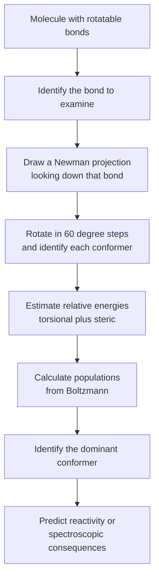
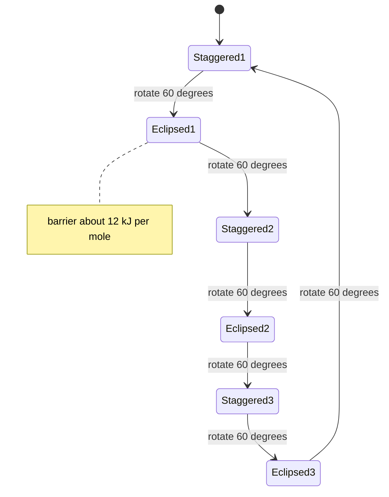
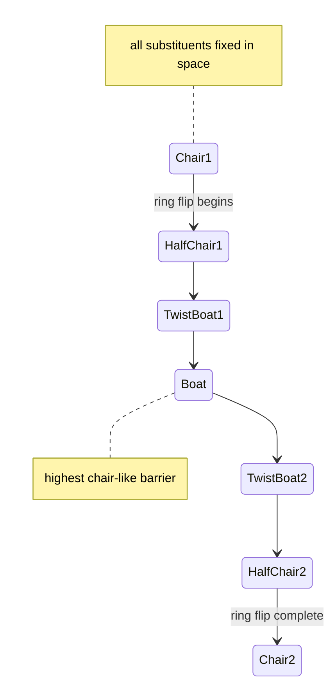
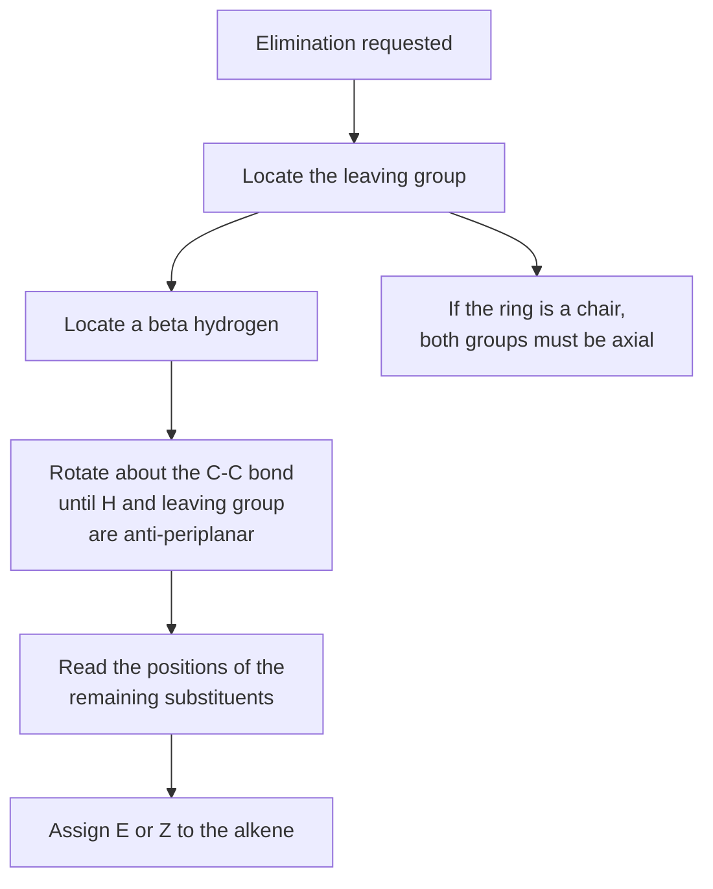

# Chapter 4 — Conformations and Conformational Analysis

> **Level:** Level 4 — Organic Chemistry
> **Estimated study time:** 7 hours (5 h reading + 2 h exercises)
> **Prerequisites:** [Isomerism and Stereochemistry](03-isomerism-and-stereochemistry.md); [Alkanes](05-alkanes.md) may be read in parallel
> **Related chapters:** [Alkanes](05-alkanes.md), [Alkenes, Alkynes and Electrophilic Addition](06-alkenes-alkynes-and-electrophilic-addition.md), [Haloalkanes: Nucleophilic Substitution and Elimination](08-haloalkanes-substitution-and-elimination.md)
> **Difficulty:** ★★★★☆ (1–5)

---

## 1. Learning Objectives

After working through this chapter you will be able to:

- Distinguish conformational from configurational isomerism, and explain why conformers are usually not isolable.
- Draw and interpret Newman projections, sawhorse projections and chair drawings, and convert between them.
- Explain the origin and magnitude of torsional strain in ethane and of the anti/gauche/eclipsed energy differences in butane.
- Describe the chair, boat and twist-boat conformations of cyclohexane and account for their relative energies.
- Assign axial and equatorial positions, perform a ring flip, and identify 1,3-diaxial interactions.
- Use A-values to predict the preferred conformation of a substituted cyclohexane, including *cis/trans* isomers and the *tert*-butyl lock.
- Explain why the E2 elimination requires an anti-periplanar arrangement and use that requirement to predict which diastereomer reacts faster.
- Recognise conformational problems in sugars, peptides and polymers, and explain why conformation determines biological function.

---

## 2. Introduction

A single organic molecule is not a single shape. The C–C single bond rotates freely at room temperature, so ethane passes through an eclipsed and two staggered conformations many billions of times per second. Butane has three distinguishable conformers, and a chain of ten carbons has a combinatorial explosion of them. The shape that a molecule adopts is not arbitrary: some conformations are lower in energy than others, and the population distribution over conformations determines reactivity, spectroscopic properties and biological recognition.

**Conformational analysis** is the study of those populations and of the energy barriers between them. The field was transformed in the 1950s by Derek Barton, who introduced the axial/equatorial description of cyclohexane and showed that conformational preferences explain the stereochemistry of steroids, and by Odd Hassel, whose electron-diffraction work established the chair conformation experimentally. Barton and Hassel shared the Nobel Prize in Chemistry in 1969. Before their work, cyclohexane was often drawn as a flat hexagon, and the consequences of that error propagated through an entire generation of steroid chemistry.

The distinction between conformation and configuration is one of the most important in the subject. **Configuration** is the arrangement of atoms in space that can be changed only by breaking bonds: *(R)* versus *(S)*, *(E)* versus *(Z)*. **Conformation** is the arrangement that can be changed by rotation about single bonds alone. Two conformers of the same molecule are the same compound, not isomers in the ordinary sense, although they can sometimes be trapped at low temperature. Two configurations are different compounds, with different physical properties and often different biological activity.

Conformational analysis also supplies the mechanistic explanation for stereospecific reactions. The E2 elimination requires the leaving group and the β-hydrogen to be anti-periplanar, and that geometric requirement explains why one diastereomer of a haloalkane eliminates far faster than another. The same kind of geometric argument explains why some substitution reactions invert configuration and others retain it, and why enzymes can accelerate a reaction by binding one conformation of a substrate and not another.

This chapter begins with the simplest rotatable bond, ethane, then builds to butane, cyclohexane and substituted cyclohexanes, then applies the analysis to rings of other sizes and to the stereochemistry of elimination. It closes with sugars and peptides, where conformational analysis is not an academic exercise but the language in which structure–function relationships are written.

---

## 3. Fundamental Concepts

### 3.1 Conformation and configurational isomerism

Two structures related by rotation about a single bond are **conformers**, not configurational isomers. They interconvert without bond breaking, and at room temperature the interconversion is usually so fast that only the population-weighted average is observed.

| Feature | Configurational isomers | Conformational isomers |
|---|---|---|
| Interconversion | Requires bond breaking | Requires only bond rotation |
| Isolable at room temperature | Yes | Usually no |
| Example | *(R)*- and *(S)*-butan-2-ol | *anti*- and *gauche*-butane |
| Energy barrier | 100–400 kJ mol⁻¹ | 4–45 kJ mol⁻¹ |
| Effect on physical properties | Different compounds | Same compound, different shape |

The barrier is the practical criterion. A barrier of 100 kJ mol⁻¹ corresponds to a half-life of minutes or longer at room temperature; a barrier of 20 kJ mol⁻¹ corresponds to interconversion on the nanosecond to picosecond timescale. Conformational analysis deals with the low-barrier regime, and the language of configuration is reserved for the high-barrier regime.

### 3.2 Newman projections

A **Newman projection** looks down a carbon–carbon bond. The front carbon is represented by the point where three bonds meet, and the back carbon by a circle. The three bonds from each carbon are drawn at 120° intervals, and the **dihedral angle** is the angle between a substituent on the front carbon and a substituent on the back carbon, measured along the bond.

Two limiting arrangements are named:

- **Staggered**: the substituents on the front and back carbons are 60° apart. This is the lowest-energy arrangement for a simple alkane, because the bonds are as far apart as possible.
- **Eclipsed**: the substituents are aligned, with a dihedral angle of 0°. This is the highest-energy arrangement, because the bonds and their electron clouds are directly adjacent.

A **sawhorse projection** shows the same molecule from an oblique angle, with the C–C bond drawn diagonally. The two conventions are equivalent, and converting between them is a matter of practice: the front carbon in a Newman projection corresponds to the lower-left carbon in a sawhorse drawing when the molecule is viewed from the left.

### 3.3 Ethane: the torsional barrier

Ethane has one C–C bond and three equivalent staggered conformations separated by three equivalent eclipsed conformations. The energy difference between them is the **torsional barrier**, about 12 kJ mol⁻¹ (2.9 kcal mol⁻¹).

```text
   H       H
   |       |
H--C-------C--H        staggered, dihedral 60 degrees
   |       |
   H       H

   H       H
    \     /
     C---C             eclipsed, dihedral 0 degrees
    /     \
   H       H
```

The barrier is not caused by steric repulsion between hydrogen atoms in the ordinary sense: the H···H distance in the eclipsed conformation is about 230 pm, well beyond the van der Waals contact distance of about 240 pm. The dominant contribution is **torsional strain**, a quantum-mechanical preference for staggered alignment that arises from the way the C–H bonding orbitals interact with the C–C σ framework. The barrier has threefold symmetry because a 120° rotation returns the molecule to an equivalent arrangement.

The barrier is small compared with thermal energy at room temperature, which is about $RT = 2.5\ \text{kJ mol}^{-1}$ per mole and about $4\ \text{kJ mol}^{-1}$ for the population above the barrier. Ethane therefore rotates freely, and the concept of a single "ethane conformation" is meaningless at room temperature; only the population distribution is meaningful.

### 3.4 Butane: anti, gauche and eclipsed

Rotation about the C2–C3 bond of butane is more informative because the two ends of the molecule are not identical. Looking down C2–C3, the front carbon carries two hydrogens and a methyl group, and the back carbon carries two hydrogens and a methyl group. The three staggered conformations are not equivalent:

- **Anti**: the two methyl groups are 180° apart. This is the lowest-energy conformer.
- **Gauche**: the two methyl groups are 60° apart. There are two equivalent gauche conformers, each about 3.8 kJ mol⁻¹ above the anti form.
- **Eclipsed**: three eclipsed conformations, of which two have a methyl group eclipsing a hydrogen (about 16 kJ mol⁻¹ above anti) and one has the two methyl groups eclipsing each other (about 19–20 kJ mol⁻¹ above anti).

| Conformer | Dihedral angle between methyls | Relative energy / kJ mol⁻¹ | Origin of strain |
|---|---|---|---|
| Anti | 180° | 0 | Reference |
| Gauche | 60°, 300° | 3.8 | Steric repulsion between methyls |
| Eclipsed, CH₃/H | 120°, 240° | 16 | Torsional strain plus one CH₃/H eclipse |
| Eclipsed, CH₃/CH₃ | 0° | 19–20 | Torsional strain plus CH₃/CH₃ eclipse |

The energy profile has three maxima and three minima per 360° rotation. The global minimum is anti, the local minima are gauche, and the maxima are eclipsed. The gauche conformer is populated to a measurable extent because 3.8 kJ mol⁻¹ is comparable to $RT$: at 298 K the anti:gauche ratio is about 70:30 when both gauche conformers are counted.

The butane profile introduces the two concepts that dominate the rest of the chapter. **Torsional strain** is the penalty for eclipsing bonds; it is present in every eclipsed conformation, including ethane. **Steric strain** (or van der Waals strain) is the penalty for forcing groups closer than their contact distance; it distinguishes the gauche conformer from the anti and the CH₃/CH₃ eclipse from the CH₃/H eclipse.

### 3.5 Cyclohexane: chair, boat and twist-boat

Cyclohexane is not planar. The planar hexagon would have C–C–C angles of 120°, which is 10.5° wider than the tetrahedral ideal, and every C–H bond would be eclipsed with a neighbouring C–H bond. The molecule avoids both penalties by puckering into the **chair** conformation.

In the chair, all C–C–C angles are close to 109.5°, and all adjacent C–H bonds are staggered. The chair is the global minimum, and it is the conformation in which essentially all cyclohexane molecules exist at room temperature.

Each carbon of the chair carries one **axial** bond and one **equatorial** bond. The axial bonds are vertical, alternating up and down around the ring; the equatorial bonds point outwards and slightly up or down, alternating in the opposite sense to the axial bond on the same carbon. On any given carbon, if the axial bond points up, the equatorial bond points down, and vice versa.

Two higher-energy conformations are important:

- **Boat**: the two "prow" carbons are raised on the same side, which forces four pairs of eclipsed C–H bonds and a flagpole interaction between the two prow hydrogens. About 29 kJ mol⁻¹ above the chair.
- **Twist-boat**: a twisted version of the boat that relieves some eclipsing. About 23 kJ mol⁻¹ above the chair. It is a local minimum, not a transition state.

| Conformation | Relative energy / kJ mol⁻¹ | Key feature |
|---|---|---|
| Chair | 0 | All bonds staggered, all angles tetrahedral |
| Twist-boat | 23 | Local minimum, some eclipsing relieved |
| Boat | 29 | Eclipsed bonds and flagpole interaction |
| Half-chair | 45 | Transition state for the ring flip |

### 3.6 The ring flip

A **ring flip** converts one chair into the other without breaking any bonds. The pathway passes through a half-chair transition state, a twist-boat, a boat and another twist-boat before reaching the second chair. The barrier is about 45 kJ mol⁻¹, which is high enough that the flip is slow on the nuclear magnetic resonance timescale at low temperature but fast at room temperature (about $10^5$ flips per second at 298 K).

The crucial consequence of the ring flip is that every axial bond becomes equatorial and every equatorial bond becomes axial, while the *up/down* sense at each carbon is preserved. A substituent that is up and axial in one chair is up and equatorial in the other. The ring flip does not change configuration; it changes conformation.

### 3.7 1,3-Diaxial interactions and A-values

In the chair, an axial substituent at C1 points towards the axial hydrogens at C3 and C5. These **1,3-diaxial interactions** are steric repulsions, and they are the main reason that substituents prefer equatorial positions.

The energetic cost of placing a substituent axial is quantified by its **A-value**, defined as the Gibbs energy difference between the axial and equatorial conformers:

$$
\text{A-value} = \Delta G^\circ_{\text{axial} \to \text{equatorial}}
$$

| Substituent | A-value / kJ mol⁻¹ | Approximate equatorial population at 298 K |
|---|---|---|
| $\ce{-H}$ | 0 | 50% |
| $\ce{-F}$ | 1.0 | 60% |
| $\ce{-CN}$ | 0.7 | 57% |
| $\ce{-Cl}$ | 2.0 | 70% |
| $\ce{-Br}$ | 2.2 | 71% |
| $\ce{-I}$ | 2.4 | 73% |
| $\ce{-OCH3}$ | 2.5 | 74% |
| $\ce{-OH}$ | 3.9 | 83% |
| $\ce{-CH3}$ | 7.6 | 95% |
| $\ce{-CH2CH3}$ | 7.5 | 95% |
| $\ce{-CH(CH3)2}$ | 9.2 | 97% |
| $\ce{-C(CH3)3}$ | >20 | >99.9% |
| $\ce{-C6H5}$ | 12.1 | 99% |

The values are approximate and depend on solvent and temperature, but the trends are robust. A methyl group is axial only about 5% of the time; a *tert*-butyl group is effectively never axial.

The A-value is a *difference*, not an absolute energy. It can be decomposed into two 1,3-diaxial interactions for a substituent that has hydrogen atoms at both C3 and C5, which is why the methyl A-value of 7.6 kJ mol⁻¹ corresponds to about 3.8 kJ mol⁻¹ per CH₃···H interaction.

### 3.8 Substituted cyclohexanes: cis and trans

A disubstituted cyclohexane has two stereocentres only when the substituents are different; with identical substituents the molecule may have a plane and be meso. The conformational analysis, however, is the same either way: for each *cis/trans* isomer, ask which chair arrangement places the larger group equatorial.

| Relationship | 1,2 | 1,3 | 1,4 |
|---|---|---|---|
| *cis* | axial, equatorial | equatorial, equatorial or axial, axial | axial, equatorial |
| *trans* | equatorial, equatorial or axial, axial | axial, equatorial | equatorial, equatorial or axial, axial |

The table is best remembered by a rule: *cis* at 1,2 and 1,4 is (a,e), and *cis* at 1,3 is (e,e) or (a,a); *trans* is the opposite. The rule follows from the up/down alternation of axial positions around the ring.

The **tert-butyl lock** is the standard application. A *tert*-butyl group has an A-value greater than 20 kJ mol⁻¹, so it is effectively fixed equatorial. Placing a *tert*-butyl group at C4 therefore fixes the conformation of the ring and allows the behaviour of a second substituent to be studied without conformational ambiguity. This is why so many conformational studies use 4-*tert*-butylcyclohexyl derivatives.

### 3.9 Cyclopentane and other rings

**Cyclopropane** is planar, with C–C–C angles of 60°. The orbitals forming the C–C bonds cannot point directly at each other, so the bonds are bent — sometimes called "banana bonds" — and the molecule has a strain energy of about 115 kJ mol⁻¹. Cyclopropane is nevertheless stable enough to be a useful reagent, and its strain makes it unusually reactive towards ring-opening.

**Cyclobutane** is puckered, with a fold angle of about 30°, which relieves some eclipsing at the cost of a small increase in angle strain. Its strain energy is about 110 kJ mol⁻¹.

**Cyclopentane** adopts an **envelope** conformation, in which four carbons are approximately coplanar and the fifth is out of plane. The envelope interconverts with other envelope conformations by **pseudorotation**, a low-barrier process that moves the out-of-plane carbon around the ring. The strain energy is only about 26 kJ mol⁻¹, much lower than for the smaller rings, because the internal angles of a planar pentagon (108°) are close to tetrahedral.

**Cyclohexane** has essentially zero strain energy in the chair, which is why six-membered rings are ubiquitous in natural products and drugs.

### 3.10 Conformational analysis of a reaction: the E2 elimination

The E2 elimination is a concerted reaction in which a base removes a β-hydrogen while a leaving group departs from the adjacent carbon. The reaction requires the H–C–C–Lg unit to be **anti-periplanar**: the dihedral angle between the C–H bond and the C–Lg bond must be close to 180°.

The requirement is stereoelectronic. The breaking C–H σ bond must overlap with the σ* orbital of the C–Lg bond, and that overlap is maximal when the two bonds are anti-periplanar. A *syn*-periplanar arrangement (dihedral 0°) also has some overlap and can react, but much more slowly; a perpendicular arrangement has essentially none.

In a cyclohexane ring, the anti-periplanar requirement translates into a simple rule: the leaving group and the β-hydrogen must both be **axial** and on opposite faces of the ring. An equatorial leaving group has no trans-diaxial β-hydrogen and therefore eliminates very slowly. This is why the E2 reaction of a 4-*tert*-butylcyclohexyl halide depends on which diastereomer is used: the *cis* isomer can place the halogen axial while the *tert*-butyl group remains equatorial, whereas the *trans* isomer has the halogen equatorial and cannot.

### 3.11 Sugars and peptides as conformational problems

**Sugars.** Glucose in solution exists mainly as a six-membered pyranose ring, and the ring adopts a chair. β-D-Glucopyranose has all five substituents — four hydroxyls and the hydroxymethyl group — equatorial, which is why it is the most stable aldohexose. α-D-Glucopyranose has the anomeric hydroxyl axial, and it is about 2–3 kJ mol⁻¹ higher in energy; the equilibrium mixture in water is about 36% α and 64% β. The preference for the axial anomer is greater than the A-value of a hydroxyl would predict, because of the **anomeric effect**, a stereoelectronic preference for an axial electronegative substituent adjacent to the ring oxygen. The anomeric effect is treated in Chapter 9.

**Peptides.** The peptide bond is planar and prefers the *trans* configuration ($\omega \approx 180°$) because of partial double-bond character. The backbone nevertheless has two rotatable bonds per residue, $\phi$ and $\psi$, and the allowed combinations are shown on a **Ramachandran plot**. The α-helix corresponds to $(\phi, \psi) \approx (-57°, -47°)$, and the β-sheet to about $(-139°, +135°)$. The restricted regions of the plot are a direct consequence of steric clashes between backbone and side-chain atoms, and they explain why protein secondary structure is limited to a small number of motifs.

**Polymers.** The conformation of a polymer chain is described by the same rotational potentials. Polyethylene prefers *trans* arrangements along the backbone, which is why crystalline polyethylene adopts a planar zigzag; the *gauche* conformers are populated in the melt and give the chain its flexibility. *cis*-Polyisoprene (natural rubber) is amorphous and elastic because the *cis* double bond prevents close packing, whereas *trans*-polyisoprene (gutta-percha) is harder and more crystalline.

---

## 4. Detailed Scientific Explanation

### 4.1 The components of strain

The energy of a conformation is the sum of several contributions, and separating them is the first step in any conformational analysis.

**Torsional strain** arises from the eclipsing of bonds. In ethane the penalty is about 12 kJ mol⁻¹ per eclipsed pair of C–H bonds, and it is the dominant term in the ethane barrier. In butane the same term is present in every eclipsed conformation, which is why even the CH₃/H eclipsed form is about 16 kJ mol⁻¹ above anti.

**Steric strain** (van der Waals strain) arises when non-bonded atoms are forced closer than the sum of their van der Waals radii. It is the term that distinguishes gauche butane from anti, and the term that makes 1,3-diaxial interactions costly. Steric strain is approximately additive for groups that are not too large, which is why A-values can be used to estimate the energies of disubstituted cyclohexanes.

**Angle strain** arises when bond angles deviate from the ideal tetrahedral value. It is small in cyclohexane, moderate in cyclopentane and severe in cyclopropane and cyclobutane. The strain energies of the cycloalkanes make the pattern clear:

| Ring | Strain energy / kJ mol⁻¹ | Dominant contribution |
|---|---|---|
| Cyclopropane | 115 | Angle strain, bent bonds, eclipsing |
| Cyclobutane | 110 | Angle strain, eclipsing |
| Cyclopentane | 26 | Eclipsing, small angle strain |
| Cyclohexane | 0 | None in the chair |
| Cycloheptane | 27 | Torsional and transannular |
| Cyclooctane | 41 | Torsional and transannular |

The table explains a great deal of reactivity. Cyclopropane and cyclobutane are strained enough to undergo ring-opening reactions that ordinary alkanes do not, whereas cyclohexane is a passive solvent-like framework. The prevalence of six-membered rings in natural products is not an accident of biosynthesis; it is a consequence of the strain-free chair.

### 4.2 Reading an energy profile

A conformational energy profile is a plot of energy against a dihedral angle. For butane, the profile has three minima (one anti at 180° and two gauche at 60° and 300°) and three maxima (eclipsed at 0°, 120° and 240°). The anti minimum is the global minimum; the gauche minima are local minima about 3.8 kJ mol⁻¹ higher; the maxima are transition states for rotation.

The distinction between a minimum and a maximum is the same as the distinction between an intermediate and a transition state in a reaction profile. A minimum is a stable or metastable species with a finite lifetime; a maximum is a configuration that the molecule passes through but cannot occupy. The twist-boat of cyclohexane is a local minimum, so it has a finite lifetime; the half-chair is a transition state, so it does not.

The population of each conformer at equilibrium is given by the Boltzmann distribution. For butane at 298 K the anti conformer accounts for about 70% of the molecules and the two gauche conformers for about 30% between them. The preference is modest because 3.8 kJ mol⁻¹ is only about 1.5 times $RT$.

### 4.3 The cyclohexane ring flip in detail

The ring flip is a concerted change in all six torsion angles. Starting from a chair, the molecule passes through a half-chair in which one carbon is displaced from the plane, then through a twist-boat, then a boat, then a second twist-boat, then a second half-chair, and finally the other chair. The whole sequence is a single continuous motion with a barrier of about 45 kJ mol⁻¹.

The two chairs are identical in energy for unsubstituted cyclohexane. For a monosubstituted cyclohexane they are not: the conformer with the substituent equatorial is lower by the A-value of the substituent, and the equilibrium lies towards that conformer. For a disubstituted cyclohexane the two chairs may have different substituent patterns, and the difference between them determines the conformational preference.

The ring flip is fast at room temperature but slow at low temperature. Cooling a substituted cyclohexane to about −80 °C slows the flip enough that the axial and equatorial protons give separate signals in the proton NMR spectrum. On warming, the signals broaden and coalesce, and above the coalescence temperature a single averaged signal is observed. This is one of the classic demonstrations that conformational exchange is a real dynamic process and not a drawing convention.

### 4.4 A-values: use and limitations

The A-value is the Gibbs energy difference between the axial and equatorial conformers of a monosubstituted cyclohexane. It is a convenient way to rank substituents, but it has limits that should be stated whenever it is used quantitatively.

First, A-values are measured in a specific solvent at a specific temperature, and they change with both. A polar substituent can have a substantially different A-value in water than in a hydrocarbon solvent, because the axial and equatorial conformers have different dipole moments and different solvation.

Second, A-values are not strictly additive. Two substituents can interact with each other through the ring, particularly when they are *cis* at 1,2 or 1,3, and the interaction energy is not simply the sum of the two A-values. The additivity assumption is a useful first approximation, not a law.

Third, A-values ignore stereoelectronic effects that can favour axial positions. The **anomeric effect** stabilises an axial electronegative substituent at a carbon adjacent to an oxygen in a ring, and the **gauche effect** can stabilise a gauche arrangement of two electronegative substituents in an acyclic chain. These effects are discussed in Section 4.7.

### 4.5 Fused rings and steroids

Two cyclohexane rings can be fused along a common bond, and the fusion can be *cis* or *trans*. In **trans-decalin** the two ring-junction hydrogens are on opposite faces, which forces both ring-junction bonds to be equatorial. The molecule is rigid: neither ring can flip without breaking the fusion. In **cis-decalin** the junction hydrogens are on the same face, one ring-junction bond is axial and the other equatorial, and the molecule can undergo a coordinated ring flip that converts one chair–chair arrangement into another.

The steroid nucleus is built from four fused rings — three six-membered and one five-membered — and the ring fusions are usually *trans*. The rigidity of the trans-fused system is what allows steroids to present a well-defined three-dimensional surface to a receptor. The axial methyl groups at the ring junctions (C18 and C19 in the standard numbering) project alternately above and below the roughly planar framework, and their positions are a direct consequence of the chair conformations of the fused rings.

The relationship between conformation and biological function is nowhere clearer than in the steroid hormones. Testosterone and oestradiol differ in the A ring — one has a ketone, the other an aromatic ring — and that difference changes both the shape and the receptor preference. The conformational framework is conserved; the functional-group decoration is what varies.

### 4.6 Converting between representations

Three representations are used interchangeably: the Newman projection, the sawhorse projection and the chair drawing. Converting between them is a skill, not a talent, and it is best learned by a fixed procedure.

**Sawhorse to Newman.** View the molecule along the C–C bond of interest. The carbon nearer the viewer becomes the front carbon of the Newman projection, and its three substituents are drawn at 120° intervals. The rear carbon becomes the circle, and its substituents are placed according to their dihedral angles relative to the front substituents.

**Newman to chair.** A cyclohexane chair can be built by placing two Newman projections side by side and joining them. The easier route is to draw the chair directly and then check it: the two parallel lines represent the C2–C3 and C5–C6 bonds, the "head" carbon C1 is up, the "foot" carbon C4 is down, and the axial bonds alternate up and down around the ring.

**Chair to axial/equatorial assignment.** At each carbon, the axial bond is vertical. If the carbon is a "peak" of the chair, its axial bond points up; if it is a "valley", its axial bond points down. The equatorial bond points in the opposite vertical sense and roughly outward from the ring.

A reliable check on any chair drawing is to count: there must be three axial bonds pointing up and three pointing down, and the same for equatorial. A drawing with four axial bonds pointing up is wrong.

### 4.7 Stereoelectronic effects beyond sterics

Two effects consistently override the simple steric preference for equatorial positions.

**The anomeric effect.** In a pyranose ring, an electronegative substituent at C1 (the anomeric carbon) prefers the axial position, contrary to the steric prediction. The accepted explanation is hyperconjugation: a lone pair on the ring oxygen donates into the σ* orbital of the C1–X bond, and this donation is most effective when the lone pair and the C–X bond are anti-periplanar, which corresponds to the axial arrangement. The effect is worth roughly 2–4 kJ mol⁻¹ for a hydroxyl group and rather more for a halogen or an alkoxy group. It is the reason α-D-glucopyranose is present at about 36% in aqueous solution despite having an axial hydroxyl.

**The gauche effect.** In 1,2-difluoroethane the *gauche* conformer is more stable than the *anti* conformer by about 2–3 kJ mol⁻¹, even though the *anti* arrangement minimises steric repulsion. The effect is attributed to hyperconjugation from a C–H σ bond to the adjacent C–F σ* orbital, which is optimal in the gauche arrangement. The effect is strongest for fluorine and weaker for larger halogens, where steric repulsion takes over.

These effects are a reminder that "steric strain" is not the only conformational force. A student who predicts conformation purely from A-values will get the right answer for alkyl substituents and the wrong answer for electronegative substituents at anomeric or vicinal positions.

### 4.8 E2 stereochemistry in acyclic systems

The anti-periplanar requirement of the E2 reaction has consequences that extend beyond cyclohexanes. In an acyclic molecule, the requirement means that the reaction is **stereospecific**: a given diastereomer of the starting material gives a specific alkene geometry.

Consider 2-bromo-3-methylbutane derivatives. The erythro and threo diastereomers, or the *meso* and *dl* pairs, eliminate to different alkene geometries because the anti-periplanar arrangement places the remaining substituents on opposite sides. The relationship is easiest to see in a Newman projection looking down the C2–C3 bond: rotate until the H and the Br are anti, then read off the positions of the two methyl groups. If they are on opposite sides of the developing double bond, the product is *(E)*; if on the same side, the product is *(Z)*.

The same analysis explains why the E2 reaction is used as a stereospecific alkene synthesis, and why the choice of base and solvent matters: a bulky base such as potassium *tert*-butoxide favours the less substituted alkene (Hofmann product) because it abstracts the more accessible hydrogen, whereas a small base favours the more substituted alkene (Zaitsev product). The conformational analysis supplies the geometric part of the explanation; the kinetics of proton abstraction supplies the rest.

---

## 5. Visual Diagrams

The four diagrams below encode the workflow of conformational analysis, the rotational cycle of ethane, the ring-flip pathway of cyclohexane and the geometric test for an E2 elimination. They are decision aids, not pictures of molecules.



**Figure 4.1 — The workflow of conformational analysis.** The sequence runs from structure to population to consequence. The critical step is E: a conformer map without energies is only a list of drawings, and the chemistry follows from the energy differences, not from the drawings themselves.



**Figure 4.2 — The rotational cycle of ethane.** Six conformations alternate around a full rotation: three staggered minima and three eclipsed maxima. The barrier is the same at each eclipse because the three C–H bonds are equivalent. The diagram is a cycle rather than a line because a 360° rotation returns the molecule to its starting arrangement.



**Figure 4.3 — The cyclohexane ring flip.** The pathway passes through two half-chairs, two twist-boats and one boat. The overall barrier is about 45 kJ mol⁻¹, which is high enough to slow the flip at low temperature but low enough that it is fast at room temperature. Every axial substituent becomes equatorial and every equatorial becomes axial, while the up/down sense is preserved.



**Figure 4.4 — The geometric test for an E2 elimination.** The anti-periplanar requirement converts a question about mechanism into a question about conformation. In an acyclic molecule the bond is rotated until the H and leaving group are anti, and the alkene geometry is read from the remaining substituents. In a cyclohexane the same requirement means that both the leaving group and the β-hydrogen must be axial.

---

## 6. Mathematical Formulas

Conformational analysis is quantitative because the population of each conformer is fixed by its energy. Four relations cover almost every calculation in this chapter.

### 6.1 Boltzmann distribution

$$
\frac{N_i}{N_j} = \exp\left(-\frac{E_i - E_j}{RT}\right)
$$

| Symbol | Meaning | SI unit |
|---|---|---|
| $N_i$ | number of molecules in conformer $i$ | — |
| $E_i$ | molar energy of conformer $i$ | J mol⁻¹ |
| $R$ | gas constant, 8.314 | J K⁻¹ mol⁻¹ |
| $T$ | thermodynamic temperature | K |

At 298 K, $RT = 2.48\ \text{kJ mol}^{-1}$. A conformer 3.8 kJ mol⁻¹ above the global minimum is therefore populated to about 22% of the ground-state population per conformer, which is why gauche butane is observable. A conformer 20 kJ mol⁻¹ above the minimum is populated to about 0.03%, which is why *tert*-butyl is effectively locked equatorial.

### 6.2 Gibbs energy and the equilibrium constant

$$
\Delta G^\circ = -RT \ln K
\qquad\text{with}\qquad
K = \frac{[\text{equatorial}]}{[\text{axial}]}
$$

For a monosubstituted cyclohexane, $K$ is the axial/equatorial ratio, and the A-value is $\Delta G^\circ$ for the axial-to-equatorial conversion. A substituent with an A-value of 7.6 kJ mol⁻¹ therefore has $K = \exp(7600/2478) = 21.5$, corresponding to about 95.6% equatorial.

### 6.3 A-value and population

$$
\text{fraction axial} = \frac{1}{1 + \exp(A/RT)}
$$

where $A$ is the A-value in J mol⁻¹. The expression follows directly from the Boltzmann distribution and assumes that only two conformers are populated, which is a good approximation for a monosubstituted cyclohexane.

### 6.4 Torsional potential

$$
E(\theta) = \frac{V_3}{2}\left[1 + \cos(3\theta)\right]
$$

| Symbol | Meaning | Unit |
|---|---|---|
| $E(\theta)$ | torsional energy at dihedral angle $\theta$ | J mol⁻¹ |
| $V_3$ | threefold barrier height | J mol⁻¹ |
| $\theta$ | dihedral angle, zero at the eclipsed arrangement | degrees |

For ethane, $V_3 \approx 12\ \text{kJ mol}^{-1}$. The function has maxima at $\theta = 0°, 120°, 240°$ and minima at $60°, 180°, 300°$, reproducing the threefold symmetry of the barrier. The model is a phenomenological fit, not a derivation; the physical origin of the barrier requires molecular orbital theory.

### 6.5 Additivity of conformational energy

$$
E_\text{total} \approx \sum E_\text{torsion} + \sum E_\text{steric} + \sum E_\text{angle}
$$

The approximation is useful but not exact. It fails when substituents interact strongly, when stereoelectronic effects such as the anomeric effect are present, and when the molecule is flexible enough that the individual terms are not independent. For alkyl-substituted cyclohexanes the approximation is good to a few kJ mol⁻¹, which is enough for qualitative predictions.

---

## 7. Chemical Equations

The equations below are reactions whose outcome depends on conformation. Each is accompanied by the conformational point that makes it instructive.

### 7.1 Dehydration of cyclohexanol

$$
\ce{C6H11OH ->[H2SO4,\ \Delta] C6H10 + H2O}
$$

Cyclohexanol dehydrates to cyclohexene. The reaction proceeds through a carbocation, and the chair conformation of the ring is retained during the formation of the double bond. The product is a strained but isolable alkene; the ring is not planar, and the double bond is accommodated in a half-chair.

### 7.2 E2 elimination of the cis isomer

$$
\ce{C10H19Br + KOH ->[ethanol,\ \Delta] C10H18 + KBr + H2O}
$$

In *cis*-1-bromo-4-*tert*-butylcyclohexane the *tert*-butyl group is equatorial and the bromine is axial. The axial C–Br bond is anti-periplanar to an axial C–H bond on the adjacent carbon, so the E2 elimination is fast. This is the conformer that reacts.

### 7.3 E2 elimination of the trans isomer

$$
\ce{C10H19Br + KOH ->[ethanol,\ \Delta] C10H18 + KBr + H2O}
$$

In *trans*-1-bromo-4-*tert*-butylcyclohexane the *tert*-butyl group is equatorial and the bromine is equatorial as well. There is no anti-periplanar C–H bond, so the E2 reaction is very slow. The same equation therefore describes two reactions with rate constants that differ by orders of magnitude; the difference is entirely conformational.

### 7.4 Epoxidation of cyclohexene

$$
\ce{C6H10 + C7H5ClO3 -> C6H10O + C7H5ClO2}
$$

Cyclohexene reacts with 3-chloroperoxybenzoic acid to give cyclohexene oxide. The reaction is a concerted *syn* addition, so the oxygen is delivered to one face of the alkene and the epoxide retains the *cis* relationship of the ring. The half-chair conformation of cyclohexene, in which the double bond is twisted, affects the face selectivity of the epoxidation; the same principle of conformational control underlies the Sharpless epoxidation of allylic alcohols, where a chiral titanium tartrate complex determines which face of the alkene is attacked.

### 7.5 Mutarotation of glucose

$$
\ce{C6H12O6 <=> C6H12O6}
$$

The two forms are the α and β anomers of D-glucopyranose. The α anomer has the anomeric hydroxyl axial and the β anomer has it equatorial; the equilibrium mixture in water is about 36% α and 64% β. The reaction is a ring-opening and re-closing sequence catalysed by acid or base, and it is a conformational change in the sense that the pyranose ring retains its chair throughout.

### 7.6 Stereospecific E2 of 2-bromobutane

$$
\ce{CH3CHBrCH2CH3 + KOH -> CH3CH=CHCH3 + KBr + H2O}
$$

The elimination requires an anti-periplanar arrangement of the β-hydrogen and the bromine. Rotation about the C2–C3 bond therefore determines whether the product is *(E)*- or *(Z)* but-2-ene. The reaction is stereospecific: a given enantiomer or diastereomer of the starting material gives a predictable alkene geometry, and the prediction is made by drawing the Newman projection with H and Br anti.

---

## 8. Worked Examples

### Worked Example 8.1 — Population of butane conformers

**Problem.** The gauche conformer of butane is 3.8 kJ mol⁻¹ above the anti conformer. Calculate the percentage of molecules in each conformer at 298 K, counting both gauche conformers.

**Strategy.** Use the Boltzmann distribution with the degeneracy of the gauche state (two equivalent conformers).

**Solution.** At 298 K,

$$
RT = 8.314 \times 298 = 2478\ \text{J mol}^{-1}
$$

The population ratio for one gauche conformer relative to anti is

$$
\frac{N_g}{N_a} = \exp\left(-\frac{3800}{2478}\right) = \exp(-1.533) = 0.216
$$

There are two gauche conformers, so the total gauche population is $2 \times 0.216 = 0.432$ times the anti population. The fractions are therefore

$$
f_\text{anti} = \frac{1}{1 + 0.432} = 0.698
\qquad
f_\text{gauche} = \frac{0.432}{1 + 0.432} = 0.302
$$

About 70% anti and 30% gauche.

**Check.** The two fractions sum to 1, and the gauche population is substantial, as expected for an energy difference of only 1.5 $RT$. A calculation that forgot the factor of two would give 78% anti and 22% gauche, which is wrong because the two gauche conformers are distinct microstates of the same energy.

### Worked Example 8.2 — Drawing a Newman projection

**Problem.** Draw Newman projections for the anti and one gauche conformer of butane, looking down the C2–C3 bond. State the dihedral angle between the two methyl groups in each.

**Strategy.** Place the front carbon at the centre with its three substituents at 120° intervals, then place the back carbon behind it and rotate to the required dihedral angle.

**Solution.** The front carbon C2 carries $\ce{H}$, $\ce{H}$ and $\ce{CH3}$; the back carbon C3 carries $\ce{H}$, $\ce{H}$ and $\ce{CH3}$. Draw the front carbon as a Y with the methyl pointing up. In the anti conformer the back carbon is rotated so that its methyl points down, giving a dihedral angle of 180° between the two methyls. In the gauche conformer the back methyl is rotated to 60° from the front methyl, which places it to the lower right in the projection.

A useful check is to count the eclipsing interactions. In the anti conformer all three front substituents are staggered relative to all three back substituents; in the gauche conformer they are also staggered, but the two methyl groups are closer.

**Check.** Both conformers are staggered, so neither has eclipsed bonds. The anti conformer has a centre of inversion between the two methyl groups; the gauche conformer does not. A drawing in which any front bond is parallel to a back bond is eclipsed and has the wrong energy.

### Worked Example 8.3 — Cis and trans 1,2-dimethylcyclohexane

**Problem.** For *cis*- and *trans*-1,2-dimethylcyclohexane, determine the substituent arrangement in each chair and state which isomer has the larger conformational preference.

**Strategy.** Draw the chair, place one methyl equatorial, then use the up/down relationship to place the second methyl and check whether it is axial or equatorial.

**Solution.** In *cis*-1,2-dimethylcyclohexane the two methyls are on the same face. If the C1 methyl is equatorial and pointing down, the C2 methyl must also point down; at C2 the down position is axial. The arrangement is therefore (a,e). Ring flipping gives (e,a), which is the same energy, so the two chairs are equivalent and the compound has no strong conformational preference.

In *trans*-1,2-dimethylcyclohexane the methyls are on opposite faces. With the C1 methyl equatorial down, the C2 methyl must point up, which is equatorial at C2. This chair is (e,e). Ring flipping gives (a,a), which is about $2 \times 7.6 = 15.2\ \text{kJ mol}^{-1}$ higher. The trans isomer therefore has a strong preference for the diequatorial chair.

**Check.** The (e,e) conformer has no 1,3-diaxial interactions involving methyl groups; the (a,a) conformer has four such interactions, two per methyl. The energy difference is consistent with the A-value of a methyl group. A common error is to assume that *trans* always means diequatorial; that is true at 1,2 and 1,4 but false at 1,3.

### Worked Example 8.4 — Using A-values quantitatively

**Problem.** 1-*tert*-Butyl-4-methylcyclohexane has the *tert*-butyl group equatorial and the methyl group either axial or equatorial. Using A-values of 20.5 kJ mol⁻¹ for *tert*-butyl and 7.6 kJ mol⁻¹ for methyl, calculate the ratio of the two conformers at 298 K.

**Strategy.** The *tert*-butyl group is effectively locked equatorial. The choice is therefore whether the methyl is axial or equatorial, and the energy difference between the two conformers is the difference between the two A-values.

**Solution.** The conformer with both groups equatorial is lower in energy by

$$
\Delta E = A(\ce{C(CH3)3}) - A(\ce{CH3}) = 20.5 - 7.6 = 12.9\ \text{kJ mol}^{-1}
$$

The ratio of the higher-energy (methyl axial) to the lower-energy (methyl equatorial) conformer is

$$
\frac{N_\text{ax}}{N_\text{eq}} = \exp\left(-\frac{12900}{2478}\right) = \exp(-5.20) = 5.5 \times 10^{-3}
$$

The diequatorial conformer therefore accounts for about 99.5% of the molecules.

**Check.** The result is consistent with the qualitative rule that the larger group dominates. A calculation that simply added the two A-values would predict a much larger preference for one conformer, which is wrong: the *tert*-butyl group does not contribute to the difference because it is equatorial in both conformers. Adding A-values is valid only when comparing conformers in which both substituents change position.

### Worked Example 8.5 — E2 rate and ring conformation

**Problem.** *cis*- and *trans*-1-Bromo-4-*tert*-butylcyclohexane are treated with potassium ethoxide. Predict which isomer undergoes E2 elimination faster, and explain the difference.

**Strategy.** Fix the *tert*-butyl group equatorial, determine whether the bromine is axial or equatorial in each isomer, and apply the anti-periplanar requirement.

**Solution.** The *tert*-butyl group is locked equatorial, which fixes the conformation of the ring. In the *cis* isomer the bromine is on the same face as the *tert*-butyl group and is therefore axial. The axial C–Br bond is anti-periplanar to an axial C–H bond at C2 and at C6, so E2 elimination is fast. In the *trans* isomer the bromine is on the opposite face and is equatorial. An equatorial leaving group has no anti-periplanar β-hydrogen in the ring, so the E2 reaction is very slow and other pathways dominate.

The *cis* isomer therefore eliminates much faster.

**Check.** A ring flip of the *cis* isomer would move the bromine to equatorial, but it would also move the *tert*-butyl group to axial, which costs more than 20 kJ mol⁻¹. The population of that conformer is negligible, which is why the *tert*-butyl lock makes the prediction reliable. Without the lock, both isomers would have some population of a reactive conformer and the rate difference would be smaller.

### Worked Example 8.6 — The anomeric equilibrium of glucose

**Problem.** In aqueous solution at 298 K, D-glucose is 36% α-pyranose and 64% β-pyranose. Calculate the Gibbs energy difference between the two anomers and state which is more stable.

**Strategy.** Use $\Delta G^\circ = -RT \ln K$ with $K = [\beta]/[\alpha]$.

**Solution.**

$$
K = \frac{0.64}{0.36} = 1.78
$$

$$
\Delta G^\circ = -RT \ln K = -2478 \times \ln(1.78) = -2478 \times 0.576 = -1.43\ \text{kJ mol}^{-1}
$$

The negative sign means that the β anomer is lower in Gibbs energy by about 1.4 kJ mol⁻¹.

**Check.** The β anomer has all substituents equatorial, so it should be more stable on steric grounds. The energy difference is smaller than the A-value of a hydroxyl group (3.9 kJ mol⁻¹) would suggest, because the anomeric effect stabilises the axial α anomer by roughly 2–3 kJ mol⁻¹. The two effects partly cancel, which is why the mixture is close to 1:2 rather than overwhelmingly β.

---

## 9. Real-World Applications

**Protein folding and structure.** The Ramachandran plot is a conformational map, and every protein structure deposited in the Protein Data Bank is validated against it. A residue in a disallowed region indicates an error in the model, because the conformational energy would be prohibitive. The same logic underlies the prediction of protein structure from sequence: the search space is astronomical, but it is constrained by the rotational potentials of the backbone and by the packing of side chains.

**Drug design.** The bioactive conformation of a drug is the conformation that binds the receptor, and it is not necessarily the global minimum in solution. Medicinal chemists often constrain a flexible molecule by adding a ring or a methyl group to lock the bioactive conformation, a strategy called conformational restriction. The gain in potency can be large, because the entropic cost of freezing the molecule is paid during synthesis rather than during binding.

**Enzyme catalysis.** Enzymes bind the transition state of a reaction more tightly than the substrate, and part of that binding energy comes from conformational preorganisation. The enzyme active site holds the substrate in the precise geometry required for reaction, which is why enzyme-catalysed reactions can be accelerated by factors of $10^{10}$ or more relative to the uncatalysed reaction in water.

**Polymers and materials.** The stiffness of a polymer chain depends on its conformational preferences. Polyethylene crystallises in a planar zigzag because the *trans* conformation is preferred, whereas atactic polystyrene is amorphous because the irregular stereochemistry prevents the chain from packing. The design of high-performance fibres such as Kevlar exploits the rigidity of the extended-chain conformation.

**Liquid crystals.** Liquid-crystalline phases arise when rod-like or disc-like molecules retain orientational order while losing positional order. The transition temperatures depend on the conformational flexibility of the mesogen, and the design of a liquid crystal for a display application is a conformational design problem as much as a synthetic one.

**Molecular machines.** Rotaxanes, catenanes and molecular motors depend on controlled conformational changes, often driven by light or by a chemical stimulus. The 2016 Nobel Prize in Chemistry recognised the design of molecular machines, and the operation of every one of them is a conformational change with a well-defined energy landscape.

---

## 10. Common Mistakes

| Mistake | Why it happens | Correct approach |
|---|---|---|
| Drawing cyclohexane as a flat hexagon | The flat drawing is easier to draw and appears in many diagrams | Draw the chair; a flat hexagon misrepresents both angles and torsional strain |
| Treating every axial bond as pointing up | The first chair a student draws has one axial up, and the pattern is generalised | Axial bonds alternate up and down around the ring; equatorial bonds point the opposite way on each carbon |
| Believing that a ring flip changes up into down | The flip looks like a large change, so the labels are confused | A ring flip changes axial into equatorial and vice versa, but an up substituent stays up |
| Assuming *trans* always means diequatorial | The 1,2 case is taught first and generalised | *trans* is diequatorial at 1,2 and 1,4, but axial/equatorial at 1,3 |
| Adding A-values when only one substituent changes | The values look like independent contributions | Add A-values only when comparing conformers in which both substituents change position |
| Treating a conformer as an isolable isomer | Conformers are drawn as if they were separate compounds | Conformers interconvert by rotation; they are isolable only when the barrier is high or the temperature is low |
| Calling an eclipsed conformation an intermediate | The energy maximum looks like a species on a profile | An eclipsed conformation is a transition state for rotation, not a minimum |
| Expecting an equatorial leaving group to undergo E2 in a chair | The leaving group is visible and the β-hydrogen is not | E2 requires an anti-periplanar H; in a chair that means both groups axial |
| Confusing *syn*- and *anti*-periplanar | The prefixes sound similar and both describe coplanarity | *Anti* means 180°, *syn* means 0°; E2 is fast only for *anti* |

---

## 11. Chapter Summary

- Conformers interconvert by rotation about single bonds; configurational isomers require bond breaking and are separate compounds.
- Newman projections look down a C–C bond and show the dihedral angle between front and back substituents.
- Ethane has a threefold torsional barrier of about 12 kJ mol⁻¹; the barrier is electronic in origin, not simply steric.
- Butane has anti (0), gauche (3.8 kJ mol⁻¹) and eclipsed (16–20 kJ mol⁻¹) conformers; at 298 K the mixture is about 70% anti and 30% gauche.
- Cyclohexane adopts a strain-free chair; boat and twist-boat are about 29 and 23 kJ mol⁻¹ higher, and the ring-flip barrier is about 45 kJ mol⁻¹.
- A ring flip converts every axial bond into an equatorial bond and vice versa, while preserving the up/down sense at each carbon.
- A-values quantify the preference for an equatorial substituent and allow quantitative prediction of conformer ratios.
- The *tert*-butyl group is an effective conformational lock because its A-value exceeds 20 kJ mol⁻¹.
- Cyclopropane and cyclobutane are highly strained; cyclopentane is mildly strained and pseudorotates; cyclohexane is strain-free.
- E2 elimination requires an anti-periplanar H–C–C–Lg arrangement, which in a chair means a trans-diaxial relationship.
- Sugars, peptides and polymers are conformational problems, and their biological properties depend on the populations of their conformers.

---

## 12. Exercises

### 12.1 Conceptual questions

1. Distinguish conformational from configurational isomerism, using butane and but-2-ene as examples.
2. Explain why the ethane rotational barrier is not primarily caused by steric repulsion between hydrogen atoms, and state what the dominant contribution is.

### 12.2 Basic problems

3. Draw Newman projections for the staggered and eclipsed conformations of ethane and state the dihedral angle between the front and back C–H bonds in each.
4. Identify the butane conformer in each case: (a) the two methyl groups are 180° apart; (b) the two methyl groups are 60° apart; (c) the two methyl groups are 0° apart.

### 12.3 Intermediate problems

5. Draw both chairs of *cis*-1,3-dimethylcyclohexane and state which is preferred and why.
6. Draw both chairs of *trans*-1,2-dibromocyclohexane and state which is preferred.

### 12.4 Advanced problems

7. Fluorocyclohexane has an A-value of 1.0 kJ mol⁻¹. Calculate the percentage of molecules with fluorine axial at 298 K.
8. A substituted cyclohexane shows a single set of proton NMR signals at room temperature but two sets at −90 °C. Explain the observation and estimate the barrier that is being frozen out.

### 12.5 Mechanism-drawing questions

9. Draw the E2 mechanism for *cis*-1-bromo-4-*tert*-butylcyclohexane with ethoxide, showing the anti-periplanar arrangement of the reacting bonds and the geometry of the product.
10. Draw the ring flip of methylcyclohexane, labelling the axial and equatorial conformers, and state which is more stable.

### 12.6 Further reasoning questions

11. A conformational equilibrium has a 95:5 ratio at 298 K. Calculate the Gibbs energy difference between the two conformers.
12. β-D-Glucopyranose is more stable than α-D-glucopyranose by only about 1.4 kJ mol⁻¹, even though the β anomer has all substituents equatorial. Explain why the difference is so small.

### 12.7 Answers

1. Butane conformers interconvert by rotation about the C2–C3 bond and are the same compound; *(E)*- and *(Z)*-but-2-ene cannot interconvert without breaking the π bond and are different compounds.
2. The H···H distance in eclipsed ethane is about 230 pm, beyond van der Waals contact; the barrier arises mainly from torsional strain, a quantum-mechanical preference for staggered bonds.
3. Staggered: dihedral 60°; eclipsed: dihedral 0°. Both have three equivalent C–H bonds on each carbon.
4. (a) Anti; (b) gauche; (c) syn-periplanar, the highest-energy eclipsed conformer.
5. The (e,e) chair is preferred, by about $2 \times 7.6 = 15.2\ \text{kJ mol}^{-1}$ relative to the (a,a) chair, because it avoids two pairs of 1,3-diaxial interactions.
6. The (e,e) chair is preferred; the (a,a) chair places both bromines axial and is higher by roughly twice the bromine A-value.
7. $K = \exp(1000/2478) = 1.50$; fraction axial $= 1/(1 + 1.50) = 0.40$, so about 40%.
8. At room temperature the ring flip is fast on the NMR timescale and the axial and equatorial environments are averaged. At −90 °C the flip is slow, so the two environments are resolved. The barrier being frozen out is the ring-flip barrier of about 45 kJ mol⁻¹.
9. The axial C–Br bond and an axial C–H bond on C2 are anti-periplanar; ethoxide removes that proton as the C–Br bond breaks, forming the C1=C2 double bond. The *tert*-butyl group remains equatorial throughout.
10. The axial-methyl conformer is about 7.6 kJ mol⁻¹ above the equatorial-methyl conformer, so the equatorial conformer dominates (about 95%).
11. $\Delta G = -RT \ln(95/5) = -2478 \times 2.944 = -7.30\ \text{kJ mol}^{-1}$.
12. The anomeric effect stabilises the axial α anomer by roughly 2–3 kJ mol⁻¹, opposing the steric preference for the all-equatorial β anomer, so the net difference is small.

> Worked solutions for this level are maintained in the `solutions/` directory of the level.

---

## 13. Further Reading

- Clayden, J.; Greeves, N.; Warren, S. *Organic Chemistry*, 2nd ed. Oxford University Press, 2012. The chapter on conformational analysis develops the treatment of alkanes, cyclohexanes and stereoelectronic effects.
- Eliel, E. L.; Wilen, S. H. *Stereochemistry of Organic Compounds*. Wiley, 1994. The definitive treatment of conformational analysis, including A-values, fused rings and the anomeric effect.
- Carey, F. A.; Sundberg, R. J. *Advanced Organic Chemistry*, Part A, 5th ed. Springer, 2007. The stereochemistry chapter includes quantitative conformational analysis and its application to reactivity.
- Barton, D. H. R. "The conformation of the steroid nucleus." *Experientia*, 1950. The paper that established the chair conformation of cyclohexane rings in steroids and founded conformational analysis as a chemical discipline.
- Ramachandran, G. N.; Ramakrishnan, C.; Sasisekharan, V. "Stereochemistry of polypeptide chain configurations." *Journal of Molecular Biology*, 1963. The original Ramachandran plot paper.
- IUPAC. *Compendium of Chemical Terminology* (the "Gold Book"), 2nd ed. (the "corrected" version). <https://goldbook.iupac.org/> Definitions of *conformation*, *conformer*, *torsion angle* and *steric strain*.
- Anslyn, E. V.; Dougherty, D. A. *Modern Physical Organic Chemistry*. University Science Books, 2006. Chapters on conformational analysis and stereoelectronic effects give the quantitative molecular-orbital background to torsional and anomeric effects.
