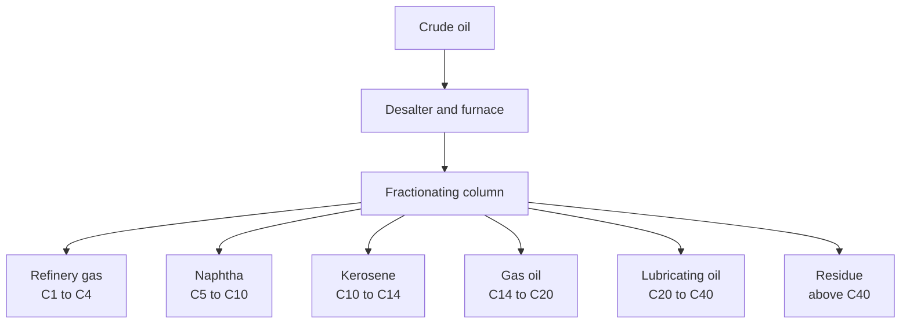
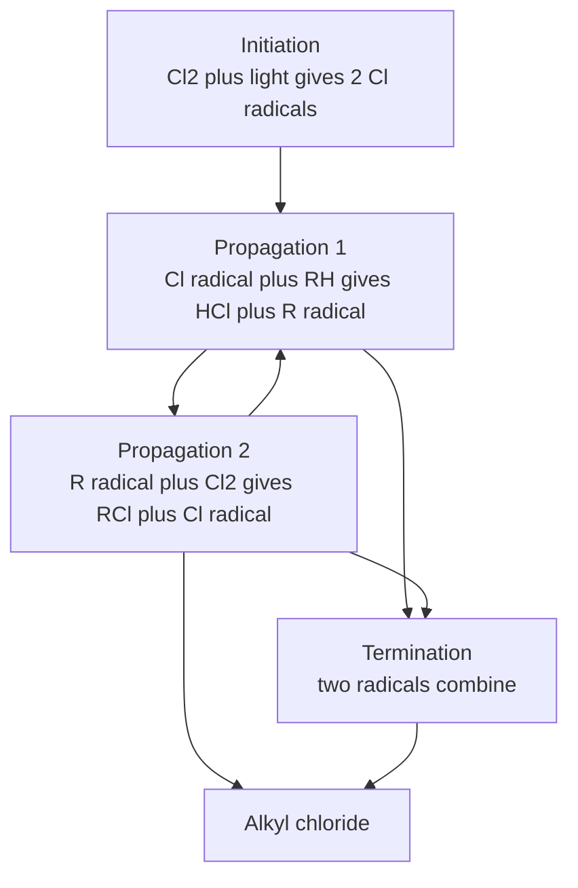
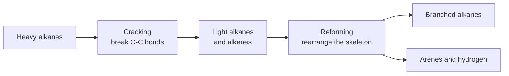
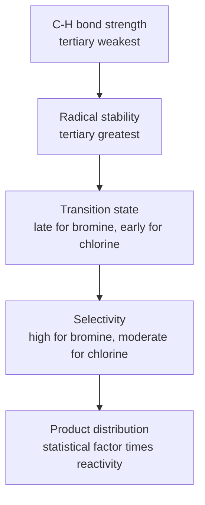

# Chapter 5 — Alkanes

> **Level:** Level 4 — Organic Chemistry
> **Estimated study time:** 5 hours (3.5 h reading + 1.5 h exercises)
> **Prerequisites:** [Functional Groups and IUPAC Nomenclature](02-functional-groups-and-iupac-nomenclature.md); [Isomerism and Stereochemistry](03-isomerism-and-stereochemistry.md); [Conformations and Conformational Analysis](04-conformations.md)
> **Related chapters:** [Alkenes, Alkynes and Electrophilic Addition](06-alkenes-alkynes-and-electrophilic-addition.md), [Aromatic Compounds and Electrophilic Aromatic Substitution](07-aromatic-compounds-and-electrophilic-aromatic-substitution.md)
> **Difficulty:** ★★★☆☆ (1–5)

---

## 1. Learning Objectives

After working through this chapter you will be able to:

- Describe the structure and bonding of alkanes in terms of $sp^3$ hybridisation and σ bonds, and explain why they are described as saturated.
- Predict and explain the boiling points, melting points and solubilities of alkanes from their chain length and branching.
- Describe the industrial sources of alkanes and the fractions obtained from crude oil, together with the uses of each fraction.
- Write the mechanism of radical halogenation, including initiation, propagation and termination, and explain the selectivity order 3° > 2° > 1° > methyl.
- Compare chlorination and bromination in terms of selectivity, and explain the difference using the Hammond postulate.
- Calculate product distributions from statistical factors and relative reactivities.
- Write balanced equations for complete and incomplete combustion, and calculate the oxygen demand and carbon dioxide production per unit of fuel.
- Explain thermal and catalytic cracking, catalytic reforming and their roles in the petrochemical industry.
- Discuss the environmental and safety issues associated with alkane production and use.

---

## 2. Introduction

Alkanes are the simplest organic compounds and the least reactive. They contain only carbon and hydrogen joined by single bonds, they have no lone pairs, no π bonds and no polarised bonds, and they are therefore inert to most of the reagents that dominate the rest of organic chemistry. This inertness is not a defect. It is the reason alkanes are useful as fuels, lubricants and solvents, and it is the reason they can be stored and transported with comparatively little risk of unwanted reaction.

The same inertness makes alkanes the feedstock of the petrochemical industry. Natural gas and crude oil are mixtures of alkanes, and the industry that separates, cracks and reforms them produces the alkenes, arenes and functionalised molecules from which plastics, fibres, pharmaceuticals and agrochemicals are made. The scale is enormous: global production of crude oil is around four billion tonnes per year, and essentially all of it is processed through alkane chemistry at some stage.

Alkanes are also a case study in selectivity. The radical halogenation reaction that converts an alkane into a haloalkane is one of the few reactions that alkanes undergo readily, and its outcome depends on the relative stability of the radicals formed at different positions. The selectivity order 3° > 2° > 1° > methyl is the first example in this level of a reactivity pattern that can be explained by intermediate stability, and it introduces the Hammond postulate, which recurs throughout mechanistic organic chemistry.

Finally, alkanes matter environmentally. Methane is a potent greenhouse gas, and the combustion of alkanes is the largest single source of anthropogenic carbon dioxide. The chemistry of alkanes is therefore inseparable from the energy transition, and a chemist who understands combustion, cracking and reforming is better placed to evaluate the claims made about alternative fuels.

This chapter covers the structure, properties, sources, preparation and reactions of alkanes. It does not attempt a comprehensive survey of industrial processes; it selects the processes that illustrate chemical principles and that appear in examination syllabuses.

---

## 3. Fundamental Concepts

### 3.1 Structure and bonding

An alkane has the general formula $\ce{C_nH_{2n+2}}$ for an acyclic, saturated hydrocarbon. Each carbon is $sp^3$ hybridised and tetrahedral, with bond angles close to 109.5°, and each carbon–carbon and carbon–hydrogen bond is a σ bond formed by head-on overlap of hybrid orbitals.

| Bond | Mean enthalpy / kJ mol⁻¹ | Mean length / pm |
|---|---|---|
| $\ce{C-C}$ | 348 | 154 |
| $\ce{C-H}$ | 412 | 109 |

The C–C bond is strong enough to survive ordinary thermal conditions, and the C–H bond is stronger still. Both are essentially non-polar: the electronegativity difference between carbon (2.55) and hydrogen (2.20) is small, and the C–C bond has no difference at all. There are no lone pairs and no low-energy empty orbitals, which is why alkanes have no acidic or basic sites and no electrophilic or nucleophilic centres in the usual sense.

The term **saturated** means that every carbon is bonded to the maximum number of atoms by single bonds. A saturated hydrocarbon cannot add further atoms without replacing one, which is why the chemistry of alkanes is dominated by substitution rather than addition.

### 3.2 Physical properties

Alkanes are non-polar, and the only intermolecular force between their molecules is **dispersion force** (London dispersion force), which arises from instantaneous fluctuations of electron density. Dispersion forces increase with the number of electrons and with the surface area of the molecule, so boiling point rises with chain length and falls with branching.

| Alkane | Formula | Boiling point / °C | Melting point / °C |
|---|---|---|---|
| Methane | $\ce{CH4}$ | −161.5 | −182.5 |
| Ethane | $\ce{C2H6}$ | −88.6 | −182.8 |
| Propane | $\ce{C3H8}$ | −42.1 | −187.7 |
| Butane | $\ce{C4H10}$ | −0.5 | −138.4 |
| Pentane | $\ce{C5H12}$ | 36.1 | −129.8 |
| Hexane | $\ce{C6H14}$ | 68.7 | −95.3 |
| Heptane | $\ce{C7H16}$ | 98.4 | −90.6 |
| Octane | $\ce{C8H18}$ | 125.7 | −56.8 |
| Nonane | $\ce{C9H20}$ | 150.8 | −51.0 |
| Decane | $\ce{C10H22}$ | 174.1 | −29.7 |

The effect of branching is visible in the pentane isomers: pentane boils at 36.1 °C, 2-methylbutane at 27.8 °C and 2,2-dimethylpropane at 9.5 °C. Branching makes the molecule more compact, reduces the surface area available for dispersion interactions, and lowers the boiling point. The same effect explains why branched alkanes are preferred in petrol: they have lower boiling points and better antiknock properties.

Melting points depend on packing as well as on molecular size, and they show an odd–even alternation for the unbranched series: alkanes with an even number of carbons pack more efficiently in the crystal and melt at higher temperatures than their odd-numbered neighbours. The effect is small but systematic, and it is a useful reminder that melting point is a property of the crystal lattice, not only of the molecule.

Alkanes are insoluble in water, because the energy required to break the hydrogen-bonded water network is not recovered by solvating a non-polar molecule. They dissolve readily in non-polar solvents such as hexane, dichloromethane and diethyl ether. Liquid alkanes are less dense than water, with densities around 0.6–0.8 g cm⁻³, and they float on water — a fact with practical consequences for oil spills.

### 3.3 Sources of alkanes

**Natural gas** is a mixture of low-molecular-mass alkanes, typically 70–90% methane, with ethane, propane and butane as the main minor components, together with carbon dioxide, nitrogen and hydrogen sulfide. It is recovered from gas fields and from associated gas produced with crude oil. Raw natural gas is processed to remove hydrogen sulfide and carbon dioxide before it is sold, because both are corrosive and carbon dioxide reduces the calorific value.

**Crude oil** is a complex mixture of hydrocarbons, predominantly alkanes and cycloalkanes with smaller amounts of arenes. It is separated by **fractional distillation** into fractions with different boiling ranges, each of which has a characteristic use.

| Fraction | Approximate boiling range / °C | Carbon range | Main uses |
|---|---|---|---|
| Refinery gas | Below 20 | C1–C4 | Fuel gas, LPG, feedstock |
| Light naphtha | 20–70 | C5–C6 | Petrol blending, solvents |
| Heavy naphtha | 70–170 | C6–C10 | Petrol, reforming feedstock |
| Kerosene | 170–250 | C10–C14 | Jet fuel, heating oil |
| Gas oil | 250–350 | C14–C20 | Diesel, industrial heating |
| Lubricating oil | 350–500 | C20–C40 | Lubricants, waxes |
| Residue | Above 500 | Above C40 | Bitumen, heavy fuel oil |

The fractions are not pure compounds but mixtures with overlapping boiling ranges. The separation exploits the same dispersion-force trend described in Section 3.2: smaller molecules have lower boiling points and are collected higher up the distillation column, where the temperature is lower.

**Biogas** is produced by anaerobic digestion of organic matter and contains 50–70% methane and 30–50% carbon dioxide. It is a renewable source of methane, although its calorific value is lower than that of natural gas because of the carbon dioxide content.

### 3.4 Nomenclature revision

The IUPAC rules for alkanes were set out in Chapter 2. The essentials are repeated here because every later chapter uses them.

1. Find the longest continuous carbon chain; that chain supplies the parent name.
2. Number from the end that gives the lowest locant set to the substituents.
3. Name substituents as alkyl prefixes and cite them alphabetically.
4. Use multiplying prefixes (*di*, *tri*) for repeated substituents, ignoring them in alphabetisation.
5. Close up the name and use hyphens between locants and letters.

Cycloalkanes take the prefix *cyclo-* and are numbered to give the lowest locant set to the substituents. A ring is not automatically the parent: if a chain attached to the ring is longer than the ring itself, the chain is the parent and the ring is a substituent, as in 1-cyclopropylbutane.

### 3.5 Preparation of alkanes

Alkanes are not usually prepared in the laboratory, because they are available from petroleum. The following methods are used when a specific alkane or a specifically labelled compound is required.

**Hydrogenation of alkenes.** Alkenes react with hydrogen over a metal catalyst to give alkanes. The reaction is the standard way to convert an alkene into the corresponding saturated compound.

$$
\ce{CH2=CH2 + H2 ->[Ni,\ 150\ ^\circ C] CH3CH3}
$$

**Reduction of haloalkanes.** A haloalkane can be reduced to an alkane with zinc and acid, or with lithium aluminium hydride, or by catalytic hydrogenolysis. The reaction replaces the halogen by hydrogen.

$$
\ce{CH3CH2Br + Zn + H+ -> CH3CH3 + Zn^2+ + Br-}
$$

**Decarboxylation.** Sodium or potassium salts of carboxylic acids decompose on heating with soda lime to give an alkane containing one carbon fewer. The reaction is a classical laboratory preparation and is also the basis of the decarboxylation of fatty acids in food chemistry.

$$
\ce{CH3COONa + NaOH ->[CaO,\ \Delta] CH4 + Na2CO3}
$$

**Corey–House synthesis.** An alkyl halide is converted into a lithium dialkylcuprate, which then couples with a second alkyl halide to give an alkane. The reaction is valuable because it forms a C–C bond without the rearrangement problems of the Wurtz reaction, and because the cuprate couples selectively with primary and secondary halides.

$$
\ce{2CH3CH2Li + CuI -> (CH3CH2)2CuLi + LiI}
$$
$$
\ce{(CH3CH2)2CuLi + CH3CH2CH2Br -> CH3CH2CH2CH2CH3 + CH3CH2Cu + LiBr}
$$

The **Wurtz reaction**, in which two alkyl halides are coupled with sodium metal, is simpler but less useful: it gives a statistical mixture of products unless both halides are identical, and it is limited to primary halides because secondary and tertiary halides undergo elimination.

### 3.6 Radical halogenation

The reaction of an alkane with a halogen under ultraviolet light or at high temperature is a **radical substitution**. The mechanism has three phases.

**Initiation.** The halogen molecule absorbs light and undergoes homolysis to two halogen atoms.

$$
\ce{Cl2 ->[h\nu] 2Cl^{.}}
$$

**Propagation.** A chlorine atom abstracts a hydrogen from the alkane, forming hydrogen chloride and an alkyl radical. The alkyl radical then reacts with a chlorine molecule to give the alkyl chloride and a new chlorine atom, which continues the chain.

$$
\ce{Cl^{.} + CH4 -> HCl + CH3^{.}}
$$
$$
\ce{CH3^{.} + Cl2 -> CH3Cl + Cl^{.}}
$$

**Termination.** Two radicals combine to give a non-radical product, removing radicals from the chain. The main termination steps are the combination of two chlorine atoms, of two methyl radicals, or of a methyl radical with a chlorine atom.

$$
\ce{Cl^{.} + Cl^{.} -> Cl2}
\qquad
\ce{CH3^{.} + CH3^{.} -> C2H6}
\qquad
\ce{CH3^{.} + Cl^{.} -> CH3Cl}
$$

The propagation steps are the ones that consume the starting materials and form the product; termination steps are rare because the radical concentration is low, but they are essential because they explain why the chain eventually stops.

### 3.7 Selectivity and relative reactivity

In a molecule with more than one type of C–H bond, the halogen can substitute at any of them, and the product distribution depends on two factors: the number of hydrogens of each type (the **statistical factor**) and the reactivity of each type (the **reactivity factor**).

The reactivity order is:

$$
3^\circ > 2^\circ > 1^\circ > \ce{CH3}
$$

The order reflects the stability of the alkyl radical formed in the hydrogen-abstraction step. A tertiary radical is stabilised by hyperconjugation from nine adjacent C–H bonds; a secondary radical by six; a primary radical by three; a methyl radical by none. The transition state for hydrogen abstraction resembles the radical product, so the barrier is lower where the radical is more stable.

| Halogen | Conditions | Relative reactivity per hydrogen | Selectivity |
|---|---|---|---|
| Chlorine | 25 °C, light | 3° : 2° : 1° : CH₃ ≈ 5.0 : 3.8 : 1.0 : 1 | Moderate |
| Bromine | 125 °C, light | 3° : 2° : 1° : CH₃ ≈ 1600 : 82 : 1 : 1 | High |
| Fluorine | Usually explosive | Not usefully selective | Very low |
| Iodine | Reversible, unfavourable | Not useful | — |

The difference between chlorine and bromine is explained by the **Hammond postulate**. Hydrogen abstraction by a chlorine atom is exothermic, so the transition state is early and resembles the reactants; the radical stability has relatively little influence on the barrier, and chlorination is only moderately selective. Hydrogen abstraction by a bromine atom is endothermic, so the transition state is late and resembles the products; the stability of the developing radical strongly influences the barrier, and bromination is highly selective.

Fluorination is too exothermic and too fast to control, and it often proceeds explosively. Iodination is thermodynamically unfavourable because the H–I bond is weak and the reaction is reversible; it is not used preparatively.

### 3.8 Combustion

Alkanes burn in oxygen to give carbon dioxide and water, releasing large amounts of energy. The reaction is highly exothermic and is the basis of their use as fuels.

$$
\ce{CH4 + 2O2 -> CO2 + 2H2O}
\qquad \Delta H^\circ = -890\ \text{kJ mol}^{-1}
$$

In a restricted supply of oxygen the combustion is incomplete, producing carbon monoxide and, at lower temperatures, carbon particles (soot). Incomplete combustion wastes energy and produces a toxic gas, which is why carbon monoxide detectors are required in buildings with gas appliances.

The enthalpy of combustion increases with chain length, but the enthalpy per gram is highest for methane, because methane has the highest proportion of hydrogen and the C–H bond is more energetic per gram than the C–C bond. This is one reason methane is preferred for heating and for power generation.

### 3.9 Cracking and reforming

Crude oil contains more heavy fractions than the market demands, and the lighter fractions are more valuable. **Cracking** breaks large alkanes into smaller and more useful molecules.

**Thermal cracking** uses high temperature (about 450–750 °C) and pressure without a catalyst. It proceeds by a radical mechanism and produces a mixture of alkanes and alkenes.

**Catalytic cracking** uses a zeolite catalyst at about 450–500 °C. It proceeds by a carbocation mechanism, is more selective, and produces branched alkanes and arenes, which are valuable for petrol blending.

**Steam cracking** uses steam at 800–900 °C and is the main industrial route to ethene and propene, the feedstocks for polyethylene and polypropylene.

$$
\ce{C10H22 -> C8H18 + C2H4}
$$

**Reforming** is the opposite kind of process: it rearranges the carbon skeleton without changing the number of carbon atoms, converting straight-chain alkanes into branched alkanes and arenes. It is carried out over a platinum or platinum–rhenium catalyst at about 500 °C and is essential for producing high-octane petrol.

$$
\ce{C6H14 ->[Pt] C6H6 + 4H2}
$$

Reforming reactions include isomerisation (converting *n*-heptane into branched isomers), cyclisation (forming cyclohexane rings) and dehydrogenation (forming arenes). The hydrogen produced is used in hydrotreating and in ammonia synthesis.

### 3.10 Conformational freedom

The C–C bond of an alkane rotates freely, and the resulting conformational flexibility has consequences for both physical properties and reactivity. Chapter 4 treated the conformational analysis of ethane, butane and cyclohexane in detail; the relevant point here is that alkanes are not rigid rods.

The flexibility affects the boiling point indirectly: a flexible chain can adopt many conformations, some of which present a larger surface area than others, and the effective surface area is an average over the accessible conformations. It also affects the crystalline packing: unbranched alkanes can pack into extended-chain crystals, whereas branched alkanes pack less efficiently and have lower melting points. The same principle explains why polyethylene is a semicrystalline material with a melting point around 130 °C, while atactic polypropylene is amorphous.

### 3.11 Uses

**Fuels.** Natural gas, LPG (a mixture of propane and butane), petrol, diesel, kerosene and fuel oil are all alkane mixtures. The choice of fuel for a given application depends on boiling range, ignition behaviour, energy density and emissions.

**Solvents.** Hexane, heptane, pentane and petroleum ether are used as non-polar solvents for extraction, chromatography and cleaning. They are preferred over chlorinated solvents in many applications because they are less toxic, although they are flammable and are volatile organic compounds.

**Lubricants and waxes.** Higher alkanes (C20–C40) are used as lubricating oils, and solid alkanes (C20+) are used as waxes in candles, polishes and coatings. The viscosity of a lubricant depends on the chain length and on the degree of branching.

**Feedstock.** Alkanes are cracked to alkenes, which are polymerised to plastics, oxidised to alcohols and acids, or converted into a vast range of other products. The petrochemical industry is, at its base, an alkane-processing industry.

**Bitumen.** The residue from crude oil distillation is used in road surfacing and roofing. It is a complex mixture of high-molecular-mass hydrocarbons and heteroatom-containing compounds, and its properties depend on the source of the crude and on the refining conditions.

### 3.12 Environmental and safety considerations

**Methane as a greenhouse gas.** Methane has a global warming potential about 28 times that of carbon dioxide over a 100-year horizon (IPCC AR5). It is the second-largest contributor to anthropogenic radiative forcing after carbon dioxide, and its atmospheric lifetime is about a decade. Reducing methane emissions from oil and gas production, agriculture and landfills is one of the fastest available routes to slowing warming.

**Volatile organic compounds.** Alkanes are volatile, and they contribute to the formation of tropospheric ozone and photochemical smog in the presence of nitrogen oxides and sunlight. Petrol is formulated to reduce volatility, and vapour recovery systems are used at filling stations.

**Oil spills.** Liquid alkanes are less dense than water and float, forming slicks that smother marine life and contaminate shorelines. The lighter fractions evaporate, the heavier fractions form tar balls, and the intermediate fractions are degraded by microorganisms. Dispersants accelerate the formation of small droplets that are more readily biodegraded, but they are themselves a pollutant.

**Combustion emissions.** Complete combustion produces carbon dioxide, the main greenhouse gas. Incomplete combustion produces carbon monoxide, soot and, in the presence of nitrogen, nitrogen oxides. The nitrogen oxides arise from the high temperature of the flame, not from the fuel, and are controlled by catalytic converters and by low-NOₓ burners.

**Safety.** Alkanes are flammable, and their vapours can form explosive mixtures with air. Methane has a flammability range of about 5–15% in air, and it is odourless, which is why the gas supplied to homes is odorised with a sulfur compound. Liquid alkanes have low flash points and can generate static electricity, so they must be handled with grounded equipment.

---

## 4. Detailed Scientific Explanation

### 4.1 Why alkanes are unreactive

The inertness of alkanes follows from four structural facts: the C–C and C–H bonds are strong, the bonds are non-polar, there are no lone pairs, and there are no low-lying empty orbitals. A reagent must therefore either supply enough energy to break a bond homolytically or find a way to attack a σ bond directly.

The strengths are substantial. The C–H bond dissociation enthalpy is about 439 kJ mol⁻¹ in methane, 423 kJ mol⁻¹ for a primary C–H bond in ethane, 416 kJ mol⁻¹ for a secondary C–H bond in propane and 410 kJ mol⁻¹ for a tertiary C–H bond in 2-methylpropane. The C–C bond dissociation enthalpy in ethane is about 377 kJ mol⁻¹. These values are far above the thermal energy available at room temperature, so uncatalysed reactions of alkanes are slow.

The absence of polarity means that ionic reagents cannot attack. A nucleophile needs an electrophilic carbon, and an alkane has none; an electrophile needs an electron-rich site, and an alkane has only σ bonds, which are poor nucleophiles. The result is that alkanes are inert to aqueous acid, aqueous base, oxidising agents such as permanganate at room temperature, and most nucleophiles.

There are exceptions that prove the rule. **Superacids** such as the Magic Acid system (antimony pentafluoride and fluorosulfonic acid) can protonate alkanes to give carbocations, a discovery for which George Olah received the Nobel Prize in Chemistry in 1994. The reaction requires a very strong acid because the σ bond is a very weak base, and it is not a practical synthetic method. **Transition-metal complexes** can activate C–H bonds through oxidative addition, and this is the basis of industrial C–H functionalisation and of the Shilov and Fujiwara reactions. **Enzymes** such as methane monooxygenase oxidise methane to methanol under mild conditions, and the mechanism is an active area of research.

For the purposes of this level, the working rule is that alkanes react by radical substitution, by combustion, or by catalytic cracking and reforming. Those are the reactions described in the rest of the chapter.

### 4.2 The hydrogen-abstraction step

The selectivity of radical halogenation is determined by the first propagation step:

$$
\ce{X^{.} + R-H -> H-X + R^{.}}
$$

The enthalpy of this step can be estimated from bond dissociation enthalpies:

$$
\Delta H = D(\ce{R-H}) - D(\ce{H-X})
$$

For chlorination, $D(\ce{H-Cl}) = 431\ \text{kJ mol}^{-1}$, so abstraction from a tertiary C–H bond ($D = 410$) is exothermic by about 21 kJ mol⁻¹, from a secondary bond ($D = 416$) by about 15 kJ mol⁻¹, and from a primary bond ($D = 423$) by about 8 kJ mol⁻¹. The differences are small, and chlorination is only moderately selective.

For bromination, $D(\ce{H-Br}) = 366\ \text{kJ mol}^{-1}$, so abstraction from a tertiary C–H bond is exothermic by about 44 kJ mol⁻¹, from a secondary bond by about 50 kJ mol⁻¹, and from a primary bond by about 57 kJ mol⁻¹. Wait: the signs must be checked. If $D(\ce{R-H}) < D(\ce{H-X})$, the reaction is exothermic. For bromination, $D(\ce{R-H}) = 410$ to 423, and $D(\ce{H-Br}) = 366$, so $\Delta H = 410 - 366 = +44\ \text{kJ mol}^{-1}$: the reaction is *endothermic* by 44–57 kJ mol⁻¹.

The distinction is decisive. Chlorination is exothermic, so the transition state is early and resembles the reactants; the radical stability has little influence on the barrier, and the selectivity is modest. Bromination is endothermic, so the transition state is late and resembles the products; the radical stability strongly influences the barrier, and the selectivity is high. This is the Hammond postulate applied to a radical abstraction, and it is the standard explanation for the difference between the two halogens.

### 4.3 Calculating product distributions

The product distribution in a halogenation is calculated by multiplying the number of equivalent hydrogens at each position by the relative reactivity per hydrogen at that position, then normalising.

$$
\text{relative yield}_i = \frac{n_i r_i}{\sum_j n_j r_j}
$$

where $n_i$ is the number of hydrogens of type $i$ and $r_i$ is the relative reactivity per hydrogen. The formula assumes that the reaction is under kinetic control, that the radicals are in steady state, and that no product undergoes further reaction. It is a good approximation for monohalogenation at low conversion.

The statistical factor is often the dominant term in chlorination. In 2-methylbutane there are nine primary hydrogens, two secondary hydrogens and one tertiary hydrogen; the tertiary position is the most reactive per hydrogen, but it is outnumbered nine to one by the primary positions. The result is that chlorination gives a mixture in which no single product dominates, which is why chlorination is rarely useful for preparing a specific alkyl chloride.

Bromination reverses the balance. The tertiary position is about 1600 times more reactive than a primary position, so even a single tertiary hydrogen outcompetes nine primary hydrogens by a large margin, and the tertiary bromide is the major product. This is why bromination is the method of choice for selective functionalisation of an alkane at a tertiary position.

Temperature affects selectivity as well. At higher temperature the difference in activation energy matters less relative to $RT$, so selectivity falls. Bromination is usually carried out at elevated temperature because the initiation and propagation steps are slow at room temperature, but the temperature is kept as low as is practical to preserve selectivity.

### 4.4 Limitations of radical halogenation

Radical halogenation has four limitations that must be recognised before it is used in synthesis.

**Mixtures of products.** Unless the alkane has only one type of hydrogen, monohalogenation gives a mixture. Even methane, which has only one type, gives a mixture of chloromethane, dichloromethane, trichloromethane and tetrachloromethane because the product still contains C–H bonds.

**Over-halogenation.** The product is more reactive than the starting material towards further halogenation, because the C–H bonds at a carbon bearing a halogen are weakened by the inductive effect of the halogen and the resulting radical is stabilised. Further substitution therefore occurs readily. The practical solution is to use a large excess of the alkane, which keeps the concentration of the product low and favours monohalogenation statistically.

**Loss of stereochemistry.** If the alkane has a stereocentre, the radical intermediate is planar at the reacting carbon and the halogen can be delivered from either face, so the product is racemised. A reaction that appears to be a simple substitution can therefore destroy the stereochemical information of the starting material.

**Rearrangement is rare but possible.** Alkyl radicals can rearrange by 1,2-shifts at elevated temperature, although the barrier is higher than for carbocation rearrangements. In most simple halogenations rearrangement is not significant, but it cannot be ignored in strained or highly branched systems.

**Practical alternatives.** Because of these limitations, selective functionalisation is usually achieved by other routes: allylic bromination with *N*-bromosuccinimide (NBS), which is selective for allylic and benzylic positions; radical chlorination of a specific alkane under controlled conditions; or synthesis from an alcohol or an alkene, where the functional group is already in place.

### 4.5 Cracking mechanisms

**Thermal cracking** proceeds by a radical chain mechanism. The initiation step is the homolysis of a C–C bond at high temperature, which produces two radicals; propagation involves β-scission, in which a radical decomposes to give an alkene and a smaller radical. The product distribution is broad because the radicals can fragment in several ways.

**Catalytic cracking** proceeds by a carbocation mechanism on the acidic sites of a zeolite. The alkane is protonated or hydride-abstracted to give a carbocation, which undergoes β-scission to give an alkene and a smaller carbocation. The carbocation mechanism is more selective than the radical mechanism, and it favours branched products because tertiary carbocations are more stable than secondary or primary ones.

**Steam cracking** is a high-temperature radical process carried out in the presence of steam, which dilutes the hydrocarbon and reduces coke formation. It is the principal source of ethene and propene, and the ratio of the two products can be adjusted by changing the temperature, the residence time and the feedstock.

The industrial importance of cracking is difficult to overstate. Ethene production is the single largest petrochemical process by volume, and almost all of it comes from steam cracking of ethane, propane, naphtha or gas oil.

### 4.6 Reforming and octane number

The **octane number** of a petrol is a measure of its resistance to autoignition, or knocking. It is defined relative to two reference compounds: *n*-heptane, which has an octane number of 0 and knocks readily, and 2,2,4-trimethylpentane (isooctane), which has an octane number of 100 and resists knocking. The research octane number (RON) and motor octane number (MON) are measured under different conditions, and their average is the antiknock index used on petrol pumps.

Branched alkanes, cycloalkanes and arenes have higher octane numbers than straight-chain alkanes. Reforming converts straight-chain alkanes into branched and aromatic compounds, and it is therefore the main source of high-octane components. The historical alternative, tetraethyl lead, was phased out because of its toxicity, and its replacement by oxygenates such as methyl *tert*-butyl ether (MTBE) and ethanol has its own environmental and economic issues.

Knocking is a kinetic phenomenon: the end gas in the cylinder ignites before the flame front reaches it, producing a pressure shock wave. A fuel that resists autoignition has a longer ignition delay and allows the flame to propagate smoothly. Diesel engines work the other way: they rely on autoignition, so diesel fuel is rated by its **cetane number**, which measures the ease of ignition. The two ratings are therefore not comparable.

### 4.7 Combustion kinetics and emissions

Combustion is a radical chain reaction with a complex mechanism involving hundreds of elementary steps. The overall process can be divided into initiation, propagation, branching and termination, and the branching steps (in which one radical produces two) are what make the reaction self-accelerating and can lead to explosion.

The **flash point** is the lowest temperature at which a liquid produces enough vapour to form an ignitable mixture with air. Petrol has a flash point below −40 °C, which is why it is handled as a highly flammable liquid; diesel has a flash point above 50 °C and is classified as a flammable liquid rather than a highly flammable one.

The main pollutants from alkane combustion are carbon monoxide, unburned hydrocarbons, nitrogen oxides and particulate matter. Carbon monoxide is produced when the air–fuel ratio is rich or the mixing is poor; nitrogen oxides are produced by the reaction of atmospheric nitrogen and oxygen at flame temperatures above about 1500 °C; particulates are produced by incomplete combustion of larger hydrocarbons. Catalytic converters oxidise carbon monoxide and unburned hydrocarbons and reduce nitrogen oxides, but they require a stoichiometric air–fuel ratio and a minimum operating temperature.

### 4.8 Alternative fuels and carbon intensity

The carbon intensity of a fuel is the mass of carbon dioxide released per unit of energy delivered. For complete combustion,

$$
\text{carbon intensity} = \frac{n_{\ce{CO2}} M_{\ce{CO2}}}{\Delta H_c}
$$

For methane, 44.01 g of carbon dioxide is released per 890 kJ, giving about 49 g MJ⁻¹. For octane, 352.1 g is released per 5470 kJ, giving about 64 g MJ⁻¹. Methane therefore has a lower carbon intensity per unit of heat, which is one reason it is preferred over oil for heating and power generation.

The comparison is not the whole story. Methane is a potent greenhouse gas, and leakage during production and transport can offset the benefit of lower combustion emissions. Life-cycle analysis must include the fugitive emissions, the energy used in compression and liquefaction, and the land-use changes associated with biofuels. A fuel that looks clean at the point of combustion may not be clean over its life cycle, and the distinction between point-of-use emissions and life-cycle emissions is one of the most common sources of misleading claims in energy policy.

Biogas, synthesis gas from gasification, and Fischer–Tropsch products are all mixtures of alkanes or alkane precursors. They can be used as drop-in fuels, but their carbon intensity depends on the feedstock and on the process energy. Hydrogen is not an alkane, but it is often discussed alongside them because it can be produced from methane by steam reforming, a process that releases carbon dioxide unless the carbon is captured.

---

## 5. Visual Diagrams

The diagrams below show the industrial flow from crude oil to fractions, the radical chain mechanism, the relationship between cracking and reforming, and the logic that connects radical stability to halogenation selectivity. Mermaid cannot draw molecular structures, so the mechanisms are represented as sequences of species and electron-bookkeeping steps.

**Figure 5.1 — Fractional distillation of crude oil.** The column is hottest at the bottom and coolest at the top, so the fractions are collected in order of decreasing boiling point. The boundaries between fractions are approximate, and a real refinery blends streams to meet specifications rather than selling pure cuts. The figure also shows why the light fractions command a higher price: demand for petrol and petrochemical feedstock exceeds the natural proportion in crude oil, which is why cracking and reforming are necessary.

**Figure 5.2 — The radical chain mechanism of chlorination.** Initiation produces the first chlorine atom; the two propagation steps form a cycle that consumes the alkane and the halogen; termination removes radicals and stops the chain. The loop is the defining feature of a chain reaction, and the ratio of the propagation rate to the termination rate determines the chain length.

**Figure 5.3 — Cracking and reforming are complementary.** Cracking reduces molecular size and produces alkenes; reforming rearranges the skeleton without changing the carbon number and produces branched and aromatic compounds. Both are needed because the market demands light, branched and aromatic molecules that crude oil does not contain in sufficient quantity.

**Figure 5.4 — From bond strength to product distribution.** The chain of reasoning runs from the strength of the C–H bond to the stability of the radical, then to the position of the transition state, then to the selectivity of the halogen, and finally to the observed product ratio. The same chain explains why bromination is a useful synthetic method for tertiary positions and chlorination is not.

---

## 6. Mathematical Formulas

### 6.1 Combustion stoichiometry

For an alkane $\ce{C_xH_y}$,

$$
\ce{C_xH_y + \left(x + \frac{y}{4}\right) O2 -> x CO2 + \frac{y}{2} H2O}
$$

The oxygen requirement follows from the carbon and hydrogen balances: each carbon needs one dioxygen molecule, and each four hydrogens need one. For octane, $x = 8$ and $y = 18$, so the requirement is $8 + 4.5 = 12.5$ mol of oxygen per mole of octane.

### 6.2 Stoichiometric air requirement

Air is approximately 21% oxygen and 79% nitrogen by volume, so

$$
n_\text{air} = \frac{n_{\ce{O2}}}{0.21}
\qquad
\text{AFR} = \frac{m_\text{air}}{m_\text{fuel}}
$$

| Symbol | Meaning | Unit |
|---|---|---|
| $n_\text{air}$ | amount of air required | mol |
| $n_{\ce{O2}}$ | amount of oxygen required | mol |
| $\text{AFR}$ | air–fuel ratio by mass | — |

For octane, the stoichiometric AFR is about 15.1:1, and for methane about 17.2:1. The values are the basis of engine control: a rich mixture (AFR below stoichiometric) produces more power but more carbon monoxide, and a lean mixture produces less power but better fuel economy.

### 6.3 Enthalpy of combustion from bond enthalpies

$$
\Delta H_c \approx \sum D(\text{bonds broken}) - \sum D(\text{bonds formed})
$$

The approximation uses mean bond enthalpies, so it is accurate only to about 10%. It is useful for estimating whether a reaction is strongly exothermic, not for reproducing a calorimetric value. The main source of error is that mean bond enthalpies ignore the differences between environments, and the C=O bond enthalpy in carbon dioxide (799 kJ mol⁻¹) differs from the mean value for a ketone (743 kJ mol⁻¹).

### 6.4 Product distribution in monohalogenation

$$
\text{fraction of product } i = \frac{n_i r_i}{\sum_j n_j r_j}
$$

| Symbol | Meaning |
|---|---|
| $n_i$ | number of equivalent hydrogens at position $i$ |
| $r_i$ | relative reactivity per hydrogen at position $i$ |

The formula is the quantitative form of the selectivity argument in Section 4.3. It assumes kinetic control and low conversion, and it neglects the different reactivities of the products towards further halogenation.

### 6.5 Carbon intensity

$$
\text{CI} = \frac{n_{\ce{CO2}} M_{\ce{CO2}}}{\Delta H_c}
$$

with $\text{CI}$ in g MJ⁻¹, $n_{\ce{CO2}}$ in mol per mol of fuel, $M_{\ce{CO2}} = 44.01\ \text{g mol}^{-1}$ and $\Delta H_c$ in kJ mol⁻¹. The value for methane is about 49 g MJ⁻¹ and for octane about 64 g MJ⁻¹. The calculation is for complete combustion only; it does not include upstream emissions, methane leakage or the energy cost of refining.

---

## 7. Chemical Equations

### 7.1 Complete combustion of methane

$$
\ce{CH4(g) + 2O2(g) -> CO2(g) + 2H2O(l)}
\qquad \Delta H^\circ = -890\ \text{kJ mol}^{-1}
$$

Methane is the most hydrogen-rich alkane, and it has the highest enthalpy of combustion per gram of any alkane (about 55.5 kJ g⁻¹). The product water is liquid at room temperature, and the enthalpy quoted is the higher heating value; the lower heating value, which assumes gaseous water, is about 802 kJ mol⁻¹.

### 7.2 Complete combustion of octane

$$
\ce{2C8H18(l) + 25O2(g) -> 16CO2(g) + 18H2O(l)}
\qquad \Delta H^\circ = -10\,940\ \text{kJ}
$$

The equation is written with whole-number coefficients to avoid a fractional oxygen coefficient. The enthalpy is per two moles of octane, so it is about −5470 kJ mol⁻¹ per mole of octane. The difference between the higher and lower heating values is larger for octane than for methane because octane produces more water per mole of fuel.

### 7.3 Incomplete combustion

$$
\ce{2CH4(g) + 3O2(g) -> 2CO(g) + 4H2O(l)}
$$

When oxygen is insufficient, carbon monoxide is formed instead of carbon dioxide. The reaction releases less energy per mole of methane (about −520 kJ mol⁻¹), and the product is toxic because carbon monoxide binds to haemoglobin about 200 times more strongly than oxygen does.

### 7.4 Chlorination of methane

$$
\ce{CH4 + Cl2 ->[h\nu] CH3Cl + HCl}
$$

The equation represents the overall substitution. The mechanism proceeds through the propagation cycle described in Section 3.6, and the product mixture contains dichloromethane, trichloromethane and tetrachloromethane unless the methane is in large excess. Industrially, the chloromethanes are separated by distillation and each has its own market.

### 7.5 Hydrogenation of ethene

$$
\ce{CH2=CH2 + H2 ->[Ni,\ 150\ ^\circ C] CH3CH3}
$$

Hydrogenation is the standard laboratory and industrial route from an alkene to an alkane. The reaction is exothermic by about 137 kJ mol⁻¹, and it is carried out over nickel, palladium or platinum. The mechanism is heterogeneous: hydrogen and the alkene adsorb on the metal surface, and the addition occurs in a syn fashion.

### 7.6 Decarboxylation of sodium ethanoate

$$
\ce{CH3COONa + NaOH ->[CaO,\ \Delta] CH4 + Na2CO3}
$$

The reaction is a classical preparation of methane and a general route from a carboxylic acid salt to an alkane with one carbon fewer. The soda lime absorbs carbon dioxide and drives the reaction to completion. The mechanism involves the formation of a carbanion, which abstracts a proton from the solvent or from another molecule.

### 7.7 Corey–House coupling

$$
\ce{(CH3CH2)2CuLi + CH3CH2CH2Br -> CH3CH2CH2CH2CH3 + CH3CH2Cu + LiBr}
$$

The lithium dialkylcuprate couples with a primary alkyl halide to give a longer-chain alkane. The reaction is useful because it is selective for primary halides and does not rearrange, unlike reactions that proceed through carbocations. The by-product is an alkylcopper species, which is usually not recovered.

### 7.8 Cracking of decane

$$
\ce{C10H22 ->[heat] C8H18 + C2H4}
$$

This is one of many possible cracking reactions of decane. The actual product distribution depends on the temperature, the residence time and the presence of a catalyst, and it includes hydrogen, methane, other alkanes and other alkenes. The equation is a stoichiometric representation of one favourable channel, not a description of the whole process.

---

## 8. Worked Examples

### Worked Example 8.1 — Oxygen demand and carbon dioxide from octane

**Problem.** Calculate the mass of oxygen required and the mass of carbon dioxide produced when 1.00 kg of octane is burned completely.

**Strategy.** Write the balanced equation, convert the mass of octane to amount, use the stoichiometric coefficients, then convert back to mass.

**Solution.** The balanced equation is

$$
\ce{2C8H18 + 25O2 -> 16CO2 + 18H2O}
$$

The molar mass of octane is $8(12.011) + 18(1.008) = 114.23\ \text{g mol}^{-1}$, so 1.00 kg contains

$$
n(\ce{C8H18}) = \frac{1000\ \text{g}}{114.23\ \text{g mol}^{-1}} = 8.754\ \text{mol}
$$

From the equation, 2 mol of octane require 25 mol of oxygen, so

$$
n(\ce{O2}) = 8.754 \times \frac{25}{2} = 109.4\ \text{mol}
$$

$$
m(\ce{O2}) = 109.4 \times 32.00 = 3501\ \text{g} = 3.50\ \text{kg}
$$

The carbon dioxide produced is

$$
n(\ce{CO2}) = 8.754 \times \frac{16}{2} = 70.03\ \text{mol}
$$

$$
m(\ce{CO2}) = 70.03 \times 44.01 = 3082\ \text{g} = 3.08\ \text{kg}
$$

**Check.** The mass balance is approximately $1.00 + 3.50 = 4.50\ \text{kg}$ of reactants and $3.08 + 1.42 = 4.50\ \text{kg}$ of products, where 1.42 kg is the mass of water (8.754 × 9 × 18.02 = 1420 g). The agreement confirms that no arithmetic slip has occurred. The stoichiometric air requirement follows from the oxygen figure: 109.4/0.21 = 521 mol of air, or about 15.1 kg of air per kg of octane.

### Worked Example 8.2 — Enthalpy of combustion from bond enthalpies

**Problem.** Estimate the enthalpy of combustion of methane using the mean bond enthalpies $D(\ce{C-H}) = 412$, $D(\ce{O=O}) = 498$, $D(\ce{C=O}) = 799$ (in carbon dioxide) and $D(\ce{O-H}) = 463\ \text{kJ mol}^{-1}$. Compare the result with the experimental value of −890 kJ mol⁻¹.

**Strategy.** Count the bonds broken and formed, apply $\Delta H \approx \sum D_\text{broken} - \sum D_\text{formed}$, and compare.

**Solution.** Bonds broken: four C–H bonds and two O=O bonds.

$$
\sum D_\text{broken} = 4(412) + 2(498) = 1648 + 996 = 2644\ \text{kJ mol}^{-1}
$$

Bonds formed: two C=O bonds in carbon dioxide and four O–H bonds in water.

$$
\sum D_\text{formed} = 2(799) + 4(463) = 1598 + 1852 = 3450\ \text{kJ mol}^{-1}
$$

$$
\Delta H_c \approx 2644 - 3450 = -806\ \text{kJ mol}^{-1}
$$

The estimate is about 9% less negative than the experimental value.

**Check.** The sign is correct and the magnitude is plausible. The discrepancy arises because mean bond enthalpies are averaged over many compounds and do not account for the specific environments in methane, carbon dioxide and water. The estimate is useful for comparing fuels, but it should not be quoted as a calorimetric value.

### Worked Example 8.3 — Chlorination of 2-methylbutane

**Problem.** 2-Methylbutane is chlorinated with a large excess of the alkane at 25 °C. Using the relative reactivities 3° : 2° : 1° = 5.0 : 3.8 : 1.0 per hydrogen, calculate the expected percentage of each monochloro product.

**Strategy.** Identify the types of hydrogen, count them, multiply by the relative reactivity, normalise, and name each product.

**Solution.** The structure is $\ce{CH3-CH(CH3)-CH2-CH3}$. The hydrogens are:

- nine primary hydrogens: three on C1, three on the branch methyl and three on C4, but C1 and the branch methyl are equivalent, so there are six equivalent primary hydrogens on C1/C5 and three on C4;
- two secondary hydrogens on C3;
- one tertiary hydrogen on C2.

The weighted contributions are:

| Position | Type | $n$ | $r$ | $n r$ | Product |
|---|---|---|---|---|---|
| C1 and C5 | primary | 6 | 1.0 | 6.0 | 1-chloro-2-methylbutane |
| C2 | tertiary | 1 | 5.0 | 5.0 | 2-chloro-2-methylbutane |
| C3 | secondary | 2 | 3.8 | 7.6 | 3-chloro-2-methylbutane |
| C4 | primary | 3 | 1.0 | 3.0 | 1-chloro-3-methylbutane |

The total is 21.6, so the percentages are 27.8%, 23.1%, 35.2% and 13.9% respectively.

**Check.** The secondary product is the largest, even though the tertiary position is the most reactive per hydrogen, because the statistical factor favours the positions with more hydrogens. The result illustrates why chlorination is not a good preparative method: four products are formed in comparable amounts.

### Worked Example 8.4 — Bromination of 2-methylbutane

**Problem.** Repeat the calculation for bromination at 125 °C, using relative reactivities 3° : 2° : 1° = 1600 : 82 : 1.

**Strategy.** Use the same statistical method with the bromination reactivities.

**Solution.** The weighted contributions are:

| Position | Type | $n$ | $r$ | $n r$ | Percentage |
|---|---|---|---|---|---|
| C1 and C5 | primary | 6 | 1 | 6 | 0.34% |
| C2 | tertiary | 1 | 1600 | 1600 | 90.2% |
| C3 | secondary | 2 | 82 | 164 | 9.2% |
| C4 | primary | 3 | 1 | 3 | 0.17% |

The total is 1773, and the tertiary bromide accounts for 90.2% of the product.

**Check.** The result is consistent with the qualitative rule that bromination is highly selective for tertiary positions. The primary products are formed in trace amounts, which is why bromination can be used to prepare a specific tertiary bromide even when the alkane has many primary hydrogens.

### Worked Example 8.5 — Cracking of decane

**Problem.** Decane is cracked according to the equation $\ce{C10H22 -> C8H18 + C2H4}$. Calculate the mass of ethene produced from 1.00 kg of decane, assuming complete conversion.

**Strategy.** Convert the mass of decane to amount, use the 1:1 stoichiometry, and convert to mass.

**Solution.** The molar mass of decane is $10(12.011) + 22(1.008) = 142.29\ \text{g mol}^{-1}$, so

$$
n(\ce{C10H22}) = \frac{1000}{142.29} = 7.028\ \text{mol}
$$

The equation gives one mole of ethene per mole of decane, so

$$
m(\ce{C2H4}) = 7.028 \times 28.05 = 197.1\ \text{g}
$$

**Check.** The mass balance is $1000\ \text{g} = 197.1\ \text{g}$ of ethene plus 802.9 g of octane, which corresponds to 7.028 mol × 114.23 g mol⁻¹ = 802.8 g. The agreement confirms the stoichiometry. In practice the yield is lower because cracking produces a distribution of products, and the figure is an upper bound.

### Worked Example 8.6 — Carbon intensity of methane and octane

**Problem.** Calculate the carbon intensity in g MJ⁻¹ for methane ($\Delta H_c = -890\ \text{kJ mol}^{-1}$) and octane ($\Delta H_c = -5470\ \text{kJ mol}^{-1}$), and comment on the difference.

**Strategy.** Use the number of moles of carbon dioxide per mole of fuel and the enthalpy of combustion.

**Solution.** For methane, one mole of carbon dioxide (44.01 g) is released per 890 kJ:

$$
\text{CI}(\ce{CH4}) = \frac{44.01}{890} = 0.0494\ \text{g kJ}^{-1} = 49.4\ \text{g MJ}^{-1}
$$

For octane, eight moles of carbon dioxide (352.1 g) are released per 5470 kJ:

$$
\text{CI}(\ce{C8H18}) = \frac{352.1}{5470} = 0.0644\ \text{g kJ}^{-1} = 64.4\ \text{g MJ}^{-1}
$$

Methane has the lower carbon intensity per unit of heat.

**Check.** The ratio $64.4/49.4 = 1.30$ reflects the higher hydrogen-to-carbon ratio of methane. The comparison is valid only for complete combustion and for the fuel itself; it does not include methane leakage, which can be significant and which has a much higher global warming potential than carbon dioxide.

---

## 9. Real-World Applications

**Domestic and industrial fuel.** Natural gas is used for heating, cooking and electricity generation, and LPG is used where a pipeline is unavailable. The choice between gas, oil and electricity depends on the capital cost of the appliance, the price of the fuel, the efficiency of conversion and the emissions. A modern condensing boiler extracts latent heat from the water vapour in the flue gas and reaches efficiencies above 90%, which is why the difference between the higher and lower heating values matters commercially.

**Transport.** Petrol and diesel are mixtures of alkanes and are specified by boiling range, octane or cetane number, volatility and sulfur content. Aviation kerosene is a narrow cut chosen for its low freezing point and high energy density. The specifications are the result of decades of engine development, and a fuel that meets them can be used without modification — the definition of a drop-in fuel.

**Petrochemical feedstock.** Ethane and propane are cracked to ethene and propene, which are polymerised to polyethylene and polypropylene, oxidised to ethylene oxide and propylene oxide, or hydrated to alcohols. Methane is converted to synthesis gas, which is used to make methanol, ammonia and hydrogen. The alkane is the starting point for almost every synthetic material in everyday life.

**Solvents and extraction.** Hexane is used to extract vegetable oils, and heptane is used in chromatography and in the purification of pharmaceuticals. The choice of solvent is governed by polarity, boiling point, toxicity and flammability, and the replacement of hexane by less hazardous solvents is an active area of green chemistry.

**Lubricants and waxes.** Base oils are high-molecular-mass alkanes and cycloalkanes, and their viscosity index depends on the degree of branching. Synthetic lubricants such as polyalphaolefins are designed to have a more uniform molecular structure and therefore a more predictable viscosity–temperature behaviour.

**Hydrogen production.** Steam reforming of methane is the dominant industrial route to hydrogen. The reaction produces synthesis gas, which is shifted to carbon dioxide and more hydrogen; the carbon dioxide is normally vented, although carbon capture and storage is technically feasible. Blue hydrogen refers to hydrogen produced this way with capture, and green hydrogen refers to hydrogen produced by electrolysis using renewable electricity.

**Safety and environmental regulation.** Alkanes are regulated as flammable substances, as volatile organic compounds and as greenhouse gases. The regulation of methane emissions from oil and gas operations is one of the fastest-moving areas of environmental policy, because methane has a much higher short-term warming effect than carbon dioxide and because leaks are often economically wasteful as well as environmentally harmful.

---

## 10. Common Mistakes

| Mistake | Why it happens | Correct approach |
|---|---|---|
| Drawing alkanes as flat chains with 90° angles | The zigzag drawing is a projection, and the temptation is to read it literally | Remember that every carbon is tetrahedral; the zigzag is a convention for a three-dimensional chain |
| Assuming that branching raises the boiling point | Branching increases the number of atoms and looks "bigger" | Branching lowers the boiling point by reducing surface area and dispersion forces |
| Expecting alkanes to react with acids or bases | Students generalise from functional-group chemistry | Alkanes have no lone pairs and no polar bonds; they react with radicals and with oxygen, not with nucleophiles or electrophiles |
| Treating initiation as the rate-determining step | Initiation is the first step and looks important | The rate-determining step is usually hydrogen abstraction in propagation, because termination is rare |
| Using full-headed curly arrows in a radical mechanism | The arrow convention is learned for polar reactions | Use half-headed fish-hook arrows for single-electron steps |
| Assuming chlorine is more selective than bromine | Chlorine is more reactive, so it is assumed to be more selective | Reactivity and selectivity are inversely related here; bromine is far more selective |
| Forgetting the statistical factor | The reactivity order seems to determine the product | Multiply the number of hydrogens at each position by the relative reactivity |
| Confusing cracking with reforming | Both are refinery processes and both involve heat and catalysts | Cracking breaks C–C bonds and reduces chain length; reforming rearranges the skeleton without changing the carbon number |
| Assuming combustion is always complete | The equation is usually written with carbon dioxide and water | In restricted oxygen, carbon monoxide and soot are formed |
| Quoting an octane number without saying which scale | RON and MON are different measurements | State the scale and, if relevant, the antiknock index |

---

## 11. Chapter Summary

- Alkanes are saturated hydrocarbons with $sp^3$ carbons, tetrahedral geometry and strong, non-polar C–C and C–H σ bonds.
- Their physical properties are governed by dispersion forces: boiling point rises with chain length and falls with branching; they are insoluble in water and less dense than water.
- Natural gas and crude oil are the main sources; fractional distillation separates crude oil into fractions defined by boiling range.
- Alkanes can be prepared by hydrogenation of alkenes, reduction of haloalkanes, decarboxylation of carboxylate salts, Corey–House coupling and, less usefully, the Wurtz reaction.
- Radical halogenation proceeds by initiation, propagation and termination; the propagation cycle is the chain-carrying part of the mechanism.
- The reactivity order 3° > 2° > 1° > methyl reflects radical stability, and the selectivity is greater for bromine than for chlorine because bromine abstraction is endothermic and has a late transition state.
- Product distributions are calculated from the number of equivalent hydrogens multiplied by the relative reactivity per hydrogen.
- Complete combustion gives carbon dioxide and water; incomplete combustion gives carbon monoxide and soot; the oxygen demand follows from the formula $\ce{C_xH_y}$.
- Cracking breaks large alkanes into smaller ones and produces alkenes; reforming rearranges the skeleton to give branched and aromatic compounds with higher octane numbers.
- The environmental consequences of alkane use include carbon dioxide emissions, methane leakage, volatile organic compounds, oil spills and combustion-generated air pollution.

---

## 12. Exercises

### 12.1 Conceptual questions

1. Explain why alkanes are described as saturated, and state the consequence for the type of reaction they undergo.
2. Explain why 2,2-dimethylpropane has a lower boiling point than pentane, even though both have the formula $\ce{C5H12}$.

### 12.2 Basic problems

3. Name each compound: (a) $\ce{CH3CH2CH2CH2CH2CH3}$; (b) $\ce{(CH3)2CHCH2CH3}$; (c) $\ce{CH3CH2CH(CH3)CH2CH3}$; (d) $\ce{(CH3)4C}$.
4. Write balanced equations for the complete combustion of propane and of butane.

### 12.3 Intermediate problems

5. Arrange the following in order of increasing boiling point and justify the order: pentane, 2-methylbutane, 2,2-dimethylpropane, hexane.
6. Write the propagation steps for the bromination of ethane and identify the rate-determining step. Explain why the step is rate-determining.

### 12.4 Advanced problems

7. Calculate the expected product distribution for the monobromination of 2-methylpropane, using relative reactivities 3° : 1° = 1600 : 1 per hydrogen.
8. Calculate the carbon intensity of propane in g MJ⁻¹ using $\Delta H_c = -2220\ \text{kJ mol}^{-1}$ and compare it with methane (49.4 g MJ⁻¹).

### 12.5 Mechanism-drawing questions

9. Draw the complete radical chlorination mechanism of ethane, including initiation, both propagation steps and at least two termination steps.
10. Draw the radical mechanism for the chlorination of 2-methylpropane and explain, using the structure of the intermediate, why the tertiary chloride is the major product.

### 12.6 Further reasoning questions

11. Explain why tetraethyl lead was removed from petrol and discuss one problem caused by each of its main replacements.
12. A petrol has a research octane number of 95 and a motor octane number of 85. Calculate its antiknock index and explain why the two numbers differ.

### 12.7 Answers

1. Every carbon is bonded to the maximum number of atoms by single bonds, so the molecule cannot add atoms; alkanes therefore undergo substitution rather than addition, and only under radical or combustion conditions.
2. 2,2-Dimethylpropane is more compact, has a smaller surface area and therefore weaker dispersion forces; pentane is a longer, more extended chain with stronger dispersion forces.
3. (a) Hexane; (b) 2-methylbutane; (c) 3-methylpentane; (d) 2,2-dimethylpropane.
4. $\ce{C3H8 + 5O2 -> 3CO2 + 4H2O}$; $\ce{2C4H10 + 13O2 -> 8CO2 + 10H2O}$.
5. 2,2-Dimethylpropane < 2-methylbutane < pentane < hexane. Boiling point increases with chain length and decreases with branching.
6. $\ce{Br^{.} + C2H6 -> HBr + C2H5^{.}}$ and $\ce{C2H5^{.} + Br2 -> C2H5Br + Br^{.}}$. The first step is rate-determining because it is endothermic and has a late, product-like transition state.
7. Nine primary hydrogens contribute $9 \times 1 = 9$; one tertiary hydrogen contributes $1 \times 1600 = 1600$; total 1609. The tertiary bromide is 99.4% and the primary bromide is 0.6%.
8. Propane releases 132.03 g of carbon dioxide per 2220 kJ, so $\text{CI} = 132.03/2220 = 0.0595\ \text{g kJ}^{-1} = 59.5\ \text{g MJ}^{-1}$, higher than methane.
9. Initiation: $\ce{Cl2 ->[h\nu] 2Cl^{.}}$. Propagation: $\ce{Cl^{.} + C2H6 -> HCl + C2H5^{.}}$; $\ce{C2H5^{.} + Cl2 -> C2H5Cl + Cl^{.}}$. Termination: $\ce{2Cl^{.} -> Cl2}$; $\ce{C2H5^{.} + Cl^{.} -> C2H5Cl}$; $\ce{2C2H5^{.} -> C4H10}$.
10. The tertiary radical $\ce{(CH3)3C^{.}}$ is stabilised by nine hyperconjugative C–H bonds, whereas the primary radical is stabilised by only three; the lower barrier to tertiary abstraction gives the tertiary chloride.
11. Tetraethyl lead was removed because lead is a cumulative neurotoxin and poisoned catalytic converters. Replacements include MTBE, which contaminates groundwater and is banned in several jurisdictions, and ethanol, which reduces energy density and competes with food production.
12. $\text{AKI} = (95 + 85)/2 = 90$. RON is measured under milder conditions and MON under more severe, high-load conditions, so MON is usually lower for fuels whose antiknock performance depends on temperature.

> Worked solutions for this level are maintained in the `solutions/` directory of the level.

---

## 13. Further Reading

- Clayden, J.; Greeves, N.; Warren, S. *Organic Chemistry*, 2nd ed. Oxford University Press, 2012. The chapters on organic structures and on radical reactions cover the bonding, conformation and halogenation of alkanes.
- Smith, M. B. *March's Advanced Organic Chemistry*, 7th ed. Wiley, 2013. The chapters on aliphatic substitution and on radical reactions give a comprehensive account of the mechanistic evidence.
- Carey, F. A.; Sundberg, R. J. *Advanced Organic Chemistry*, Part A, 5th ed. Springer, 2007. The treatment of radical reactions includes the thermochemistry of hydrogen abstraction and the interpretation of selectivity.
- Olah, G. A.; Prakash, G. K. S.; Molnár, Á.; Sommer, J. *Superacid Chemistry*, 2nd ed. Wiley, 2009. The chemistry of alkane protonation and carbocation formation in superacids.
- Speight, J. G. *The Chemistry and Technology of Petroleum*, 5th ed. CRC Press, 2014. The industrial chemistry of crude oil, fractional distillation, cracking and reforming.
- IUPAC. *Compendium of Chemical Terminology* (the "Gold Book"), 2nd ed. (the "corrected" version). <https://goldbook.iupac.org/> Definitions of *alkane*, *radical*, *homolysis* and *chain reaction*.
- IPCC. *Climate Change 2014: Synthesis Report*. Intergovernmental Panel on Climate Change, 2014. The source of the 100-year global warming potentials quoted in this chapter.
