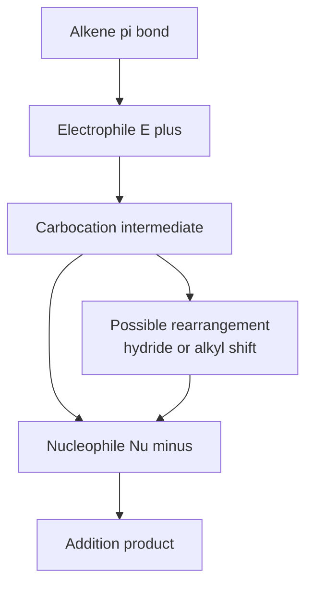
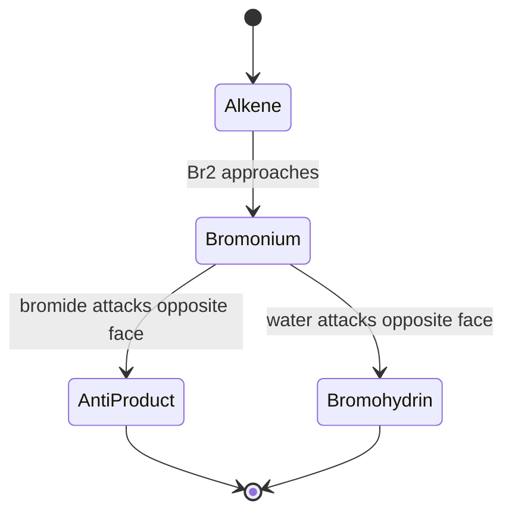
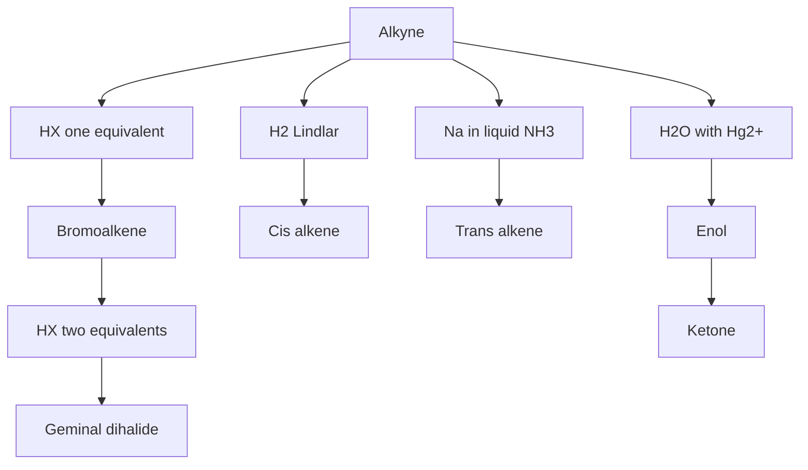
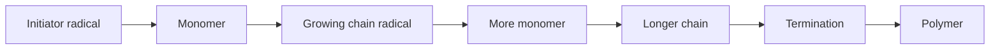

# Chapter 6 — Alkenes, Alkynes and Electrophilic Addition

> **Level:** Level 4 — Organic Chemistry
> **Estimated study time:** 9 hours (6 h reading + 3 h exercises)
> **Prerequisites:** [Alkanes](05-alkanes.md); [Isomerism and Stereochemistry](03-isomerism-and-stereochemistry.md); [Conformations and Conformational Analysis](04-conformations.md)
> **Related chapters:** [Aromatic Compounds and Electrophilic Aromatic Substitution](07-aromatic-compounds-and-electrophilic-aromatic-substitution.md), [Haloalkanes: Nucleophilic Substitution and Elimination](08-haloalkanes-substitution-and-elimination.md)
> **Difficulty:** ★★★★☆ (1–5)

---

## 1. Learning Objectives

After working through this chapter you will be able to:

- Describe the bonding in alkenes and alkynes in terms of $sp^2$ and $sp$ hybridisation, σ and π bonds, and explain the origin of restricted rotation.
- Rank alkenes by stability using hyperconjugation and heats of hydrogenation.
- Write the two-step mechanism of electrophilic addition, including the formation of carbocations and the possibility of rearrangement.
- Apply Markovnikov's rule and explain it mechanistically rather than as a memorised statement.
- Distinguish the stereochemical outcomes of halogenation, hydrogenation, hydroboration, dihydroxylation and epoxidation.
- Predict the products of hydration, oxymercuration–demercuration, hydroboration–oxidation and hydrogenation.
- Describe the oxidation of alkenes by permanganate, osmium tetroxide and ozone, and use ozonolysis for structure determination.
- Explain the acidity of terminal alkynes and use acetylide chemistry to build carbon chains.
- Describe the addition and polymerisation reactions of alkynes and alkenes, and relate them to industrial polymers.

---

## 2. Introduction

Alkenes are hydrocarbons containing a carbon–carbon double bond. The double bond is the reactive centre of the molecule: it is electron-rich, it is planar, and it is attacked by electrophiles. That single property accounts for most of the chemistry in this chapter, and for a large part of the industrial chemistry of the modern world. Ethene is the largest-volume organic chemical produced globally, and almost all of it is converted into polymers, ethylene oxide, ethylene glycol and other products by reactions that begin with electrophilic attack on the π bond.

The double bond is also a structural constraint. The atoms at each end of a C=C bond are coplanar, the bond cannot rotate, and the arrangement of substituents on the two ends defines *cis/trans* or *(E)/(Z)* isomerism. Chapter 3 introduced the descriptors; this chapter uses them to describe the stereochemical outcome of addition reactions, because an addition to an alkene can deliver two groups to the same face (*syn*) or to opposite faces (*anti*), and the choice is often determined by the mechanism.

Alkynes contain a carbon–carbon triple bond and are even more unsaturated. They are linear, they are less common in nature than alkenes, and they are important because a terminal alkyne is acidic enough to be deprotonated by a strong base, which makes it a building block for carbon–carbon bond formation. The alkyne chemistry in this chapter is selective rather than comprehensive: it covers the reactions that illustrate the difference between $sp$ and $sp^2$ carbons and that are used in synthesis.

The chapter is organised around mechanism. It begins with bonding and stability, then with the general electrophilic addition pathway, then with the individual reactions grouped by the intermediate they involve — carbocation, bromonium ion, borane, osmate ester, ozonide — and finally with alkynes and polymerisation. The recurring question is not "what is the product?" but "which intermediate is formed, and what does its structure predict about regiochemistry and stereochemistry?"

---

## 3. Fundamental Concepts

### 3.1 Bonding in alkenes

An alkene carbon is $sp^2$ hybridised. Three $sp^2$ orbitals form σ bonds in a plane at approximately 120° to one another, and the remaining p orbital, perpendicular to that plane, overlaps side-on with the p orbital of the adjacent carbon to form a π bond. The result is a planar unit with a σ framework in the molecular plane and π electron density above and below it.

| Bond | Length / pm | Enthalpy / kJ mol⁻¹ | Hybridisation |
|---|---|---|---|
| $\ce{C-C}$ | 154 | 348 | $sp^3$–$sp^3$ |
| $\ce{C=C}$ | 134 | 612 | $sp^2$–$sp^2$ |
| $\ce{C#C}$ | 120 | 837 | $sp$–$sp$ |
| $\ce{C-H}$ in alkane | 109 | 412 | $sp^3$–$s$ |
| $\ce{C-H}$ in alkene | 108 | 452 | $sp^2$–$s$ |

The double bond is shorter and stronger than a single bond, but not twice as strong: the π component contributes about 264 kJ mol⁻¹, less than the σ component, because side-on overlap is less effective than head-on overlap. The π electrons are also more exposed and less tightly held, which is why they are the reactive part of the molecule.

**Restricted rotation** is the geometric consequence of the π bond. Rotation about the C=C axis would require the p orbitals to become orthogonal, destroying the π overlap. The barrier is about 270 kJ mol⁻¹ for ethene, far above thermal energy at room temperature, so the two ends of the double bond are locked in place. This is the physical basis of *cis/trans* and *(E)/(Z)* isomerism.

### 3.2 Geometry and isomerism

The substituents at each alkene carbon lie in the molecular plane, and the arrangement is described by the *(E)/(Z)* descriptor introduced in Chapter 3. The descriptor is assigned by CIP priorities at each carbon: if the higher-priority groups are on the same side, the alkene is *(Z)*; if on opposite sides, it is *(E)*.

The *cis/trans* terminology is still used for simple alkenes and for rings. It is adequate when each carbon carries one hydrogen and one carbon substituent, as in *cis*- and *trans*-but-2-ene. It becomes ambiguous when the substituents are more varied, which is why *(E)/(Z)* is preferred in systematic work.

### 3.3 Stability of alkenes

Alkenes are stabilised by alkyl substitution. The order of stability is:

$$
\ce{CH2=CH2} < \ce{RCH=CH2} < \ce{R2C=CH2} \approx \ce{RCH=CHR} < \ce{R2C=CHR} < \ce{R2C=CR2}
$$

The stabilisation is revealed by **heats of hydrogenation**, the enthalpy change for the addition of one mole of hydrogen to one mole of alkene.

| Alkene | Heat of hydrogenation / kJ mol⁻¹ |
|---|---|
| Ethene | −137 |
| Propene | −126 |
| But-1-ene | −127 |
| *cis*-But-2-ene | −120 |
| *trans*-But-2-ene | −115 |
| 2-Methylpropene | −119 |
| 2-Methylbut-2-ene | −113 |
| Cyclohexene | −120 |

The less negative the heat of hydrogenation, the more stable the alkene, because the product alkane is approximately the same in each case. The difference between ethene and 2-methylpropene is about 18 kJ mol⁻¹, which is the stabilisation provided by two extra methyl groups.

The explanation is **hyperconjugation**: the σ electrons of an adjacent C–H bond donate into the empty π* orbital of the double bond, delocalising electron density and lowering the energy. The effect increases with the number of alkyl groups attached to the double bond, which is why highly substituted alkenes are the most stable.

The *cis/trans* difference is a steric effect. *trans*-But-2-ene is about 5 kJ mol⁻¹ more stable than the *cis* isomer because the two methyl groups are further apart. The difference is small but measurable, and it is the reason that *trans* alkenes are often the thermodynamic products of elimination reactions.

### 3.4 Preparation of alkenes

**Elimination of HX from a haloalkane.** A strong base removes a β-hydrogen and the halide departs, forming a double bond. The reaction is treated mechanistically in Chapter 8; for now it is the standard laboratory route to alkenes.

$$
\ce{CH3CH2Br + KOH ->[ethanol,\ \Delta] CH2=CH2 + KBr + H2O}
$$

**Dehydration of an alcohol.** An alcohol is heated with a strong acid, usually sulfuric or phosphoric acid, to eliminate water. The reaction proceeds through a carbocation and can rearrange.

$$
\ce{CH3CH2OH ->[H2SO4,\ 170\ ^\circ C] CH2=CH2 + H2O}
$$

**Partial hydrogenation of alkynes.** An alkyne can be hydrogenated to an alkene if the catalyst is poisoned so that it stops at the alkene stage. Lindlar's catalyst (palladium on calcium carbonate, deactivated with lead acetate and quinoline) gives the *cis* alkene; dissolving-metal reduction with sodium in liquid ammonia gives the *trans* alkene.

**Metathesis.** The carbon–carbon double bond can be redistributed between two alkenes in the presence of a metal carbene catalyst. Olefin metathesis, recognised by the 2005 Nobel Prize in Chemistry, is a powerful route to alkenes that are difficult to prepare by elimination.

### 3.5 Electrophilic addition: the general mechanism

The characteristic reaction of an alkene is **electrophilic addition**: an electrophile attacks the π bond, and a nucleophile then captures the resulting carbocation. The mechanism has two steps.

**Step 1.** The π electrons attack the electrophile, forming a new σ bond and a carbocation.

**Step 2.** The nucleophile attacks the carbocation, forming the second new σ bond.

For the addition of HBr to propene, the mechanism is written as three arrow-pushing operations grouped into two steps:

1. **Curly arrow from the π bond to the hydrogen of HBr.** The π electrons form a new σ bond to hydrogen, and the π bond is broken.
2. **Curly arrow from the H–Br bond to bromine.** The bonding pair leaves with bromine, so the H–Br bond breaks heterolytically and bromide ion is formed. The product of steps 1 and 2 is a secondary carbocation at C2 and a bromide ion.
3. **Curly arrow from a lone pair on bromide to the carbocation carbon.** The C–Br bond forms, and the product is 2-bromopropane.

The overall equation is

$$
\ce{CH3CH=CH2 + HBr -> CH3CHBrCH3}
$$

The first step is rate-determining and endothermic, and the stability of the carbocation controls the regiochemistry. Protonation at C1 gives a secondary carbocation at C2; protonation at C2 would give a primary carbocation at C1. The secondary cation is lower in energy, so the pathway through it is faster, and the major product is the one derived from the more stable cation.

### 3.6 Markovnikov's rule and its origin

**Markovnikov's rule** states that in the addition of HX to an unsymmetrical alkene, the hydrogen adds to the carbon that already bears more hydrogens, and the halogen adds to the carbon that bears fewer. The rule is a summary of the regiochemistry, not an explanation.

The mechanistic explanation is the stability of the carbocation intermediate. The rule holds when the reaction proceeds through a carbocation, and it fails when the mechanism changes. The most important exception is the **peroxide effect**: in the presence of peroxides, HBr adds anti-Markovnikov to alkenes, because the reaction proceeds by a radical chain mechanism rather than by a carbocation pathway.

The radical mechanism is:

**Initiation.** Peroxide decomposes to give radicals, which abstract hydrogen from HBr to give a bromine atom.

$$
\ce{RO-OR ->[h\nu] 2RO^{.}}
\qquad
\ce{RO^{.} + HBr -> ROH + Br^{.}}
$$

**Propagation.** The bromine atom adds to the alkene to give the more stable carbon radical, and the carbon radical abstracts hydrogen from HBr to give the product and regenerate the bromine atom.

$$
\ce{Br^{.} + CH3CH=CH2 -> CH3CH^{.}CH2Br}
$$
$$
\ce{CH3CH^{.}CH2Br + HBr -> CH3CH2CH2Br + Br^{.}}
$$

The first propagation step places the bromine at the less substituted carbon because the resulting radical is secondary rather than primary. The product is therefore 1-bromopropane, the anti-Markovnikov product. The peroxide effect is observed for HBr but not for HCl or HI: the H–Cl bond is too strong for the radical abstraction to be favourable, and the H–I bond is too weak for the iodine atom to add selectively.

### 3.7 Halogenation: the bromonium ion

The addition of bromine to an alkene does not proceed through a free carbocation. Instead, the alkene attacks bromine to give a cyclic **bromonium ion**, in which the bromine bridges the two carbons and carries a positive charge. Bromide ion then attacks the bromonium ion from the side opposite the bromine bridge, opening the ring and giving the *anti* addition product.

The evidence for the bromonium ion is threefold:

- The addition is **anti**: the two bromine atoms end up on opposite faces of the double bond.
- The addition is **stereospecific**: *cis*- and *trans*-but-2-ene give different diastereomers of 2,3-dibromobutane.
- The addition is **not accompanied by rearrangement**, which would be expected if a free carbocation were formed.

The stereochemical outcome is easiest to see with cyclohexene. Bromination gives *trans*-1,2-dibromocyclohexane, with one bromine above the ring and one below. The *cis* isomer is not formed, because the bromide must attack from the face opposite the bromine bridge.

Chlorine adds in the same way, although the chloronium ion is less stable and the reaction is faster. Iodine adds only slowly and reversibly, and the addition is often carried out in the presence of an oxidant that converts the iodine back to the reactive species.

### 3.8 Hydration

The addition of water across a double bond can be achieved in three ways, and each gives a different regiochemical or stereochemical outcome.

**Acid-catalysed hydration.** The alkene is treated with dilute sulfuric acid or with aqueous acid. The mechanism is the same as hydrohalogenation: protonation gives the more stable carbocation, and water attacks it to give an alcohol after deprotonation. The reaction is Markovnikov, and it can be accompanied by rearrangement because a free carbocation is involved.

$$
\ce{CH3CH=CH2 + H2O ->[H+] CH3CH(OH)CH3}
$$

**Oxymercuration–demercuration.** The alkene is treated with mercury(II) acetate in water, and the resulting organomercury compound is reduced with sodium borohydride. The reaction gives the Markovnikov alcohol, but it proceeds through a mercurinium ion rather than a free carbocation, so rearrangement is not observed. It is the method of choice for Markovnikov hydration of alkenes that would rearrange under acid catalysis.

**Hydroboration–oxidation.** The alkene is treated with borane (usually as the tetrahydrofuran complex) and the resulting organoborane is oxidised with hydrogen peroxide and sodium hydroxide. The reaction gives the **anti-Markovnikov** alcohol, and the addition is **syn**: the boron and hydrogen add to the same face of the double bond.

$$
\ce{CH3CH=CH2 ->[BH3] CH3CH2CH2BH2 ->[H2O2, NaOH] CH3CH2CH2OH}
$$

The regiochemistry follows from the polarity of the B–H bond. Boron is less electronegative than hydrogen, so the boron carries a partial positive charge and the hydrogen a partial negative charge. The boron adds to the less substituted carbon, which is better able to stabilise the developing positive charge, and the hydrogen adds to the more substituted carbon.

### 3.9 Hydrogenation

Catalytic hydrogenation adds hydrogen across a double bond. The reaction is *syn*: both hydrogen atoms are delivered from the same face of the alkene, because both are adsorbed on the metal surface and transferred to the same side of the molecule.

The catalyst is usually palladium on carbon, platinum oxide or Raney nickel. The reaction is exothermic, and the heat of hydrogenation is a measure of the alkene's stability. Hydrogenation is used industrially to convert unsaturated fats into saturated fats, and in the laboratory to remove a double bond temporarily or permanently.

### 3.10 Oxidation

**Epoxidation.** An alkene reacts with a peroxyacid, such as 3-chloroperoxybenzoic acid, to give an epoxide. The reaction is a concerted *syn* addition: the oxygen is delivered to one face of the alkene, and the stereochemistry of the alkene is retained in the epoxide.

$$
\ce{C6H10 + C7H5ClO3 -> C6H10O + C7H5ClO2}
$$

**Dihydroxylation.** Osmium tetroxide adds two hydroxyl groups to the same face of an alkene, giving a *cis*-1,2-diol. The reagent is expensive and toxic, so it is used catalytically with a co-oxidant such as *N*-methylmorpholine *N*-oxide. Cold, dilute potassium permanganate gives the same *cis* diol, but the reaction is less clean and often proceeds to cleavage.

**Ozonolysis.** Ozone cleaves the double bond to give two carbonyl compounds. The reaction proceeds through a molozonide and an ozonide, and the products depend on the workup. Reductive workup with zinc and water, or with dimethyl sulfide, gives aldehydes and ketones; oxidative workup with hydrogen peroxide gives carboxylic acids from aldehydes.

$$
\ce{CH3CH=CHCH3 ->[O3][Zn, H2O] 2CH3CHO}
$$

Ozonolysis is a standard method for locating a double bond in an unknown structure: the carbonyl fragments identify the two carbons that were joined by the double bond.

**Oxidative cleavage.** Hot, concentrated potassium permanganate cleaves the double bond completely, oxidising the carbon atoms to carboxylic acids or ketones depending on their substitution.

### 3.11 Alkynes

An alkyne carbon is $sp$ hybridised, and the molecule is linear at the triple bond, with a C–C≡C angle of 180° and a bond length of 120 pm. The triple bond consists of one σ bond and two orthogonal π bonds, and it is shorter and stronger than a double bond.

Alkynes undergo the same electrophilic additions as alkenes, but they can add two equivalents of the reagent. The addition of one equivalent of HBr to an alkyne gives a bromoalkene, and a second equivalent gives a geminal dibromide. The regiochemistry follows Markovnikov's rule at each stage.

**Acidity of terminal alkynes.** A terminal alkyne has a hydrogen attached to an $sp$ carbon. The $sp$ orbital has more s character than an $sp^2$ or $sp^3$ orbital, so the electron pair in the C–H bond is held closer to the carbon and the bond is more acidic. The pKa of a terminal alkyne is about 25, compared with about 44 for an alkene and about 50 for an alkane. The alkyne can therefore be deprotonated by sodium amide ($\ce{NaNH2}$) or by butyllithium, but not by hydroxide or alkoxide.

$$
\ce{HC#CH + NaNH2 -> HC#C^-Na+ + NH3}
$$

The acetylide ion is a strong nucleophile and reacts with primary alkyl halides to give internal alkynes. This is one of the standard methods for extending a carbon chain.

**Reduction of alkynes.** Hydrogenation over Lindlar's catalyst gives the *cis* alkene, and reduction with sodium in liquid ammonia gives the *trans* alkene. The two methods are complementary and are the standard routes to stereodefined alkenes.

**Hydration of alkynes.** Alkynes react with water in the presence of mercury(II) sulfate and sulfuric acid to give an enol, which tautomerises to a ketone. The addition is Markovnikov, so a terminal alkyne gives a methyl ketone.

$$
\ce{CH3CH2C#CH + H2O ->[HgSO4, H2SO4] CH3CH2COCH3}
$$

### 3.12 Polymerisation

**Addition polymerisation** converts alkenes into polymers without the loss of any atoms. The reaction is a radical chain process:

**Initiation.** An initiator radical adds to the double bond to give a carbon radical.

**Propagation.** The carbon radical adds to another alkene molecule, regenerating a radical at the end of the growing chain.

**Termination.** Two radicals combine, or a radical transfers to another molecule, ending the chain.

The polymer is a mixture of chains with different lengths, and its properties depend on the average molecular mass and on the distribution. **Tacticity** — the stereochemical arrangement of substituents along the chain — determines whether the polymer is crystalline or amorphous. Ziegler–Natta catalysts produce stereoregular polymers, which is why isotactic polypropylene is a strong, crystalline material while atactic polypropylene is amorphous and tacky.

**Copolymerisation** combines two different alkenes in the same chain. The properties of the copolymer depend on the ratio and on the sequence distribution; random copolymers, block copolymers and graft copolymers all have different behaviour.

**Alkyne polymerisation.** Acetylene can be polymerised to polyacetylene, a conducting polymer whose conductivity rises by many orders of magnitude on doping with iodine. The discovery of conducting polymers was recognised by the 2000 Nobel Prize in Chemistry.

---

## 4. Detailed Scientific Explanation

### 4.1 Why the π bond is nucleophilic

The π bond is formed from p orbitals that overlap side-on, above and below the molecular plane. The overlap is less effective than the head-on overlap of a σ bond, so the π electrons are higher in energy and more polarisable. In molecular orbital terms, the highest occupied molecular orbital of an alkene is the π orbital, and its energy is well above the σ orbitals. The lowest unoccupied molecular orbital is the π* orbital, which is low enough in energy to accept electron density from a suitable electrophile.

The consequence is that alkenes are nucleophiles towards strong electrophiles such as protons, halonium ions, mercuric ions and peroxyacids. They are not nucleophilic enough to react with weak electrophiles such as carbonyl carbons, which is why alkenes and ketones coexist without reacting in the absence of a catalyst.

The π bond is also polarisable. In the presence of a nearby cation, the π electron density distorts towards the cation, which increases the interaction energy. This is part of the reason that electrophilic addition is fast even though the alkene is a weak nucleophile: the electrophile induces the nucleophilicity it exploits.

### 4.2 Carbocations and rearrangement

The carbocation formed in the first step of electrophilic addition is a genuine intermediate with a finite lifetime, and it can rearrange before the nucleophile captures it. Two rearrangements are common:

**Hydride shift.** A hydride ion, $\ce{H-}$, migrates from an adjacent carbon to the carbocation, moving the positive charge to the adjacent carbon.

**Alkyl shift.** An alkyl group, usually methyl, migrates with its bonding pair, with the same effect.

Both shifts occur when the new carbocation is more stable than the old one, and both are driven by the same thermodynamic principle that governs carbocation stability. A secondary carbocation adjacent to a quaternary carbon can rearrange to a tertiary carbocation; a primary carbocation adjacent to a tertiary carbon can rearrange to a tertiary carbocation.

The classic example is the addition of HCl to 3,3-dimethylbut-1-ene. Protonation at C1 gives a secondary carbocation at C2, which is adjacent to a quaternary carbon. A 1,2-methyl shift moves one methyl group from C3 to C2, placing the positive charge on C3, which is now tertiary. Chloride attacks the tertiary carbocation, and the product is 2-chloro-2,3-dimethylbutane rather than the unrearranged 2-chloro-3,3-dimethylbutane.

Rearrangement is not observed in reactions that avoid a free carbocation, such as bromination, oxymercuration and hydroboration. That difference is one of the most useful diagnostic tests for the mechanism: if a reaction gives a rearranged product, a carbocation is probably involved.

### 4.3 The mechanism changes the rule

Markovnikov's rule is not a law of nature. It is a prediction that holds when the reaction proceeds through a carbocation, and it fails when the mechanism changes. The table below collects the standard additions and shows how the mechanism determines the outcome.

| Reaction | Reagents | Intermediate | Regiochemistry | Stereochemistry | Rearrangement |
|---|---|---|---|---|---|
| Hydrohalogenation | $\ce{HX}$ | Carbocation | Markovnikov | None | Possible |
| Radical hydrohalogenation | $\ce{HBr}$, peroxide | Carbon radical | Anti-Markovnikov | None | No |
| Halogenation | $\ce{X2}$ | Halonium ion | — | Anti | No |
| Acid-catalysed hydration | $\ce{H3O+}$ | Carbocation | Markovnikov | None | Possible |
| Oxymercuration | $\ce{Hg(OAc)2}$, $\ce{H2O}$, then $\ce{NaBH4}$ | Mercurinium ion | Markovnikov | Anti addition of Hg and OH, mercury later removed | No |
| Hydroboration–oxidation | $\ce{BH3}$, then $\ce{H2O2/OH-}$ | Organoborane | Anti-Markovnikov | Syn | No |
| Hydrogenation | $\ce{H2}$, metal catalyst | Surface-bound species | — | Syn | No |
| Epoxidation | Peroxyacid | Concerted | — | Syn | No |
| Dihydroxylation | $\ce{OsO4}$ | Cyclic osmate | — | Syn | No |
| Ozonolysis | $\ce{O3}$, then workup | Ozonide | Cleavage | — | No |

Two entries in the table need comment. Oxymercuration is an *anti* addition of Hg and OH, but the mercury is removed in the demercuration step, so the overall transformation is a Markovnikov hydration with no rearrangement; the stereochemical information at the carbon bearing mercury is lost. Hydroboration is a *syn* addition of B and H, and the boron is replaced by oxygen with retention of configuration, so the overall hydration is *syn*.

### 4.4 The bromonium ion and stereospecificity

The bromonium ion is a three-membered ring containing bromine and the two alkene carbons, with a positive charge on bromine. It is formed by the attack of the alkene π electrons on bromine, and it is opened by bromide ion from the face opposite the bromine bridge.

The stereochemical consequences are precise. For *trans*-but-2-ene, anti addition of bromine gives the *meso* dibromide. For *cis*-but-2-ene, anti addition gives a racemic mixture of the *(R,R)* and *(S,S)* dibromides. The two alkenes therefore give different diastereomers, and the reaction is stereospecific.

The same logic explains the formation of **bromohydrins**. If the bromination is carried out in water, water can compete with bromide as the nucleophile that opens the bromonium ion. Water attacks from the face opposite the bromine, giving a bromohydrin with anti stereochemistry. The regiochemistry of the attack is determined by the stability of the partial positive charge in the bromonium ion: the more substituted carbon bears more of the positive charge and is attacked preferentially by the nucleophile.

### 4.5 Oxymercuration and hydroboration compared

Both reactions avoid a free carbocation, and both are useful precisely because they suppress rearrangement. They differ in regiochemistry and in the practical conditions.

**Oxymercuration–demercuration** gives the Markovnikov alcohol. The alkene is treated with mercury(II) acetate in aqueous tetrahydrofuran, and the intermediate organomercury compound is reduced with sodium borohydride. The reaction is fast, works on most alkenes, and does not rearrange. Its disadvantages are the toxicity of mercury and the cost of disposal, which is why it has been largely replaced by other methods in industry.

**Hydroboration–oxidation** gives the anti-Markovnikov alcohol. The alkene is treated with borane in tetrahydrofuran, and the organoborane is oxidised with alkaline hydrogen peroxide. The reaction is fast, selective, and works on a wide range of alkenes. It is also *syn*, which makes it valuable for stereospecific synthesis. Diborane and its complexes are flammable and moisture-sensitive, so the reaction is carried out under anhydrous conditions.

The choice between them is therefore a choice of regiochemistry: Markovnikov or anti-Markovnikov, with both avoiding rearrangement. Acid-catalysed hydration also gives the Markovnikov alcohol, but it is cheaper and is used industrially where rearrangement is not a problem.

### 4.6 Ozonolysis and structure determination

Ozone adds to an alkene in a 1,3-dipolar cycloaddition to give a **molozonide**, a five-membered ring containing three oxygens. The molozonide fragments to a carbonyl compound and a **carbonyl oxide**, which recombine to give an **ozonide**, a five-membered ring containing three oxygens and two carbons. The ozonide is then cleaved by the workup.

**Reductive workup** with zinc and water, or with dimethyl sulfide, gives aldehydes and ketones. **Oxidative workup** with hydrogen peroxide gives carboxylic acids from aldehydes, while ketones are unaffected because they have no C–H bond at the carbonyl carbon.

The synthetic value of ozonolysis is that it converts a double bond into two carbonyl groups, which can then be manipulated. The analytical value is that the fragments identify the position of the double bond: if a compound of formula $\ce{C6H12}$ gives acetone and propanal on ozonolysis, the double bond must have joined the carbon that became the acetone carbonyl to the carbon that became the propanal carbonyl.

Ozonolysis is also used industrially to convert oleic acid into azelaic acid and pelargonic acid, and to produce vanillin from eugenol. The reaction is exothermic and potentially hazardous at scale, so industrial ozonolysis is carried out under carefully controlled conditions.

### 4.7 Alkyne chemistry

**Acidity.** The pKa of a terminal alkyne is about 25, which is low enough for sodium amide ($\ce{NaNH2}$, conjugate acid $\ce{NH3}$, pKa 38) to deprotonate it quantitatively, but not low enough for hydroxide (pKa of water 15.7) to do so. The acidity order is:

$$
\ce{HC#CH} > \ce{H2C=CH2} > \ce{CH3CH3}
\qquad
\text{pKa} \approx 25 > 44 > 50
$$

The order follows from the s character of the hybrid orbital: an $sp$ orbital has 50% s character, an $sp^2$ orbital 33% and an $sp^3$ orbital 25%. More s character means the electron pair is held closer to the nucleus and the conjugate base is more stable.

**Acetylide chemistry.** The acetylide ion is a strong nucleophile and a strong base. It reacts with primary alkyl halides by $\mathrm{S_N2}$ to give internal alkynes, and with carbonyl compounds to give propargylic alcohols. It reacts with water to regenerate the alkyne and with terminal alkynes to give a diacetylide, so the reaction must be carried out under anhydrous conditions.

**Preparation of alkynes.** A terminal alkyne can be prepared from a 1,2-dihaloalkane by double dehydrohalogenation with a strong base. A 1,1-dihaloalkane gives a terminal alkyne, and a 1,2-dihaloalkane gives an internal alkyne if the two halogens are not at the ends of the chain.

$$
\ce{CH2BrCH2Br + 2NaNH2 -> HC#CH + 2NaBr + 2NH3}
$$

**Addition to alkynes.** Alkynes undergo the same electrophilic additions as alkenes, but the product of the first addition is an alkene that can react again. The addition of one equivalent of HBr to propyne gives 2-bromopropene, and a second equivalent gives 2,2-dibromopropane. The regiochemistry of each step follows Markovnikov's rule.

**Reduction.** Lindlar hydrogenation gives the *cis* alkene, and sodium in liquid ammonia gives the *trans* alkene. The two methods are the standard way to prepare stereodefined alkenes from alkynes, and they are complementary to the stereospecific elimination reactions of Chapter 8.

**Hydration.** Mercury(II)-catalysed hydration gives an enol, which tautomerises to a ketone. A terminal alkyne gives a methyl ketone; ethyne gives ethanal, which is the exception because the enol is ethenol and tautomerisation gives the aldehyde.

### 4.8 Polymerisation and industrial chemistry

The polymerisation of alkenes is the largest application of alkene chemistry. The mechanism determines the structure of the polymer, and the structure determines its properties.

**Radical polymerisation** is used for polyethylene, polystyrene, polyvinyl chloride and poly(methyl methacrylate). It is initiated by a peroxide or an azo compound, propagated by radical addition, and terminated by coupling or disproportionation. The polymer has a broad molecular-mass distribution and, for monosubstituted monomers, an atactic structure unless the reaction is controlled.

**Coordination polymerisation** uses Ziegler–Natta catalysts (titanium tetrachloride with an aluminium alkyl) or metallocene catalysts. The monomer coordinates to the metal before insertion, and the stereochemistry of the insertion is controlled by the catalyst. The result is a stereoregular polymer with a narrow molecular-mass distribution. Isotactic polypropylene, made with a Ziegler–Natta catalyst, is a crystalline thermoplastic; atactic polypropylene is amorphous and is used as an adhesive or a modifier.

**Copolymerisation** combines two monomers. Styrene–butadiene rubber, acrylonitrile–butadiene–styrene and ethylene–propylene rubber are all copolymers whose properties are tuned by the monomer ratio and the sequence distribution.

**Metathesis polymerisation** and **ring-opening metathesis polymerisation** (ROMP) use metal carbene catalysts to open strained cyclic alkenes and link them into a polymer. The 2005 Nobel Prize in Chemistry was awarded to Chauvin, Grubbs and Schrock for the development of metathesis, and ROMP is now used to make specialty polymers with controlled structure.

**Polyacetylene** is the simplest conjugated polymer. It is insulating in its neutral form but becomes conducting when doped with iodine or arsenic pentafluoride, and its discovery opened the field of conducting polymers, recognised by the 2000 Nobel Prize in Chemistry.

### 4.9 A summary of addition reactions

The following table summarises the reactions of alkenes that are examinable at this level. The columns are the ones that matter in synthesis: what is added, with what regiochemistry, with what stereochemistry, and whether rearrangement can occur.

| Alkene reaction | Product | Regiochemistry | Stereochemistry |
|---|---|---|---|
| $\ce{HX}$ | Alkyl halide | Markovnikov | Racemic at new stereocentre |
| $\ce{HBr}$ + peroxide | Alkyl halide | Anti-Markovnikov | Racemic |
| $\ce{X2}$ | Vicinal dihalide | — | Anti |
| $\ce{X2/H2O}$ | Halohydrin | Markovnikov for OH | Anti |
| $\ce{H3O+}$ | Alcohol | Markovnikov | Racemic |
| $\ce{Hg(OAc)2/H2O}$, then $\ce{NaBH4}$ | Alcohol | Markovnikov | Racemic, no rearrangement |
| $\ce{BH3}$, then $\ce{H2O2/OH-}$ | Alcohol | Anti-Markovnikov | Syn |
| $\ce{H2/cat}$ | Alkane | — | Syn |
| $\ce{RCO3H}$ | Epoxide | — | Syn |
| $\ce{OsO4}$, then $\ce{NaHSO3}$ | *cis*-Diol | — | Syn |
| $\ce{O3}$, then $\ce{Zn/H2O}$ | Aldehydes and ketones | Cleavage | — |
| $\ce{KMnO4}$, hot | Carboxylic acids and ketones | Cleavage | — |

The table is a summary, not a substitute for the mechanisms. A student who knows only the table cannot predict the outcome for an unfamiliar substrate; a student who knows the mechanisms can reconstruct the table.

---

## 5. Visual Diagrams

The diagrams below show the two-step addition mechanism, the bromonium ion pathway, the reaction map of alkynes and the radical polymerisation cycle. They are flowcharts of species and electron flow, not structural formulae.

**Figure 6.1 — The two-step electrophilic addition.** The alkene attacks the electrophile to give a carbocation, which is then captured by a nucleophile. The dashed branch is the rearrangement pathway, available only when the carbocation has a suitable adjacent group. The stability of the carbocation determines both the regiochemistry and the likelihood of rearrangement.

**Figure 6.2 — The bromonium ion pathway.** The cyclic bromonium ion blocks one face of the alkene, so the nucleophile must attack from the opposite face. This is the origin of the anti stereochemistry of halogenation and of the anti relationship in bromohydrins. A free carbocation would not impose this geometric constraint, which is why the observation of anti addition is evidence for the bromonium ion.

**Figure 6.3 — The reaction map of alkynes.** The same alkyne can be converted into a bromoalkene, a geminal dihalide, a *cis* alkene, a *trans* alkene or a ketone by changing the reagent. The map is the basis of alkyne synthesis planning: the choice of reagent determines both the functional group and the stereochemistry of the product.

**Figure 6.4 — Radical addition polymerisation.** The initiator creates a radical, which adds to a monomer and generates a new radical at the chain end. The cycle repeats thousands of times before termination. The length of the chain, and therefore the molecular mass of the polymer, depends on the relative rates of propagation and termination.

---

## 6. Mathematical Formulas

### 6.1 Degree of unsaturation

$$
\text{DBE} = \frac{2C + 2 + N - H - X}{2}
$$

Each double bond contributes 1 to the DBE, each triple bond 2 and each ring 1. A compound with $\text{DBE} = 2$ may contain two double bonds, one triple bond, or one double bond and one ring. The formula is the first check on any proposed structure and is used throughout this chapter to confirm that an addition product has the expected formula.

### 6.2 Heat of hydrogenation and relative stability

$$
\Delta H_\text{hydro} = \Delta H_f^\circ(\text{alkane}) - \Delta H_f^\circ(\text{alkene}) - \Delta H_f^\circ(\ce{H2})
$$

Because the product alkane is common to a series of isomeric alkenes, differences in $\Delta H_\text{hydro}$ measure differences in alkene stability. A less negative value means a more stable alkene. The comparison is valid only for alkenes that give the same alkane on hydrogenation; for alkenes with different skeletons, the strain energy of the alkane must also be considered.

The same logic applies to alkynes: the heat of hydrogenation of ethyne to ethane is about −311 kJ mol⁻¹, which is not twice the value for ethene (−274 kJ mol⁻¹); the difference reflects the different hybridisation of the $sp$ carbon and the interaction between the two π bonds.

### 6.3 Degree of polymerisation

$$
\text{DP} = \frac{M_n}{M_0}
\qquad
\text{PDI} = \frac{M_w}{M_n}
$$

| Symbol | Meaning | Unit |
|---|---|---|
| $\text{DP}$ | average number of monomer units per chain | — |
| $M_n$ | number-average molecular mass | g mol⁻¹ |
| $M_0$ | molar mass of the monomer | g mol⁻¹ |
| $M_w$ | weight-average molecular mass | g mol⁻¹ |
| $\text{PDI}$ | polydispersity index | — |

A polymer with $M_n = 1.0 \times 10^6\ \text{g mol}^{-1}$ made from ethene ($M_0 = 28.05\ \text{g mol}^{-1}$) has a degree of polymerisation of about 35 700. The PDI is 1 for a perfectly monodisperse polymer and is typically 2–5 for a radical polymerisation, because the chain lengths are statistically distributed.

### 6.4 Number of stereoisomers in an addition

$$
N = 2^n
$$

where $n$ is the number of new stereocentres created by the addition. The formula applies when the centres are independent and no meso compound is formed. Addition of $\ce{Br2}$ to an alkene creates two stereocentres, so up to four stereoisomers are possible; whether all four are formed depends on the stereochemistry of the alkene and on the *anti* addition pathway.

---

## 7. Chemical Equations

### 7.1 Markovnikov hydrohalogenation

$$
\ce{CH3CH=CH2 + HBr -> CH3CHBrCH3}
$$

The reaction proceeds through a secondary carbocation at C2 and gives 2-bromopropane. The alternative regioisomer, 1-bromopropane, would require a primary carbocation and is formed only in trace amounts under ionic conditions.

### 7.2 Anti-Markovnikov hydrohalogenation

$$
\ce{CH3CH=CH2 + HBr ->[ROOR] CH3CH2CH2Br}
$$

In the presence of a peroxide, the reaction proceeds by a radical chain and gives 1-bromopropane. The peroxide effect is specific to HBr; HCl and HI do not give anti-Markovnikov addition under these conditions.

### 7.3 Bromination of cyclohexene

$$
\ce{C6H10 + Br2 -> C6H10Br2}
$$

The product is *trans*-1,2-dibromocyclohexane. The bromonium ion intermediate blocks one face of the alkene, so the second bromine must attack from the opposite face. The colour of bromine disappears as the reaction proceeds, which is the basis of the bromine test for unsaturation.

### 7.4 Acid-catalysed hydration

$$
\ce{CH3CH=CH2 + H2O ->[H2SO4] CH3CH(OH)CH3}
$$

The reaction gives propan-2-ol by Markovnikov addition. The first step is protonation to give the secondary carbocation, and the second is attack by water followed by deprotonation. The reaction is reversible, and the equilibrium can be shifted by using excess water or by removing the alcohol.

### 7.5 Oxymercuration–demercuration

$$
\ce{CH3CH=CH2 ->[Hg(OAc)2, H2O][NaBH4] CH3CH(OH)CH3}
$$

The reaction gives the Markovnikov alcohol without rearrangement. The intermediate is a mercurinium ion, which is opened by water at the more substituted carbon; the mercury is then removed by reduction with borohydride.

### 7.6 Hydroboration–oxidation

$$
\ce{CH3CH=CH2 ->[BH3][H2O2, NaOH] CH3CH2CH2OH}
$$

The reaction gives the anti-Markovnikov alcohol. Boron adds to the less substituted carbon and hydrogen to the more substituted carbon, both from the same face, and the boron is then replaced by hydroxyl with retention of configuration.

### 7.7 Catalytic hydrogenation

$$
\ce{CH3CH=CHCH3 + H2 ->[Pd/C] CH3CH2CH2CH3}
$$

Hydrogenation gives butane. The reaction is *syn*, and it is used both analytically, to count double bonds by measuring hydrogen uptake, and synthetically, to remove unsaturation.

### 7.8 Epoxidation

$$
\ce{CH3CH=CHCH3 + C7H5ClO3 -> C4H8O + C7H5ClO2}
$$

The reaction gives *cis*-2,3-dimethyloxirane from *cis*-but-2-ene and the *trans* epoxide from *trans*-but-2-ene. The oxygen is delivered to one face of the alkene in a concerted step, so the stereochemistry of the alkene is retained.

### 7.9 Ozonolysis

$$
\ce{CH3CH=CHCH3 ->[O3][Zn, H2O] 2CH3CHO}
$$

Reductive ozonolysis of but-2-ene gives two molecules of ethanal. Oxidative workup would give two molecules of ethanoic acid instead. The reaction is a standard method for locating double bonds and for preparing carbonyl compounds.

### 7.10 Addition of HBr to an alkyne

$$
\ce{CH3C#CH + HBr -> CH3CBr=CH2}
$$
$$
\ce{CH3CBr=CH2 + HBr -> CH3CBr2CH3}
$$

The first addition follows Markovnikov's rule and gives 2-bromopropene; the second gives 2,2-dibromopropane. The reaction can be stopped at the alkene stage by using one equivalent of HBr and a low temperature.

### 7.11 Acetylide substitution

$$
\ce{NaC#CH + CH3CH2Br -> HC#CCH2CH3 + NaBr}
$$

Sodium acetylide reacts with bromoethane to give but-1-yne. The reaction is an $\mathrm{S_N2}$ substitution and works best with primary alkyl halides; secondary and tertiary halides undergo elimination instead.

### 7.12 Polymerisation of ethene

$$
\ce{n CH2=CH2 ->[TiCl4, Al(C2H5)3] (CH2CH2)_n}
$$

The equation represents the coordination polymerisation of ethene to high-density polyethylene. The subscript $n$ denotes the degree of polymerisation, which is typically between $10^3$ and $10^5$. The polymer is a mixture of chains, so the formula is a repeat-unit representation rather than a single molecular formula.

---

## 8. Worked Examples

### Worked Example 8.1 — Markovnikov addition with rearrangement

**Problem.** 3,3-Dimethylbut-1-ene reacts with HCl. Predict the structure of the major product and explain why it is not the simple Markovnikov product.

**Strategy.** Protonate to give the more stable carbocation, check whether a rearrangement can give a more stable carbocation, then capture the rearranged cation.

**Solution.** The alkene is $\ce{CH2=CH-C(CH3)3}$. Protonation at C1 gives the secondary carbocation $\ce{CH3-CH+-C(CH3)3}$ at C2. This cation is adjacent to a quaternary carbon, and a 1,2-methyl shift moves one methyl group from C3 to C2 with its bonding pair. The positive charge moves to C3, which is now tertiary: $\ce{CH3-CH(CH3)-C+(CH3)2}$.

Chloride attacks the tertiary carbocation, giving 2-chloro-2,3-dimethylbutane, $\ce{(CH3)2C(Cl)CH(CH3)2}$.

**Check.** The formula of the product is $\ce{C6H13Cl}$, which is the sum of $\ce{C6H12}$ and $\ce{HCl}$. The unrearranged product would be 2-chloro-3,3-dimethylbutane, which has a secondary chloride; the rearranged product has a tertiary chloride and is both more stable and the observed major product. The rearrangement is a signature of a carbocation mechanism, and it would not occur under bromination or hydroboration conditions.

### Worked Example 8.2 — Stereochemistry of bromination

**Problem.** *trans*-But-2-ene is treated with bromine in carbon tetrachloride. Draw the product and assign its stereochemistry.

**Strategy.** Form the bromonium ion on one face, open it by anti attack of bromide, and determine the configuration of the two new stereocentres.

**Solution.** The bromonium ion forms on one face of the *trans* alkene. Bromide attacks either carbon from the opposite face, opening the ring. Because the alkene is *trans*, the two methyl groups are on opposite sides, and the anti addition of the two bromines gives the *meso* stereoisomer, *(2R,3S)*-2,3-dibromobutane. The molecule has an internal mirror plane and is achiral.

**Check.** The product is optically inactive, and it is not a racemate: it is a single meso compound. The corresponding reaction of *cis*-but-2-ene gives a racemic mixture of *(R,R)* and *(S,S)*, which is optically inactive for a different reason. Distinguishing a meso compound from a racemate is the key step in this problem, and Chapter 3 gives the symmetry test.

### Worked Example 8.3 — Regiochemistry of hydration

**Problem.** Propene is converted into propan-1-ol in one sequence and into propan-2-ol in another. Identify the reagents for each sequence and explain the difference.

**Strategy.** Match the target to the regiochemistry of the available hydration methods.

**Solution.** Propan-2-ol is the Markovnikov alcohol. It can be prepared by acid-catalysed hydration with aqueous sulfuric acid, or by oxymercuration–demercuration with mercury(II) acetate followed by sodium borohydride.

Propan-1-ol is the anti-Markovnikov alcohol. It is prepared by hydroboration–oxidation: treatment with borane in tetrahydrofuran, followed by hydrogen peroxide and sodium hydroxide.

**Check.** Both products have the formula $\ce{C3H8O}$ and both are alcohols, so the difference is purely regiochemical. The acid-catalysed route can be defeated by rearrangement if the carbocation is adjacent to a quaternary centre, which is why oxymercuration is preferred for hindered substrates. Hydroboration is the only one of the three methods that gives the anti-Markovnikov product.

### Worked Example 8.4 — Structure determination by ozonolysis

**Problem.** A compound of formula $\ce{C6H12}$ gives acetone and propanal in equimolar amounts on reductive ozonolysis. Deduce its structure.

**Strategy.** Identify the carbonyl carbons as the two carbons that were joined by the double bond, then rejoin them by removing the oxygens.

**Solution.** Acetone is $\ce{(CH3)2C=O}$, so one alkene carbon carried two methyl groups. Propanal is $\ce{CH3CH2CHO}$, so the other alkene carbon carried a hydrogen and an ethyl group. Rejoining the two carbonyl carbons gives $\ce{(CH3)2C=CHCH2CH3}$, which is 2-methylpent-2-ene.

**Check.** The formula is $\ce{C6H12}$, with $\text{DBE} = 1$, matching one double bond. Ozonolysis of 2-methylpent-2-ene would cleave the C2=C3 bond to give acetone and propanal, as required. An alternative structure such as 3-methylpent-2-ene would give different fragments, so the ozonolysis data identify the position of the double bond unambiguously.

### Worked Example 8.5 — Hydration of an alkyne

**Problem.** But-1-yne is treated with water in the presence of mercury(II) sulfate and sulfuric acid. Predict the product and explain the mechanism.

**Strategy.** Add water according to Markovnikov's rule to give an enol, then tautomerise the enol to a carbonyl compound.

**Solution.** Protonation of the triple bond at C1 gives a carbocation at C2, which is stabilised by the adjacent alkyl group. Water attacks C2, and deprotonation gives the enol $\ce{CH3CH2C(OH)=CH2}$. The enol tautomerises by transfer of the hydroxyl proton to the terminal carbon, giving butan-2-one, $\ce{CH3CH2COCH3}$.

**Check.** The product has the formula $\ce{C4H8O}$ and a ketone carbonyl, consistent with Markovnikov hydration. Ethyne is the exception: hydration gives ethenol, $\ce{CH2=CHOH}$, which tautomerises to ethanal rather than to a ketone, because there is no second carbon substituent to become the second alkyl group of a ketone.

### Worked Example 8.6 — Degree of polymerisation

**Problem.** A sample of high-density polyethylene has a number-average molecular mass of $1.0 \times 10^6\ \text{g mol}^{-1}$. Calculate its degree of polymerisation and comment on the result.

**Strategy.** Divide the polymer molecular mass by the molar mass of the monomer.

**Solution.** The monomer is ethene, $M_0 = 28.05\ \text{g mol}^{-1}$, so

$$
\text{DP} = \frac{1.0 \times 10^6}{28.05} = 3.6 \times 10^4
$$

The average chain contains about 36 000 monomer units.

**Check.** A degree of polymerisation of $10^3$ to $10^5$ is typical for commercial polymers. The calculation assumes that the repeat unit is exactly $\ce{CH2CH2}$; end groups are negligible at this chain length. The number-average molecular mass is lower than the weight-average molecular mass for a real polymer, so the DP calculated from $M_w$ would be higher.

---

## 9. Real-World Applications

**Plastics.** Polyethylene, polypropylene, polystyrene, polyvinyl chloride and poly(ethylene terephthalate) are all made from alkenes or from alkene-derived monomers. Global production exceeds 300 million tonnes per year, and the properties of each polymer are determined by the monomer, the polymerisation mechanism and the chain architecture. Recycling depends on separating these polymers, which is difficult because they are chemically similar and often blended.

**Rubber.** Natural rubber is *cis*-polyisoprene, and its elasticity depends on the *cis* configuration, which prevents the chains from packing into a crystalline solid. Vulcanisation cross-links the chains with sulfur, converting a sticky gum into a durable elastomer. Synthetic rubbers such as styrene–butadiene rubber and ethylene–propylene rubber are copolymers designed to match or improve on the properties of natural rubber.

**Industrial chemicals.** Ethene is converted into ethylene oxide, ethylene glycol, ethanol, acetaldehyde, vinyl chloride and polyethylene. Propene is converted into polypropylene, propylene oxide, acrylonitrile, cumene and acrylic acid. The scale of these processes is enormous, and the selectivity of the catalysts that mediate them is a major area of industrial research.

**Ethylene in biology.** Ethene is a plant hormone that regulates fruit ripening, senescence and abscission. The effect was discovered because ethene from illuminating gas caused trees near street lamps to lose their leaves. Commercial fruit ripening uses controlled ethene atmospheres, and the inhibition of ethene perception is a target for prolonging the shelf life of produce.

**Metathesis.** Olefin metathesis is used in the pharmaceutical industry to form large rings and to connect fragments that are difficult to join by other methods. The 2005 Nobel Prize in Chemistry recognised the development of the catalysts, and the reaction is now a standard tool in process chemistry.

**Ozonolysis and oxidation.** Industrial ozonolysis converts oleic acid into azelaic acid, a precursor to nylon and to lubricants, and pelargonic acid, used in herbicides and cosmetics. Epoxidation of vegetable oils produces epoxidised soybean oil, a plasticiser and stabiliser for PVC.

**Click chemistry.** The copper-catalysed azide–alkyne cycloaddition is a highly selective reaction that joins two molecules through a triazole ring. It is used in drug discovery, materials science and bioconjugation, and the 2022 Nobel Prize in Chemistry recognised the development of click chemistry and bioorthogonal chemistry.

---

## 10. Common Mistakes

| Mistake | Why it happens | Correct approach |
|---|---|---|
| Drawing a carbocation as pyramidal | The starting carbon was tetrahedral, so the shape is carried over | A carbocation is trigonal planar with an empty p orbital; that planarity is why it can be attacked from either face |
| Applying Markovnikov's rule to every addition | The rule is taught first and generalised | Check the mechanism: the rule applies only to carbocation pathways, not to radical, hydroboration or halonium reactions |
| Forgetting that halogenation is anti | The product is drawn flat, so the stereochemistry is invisible | Draw the bromonium ion and open it from the opposite face |
| Expecting hydroboration to give the Markovnikov alcohol | The reagent is not obviously different from acid | Boron is electropositive, so it adds to the less substituted carbon; the overall result is anti-Markovnikov |
| Confusing *syn* and *anti* dihydroxylation | Both give diols and both are stereospecific | Osmium tetroxide and cold permanganate are *syn*; bromination and epoxidation are concerted *syn*; halogenation is *anti* |
| Treating a terminal alkyne as a normal alkane | The C–H bond looks ordinary | The $sp$ carbon is acidic (pKa about 25) and can be deprotonated by amide or alkyllithium |
| Trying to form an acetylide in water | The reagent is written without solvent conditions | Acetylides are destroyed by water; the reaction must be anhydrous |
| Forgetting the second addition to an alkyne | The first addition gives a stable alkene | Alkynes can add two equivalents of HX or H2; control the stoichiometry to stop at the alkene |
| Assuming ozonolysis always gives carboxylic acids | The oxidative workup is the one most often quoted | Reductive workup gives aldehydes and ketones; oxidative workup gives acids |
| Ignoring rearrangement in an addition | The rearranged product is not the obvious Markovnikov one | Check whether a 1,2-hydride or alkyl shift can give a more stable carbocation |

---

## 11. Chapter Summary

- Alkene carbons are $sp^2$ hybridised and planar; the π bond is formed by side-on overlap of p orbitals and restricts rotation.
- Alkene stability increases with alkyl substitution because of hyperconjugation, as shown by heats of hydrogenation.
- Electrophilic addition proceeds through a carbocation, and the stability of that cation determines the regiochemistry; rearrangements are possible.
- Markovnikov's rule is a summary of the carbocation mechanism and fails when the mechanism changes, most notably for HBr with peroxides.
- Halogenation proceeds through a halonium ion and gives anti addition; the reaction is stereospecific.
- Acid-catalysed hydration and oxymercuration give the Markovnikov alcohol; hydroboration–oxidation gives the anti-Markovnikov alcohol and is syn.
- Hydrogenation, epoxidation and dihydroxylation are syn additions; ozonolysis cleaves the double bond to carbonyl compounds.
- Alkynes are linear, undergo addition twice, and are reduced to *cis* or *trans* alkenes depending on the method.
- Terminal alkynes are acidic at the $sp$ C–H and can be converted into acetylides, which are useful carbon-nucleophiles.
- Alkenes polymerise by radical or coordination mechanisms; the mechanism controls tacticity and therefore the properties of the polymer.
- The choice of reagent, not just the choice of reaction type, determines the regio- and stereochemical outcome of an addition.

---

## 12. Exercises

### 12.1 Conceptual questions

1. Explain why the C=C bond is shorter and stronger than the C–C bond, but less than twice as strong.
2. Explain why HBr adds anti-Markovnikov in the presence of peroxides, while HCl and HI do not.

### 12.2 Basic problems

3. Predict the major product: (a) propene + HCl; (b) but-1-ene + Br₂; (c) cyclohexene + H₂/Ni; (d) propene + H₂O/H₂SO₄.
4. Assign *(E)* or *(Z)*, or state that no descriptor is needed: (a) pent-2-ene drawn with the two alkyl groups on opposite sides; (b) 1,2-dichloroethene drawn with both chlorines on the same side; (c) 2-methylbut-2-ene.

### 12.3 Intermediate problems

5. Predict the major product: (a) 2-methylbut-2-ene + HBr; (b) 2-methylbut-2-ene + BH₃, then H₂O₂/NaOH; (c) 2-methylbut-2-ene + Br₂/H₂O.
6. Write the mechanism of the bromination of ethene, showing the bromonium ion and the anti attack.

### 12.4 Advanced problems

7. A compound of formula $\ce{C7H14}$ gives acetone and butanal in equimolar amounts on reductive ozonolysis. Deduce its structure.
8. Propyne is converted into pent-2-yne. Write the sequence of reagents and the equations for each step.

### 12.5 Mechanism-drawing questions

9. Draw the mechanism of the hydroboration–oxidation of propene, showing the *syn* addition and the origin of the anti-Markovnikov regiochemistry.
10. Draw the mechanism of the addition of HCl to 3,3-dimethylbut-1-ene, including the 1,2-methyl shift.

### 12.6 Further reasoning questions

11. Explain why oxymercuration–demercuration gives the Markovnikov alcohol without rearrangement, whereas acid-catalysed hydration can give rearranged products.
12. Calculate the mass of bromine that reacts completely with 10.0 g of cyclohexene.

### 12.7 Answers

1. The double bond contains a σ and a π component; the π overlap is weaker than the σ overlap, so the total bond enthalpy is less than twice that of a single bond, and the shorter bond length reflects the additional π bonding.
2. The radical mechanism requires abstraction of hydrogen from HX by a radical; HBr is suitable because the H–Br bond is weak enough, whereas H–Cl is too strong and HI gives an iodine atom that is not reactive enough to add selectively.
3. (a) 2-Chloropropane; (b) 1,2-dibromobutane; (c) cyclohexane; (d) propan-2-ol.
4. (a) *(E)*; (b) *(Z)*; (c) no descriptor, because C2 carries two identical methyl groups.
5. (a) 2-Bromo-2-methylbutane; (b) 3-methylbutan-1-ol; (c) 3-bromo-2-methylbutan-2-ol, because water attacks the more substituted carbon of the bromonium ion and bromide remains on the less substituted carbon.
6. The π bond attacks Br₂ to give the bromonium ion; bromide attacks one carbon from the opposite face, opening the ring and giving 1,2-dibromoethane.
7. Acetone contributes $\ce{(CH3)2C=}$, and butanal contributes $\ce{=CHCH2CH2CH3}$; joining them gives 2-methylhex-2-ene, $\ce{(CH3)2C=CHCH2CH2CH3}$.
8. $\ce{CH3C#CH + NaNH2 -> NaC#CCH3 + NH3}$; $\ce{NaC#CCH3 + CH3CH2Br -> CH3C#CCH2CH3 + NaBr}$.
9. Borane adds across the double bond with B at the less substituted carbon and H at the more substituted carbon, both from the same face; oxidation replaces B by OH with retention, giving propan-1-ol.
10. Protonation at C1 gives a secondary carbocation at C2; a 1,2-methyl shift gives a tertiary carbocation at C3; chloride attacks to give 2-chloro-2,3-dimethylbutane.
11. Oxymercuration proceeds through a mercurinium ion, which is opened directly by water without a free carbocation; acid-catalysed hydration forms a free carbocation, which can rearrange before water attacks.
12. $n(\ce{C6H10}) = 10.0/82.14 = 0.1218\ \text{mol}$; $m(\ce{Br2}) = 0.1218 \times 159.81 = 19.5\ \text{g}$.

> Worked solutions for this level are maintained in the `solutions/` directory of the level.

---

## 13. Further Reading

- Clayden, J.; Greeves, N.; Warren, S. *Organic Chemistry*, 2nd ed. Oxford University Press, 2012. The chapters on alkenes, electrophilic addition and elimination give the fullest treatment of the material in this chapter.
- Smith, M. B. *March's Advanced Organic Chemistry*, 7th ed. Wiley, 2013. The chapters on addition reactions and on alkenes and alkynes contain the detailed mechanistic evidence.
- Carey, F. A.; Sundberg, R. J. *Advanced Organic Chemistry*, Part A, 5th ed. Springer, 2007. The treatment of electrophilic addition includes stereochemistry, rearrangements and the comparison of addition methods.
- IUPAC. *Compendium of Chemical Terminology* (the "Gold Book"), 2nd ed. (the "corrected" version). <https://goldbook.iupac.org/> Definitions of *electrophilic addition*, *Markovnikov rule*, *halonium ion*, *ozonolysis* and *metathesis*.
- IUPAC. *Nomenclature of Organic Chemistry: IUPAC Recommendations and Preferred Names 2013* (the "Blue Book"). Royal Society of Chemistry, 2014. The rules for naming alkenes, alkynes and their addition products, including the *(E)/(Z)* descriptors.
- Anslyn, E. V.; Dougherty, D. A. *Modern Physical Organic Chemistry*. University Science Books, 2006. The chapters on addition reactions and on stereoelectronic effects explain the orbital basis of the regiochemistry and stereochemistry summarised here.
