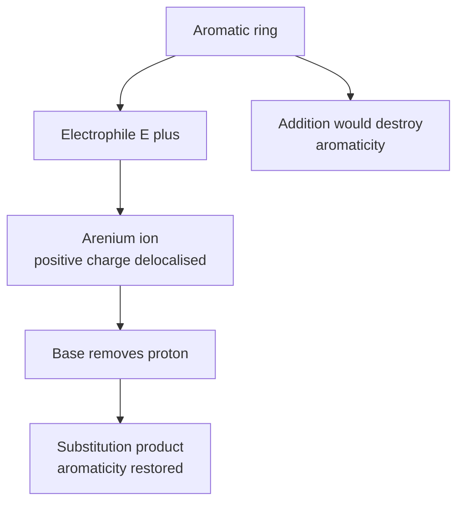
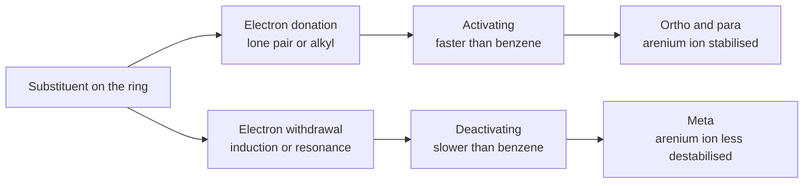
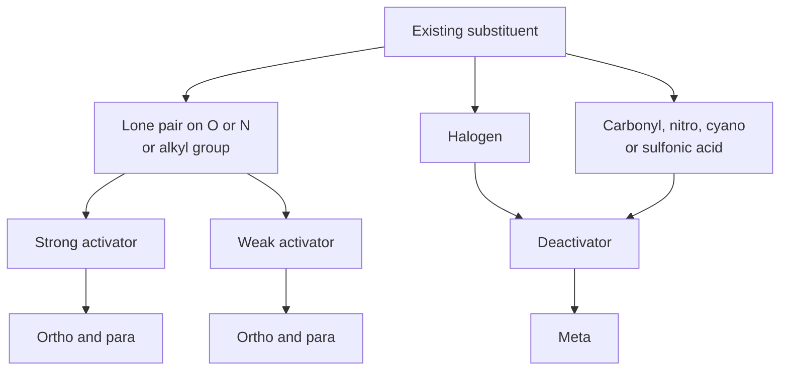
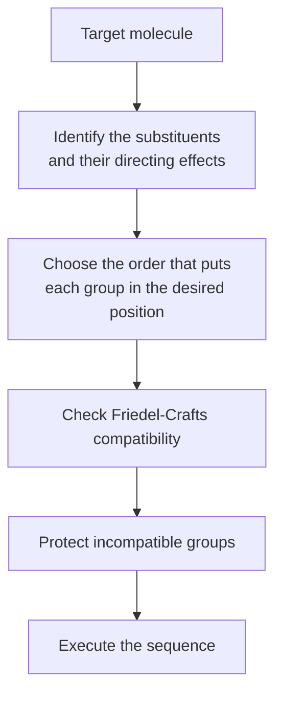

# Chapter 7 — Aromatic Compounds and Electrophilic Aromatic Substitution

> **Level:** Level 4 — Organic Chemistry
> **Estimated study time:** 9 hours (6 h reading + 3 h exercises)
> **Prerequisites:** [Alkenes, Alkynes and Electrophilic Addition](06-alkenes-alkynes-and-electrophilic-addition.md); [Conformations and Conformational Analysis](04-conformations.md)
> **Related chapters:** [Functional Groups and IUPAC Nomenclature](02-functional-groups-and-iupac-nomenclature.md), [Haloalkanes: Nucleophilic Substitution and Elimination](08-haloalkanes-substitution-and-elimination.md), [Pericyclic Reactions](13-pericyclic-reactions.md) may be read later
> **Difficulty:** ★★★★☆ (1–5)

---

## 1. Learning Objectives

After working through this chapter you will be able to:

- Describe the structure of benzene in terms of delocalised π electrons and explain why it is unusually stable.
- Apply Hückel's rule to decide whether a cyclic conjugated system is aromatic, antiaromatic or non-aromatic.
- Recognise aromatic heterocycles and explain how the lone pair on nitrogen, oxygen or sulfur participates in the aromatic system.
- Write the general mechanism of electrophilic aromatic substitution, including the arenium ion intermediate.
- Write mechanisms and conditions for nitration, sulfonation, halogenation, Friedel–Crafts alkylation and Friedel–Crafts acylation.
- Classify substituents as activating or deactivating and as *ortho/para* or *meta* directors, and explain the classification in terms of resonance and inductive effects.
- Plan a multi-step synthesis on a benzene ring, taking account of directing effects and of the limitations of Friedel–Crafts reactions.
- Describe nucleophilic aromatic substitution, side-chain oxidation and the chemistry of polycyclic aromatic hydrocarbons.

---

## 2. Introduction

Benzene was isolated from coal tar in 1825 by Michael Faraday, and its formula, $\ce{C6H6}$, was recognised as a problem for two decades. A molecule with six carbons and six hydrogens is far more unsaturated than the formula suggests, yet benzene does not behave like an alkene. It does not decolourise bromine water, it does not add hydrogen chloride, and it undergoes substitution rather than addition when treated with electrophiles. August Kekulé proposed the alternating double-bond structure in 1865, and the modern explanation — a delocalised π system of six electrons — was developed in the twentieth century.

The stability of benzene is not a minor curiosity. It is the defining property of an entire class of compounds, and it changes the reactivity of the ring so profoundly that aromatic chemistry is treated as a separate branch of organic chemistry. Aromatic rings are also ubiquitous: they occur in pharmaceuticals, dyes, polymers, herbicides, explosives, vitamins and the aromatic amino acids of proteins. The benzene ring is the most common structural motif in drug molecules after the carbonyl group.

The central reaction of aromatic chemistry is **electrophilic aromatic substitution (EAS)**. An electrophile attacks the ring, a hydrogen is replaced, and the aromatic system is restored. The mechanism passes through a **arenium ion**, a delocalised carbocation that retains most of the aromatic stabilisation, and the rate and orientation of the reaction are controlled by the stability of that intermediate. Substituents already on the ring influence both, and the rules that describe the influence are among the most useful predictive tools in the subject.

This chapter begins with structure and aromaticity, then with the general EAS mechanism, then with the individual reactions and their conditions, then with substituent effects and synthesis strategy. It closes with nucleophilic aromatic substitution, side-chain chemistry and the environmental and health aspects of polycyclic aromatic hydrocarbons.

---

## 3. Fundamental Concepts

### 3.1 The structure of benzene

Benzene is a planar, regular hexagon of carbon atoms with a hydrogen attached to each carbon. Every C–C bond is 139 pm long, intermediate between the 154 pm of a C–C single bond and the 134 pm of a C=C double bond, and every C–C–C angle is 120°. The molecule belongs to the $D_{6h}$ point group.

The equivalence of the six C–C bonds rules out a structure with alternating single and double bonds, because such a structure would have three short bonds and three long bonds. The correct description is a delocalised π system: each carbon contributes one p electron, the six p orbitals combine to give six π molecular orbitals, and the six electrons occupy the three bonding orbitals. The result is a continuous ring of π electron density above and below the molecular plane.

The delocalisation energy is measured by comparing the enthalpy of hydrogenation of benzene with that of a hypothetical cyclohexatriene. Benzene hydrogenates to cyclohexane with $\Delta H = -208\ \text{kJ mol}^{-1}$. Cyclohexene hydrogenates with $\Delta H = -120\ \text{kJ mol}^{-1}$, so a hypothetical cyclohexatriene would be expected to release about $3 \times 120 = 360\ \text{kJ mol}^{-1}$. The difference, about $150\ \text{kJ mol}^{-1}$, is the **resonance energy** (or delocalisation energy) of benzene.

That value is the reason benzene is stable. It is not enough to make benzene inert — it still reacts with strong electrophiles — but it is enough to change the preferred pathway from addition to substitution: addition would destroy the aromatic system and lose the resonance energy, whereas substitution preserves it.

### 3.2 Hückel's rule

A cyclic, planar, fully conjugated system with $4n + 2$ π electrons is **aromatic**. The rule follows from the molecular orbital pattern of a monocyclic conjugated system: the lowest orbital is non-degenerate and the remaining orbitals come in degenerate pairs, so filling the orbitals with $4n + 2$ electrons completes a shell and leaves a large gap to the next orbital.

| π electrons | $n$ | Classification | Example |
|---|---|---|---|
| 2 | 0 | Aromatic | Cyclopropenyl cation |
| 4 | — | Antiaromatic | Cyclobutadiene |
| 6 | 1 | Aromatic | Benzene, cyclopentadienyl anion, tropylium cation |
| 8 | — | Antiaromatic if planar | Cyclooctatetraene (non-planar, so non-aromatic) |
| 10 | 2 | Aromatic if planar | [10]Annulene (non-planar in practice) |
| 14 | 3 | Aromatic | [14]Annulene |
| 18 | 4 | Aromatic | [18]Annulene |

Three terms must be distinguished:

- **Aromatic**: cyclic, planar, fully conjugated, $4n + 2$ π electrons, and unusually stable.
- **Antiaromatic**: cyclic, planar, fully conjugated, $4n$ π electrons, and unusually unstable. Cyclobutadiene is the classic example; it distorts to a rectangle to reduce the antiaromatic character.
- **Non-aromatic**: not fully conjugated, or not planar, so the Hückel criteria do not apply. Cyclooctatetraene is non-aromatic because it adopts a tub shape that breaks the conjugation.

The rule applies only to monocyclic systems in its simple form. Polycyclic systems such as naphthalene and anthracene are aromatic, but the electron count must be applied to the whole conjugated perimeter or to the individual rings with care; the simple $4n + 2$ count works for the perimeter of naphthalene (10 π electrons) but not for every ring separately.

### 3.3 Annulenes

**Annulenes** are monocyclic conjugated polyenes with alternating single and double bonds. The name is given with the number of carbon atoms in square brackets: [10]annulene, [14]annulene, [18]annulene.

[18]Annulene is aromatic. It has 18 π electrons ($n = 4$), it is large enough to accommodate the internal hydrogens without severe steric clash, and it is planar enough for conjugation. [14]Annulene is also aromatic, although it is less stable and more distorted. [10]Annulene is not planar in practice because the two internal hydrogens collide, so it is non-aromatic despite having 10 π electrons.

The annulenes are important because they test the Hückel rule directly. A molecule that satisfies the electron count but cannot adopt a planar conformation is not aromatic, which is why the rule is stated with the planarity condition and not only with the electron count.

### 3.4 Heteroaromatic compounds

A heterocycle can be aromatic if a lone pair on the heteroatom participates in the π system or if the heteroatom contributes one electron to the π system and keeps its lone pair orthogonal.

**Pyridine** is a six-membered ring with one nitrogen. The nitrogen is $sp^2$ hybridised, contributes one electron to the π system, and holds its lone pair in an $sp^2$ orbital in the plane of the ring, perpendicular to the π system. Pyridine therefore has six π electrons and is aromatic, and the lone pair is available for protonation: pyridine is a weak base with a conjugate acid pKa of about 5.2.

**Pyrrole** is a five-membered ring with one nitrogen. The nitrogen contributes its lone pair to the π system, giving six π electrons, and the N–H bond lies in the plane. The lone pair is therefore not available for protonation without destroying the aromatic system, so pyrrole is an extremely weak base (conjugate acid pKa about −3.8) and a weak acid at nitrogen (pKa about 16.5).

**Furan** and **thiophene** are five-membered rings with oxygen and sulfur respectively. In each case one lone pair on the heteroatom participates in the π system, giving six π electrons, and the ring is aromatic. Thiophene is more aromatic than furan because the larger sulfur atom overlaps better with carbon and because oxygen is more electronegative, which localises the lone pair.

| Heterocycle | Ring size | π electrons | Lone pair role | Basicity |
|---|---|---|---|---|
| Pyridine | 6 | 6 | Orthogonal, not in π system | Weak base, pKaH 5.2 |
| Pyrrole | 5 | 6 | In the π system | Very weak base, pKaH −3.8 |
| Furan | 5 | 6 | One lone pair in the π system | Very weak base |
| Thiophene | 5 | 6 | One lone pair in the π system | Very weak base |
| Imidazole | 5 | 6 | One pyrrole-type N, one pyridine-type N | Weak base, pKaH 7.0 |

Imidazole illustrates the two types of nitrogen in one ring: the pyrrole-type nitrogen contributes its lone pair to the aromatic system and is not basic, while the pyridine-type nitrogen has an orthogonal lone pair and is basic. This distinction is essential for understanding the chemistry of histidine and of many drugs.

### 3.5 Aromatic versus aliphatic reactivity

An alkene reacts with bromine by addition, because addition converts the π bond into two σ bonds and the product is stable. Benzene reacts with bromine only in the presence of a Lewis acid, and the product is bromobenzene, formed by substitution. The difference is thermodynamic: addition to benzene would destroy the aromatic system and cost about 150 kJ mol⁻¹, whereas substitution preserves it.

The same logic explains why benzene does not undergo the typical reactions of alkenes — hydration, hydrohalogenation, epoxidation, ozonolysis — under ordinary conditions. It does undergo hydrogenation at high temperature and pressure, and it can be reduced by dissolving metals (Birch reduction), but these reactions require forcing conditions because they destroy the aromatic system.

The reactivity of benzene is therefore not "low" in an absolute sense: benzene reacts readily with strong electrophiles. It is *selective*: it prefers substitution over addition because substitution retains the resonance energy.

### 3.6 The general mechanism of electrophilic aromatic substitution

EAS proceeds in two steps, which can be written as two arrow-pushing operations:

1. **Curly arrow from the ring π bond to the electrophile.** The π electrons form a new σ bond at one carbon, and that carbon becomes $sp^3$ hybridised. The positive charge is left delocalised over the remaining five carbons; the intermediate is the **arenium ion**, also called the **σ complex** or the **Wheland intermediate**.
2. **Curly arrow from the C–H σ bond at the site of attack to the adjacent ring carbon.** The bonding pair becomes the π bond that restores the aromatic ring, the C–H bond breaks, and the proton is released. A base in the medium, usually the conjugate base of the electrophile or the solvent, accepts the proton.

The overall reaction is a substitution: one hydrogen is replaced by the electrophile, and the aromatic system is regenerated.

The first step is rate-determining. The arenium ion is not aromatic in the full sense, but it retains delocalisation over five carbons, so it is much more stable than a simple carbocation. The stability of the arenium ion determines both the rate of the reaction and the orientation imposed by substituents.

### 3.7 Nitration

Nitration is carried out with a mixture of concentrated nitric acid and concentrated sulfuric acid. Sulfuric acid protonates nitric acid, which loses water to give the **nitronium ion**, $\ce{NO2+}$, the active electrophile.

$$
\ce{HNO3 + 2H2SO4 -> NO2+ + H3O+ + 2HSO4-}
$$

The nitronium ion attacks the ring to give the arenium ion, and loss of a proton gives nitrobenzene. The reaction is irreversible under the usual conditions, and it is used both analytically and industrially. Nitrobenzene is a precursor to aniline, which is a precursor to dyes, pharmaceuticals and polyurethane foams.

The reaction requires a strongly acidic medium, and it is sensitive to the substituent already on the ring. An activated ring such as phenol or toluene nitrates readily, often at room temperature; a deactivated ring such as nitrobenzene requires fuming nitric acid and a higher temperature, and a second nitration is much slower than the first.

### 3.8 Sulfonation

Sulfonation is carried out with fuming sulfuric acid (oleum, a solution of sulfur trioxide in sulfuric acid) or with concentrated sulfuric acid at elevated temperature. The electrophile is sulfur trioxide, $\ce{SO3}$, or a protonated form of it.

$$
\ce{C6H6 + SO3 -> C6H5SO3H}
$$

Sulfonation is **reversible**. The sulfonic acid group can be removed by heating with dilute aqueous acid, a process called desulfonation. The reversibility is synthetically useful: a sulfonic acid group can be introduced to block a position, used to direct a subsequent substitution, and then removed.

Sulfonation is also temperature-dependent in its regiochemistry for naphthalene: at low temperature the kinetic product is the 1-sulfonic acid, and at high temperature the thermodynamic product is the 2-sulfonic acid. This is a standard example of kinetic versus thermodynamic control.

### 3.9 Halogenation

Bromination and chlorination require a Lewis acid catalyst, such as iron(III) bromide or aluminium chloride. The catalyst polarises the halogen and generates a more reactive electrophile, which is often represented as a halonium ion or as a complex between the halogen and the Lewis acid.

$$
\ce{C6H6 + Br2 ->[FeBr3] C6H5Br + HBr}
$$

Fluorination is too vigorous to control directly and is usually carried out by indirect methods. Iodination is reversible and requires an oxidant to remove the hydrogen iodide and drive the reaction forward. The order of reactivity of the halogens is therefore $\ce{F2} > \ce{Cl2} > \ce{Br2} > \ce{I2}$, with practical considerations reversing the usefulness of fluorine and iodine.

### 3.10 Friedel–Crafts alkylation

An alkyl halide reacts with benzene in the presence of aluminium chloride to give an alkylbenzene. The catalyst abstracts the halide to give a carbocation, which attacks the ring.

$$
\ce{C6H6 + CH3CH2Cl ->[AlCl3] C6H5CH2CH3 + HCl}
$$

The reaction has three important limitations. First, the carbocation can rearrange, so propyl chloride gives mostly isopropylbenzene rather than propylbenzene. Second, polyalkylation occurs because the product is more reactive than the starting material; an alkyl group activates the ring. Third, the reaction fails on strongly deactivated rings such as nitrobenzene, and it fails with substrates that complex strongly with the catalyst, such as aniline.

### 3.11 Friedel–Crafts acylation

An acyl chloride reacts with benzene in the presence of aluminium chloride to give an aryl ketone. The electrophile is an **acylium ion**, formed by the abstraction of chloride by the Lewis acid.

$$
\ce{C6H6 + CH3COCl ->[AlCl3] C6H5COCH3 + HCl}
$$

Acylation avoids the three main problems of alkylation. The acylium ion does not rearrange, so the acyl group is attached without skeletal change. The product is deactivated relative to benzene, so monoacylation is the normal outcome. The reaction still fails on strongly deactivated rings.

Acylation is the standard route to aryl ketones, which can then be reduced to alkylbenzenes or converted into other functional groups. The reduction of acetophenone to ethylbenzene, for example, is a way of attaching an ethyl group without the rearrangement that would occur in direct alkylation.

### 3.12 Substituent effects

A substituent already on the ring affects both the rate of further substitution and the position at which it occurs. The two effects are related but not identical, and they are classified separately.

**Activating substituents** increase the rate of EAS relative to benzene. They do so by donating electron density to the ring, either by resonance (lone-pair donation) or by inductive effects (alkyl groups). **Deactivating substituents** decrease the rate by withdrawing electron density.

**Ortho/para directors** direct the incoming electrophile to the positions adjacent to and opposite the substituent. They are usually activating, and their effect is explained by resonance: the intermediate arenium ion is stabilised when the positive charge can be delocalised onto the substituent.

**Meta directors** direct the electrophile to the position separated from the substituent by one carbon. They are usually deactivating, and their effect is explained by the absence of resonance stabilisation of the arenium ion at the *ortho* and *para* positions.

| Substituent | Effect on rate | Orientation | Explanation |
|---|---|---|---|
| $\ce{-NH2}$, $\ce{-NHR}$, $\ce{-NR2}$ | Strongly activating | *o/p* | Lone pair conjugated with the ring |
| $\ce{-OH}$, $\ce{-OR}$ | Strongly activating | *o/p* | Lone pair conjugated with the ring |
| $\ce{-NHCOR}$, $\ce{-OCOR}$ | Moderately activating | *o/p* | Conjugation, attenuated by the carbonyl |
| $\ce{-R}$, $\ce{-Ar}$ | Weakly activating | *o/p* | Hyperconjugation and induction |
| $\ce{-F}$, $\ce{-Cl}$, $\ce{-Br}$, $\ce{-I}$ | Deactivating | *o/p* | Inductive withdrawal dominates, resonance donation determines orientation |
| $\ce{-CHO}$, $\ce{-COR}$, $\ce{-COOH}$, $\ce{-COOR}$ | Deactivating | *meta* | Carbonyl withdraws by resonance and induction |
| $\ce{-CN}$, $\ce{-SO3H}$, $\ce{-NO2}$, $\ce{-NR3+}$ | Strongly deactivating | *meta* | Strong inductive and resonance withdrawal |

The halogens are the exception that proves the rule. They are deactivating because their inductive electron withdrawal outweighs their resonance donation, but they are *ortho/para* directors because the resonance donation stabilises the arenium ion at those positions. The two effects therefore point in different directions, and the orientation is determined by the resonance effect while the rate is determined by the inductive effect.

Alkyl groups are weakly activating and *ortho/para* directing. The effect is small compared with that of an amino or hydroxyl group, but it is large enough to make toluene react about 25 times faster than benzene and to direct a second substituent mainly to the *ortho* and *para* positions.

The *ortho/para* ratio is influenced by steric effects. A bulky substituent such as a *tert*-butyl group directs almost exclusively to the *para* position, because the *ortho* positions are blocked. A small substituent such as fluorine gives a mixture in which the *ortho* product can be significant.

### 3.13 Multi-substitution and synthesis strategy

The directing effects of substituents allow a sequence of reactions to be planned so that each new group is introduced at the desired position. Three principles govern the planning.

**Compatible groups.** If two substituents direct to the same position, the reaction is straightforward. If they direct to different positions, the more strongly activating group usually wins, and the reaction gives a mixture if the difference is small.

**Order of introduction.** The order matters. To make *m*-bromonitrobenzene, nitration must be carried out first, because the nitro group directs the subsequent bromination to the *meta* position. If bromination is carried out first, the bromine directs the nitration to the *ortho* and *para* positions, and the *meta* product is minor.

**Blocking and protection.** A position can be blocked by a substituent that is later removed. The sulfonic acid group is useful for this purpose because it can be introduced and removed reversibly. A bulky group such as *tert*-butyl can also block a position sterically, but it is not easily removed.

**Limitations.** Friedel–Crafts reactions fail on strongly deactivated rings, so a nitrobenzene cannot be alkylated or acylated. Aniline reacts with aluminium chloride to form a complex, which deactivates the ring and prevents Friedel–Crafts reaction; the amine must be protected as an amide before the reaction is attempted.

### 3.14 Nucleophilic aromatic substitution

Aromatic rings are usually attacked by electrophiles, not nucleophiles, because the π system is electron-rich. Nucleophilic aromatic substitution becomes possible when the ring bears strongly electron-withdrawing groups at the *ortho* and *para* positions, which stabilise the negative charge of the intermediate.

The mechanism is **addition–elimination**. The nucleophile adds to the ring to give a **Meisenheimer complex**, a delocalised carbanion, and the leaving group departs to restore aromaticity.

$$
\ce{C6H5F + NH3 ->[heat] C6H5NH2 + HF}
$$

The reaction requires an electron-poor ring. 1-Fluoro-2,4-dinitrobenzene reacts with ammonia at room temperature, whereas fluorobenzene requires extreme conditions. The leaving-group order is $\ce{F} > \ce{Cl} > \ce{Br} > \ce{I}$, which is the reverse of the order for aliphatic substitution: fluoride is the best leaving group because the C–F bond is highly polarised and because the Meisenheimer complex is stabilised by the inductive effect of fluorine.

A second mechanism, the **benzyne** pathway, operates when there is no good leaving group at the position of attack and a very strong base is used. Chlorobenzene treated with sodium amide in liquid ammonia gives aniline, but the reaction proceeds through a benzyne intermediate rather than through a Meisenheimer complex. The benzyne mechanism is treated in more detail in Chapter 8.

### 3.15 Oxidation of side chains

An alkyl side chain on a benzene ring can be oxidised to a carboxyl group if it has at least one benzylic hydrogen. Hot aqueous potassium permanganate or chromic acid converts toluene to benzoic acid, ethylbenzene to benzoic acid, and isopropylbenzene to benzoic acid. A *tert*-butyl group has no benzylic hydrogen and is resistant to oxidation.

$$
\ce{C6H5CH3 ->[KMnO4, H2O, \Delta] C6H5COOH}
$$

The reaction is useful for preparing aromatic carboxylic acids, and it is also a way of degrading an alkyl side chain to a functional group that can be further elaborated. The mechanism involves benzylic hydrogen abstraction and oxidation through the alcohol and aldehyde stages.

Benzylic positions can also be halogenated selectively by radical substitution, because the benzylic radical is stabilised by resonance with the ring. *N*-Bromosuccinimide is the standard reagent for benzylic bromination, and the product is a benzylic bromide that can be substituted by nucleophiles.

### 3.16 Polycyclic aromatic hydrocarbons

**Naphthalene**, $\ce{C10H8}$, consists of two fused benzene rings. It is aromatic, with 10 π electrons around the perimeter, and it undergoes EAS at the 1-position (the α position) rather than at the 2-position, because the arenium ion from attack at C1 has more resonance structures that retain an intact benzene ring.

**Anthracene** and **phenanthrene** are three-ring systems. Anthracene reacts at the 9- and 10-positions, which are the most reactive because attack there preserves the aromaticity of two rings. Phenanthrene reacts at the 9-position for the same reason.

**Polycyclic aromatic hydrocarbons (PAHs)** are formed by incomplete combustion of organic matter. They are widespread environmental contaminants, and several are carcinogenic. Benzo[*a*]pyrene is the best-known example: it is metabolised by cytochrome P450 enzymes to a diol epoxide, which intercalates into DNA and forms covalent adducts that cause mutations.

The health effects of PAHs are a direct consequence of their electronic structure. The same delocalisation that makes the rings stable also makes them lipophilic and able to slip between DNA base pairs. The metabolic activation of benzo[*a*]pyrene is a case study in the relationship between aromatic chemistry and toxicology, and it is one reason that aromatic chemistry cannot be taught without an environmental dimension.

---

## 4. Detailed Scientific Explanation

### 4.1 Resonance energy and its consequences

The resonance energy of benzene is about 150 kJ mol⁻¹. It is measured by comparing the enthalpy of hydrogenation of benzene with three times that of cyclohexene, and it represents the extra stability that the delocalised π system provides over a hypothetical localised triene.

The value has three consequences that shape the whole chapter.

First, **addition is thermodynamically disfavoured** relative to substitution. An addition reaction converts two π electrons into two σ bonds and destroys the aromatic system; the energy released by forming the new bonds does not compensate for the loss of resonance energy. A substitution reaction forms the same number of new bonds but restores the aromatic system, so it is strongly favoured.

Second, **the ring is resistant to oxidation and reduction** under mild conditions. Ozonolysis, epoxidation and catalytic hydrogenation at room temperature do not affect benzene. Hydrogenation requires high temperature and pressure, and the Birch reduction requires dissolving metals in liquid ammonia.

Third, **the ring is stabilised but not inert**. The resonance energy raises the activation barrier for attack, but a strong electrophile can still overcome it. The result is a reactivity pattern that is quantitatively lower than that of an alkene but qualitatively similar in the first step: attack by an electrophile to give a delocalised cation.

The resonance energy also varies with the substitution pattern. Naphthalene has a resonance energy of about 255 kJ mol⁻¹, which is less than twice that of benzene (300 kJ mol⁻¹), so the second ring is less aromatic than the first. This is why naphthalene undergoes addition and oxidation more readily than benzene, and why attack occurs preferentially at the positions that preserve the remaining benzene ring.

### 4.2 The molecular orbital picture

Benzene has six p orbitals, one on each carbon, and these combine to give six π molecular orbitals. Three are bonding and three are antibonding, and the six π electrons fill the three bonding orbitals, leaving the antibonding orbitals empty. The energy gap between the highest occupied and lowest unoccupied orbitals is large, which is why benzene is chemically stable and why it absorbs ultraviolet light rather than visible light.

The orbital pattern can be generated by the **Frost circle** construction: draw a circle, inscribe a regular polygon with one vertex at the bottom, and place the orbitals at the vertices. For benzene, the hexagon gives one orbital at the bottom, two degenerate pairs above it and one at the top. Filling the lowest three levels with six electrons gives a closed shell and a large gap to the next level.

For cyclobutadiene, the square gives one orbital at the bottom, a degenerate pair in the middle and one at the top. Filling with four electrons places two electrons in the degenerate pair, giving an open shell and a singly occupied, doubly degenerate set. The molecule is therefore a diradical in the delocalised picture, and it distorts to a rectangular structure with localised double bonds to avoid the antiaromatic instability.

For cyclooctatetraene, the octagon gives a closed shell with eight electrons if the molecule is planar, but the planar conformation would be antiaromatic. The molecule avoids this by adopting a tub shape, which breaks the conjugation and makes it non-aromatic. The tub conformation costs some strain energy, but it avoids the much larger antiaromatic penalty.

### 4.3 The arenium ion

The arenium ion is formed when an electrophile adds to one carbon of the ring. That carbon becomes $sp^3$ hybridised, and the positive charge is delocalised over the remaining five carbons. The ion has four resonance structures in which the charge is on the *ortho* and *para* positions relative to the site of attack, and the attacking electrophile is on the *ipso* carbon.

The stability of the arenium ion is the key to both reactivity and orientation. It is more stable than an ordinary secondary carbocation because the positive charge is delocalised over several carbons, but it is less stable than benzene because one carbon is no longer part of the π system. The activation energy for its formation is therefore lower than the activation energy for a reaction that would destroy the aromatic system completely, but higher than the activation energy for addition to an alkene.

The arenium ion is a real intermediate, not a transition state. It has been observed spectroscopically in superacid solution, and its formation is rate-determining in most EAS reactions. The second step, loss of a proton, is fast and does not affect the rate or the orientation.

### 4.4 Nitration in detail

The nitrating mixture generates the nitronium ion by the dehydration of protonated nitric acid:

$$
\ce{HNO3 + H2SO4 <=> H2NO3+ + HSO4-}
$$
$$
\ce{H2NO3+ <=> NO2+ + H2O}
$$

The nitronium ion is a linear, highly electrophilic cation. It attacks the ring to give the arenium ion, which loses a proton to a base (usually $\ce{HSO4-}$ or water) to give nitrobenzene.

Nitration is irreversible under the usual conditions because the nitro group is strongly deactivating and the reverse reaction would require attack of a nitronium ion on a deactivated ring. The irreversibility means that the product distribution reflects the kinetics of the first step, not the thermodynamics of the overall reaction.

The reaction is used industrially for the production of nitrobenzene, which is hydrogenated to aniline. Aniline is a precursor to polyurethane foams, dyes and pharmaceuticals, and the nitration–hydrogenation sequence is one of the largest industrial applications of aromatic chemistry.

### 4.5 Sulfonation and reversibility

Sulfonation is reversible because the sulfonic acid group is a good leaving group under acidic conditions and because the reaction is exothermic in the forward direction but the reverse reaction is accessible at elevated temperature.

The reversibility has two consequences. First, sulfonation can be used to protect a position: the group can be introduced, the rest of the molecule elaborated, and the group removed by heating with dilute acid. Second, the reaction can be used to separate isomers, because the sulfonic acids have different solubilities and can be crystallised or hydrolysed selectively.

The temperature dependence of naphthalene sulfonation is the standard example of kinetic versus thermodynamic control. At 80 °C the reaction is under kinetic control and gives the 1-sulfonic acid, because attack at the 1-position has the lower activation energy. At 160 °C the reaction is under thermodynamic control and gives the 2-sulfonic acid, because it is more stable and the sulfonation is reversible. The 1-isomer is sterically crowded by the peri-hydrogen at C8, and the 2-isomer relieves that strain.

### 4.6 Halogenation and the electrophile

The halogenation of benzene requires a Lewis acid because the halogen molecule is not electrophilic enough on its own. The Lewis acid coordinates to the halogen and polarises the X–X bond, generating an electrophilic species that can be represented as $\ce{X+}$ or as a complex.

The exact nature of the electrophile is still debated. For bromination with iron(III) bromide, the reactive species may be a bromonium ion, a bromine–iron complex or a free bromine cation. The mechanistic conclusion does not depend on the identity of the species: the ring attacks an electrophilic halogen, and the arenium ion loses a proton.

The order of reactivity is $\ce{F2} > \ce{Cl2} > \ce{Br2} > \ce{I2}$, but the practical order of usefulness is different. Fluorine is too reactive to control, and direct fluorination of benzene gives a mixture of products and destroyed material. Iodine is too unreactive, and the reaction is reversible; it is driven forward by an oxidant such as nitric acid or hydrogen peroxide. Chlorine and bromine are the useful reagents, and bromination is the standard demonstration reaction because the colour of bromine disappears and the product is easily isolated.

### 4.7 Friedel–Crafts reactions

The Friedel–Crafts alkylation and acylation reactions are the standard methods for introducing carbon substituents onto an aromatic ring, and their limitations are as important as their scope.

**Alkylation.** The carbocation is generated by the Lewis acid and can rearrange. Propyl chloride with aluminium chloride gives a mixture in which isopropylbenzene predominates, because the secondary carbocation is more stable than the primary one. The reaction also suffers from polyalkylation, because the alkyl group activates the ring and the product reacts faster than the starting material. The problem can be mitigated by using a large excess of benzene, but it cannot be eliminated.

**Acylation.** The acylium ion is stabilised by resonance ($\ce{R-C#O+ <-> R-C+=O}$), and it does not rearrange. The product is a ketone, which is deactivated relative to benzene, so monoacylation is the normal outcome. The reaction is therefore the method of choice for introducing a carbon chain that would rearrange under alkylation conditions.

**Workup.** The aluminium chloride is used in stoichiometric amounts, not catalytic amounts, because it complexes with the carbonyl oxygen of the product. The complex must be hydrolysed with water or dilute acid to release the ketone, and the aluminium salts are a waste stream that must be managed.

**Limitations.** Neither reaction works on strongly deactivated rings such as nitrobenzene, because the ring is not nucleophilic enough to attack the electrophile. Aniline and other amines complex with aluminium chloride, which deactivates the ring and prevents the reaction; the amine must be protected as an amide before the Friedel–Crafts step.

### 4.8 Why substituents direct where they do

The orientation of EAS is determined by the stability of the arenium ion formed by attack at each position. A substituent that can donate electron density by resonance stabilises the arenium ion when the positive charge is on the carbon bearing the substituent, and that stabilisation is available only for attack at the *ortho* and *para* positions.

Consider an amino group. When the electrophile attacks the *para* position, one of the resonance structures of the arenium ion places the positive charge on the carbon bearing the nitrogen. The nitrogen lone pair can then donate to form a C=N double bond, giving a resonance structure in which every atom has a complete octet. This structure is particularly stable, and it lowers the energy of the transition state leading to the *para* product. The same stabilisation is available for *ortho* attack but not for *meta* attack.

Now consider a nitro group. The nitrogen is positively charged and bears two oxygens, so it withdraws electron density by both induction and resonance. When the electrophile attacks the *ortho* or *para* position, one resonance structure places the positive charge on the carbon bearing the nitro group, which is already electron-poor; that structure is strongly destabilised. When attack occurs at the *meta* position, the positive charge never falls on the substituted carbon, so the destabilisation is smaller. The *meta* product is therefore favoured, even though all positions are deactivated relative to benzene.

The halogens are a special case because their inductive withdrawal and their resonance donation act in opposite directions. The induction dominates the overall rate, so halobenzenes are deactivated. The resonance donation stabilises the arenium ion at the *ortho* and *para* positions, so the orientation is *ortho/para*. The result is a substituent that is deactivating but *ortho/para* directing, which is why the halogens occupy a separate row in the table.

Alkyl groups donate by hyperconjugation and induction, and the effect is weak but consistent. They are weakly activating and *ortho/para* directing. The *ortho/para* ratio depends on sterics: a methyl group gives a mixture of *ortho* and *para* products, while a *tert*-butyl group gives almost exclusively the *para* product.

### 4.9 Planning a synthesis

The directing rules are used in reverse when planning a synthesis. The question is not "what does this substituent do?" but "in what order should the substituents be introduced so that each one ends up where it is wanted?"

A worked strategy makes the logic clear. Suppose the target is *m*-bromonitrobenzene. The two substituents are a bromine and a nitro group, and they are *meta* to each other. Bromine is an *ortho/para* director, and nitro is a *meta* director. If bromination is carried out first, the nitro group will enter at the *ortho* and *para* positions, giving the wrong isomer. If nitration is carried out first, the nitro group directs the bromine to the *meta* position, giving the desired product. The order is therefore nitration followed by bromination.

The same logic applies to more complex targets. A third substituent must be introduced at a position that is favoured by the existing groups, or the existing groups must be modified to change their directing effect. A nitro group can be reduced to an amino group, which changes it from a *meta* director to a strong *ortho/para* director; an amino group can be acetylated to reduce its activating power and to prevent it from reacting with the electrophile.

### 4.10 Nucleophilic aromatic substitution

The SNAr mechanism is addition–elimination. The nucleophile adds to the ring to give a Meisenheimer complex, which is a delocalised carbanion; the leaving group then departs, restoring aromaticity. The reaction is favoured by electron-withdrawing groups at the *ortho* and *para* positions, because they stabilise the negative charge of the Meisenheimer complex.

The rate order for the leaving group is $\ce{F} > \ce{Cl} > \ce{Br} > \ce{I}$, which is the reverse of the order for aliphatic $\mathrm{S_N2}$. The reason is that the addition step, not the elimination step, is rate-determining, and fluorine stabilises the Meisenheimer complex most strongly because of its high electronegativity. The C–F bond is strong, but it is broken in a fast step after the rate-determining addition.

The benzyne mechanism is a different pathway. It requires a strong base and a poor leaving group, and it proceeds by elimination of HX to give an aryne, followed by addition of the nucleophile. The benzyne intermediate is highly reactive and is trapped by any nucleophile present, which is why the reaction gives a mixture of products when the aryne is unsymmetrical.

### 4.11 Side-chain chemistry

The benzylic position is the carbon adjacent to the aromatic ring. It is activated towards both radical substitution and oxidation because the benzylic radical and the benzylic cation are stabilised by resonance with the ring.

**Radical halogenation.** Benzylic bromination with *N*-bromosuccinimide proceeds by a radical chain and is highly selective for the benzylic position. The product is a benzylic bromide, which can be substituted by nucleophiles or eliminated to give a styrene.

**Oxidation.** Hot potassium permanganate or chromic acid oxidises a benzylic C–H bond to a carboxyl group. The whole side chain is converted, not just the benzylic carbon: ethylbenzene gives benzoic acid, and isopropylbenzene gives benzoic acid. A *tert*-butyl group has no benzylic hydrogen and is not oxidised.

**Reduction.** Birch reduction (sodium in liquid ammonia with an alcohol) reduces benzene to 1,4-cyclohexadiene. The reaction is a dissolving-metal reduction and proceeds by electron transfer, not by catalytic hydrogenation. It is useful for preparing cyclohexadienes that can be elaborated further.

### 4.12 Polycyclic aromatic hydrocarbons and health

PAHs are formed whenever organic matter is burned incompletely: in vehicle exhaust, cigarette smoke, wood smoke, grilled food and industrial processes. They are persistent in the environment because they are lipophilic and resistant to degradation, and they accumulate in sediments and in fatty tissue.

Benzo[*a*]pyrene is the most studied PAH. It is not carcinogenic itself; it becomes carcinogenic after metabolic activation by cytochrome P450 enzymes, which oxidise it to a diol epoxide. The epoxide is highly electrophilic and reacts with the exocyclic amino group of guanine in DNA, forming a bulky adduct that distorts the double helix and causes mutations. The same chemistry that makes the aromatic ring stable also makes it a good substrate for oxidation and a good intercalator.

The environmental regulation of PAHs is based on their carcinogenicity and on their persistence. The United States Environmental Protection Agency lists sixteen PAHs as priority pollutants, and the European Union sets maximum levels for benzo[*a*]pyrene in food. The chemistry of PAHs is therefore not only a matter of academic interest; it is the basis of environmental monitoring and public health policy.

---

## 5. Visual Diagrams

The diagrams below show the general EAS mechanism, the electronic classification of substituents, the decision procedure for predicting orientation, and the strategy for ordering substitutions in a synthesis.

**Figure 7.1 — The general mechanism of electrophilic aromatic substitution.** The ring attacks the electrophile to give the arenium ion, and a base removes the proton to restore aromaticity. The lower branch is the addition pathway that the molecule avoids: it would destroy the aromatic system and cost about 150 kJ mol⁻¹. The figure makes the thermodynamic reason for substitution over addition explicit.

**Figure 7.2 — The electronic basis of substituent effects.** Electron donation activates the ring and stabilises the arenium ion at the *ortho* and *para* positions; electron withdrawal deactivates the ring and makes the *meta* positions relatively less unfavourable. The halogens sit at the intersection of the two branches: they withdraw inductively but donate by resonance, so they are deactivating yet *ortho/para* directing.

**Figure 7.3 — Predicting the orientation of a second substitution.** The procedure is to classify the existing substituent, then apply the orientation rule. The diagram deliberately separates the rate effect from the orientation effect: a substituent can be deactivating and still *ortho/para* directing, which is the case for the halogens.

**Figure 7.4 — Planning an aromatic synthesis.** The order of substitution is dictated by the directing effects, and the feasibility of each step is dictated by the compatibility of the substituents with the reaction conditions. Friedel–Crafts reactions are the most common point of failure, because they do not work on deactivated rings or on free amines, and the figure places the compatibility check before the execution step.

---

## 6. Mathematical Formulas

### 6.1 Hückel's rule

$$
\pi = 4n + 2
\qquad\text{equivalently}\qquad
n = \frac{\pi - 2}{4}
$$

where $\pi$ is the number of π electrons in the cyclic conjugated system and $n$ is a non-negative integer. A system with $4n$ π electrons is antiaromatic if it is planar and fully conjugated, and non-aromatic if it is not. The rule is a counting rule, not a stability scale: it tells you whether a closed-shell aromatic configuration is possible, not how stable the molecule will be relative to its isomers.

### 6.2 Resonance energy from hydrogenation

$$
E_\text{res} = 3\left|\Delta H_\text{hydro}(\text{cyclohexene})\right| - \left|\Delta H_\text{hydro}(\text{benzene})\right|
$$

The factor of three comes from the three double bonds of the hypothetical cyclohexatriene. For benzene the result is $3(120) - 208 = 152\ \text{kJ mol}^{-1}$. The method is approximate because it compares different molecules, but it is the standard operational definition and gives consistent values across the aromatic series.

### 6.3 Partial rate factors

$$
f = \frac{\text{rate at one position in the substituted ring}}{\text{rate at one position in benzene}}
$$

The partial rate factor allows the effect of a substituent to be quantified position by position. A partial rate factor greater than 1 means that the position is more reactive than a position in benzene; less than 1 means less reactive. The overall rate ratio is the sum of the partial rate factors over all available positions, divided by six.

### 6.4 Degree of unsaturation of an aromatic ring

A benzene ring contributes 4 to the degree of unsaturation: three π bonds and one ring. The general formula for a benzene derivative with $k$ rings and $m$ double bonds outside the ring is therefore

$$
\text{DBE} = 4 + k + m
$$

which is useful for checking that a proposed structure is consistent with its molecular formula before any spectroscopic analysis is attempted.

---

## 7. Chemical Equations

### 7.1 Nitration of benzene

$$
\ce{C6H6 + HNO3 ->[H2SO4,\ 50\ ^\circ C] C6H5NO2 + H2O}
$$

The electrophile is the nitronium ion, $\ce{NO2+}$, generated by the dehydration of protonated nitric acid. The reaction is irreversible under the usual conditions and gives nitrobenzene in good yield. The temperature is kept below 60 °C to avoid dinitration and oxidation of the ring.

### 7.2 Sulfonation of benzene

$$
\ce{C6H6 + SO3 ->[H2SO4] C6H5SO3H}
$$

The electrophile is sulfur trioxide or a protonated form of it. The reaction is reversible, and the sulfonic acid can be removed by heating with dilute aqueous acid. The reversibility is used in synthesis to block a position temporarily.

### 7.3 Bromination of benzene

$$
\ce{C6H6 + Br2 ->[FeBr3] C6H5Br + HBr}
$$

The Lewis acid polarises the bromine and generates the electrophile. The reaction is slower than chlorination and faster than iodination. The product, bromobenzene, is a substrate for further functionalisation by halogen–metal exchange or by nucleophilic aromatic substitution.

### 7.4 Friedel–Crafts alkylation

$$
\ce{C6H6 + CH3CH2Cl ->[AlCl3] C6H5CH2CH3 + HCl}
$$

Ethylbenzene is the product of ethylation. The reaction proceeds through a carbocation and is subject to rearrangement, polyalkylation and failure on deactivated rings. Industrially, ethylbenzene is made by the alkylation of benzene with ethene over a solid acid catalyst, a cleaner process that avoids the stoichiometric aluminium chloride.

### 7.5 Friedel–Crafts acylation

$$
\ce{C6H6 + CH3COCl ->[AlCl3] C6H5COCH3 + HCl}
$$

Acetophenone is the product of acetylation. The acylium ion does not rearrange, and the product is deactivated, so monoacylation is the normal outcome. The aluminium chloride is required in stoichiometric amount because it complexes with the ketone product.

### 7.6 Nitration of toluene

$$
\ce{C6H5CH3 + HNO3 ->[H2SO4] C6H4(CH3)(NO2) + H2O}
$$

The methyl group is weakly activating and *ortho/para* directing, so the product is a mixture of 2-nitrotoluene and 4-nitrotoluene, with the *para* isomer usually predominating because of steric effects. Further nitration gives 2,4-dinitrotoluene and then 2,4,6-trinitrotoluene.

### 7.7 Oxidation of toluene

$$
\ce{C6H5CH3 ->[KMnO4, H2O, \Delta] C6H5COOH}
$$

Hot aqueous permanganate oxidises the methyl group to a carboxyl group. The reaction requires at least one benzylic hydrogen, so *tert*-butylbenzene is resistant. The product, benzoic acid, is a useful intermediate and a food preservative in its salt form.

### 7.8 Nucleophilic aromatic substitution

$$
\ce{C6H5F + NH3 ->[heat] C6H5NH2 + HF}
$$

Fluorobenzene requires extreme conditions, but 1-fluoro-2,4-dinitrobenzene reacts with ammonia at room temperature. The difference is the stability of the Meisenheimer complex, which is strongly stabilised by the two nitro groups.

### 7.9 Nitration of naphthalene

$$
\ce{C10H8 + HNO3 ->[H2SO4] C10H7NO2 + H2O}
$$

Nitration occurs mainly at the 1-position, because attack there gives an arenium ion that retains an intact benzene ring in more resonance structures than attack at the 2-position. The product is 1-nitronaphthalene.

### 7.10 Sulfonation of naphthalene

$$
\ce{C10H8 + H2SO4 ->[160\ ^\circ C] C10H7SO3H + H2O}
$$

At 160 °C the thermodynamic product, naphthalene-2-sulfonic acid, predominates. At 80 °C the kinetic product, naphthalene-1-sulfonic acid, predominates. The example is the standard illustration of kinetic versus thermodynamic control in aromatic substitution.

### 7.11 Birch reduction of benzene

$$
\ce{C6H6 + 2Na + 2C2H5OH ->[NH3] C6H8 + 2C2H5ONa}
$$

The product is 1,4-cyclohexadiene. The reaction proceeds by electron transfer from sodium to the aromatic ring, followed by protonation, and it is one of the few ways to reduce benzene without destroying the ring completely.

---

## 8. Worked Examples

### Worked Example 8.1 — Applying Hückel's rule

**Problem.** Classify each species as aromatic, antiaromatic or non-aromatic: (a) the cyclopentadienyl anion; (b) the cycloheptatrienyl cation; (c) cyclobutadiene; (d) cyclooctatetraene.

**Strategy.** Count the π electrons, check whether the system is cyclic, planar and fully conjugated, and apply $4n + 2$.

**Solution.** (a) The cyclopentadienyl anion has five carbons in a ring, each contributing one p orbital, and the anion contributes two electrons from the lone pair. The total is six π electrons, which is $4n + 2$ with $n = 1$. The ring is planar and fully conjugated, so it is aromatic. (b) The cycloheptatrienyl cation has seven carbons and three double bonds, giving six π electrons, and the positive charge corresponds to an empty p orbital. The total is six π electrons, so the cation is aromatic. (c) Cyclobutadiene has four π electrons, which is $4n$ with $n = 1$. It is planar and conjugated, so it is antiaromatic; in practice it distorts to a rectangle to reduce the antiaromatic character. (d) Cyclooctatetraene has eight π electrons, which is $4n$ with $n = 2$. A planar conformation would be antiaromatic, so the molecule adopts a tub shape that breaks the conjugation and is non-aromatic.

**Check.** The electron counts are 6, 6, 4 and 8 respectively, and the classifications follow directly. A common error is to count the lone pair on the heteroatom in pyridine as part of the π system; it is orthogonal and does not count, which is why pyridine has six π electrons from the ring alone.

### Worked Example 8.2 — Resonance energy

**Problem.** The enthalpy of hydrogenation of benzene to cyclohexane is $-208\ \text{kJ mol}^{-1}$, and that of cyclohexene to cyclohexane is $-120\ \text{kJ mol}^{-1}$. Calculate the resonance energy of benzene.

**Strategy.** Compare the observed enthalpy with the enthalpy expected for three isolated double bonds, and take the difference.

**Solution.** A hypothetical cyclohexatriene with three isolated double bonds would release

$$
3 \times 120 = 360\ \text{kJ mol}^{-1}
$$

The observed value is 208 kJ mol⁻¹, so the resonance energy is

$$
E_\text{res} = 360 - 208 = 152\ \text{kJ mol}^{-1}
$$

**Check.** The value is close to the commonly quoted 150 kJ mol⁻¹. The calculation assumes that the three double bonds in the hypothetical triene would each behave like the double bond in cyclohexene, which is an approximation; the true resonance energy is defined by a more sophisticated thermochemical cycle. The conclusion — that benzene is stabilised by about 150 kJ mol⁻¹ relative to a localised triene — is robust.

### Worked Example 8.3 — Predicting orientation

**Problem.** Predict the major product of mononitration for each substrate: (a) chlorobenzene; (b) benzoic acid; (c) phenol; (d) *tert*-butylbenzene.

**Strategy.** Classify the substituent as activating or deactivating and as *ortho/para* or *meta* directing, then apply the rule. Consider steric effects where relevant.

**Solution.** (a) Chlorine is deactivating but *ortho/para* directing, so the major products are 2-nitrochlorobenzene and 4-nitrochlorobenzene, with the *para* isomer usually predominating. (b) The carboxyl group is strongly deactivating and *meta* directing, so the major product is 3-nitrobenzoic acid. (c) The hydroxyl group is strongly activating and *ortho/para* directing, so the products are 2-nitrophenol and 4-nitrophenol; with excess reagent, 2,4,6-trinitrophenol is formed. (d) The *tert*-butyl group is weakly activating and *ortho/para* directing, but it is bulky, so the *para* product, 4-*tert*-butylnitrobenzene, dominates.

**Check.** In each case the orientation follows from the resonance stabilisation of the arenium ion. The *ortho/para* ratio is a steric question, not an electronic one, and it is the main source of uncertainty in a prediction. A substituent that is both strongly activating and bulky, such as *tert*-butyl, gives almost pure *para*; a small substituent such as fluorine gives a substantial *ortho* fraction.

### Worked Example 8.4 — Choosing the order of substitution

**Problem.** Starting from benzene, propose a synthesis of *m*-bromonitrobenzene.

**Strategy.** Identify the directing effect of each substituent, decide which must be introduced first, and check that the second substitution is feasible.

**Solution.** The target has a bromine and a nitro group in a *meta* relationship. Bromine is an *ortho/para* director, and nitro is a *meta* director. If bromination is carried out first, the nitro group enters at the *ortho* and *para* positions, giving the wrong isomer. If nitration is carried out first, the nitro group directs the bromine to the *meta* position. The sequence is therefore:

1. Nitration of benzene with $\ce{HNO3/H2SO4}$ gives nitrobenzene.
2. Bromination with $\ce{Br2/FeBr3}$ gives *m*-bromonitrobenzene.

**Check.** The second step is feasible because nitrobenzene, although deactivated, still undergoes halogenation under forcing conditions. A Friedel–Crafts reaction would not work on nitrobenzene, which is why bromination rather than alkylation is used. The order of introduction is the whole answer; reversing it gives mainly the *para* isomer.

### Worked Example 8.5 — Why Friedel–Crafts fails

**Problem.** Explain why aniline does not undergo Friedel–Crafts acylation with acetyl chloride and aluminium chloride, and suggest how the reaction can be carried out.

**Strategy.** Consider the acid–base interaction between the amine and the Lewis acid, and the effect of the resulting complex on the ring.

**Solution.** Aniline is a base, and aluminium chloride is a Lewis acid. The lone pair on nitrogen coordinates to aluminium, forming a complex in which the nitrogen bears a positive charge. The positive charge strongly withdraws electron density from the ring, deactivating it and converting the amino group from an *ortho/para* director into a *meta* director. The ring is then too deactivated to undergo Friedel–Crafts acylation.

The solution is to protect the amine as an amide, for example by acetylation with acetic anhydride to give acetanilide. The amide nitrogen is much less basic, so it does not complex strongly with aluminium chloride, and the ring remains reactive. The Friedel–Crafts acylation can then be carried out, and the amide is hydrolysed at the end to regenerate the amine.

**Check.** The protected amine is still an *ortho/para* director, so the acyl group enters mainly at the *para* position. The same problem arises with any basic substituent, including primary, secondary and tertiary amines, and the same protection strategy is used.

### Worked Example 8.6 — Nucleophilic aromatic substitution

**Problem.** Fluorobenzene requires heating with hydroxide at about 350 °C to give phenol, whereas 1-fluoro-2,4-dinitrobenzene reacts with ammonia at room temperature. Explain the difference.

**Strategy.** Compare the stability of the Meisenheimer complex in the two substrates, and consider which step is rate-determining.

**Solution.** The SNAr reaction proceeds by addition of the nucleophile to give a Meisenheimer complex, followed by loss of fluoride. The addition step is rate-determining. In fluorobenzene, the Meisenheimer complex has a negative charge delocalised around the ring with no stabilising substituent, so it is high in energy and the reaction is slow. In 1-fluoro-2,4-dinitrobenzene, the two nitro groups are at the *ortho* and *para* positions, and they stabilise the negative charge by both resonance and induction. The Meisenheimer complex is much lower in energy, the barrier is much smaller, and the reaction proceeds at room temperature.

**Check.** The leaving group is the same in both cases, so the difference cannot be attributed to the C–F bond strength. The rate order $\ce{F} > \ce{Cl} > \ce{Br} > \ce{I}$ in SNAr is consistent with the addition step being rate-determining, because fluorine stabilises the Meisenheimer complex most strongly. The reagent 1-fluoro-2,4-dinitrobenzene is known as Sanger's reagent and is used to label the N-terminal amino group of peptides.

---

## 9. Real-World Applications

**Petrochemicals.** Benzene, toluene and the xylenes (BTX) are produced by catalytic reforming and by steam cracking, and they are the starting materials for a huge range of products. Benzene is used to make ethylbenzene (for styrene), cumene (for phenol and acetone), cyclohexane (for nylon) and aniline (for polyurethane). Toluene is used as a solvent and as a precursor to benzoic acid and to explosives.

**Polymers.** Polystyrene is made by the radical or anionic polymerisation of styrene, and it is one of the most widely used plastics. Poly(phenylene oxide), polycarbonate and epoxy resins all contain aromatic rings that provide rigidity and thermal stability. The aromatic ring is the main reason that these polymers have high glass transition temperatures.

**Pharmaceuticals.** A large fraction of drug molecules contain an aromatic ring, often a benzene ring with several substituents. The ring provides a rigid, flat scaffold that positions functional groups for binding to a receptor, and the substituents tune solubility, metabolism and potency. Ibuprofen, paracetamol, diazepam and atorvastatin all contain aromatic rings, and the synthesis of each uses at least one EAS or related aromatic transformation.

**Dyes and pigments.** Azo dyes are made by diazotisation of an aromatic amine followed by coupling with a phenol or an amine. The extended conjugated system absorbs visible light, and the substituents determine the colour and the fastness. The dye industry was the first large-scale application of aromatic chemistry, and it drove the development of the subject in the nineteenth century.

**Explosives.** Nitration of toluene gives 2,4,6-trinitrotoluene (TNT), and nitration of phenol gives picric acid. The explosive properties depend on the rapid decomposition of the nitro groups to gaseous products, and the aromatic ring provides a stable framework that can be handled safely until detonation. The same chemistry is used in propellants and in mining.

**Environmental and health concerns.** Benzene is a known human carcinogen and is regulated in petrol and in workplace air. PAHs are persistent organic pollutants and are monitored in air, water, soil and food. The health effects of aromatic compounds are a direct consequence of their lipophilicity and their ability to intercalate into DNA, and they are the reason that aromatic chemistry is taught alongside toxicology and environmental science.

**Materials science.** Aromatic rings are the building blocks of organic semiconductors, organic light-emitting diodes, liquid crystals and graphene. The delocalised π system allows charge transport, and the substituents control the energy levels and the packing. The same electronic structure that makes benzene stable makes it a useful component of materials that need to be robust and conductive.

---

## 10. Common Mistakes

| Mistake | Why it happens | Correct approach |
|---|---|---|
| Counting the pyridine lone pair as part of the π system | The nitrogen has a lone pair, so it is assumed to participate | In pyridine the lone pair is in an $sp^2$ orbital orthogonal to the π system; only the ring electrons count |
| Treating every $4n$ system as non-aromatic | The distinction between antiaromatic and non-aromatic is subtle | A planar, fully conjugated $4n$ system is antiaromatic; a non-planar one is non-aromatic |
| Drawing the arenium ion as if it were aromatic | The ring is drawn as a hexagon with a circle out of habit | The arenium ion has one $sp^3$ carbon and a delocalised cation; it is not aromatic |
| Assuming halogens are *meta* directors because they deactivate | Deactivation and orientation are conflated | Halogens are deactivating but *ortho/para* directing, because resonance donation controls orientation |
| Expecting Friedel–Crafts alkylation to give the straight-chain product | The alkyl halide is drawn as a straight chain | The carbocation rearranges, so propyl chloride gives isopropylbenzene |
| Using a catalytic amount of aluminium chloride in acylation | The reaction is written with a catalyst, so a catalytic amount seems sufficient | Aluminium chloride complexes with the ketone product and must be used stoichiometrically |
| Attempting Friedel–Crafts on nitrobenzene or aniline | The reaction works on benzene itself | Strongly deactivated rings do not react, and free amines complex with the catalyst and must be protected |
| Assuming sulfonation is irreversible like nitration | Both are EAS reactions and look similar | Sulfonation is reversible and can be used as a blocking group |
| Nitrating a deactivated ring under the same conditions as benzene | The conditions are memorised without the substrate dependence | Deactivated rings need fuming nitric acid and higher temperature, or they do not react |

---

## 11. Chapter Summary

- Benzene is planar and hexagonal, with six equivalent C–C bonds of 139 pm and a delocalised π system.
- The resonance energy of benzene is about 150 kJ mol⁻¹, which is why substitution is favoured over addition.
- Hückel's rule: a cyclic, planar, fully conjugated system with $4n + 2$ π electrons is aromatic; a $4n$ system is antiaromatic if planar and non-aromatic if not.
- Cyclopentadienyl anion, tropylium cation and benzene are aromatic; cyclobutadiene is antiaromatic; cyclooctatetraene is non-aromatic because it is not planar.
- Pyridine is aromatic with an orthogonal lone pair and is basic; pyrrole, furan and thiophene are aromatic with the heteroatom lone pair in the π system and are very weak bases.
- EAS proceeds by attack of an electrophile to give an arenium ion, followed by loss of a proton to restore aromaticity.
- Nitration uses $\ce{NO2+}$; sulfonation uses $\ce{SO3}$ and is reversible; halogenation requires a Lewis acid; Friedel–Crafts alkylation and acylation introduce carbon substituents.
- Activating groups are usually *ortho/para* directors; deactivating groups are usually *meta* directors; halogens are the exception, being deactivating but *ortho/para* directing.
- The directing effects determine the order in which substituents must be introduced in a synthesis.
- Nucleophilic aromatic substitution requires electron-withdrawing groups and proceeds through a Meisenheimer complex; benzylic positions are activated towards radical substitution and oxidation.
- Polycyclic aromatic hydrocarbons are environmental contaminants and several are carcinogenic after metabolic activation.

---

## 12. Exercises

### 12.1 Conceptual questions

1. Explain why benzene undergoes substitution rather than addition with bromine.
2. Explain why pyrrole is a much weaker base than pyridine, even though both contain nitrogen with a lone pair.

### 12.2 Basic problems

3. Classify each species as aromatic, antiaromatic or non-aromatic: (a) cyclopropenyl cation; (b) cyclobutadiene; (c) cyclooctatetraene; (d) pyridine.
4. Predict the major mononitration product for each substrate: (a) anisole; (b) nitrobenzene; (c) benzoic acid; (d) bromobenzene.

### 12.3 Intermediate problems

5. Write the mechanism of the sulfonation of benzene with sulfur trioxide and explain why the reaction is reversible.
6. Explain why the chlorination of benzene requires a Lewis acid catalyst, whereas the chlorination of cyclohexene does not.

### 12.4 Advanced problems

7. Devise a synthesis of 4-bromonitrobenzene from benzene, stating the order of the reactions and the reagents.
8. Explain why nitration of nitrobenzene requires harsher conditions than nitration of benzene and why it gives mainly the *meta* product.

### 12.5 Mechanism-drawing questions

9. Draw the mechanism of the Friedel–Crafts acylation of benzene with ethanoyl chloride, including the formation of the acylium ion and the arenium ion.
10. Draw the mechanism of the reaction of 1-fluoro-2,4-dinitrobenzene with ammonia, showing the Meisenheimer complex and the loss of fluoride.

### 12.6 Further reasoning questions

11. Explain why naphthalene is nitrated mainly at the 1-position rather than the 2-position.
12. Calculate the mass of nitrobenzene that can be obtained from 100 g of benzene if the yield is 80%.

### 12.7 Answers

1. Addition would destroy the aromatic system and lose about 150 kJ mol⁻¹ of resonance energy; substitution restores the aromatic ring and is therefore thermodynamically favoured.
2. The lone pair on the pyrrole nitrogen is part of the aromatic sextet, so protonation would destroy aromaticity; the pyridine lone pair is orthogonal to the π system and is available for protonation.
3. (a) Aromatic, 2 π electrons, $n = 0$; (b) antiaromatic, 4 π electrons; (c) non-aromatic, because the tub shape breaks conjugation; (d) aromatic, 6 π electrons.
4. (a) *ortho* and *para*; (b) *meta*; (c) *meta*; (d) *ortho* and *para*, with *para* favoured.
5. Sulfur trioxide is attacked by the ring to give the arenium ion, and a base removes a proton; the reverse reaction is protonation of the sulfonic acid and attack by the ring on the protonated sulfur, which is accessible at elevated temperature.
6. Benzene is not nucleophilic enough to attack $\ce{Cl2}$ directly, so a Lewis acid is needed to polarise the halogen; cyclohexene is an alkene and attacks the halogen without a catalyst.
7. Brominate benzene with $\ce{Br2/FeBr3}$ to give bromobenzene; then nitrate with $\ce{HNO3/H2SO4}$, which gives mainly 4-bromonitrobenzene because bromine is an *ortho/para* director.
8. The nitro group withdraws electron density, so the ring is less nucleophilic and the arenium ion is less stabilised; attack at the *meta* position never places the positive charge on the substituted carbon, so it is less destabilised than *ortho* or *para* attack.
9. Ethanoyl chloride reacts with aluminium chloride to give the acylium ion $\ce{CH3CO+}$ and $\ce{AlCl4-}$; the ring attacks the acylium ion to give the arenium ion; loss of a proton gives acetophenone.
10. Ammonia adds to the ring at the position bearing fluorine to give the Meisenheimer complex, with the negative charge delocalised and stabilised by the two nitro groups; fluoride departs and a proton is lost to give 2,4-dinitroaniline.
11. Attack at C1 gives an arenium ion with more resonance structures that retain an intact benzene ring than attack at C2, so the activation energy is lower and the C1 product is formed faster.
12. $n(\ce{C6H6}) = 100/78.11 = 1.280\ \text{mol}$; theoretical mass $= 1.280 \times 123.11 = 157.6\ \text{g}$; at 80% yield, $126\ \text{g}$.

> Worked solutions for this level are maintained in the `solutions/` directory of the level.

---

## 13. Further Reading

- Clayden, J.; Greeves, N.; Warren, S. *Organic Chemistry*, 2nd ed. Oxford University Press, 2012. The chapters on aromatic chemistry cover structure, aromaticity, EAS and substituent effects in detail.
- Smith, M. B. *March's Advanced Organic Chemistry*, 7th ed. Wiley, 2013. The chapters on aromatic substitution contain the mechanistic evidence, the partial rate factors and the exceptions.
- Carey, F. A.; Sundberg, R. J. *Advanced Organic Chemistry*, Part A, 5th ed. Springer, 2007. The treatment of aromatic substitution includes molecular orbital analysis and the quantitative study of substituent effects.
- IUPAC. *Nomenclature of Organic Chemistry: IUPAC Recommendations and Preferred Names 2013* (the "Blue Book"). Royal Society of Chemistry, 2014. The rules for naming aromatic compounds, fused rings and substituted benzenes.
- IUPAC. *Compendium of Chemical Terminology* (the "Gold Book"), 2nd ed. (the "corrected" version). <https://goldbook.iupac.org/> Definitions of *aromatic*, *antiaromatic*, *Hückel rule*, *electrophilic aromatic substitution* and *arenium ion*.
- Sykes, P. *A Guidebook to Mechanism in Organic Chemistry*, 6th ed. Longman, 1986. A concise treatment of the mechanistic reasoning behind the directing rules, written for students making the transition from introductory to advanced organic chemistry.
