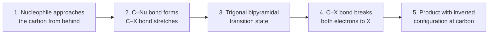
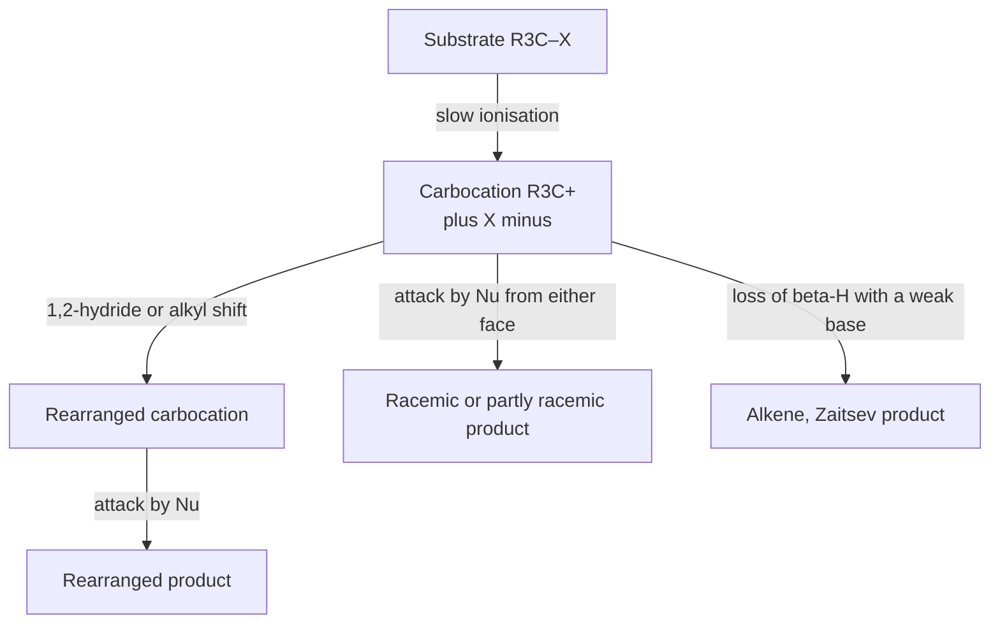
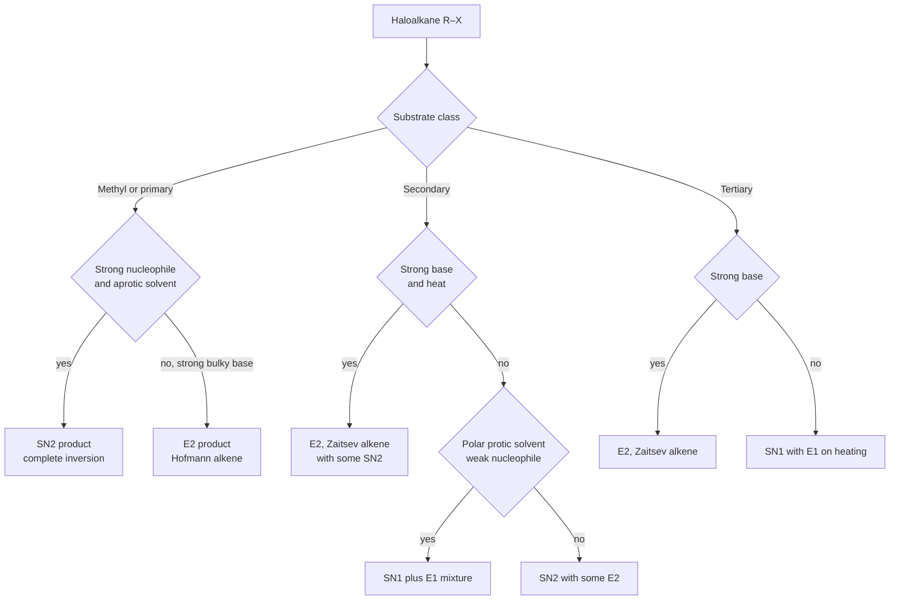
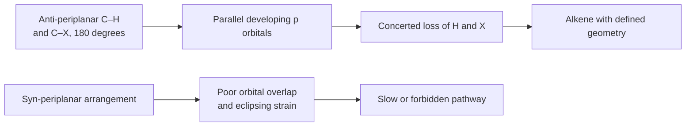

# Chapter 8 — Haloalkanes: Nucleophilic Substitution and Elimination

> **Level:** Advanced (Level 4 — Organic Chemistry)
> **Estimated study time:** 9 hours (6 h reading + 3 h exercises)
> **Prerequisites:** Level 4 Chapters 3–6 (isomerism and stereochemistry, conformations, alkenes, aromatic substitution); Level 2 Chapter 11 (acid–base equilibria)
> **Related chapters:** [Alcohols, Phenols and Ethers](09-alcohols-phenols-and-ethers.md), [Aldehydes, Ketones and Carbonyl Chemistry](10-aldehydes-ketones-and-carbonyl-chemistry.md), [Retrosynthetic Analysis and Synthesis Strategy](14-retrosynthetic-analysis-and-synthesis-strategy.md)
> **Difficulty:** ★★★★☆ (4–5)

---

## 1. Learning Objectives

After working through this chapter you will be able to:

- Explain why the carbon–halogen bond is polarised, and rank the halogens by bond strength, bond length, polarisability and leaving-group ability.
- Classify a haloalkane as methyl, primary, secondary, tertiary, vinyl, aryl, allylic or benzylic, and predict how that classification constrains its reactivity.
- Write the rate law for an $S_N2$ and an $S_N1$ reaction, and distinguish the two mechanisms from kinetic, stereochemical and substituent evidence.
- Draw the transition state of an $S_N2$ reaction and explain backside attack, Walden inversion and the origin of second-order kinetics.
- Explain carbocation stability, the planar $sp^2$ geometry of a carbocation, racemisation in $S_N1$ reactions and carbocation rearrangement.
- Apply the anti-periplanar requirement to predict the stereochemistry of an $E2$ elimination.
- Distinguish Zaitsev from Hofmann products and explain the role of base strength, base bulk and temperature.
- Select a mechanism and predict the major product for a given substrate, nucleophile, base and solvent combination.
- Describe the Finkelstein and Swarts halogen-exchange reactions and the formation of Grignard and organolithium reagents from haloalkanes.
- Relate chlorofluorocarbon chemistry to stratospheric ozone depletion and to the Montreal Protocol.

---

## 2. Introduction

A haloalkane is an alkane in which one or more hydrogen atoms have been replaced by a halogen. The functional group is the carbon–halogen bond, and it is the simplest functional group in organic chemistry that makes a carbon atom *electrophilic*. An alkane is inert to nucleophiles because its carbon atoms carry no partial positive charge and hold no leaving group. Replace one hydrogen by chlorine and the same carbon skeleton becomes a target: hydroxide, cyanide, azide, thiolate, alkoxide, ammonia and carbanions all attack it, and the chloride leaves. That single transformation turns an unreactive hydrocarbon into an alcohol, a nitrile, an amine, a thioether or a new carbon–carbon bond.

This is why haloalkanes occupy a strategic position in the curriculum. They are the entry point to mechanistic organic chemistry, and almost every idea used later — kinetics as evidence for mechanism, stereochemistry as a mechanistic probe, solvent effects, leaving-group ability, competing pathways — is introduced here in its clearest form. The substrate is simple, the products are easy to isolate and the two competing mechanisms differ in a way that can be measured. A student who can reason about a haloalkane can reason about most of the rest of the subject.

The industrial importance is equally direct. Dichloromethane extracts caffeine from coffee beans and strips paint. Trichloromethane (chloroform) was the first widely used surgical anaesthetic. Halothane and enflurane are fluorinated inhalation anaesthetics. Chlorofluorocarbons once filled every refrigerator and aerosol can, until their role in stratospheric ozone depletion produced the Montreal Protocol — the most successful environmental treaty in history. Alkyl halides are also the reagents from which Grignard reagents are made, and Grignard reagents are the workhorses of carbon–carbon bond formation in the pharmaceutical industry.

Two mechanisms dominate: **nucleophilic substitution**, in which the halogen is replaced, and **elimination**, in which the halogen leaves together with a hydrogen atom from an adjacent carbon to create a $\pi$ bond. Both can proceed through a one-step (concerted) or a two-step (carbocation) pathway, which gives four limiting mechanisms — $S_N2$, $S_N1$, $E2$ and $E1$ — and a competition that is decided by substrate structure, nucleophile strength, base strength, solvent and temperature. Predicting which one wins is the central skill of the chapter.

---

## 3. Fundamental Concepts

### 3.1 The carbon–halogen bond

Carbon is more electronegative than every halogen except fluorine, so the bond dipole runs from carbon to halogen in $\ce{CH3F}$ and from carbon to halogen in the others as well:

| Bond | Electronegativity difference | Bond length / pm | Bond enthalpy / kJ mol⁻¹ | Dipole moment of $\ce{CH3X}$ / D |
|---|---|---|---|---|
| $\ce{C-F}$ | 1.43 | 139 | ≈ 450 | 1.85 |
| $\ce{C-Cl}$ | 0.61 | 178 | ≈ 350 | 1.87 |
| $\ce{C-Br}$ | 0.41 | 194 | ≈ 290 | 1.81 |
| $\ce{C-I}$ | 0.21 | 214 | ≈ 235 | 1.62 |

Three trends run in opposite directions and must be kept separate.

1. **Polarity** is largest for $\ce{C-F}$ and smallest for $\ce{C-I}$. A large dipole makes the carbon more electrophilic, which is why fluorinated alkyl groups are strongly electron-withdrawing inductively.
2. **Bond strength** decreases down the group. The $\ce{C-F}$ bond is the strongest single bond to carbon in this series, and that strength, not polarity, is what makes fluoride a poor leaving group.
3. **Polarisability** increases down the group. Iodine's diffuse valence orbitals distort easily, so the $\ce{C-I}$ bond is the most polarisable and iodide is the most stabilised anion in solution.

A leaving group must be able to *accept* the bonding electrons and stabilise the negative charge that results. That is a question of the stability of the anion, not of the polarity of the bond, and it is quantified by the $\mathrm{p}K_a$ of the conjugate acid (Section 3.4).

The carbon atom itself is $sp^3$ hybridised and tetrahedral. In a tertiary halide the three alkyl groups surround the reactive centre and physically block one face; in a methyl halide nothing blocks it. Almost the whole of the $S_N1$/$S_N2$ competition follows from that geometric fact.

### 3.2 Classification and nomenclature

Haloalkanes are classified by the number of carbon atoms attached to the carbon that bears the halogen:

| Class | Definition | Example | Reactivity pattern |
|---|---|---|---|
| Methyl | $\ce{CH3X}$ | $\ce{CH3Br}$ | $S_N2$ only |
| Primary ($1^\circ$) | $\ce{RCH2X}$ | $\ce{CH3CH2Br}$ | $S_N2$; $E2$ with strong base |
| Secondary ($2^\circ$) | $\ce{R2CHX}$ | $\ce{(CH3)2CHCl}$ | $S_N2$/$E2$ or $S_N1$/$E1$, depending on conditions |
| Tertiary ($3^\circ$) | $\ce{R3CX}$ | $\ce{(CH3)3CBr}$ | $S_N1$/$E1$; $E2$ with strong base |
| Vinyl | $\ce{X}$ on an alkene carbon | $\ce{CH2=CHCl}$ | Essentially unreactive towards substitution |
| Aryl | $\ce{X}$ on a benzene ring | $\ce{C6H5Cl}$ | Unreactive unless strongly activated |
| Allylic | $\ce{X}$ on a carbon adjacent to $\ce{C=C}$ | $\ce{CH2=CHCH2Br}$ | Fast $S_N1$ and $S_N2$ |
| Benzylic | $\ce{X}$ on a carbon adjacent to a ring | $\ce{C6H5CH2Cl}$ | Fast $S_N1$ and $S_N2$ |

Vinyl and aryl halides are inert towards ordinary nucleophilic substitution because the $\ce{C-X}$ bond is strengthened by partial double-bond character (conjugation of the halogen lone pair with the $\pi$ system) and because backside attack would require the nucleophile to pass through the $\pi$ cloud or the ring. Allylic and benzylic halides are unusually reactive in both mechanisms: the adjacent $\pi$ system stabilises the $S_N2$ transition state through orbital overlap, and it stabilises the carbocation in the $S_N1$ pathway by resonance.

IUPAC nomenclature treats the halogen as a prefix: $\ce{CH3CH2Cl}$ is chloroethane, $\ce{CH3CHBrCH3}$ is 2-bromopropane, and $\ce{CH2Cl2}$ is dichloromethane. Common names survive in the laboratory: chloroform for trichloromethane, carbon tetrachloride for tetrachloromethane, and the "alkyl halide" style ($n$-butyl bromide) that is still used for simple compounds.

### 3.3 Nucleophiles

A **nucleophile** is a species that donates an electron pair to an electron-deficient centre. A **base** is a species that donates an electron pair to a proton. The definitions overlap because both properties come from a lone pair or a $\pi$ bond, but they are not the same: iodide is an excellent nucleophile and a poor base; fluoride is a strong base in a non-polar medium and a poor nucleophile in a protic solvent.

Nucleophilicity is a kinetic property, measured by the rate at which a nucleophile attacks a standard substrate. Basicity is a thermodynamic property, measured by the position of an equilibrium with a proton. Four factors decide nucleophilicity:

- **Charge.** An anion is far more nucleophilic than its conjugate acid: $\ce{OH^-}$ is much more reactive than $\ce{H2O}$, and $\ce{RS^-}$ more than $\ce{RSH}$.
- **Electronegativity and polarisability.** Across a period, nucleophilicity falls as electronegativity rises ($\ce{H2N^-} > \ce{HO^-} > \ce{F^-}$), because a less electronegative atom holds its lone pair less tightly. Down a group the opposite trend wins in protic solvents: $\ce{I^-} > \ce{Br^-} > \ce{Cl^-} > \ce{F^-}$, because the larger ion is more polarisable and less strongly hydrogen-bonded.
- **Solvation.** A nucleophile wrapped in a solvent shell is a nucleophile that cannot attack. This single idea explains why the halide order reverses in aprotic solvents (Section 3.6).
- **Steric bulk.** A bulky nucleophile, such as tert-butoxide, is a good base but a poor nucleophile towards a hindered carbon.

| Nucleophile | Typical reagent | Product with $\ce{R-X}$ | Class |
|---|---|---|---|
| $\ce{HO^-}$ | $\ce{NaOH}$ in water | $\ce{R-OH}$ | Anionic, strong |
| $\ce{RO^-}$ | $\ce{NaOR}$ in $\ce{ROH}$ | $\ce{R-OR}$ | Anionic, strong base |
| $\ce{^-C#N}$ | $\ce{NaCN}$ in DMF | $\ce{R-CN}$ | Anionic, moderate |
| $\ce{N3^-}$ | $\ce{NaN3}$ in DMF | $\ce{R-N3}$ | Anionic, excellent |
| $\ce{RS^-}$ | $\ce{NaSR}$ | $\ce{R-SR}$ | Anionic, excellent |
| $\ce{I^-}$ | $\ce{NaI}$ in acetone | $\ce{R-I}$ | Anionic, excellent |
| $\ce{NH3}$ | concentrated ammonia | $\ce{R-NH2}$ | Neutral, weak |
| $\ce{H2O}$ | water or aqueous ethanol | $\ce{R-OH}$ | Neutral, very weak |

### 3.4 Leaving groups

A **leaving group** is the fragment that departs with the bonding electron pair. The best leaving groups are the conjugate bases of strong acids, because they carry the negative charge comfortably. The quantitative rule is simple: the lower the $\mathrm{p}K_a$ of the conjugate acid, the better the leaving group.

| Leaving group | Conjugate acid | $\mathrm{p}K_a$ of conjugate acid | Quality |
|---|---|---|---|
| $\ce{-OTf}$ (triflate) | $\ce{CF3SO3H}$ | ≈ −14 | Excellent |
| $\ce{-I}$ | $\ce{HI}$ | ≈ −10 | Excellent |
| $\ce{-Br}$ | $\ce{HBr}$ | ≈ −9 | Very good |
| $\ce{-Cl}$ | $\ce{HCl}$ | ≈ −7 | Good |
| $\ce{-OTs}$ (tosylate) | $\ce{CH3C6H4SO3H}$ | ≈ −2.8 | Very good |
| $\ce{-OMs}$ (mesylate) | $\ce{MsOH}$ | ≈ −1.9 | Very good |
| $\ce{-F}$ | $\ce{HF}$ | 3.2 | Poor |
| $\ce{-OH}$ | $\ce{H2O}$ | 15.7 | Very poor; protonate first |
| $\ce{-OR}$ | $\ce{ROH}$ | ≈ 16 | Very poor |
| $\ce{-NH2}$ | $\ce{NH3}$ | 38 | Not a leaving group |

Two practical consequences follow. First, alcohols and amines are not substituted directly; they are converted into a good leaving group — protonated ($\ce{-OH2^+}$), tosylated, mesylated or halogenated — before the nucleophile is introduced. Second, the sulfonate esters are the leaving groups of choice in synthesis because they are crystalline, easily prepared from the alcohol and sulfonyl chloride, and they do not compete as nucleophiles.

Fluoride is the exception that proves the rule. The $\ce{C-F}$ bond is the strongest bond to carbon, and $\ce{F^-}$ is a strong base in the gas phase; the combination makes fluoride a very poor leaving group despite the high polarity of the bond. Aryl fluorides are therefore stable enough to be used as pharmaceuticals (fluoroquinolones, fluoxetine) and as tracers in positron emission tomography, where $^{18}\ce{F}$ is introduced early and survives the rest of the synthesis.

### 3.5 The two limiting mechanisms at a glance

| Feature | $S_N2$ | $S_N1$ |
|---|---|---|
| Molecularity | Bimolecular; one step | Unimolecular; two steps |
| Rate law | $v = k[\ce{RX}][\ce{Nu^-}]$ | $v = k[\ce{RX}]$ |
| Stereochemistry | Complete inversion | Racemisation, often with slight excess of inversion |
| Substrate order | $\ce{CH3} > 1^\circ > 2^\circ \gg 3^\circ$ | $3^\circ > 2^\circ \gg 1^\circ > \ce{CH3}$ |
| Nucleophile | Strong; concentration matters | Weak; concentration does not matter |
| Solvent | Polar aprotic best | Polar protic best |
| Rearrangement | Never | Common |
| Leaving group | Good; rate depends on it | Good; rate depends on it |
| Typical partner | $\ce{CN^-}$, $\ce{N3^-}$, $\ce{I^-}$, $\ce{RS^-}$, $\ce{RO^-}$ | $\ce{H2O}$, $\ce{ROH}$, $\ce{RCOOH}$ |

### 3.6 Solvents: protic and aprotic

A **polar protic** solvent has an $\ce{O-H}$ or $\ce{N-H}$ bond and can donate hydrogen bonds: water, methanol, ethanol, acetic acid, formic acid. A **polar aprotic** solvent has a large dipole but no hydrogen-bond donor: acetone, acetonitrile, $N,N$-dimethylformamide (DMF), dimethyl sulfoxide (DMSO), hexamethylphosphoramide (HMPA).

| Solvent | Type | Dielectric constant $\varepsilon_r$ | Effect on anions |
|---|---|---|---|
| Water | Protic | 78 | Strongly solvated by hydrogen bonding |
| Methanol | Protic | 33 | Strongly solvated |
| Ethanol | Protic | 24.5 | Solvated |
| Acetic acid | Protic | 6.2 | Weakly solvated; ionising for carbocations |
| DMSO | Aprotic | 47 | Cation solvated, anion "naked" |
| DMF | Aprotic | 37 | Cation solvated, anion free |
| Acetonitrile | Aprotic | 36 | Cation solvated |
| Acetone | Aprotic | 21 | Moderate |
| Dichloromethane | Aprotic | 8.9 | Weakly ionising |

The distinction matters because a protic solvent hydrogen-bonds to anions and wraps them in a shell. That shell stabilises the anion thermodynamically but blocks it kinetically, so nucleophilicity falls. The same hydrogen bonding stabilises the developing anion in an $S_N1$ transition state and, more importantly, solvates the departing halide and the carbocation, which is why ionisation is fast in water and slow in hexane.

In an aprotic solvent the cation is solvated by the oxygen of the solvent but the anion is left comparatively bare. Nucleophilicity therefore rises, and the intrinsic order $\ce{F^-} > \ce{Cl^-} > \ce{Br^-} > \ce{I^-}$ is restored. Potassium fluoride in DMF or acetonitrile is a usable nucleophile; potassium fluoride in water is not.

---

## 4. Detailed Scientific Explanation

### 4.1 The $S_N2$ mechanism

$S_N2$ stands for *substitution nucleophilic bimolecular*. One step, one transition state, no intermediate. The nucleophile attacks the carbon from the side opposite the leaving group, the $\ce{C-X}$ bond lengthens as the $\ce{C-Nu}$ bond forms, and the other three substituents turn inside out like an umbrella in wind.

The curly-arrow description, in numbered steps, is:

1. A lone pair on the nucleophile forms a bond to the electrophilic carbon, approaching along the axis defined by the $\ce{C-X}$ bond but from the opposite face.
2. The $\ce{C-X}$ $\sigma$ bond breaks heterolytically; both electrons move onto the halogen.
3. The three remaining substituents invert their configuration as the carbon passes through a planar transition state.

$$
\ce{Nu^- + R-X -> [Nu\bond{...}R\bond{...}X]^\ddagger -> Nu-R + X^-}
$$

The transition state is trigonal bipyramidal, with the entering and leaving groups apical and the three retained substituents equatorial. It is not an intermediate: it sits at a single maximum on the energy profile and cannot be isolated. The rate depends on the concentration of both partners, so the reaction is second order overall:

$$
v = k_2[\ce{RX}][\ce{Nu^-}]
$$

**Stereochemistry.** Because the nucleophile must approach from behind, every $S_N2$ reaction proceeds with **inversion of configuration** at the reacting carbon — Walden inversion. If the substrate is chiral and the nucleophile is not the same as the leaving group, the product is the enantiomer of the starting material's configuration at that centre. This is the most reliable stereochemical test for $S_N2$: a clean inversion proves backside attack, and a partial racemisation proves that something else is competing.

**Steric effects.** The rate falls steeply as the carbon becomes more substituted, because the substituents block the backside trajectory and because the transition state is crowded:

| Substrate | Relative rate of $S_N2$ with $\ce{Br^-}$ in acetone |
|---|---|
| $\ce{CH3Br}$ | 150 |
| $\ce{CH3CH2Br}$ | 1 |
| $\ce{(CH3)2CHBr}$ | 0.008 |
| $\ce{(CH3)3CBr}$ | ≈ 0 |

The numbers vary with the nucleophile and solvent, but the pattern does not: the reactivity span from methyl to tertiary is about five orders of magnitude. Neopentyl bromide, $\ce{(CH3)3CCH2Br}$, is primary yet reacts thousands of times more slowly than ethyl bromide, because the quaternary centre immediately behind the reacting carbon blocks the approach. This is direct evidence that the nucleophile attacks from behind rather than from the front.

**Nucleophile effects.** A stronger nucleophile accelerates $S_N2$; the Brønsted relation $k = G K_a^{-\beta}$ (with $\beta \approx 0.5$ for many families) quantifies the dependence. In protic solvents the halide order is $\ce{I^-} > \ce{Br^-} > \ce{Cl^-} > \ce{F^-}$; in aprotic solvents it inverts.

**Leaving-group effects.** The rate increases with the stability of the departing anion: $\ce{-OTf} > \ce{-I} > \ce{-Br} > \ce{-Cl} \gg \ce{-F}$. A good leaving group lowers the energy of the transition state because the $\ce{C-X}$ bond is already partly broken there.

**Solvent effects.** Polar aprotic solvents accelerate $S_N2$ by 10–1000 times relative to protic solvents, for the solvation reasons given in Section 3.6. Dimethylformamide is the standard choice for cyanide, azide and thiolate displacements.

**Intramolecular $S_N2$.** When the nucleophile and the leaving group are in the same molecule, the reaction is entropically favoured and can be very fast, closing three-, five- and six-membered rings. Three-membered ring formation is slow because of ring strain, and five- and six-membered rings form fastest.

### 4.2 The $S_N1$ mechanism

$S_N1$ stands for *substitution nucleophilic unimolecular*. The substrate first ionises to a carbocation and a halide ion; the nucleophile then captures the carbocation. Two steps, one intermediate, and a rate that depends only on the substrate.

1. The $\ce{C-X}$ bond breaks heterolytically, with both electrons going to the halogen. This is the slow, rate-determining step.
2. The resulting carbocation, planar at carbon with an empty $p$ orbital, is captured by a nucleophile from either face.
3. The product loses a proton if the nucleophile was neutral (water or an alcohol).

$$
\ce{R3C-X ->[\text{slow}] R3C+ + X^-}
\qquad
\ce{R3C+ + Nu^- ->[\text{fast}] R3C-Nu}
$$

The rate law contains only the substrate:

$$
v = k_1[\ce{RX}]
$$

and the kinetics are first order. Adding more nucleophile does not speed the reaction, because the nucleophile is not involved in the rate-determining step. This is the diagnostic experiment that separates $S_N1$ from $S_N2$: if doubling the nucleophile concentration doubles the rate, the mechanism is $S_N2$; if it changes nothing, the mechanism is $S_N1$.

**Carbocation stability.** The order is $3^\circ > 2^\circ > 1^\circ > \ce{CH3}$, and the reasons are hyperconjugation and inductive donation. A carbocation has an empty $p$ orbital; adjacent $\ce{C-H}$ or $\ce{C-C}$ $\sigma$ bonds can donate electron density into it, and each alkyl group adds three more opportunities. Benzyl and allyl cations are stabilised by resonance and are comparable to secondary or tertiary cations in stability. Vinyl and aryl cations are very unstable because the empty orbital would lie in the plane of the $\pi$ system and cannot be conjugated.

| Carbocation | Relative stability | Reason |
|---|---|---|
| $\ce{CH3+}$ | Very low | No alkyl donation |
| $\ce{CH3CH2+}$ | Low | Three $\beta$ $\ce{C-H}$ bonds |
| $\ce{(CH3)2CH+}$ | Moderate | Six $\beta$ $\ce{C-H}$ bonds |
| $\ce{(CH3)3C+}$ | High | Nine $\beta$ $\ce{C-H}$ bonds |
| $\ce{C6H5CH2+}$ | High | Resonance with the ring |
| $\ce{CH2=CHCH2+}$ | High | Resonance with the alkene |

**Racemisation.** A planar carbocation has two identical faces, so attack from either side is equally likely and the product should be a 50:50 mixture. In practice the observed optical purity is rarely zero: the departing halide remains nearby as an ion pair and shields the face it left from, so inversion usually exceeds retention by a modest margin. The result is *partial* racemisation with a small excess of inversion — a signature that distinguishes $S_N1$ from the complete inversion of $S_N2$.

**Rearrangements.** Because the carbocation is a real intermediate with a finite lifetime, it can rearrange before the nucleophile arrives. A 1,2-hydride shift converts a secondary cation into a tertiary one; a 1,2-methyl shift does the same; a ring expansion relieves strain. Neopentyl bromide, for example, ionises only with difficulty, but once the cation forms it rearranges to the tertiary tert-amyl cation, and solvolysis gives 2-methyl-2-butanol rather than the unrearranged product. Rearrangement is proof of a carbocation intermediate and is never observed in $S_N2$.

**Solvent and salt effects.** Ionisation is strongly accelerated by polar protic solvents, which solvate both the carbocation and the halide. The effect is large: the solvolysis of tert-butyl chloride is roughly $10^5$ times faster in 80% aqueous ethanol than in pure ethanol. Added salts can either accelerate ionisation (by stabilising the separating charges) or retard it (by a common-ion effect when the added salt contains the leaving-group anion); the interplay is one of the classic demonstrations that ionisation is reversible.

**Which substrates go $S_N1$?** Tertiary, allylic and benzylic halides, and secondary halides in strongly ionising solvents with weak nucleophiles. Primary halides essentially never ionise to a primary carbocation; if a primary halide reacts by a carbocation-like pathway at all, it does so with rearrangement after assistance.

### 4.3 The $E2$ mechanism

$E2$ is a concerted elimination: the base removes a $\beta$-hydrogen while the $\ce{C-X}$ bond breaks, and the $\pi$ bond forms in the same step. The rate law is second order,

$$
v = k_2[\ce{RX}][\ce{B^-}]
$$

and there is no carbocation intermediate.

The geometric requirement is the defining feature: the $\ce{C-H}$ and $\ce{C-X}$ bonds must be **anti-periplanar**, with a dihedral angle of $180^\circ$. In that arrangement the developing $p$ orbitals on the two carbons are parallel and can overlap to form the $\pi$ bond; in the syn-periplanar arrangement ($0^\circ$) the overlap is poorer and the eclipsing interactions in the transition state are severe. Because the requirement is geometric, $E2$ is **stereospecific**: a given stereoisomer of the substrate gives a specific stereoisomer of the alkene.

In a cyclohexane ring, anti-periplanar means **trans-diaxial**. A leaving group in an equatorial position cannot eliminate until the ring flips to put it axial. This is why the rate of $E2$ in cyclohexyl systems depends on conformation and why rigid systems can be forced to eliminate only from one face.

**Regiochemistry: Zaitsev and Hofmann.** When more than one $\beta$-hydrogen is available, the product distribution depends on the base:

- Small strong bases ($\ce{C2H5O^-}$, $\ce{OH^-}$, $\ce{NH2^-}$) give the **Zaitsev** product, the more substituted alkene, because the more substituted double bond is thermodynamically more stable and because the transition state has more alkene character.
- Bulky bases ($\ce{(CH3)3CO^-}$, 2,6-lutidine, LDA) give the **Hofmann** product, the less substituted alkene, because removing a hydrogen from the more hindered $\beta$-carbon is sterically blocked.
- Quaternary ammonium salts ($\ce{R4N+}$) eliminate on heating to give the Hofmann product, because the bulky ammonium group and the poor leaving-group ability of trialkylamine change the transition-state geometry.

**Base strength.** $E2$ needs a strong base. Hydroxide, alkoxides, amide and LDA all work; water and alcohols are too weak to drive the reaction at a useful rate, and with those the competing pathway is $S_N1$/$E1$.

**Substrate effects.** Tertiary substrates eliminate fastest; primary substrates eliminate only with very strong, bulky bases, and often prefer $S_N2$. A $\beta$-branch decreases the $E2$ rate because the transition state is crowded.

**Isotope effects.** Replacing the $\beta$-hydrogen by deuterium slows an $E2$ reaction by a factor of about 3–8 ($k_H/k_D$), because the $\ce{C-H}$ bond is being broken in the rate-determining step. An $E1$ reaction, in which proton loss follows the rate-determining ionisation, shows no such effect.

### 4.4 The $E1$ mechanism

$E1$ is the elimination counterpart of $S_N1$: ionisation first, then loss of a proton from the carbocation.

1. The $\ce{C-X}$ bond ionises to a carbocation (slow, rate-determining).
2. A base — often the solvent — removes a $\beta$-hydrogen from the carbocation, and the electrons move into the empty $p$ orbital to form the $\pi$ bond.

$$
\ce{R3C-CR2-X ->[\text{slow}] R3C-CR2+ + X^-}
\qquad
\ce{R3C-CR2+ ->[\text{base}] R2C=CR2 + H+}
$$

The rate law is first order in substrate. The regiochemistry follows Zaitsev's rule, because the carbocation has time to rearrange and the more substituted alkene is both faster to form and more stable. $E1$ is not stereospecific: the carbocation is planar and rotation about the $\ce{C-C}$ bond is fast before proton loss, so both alkene geometries can appear.

$E1$ competes with $S_N1$ whenever a carbocation is formed in a weakly basic, ionising medium. Heating shifts the balance towards elimination, because elimination increases the number of particles and therefore has the more favourable entropy of activation.

### 4.5 Substitution versus elimination

Four variables decide the outcome: the substrate, the nucleophile or base, the solvent, and the temperature.

| Variable | Favours substitution | Favours elimination |
|---|---|---|
| Substrate | Methyl, $1^\circ$ | $3^\circ$ (with strong base) |
| Reagent | Good nucleophile, weak base ($\ce{I^-}$, $\ce{N3^-}$, $\ce{RS^-}$, $\ce{CN^-}$) | Strong base ($\ce{RO^-}$, $\ce{NH2^-}$, LDA) |
| Base bulk | Small | Large ($\ce{(CH3)3CO^-}$) |
| Solvent | Polar aprotic for $S_N2$; polar protic for $S_N1$ | Polar protic with heat for $E1$; ethers for $E2$ |
| Temperature | Low | High |

The practical rules of thumb are:

1. **Methyl and primary substrates** with a good nucleophile go $S_N2$. With a strong bulky base they may go $E2$, but $S_N2$ usually dominates unless the $\beta$-carbon is unhindered.
2. **Secondary substrates** are the ambiguous case. A strong nucleophile that is also a strong base ($\ce{C2H5O^-}$) gives a mixture of $S_N2$ and $E2$; a strong base with a hindered carbon gives mainly $E2$; a weak nucleophile in a protic solvent gives $S_N1$ plus $E1$; a polar aprotic solvent with a good nucleophile favours $S_N2$.
3. **Tertiary substrates** cannot undergo $S_N2$ at a useful rate. With a strong base they go $E2$; with a weak nucleophile in a protic solvent they go $S_N1$ (and $E1$ on heating).
4. **Heat** always favours elimination, because the entropy change is positive.

### 4.6 Halogen exchange and organometallic formation

**Finkelstein reaction.** A primary alkyl chloride or bromide is treated with sodium iodide in dry acetone:

$$
\ce{R-Cl + NaI ->[acetone] R-I + NaCl v}
$$

Sodium chloride and sodium bromide are insoluble in acetone, so they precipitate and drive the equilibrium to the right. The reaction is an $S_N2$ displacement and works well for primary and activated secondary halides; tertiary halides eliminate instead. The reverse reaction — iodide to chloride — is driven by using a large excess of the chloride salt.

**Swarts reaction.** Alkyl fluorides are made by treating a chloride or bromide with a metal fluoride:

$$
\ce{R-Br + AgF -> R-F + AgBr}
\qquad
\ce{2R-Cl + Hg2F2 -> 2R-F + Hg2Cl2}
$$

Silver(I) fluoride, mercury(II) fluoride and antimony(III) fluoride are the classical reagents; industrial fluorination of chlorocarbons uses cobalt(III) fluoride or potassium fluoride in a polar aprotic solvent at elevated temperature. The driving force is the formation of the very strong $\ce{C-F}$ bond and the precipitation of the metal halide. Modern reagents — diethylaminosulfur trifluoride (DAST) and Deoxo-Fluor — convert alcohols directly to fluorides and are the laboratory method of choice.

**Organometallic formation.** Haloalkanes react with magnesium in dry ether or tetrahydrofuran to give Grignard reagents:

$$
\ce{R-X + Mg ->[dry\ C2H5OC2H5] R-MgX}
$$

and with two equivalents of lithium metal to give organolithiums:

$$
\ce{R-X + 2Li ->[hexane] R-Li + LiX}
$$

Both reactions require rigorously dry, oxygen-free conditions, because the reagents are destroyed by water, alcohols, amines, carboxylic acids and oxygen. The carbon–metal bond is strongly polarised towards carbon, so the carbon behaves as a carbanion and is a powerful nucleophile and base. Grignard reagents cannot be prepared from substrates that contain an acidic proton, a carbonyl group or a reactive halogen elsewhere in the molecule; those groups must be protected first. Chapter 12 develops the reactivity of these reagents in detail.

---

## 5. Visual Diagrams

**Figure 8.1 — The $S_N2$ reaction as a single concerted event.** The five boxes are not five steps but five snapshots of one step: only the transition state in the middle is a maximum on the energy profile, and no intermediate is formed. The diagram is drawn left to right because the nucleophile and leaving group must be on opposite faces at every point; that is the geometric content of backside attack. Because both partners meet in the transition state, the rate depends on both concentrations and the kinetics are second order.

**Figure 8.2 — The $S_N1$ and $E1$ pathways share one intermediate.** Everything in the diagram flows from the single slow ionisation at the top, which is why the rate law contains only the substrate. The two arrows leaving the carbocation show the fork between substitution and elimination, and the rearrangement arrow shows why $S_N1$ products are not always the obvious ones. A planar carbocation has no memory of which face the halide left, so attack occurs from both faces and the optical purity collapses.

**Figure 8.3 — Decision flowchart for the four limiting mechanisms.** Read the chart from the substrate class downwards and stop at the first branch that matches the conditions. The secondary row is deliberately drawn with two consecutive questions, because secondary substrates are the genuine borderline and no single rule decides them. The chart encodes the four variables of Section 4.5 in the order in which they dominate: structure first, then base strength, then solvent, then temperature.

**Figure 8.4 — Why $E2$ demands an anti-periplanar arrangement.** The upper pathway is allowed because the two $sp^3$ bonds that break lie in one plane, so the $p$ orbitals that remain can overlap side-on as they form the $\pi$ bond. The lower pathway is disfavoured both electronically and sterically. The practical consequence is stereospecificity: because the geometry of the starting material fixes which hydrogen can be anti to the leaving group, the alkene geometry is fixed as well.

---

## 6. Mathematical Formulas

### 6.1 Rate laws

For the general substitution

$$
\ce{R-X + Nu^- -> R-Nu + X^-}
$$

the two limiting rate laws are

$$
v_{S_N2} = k_2[\ce{RX}][\ce{Nu^-}]
\qquad
v_{S_N1} = k_1[\ce{RX}]
$$

| Symbol | Meaning | SI unit |
|---|---|---|
| $v$ | rate of reaction | mol dm⁻³ s⁻¹ |
| $k_2$ | second-order rate constant | dm³ mol⁻¹ s⁻¹ |
| $k_1$ | first-order rate constant | s⁻¹ |
| $[\ce{RX}]$ | concentration of haloalkane | mol dm⁻³ |
| $[\ce{Nu^-}]$ | concentration of nucleophile | mol dm⁻³ |

The units are the simplest experimental test of molecularity: a second-order constant has units of reciprocal concentration times reciprocal time, a first-order constant has units of reciprocal time.

### 6.2 Integrated first-order kinetics

For an $S_N1$ reaction the concentration of substrate falls exponentially:

$$
[\ce{RX}] = [\ce{RX}]_0 e^{-k_1 t}
\qquad
t_{1/2} = \frac{\ln 2}{k_1} \approx \frac{0.693}{k_1}
$$

| Symbol | Meaning | SI unit |
|---|---|---|
| $[\ce{RX}]_0$ | initial concentration | mol dm⁻³ |
| $t$ | time | s |
| $t_{1/2}$ | half-life | s |

The half-life of a first-order reaction is independent of concentration, which is why solvolysis half-lives can be quoted as a characteristic of the substrate and solvent alone. For a second-order reaction the half-life depends on the initial concentrations, so it is not a useful fingerprint.

### 6.3 Temperature dependence

$$
k = A e^{-E_a/(RT)}
\qquad
\ln\frac{k_2}{k_1} = \frac{E_a}{R}\left(\frac{1}{T_1} - \frac{1}{T_2}\right)
$$

| Symbol | Meaning | SI unit |
|---|---|---|
| $A$ | pre-exponential factor | same as $k$ |
| $E_a$ | activation energy | J mol⁻¹ |
| $R$ | gas constant, 8.314 | J K⁻¹ mol⁻¹ |
| $T$ | thermodynamic temperature | K |

A reaction with $E_a \approx 60\ \text{kJ mol}^{-1}$ is roughly ten times faster at $300\ \text{K}$ than at $280\ \text{K}$; a reaction with $E_a \approx 120\ \text{kJ mol}^{-1}$ is roughly forty times faster over the same interval.

### 6.4 Transition-state theory

$$
k = \frac{k_B T}{h} e^{-\Delta G^\ddagger/(RT)}
$$

| Symbol | Meaning | SI unit |
|---|---|---|
| $k_B$ | Boltzmann constant, $1.381 \times 10^{-23}$ | J K⁻¹ |
| $h$ | Planck constant, $6.626 \times 10^{-34}$ | J s |
| $\Delta G^\ddagger$ | Gibbs energy of activation | J mol⁻¹ |

The pre-exponential factor $k_B T / h$ is about $6 \times 10^{12}\ \text{s}^{-1}$ at room temperature. A reaction with $\Delta G^\ddagger = 100\ \text{kJ mol}^{-1}$ therefore has a rate constant of order $10^{-5}\ \text{s}^{-1}$, which corresponds to a half-life of hours; a difference of $20\ \text{kJ mol}^{-1}$ changes the rate by a factor of about 3000. This sensitivity is why the $S_N1$/$S_N2$ competition is so sharp: a small change in transition-state stabilisation produces a large change in product ratio.

### 6.5 Optical purity

If a reaction gives fractions $f_R$ and $f_S$ of two enantiomers, the enantiomeric excess is

$$
\text{ee} = \left|f_R - f_S\right| \times 100\%
$$

A reaction that proceeds with $x\%$ inversion and $(100-x)\%$ retention from a single enantiomer gives $\text{ee} = |2x - 100|\%$. Complete inversion gives 100% ee; complete racemisation gives 0% ee; a 70:30 mixture gives 40% ee.

---

## 7. Chemical Equations

### 7.1 Typical $S_N2$ displacements

$$
\ce{CH3CH2Br + OH^- -> CH3CH2OH + Br^-}
\qquad \text{aqueous NaOH, heat}
$$

$$
\ce{CH3CH2CH2Cl + CN^- -> CH3CH2CH2CN + Cl^-}
\qquad \text{NaCN in DMF, 80 }^\circ\text{C}
$$

$$
\ce{CH3CH2Br + N3^- -> CH3CH2N3 + Br^-}
\qquad \text{NaN3 in DMF}
$$

$$
\ce{CH3CH2Br + CH3CH2S^- -> CH3CH2SCH2CH3 + Br^-}
\qquad \text{thiolate, polar aprotic}
$$

$$
\ce{CH3CH2Br + 2NH3 -> CH3CH2NH2 + NH4Br}
\qquad \text{excess ammonia}
$$

In each case the nucleophile attacks the carbon and the halide leaves. The ammonia reaction needs a large excess of ammonia, otherwise the primary amine produced competes as a nucleophile and over-alkylation gives secondary and tertiary amines.

### 7.2 Solvolysis

$$
\ce{(CH3)3CBr + 2H2O -> (CH3)3COH + H3O+ + Br^-}
\qquad \text{80\% aqueous ethanol, 25 }^\circ\text{C}
$$

The rate is independent of water concentration over a wide range, which is the kinetic signature of an $S_N1$ reaction. The water molecule that attacks is not the one that removes the proton, so two equivalents are consumed overall.

### 7.3 Eliminations

$$
\ce{CH3CH2CHBrCH3 + CH3CH2O^- -> CH3CH=CHCH3 + CH3CH2OH + Br^-}
\qquad \text{Zaitsev product, major}
$$

$$
\ce{CH3CH2CHBrCH3 + (CH3)3CO^- -> CH3CH2CH=CH2 + (CH3)3COH + Br^-}
\qquad \text{Hofmann product, major}
$$

The same substrate gives different alkenes with different bases. Ethanolic ethoxide is small and removes the more accessible hydrogen on the more substituted carbon; potassium tert-butoxide is bulky and removes the hydrogen on the less substituted carbon.

$$
\ce{(CH3)3CBr + CH3CH2O^- -> (CH3)2C=CHCH3 + CH3CH2OH + Br^-}
\qquad \text{E2 dominates}
$$

A tertiary substrate cannot undergo $S_N2$, and with a strong base elimination is the only productive pathway.

### 7.4 Halogen exchange

$$
\ce{CH3CH2CH2Br + NaI ->[acetone, reflux] CH3CH2CH2I + NaBr v}
$$

$$
\ce{CH3CH2CH2Cl + KF ->[DMF, 100\ ^\circ C] CH3CH2CH2F + KCl}
$$

$$
\ce{CH3Cl + AgF -> CH3F + AgCl v}
$$

### 7.5 Organometallic formation

$$
\ce{CH3CH2Br + Mg ->[dry\ C2H5OC2H5] CH3CH2MgBr}
$$

$$
\ce{CH3CH2Br + 2Li ->[hexane, -10\ ^\circ C] CH3CH2Li + LiBr}
$$

### 7.6 Stratospheric ozone destruction by CFCs

$$
\ce{CCl2F2 ->[h\nu\ <\ 220\ nm] CClF2. + Cl.}
$$

$$
\ce{Cl. + O3 -> ClO. + O2}
\qquad
\ce{ClO. + O. -> Cl. + O2}
$$

The net reaction is $\ce{O3 + O -> 2O2}$, and the chlorine atom is regenerated, so a single chlorine atom can destroy of the order of $10^5$ ozone molecules before it is removed as $\ce{HCl}$ or $\ce{ClONO2}$. The $\ce{C-F}$ bond is not broken by stratospheric ultraviolet light, which is why fluorocarbons survive long enough to reach the stratosphere and why hydrochlorofluorocarbons, which contain a hydrogen atom and are therefore oxidised in the troposphere, have shorter lifetimes.

---

## 8. Worked Examples

### Worked Example 8.1 — Selecting a mechanism from the conditions

**Problem.** Predict the major organic product and the dominant mechanism for each reaction.

(a) 1-bromopropane with sodium cyanide in DMF at $80\ ^\circ\text{C}$.
(b) 2-bromo-2-methylpropane with water in aqueous ethanol at $25\ ^\circ\text{C}$.
(c) 2-bromobutane with potassium tert-butoxide in tert-butanol at $80\ ^\circ\text{C}$.
(d) 1-bromo-2,2-dimethylpropane with sodium iodide in acetone.

**Strategy.** Apply the four variables in the order of Figure 8.3: classify the substrate, then identify whether the reagent is a nucleophile or a base and whether it is hindered, then consider the solvent.

**Solution.**

(a) The substrate is primary and unhindered; cyanide is a strong, small nucleophile; DMF is polar aprotic. All three conditions point to $S_N2$. The product is butanenitrile:

$$
\ce{CH3CH2CH2Br + CN^- -> CH3CH2CH2CN + Br^-}
$$

(b) The substrate is tertiary; water is a weak nucleophile and a weak base; the solvent is polar protic and strongly ionising. The tertiary halide cannot undergo $S_N2$, so the pathway is $S_N1$ with a little $E1$ on standing. The product is 2-methylpropan-2-ol:

$$
\ce{(CH3)3CBr + H2O -> (CH3)3COH + HBr}
$$

(c) The substrate is secondary; tert-butoxide is a strong, very bulky base. Bulky bases cannot reach the carbon efficiently but can reach the less hindered $\beta$-hydrogen, so $E2$ with the Hofmann regiochemistry dominates. But-1-ene is the major product, with some but-2-ene.

(d) The substrate is primary, but the carbon behind the reacting centre is quaternary, so backside attack is blocked. $S_N2$ is thousands of times slower than for a normal primary halide and is not useful synthetically.

**Check.** Each answer is consistent with the rate law it implies: (a) second order, (b) first order, (c) second order in base, (d) second order but with a very small $k_2$. If a proposed mechanism cannot be written with the right rate law, the prediction is wrong.

### Worked Example 8.2 — Extracting the rate law from initial rates

**Problem.** The initial rate of substitution of a haloalkane by azide was measured at $25\ ^\circ\text{C}$:

| $[\ce{RX}]$ / mol dm⁻³ | $[\ce{N3^-}]$ / mol dm⁻³ | Initial rate / mol dm⁻³ s⁻¹ |
|---|---|---|
| 0.10 | 0.10 | $2.0 \times 10^{-4}$ |
| 0.20 | 0.10 | $4.0 \times 10^{-4}$ |
| 0.10 | 0.20 | $4.0 \times 10^{-4}$ |

Determine the rate law, the rate constant and the molecularity.

**Strategy.** Hold one concentration constant while doubling the other, and read the order from the ratio of rates.

**Solution.** Doubling $[\ce{RX}]$ at constant $[\ce{N3^-}]$ doubles the rate, so the reaction is first order in $\ce{RX}$. Doubling $[\ce{N3^-}]$ at constant $[\ce{RX}]$ also doubles the rate, so it is first order in azide. The rate law is

$$
v = k_2[\ce{RX}][\ce{N3^-}]
$$

and the reaction is second order overall, which identifies $S_N2$. The rate constant follows from any row:

$$
k_2 = \frac{v}{[\ce{RX}][\ce{N3^-}]}
= \frac{2.0 \times 10^{-4}}{0.10 \times 0.10}
= 2.0 \times 10^{-2}\ \text{dm}^3\ \text{mol}^{-1}\ \text{s}^{-1}
$$

**Check.** Substitute the second row: $k_2 = 4.0 \times 10^{-4}/(0.20 \times 0.10) = 2.0 \times 10^{-2}$, the same value. The units are those of a second-order constant, confirming the assignment.

### Worked Example 8.3 — Stereochemistry of an $S_N2$ displacement

**Problem.** (R)-2-bromobutane is treated with aqueous hydroxide. Give the structure and configuration of the product, and state the optical purity expected.

**Strategy.** Assign priorities at the reacting carbon before and after substitution, apply inversion, and remember that the nucleophile here differs from the leaving group.

**Solution.** At C2 of (R)-2-bromobutane the priorities are $\ce{Br}$ (1), $\ce{CH2CH3}$ (2), $\ce{CH3}$ (3) and $\ce{H}$ (4). With hydrogen pointing away from the viewer, the sequence 1 → 2 → 3 runs clockwise, so the configuration is $R$.

Hydroxide attacks the back face, so the $\ce{C-O}$ bond occupies the position opposite the departed bromide. The product is 2-butanol with the opposite configuration at C2. Its priorities are $\ce{OH}$ (1), $\ce{CH2CH3}$ (2), $\ce{CH3}$ (3) and $\ce{H}$ (4), and the sequence is now anticlockwise, so the product is (S)-2-butanol.

Because the reaction is concerted and the nucleophile approaches from one face only, the inversion is complete and the product is enantiomerically pure, 100% ee, provided no competing $S_N1$ pathway operates.

**Check.** Aqueous hydroxide with a secondary substrate is a borderline case: some $S_N1$ solvolysis can occur, which would give partial racemisation and reduce the ee. The prediction of complete inversion therefore assumes that the hydroxide concentration is high enough for $S_N2$ to dominate. Stating that assumption is part of the answer.

### Worked Example 8.4 — Zaitsev and Hofmann products from the same substrate

**Problem.** 2-Bromo-2-methylbutane is treated with (a) sodium ethoxide in ethanol and (b) potassium tert-butoxide in tert-butanol, both at reflux. Identify all possible alkene products, count the $\beta$-hydrogens available for each, and predict the major product in each case.

**Strategy.** Locate every $\beta$-carbon, remove a hydrogen from each in turn, and compare the substitution level of the resulting alkenes. Then apply the base-bulk rule.

**Solution.** The substrate is $\ce{CH3-C(Br)(CH3)-CH2-CH3}$. The $\beta$-carbons are the two equivalent methyl groups on C2 (six hydrogens) and C3 (two hydrogens).

Removing a hydrogen from a C2 methyl group gives 2-methylbut-2-ene, $\ce{(CH3)2C=CHCH3}$, a trisubstituted alkene. Removing a hydrogen from C3 gives 2-methylbut-1-ene, $\ce{CH2=C(CH3)CH2CH3}$, a disubstituted alkene.

(a) Ethoxide is small and strongly basic. It removes the more accessible hydrogen that leads to the more stable alkene, so the Zaitsev product, 2-methylbut-2-ene, dominates.

(b) tert-Butoxide is bulky. Approach to the hindered C2 methyl groups is blocked, so it removes a hydrogen from the less hindered C3, and the Hofmann product, 2-methylbut-1-ene, dominates.

**Check.** Both products are constitutional isomers of $\ce{C5H10}$ and both follow from a single $E2$ event. The ratio is not absolute — Hofmann eliminations typically give 60–80% of the less substituted alkene with tert-butoxide — so the answer should say "major", not "exclusive".

### Worked Example 8.5 — Activation energy and half-life from rate constants

**Problem.** The solvolysis of a tertiary bromide has $k = 1.0 \times 10^{-4}\ \text{s}^{-1}$ at $300\ \text{K}$ and $k = 5.0 \times 10^{-4}\ \text{s}^{-1}$ at $320\ \text{K}$. Calculate the activation energy and the half-life at $300\ \text{K}$.

**Strategy.** Use the two-temperature form of the Arrhenius equation, then the first-order half-life.

**Solution.** With $T_1 = 300\ \text{K}$, $T_2 = 320\ \text{K}$ and $R = 8.314\ \text{J K}^{-1}\ \text{mol}^{-1}$,

$$
\ln\frac{k_2}{k_1} = \ln 5 = 1.609
$$

$$
\frac{1}{T_1} - \frac{1}{T_2} = 3.333 \times 10^{-3} - 3.125 \times 10^{-3} = 2.083 \times 10^{-4}\ \text{K}^{-1}
$$

$$
E_a = \frac{R \ln(k_2/k_1)}{1/T_1 - 1/T_2}
= \frac{8.314 \times 1.609}{2.083 \times 10^{-4}}
= 6.42 \times 10^{4}\ \text{J mol}^{-1}
$$

so $E_a = 64.2\ \text{kJ mol}^{-1}$. The half-life at $300\ \text{K}$ is

$$
t_{1/2} = \frac{0.693}{1.0 \times 10^{-4}\ \text{s}^{-1}} = 6.93 \times 10^{3}\ \text{s} \approx 1.9\ \text{h}
$$

**Check.** A $20\ \text{K}$ rise increases the rate fivefold. The rule of thumb that a $10\ \text{K}$ rise doubles or triples a rate corresponds to about $50$–$60\ \text{kJ mol}^{-1}$, so the computed value is of the right magnitude for a bond-breaking step in solution.

---

## 9. Real-World Applications

**Refrigeration and the ozone hole.** Chlorofluorocarbons were introduced in the 1930s because they are non-toxic, non-flammable and chemically inert — exactly the properties that made them useful and exactly the properties that made them dangerous. Being inert, they survive to the stratosphere, where ultraviolet light breaks the $\ce{C-Cl}$ bond and releases chlorine atoms that catalyse ozone destruction. The Montreal Protocol of 1987 phased out CFCs and is estimated to have avoided millions of cases of skin cancer; the Kigali Amendment of 2016 extends the treaty to hydrofluorocarbons, which are ozone-safe but potent greenhouse gases.

**Anaesthesia and medicine.** Halothane ($\ce{CF3CHBrCl}$), enflurane and isoflurane are volatile haloalkanes used as inhalation anaesthetics. Their lipophilicity allows them to cross membranes, and their low reactivity limits hepatic damage. Chloramphenicol, an antibiotic that contains a dichloroacetyl group, and vancomycin, a glycopeptide antibiotic with chlorinated aromatic rings, show that halogenation is a natural strategy as well as a synthetic one; marine organisms produce thousands of organohalogens, including methyl chloride and bromoform.

**Solvents and industrial chemistry.** Dichloromethane is used for caffeine extraction, paint stripping and as a reaction solvent; its low boiling point allows easy removal. Chloroform and carbon tetrachloride have largely been withdrawn because of toxicity and ozone depletion. Alkyl halides are also the raw material for Grignard chemistry: the manufacture of pharmaceuticals and agrochemicals routinely converts an aryl or alkyl halide into a Grignard reagent or a cross-coupling partner.

**Alkylating agents and toxicity.** Haloalkanes are electrophiles, and electrophiles react with nucleophilic sites in DNA and proteins. Methyl iodide and dimethyl sulfate methylate guanine N7, and the nitrogen mustards alkylate DNA through an intramolecular $S_N1$-like mechanism, cross-linking the strands. This is the basis of both their anticancer activity and their carcinogenicity, and it is why halogenated solvents are handled in fume hoods with gloves.

**Environmental persistence.** The same $\ce{C-X}$ bond strength that makes fluorocarbons unreactive makes them persistent. Per- and polyfluoroalkyl substances (PFAS) resist hydrolysis, photolysis and biodegradation and are now widespread contaminants; the environmental lesson mirrors the CFC lesson, namely that inertness in the intended application implies persistence in the environment.

---

## 10. Common Mistakes

| Mistake | Why it happens | Correct approach |
|---|---|---|
| Assuming the most polar bond gives the best leaving group | Polarity and leaving-group ability are conflated | Leaving-group ability follows the stability of the anion and the $\mathrm{p}K_a$ of the conjugate acid; $\ce{C-F}$ is the most polar bond and fluoride the worst leaving group |
| Writing $v = k[\ce{RX}][\ce{Nu^-}]$ for an $S_N1$ reaction | The overall equation contains both species | Only the substrate appears in an $S_N1$ rate law; the nucleophile enters after the rate-determining step |
| Expecting exactly 50:50 products from an $S_N1$ reaction | The carbocation is assumed to be free and symmetric | Ion pairing and the departing halide bias attack towards inversion; partial racemisation is normal |
| Attempting $S_N2$ on a tertiary halide | The substrate is chosen for the product rather than for the mechanism | Tertiary substrates are essentially inert to $S_N2$; use $S_N1$ conditions or a different disconnection |
| Using a strong base with a tertiary halide and expecting substitution | "Strong nucleophile" and "strong base" are treated as synonyms | Strong bases promote $E2$; if substitution is wanted, use a weak base with a good nucleophile |
| Predicting syn elimination because it looks simpler | The anti-periplanar requirement is forgotten | $E2$ requires a dihedral angle near $180^\circ$; check the conformation before drawing the product |
| Trying Finkelstein exchange on a tertiary halide | The reaction is assumed to be general | Finkelstein is an $S_N2$ reaction; tertiary substrates eliminate |
| Ignoring the solvent when predicting the halide order | Nucleophilicity is treated as an intrinsic property | In protic solvents $\ce{I^-} > \ce{F^-}$; in aprotic solvents the order reverses |

---

## 11. Chapter Summary

- The $\ce{C-X}$ bond is polarised towards the halogen, which makes the carbon electrophilic; bond strength falls and polarisability rises down the group.
- Leaving-group ability is governed by the stability of the departing anion, quantified by the $\mathrm{p}K_a$ of its conjugate acid: $\ce{-OTf} > \ce{-I} > \ce{-Br} > \ce{-Cl} \gg \ce{-F}$.
- $S_N2$ is a single concerted step with backside attack, a trigonal bipyramidal transition state, complete inversion and second-order kinetics; it is fastest for methyl and primary substrates in polar aprotic solvents.
- $S_N1$ proceeds through a planar carbocation, is first order in substrate, gives partial racemisation and frequently rearranges; it is fastest for tertiary, allylic and benzylic substrates in polar protic solvents.
- Carbocation stability ($3^\circ > 2^\circ > 1^\circ > \ce{CH3}$) is explained by hyperconjugation and inductive donation.
- $E2$ is concerted and stereospecific, requiring an anti-periplanar arrangement of $\ce{C-H}$ and $\ce{C-X}$; small bases give Zaitsev products, bulky bases give Hofmann products.
- $E1$ shares the carbocation intermediate of $S_N1$, follows Zaitsev's rule, is not stereospecific and is favoured by heat.
- The competition between the four mechanisms is decided by substrate class, nucleophile or base strength, base bulk, solvent polarity and temperature.
- Finkelstein exchange exploits the insolubility of sodium halides in acetone; the Swarts reaction exploits the strength of the $\ce{C-F}$ bond; both are $S_N2$ processes at carbon.
- Haloalkanes are the entry point to organometallic chemistry: magnesium and lithium insert into the $\ce{C-X}$ bond to give nucleophilic carbon reagents.
- CFCs illustrate the environmental cost of chemical inertness and the effectiveness of internationally coordinated regulation.

---

## 12. Exercises

### 12.1 Conceptual questions

1. Explain why fluoride is a poor leaving group even though the $\ce{C-F}$ bond is the most polar carbon–halogen bond.
2. Why is the racemisation observed in an $S_N1$ reaction rarely complete, and what does the size of the excess inversion tell you about the reaction?

### 12.2 Basic problems

3. Predict the major organic product and the mechanism for each reaction: (a) 2-bromopropane with sodium cyanide in DMF; (b) 3-bromo-3-methylpentane with water in aqueous ethanol; (c) 1-bromobutane with potassium tert-butoxide in tert-butanol; (d) bromocyclohexane with sodium ethoxide in ethanol at reflux.
4. Arrange the following in order of decreasing $S_N2$ reactivity and justify the order: 1-bromobutane, 2-bromobutane, 2-bromo-2-methylpropane, 1-bromo-2,2-dimethylpropane.

### 12.3 Intermediate problems

5. (S)-2-Bromobutane is treated with sodium hydrosulfide in DMF. Give the product, its configuration, and the expected optical purity, with reasoning.
6. The solvolysis of tert-butyl chloride in aqueous ethanol is studied. Predict the effect on the initial rate of (a) doubling the water concentration, (b) adding sodium bromide, (c) replacing ethanol by DMSO, and (d) raising the temperature by $20\ \text{K}$.
7. 2-Bromo-2-methylbutane is treated with potassium tert-butoxide. Draw every possible $E2$ product, state which is Hofmann and which is Zaitsev, and explain the observed preference.

### 12.4 Advanced problems

8. meso-1,2-Dibromo-1,2-diphenylethane and the racemic dibromide are each treated with potassium iodide in acetone. Predict the geometry of the stilbene formed from each, and explain the difference using the anti-periplanar requirement.
9. Neopentyl bromide reacts only slowly with silver nitrate in aqueous ethanol, but the product mixture contains 2-methyl-2-butanol rather than 2,2-dimethylpropan-1-ol. Explain both observations.
10. Starting from 1-bromobutane, propose a sequence of reagents for the preparation of (a) butanenitrile, (b) butan-1-amine, (c) 1-iodobutane and (d) pentanoic acid. State the mechanism operating in each step.

### 12.5 Calculation problems

11. For the reaction of a primary bromide with thiophenolate, the following initial rates were measured at $25\ ^\circ\text{C}$: $[\ce{RX}] = 0.050\ \text{mol dm}^{-3}$, $[\ce{C6H5S^-}] = 0.050\ \text{mol dm}^{-3}$, $v = 5.0 \times 10^{-5}\ \text{mol dm}^{-3}\ \text{s}^{-1}$; $[\ce{RX}] = 0.100$, $[\ce{C6H5S^-}] = 0.050$, $v = 1.0 \times 10^{-4}$; $[\ce{RX}] = 0.050$, $[\ce{C6H5S^-}] = 0.100$, $v = 1.0 \times 10^{-4}$. Determine the rate law, the rate constant and the molecularity.
12. A first-order solvolysis has $k = 3.5 \times 10^{-5}\ \text{s}^{-1}$ at $298\ \text{K}$ and $E_a = 85\ \text{kJ mol}^{-1}$. Calculate the half-life at $298\ \text{K}$ and the rate constant at $318\ \text{K}$.

### 12.6 Answers

1. Leaving-group ability depends on the stability of the anion, not on bond polarity. Fluoride is a strong base ($\mathrm{p}K_a(\ce{HF}) = 3.2$) and the $\ce{C-F}$ bond is the strongest carbon–halogen bond, so heterolysis is thermodynamically and kinetically unfavourable.
2. The departing halide remains close as an ion pair and screens the face it left, so attack from the opposite face is slightly favoured. A large excess of inversion indicates tight ion pairing; near-zero excess indicates a free, solvent-separated carbocation.
3. (a) 2-methylpropanenitrile, $S_N2$; (b) 3-methylpentan-3-ol, $S_N1$ with some $E1$; (c) 2-methylpropene, $E2$ (Hofmann); (d) cyclohexene, $E2$ with some $S_N2$ giving ethoxycyclohexane.
4. 1-bromobutane > 2-bromobutane > 1-bromo-2,2-dimethylpropane > 2-bromo-2-methylpropane. Backside attack is progressively blocked; neopentyl is primary but blocked by the quaternary centre, and the tertiary halide is essentially unreactive.
5. (R)-2-Butanethiol, 100% ee, because $S_N2$ proceeds with complete inversion and the nucleophile differs from the leaving group.
6. (a) Little or no effect, because water is not in the rate law; (b) the rate falls, because bromide is a common ion and ionisation is reversible; (c) the rate falls sharply, because DMSO is aprotic and does not solvate the developing ions; (d) the rate rises, by roughly a factor of ten for $E_a \approx 60\ \text{kJ mol}^{-1}$.
7. 2-Methylbut-2-ene (Zaitsev, trisubstituted) and 2-methylbut-1-ene (Hofmann, disubstituted). The bulky base gives mainly the Hofmann product because the hindered $\beta$-methyl hydrogens are inaccessible.
8. The meso dibromide gives trans-stilbene; the racemic dibromide gives cis-stilbene. Only the anti-periplanar arrangement of $\ce{H}$ and $\ce{Br}$ in each diastereomer leads to the observed geometry, so the reaction is stereospecific.
9. Neopentyl bromide ionises slowly because the primary cation is unstable and the neopentyl group is hindered. Once ionised, the primary cation rearranges by a 1,2-methyl shift to the tertiary tert-amyl cation, which is captured by water to give 2-methyl-2-butanol.
10. (a) $\ce{NaCN}$ in DMF, $S_N2$; (b) $\ce{NaN3}$ then $\ce{H2/Pd}$ or $\ce{LiAlH4}$, or excess $\ce{NH3}$ with $S_N2$; (c) $\ce{NaI}$ in acetone, Finkelstein $S_N2$; (d) $\ce{Mg}$ in ether then $\ce{CO2}$ then $\ce{H3O+}$, Grignard addition.
11. First order in each partner; $v = k[\ce{RX}][\ce{C6H5S^-}]$; $k = 5.0 \times 10^{-5}/(0.050 \times 0.050) = 2.0 \times 10^{-2}\ \text{dm}^3\ \text{mol}^{-1}\ \text{s}^{-1}$; bimolecular $S_N2$.
12. $t_{1/2} = 0.693/(3.5 \times 10^{-5}) = 1.98 \times 10^{4}\ \text{s} \approx 5.5\ \text{h}$. Using $\ln(k_2/k_1) = (E_a/R)(1/T_1 - 1/T_2) = (85000/8.314)(3.356 \times 10^{-3} - 3.145 \times 10^{-3}) = 2.16$, so $k_2 = 3.5 \times 10^{-5} \times 8.7 = 3.0 \times 10^{-4}\ \text{s}^{-1}$.

---

## 13. Further Reading

- Clayden, J.; Greeves, N.; Warren, S. *Organic Chemistry*, 2nd ed., Oxford University Press, 2012. Chapters 15 and 17 treat nucleophilic substitution and elimination with the same mechanistic emphasis used here.
- McMurry, J. *Organic Chemistry*, 9th ed., Cengage Learning. Chapter 11 covers the $S_N1$/$S_N2$ competition and its stereochemical consequences.
- Anslyn, E. V.; Dougherty, D. A. *Modern Physical Organic Chemistry*, University Science Books, 2006. Chapters 10 and 11 give the quantitative treatment of nucleophilicity, leaving-group effects and solvent effects.
- Smith, M. B. *March's Advanced Organic Chemistry: Reactions, Mechanisms, and Structure*, 7th ed., Wiley. The chapter on aliphatic nucleophilic substitution is an exhaustive reference.
- Carey, F. A.; Sundberg, R. J. *Advanced Organic Chemistry, Part A: Structure and Mechanisms*, 5th ed., Springer. Chapter 5 discusses ion pairs and the stereochemistry of $S_N1$ reactions.
- IUPAC. *Compendium of Chemical Terminology* (the "Gold Book"), 2nd ed. (corrected version). <https://goldbook.iupac.org/> Definitions of nucleophile, electrophile, leaving group and Walden inversion.
- United Nations Environment Programme. *The Montreal Protocol on Substances that Deplete the Ozone Layer*. <https://ozone.unep.org/treaties/montreal-protocol>
- Nobel Prize Outreach. *The Nobel Prize in Chemistry 1995* — Crutzen, Molina and Rowland, for work on atmospheric chemistry and ozone depletion. <https://www.nobelprize.org/prizes/chemistry/1995/summary/>
- [CURRICULUM.md](../CURRICULUM.md) — where this chapter sits in the full programme.
- [REFERENCES.md](../REFERENCES.md) — the repository's verified source list.

> Only sources that can be checked are cited here. No DOI, page number or edition is invented beyond the verifiable edition statements above.

