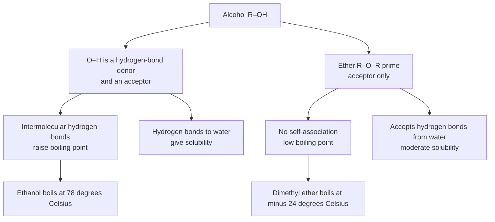
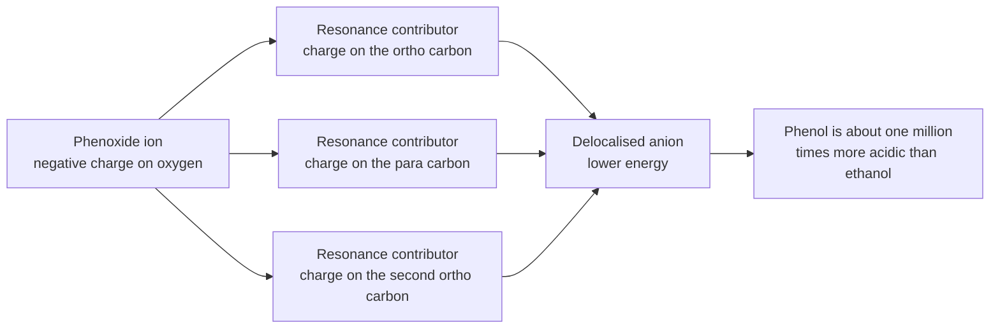
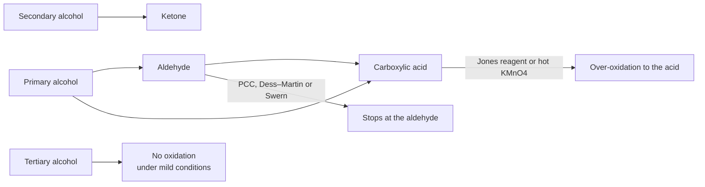
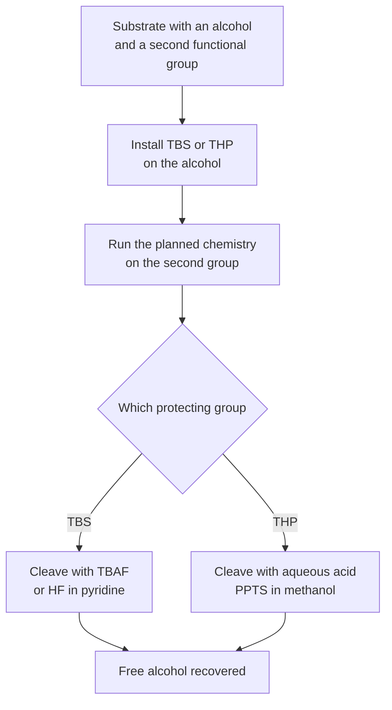

# Chapter 9 — Alcohols, Phenols and Ethers

> **Level:** Advanced (Level 4 — Organic Chemistry)
> **Estimated study time:** 8 hours (5.5 h reading + 2.5 h exercises)
> **Prerequisites:** Chapter 8 (nucleophilic substitution and elimination); Level 2 Chapter 5 (intermolecular forces); Level 2 Chapter 11 (acid–base equilibria)
> **Related chapters:** [Haloalkanes: Nucleophilic Substitution and Elimination](08-haloalkanes-substitution-and-elimination.md), [Aldehydes, Ketones and Carbonyl Chemistry](10-aldehydes-ketones-and-carbonyl-chemistry.md), [Carboxylic Acids, Esters, Amines and Amides](11-carboxylic-acids-esters-and-amines.md)
> **Difficulty:** ★★★★☆ (3–4)

---

## 1. Learning Objectives

After working through this chapter you will be able to:

- Classify an alcohol as primary, secondary or tertiary, and classify a phenol or an ether from its structure.
- Explain how hydrogen bonding controls the boiling points, melting points and water solubility of alcohols and ethers, and predict the trends from molecular structure.
- Compare the acidities of water, alcohols and phenols using $\mathrm{p}K_a$ values, and explain the role of inductive effects, solvation and resonance.
- Predict how substituents on a phenol ring change its acidity.
- Select a preparation of an alcohol — hydration, hydroboration–oxidation, carbonyl reduction, Grignard addition or nucleophilic substitution — for a given target.
- Write the products of an alcohol with an alkali metal, a hydrogen halide, a phosphorus halide, thionyl chloride, an acid catalyst, an oxidising agent and a carboxylic acid.
- Choose an oxidant that stops at the aldehyde, the ketone or the carboxylic acid, and justify the choice.
- Describe the acidity of phenols, their electrophilic substitution and the Kolbe–Schmitt reaction.
- Explain the Williamson ether synthesis, the cleavage of ethers by hydrogen iodide and the peroxide hazard of ether storage.
- Explain how silyl and tetrahydropyranyl protecting groups are installed and removed, and why the order matters.

---

## 2. Introduction

The hydroxyl group is the most abundant functional group in the living world. Water is the simplest member; ethanol, glycerol, glucose, cholesterol, serine and the phenolic side chain of tyrosine all contain it. The group is also central to industrial chemistry: methanol is a commodity chemical made at tens of millions of tonnes per year, ethanol is both a fuel additive and a solvent, phenol is the precursor to polycarbonate and epoxy resins, and diethyl ether was the first general anaesthetic.

What makes the hydroxyl group so important is a single structural feature: an oxygen atom with two lone pairs and a hydrogen atom attached to a more electronegative atom. That combination produces three distinct reactivities in one group. The $\ce{O-H}$ bond can be broken by a base, so alcohols are weak acids ($\mathrm{p}K_a \approx 16$). The oxygen lone pair can accept a proton or an electrophile, so alcohols are weak bases and excellent nucleophiles. The $\ce{C-O}$ bond can be broken by an acid, because protonation converts a poor leaving group ($\ce{OH^-}$) into a good one ($\ce{H2O}$), so alcohols undergo substitution and elimination in the same way as haloalkanes.

Phenols add resonance to the picture. In phenoxide the negative charge is delocalised into the aromatic ring, and that delocalisation makes phenol about a million times more acidic than ethanol. The same delocalisation makes the ring electron-rich, so phenols undergo electrophilic aromatic substitution far more readily than benzene — and coupling with diazonium salts gives the azo dyes.

Ethers are the third member of the family: an oxygen atom bonded to two carbon atoms. They are the least reactive of the three, which is precisely why they are used as solvents. Their one important reaction, cleavage by hydrogen iodide, follows the mechanistic rules of Chapter 8, and their one important hazard, peroxide formation on storage, follows from the weakness of the $\ce{C-H}$ bond adjacent to oxygen.

This chapter therefore functions as a bridge. It converts the mechanistic vocabulary of Chapter 8 into the functional-group transformations that Chapters 10 to 12 assume, and it introduces the protecting-group logic that Chapter 14 uses constantly.

---

## 3. Fundamental Concepts

### 3.1 Classification and nomenclature

An **alcohol** contains an $\ce{-OH}$ group bonded to an $sp^3$ carbon. It is classified by the number of carbon atoms attached to that carbon:

| Class | General formula | Example | IUPAC name |
|---|---|---|---|
| Primary | $\ce{RCH2OH}$ | $\ce{CH3CH2CH2OH}$ | propan-1-ol |
| Secondary | $\ce{R2CHOH}$ | $\ce{CH3CH(OH)CH3}$ | propan-2-ol |
| Tertiary | $\ce{R3COH}$ | $\ce{(CH3)3COH}$ | 2-methylpropan-2-ol |
| Allylic | $\ce{C=C-CH2OH}$ | $\ce{CH2=CHCH2OH}$ | prop-2-en-1-ol |
| Benzylic | $\ce{ArCH2OH}$ | $\ce{C6H5CH2OH}$ | phenylmethanol |
| Diol | two $\ce{-OH}$ | $\ce{HOCH2CH2OH}$ | ethane-1,2-diol |
| Triol | three $\ce{-OH}$ | $\ce{HOCH2CH(OH)CH2OH}$ | propane-1,2,3-triol |

A **phenol** contains an $\ce{-OH}$ group bonded directly to an aromatic ring. The parent compound is phenol itself, $\ce{C6H5OH}$; the group is a phenol, not an alcohol, because its chemistry is dominated by the ring.

An **ether** has the formula $\ce{R-O-R'}$, with two carbon substituents on oxygen. If one substituent is aromatic the compound is an aryl ether; if the oxygen is part of a ring it is a cyclic ether. Tetrahydrofuran (THF), 1,4-dioxane and the crown ethers are cyclic ethers.

IUPAC names use the suffix *-ol* with the lowest locant: butan-2-ol, 2-methylpropan-2-ol, propane-1,3-diol. Common names — ethylene glycol, glycerol, isopropanol, tert-butanol — remain common in industry. Ethers are named as alkoxyalkanes (methoxyethane) or as dialkyl ethers (diethyl ether).

### 3.2 Physical properties and hydrogen bonding

An alcohol molecule can both donate and accept a hydrogen bond: the $\ce{O-H}$ hydrogen is a donor, and the oxygen lone pairs are acceptors. An ether has only acceptor ability. That asymmetry explains most of the physical-property differences in the family.

| Compound | Molar mass / g mol⁻¹ | Boiling point / °C | Solubility in water |
|---|---|---|---|
| Ethane | 30 | −89 | Insoluble |
| Dimethyl ether | 46 | −24 | ≈ 70 g L⁻¹ |
| Methanol | 32 | 65 | Miscible |
| Ethanol | 46 | 78 | Miscible |
| Propan-1-ol | 60 | 97 | Miscible |
| Butan-1-ol | 74 | 118 | ≈ 73 g L⁻¹ |
| Pentan-1-ol | 88 | 138 | ≈ 22 g L⁻¹ |
| Phenol | 94 | 182 | ≈ 80 g L⁻¹ |
| Diethyl ether | 74 | 35 | ≈ 69 g L⁻¹ |

Three observations follow.

1. **Boiling points rise with the number of hydrogen bonds per molecule.** Ethanol (78 °C) and dimethyl ether (46 g mol⁻¹, −24 °C) are isomers, yet their boiling points differ by more than 100 K, because ethanol molecules hydrogen-bond to each other and dimethyl ether molecules do not. Dimethyl ether can accept hydrogen bonds from water, which is why it is water-soluble despite its low boiling point.
2. **Water solubility falls as the hydrocarbon part grows.** The $\ce{-OH}$ group can hydrogen-bond to water, but each additional $\ce{CH2}$ costs energy by disrupting the water structure. Methanol, ethanol and propan-1-ol are miscible with water in all proportions; butan-1-ol dissolves to about 73 g L⁻¹; pentan-1-ol to about 22 g L⁻¹.
3. **Branching lowers the boiling point** by reducing the surface area available for van der Waals contact. tert-Butanol (82 °C) boils below butan-1-ol (118 °C) despite having the same formula.

Phenol is a solid at room temperature (melting point 41 °C) because its flat, polar molecules pack efficiently in the crystal. Its boiling point is high for its size, but it is only moderately soluble in water: the phenyl ring is large and hydrophobic even though the $\ce{-OH}$ group is acidic.

The $\ce{O-H}$ bond is also weak enough to be broken by radicals. The bond dissociation enthalpy of a phenolic $\ce{O-H}$ is roughly $330$–$360\ \text{kJ mol}^{-1}$, compared with about $410\ \text{kJ mol}^{-1}$ for a typical $\ce{C-H}$; this is the thermodynamic basis of phenolic antioxidants (Section 9).

### 3.3 Acidity

An alcohol is a Brønsted acid because it can lose a proton from oxygen:

$$
\ce{ROH + H2O <=> RO^- + H3O+}
\qquad
K_a = \frac{[\ce{RO^-}][\ce{H3O+}]}{[\ce{ROH}]}
$$

| Compound | $\mathrm{p}K_a$ | Conjugate base | Comment |
|---|---|---|---|
| Trifluoroethanol | 12.4 | $\ce{CF3CH2O^-}$ | Three fluorines withdraw inductively |
| Water | 15.7 | $\ce{OH^-}$ | Reference point |
| Methanol | 15.5 | $\ce{CH3O^-}$ | Slightly more acidic than water |
| Ethanol | 16.0 | $\ce{CH3CH2O^-}$ | The standard alkoxide source |
| Propan-2-ol | 16.5 | $\ce{(CH3)2CHO^-}$ | Two electron-donating alkyl groups |
| tert-Butanol | 18.0 | $\ce{(CH3)3CO^-}$ | Three alkyl groups, hindered solvation |
| Phenol | 9.95 | $\ce{C6H5O^-}$ | Resonance delocalisation |
| 4-Nitrophenol | 7.15 | $\ce{4-NO2C6H4O^-}$ | Strong electron withdrawal |
| 2,4-Dinitrophenol | 4.1 | $\ce{(NO2)2C6H3O^-}$ | Two nitro groups |
| 2,4,6-Trinitrophenol | ≈ 0.4 | $\ce{(NO2)3C6H2O^-}$ | Picric acid; comparable to a mineral acid |

Alkyl groups are electron-donating by induction, so they destabilise the alkoxide and weaken the acid: the order is methanol > ethanol > propan-2-ol > tert-butanol. The effect is modest, about $2.5\ \mathrm{p}K_a$ units across the series, because induction is a short-range effect that dies quickly with distance.

Phenol is a different case. Its conjugate base, the phenoxide ion, is stabilised by resonance: the negative charge on oxygen is delocalised onto the *ortho* and *para* carbons of the ring, and the resulting hybrid has lower energy than a localised alkoxide. The difference is about six orders of magnitude in $K_a$ — phenol is roughly a million times more acidic than ethanol — and it is the single largest substituent effect in this chapter.

Electron-withdrawing substituents on the ring stabilise the phenoxide further and increase acidity; electron-donating substituents do the opposite. The effect is strongest at the *ortho* and *para* positions, because those are the positions that carry charge in the resonance contributors, and weakest at the *meta* position. This is why 4-nitrophenol ($\mathrm{p}K_a$ 7.15) is more acidic than 3-nitrophenol ($\mathrm{p}K_a$ 8.4), and why 4-methoxyphenol ($\mathrm{p}K_a$ 10.2) is less acidic than phenol.

**Solvation matters as much as structure.** tert-Butoxide is a weaker base than ethoxide in water because the bulky tert-butyl group prevents the solvent from stabilising the anion, but in the gas phase the order reverses. Any statement about acidity is therefore a statement about a particular solvent, usually water, and should say so.

### 3.4 Preparation of alcohols

There are five general routes, and the choice depends on the substitution pattern of the target.

**Hydration of alkenes.** Acid-catalysed hydration adds water across a double bond with Markovnikov regiochemistry:

$$
\ce{CH3CH=CH2 + H2O ->[H3PO4] CH3CH(OH)CH3}
$$

The reaction proceeds through the more stable carbocation, so rearrangement is possible and tertiary alcohols form easily. Oxymercuration–demercuration gives Markovnikov products without rearrangement; hydroboration–oxidation gives the anti-Markovnikov alcohol with *syn* addition.

**Hydroboration–oxidation.** Diborane adds to an alkene with boron at the less substituted carbon, and oxidation with alkaline hydrogen peroxide replaces boron by $\ce{OH}$ with retention:

$$
\ce{CH3CH=CH2 ->[1.\ BH3] ->[2.\ H2O2,\ OH^-] CH3CH2CH2OH}
$$

This is the standard route to primary alcohols from terminal alkenes.

**Reduction of carbonyl compounds.** Aldehydes give primary alcohols, ketones give secondary alcohols. Sodium borohydride in methanol is the mild standard; lithium aluminium hydride is stronger and also reduces esters and acids:

$$
\ce{CH3CHO ->[NaBH4] CH3CH2OH}
\qquad
\ce{CH3COCH3 ->[NaBH4] CH3CH(OH)CH3}
$$

**Grignard addition.** A Grignard reagent adds to formaldehyde to give a primary alcohol, to another aldehyde to give a secondary alcohol, and to a ketone to give a tertiary alcohol. This is the most general method for making tertiary alcohols, because the three carbon substituents can be chosen independently:

$$
\ce{CH3MgBr + CH3COCH3 -> ->[H3O+] (CH3)3COH}
$$

**Nucleophilic substitution.** Primary alkyl halides react with hydroxide by $S_N2$, but the reaction is of limited use for secondary and tertiary substrates because elimination competes. A better route to a primary alcohol is to displace a halide with acetate and then hydrolyse the ester, which avoids the strong base.

**Fermentation** remains the industrial route to ethanol from sugar or starch, and the hydration of ethene is the petrochemical route:

$$
\ce{C6H12O6 ->[yeast] 2CH3CH2OH + 2CO2}
$$

### 3.5 The reactions of alcohols at a glance

| Reagent | Site attacked | Product | Mechanism |
|---|---|---|---|
| $\ce{Na}$ or $\ce{K}$ | $\ce{O-H}$ | Alkoxide + $\ce{H2}$ | Acid–base |
| $\ce{HX}$ | $\ce{C-O}$ after protonation | Alkyl halide | $S_N1$ or $S_N2$ |
| $\ce{PBr3}$, $\ce{PCl5}$ | $\ce{C-O}$ | Alkyl halide | $S_N2$-like |
| $\ce{SOCl2}$ | $\ce{C-O}$ | Alkyl chloride | $S_N2$-like, inversion |
| $\ce{H2SO4}$ or $\ce{H3PO4}$, heat | $\ce{C-H}$ and $\ce{C-O}$ | Alkene | $E1$ |
| $\ce{KMnO4}$, $\ce{K2Cr2O7}$, PCC, Swern | $\ce{C-H}$ on the carbinol carbon | Aldehyde, ketone or acid | Oxidation |
| $\ce{R'COOH}$, acid catalyst | $\ce{O-H}$ and acyl carbon | Ester | Fischer esterification |
| $\ce{CH3C6H4SO2Cl}$ or $\ce{MsCl}$, base | $\ce{O-H}$ | Sulfonate ester | Nucleophilic acyl substitution |

---

## 4. Detailed Scientific Explanation

### 4.1 Reaction with alkali metals

An alcohol reacts with sodium or potassium to give an alkoxide and hydrogen:

$$
\ce{2CH3CH2OH + 2Na -> 2CH3CH2ONa + H2}
$$

The reaction is a redox process as well as an acid–base reaction: the alcohol hydrogen is reduced from +1 to 0, and sodium is oxidised from 0 to +1. It is much slower than the corresponding reaction of water, which is consistent with the weaker acidity of ethanol ($\mathrm{p}K_a$ 16 versus 15.7). Potassium is more reactive than sodium and is used when a soluble alkoxide is required.

The alkoxide is a strong base — the conjugate base of a weak acid — and is the reagent for the Williamson synthesis, for directed aldol reactions and for many other transformations. It is destroyed by water, so alkoxides are prepared and used in dry alcohols or dry ethers.

### 4.2 Reaction with hydrogen halides

Alcohols do not react with halide ions directly, because hydroxide is a poor leaving group. In acid, the hydroxyl oxygen is protonated and the leaving group becomes water:

$$
\ce{ROH + HX <=> ROH2+ + X^- -> RX + H2O}
$$

The mechanism depends on the substrate. Tertiary alcohols ionise to a carbocation and react by $S_N1$; primary alcohols react by $S_N2$ with the halide attacking the protonated alcohol; secondary alcohols are intermediate and can go either way. Rearrangement is common with tertiary and secondary substrates, and the reaction is driven forward by using concentrated acid and by distilling the volatile alkyl halide.

The **Lucas test** exploits the difference in rate. A solution of zinc chloride in concentrated hydrochloric acid is added to the alcohol; tertiary alcohols give an immediate cloudy second layer of alkyl chloride, secondary alcohols give it within about five minutes, and primary alcohols require heating. The order reflects carbocation stability, so the test is diagnostic for the class of alcohol.

### 4.3 Reaction with phosphorus halides and thionyl chloride

Phosphorus tribromide converts alcohols to bromides:

$$
\ce{3ROH + PBr3 -> 3RBr + H3PO3}
$$

The reaction proceeds through a bromophosphite intermediate, $\ce{(RO)2PBr}$, which is displaced by bromide in an $S_N2$ reaction. The upshot is inversion of configuration at the carbinol carbon. Phosphorus pentachloride behaves similarly for chlorides.

Thionyl chloride is the reagent of choice for chlorides because the by-products are gases:

$$
\ce{ROH + SOCl2 -> RCl + SO2 ^ + HCl ^}
$$

The mechanism involves formation of a chlorosulfite ester, $\ce{ROSOCl}$, followed by displacement of $\ce{SO2}$ and chloride by the chloride ion. The reaction is normally run in dichloromethane or with pyridine, and it proceeds with inversion. Because sulfur dioxide and hydrogen chloride escape, the reaction goes to completion and the product is easily isolated — a considerable practical advantage over phosphorus reagents, which leave phosphorus-containing residues.

### 4.4 Dehydration

Heating an alcohol with a strong acid removes water and forms an alkene. The mechanism is $E1$ for secondary and tertiary alcohols: protonation, loss of water to give a carbocation, then loss of a $\beta$-proton. Primary alcohols dehydrate by an $E2$-like pathway at high temperature.

$$
\ce{CH3CH2OH ->[H2SO4,\ 170\ ^\circ C] CH2=CH2 + H2O}
$$

Temperature controls the outcome for ethanol. At about $140\ ^\circ\text{C}$ the dominant product is diethyl ether, formed by nucleophilic attack of one alcohol molecule on the protonated other; at about $170\ ^\circ\text{C}$ the alkene dominates, because the elimination has the more favourable entropy of activation. This is a textbook illustration of kinetic versus thermodynamic control by temperature.

Regiochemistry follows Zaitsev's rule, and rearrangement is common. 3,3-Dimethylbutan-2-ol, for example, gives mainly 2,3-dimethylbut-2-ene rather than the direct dehydration product, because a methyl shift converts the secondary cation into a tertiary one before proton loss. Phosphoric acid is preferred over sulfuric acid for acid-sensitive substrates because it is less oxidising and less prone to charring.

### 4.5 Oxidation

Oxidation of an alcohol removes two hydrogen atoms from the carbinol carbon: one from the $\ce{O-H}$ bond and one from the $\ce{C-H}$ bond. The product depends on how many hydrogens are available.

| Substrate | Product with mild oxidant | Product with strong oxidant |
|---|---|---|
| Primary alcohol | Aldehyde | Carboxylic acid |
| Secondary alcohol | Ketone | Ketone (further oxidation requires C–C cleavage) |
| Tertiary alcohol | No reaction | No reaction under mild conditions; hot $\ce{KMnO4}$ cleaves the C–C bond |

The reagents differ in strength and selectivity:

| Reagent | Conditions | Primary alcohol gives | Secondary alcohol gives | Notes |
|---|---|---|---|---|
| PCC | $\ce{CH2Cl2}$, 0 °C | Aldehyde | Ketone | Mild, acidic; aldehydes survive |
| Dess–Martin periodinane | $\ce{CH2Cl2}$, room temperature | Aldehyde | Ketone | Mild, no acidic by-products, expensive |
| Swern oxidation | $\ce{(CH3)2SO}$, $\ce{(COCl)2}$, $\ce{(C2H5)3N}$, −78 °C | Aldehyde | Ketone | Very mild; dimethyl sulfide by-product |
| Jones reagent | $\ce{CrO3}$, $\ce{H2SO4}$, acetone, 0 °C | Carboxylic acid | Ketone | Aqueous acid; over-oxidises aldehydes |
| $\ce{K2Cr2O7}$, $\ce{H2SO4}$ | reflux | Carboxylic acid | Ketone | Classical strong oxidant |
| $\ce{KMnO4}$, dilute, cold | aqueous, alkaline | Aldehyde, then acid | Ketone | Purple colour fades |
| $\ce{KMnO4}$, hot, concentrated | aqueous, alkaline, heat | Carboxylic acid | Ketone, then cleavage | Harsh; cleaves side chains |

The aldehyde is an intermediate in every primary-alcohol oxidation: it is more easily oxidised than the alcohol, so a strong aqueous oxidant carries it on to the acid. To stop at the aldehyde, the aldehyde must be removed as it forms (distillation) or the oxidation must be run under conditions in which the aldehyde is stable — anhydrous, non-nucleophilic, and free of water. PCC, Dess–Martin and Swern all satisfy that requirement.

### 4.6 Esterification

Alcohols react with carboxylic acids in the presence of an acid catalyst to give esters:

$$
\ce{RCOOH + R'OH <=> RCOOR' + H2O}
$$

The reaction is reversible and its equilibrium constant is of order unity for simple aliphatic partners, so the yield is controlled by Le Châtelier's principle: remove water (Dean–Stark apparatus, molecular sieves) or use an excess of one partner. The mechanism is treated in Chapter 11; for present purposes the important point is that the alcohol oxygen becomes the ester oxygen, which is proved by isotopic labelling with $\ce{H2^{18}O}$.

### 4.7 Phenols

**Acidity.** Phenol is weak by mineral-acid standards but strong by alcohol standards. The phenoxide ion is stabilised by resonance, and the effect is amplified by electron-withdrawing substituents. Phenol dissolves in aqueous sodium hydroxide but not in sodium bicarbonate, which distinguishes it from a carboxylic acid ($\mathrm{p}K_a \approx 5$): the bicarbonate reaction requires an acid strong enough to protonate $\ce{HCO3^-}$ ($\mathrm{p}K_a$ of $\ce{H2CO3}$ is 6.4), and phenol is not.

**Electrophilic aromatic substitution.** The $\ce{-OH}$ group is strongly activating and *ortho*/*para* directing, because the oxygen lone pair donates into the ring and stabilises the *ortho*- and *para*-arenium ions. Phenol reacts with bromine water without a catalyst to give 2,4,6-tribromophenol as a white precipitate — a classic test for phenol. Nitration with dilute nitric acid gives a mixture of 2-nitrophenol and 4-nitrophenol; sulfonation gives 4-hydroxybenzenesulfonic acid; and coupling with a diazonium salt gives an azo dye (Chapter 11).

**Kolbe–Schmitt reaction.** Sodium phenoxide reacts with carbon dioxide at about $125\ ^\circ\text{C}$ and $100\ \text{atm}$ to give sodium salicylate, which is acidified to salicylic acid:

$$
\ce{C6H5ONa + CO2 ->[125\ ^\circ C,\ 100\ atm] HOC6H4CO2Na ->[H3O+] HOC6H4CO2H}
$$

The carboxylate group enters *ortho* to the oxygen, because the phenoxide oxygen coordinates the carbon dioxide and directs it to the adjacent position. Salicylic acid is the precursor to aspirin (acetylsalicylic acid), so this 19th-century reaction remains a commercial route to a pharmaceutical.

**Oxidation.** Phenols are easily oxidised to quinones, and this is why phenol darkens on exposure to air. The two-electron oxidation of 1,4-benzenediol (hydroquinone) to 1,4-benzoquinone is reversible and underpins the chemistry of coenzyme Q and of photographic developers.

### 4.8 Ethers

**Williamson synthesis.** An alkoxide reacts with a primary alkyl halide in an $S_N2$ displacement:

$$
\ce{RO^- + R'CH2X -> R-O-CH2R' + X^-}
$$

The method is reliable only when the halide is primary or activated. With a secondary halide, elimination competes; with a tertiary halide, elimination is essentially the only outcome. To make an unsymmetrical ether, therefore, the halide must be the less hindered partner: methyl tert-butyl ether is made from tert-butoxide and methyl iodide, not from methoxide and tert-butyl iodide.

Phenols are excellent partners because the phenoxide is a good nucleophile and the aromatic carbon–oxygen bond is formed without competition from elimination:

$$
\ce{C6H5O^- + CH3I -> C6H5OCH3 + I^-}
$$

**Cleavage by hydrogen iodide.** Ethers are cleaved by concentrated hydriodic acid. The mechanism depends on the substituents: a primary or secondary alkyl group is displaced by iodide in an $S_N2$ reaction, whereas a tertiary group ionises and is captured by iodide in an $S_N1$ reaction. The first equivalent gives an alcohol and an alkyl iodide; a second equivalent converts the alcohol to a second alkyl iodide.

$$
\ce{CH3CH2-O-CH3 + HI -> CH3CH2I + CH3OH}
\qquad
\ce{CH3OH + HI -> CH3I + H2O}
$$

With an aryl alkyl ether, cleavage occurs at the alkyl group, because the aryl carbon–oxygen bond is too strong to break; the products are phenol and the alkyl iodide. This is a useful way to unmask a phenol.

**Peroxide hazard.** Ethers with a hydrogen atom on a carbon adjacent to oxygen are oxidised by atmospheric oxygen to hydroperoxides and dialkyl peroxides:

$$
\ce{CH3CH2-O-CH2CH3 + O2 -> CH3CH(OOH)-O-CH2CH3}
$$

The peroxides are less volatile than the ether, so they concentrate when an old ether sample is distilled, and they detonate on heating or on contact with a ground-glass joint. Diisopropyl ether is particularly dangerous because its peroxide is less volatile and accumulates. Standard precautions are to store ethers in the dark under nitrogen, over potassium hydroxide, with an inhibitor such as butylated hydroxytoluene, to test for peroxides with acidified potassium iodide and starch before use, and never to distil an ether to dryness.

**Crown ethers.** Cyclic polyethers with repeating $\ce{-CH2CH2O-}$ units bind metal cations in their central cavity. The cavity size selects the cation: 12-crown-4 binds lithium, 15-crown-5 binds sodium, and 18-crown-6 binds potassium. The exterior of the complex is hydrocarbon-like, so the salt becomes soluble in non-polar solvents — the basis of phase-transfer catalysis and of the design of ion-selective electrodes.

### 4.9 Protection strategies

An alcohol is a nucleophile and an acid, and many reagents attack it. When a molecule contains several functional groups and only one should react, the alcohol is temporarily converted into a group that is inert to the planned chemistry and is then removed.

**Silyl ethers.** tert-Butyldimethylsilyl (TBS) chloride reacts with an alcohol and imidazole in DMF to give a TBS ether:

$$
\ce{ROH + (CH3)3C-Si(CH3)2Cl ->[imidazole,\ DMF] RO-Si(CH3)2C(CH3)3 + HCl}
$$

The TBS group is stable to base, to organometallic reagents, to hydrogenation and to mild acid, but it is cleaved by fluoride ion — tetrabutylammonium fluoride in THF, or hydrogen fluoride in pyridine — because silicon binds fluoride very strongly. The orthogonal stability of silyl ethers and acetals is the basis of most protecting-group strategies.

**Tetrahydropyranyl ethers.** 3,4-Dihydro-2H-pyran adds to an alcohol under mild acid catalysis to give a tetrahydropyranyl (THP) ether:

$$
\ce{ROH + C5H8O2 ->[H+] RO-C5H9O}
$$

The THP group is an acetal and is stable to base and to hydride reducing agents, but it is removed by aqueous acid. It is therefore the protecting group of choice when the subsequent chemistry is basic or involves hydride, and it is the one group that cannot survive a acidic work-up.

The strategic point is that protection and deprotection add two steps to a synthesis, so a protecting group is justified only when the selectivity it provides cannot be achieved otherwise. Modern synthesis tries to minimise them, but the logic remains essential.

---

## 5. Visual Diagrams

**Figure 9.1 — One hydrogen bond, two physical consequences.** The diagram separates the donor and acceptor roles because they explain different observations: self-association between alcohol molecules raises the boiling point, whereas association with water determines solubility. Dimethyl ether has the same molar mass as ethanol but cannot donate a hydrogen bond, so its boiling point is more than 100 K lower; it is still water-soluble because it can accept hydrogen bonds from water. The figure is the structural reason that boiling point is not a simple function of molecular mass.

**Figure 9.2 — Resonance stabilisation of the phenoxide ion.** The oxygen lone pair that carries the negative charge is conjugated with the aromatic ring, so the charge is shared over the oxygen and the two *ortho* carbons and the *para* carbon. Delocalisation lowers the energy of the anion relative to a localised alkoxide, and the difference in anion stability appears directly as a difference in $\mathrm{p}K_a$: about 10 for phenol against about 16 for ethanol. The same delocalisation makes the ring electron-rich and therefore activated towards electrophiles.

**Figure 9.3 — The oxidation map for alcohols.** The upper route is available only if the aldehyde is protected from further oxidation, either by using an anhydrous reagent or by removing it as it forms. The tertiary alcohol has no hydrogen on the carbinol carbon, so the two-hydrogen removal that defines oxidation cannot occur; forcing conditions instead break a carbon–carbon bond and give a mixture of ketones and acids. The figure is a decision tool: identify the class of alcohol first, then choose the reagent that stops at the required oxidation level.

**Figure 9.4 — Protection and deprotection as a temporary detour.** The two branches differ only in the cleavage conditions, and that difference is the whole point: TBS survives acid and is removed by fluoride, whereas THP survives base and hydride but is removed by acid. Choosing between them requires looking ahead at every step that the protected intermediate must survive. Each protecting group costs two steps, so the strategy is justified only when direct selectivity is impossible.

---

## 6. Mathematical Formulas

### 6.1 Acid dissociation constants

$$
K_a = \frac{[\ce{H3O+}][\ce{A^-}]}{[\ce{HA}]}
\qquad
\mathrm{p}K_a = -\log_{10} K_a
$$

| Symbol | Meaning | SI unit |
|---|---|---|
| $K_a$ | acid dissociation constant | mol dm⁻³ |
| $\mathrm{p}K_a$ | negative logarithm of $K_a$ | dimensionless |
| $[\ce{HA}]$ | concentration of the acid | mol dm⁻³ |
| $[\ce{A^-}]$ | concentration of its conjugate base | mol dm⁻³ |

A difference of one $\mathrm{p}K_a$ unit corresponds to a factor of ten in acidity. Ethanol ($\mathrm{p}K_a$ 16) and phenol ($\mathrm{p}K_a$ 10) therefore differ by a factor of $10^6$ in $K_a$.

### 6.2 Base strength of an alkoxide

The conjugate base of an acid with constant $K_a$ has

$$
K_b = \frac{K_w}{K_a}
\qquad
\mathrm{p}K_b = 14 - \mathrm{p}K_a
$$

at $298\ \text{K}$, where $K_w = 1.0 \times 10^{-14}$. Ethoxide ($\mathrm{p}K_a$ of ethanol 16) has $\mathrm{p}K_b \approx -2$, so it is a strong base: its conjugate acid is a very weak acid. Phenoxide ($\mathrm{p}K_a$ 10) has $\mathrm{p}K_b \approx 4$, a much weaker base. This is why phenoxide is a poor reagent for the Williamson synthesis with unactivated halides, and why phenol can be deprotonated by hydroxide while ethanol cannot.

### 6.3 Degree of dissociation

For a weak acid of analytical concentration $c$ and dissociation degree $\alpha$,

$$
K_a = \frac{c\alpha^2}{1-\alpha}
\qquad
\alpha \approx \sqrt{\frac{K_a}{c}} \quad \text{when } \alpha \ll 1
$$

For phenol at $c = 0.10\ \text{mol dm}^{-3}$, $K_a = 1.0 \times 10^{-10}$, so $\alpha \approx \sqrt{10^{-9}} = 3.2 \times 10^{-5}$: only about 0.003% of the molecules are ionised. For acetic acid under the same conditions, $\alpha \approx 1.3\%$. The comparison shows why "weak acid" is a relative term spanning many orders of magnitude.

### 6.4 Hammett relationship

For substituted phenols and benzoic acids, the effect of a substituent on acidity is correlated by

$$
\log_{10}\frac{K_a}{K_a^0} = \rho\sigma
$$

where $K_a^0$ refers to the unsubstituted compound, $\sigma$ is a substituent constant (positive for electron withdrawal) and $\rho$ is a reaction constant that measures the sensitivity of the equilibrium to charge. For phenol ionisation $\rho$ is positive, because developing negative charge is stabilised by electron withdrawal. The equation is a correlation, not a theory, and it fails when the substituent can conjugate directly with the reaction centre in a way the reference reaction does not capture.

### 6.5 Equilibrium in Fischer esterification

$$
K = \frac{[\ce{RCOOR'}][\ce{H2O}]}{[\ce{RCOOH}][\ce{R'OH}]}
$$

For acetic acid and ethanol, $K \approx 4$ at room temperature. If $n_0$ moles of each reactant are mixed and $x$ moles of ester form in a volume $V$, then

$$
K = \frac{(x/V)^2}{\left((n_0-x)/V\right)^2} = \frac{x^2}{(n_0-x)^2}
$$

so $x/(n_0-x) = \sqrt{K} = 2$ and $x = 0.667\,n_0$: the maximum yield from equimolar starting materials is about 67%, no matter how long the reaction is run. Removing water or using an excess of the alcohol shifts the equilibrium and is the standard practical remedy.

---

## 7. Chemical Equations

### 7.1 Acid–base reactions

$$
\ce{2CH3CH2OH + 2Na -> 2CH3CH2ONa + H2 ^}
$$

$$
\ce{C6H5OH + NaOH -> C6H5ONa + H2O}
\qquad \text{phenol dissolves in alkali}
$$

$$
\ce{CH3CH2ONa + H2O -> CH3CH2OH + NaOH}
\qquad \text{the equilibrium lies far to the right}
$$

The second and third equations are the basis of the distinction between phenols and alcohols: both dissolve in sodium hydroxide only if the $\mathrm{p}K_a$ is below about 15.7.

### 7.2 Conversion to halides

$$
\ce{CH3CH2CH2OH + HBr ->[reflux] CH3CH2CH2Br + H2O}
$$

$$
\ce{3CH3CH2OH + PBr3 -> 3CH3CH2Br + H3PO3}
$$

$$
\ce{CH3CH2OH + SOCl2 ->[pyridine] CH3CH2Cl + SO2 ^ + HCl ^}
$$

$$
\ce{CH3CH2OH + CH3C6H4SO2Cl ->[pyridine] CH3CH2OSO2C6H4CH3 + HCl}
$$

The tosylate is a better leaving group than chloride and is used when a mild, clean displacement is required.

### 7.3 Dehydration and ether formation

$$
\ce{CH3CH2OH ->[H2SO4,\ 170\ ^\circ C] CH2=CH2 + H2O}
$$

$$
\ce{2CH3CH2OH ->[H2SO4,\ 140\ ^\circ C] CH3CH2OCH2CH3 + H2O}
$$

$$
\ce{(CH3)3COH ->[H2SO4,\ heat] (CH3)2C=CH2 + H2O}
$$

The third equation is an $E1$ reaction and illustrates why tertiary alcohols dehydrate under very mild conditions: the carbocation forms readily.

### 7.4 Oxidation

$$
\ce{CH3CH2OH ->[PCC] CH3CHO}
$$

$$
\ce{CH3CH2OH ->[K2Cr2O7,\ H2SO4,\ heat] CH3COOH}
$$

$$
\ce{CH3CH(OH)CH3 ->[K2Cr2O7,\ H2SO4] CH3COCH3}
$$

$$
\ce{(CH3)3COH ->[KMnO4,\ hot] \text{no clean oxidation product}}
$$

### 7.5 Phenol chemistry

$$
\ce{C6H5OH + 3Br2 ->[H2O] C6H2Br3OH v + 3HBr}
$$

$$
\ce{C6H5ONa + CO2 ->[125\ ^\circ C,\ 100\ atm] HOC6H4CO2Na}
$$

$$
\ce{HOC6H4CO2Na + HCl -> HOC6H4CO2H + NaCl}
$$

### 7.6 Ether synthesis and cleavage

$$
\ce{C6H5O^- + CH3I -> C6H5OCH3 + I^-}
\qquad \text{anisole}
$$

$$
\ce{(CH3)3CO^- + CH3I -> (CH3)3COCH3 + I^-}
\qquad \text{MTBE}
$$

$$
\ce{CH3CH2OCH2CH3 + HI -> CH3CH2I + CH3CH2OH}
$$

$$
\ce{C6H5OCH3 + HI -> C6H5OH + CH3I}
\qquad \text{aryl ethers cleave at the alkyl group}
$$

### 7.7 Protection and deprotection

$$
\ce{ROH + (CH3)3C-Si(CH3)2Cl ->[imidazole,\ DMF] RO-Si(CH3)2C(CH3)3 + HCl}
$$

$$
\ce{RO-Si(CH3)2C(CH3)3 + F^- -> ROH + F-Si(CH3)2C(CH3)3}
$$

$$
\ce{ROH + C5H8O2 ->[H+] RO-C5H9O}
\qquad
\ce{RO-C5H9O + H2O ->[H+] ROH + C5H10O2}
$$

In the first pair of equations the silyl chloride is tert-butyldimethylsilyl chloride and the fluoride source is tetrabutylammonium fluoride; in the second pair $\ce{C5H8O2}$ is 3,4-dihydro-2H-pyran and $\ce{C5H10O2}$ is 5-hydroxypentanal, the ring-opened hydrolysis product.

---

## 8. Worked Examples

### Worked Example 9.1 — Ranking acidities and calculating conjugate-base strength

**Problem.** Arrange the following in order of increasing acidity and justify the order: ethanol, 2,2,2-trifluoroethanol, phenol, 4-nitrophenol, tert-butanol. Then calculate the $\mathrm{p}K_b$ of each conjugate base.

**Strategy.** Identify the structural feature that stabilises each anion: induction for the fluorinated alcohol, resonance for the phenols, and steric hindrance to solvation for the tertiary alcohol. Then use $\mathrm{p}K_b = 14 - \mathrm{p}K_a$.

**Solution.** The $\mathrm{p}K_a$ values are tert-butanol 18.0, ethanol 16.0, 2,2,2-trifluoroethanol 12.4, phenol 9.95 and 4-nitrophenol 7.15, so the order of increasing acidity is

$$
\text{tert-butanol} < \text{ethanol} < \text{trifluoroethanol} < \text{phenol} < \text{4-nitrophenol}
$$

The conjugate-base $\mathrm{p}K_b$ values follow as $-4.0$, $-2.0$, $1.6$, $4.05$ and $6.85$ respectively.

The ordering has three separate causes. The three methyl groups of tert-butanol donate electron density inductively and shield the alkoxide from solvation, so its anion is the least stable. Ethanol has one electron-donating ethyl group and is slightly less acidic than methanol. In trifluoroethanol the three fluorine atoms withdraw inductively through the $\ce{C-C}$ bond, and because fluorine is the most electronegative element the effect is large enough to move the $\mathrm{p}K_a$ by almost four units. Phenol gains resonance stabilisation of the phenoxide, worth about six orders of magnitude relative to ethanol, and the nitro group of 4-nitrophenol adds a further two to three orders by withdrawing density from the ring and by delocalising the negative charge onto its own oxygen atoms.

**Check.** A stronger acid has a weaker conjugate base, so the $\mathrm{p}K_b$ order must be the reverse of the acidity order. The values confirm this, and the strongest acid in the list, 4-nitrophenol, has the weakest conjugate base.

### Worked Example 9.2 — Choosing an oxidant

**Problem.** Give the product of each reaction and state why the chosen reagent is appropriate.

(a) Butan-1-ol with PCC in dichloromethane.
(b) Butan-1-ol with acidified potassium dichromate under reflux.
(c) Butan-2-ol with the Swern reagent at $-78\ ^\circ\text{C}$.
(d) 2-Methylpropan-2-ol with PCC.

**Strategy.** Classify the alcohol, identify how many hydrogens are on the carbinol carbon, and match the reagent to the oxidation level required.

**Solution.**

(a) Butan-1-ol is primary, so the first oxidation product is butanal. PCC is anhydrous and non-nucleophilic, so the aldehyde is not hydrated to the geminal diol that would be needed for further oxidation. The product is butanal.

(b) Butan-1-ol with hot acidified dichromate gives butanoic acid. The aqueous acid hydrates the aldehyde, and the hydrate is oxidised further; the strong oxidant and the heat drive the reaction to the acid.

(c) Butan-2-ol is secondary, so oxidation gives butanone. The Swern conditions are chosen because they are mild and avoid the acidic or basic conditions that could epimerise a sensitive centre elsewhere in a molecule. The product is butanone.

(d) 2-Methylpropan-2-ol is tertiary and has no hydrogen on the carbinol carbon, so PCC gives no oxidation product; the alcohol is recovered.

**Check.** Each product has the correct carbon skeleton and the correct number of $\ce{C-O}$ bonds: one for an aldehyde or ketone, two for an acid. No reaction changes the carbon skeleton, which is the signature of an oxidation of an alcohol.

### Worked Example 9.3 — Designing a Williamson synthesis

**Problem.** Propose a Williamson synthesis for (a) methyl tert-butyl ether (MTBE) and (b) benzyl phenyl ether. In each case explain why the alternative pairing of partners is inferior.

**Strategy.** The Williamson reaction is an $S_N2$ displacement, so the halide must be the less hindered partner and the alkoxide the more hindered one. Check each possible pairing against the substrate classes of Chapter 8.

**Solution.**

(a) MTBE, $\ce{(CH3)3COCH3}$, can be disconnected in two ways. Pairing tert-butoxide with methyl iodide works: the halide is methyl, the least hindered possible substrate, and the alkoxide is a strong nucleophile. The alternative, methoxide with tert-butyl iodide, fails because tert-butyl iodide is tertiary and undergoes $E2$ elimination with methoxide to give 2-methylpropene; no substitution product is formed. The synthesis is

$$
\ce{(CH3)3CO^- + CH3I -> (CH3)3COCH3 + I^-}
$$

(b) Benzyl phenyl ether, $\ce{C6H5OCH2C6H5}$, requires a phenoxide and a benzylic halide. Phenoxide is a good nucleophile, and benzyl bromide is a primary, activated halide that reacts rapidly by $S_N2$. The alternative, benzyl alkoxide with bromobenzene, fails because aryl halides are inert to $S_N2$: the carbon–bromine bond is strengthened by conjugation and backside attack is blocked by the ring. The synthesis is

$$
\ce{C6H5O^- + C6H5CH2Br -> C6H5OCH2C6H5 + Br^-}
$$

**Check.** Both products contain the required $\ce{C-O-C}$ linkage, and in both cases the halide is primary or methyl. The rule to remember is that the halide supplies the less substituted carbon of the ether; if both carbons are hindered, the Williamson route is the wrong disconnection.

### Worked Example 9.4 — Reaction with hydrogen bromide and rearrangement

**Problem.** 3,3-Dimethylbutan-2-ol is treated with concentrated hydrobromic acid. Predict the structure of the major product and explain the mechanism.

**Strategy.** A secondary alcohol in strong acid reacts by $S_N1$ or by a solvating $S_N2$; check whether the resulting carbocation can rearrange to a more stable one.

**Solution.** Protonation of the hydroxyl group converts it into a good leaving group, water. Loss of water from the secondary carbon gives the secondary carbocation $\ce{(CH3)3C-CH+-CH3}$. A 1,2-methyl shift from the adjacent quaternary carbon converts this into the tertiary carbocation $\ce{(CH3)2C+-CH(CH3)2}$, which is more stable because it has three alkyl substituents rather than two. Bromide then attacks the tertiary cation to give 2-bromo-2,3-dimethylbutane.

$$
\ce{(CH3)3C-CH(OH)-CH3 ->[HBr] (CH3)3C-CH+-CH3 -> (CH3)2C+-CH(CH3)2 -> (CH3)2C(Br)CH(CH3)2}
$$

**Check.** The product has the same molecular formula as the starting material minus water plus hydrogen bromide, and the skeleton has been rearranged, which is only possible if a carbocation intermediate was formed. The observation of rearrangement is therefore positive evidence for $S_N1$.

### Worked Example 9.5 — Fischer esterification and Le Châtelier's principle

**Problem.** Acetic acid and ethanol react with $K = 4.0$ at room temperature. Calculate the equilibrium yield of ethyl acetate when (a) 1.0 mol of each is used, (b) 1.0 mol of acid is used with 0.50 mol of water already present, and (c) 1.0 mol of acid is used with 3.0 mol of ethanol.

**Strategy.** Write the equilibrium expression in terms of the extent of reaction $x$, solve the resulting quadratic, and compare the three yields.

**Solution.** For (a), $K = x^2/(1-x)^2 = 4$, so $x/(1-x) = 2$ and $x = 0.67\ \text{mol}$, a yield of 67%.

For (b), $K = x^2/\left((1-x)(0.50-x)\right) = 4$. Expanding gives $3x^2 - 6x + 2 = 0$, so $x = (6 - \sqrt{12})/6 = 0.42\ \text{mol}$, a yield of 42%.

For (c), $K = x^2/\left((1-x)(3.0-x)\right) = 4$. Expanding gives $3x^2 - 16x + 12 = 0$, so $x = (16 - \sqrt{112})/6 = 0.90\ \text{mol}$, a yield of 90%.

**Check.** Adding a product suppresses the reaction and adding a reactant drives it, exactly as Le Châtelier's principle predicts. The pattern also explains industrial practice: an excess of the cheaper partner and continuous removal of water are used together to push a reaction with an unfavourable equilibrium constant to a high conversion.

---

## 9. Real-World Applications

**Ethanol and methanol.** Ethanol is produced by fermentation of glucose from sugar cane, maize or wheat, and by acid-catalysed hydration of ethene from petroleum. It is used as a solvent, as a disinfectant at 70% concentration, and as a fuel additive; in Brazil it is a major transport fuel in its own right. Methanol is made industrially from synthesis gas over a copper–zinc oxide catalyst and is the feedstock for formaldehyde, acetic acid and methyl tert-butyl ether. Methanol is acutely toxic because alcohol dehydrogenase oxidises it to formaldehyde and formic acid, which damage the optic nerve.

**Glycerol.** Propane-1,2,3-triol is a by-product of soap manufacture and of biodiesel production: each triglyceride molecule yields three methyl esters and one glycerol. It is used as a humectant in food and cosmetics, as a precursor to nitroglycerin (glyceryl trinitrate, a vasodilator and explosive) and as a feedstock for epichlorohydrin, from which epoxy resins are made.

**Phenolic antioxidants.** Butylated hydroxytoluene (BHT), butylated hydroxyanisole (BHA) and vitamin E ($\alpha$-tocopherol) are hindered phenols. They protect fats and oils from radical chain oxidation by transferring a hydrogen atom from the phenolic $\ce{O-H}$ to a peroxyl radical; the resulting phenoxyl radical is stabilised by resonance and by steric shielding, so it does not propagate the chain. The same principle protects polymers against degradation.

**Lignin and wood chemistry.** Lignin, the second most abundant biopolymer after cellulose, is a cross-linked aromatic polymer built from *p*-hydroxycinnamyl alcohols (coniferyl, sinapyl and *p*-coumaryl alcohol) linked mainly by $\beta$-$\ce{O-4}$ ether bonds. It gives wood its rigidity and its resistance to decay. Delignification in papermaking is the industrial-scale cleavage of exactly the aryl ether bonds described in Section 4.8, and the valorisation of lignin into phenolic chemicals is an active research field.

**Phenol resins and pharmaceuticals.** Phenol condenses with formaldehyde to give Bakelite, the first synthetic thermosetting plastic, and with acetone to give bisphenol A, the monomer for polycarbonate and epoxy resins. Salicylic acid from the Kolbe–Schmitt reaction is acetylated to aspirin; paracetamol is an amide of 4-aminophenol; and propofol, a widely used intravenous anaesthetic, is a hindered phenol.

**Ethers as solvents and hazards.** Diethyl ether was used as a general anaesthetic from 1846 and remains a common extraction solvent; THF is the solvent of choice for Grignard reactions because it is more polar and less volatile. Methyl tert-butyl ether was added to petrol as an oxygenate to improve combustion, but its high water solubility and persistence have made it a significant groundwater contaminant, and several jurisdictions have restricted its use.

---

## 10. Common Mistakes

| Mistake | Why it happens | Correct approach |
|---|---|---|
| Treating phenol as just another alcohol | Both contain an $\ce{-OH}$ group | Phenol is acidic enough to dissolve in alkali and undergoes electrophilic aromatic substitution; its chemistry is dominated by the ring |
| Predicting that phenol dissolves in sodium bicarbonate | Phenol is called an acid | Phenol ($\mathrm{p}K_a$ 9.95) cannot protonate bicarbonate ($\mathrm{p}K_a$ of $\ce{H2CO3}$ 6.4); only carboxylic acids effervesce |
| Using sodium borohydride to reduce an ester to an alcohol | $\ce{NaBH4}$ is the "standard" reducing agent | $\ce{NaBH4}$ reduces aldehydes and ketones; esters need $\ce{LiAlH4}$ or $\ce{DIBAL-H}$ |
| Oxidising a primary alcohol with hot permanganate and expecting the aldehyde | The reagent is chosen without considering over-oxidation | Use PCC, Dess–Martin or Swern in anhydrous conditions to stop at the aldehyde |
| Expecting a tertiary alcohol to oxidise | All alcohols are assumed to react similarly | A tertiary alcohol has no hydrogen on the carbinol carbon; mild oxidation does nothing |
| Making an ether from a tertiary halide and an alkoxide | The Williamson synthesis is applied without checking the halide | Tertiary halides eliminate; make the ether with the tertiary group as the alkoxide and a methyl or primary halide |
| Cleaving an aryl ether at the aromatic carbon | Both $\ce{C-O}$ bonds look equivalent | The aryl carbon–oxygen bond is too strong; HI cleaves the alkyl group and gives phenol |
| Distilling an old ether sample to dryness | Peroxide hazard is underestimated | Test for peroxides, store over KOH in the dark with an inhibitor, and never evaporate to dryness |
| Deprotecting a THP ether with base | Protecting groups are assumed to be interchangeable | THP is an acetal and requires acid; TBS requires fluoride |

---

## 11. Chapter Summary

- Alcohols are classified as primary, secondary or tertiary by the number of carbon substituents on the carbinol carbon; phenols have the hydroxyl group on an aromatic ring, and ethers have two carbon substituents on oxygen.
- The $\ce{O-H}$ group makes alcohols hydrogen-bond donors and acceptors, raising boiling points and water solubility relative to ethers of similar mass.
- Alcohols are weak acids ($\mathrm{p}K_a \approx 16$), phenols are much stronger ($\mathrm{p}K_a \approx 10$) because the phenoxide is stabilised by resonance, and electron-withdrawing substituents increase phenol acidity further.
- Alcohols are prepared by alkene hydration, hydroboration–oxidation, carbonyl reduction, Grignard addition and nucleophilic substitution.
- Alcohols react with alkali metals to give alkoxides, with hydrogen halides to give alkyl halides, with phosphorus halides and thionyl chloride to give halides with inversion, and with acids on heating to give alkenes or ethers.
- Oxidation of a primary alcohol gives an aldehyde or a carboxylic acid depending on the reagent; a secondary alcohol gives a ketone; a tertiary alcohol resists oxidation.
- Fischer esterification is an equilibrium with $K \approx 4$; the yield is raised by removing water or using an excess of one partner.
- Phenols are activated *ortho*/*para* towards electrophilic substitution, undergo the Kolbe–Schmitt carboxylation and are cleaved from aryl ethers only at the alkyl group.
- The Williamson synthesis is an $S_N2$ reaction and requires an unhindered halide; ethers are cleaved by HI and form explosive peroxides on storage.
- Crown ethers bind cations according to cavity size and make salts soluble in non-polar media.
- TBS ethers are removed by fluoride and THP ethers by acid; the choice between them is dictated by the conditions the protected intermediate must survive.

---

## 12. Exercises

### 12.1 Conceptual questions

1. Explain why phenol is about a million times more acidic than ethanol, and why 4-nitrophenol is more acidic than 3-nitrophenol.
2. Explain why ethanol boils at $78\ ^\circ\text{C}$ while dimethyl ether, with the same molar mass, boils at $-24\ ^\circ\text{C}$, yet both are soluble in water.

### 12.2 Basic problems

3. Give the major organic product for each reaction: (a) propan-1-ol with sodium metal; (b) propan-2-ol with PCC; (c) 2-methylpropan-2-ol with concentrated HBr; (d) ethanol with thionyl chloride and pyridine; (e) phenol with excess bromine water.
4. In each pair, state which compound is the stronger acid and why: (a) methanol or 2,2,2-trifluoroethanol; (b) 4-methylphenol or 4-nitrophenol; (c) propan-1-ol or propan-2-ol.

### 12.3 Intermediate problems

5. Propose a synthesis of 2-methylhexan-2-ol from a ketone and a Grignard reagent, and name the ketone and the reagent.
6. Propose a Williamson synthesis of benzyl methyl ether, and explain why the alternative pairing of benzyl alkoxide with methyl iodide or of methoxide with benzyl iodide is or is not acceptable.
7. You need to oxidise the aldehyde group of 4-hydroxybutanal to a carboxylic acid without touching the alcohol. Describe the protecting-group strategy, with reagents for protection and deprotection.

### 12.4 Advanced problems

8. 3,3-Dimethylbutan-2-ol reacts with concentrated HBr to give a rearranged bromide. Give the structure of the product and a step-by-step mechanism, and explain why the rearrangement occurs.
9. Hydrogen iodide cleaves methyl phenyl ether to phenol and iodomethane, but cleaves methyl tert-butyl ether to tert-butyl iodide and methanol. Explain both outcomes in mechanistic terms.
10. An old bottle of diisopropyl ether is found to contain peroxides. Explain how the peroxides form, why distillation is the most dangerous operation, and what precautions prevent the hazard.

### 12.5 Calculation problems

11. Calculate the pH and the degree of dissociation of a $0.050\ \text{mol dm}^{-3}$ aqueous solution of phenol, taking $K_a = 1.0 \times 10^{-10}$.
12. Acetic acid and ethanol react with $K = 4.0$. Calculate the equilibrium yield of ester when 1.0 mol of acid is mixed with 3.0 mol of ethanol, and compare it with the yield from equimolar amounts.

### 12.6 Answers

1. Phenoxide is stabilised by delocalisation of the negative charge onto the *ortho* and *para* carbons, which lowers its energy relative to a localised alkoxide; the effect is about $10^6$ in $K_a$. The nitro group withdraws inductively and by resonance, and in the 4-position it can delocalise charge directly onto its oxygens, so 4-nitrophenol is more acidic than 3-nitrophenol, where only induction operates.
2. Ethanol molecules donate and accept hydrogen bonds, so they associate strongly; dimethyl ether can only accept, so it cannot hydrogen-bond to itself. Both can accept hydrogen bonds from water, which is why both dissolve.
3. (a) Sodium propoxide and hydrogen; (b) propanone; (c) 2-bromo-2-methylpropane; (d) chloroethane; (e) 2,4,6-tribromophenol.
4. (a) Trifluoroethanol, because three fluorines withdraw inductively; (b) 4-nitrophenol, because the nitro group stabilises the phenoxide; (c) propan-1-ol, because the primary alkoxide is less destabilised by alkyl donation and better solvated.
5. 2-Methylhexan-2-ol is a tertiary alcohol with a methyl and a butyl group on the carbinol carbon, so it comes from 2-hexanone (hexan-2-one) and methylmagnesium bromide.
6. Benzyl methyl ether, $\ce{C6H5CH2OCH3}$, is made from sodium methoxide and benzyl bromide: methoxide is a strong nucleophile and benzyl bromide is a primary, activated halide. The alternative, benzyl alkoxide with methyl iodide, also works in principle but offers no advantage; methoxide with benzyl iodide would work too, but benzyl iodide is less accessible. What fails is any pairing in which the halide is tertiary or aryl.
7. Protect the alcohol as a TBS ether using TBSCl and imidazole in DMF; oxidise the aldehyde with Jones reagent or hot permanganate; then remove the silyl group with tetrabutylammonium fluoride in THF.
8. The product is 2-bromo-2,3-dimethylbutane. Protonation and loss of water give the secondary cation, a 1,2-methyl shift from the adjacent quaternary carbon gives a tertiary cation, and bromide captures it; the driving force is the greater stability of the tertiary cation.
9. Methyl phenyl ether is cleaved at the methyl group because the aryl carbon–oxygen bond is strong and the methyl group is a good $S_N2$ site, so iodide attacks methyl and phenol is the leaving group. Methyl tert-butyl ether is cleaved at the tert-butyl group because that group ionises readily to a tertiary carbocation, which is captured by iodide; methanol is the leaving group.
10. Atmospheric oxygen abstracts a hydrogen atom from the carbon adjacent to oxygen, and the resulting radical combines with oxygen to give a hydroperoxide; the peroxides are less volatile than the ether and concentrate on distillation, where heating a concentrated peroxide can detonate. Precautions: store over KOH in the dark under nitrogen with BHT, test with acidified KI and starch, and never distil to dryness.
11. $[\ce{H+}] = \sqrt{K_a c} = \sqrt{1.0 \times 10^{-10} \times 0.050} = 2.2 \times 10^{-6}\ \text{mol dm}^{-3}$, so $\mathrm{pH} = 5.65$; $\alpha = 2.2 \times 10^{-6}/0.050 = 4.5 \times 10^{-5}$, or 0.0045%.
12. For 1:3, $x^2/\left((1-x)(3-x)\right) = 4$ gives $3x^2 - 16x + 12 = 0$ and $x = 0.90\ \text{mol}$, a yield of 90%; for equimolar amounts, $x = 0.67\ \text{mol}$, a yield of 67%. The excess alcohol raises the yield by shifting the equilibrium.

---

## 13. Further Reading

- Clayden, J.; Greeves, N.; Warren, S. *Organic Chemistry*, 2nd ed., Oxford University Press, 2012. The chapters on alcohols and on phenols develop the acidity and substitution chemistry used here.
- McMurry, J. *Organic Chemistry*, 9th ed., Cengage Learning. The alcohol and phenol chapters contain the preparative routes and the oxidation tables in a form suitable for revision.
- Vollhardt, K. P. C.; Schore, N. E. *Organic Chemistry: Structure and Function*, 8th ed., W. H. Freeman. Strong on the physical-property data and on hydrogen bonding.
- Smith, M. B. *March's Advanced Organic Chemistry: Reactions, Mechanisms, and Structure*, 7th ed., Wiley. The reference work for the named reactions in this chapter, including the Kolbe–Schmitt and Williamson reactions.
- Tojo, G.; Fernández, M. *Oxidation of Alcohols to Aldehydes and Ketones: A Guide to Current Common Practice*, Springer, 2006. A practical comparison of PCC, Dess–Martin, Swern and related methods.
- Wuts, P. G. M. *Greene's Protective Groups in Organic Synthesis*, 5th ed., Wiley, 2014. The standard reference for silyl, acetal and ether protecting groups.
- IUPAC. *Compendium of Chemical Terminology* (the "Gold Book"), 2nd ed. (corrected version). <https://goldbook.iupac.org/>
- National Center for Biotechnology Information. *PubChem*. <https://pubchem.ncbi.nlm.nih.gov/> Physical and safety data for the compounds discussed.
- [CURRICULUM.md](../CURRICULUM.md) — where this chapter sits in the full programme.
- [REFERENCES.md](../REFERENCES.md) — the repository's verified source list.

> Only sources that can be checked are cited here. No DOI, page number or edition is invented beyond the verifiable edition statements above.

