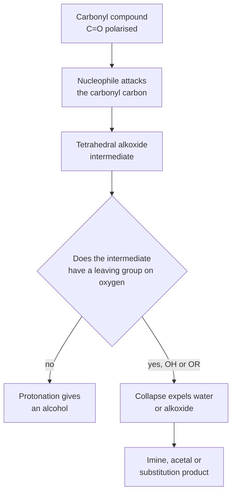
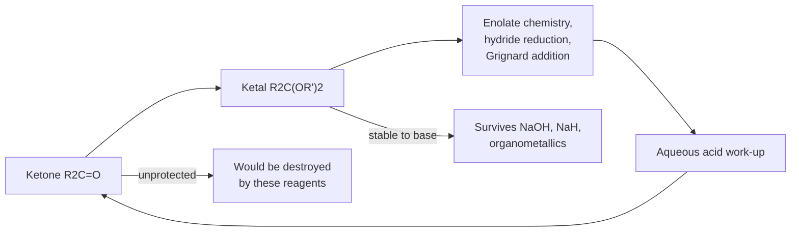
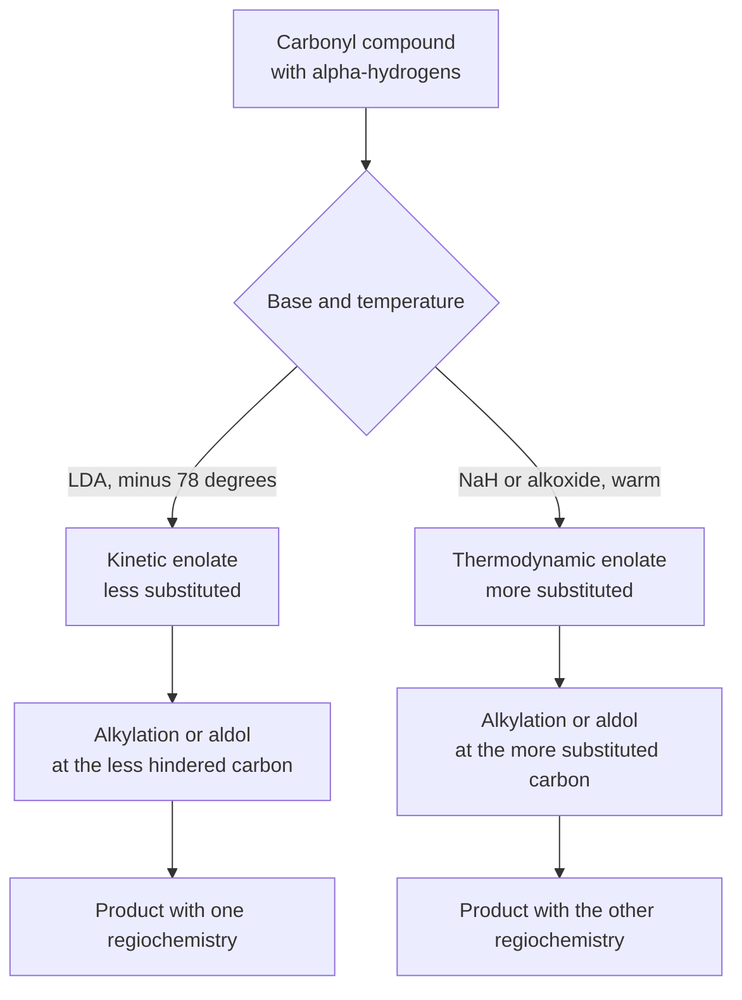
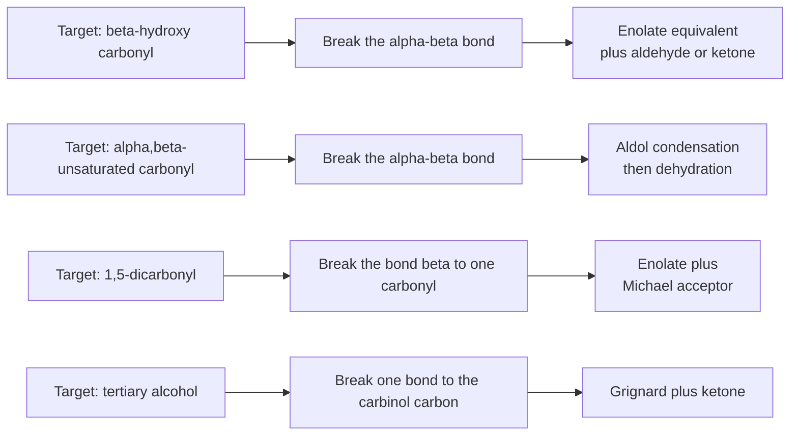

# Chapter 10 — Aldehydes, Ketones and Carbonyl Chemistry

> **Level:** Advanced (Level 4 — Organic Chemistry)
> **Estimated study time:** 10 hours (7 h reading + 3 h exercises)
> **Prerequisites:** Chapter 8 (nucleophilic substitution and elimination); Chapter 9 (alcohols and oxidation); Level 3 Chapter 3 (molecular orbital theory)
> **Related chapters:** [Alcohols, Phenols and Ethers](09-alcohols-phenols-and-ethers.md), [Carboxylic Acids, Esters, Amines and Amides](11-carboxylic-acids-esters-and-amines.md), [Pericyclic Reactions](13-pericyclic-reactions.md)
> **Difficulty:** ★★★★★ (4–5)

---

## 1. Learning Objectives

After working through this chapter you will be able to:

- Describe the bonding and polarity of the carbonyl group and explain why the carbonyl carbon is electrophilic.
- Write the mechanism of nucleophilic addition, including the tetrahedral intermediate, and account for the stereochemical outcome with chiral substrates.
- Rank aldehydes and ketones by reactivity using electronic and steric arguments.
- Predict the products of addition of cyanide, Grignard reagents, hydrides, alcohols, amines and sulfur nucleophiles, and choose between $\ce{NaBH4}$ and $\ce{LiAlH4}$.
- Explain how acetals are formed, hydrolysed and used as protecting groups, and how thioacetals invert the polarity of the carbonyl carbon.
- Explain keto–enol tautomerism and the acidity of $\alpha$-hydrogens, and distinguish the kinetic from the thermodynamic enolate.
- Construct aldol, Claisen, Michael, Mannich and Robinson products, and disassemble them retrosynthetically.
- Predict the outcome of the haloform and Cannizzaro reactions and explain why each requires its specific structural precondition.
- Apply the Wittig reaction to alkene synthesis and select conditions for $E$ or $Z$ selectivity.
- Use Tollens', Fehling's, iodoform and 2,4-dinitrophenylhydrazine tests to distinguish carbonyl compounds.
- Propose a carbonyl disconnection for a target alcohol, alkene or $\beta$-hydroxy carbonyl compound.

---

## 2. Introduction

The carbonyl group is the most versatile functional group in organic chemistry. A carbon doubly bonded to oxygen is planar, strongly polarised and attacked by nucleophiles; the same carbon bears hydrogens on the adjacent position that can be removed by base. One group therefore offers two reactive sites, and the interplay between them generates most of the carbon–carbon bond-forming reactions in the subject.

The group occurs in aldehydes ($\ce{RCHO}$), ketones ($\ce{R2CO}$), carboxylic acids and their derivatives, and in a vast range of natural products: sugars are polyhydroxy aldehydes and ketones, steroids are polycyclic ketones, and the reactivity of the carbonyl group underlies the chemistry of vision, blood clotting and enzyme catalysis. Industrially, formaldehyde is produced at more than 50 million tonnes per year and is the monomer for urea–formaldehyde and phenol–formaldehyde resins; acetone is a commodity solvent; and benzaldehyde is the parent of a large family of flavour and fragrance compounds.

The chapter is organised around three questions. First, what happens at the carbonyl carbon when a nucleophile arrives? Second, what happens at the $\alpha$-carbon when a base removes a proton? Third, how can the two be combined to make carbon–carbon bonds? The answers give the aldol, Claisen, Michael, Mannich and Robinson reactions, the Wittig olefination, and the classical tests that identify carbonyl compounds in the laboratory.

A warning about scope. Carbonyl chemistry is the point at which organic chemistry stops being a list of reactions and becomes a system. The aldol reaction, the Claisen condensation and the Michael addition are the same idea — an enolate attacking an electrophile — seen from three angles. Learn the idea, not the list; the list can then be reconstructed.

---

## 3. Fundamental Concepts

### 3.1 Bonding and polarity of the carbonyl group

The carbonyl carbon is $sp^2$ hybridised and bonded to three atoms, which makes the group planar with bond angles close to $120^\circ$. The $\ce{C=O}$ bond comprises a $\sigma$ bond and a $\pi$ bond formed by overlap of a carbon $2p$ orbital with an oxygen $2p$ orbital. The oxygen is more electronegative than carbon, so the $\pi$ electrons are polarised towards oxygen and the bond has a large dipole moment: 2.33 D for formaldehyde and 2.91 D for acetone.

| Property | Value | Consequence |
|---|---|---|
| $\ce{C=O}$ bond length | ≈ 122 pm | Shorter than a $\ce{C-O}$ single bond, 143 pm |
| $\ce{C=O}$ bond enthalpy | ≈ 745 kJ mol⁻¹ | Thermodynamically strong, but kinetically reactive |
| Dipole moment of $\ce{H2CO}$ | 2.33 D | Strongly polarised; carbon is electrophilic |
| Dipole moment of $\ce{(CH3)2CO}$ | 2.91 D | Alkyl groups increase the dipole |
| Geometry at carbon | Trigonal planar, $120^\circ$ | Nucleophiles approach perpendicular to the plane |

The polarisation is described by two resonance contributors:

$$
\ce{C=O <-> C+-O^-}
$$

The second contributor is minor, but it is the chemically decisive one: it places a partial positive charge on carbon and a partial negative charge on oxygen. The lowest unoccupied molecular orbital of the carbonyl group is the $\pi^*$ orbital, which has a large coefficient on carbon; nucleophiles donate into that orbital. This is the molecular-orbital statement of the same fact, and it explains why attack occurs at carbon rather than at oxygen.

### 3.2 Nomenclature and classification

Aldehydes are named with the suffix *-al*: methanal (formaldehyde), ethanal (acetaldehyde), benzaldehyde. Ketones take *-one*: propanone (acetone), cyclohexanone, butan-2-one. When the group must be cited as a prefix, the forms are *oxo* (for a ketone) and *formyl* (for an aldehyde). Common names remain widespread: formaldehyde, acetaldehyde, acetone, benzophenone, acetophenone.

### 3.3 Relative reactivity

Aldehydes are more reactive than ketones towards nucleophilic addition for two reasons.

- **Electronic.** Alkyl groups donate electron density inductively and stabilise the partial positive charge on the carbonyl carbon, so a ketone is less electrophilic than an aldehyde. The effect is modest but consistent.
- **Steric.** Two alkyl groups shield the carbonyl carbon, and the approach of a nucleophile is hindered. The effect becomes large with bulky groups such as tert-butyl.

Formaldehyde, with two hydrogens, is the most reactive carbonyl compound of all; it reacts with nucleophiles that fail with acetone. The order is

$$
\ce{HCHO} > \ce{RCHO} > \ce{R2CO} > \ce{Ar2CO}
$$

with aryl ketones least reactive because the ring conjugates with the carbonyl and delocalises the positive charge. Steric effects can override the electronic order: pinacolone, $\ce{(CH3)3CCOCH3}$, reacts slowly because the tert-butyl group blocks the approach.

### 3.4 Three reaction manifolds

A carbonyl compound can react in three distinct ways, and keeping them apart prevents most confusion.

1. **Nucleophilic addition at carbon.** The nucleophile adds to the carbonyl carbon, the $\pi$ bond breaks, and a tetrahedral alkoxide intermediate is protonated to give an alcohol. Grignard reagents, hydrides and cyanide follow this manifold.
2. **Addition–elimination at carbon.** The nucleophile adds, the tetrahedral intermediate collapses, and the oxygen leaves as water or an alkoxide. Imine formation and acetal formation are of this type: the overall result is replacement of $\ce{=O}$ by $\ce{=NR}$ or $\ce{-OR}$.
3. **Substitution at the $\alpha$-carbon.** A base removes an $\alpha$-hydrogen to give an enolate, which then attacks an electrophile. Alkylation, halogenation and the aldol reaction belong here.

A single reagent can sometimes do two of these. A Grignard reagent adds to a ketone to give an alkoxide, which is stable until aqueous work-up; with an ester, the first addition gives a tetrahedral intermediate that collapses to a ketone, which then reacts with a second equivalent of Grignard reagent. The outcome depends on which intermediate can collapse and which can survive.

### 3.5 The $\alpha$-carbon and its acidity

The carbon adjacent to a carbonyl group is called the $\alpha$-carbon, and its hydrogens are unusually acidic. The reason is that the resulting carbanion, an **enolate**, is stabilised by resonance: the negative charge is delocalised onto the electronegative oxygen.

$$
\ce{R2C=C(O^-)R' <-> R2C^--C(=O)R'}
$$

| Compound | $\mathrm{p}K_a$ of the $\alpha$-H | Consequence |
|---|---|---|
| Acetaldehyde | ≈ 16.7 | Enolises readily |
| Acetone | ≈ 19.3 | Enolises slowly but completely with strong base |
| Cyclohexanone | ≈ 16.7 | Similar to acetaldehyde |
| Ethyl acetate | ≈ 25.6 | Much less acidic; ester enolates need LDA |
| Acetylacetone | ≈ 9.0 | Two carbonyls stabilise the enolate |
| Nitromethane | ≈ 10.2 | Nitro group stabilises the anion |

The $\mathrm{p}K_a$ falls as the number of electron-withdrawing groups increases, which is why $\beta$-dicarbonyl compounds are deprotonated quantitatively by alkoxides while simple esters are not. A practical rule: a base can deprotonate an acid whose $\mathrm{p}K_a$ is at least two units lower than that of its conjugate acid. Ethoxide ($\mathrm{p}K_a$ of ethanol 16) can deprotonate a ketone ($\mathrm{p}K_a$ 19–20) only to a small extent, which is why aldol reactions with ketones often need forcing conditions; LDA ($\mathrm{p}K_a$ of diisopropylamine 36) deprotonates ketones completely.

---

## 4. Detailed Scientific Explanation

### 4.1 The mechanism of nucleophilic addition

The addition of a nucleophile to a carbonyl group proceeds in two stages.

1. The nucleophile donates a lone pair into the $\pi^*$ orbital of the carbonyl, forming a bond to carbon and pushing the $\pi$ electrons onto oxygen. The carbonyl carbon rehybridises from $sp^2$ to $sp^3$, and the group becomes tetrahedral.
2. The resulting alkoxide is protonated by the solvent or by aqueous acid during work-up.

The curly-arrow description is:

1. Lone pair on $\ce{Nu^-}$ → $\ce{C=O}$ carbon.
2. $\pi$ electrons of $\ce{C=O}$ → oxygen, giving $\ce{O^-}$.
3. Proton transfer from the medium to $\ce{O^-}$.

The intermediate is a **tetrahedral alkoxide**. Its formation is usually rate-determining, so the reaction rate depends on the electrophilicity of the carbonyl and on the strength of the nucleophile. With a chiral carbonyl compound, attack from the two faces is diastereotopic, so the two products are diastereomers and are formed in unequal amounts — the basis of the Felkin–Anh model of stereoselective addition.

When the nucleophile is a hydride or a carbanion, the alkoxide cannot eliminate anything, so the product is an alcohol. When the nucleophile is an amine or an alcohol, the tetrahedral intermediate can lose water, and the product is an imine or an acetal. The same first step therefore leads to two different overall outcomes, decided by whether the intermediate has a leaving group on oxygen.

### 4.2 Cyanohydrins

Hydrogen cyanide adds to aldehydes and ketones in the presence of a trace of base:

$$
\ce{R2C=O + HCN <=> R2C(OH)CN}
$$

The base generates a small concentration of cyanide ion, which is the actual nucleophile; the proton comes from HCN. The reaction is reversible and the equilibrium lies towards the cyanohydrin for aldehydes and unhindered ketones, but towards the carbonyl compound for hindered ketones. Cyanide is a poor leaving group unless it is protonated or unless the alkoxide is expelled, so the cyanohydrin is stable under neutral conditions and can be isolated.

The synthetic value of cyanohydrins is that hydrolysis gives an $\alpha$-hydroxy acid, and reduction gives an $\alpha$-hydroxy amine. Acetone cyanohydrin is the industrial precursor to methyl methacrylate, the monomer for poly(methyl methacrylate), and the cyanohydrin is also a masked carbonyl: deprotonation at the $\alpha$-carbon gives a nucleophile equivalent to an acyl anion, the simplest example of umpolung.

### 4.3 Grignard and organolithium additions

A Grignard reagent adds to a carbonyl compound to give an alkoxide, which is protonated on work-up:

$$
\ce{RMgX + R'2C=O -> R'2C(OMgX)R ->[H3O+] R'2C(OH)R}
$$

The product depends on the carbonyl compound:

| Carbonyl compound | Product after work-up | Carbon added |
|---|---|---|
| Formaldehyde | Primary alcohol | One |
| Other aldehyde | Secondary alcohol | One |
| Ketone | Tertiary alcohol | One |
| Ester | Tertiary alcohol with two identical groups | Two |
| Acid chloride | Tertiary alcohol, or ketone at low temperature | Two or one |
| Carbon dioxide | Carboxylic acid | One |
| Epoxide | Alcohol with a two-carbon extension | Two |
| Nitrile | Ketone after hydrolysis | One |

The ester case is the one that surprises students. The first equivalent adds to give a tetrahedral intermediate, which collapses and expels the alkoxide to give a ketone. The ketone is more electrophilic than the ester, so it reacts immediately with a second equivalent, and the product is a tertiary alcohol with two identical groups. To stop at the ketone, the ester must be replaced by a less reactive derivative such as a Weinreb amide, or the nucleophile must be an organocuprate, which transfers only one group.

Grignard reagents are destroyed by acidic protons, so the substrate must not contain an alcohol, an amine, a carboxylic acid or a terminal alkyne. They also add to the carbonyl of an amide or an ester elsewhere in the molecule, so those groups must be protected. Organolithiums are even more reactive and are used when a Grignard fails, for example with hindered ketones or with substrates that react only slowly.

### 4.4 Hydride reagents

Sodium borohydride and lithium aluminium hydride both deliver hydride, but their reducing power is very different.

| Reagent | Conditions | Reduces | Does not reduce |
|---|---|---|---|
| $\ce{NaBH4}$ | Methanol or ethanol, $0\ ^\circ\text{C}$ to room temperature | Aldehydes, ketones, acid chlorides | Esters, carboxylic acids, amides, nitriles |
| $\ce{LiAlH4}$ | Dry ether or THF, $0\ ^\circ\text{C}$ to reflux | Aldehydes, ketones, esters, acids, amides, nitriles | Isolated alkenes |
| $\ce{DIBAL-H}$ | Toluene or $\ce{CH2Cl2}$, $-78\ ^\circ\text{C}$ | Esters and nitriles to aldehydes | Alcohols (at low temperature) |
| $\ce{NaBH3CN}$ | Methanol, pH 5–6 | Imines and iminium ions | Ketones and aldehydes slowly |

The selectivity follows from the polarisation of the reagent. The $\ce{B-H}$ bond is less polar than the $\ce{Al-H}$ bond, so borohydride is a milder hydride donor and is used when a ketone must be reduced in the presence of an ester. Lithium aluminium hydride is used when the stronger reagent is required, but it must be handled in dry solvent because it reacts violently with water.

The mechanism is a sequence of hydride transfers. Each transfer converts a carbonyl group into an alkoxide, and the aluminium or boron centre coordinates the oxygen, activating the carbonyl towards further transfer. With $\ce{LiAlH4}$ and an ester, the first transfer gives a tetrahedral intermediate that collapses to an aldehyde, which is reduced again; that is why esters give primary alcohols rather than aldehydes, and why DIBAL-H at low temperature, where collapse is slow, can stop at the aldehyde.

### 4.5 Acetals and ketals: formation, hydrolysis and protection

An aldehyde reacts with one equivalent of an alcohol to give a **hemiacetal**, and with a second equivalent to give an **acetal**:

$$
\ce{RCHO + R'OH <=> RCH(OH)OR' <=> RCH(OR')2}
$$

The reaction requires acid catalysis. The mechanism is:

1. Protonation of the carbonyl oxygen.
2. Attack by the alcohol to give a protonated hemiacetal.
3. Loss of a proton to give the neutral hemiacetal.
4. Protonation of the hydroxyl group and loss of water to give an oxocarbenium ion.
5. Attack by a second alcohol molecule and loss of a proton to give the acetal.

Each step is reversible, so the equilibrium can be driven by removing water (Dean–Stark apparatus or molecular sieves) or by using an excess of the alcohol. Cyclic acetals form especially readily because the intramolecular second step is entropically favoured: ethylene glycol gives a 1,3-dioxolane, and 2,2-dimethoxypropane is used to convert diols into acetonides with acetone as the by-product.

The synthetic importance of acetals is that they are **stable to base and to nucleophiles** but are hydrolysed by aqueous acid. A ketone can therefore be protected as a ketal while a Grignard reaction, a hydride reduction or an enolate alkylation is carried out elsewhere in the molecule, and then unmasked by treatment with dilute acid. The same chemistry explains why sugars exist mainly as cyclic hemiacetals: the hydroxyl group at C5 attacks the aldehyde at C1 to give a six-membered ring, and the anomeric carbon retains the ability to open and close.

**Thioacetals** are the sulfur analogues, formed with a thiol under acid catalysis:

$$
\ce{R2C=O + 2R'SH -> R2C(SR')2 + H2O}
$$

They are more stable than acetals and are cleaved by mercury(II) salts or by oxidants rather than by acid. Their special value is that deprotonation at the carbon between the two sulfur atoms gives a nucleophile, a **dithiane anion**, which is the reverse of the normal carbonyl polarity: the carbon that was electrophilic becomes nucleophilic. This is the standard umpolung of an acyl anion, and it is used to make ketones that cannot be made by direct addition.

### 4.6 Nitrogen nucleophiles

**Imines.** A primary amine condenses with an aldehyde or ketone to give an imine (Schiff base):

$$
\ce{R2C=O + R'NH2 <=> R2C=NR' + H2O}
$$

The mechanism is the same addition–elimination sequence as acetal formation, with the amine as the nucleophile and water as the leaving group. The pH optimum is slightly acidic, around 4.5–5: too acidic and the amine is protonated and unreactive, too basic and the carbonyl is not activated and the elimination of hydroxide is slow. Imines are hydrolysed by aqueous acid, so they are stable only under neutral or basic conditions.

**Enamines.** A secondary amine cannot form a stable imine, because it has no hydrogen to lose after addition. Instead, the iminium ion loses a proton from the $\alpha$-carbon to give an enamine:

$$
\ce{R2C=O + R'2NH -> R2C=CHNR'2 + H2O}
$$

Enamines are the nitrogen analogues of enols and enolates, and they are nucleophilic at the $\beta$-carbon. The Stork enamine synthesis uses this: an enamine attacks an alkyl halide or an Michael acceptor, and hydrolysis of the product regenerates the carbonyl. Enamines are also the intermediates in the Mannich reaction.

**Hydrazones and oximes.** Hydrazine, hydroxylamine and 2,4-dinitrophenylhydrazine all condense with carbonyl compounds. The 2,4-dinitrophenylhydrazone is a crystalline yellow or orange solid with a sharp melting point, which is why 2,4-dinitrophenylhydrazine (Brady's reagent) is used to identify unknown carbonyl compounds.

**Reductive amination.** An aldehyde or ketone and an amine can be condensed and then reduced in one pot:

$$
\ce{R2C=O + R'NH2 ->[NaBH3CN,\ pH\ 5] R2CH-NHR'}
$$

The imine is formed first and is reduced by the mild hydride donor, which does not reduce the carbonyl compound itself at the working pH. This is one of the most useful ways to make secondary and tertiary amines.

### 4.7 Sulfur nucleophiles

Thiols are stronger nucleophiles than alcohols and form thioacetals readily. Hydrogen sulfite (from sodium bisulfite) adds to aldehydes and to unhindered methyl ketones to give a crystalline bisulfite adduct, which is used to purify aldehydes: the adduct precipitates, is filtered, and is then decomposed with acid or base to release the carbonyl compound.

### 4.8 Enolisation, tautomerism and enolates

A carbonyl compound with an $\alpha$-hydrogen exists in equilibrium with its **enol**:

$$
\ce{R2CH-C(=O)R' <=> R2C=C(OH)R'}
$$

The keto form usually dominates: for acetone the enol content is about $1.5 \times 10^{-6}$, and for simple ketones it is typically $10^{-5}$ to $10^{-6}$. For acetylacetone, where the enol is stabilised by an intramolecular hydrogen bond and by conjugation, the enol content is about 80%; for phenol the enol form is essentially the only form.

Tautomerism is catalysed by both acid and base. In acid, protonation of the carbonyl oxygen is followed by loss of the $\alpha$-proton; in base, deprotonation of the $\alpha$-carbon is followed by protonation of oxygen. The interconversion is fast, which is why the configuration at an $\alpha$-carbon is easily lost under basic conditions.

The **enolate** is the conjugate base of the ketone and the key nucleophile of carbonyl chemistry. Its reactivity depends on how it is made:

- **Kinetic enolate.** Formed by deprotonation with a hindered strong base such as LDA at $-78\ ^\circ\text{C}$. The base removes the most accessible proton, so the less substituted enolate forms fastest, and it is trapped before it can equilibrate.
- **Thermodynamic enolate.** Formed with a small base at higher temperature or with a longer equilibration time. The more substituted enolate is more stable, so it dominates at equilibrium.

The distinction is the basis of regiocontrol in enolate alkylation and in the directed aldol reaction. Deprotonating 2-methylcyclohexanone with LDA at $-78\ ^\circ\text{C}$ gives the kinetic enolate at C6; deprotonating with sodium hydride at room temperature gives the thermodynamic enolate at C2.

### 4.9 The aldol condensation

Two molecules of an aldehyde or ketone react in the presence of base: the enolate of one attacks the carbonyl carbon of the other, and the product is a $\beta$-hydroxy carbonyl compound. This is the **aldol addition**. On heating, the $\beta$-hydroxy carbonyl compound loses water to give an $\alpha$,$\beta$-unsaturated carbonyl compound, and this second stage is the **aldol condensation**.

$$
\ce{2CH3CHO ->[OH^-] CH3CH(OH)CH2CHO ->[\Delta] CH3CH=CHCHO + H2O}
$$

The mechanism is:

1. Hydroxide removes an $\alpha$-hydrogen to give the enolate.
2. The enolate attacks the carbonyl carbon of a second molecule.
3. The alkoxide is protonated by water to give the $\beta$-hydroxy aldehyde.
4. On heating, a second enolate forms and eliminates hydroxide to give the enone.

The dehydration is favoured because the conjugated enone is more stable than the $\beta$-hydroxy compound, and because water is removed from the equilibrium.

**Crossed aldol reactions.** When two different carbonyl compounds are used, four products are possible unless one partner has no $\alpha$-hydrogen. Benzaldehyde, formaldehyde and ethyl formate have no $\alpha$-hydrogen, so they can only act as electrophiles; the enolate of the other partner attacks them exclusively. This is the basis of the Claisen–Schmidt reaction, which gives chalcones and cinnamaldehydes.

**Directed aldol.** A preformed enolate can be added to a chosen aldehyde, which gives control over which partner acts as nucleophile. LDA at $-78\ ^\circ\text{C}$ gives the kinetic enolate, and the aldehyde is added afterwards.

**Intramolecular aldol.** A diketone can fold so that one carbonyl forms an enolate and attacks the other, giving a ring. Five- and six-membered rings form readily; this is the second half of the Robinson annulation.

### 4.10 The Claisen condensation

Two esters react in the presence of a strong alkoxide base to give a $\beta$-keto ester:

$$
\ce{2CH3CO2C2H5 ->[NaOC2H5,\ C2H5OH] CH3COCH2CO2C2H5 + C2H5OH}
$$

The mechanism is an addition–elimination at the ester carbonyl: the enolate of one ester attacks the other, the tetrahedral intermediate collapses and expels ethoxide, and the product is deprotonated at the $\alpha$-carbon because the $\beta$-keto ester is far more acidic ($\mathrm{p}K_a \approx 11$) than the starting ester ($\mathrm{p}K_a \approx 25$). That final deprotonation is the thermodynamic driving force: the reaction consumes one equivalent of base and gives the enolate of the product.

The base must match the alkoxide of the ester, otherwise transesterification competes. The **Dieckmann condensation** is the intramolecular version and gives five- or six-membered rings. The product $\beta$-keto ester is a useful intermediate: hydrolysis and decarboxylation give a ketone (Chapter 11), and alkylation followed by hydrolysis gives a substituted ketone.

### 4.11 Michael addition and the Robinson annulation

An enolate is a soft nucleophile and attacks the soft $\beta$-carbon of an $\alpha$,$\beta$-unsaturated carbonyl rather than the harder carbonyl carbon, in a conjugate addition, or **Michael addition**:

$$
\ce{CH3COCH3 + CH2=CHCOCH3 ->[base] CH3COCH2CH2CH2COCH3}
$$

The product is a 1,5-dicarbonyl compound, which is set up for a subsequent intramolecular aldol. When the two steps are combined in one pot, the result is the **Robinson annulation**, a six-membered ring annulation that is one of the most powerful ring-forming reactions in synthesis:

$$
\ce{C6H10O + C4H6O ->[base] C10H14O + H2O}
$$

The mechanism is Michael addition of the cyclohexanone enolate to methyl vinyl ketone, giving a 1,5-diketone, followed by intramolecular aldol condensation to close the second ring and dehydrate. The product is a bicyclic $\alpha$,$\beta$-unsaturated ketone, the skeleton of many steroids, and the reaction is a standard way to build the CD ring system of steroids and the core of the Wieland–Miescher ketone.

### 4.12 The Mannich reaction

An enolate (or enol) of a carbonyl compound adds to an iminium ion formed from formaldehyde and a primary or secondary amine:

$$
\ce{RCOCH3 + CH2O + R'2NH ->[H+] RCOCH2CH2NR'2 + H2O}
$$

The product is a $\beta$-aminocarbonyl compound, called a Mannich base. The reaction is used to introduce an aminomethyl group, and the product can be converted into an $\alpha$,$\beta$-unsaturated ketone by elimination of the amine, which makes the Mannich reaction a route to enones that avoids the aldol.

### 4.13 The haloform reaction

A methyl ketone reacts with halogen and base to give a haloform and a carboxylate:

$$
\ce{CH3COCH3 + 3I2 + 4OH^- -> CHI3 v + CH3COO^- + 3I^- + 3H2O}
$$

The mechanism is a sequence of $\alpha$-halogenations followed by nucleophilic acyl substitution. Each halogenation replaces an $\alpha$-hydrogen by halogen; the trihalomethyl ketone is then attacked by hydroxide, and the trihalomethyl group departs as a stabilised carbanion, which picks up a proton to give the haloform. The carboxylate is the other product.

The reaction requires a methyl group on the carbonyl carbon, and it is the basis of the iodoform test: a positive test gives a yellow precipitate of triiodomethane, and it is given by acetaldehyde, methyl ketones and secondary alcohols of the type $\ce{CH3CH(OH)R}$, which are oxidised to methyl ketones under the reaction conditions. Ethanol gives a positive iodoform test for the same reason.

### 4.14 The Cannizzaro reaction

An aldehyde with no $\alpha$-hydrogen undergoes disproportionation in concentrated base: one molecule is oxidised to a carboxylate and another is reduced to an alcohol.

$$
\ce{2C6H5CHO + NaOH -> C6H5CH2OH + C6H5COO^-Na+}
$$

The mechanism is a hydride transfer. Hydroxide attacks the carbonyl carbon of one molecule to give a tetrahedral intermediate, which transfers hydride to the carbonyl carbon of a second molecule. The donor becomes a carboxylate and the acceptor becomes an alkoxide, which is protonated to the alcohol. Because the reaction requires a hydride transfer from a tetrahedral intermediate, it only works for aldehydes that cannot enolise: if an $\alpha$-hydrogen is present, the aldol reaction is much faster.

In a **crossed Cannizzaro** with formaldehyde, formaldehyde is the hydride donor and the other aldehyde is reduced: formaldehyde is oxidised to formate, and the more valuable aldehyde becomes the alcohol. This is used to convert aromatic aldehydes into benzylic alcohols.

### 4.15 The Wittig reaction

A phosphonium ylide reacts with a carbonyl compound to give an alkene and triphenylphosphine oxide:

$$
\ce{(C6H5)3P=CHR + R'2C=O -> R'2C=CHR + (C6H5)3P=O}
$$

The ylide is prepared in two steps: triphenylphosphine displaces the halide from an alkyl halide to give a phosphonium salt, and a strong base removes a proton from the carbon adjacent to phosphorus.

$$
\ce{(C6H5)3P + RCH2Br -> [(C6H5)3PCH2R]+ Br^- ->[C4H9Li] (C6H5)3P=CHR}
$$

The mechanism is a cycloaddition: the ylide carbon and the carbonyl carbon form a four-membered ring, an oxaphosphetane, which collapses to the alkene and the phosphine oxide. The driving force is the formation of the very strong $\ce{P=O}$ bond.

The stereochemistry depends on the ylide. **Stabilised ylides**, which carry an electron-withdrawing group such as an ester on the ylide carbon, give mainly the $E$-alkene because the intermediate oxaphosphetane equilibrates before collapse. **Unstabilised ylides**, such as the parent methylenetriphenylphosphorane, give mainly the $Z$-alkene under salt-free conditions because the reaction is under kinetic control. The Horner–Wadsworth–Emmons reaction, which uses a phosphonate ester instead of a phosphonium salt, gives $E$-alkenes reliably and is often preferred for that reason.

### 4.16 Oxidation and reduction of carbonyl compounds

Aldehydes are easily oxidised to carboxylic acids; ketones are not, because the carbonyl carbon has no hydrogen. Tollens' reagent (ammoniacal silver nitrate) oxidises aldehydes to carboxylates and deposits metallic silver as a mirror; Fehling's solution (copper(II) tartrate in alkali) oxidises aliphatic aldehydes to carboxylates and precipitates red copper(I) oxide. Aromatic aldehydes reduce Tollens' reagent but not Fehling's solution, which distinguishes benzaldehyde from an aliphatic aldehyde. Reduction follows the hydride reagents of Section 4.4: $\ce{NaBH4}$ for aldehydes and ketones, $\ce{LiAlH4}$ when esters or acids are also present, and catalytic hydrogenation when a double bond must be reduced at the same time.

### 4.17 Planning a carbonyl disconnection

The carbonyl group is the most useful retrosynthetic handle in organic chemistry, because several reliable reactions make it.

| Target feature | Disconnection | Reagents |
|---|---|---|
| Secondary alcohol | $\ce{C-C}$ bond to the carbinol carbon | Grignard + aldehyde |
| Tertiary alcohol | One of the three $\ce{C-C}$ bonds | Grignard + ketone |
| $\beta$-Hydroxy carbonyl | $\alpha$-$\beta$ bond | Aldol |
| $\alpha$,$\beta$-Unsaturated carbonyl | $\alpha$-$\beta$ bond | Aldol condensation, or Wittig |
| 1,5-Dicarbonyl | $\alpha$-$\beta$ bond | Michael addition |
| Cyclohexenone | Two bonds of the ring | Robinson annulation |
| Alkene | $\ce{C=C}$ | Wittig, or Diels–Alder (Chapter 13) |

A worked disconnection proceeds in three steps: identify the target's carbon skeleton and functional groups, break a bond that a known reaction can form, and check that the resulting fragments are available and that the functional groups are compatible. Chapter 14 develops the full method; here the point is that carbonyl chemistry supplies the largest set of reliable disconnections.

---

## 5. Visual Diagrams

**Figure 10.1 — One first step, two families of product.** Every nucleophilic addition begins with the same attack and the same tetrahedral intermediate; the fork in the diagram is decided by whether the oxygen can leave. Hydride and carbanion nucleophiles give alcohols because there is nothing to expel, whereas amines and alcohols give imines and acetals because water or alkoxide can leave. Recognising the fork removes the need to memorise the individual reactions separately.

**Figure 10.2 — The protection cycle for a ketone.** The upper route is the protected pathway: the ketone is converted into a ketal, the incompatible chemistry is performed, and the ketone is restored by acid hydrolysis. The lower route shows what would happen without protection. The cycle is worth two steps only when the ketal is genuinely inert to everything that follows, which is why the choice of protecting group is made by looking at the whole sequence rather than at a single step.

**Figure 10.3 — Kinetic and thermodynamic control of enolate formation.** The two enolates are the same species family but differ in which $\alpha$-carbon carries the double bond. Low temperature and a hindered base trap the enolate that forms fastest; higher temperature and a small base allow equilibration to the more substituted, more stable enolate. The figure is the regiochemical control element of every enolate reaction that follows, including the directed aldol and the alkylation of unsymmetrical ketones.

**Figure 10.4 — Four carbonyl disconnections and the reactions that reverse them.** Each row pairs a target motif with the bond that a reliable reaction can form, and the right-hand column names the reagents that make that bond. The diagram is a lookup table for retrosynthetic planning rather than a mechanism: the curved arrows belong to the forward reaction, and the analysis runs from right to left. Chapter 14 extends the table with protecting-group and selectivity considerations.

---

## 6. Mathematical Formulas

### 6.1 Equilibrium and Gibbs energy

For any reversible addition,

$$
\Delta G^\circ = -RT \ln K
\qquad
K = e^{-\Delta G^\circ/(RT)}
$$

| Symbol | Meaning | SI unit |
|---|---|---|
| $\Delta G^\circ$ | standard Gibbs energy change | J mol⁻¹ |
| $R$ | gas constant, 8.314 | J K⁻¹ mol⁻¹ |
| $T$ | thermodynamic temperature | K |
| $K$ | equilibrium constant | dimensionless |

At $298\ \text{K}$, $RT = 2.479\ \text{kJ mol}^{-1}$, so a change of $5.7\ \text{kJ mol}^{-1}$ in $\Delta G^\circ$ corresponds to a factor of ten in $K$. This is why a difference of a few kilojoules decides whether a cyanohydrin or an acetal is stable.

### 6.2 Extent of hydration and enolisation

$$
K_{\text{hyd}} = \frac{[\ce{R2C(OH)2}]}{[\ce{R2C=O}]}
\qquad
\%\ \text{enol} = \frac{[\text{enol}]}{[\text{keto}] + [\text{enol}]} \times 100
$$

| Carbonyl compound | $K_{\text{hyd}}$ in water | Enol content |
|---|---|---|
| Formaldehyde | ≈ $2 \times 10^{3}$ | Negligible |
| Acetaldehyde | ≈ 1 | ≈ $6 \times 10^{-5}$ |
| Acetone | ≈ $2 \times 10^{-3}$ | ≈ $1.5 \times 10^{-6}$ |
| Acetylacetone | Small | ≈ 0.8 |

The two columns run in opposite directions because they measure different things: hydration reflects the electrophilicity of the carbonyl carbon, whereas enolisation reflects the stability of the enol. Acetone is poorly hydrated but measurably enolised; acetylacetone is extensively enolised because its enol is conjugated and intramolecularly hydrogen-bonded.

### 6.3 Acid–base balance for enolate formation

A base $\ce{B^-}$ deprotonates a carbonyl compound $\ce{HA}$ according to

$$
K = \frac{[\ce{A^-}][\ce{BH}]}{[\ce{HA}][\ce{B^-}]} = 10^{\,\mathrm{p}K_a(\ce{BH}) - \mathrm{p}K_a(\ce{HA})}
$$

For ethoxide ($\mathrm{p}K_a$ of ethanol 16) and acetone ($\mathrm{p}K_a$ 19.3), $K = 10^{-3.3} \approx 5 \times 10^{-4}$: only about 0.05% of the ketone is enolised at equilibrium. For LDA ($\mathrm{p}K_a$ of diisopropylamine 36), $K = 10^{16.7}$, so deprotonation is essentially complete. The equation is the quantitative form of the rule that a base must be substantially stronger than the conjugate base of the substrate.

### 6.4 Yields in condensation reactions

For an aldol addition that reaches equilibrium, the yield of the $\beta$-hydroxy carbonyl compound is obtained from its formation constant in the same way as for esterification. When the condensation is followed by dehydration, the water is removed and the second step is effectively irreversible, so the yield is limited by the first step and by any competing reactions rather than by the equilibrium.

### 6.5 Atom economy of a Wittig reaction

$$
\text{Atom economy} = \frac{M(\text{alkene})}{M(\text{ylide}) + M(\text{carbonyl})} \times 100\%
$$

For the reaction of methylenetriphenylphosphorane ($M = 276.3\ \text{g mol}^{-1}$) with benzaldehyde ($M = 106.1\ \text{g mol}^{-1}$) to give styrene ($M = 104.2\ \text{g mol}^{-1}$), the atom economy is

$$
\frac{104.2}{276.3 + 106.1} \times 100\% = 27.3\%
$$

The remaining 73% becomes triphenylphosphine oxide, which is the principal weakness of the Wittig reaction and the reason the Horner–Wadsworth–Emmons variant, which uses a smaller phosphonate, is often preferred.

---

## 7. Chemical Equations

### 7.1 Cyanohydrin formation and hydrolysis

$$
\ce{CH3COCH3 + HCN ->[KCN,\ trace] (CH3)2C(OH)CN}
$$

$$
\ce{(CH3)2C(OH)CN + 2H2O ->[H2SO4] (CH3)2C(OH)CO2H + NH4+}
$$

### 7.2 Grignard additions

$$
\ce{CH3MgBr + HCHO -> CH3CH2OH}
\qquad \text{primary alcohol}
$$

$$
\ce{CH3MgBr + CH3CHO -> CH3CH(OH)CH3}
\qquad \text{secondary alcohol}
$$

$$
\ce{CH3MgBr + CH3COCH3 -> (CH3)3COH}
\qquad \text{tertiary alcohol}
$$

$$
\ce{2CH3MgBr + CH3COOCH3 -> (CH3)3COH + CH3OH}
\qquad \text{two additions}
$$

$$
\ce{CH3MgBr + CO2 -> CH3CO2MgBr ->[H3O+] CH3COOH}
$$

### 7.3 Hydride reductions

$$
\ce{CH3CHO + NaBH4 ->[CH3OH] CH3CH2OH}
$$

$$
\ce{CH3COOCH2CH3 + LiAlH4 ->[C2H5OC2H5] 2CH3CH2OH}
$$

$$
\ce{CH3COOCH2CH3 + DIBAL-H ->[-78\ ^\circ C] CH3CHO}
$$

### 7.4 Acetal formation and hydrolysis

$$
\ce{CH3CHO + 2CH3OH ->[HCl,\ dry] CH3CH(OCH3)2 + H2O}
$$

$$
\ce{CH3CH(OCH3)2 + H2O ->[H+] CH3CHO + 2CH3OH}
$$

$$
\ce{(CH3)2C=O + HOCH2CH2OH ->[CH3C6H4SO3H,\ \Delta] C5H10O2 + H2O}
$$

### 7.5 Imine, enamine and reductive amination

$$
\ce{C6H5CHO + C6H5NH2 ->[pH\ 5] C6H5CH=NC6H5 + H2O}
$$

$$
\ce{CH3COCH3 + (CH3)2NH ->[H+] (CH3)2C=CHN(CH3)2 + H2O}
$$

$$
\ce{C6H5CHO + CH3NH2 ->[NaBH3CN,\ pH\ 5] C6H5CH2NHCH3}
$$

### 7.6 Aldol and Claisen condensations

$$
\ce{2CH3CHO ->[OH^-] CH3CH(OH)CH2CHO ->[\Delta] CH3CH=CHCHO + H2O}
$$

$$
\ce{C6H5CHO + CH3CHO ->[OH^-] C6H5CH=CHCHO + H2O}
\qquad \text{Claisen–Schmidt}
$$

$$
\ce{2CH3CO2C2H5 ->[NaOC2H5] CH3COCH2CO2C2H5 + C2H5OH}
$$

### 7.7 Michael addition and Robinson annulation

$$
\ce{CH3COCH3 + CH2=CHCOCH3 ->[OH^-] CH3COCH2CH2CH2COCH3}
$$

$$
\ce{C6H10O + CH2=CHCOCH3 ->[NaOC2H5] C10H14O + H2O}
$$

### 7.8 Mannich, haloform and Cannizzaro reactions

$$
\ce{CH3COCH3 + CH2O + (CH3)2NH ->[H+] CH3COCH2CH2N(CH3)2 + H2O}
$$

$$
\ce{CH3COCH3 + 3I2 + 4OH^- -> CHI3 v + CH3COO^- + 3I^- + 3H2O}
$$

$$
\ce{2C6H5CHO + NaOH -> C6H5CH2OH + C6H5COO^-Na+}
$$

### 7.9 Wittig reaction

$$
\ce{C6H5CHO + (C6H5)3P=CHCO2C2H5 -> C6H5CH=CHCO2C2H5 + (C6H5)3P=O}
\qquad \text{stabilised ylide; E-alkene}
$$

$$
\ce{C6H5CHO + (C6H5)3P=CH2 -> C6H5CH=CH2 + (C6H5)3P=O}
\qquad \text{unstabilised ylide}
$$

### 7.10 Qualitative tests

$$
\ce{RCHO + 2[Ag(NH3)2]+ + 2OH^- -> RCOO^- + 2Ag v + 4NH3 + H2O}
$$

$$
\ce{RCHO + 2Cu^2+ + 5OH^- -> RCOO^- + Cu2O v + 3H2O}
$$

$$
\ce{R2C=O + H2N-NH-C6H3(NO2)2 -> R2C=N-NH-C6H3(NO2)2 v + H2O}
$$

---

## 8. Worked Examples

### Worked Example 10.1 — Products of nucleophilic addition

**Problem.** Give the product of each reaction: (a) propanal with KCN and a trace of acid; (b) cyclohexanone with methylmagnesium bromide, then aqueous acid; (c) ethyl acetate with two equivalents of phenylmagnesium bromide, then acid; (d) butanal with sodium borohydride in methanol.

**Strategy.** Identify whether the nucleophile can leave after addition. Cyanide and hydride give stable alkoxides; a Grignard gives an alkoxide that survives until work-up; an ester can react twice.

**Solution.**

(a) Cyanide adds to the aldehyde carbon and the alkoxide is protonated, giving 2-hydroxybutanenitrile, $\ce{CH3CH2CH(OH)CN}$.

(b) One equivalent of Grignard adds to the ketone; work-up gives 1-methylcyclohexanol.

(c) The first equivalent gives a tetrahedral intermediate that collapses to acetophenone, which is more electrophilic than the ester and reacts with the second equivalent. The product is 1,1-diphenylethanol, $\ce{CH3C(OH)(C6H5)2}$, a tertiary alcohol with two identical phenyl groups.

(d) Borohydride transfers hydride to the aldehyde carbon; work-up gives butan-1-ol.

**Check.** Each product has gained one nucleophile and one hydrogen and has lost the $\ce{C=O}$ $\pi$ bond. In (c) the count of phenyl groups confirms that both equivalents were consumed, which is the signature of the ester double addition.

### Worked Example 10.2 — Protecting a ketone from a hydride

**Problem.** A molecule contains a cyclohexanone ring and an ethyl ester. You need to reduce the ester to a primary alcohol with $\ce{LiAlH4}$ without reducing the ketone. Propose a protecting-group strategy with reagents.

**Strategy.** $\ce{LiAlH4}$ reduces both ketones and esters, so the ketone must be converted into a group that is inert to hydride before the reduction.

**Solution.** Treat the compound with ethane-1,2-diol and a catalytic acid such as 4-toluenesulfonic acid in refluxing benzene, removing water with a Dean–Stark trap. The ketone becomes a cyclic ketal (a 1,3-dioxolane), which is inert to hydride. Then add $\ce{LiAlH4}$ in dry THF to reduce the ester to the primary alcohol, and finally stir the product with dilute aqueous acid to hydrolyse the ketal and restore the ketone.

**Check.** Each step is orthogonal: the ketal survives $\ce{LiAlH4}$, and the alcohol produced by reduction survives dilute acid. If the order were reversed — reduce first, then protect — the ketone would already have been destroyed.

### Worked Example 10.3 — An aldol disconnection

**Problem.** Propose a synthesis of 4-hydroxy-4-methylpentan-2-one (diacetone alcohol) and of its dehydration product, 4-methylpent-3-en-2-one (mesityl oxide).

**Strategy.** The target is a $\beta$-hydroxy ketone, so disconnect the bond between the $\alpha$- and $\beta$-carbons to reveal two acetone molecules.

**Solution.** The disconnection gives acetone as both nucleophile and electrophile. Treatment of acetone with a catalytic amount of barium hydroxide or sodium hydroxide gives the aldol addition product:

$$
\ce{2CH3COCH3 <=> (CH3)2C(OH)CH2COCH3}
$$

The equilibrium lies towards the starting ketone, so the alcohol is obtained in modest yield unless acetone is removed or the product is trapped. Warming with acid or base dehydrates the aldol to mesityl oxide:

$$
\ce{(CH3)2C(OH)CH2COCH3 ->[H+] (CH3)2C=CHCOCH3 + H2O}
$$

**Check.** The carbon count is correct (six carbons from two acetones), the $\beta$-hydroxy ketone has the hydroxy group on the carbon that was the electrophilic carbonyl, and the enone is conjugated, which explains why dehydration is favourable.

### Worked Example 10.4 — Wittig selectivity

**Problem.** Propose syntheses of (E)-ethyl cinnamate and of the corresponding $Z$-alkene from benzaldehyde, and explain how the choice of ylide controls the geometry.

**Strategy.** Use a stabilised ylide for the $E$-isomer and an unstabilised ylide, or the Schlosser modification, for the $Z$-isomer.

**Solution.** For the $E$-alkene, treat benzaldehyde with the stabilised ylide $\ce{(C6H5)3P=CHCO2C2H5}$, prepared from ethyl bromoacetate and triphenylphosphine followed by a base. The electron-withdrawing ester group stabilises the ylide and allows the oxaphosphetane intermediate to equilibrate, so the more stable $E$-isomer dominates:

$$
\ce{C6H5CHO + (C6H5)3P=CHCO2C2H5 -> C6H5CH=CHCO2C2H5 + (C6H5)3P=O}
$$

For the $Z$-alkene, the unstabilised ylide $\ce{(C6H5)3P=CHCO2C2H5}$ is not appropriate; instead the ester is reduced to the allylic alcohol, the alcohol is oxidised to the aldehyde with the $Z$-geometry already set, or a Horner–Wadsworth–Emmons reagent is used under salt-free conditions.

**Check.** The $E$-isomer has the two large groups on opposite sides, which is the thermodynamic outcome; the $Z$-isomer requires kinetic control. The by-product in both cases is triphenylphosphine oxide, which is removed by chromatography or crystallisation.

### Worked Example 10.5 — Haloform stoichiometry

**Problem.** Propanone (5.00 g) is treated with excess iodine and sodium hydroxide. Calculate the maximum mass of triiodomethane that can be obtained.

**Strategy.** The reaction is a 1:1 conversion of a methyl ketone into haloform. Calculate the amount of propanone and multiply by the molar mass of triiodomethane.

**Solution.** The molar masses are $M(\ce{CH3COCH3}) = 58.08\ \text{g mol}^{-1}$ and $M(\ce{CHI3}) = 393.73\ \text{g mol}^{-1}$. The amount of propanone is

$$
n = \frac{5.00\ \text{g}}{58.08\ \text{g mol}^{-1}} = 8.61 \times 10^{-2}\ \text{mol}
$$

Since one mole of propanone gives one mole of triiodomethane,

$$
m(\ce{CHI3}) = 8.61 \times 10^{-2}\ \text{mol} \times 393.73\ \text{g mol}^{-1} = 33.9\ \text{g}
$$

**Check.** The mass of the product exceeds the mass of the starting material because most of the mass comes from iodine; the carbon balance is one carbon from propanone into triiodomethane and two into acetate. The calculation assumes complete conversion, which requires excess halogen and base.

---

## 9. Real-World Applications

**Formaldehyde and resins.** Formaldehyde is produced by catalytic oxidation of methanol over silver or an iron–molybdenum oxide catalyst and is used to make urea–formaldehyde and melamine–formaldehyde resins for plywood and laminates, and phenol–formaldehyde (Bakelite) for electrical components. Formalin, a 37% aqueous solution, is a disinfectant and a tissue fixative; it cross-links proteins through imine and methylene bridges. **Acetone and methyl methacrylate.** Acetone is a commodity solvent and the starting material for bisphenol A, the monomer of polycarbonate and epoxy resins. Its cyanohydrin is converted on a large scale into methyl methacrylate, the monomer of acrylic glass; the sequence is a direct industrial application of the cyanohydrin chemistry of Section 4.2. **Sugars and glycosides.** Glucose exists mainly as a cyclic hemiacetal formed by intramolecular attack of the C5 hydroxyl on the C1 aldehyde. The hemiacetal carbon is the anomeric centre, and its reaction with a second alcohol gives a glycoside — an acetal — which is how carbohydrates are linked to proteins and to other sugars. The acetal chemistry of Section 4.5 is therefore the chemistry of every polysaccharide. **Flavours, fragrances and vitamins.** Benzaldehyde provides the almond odour, cinnamaldehyde the cinnamon odour, and vanillin the vanilla odour; all three are aromatic aldehydes whose reactivity follows the patterns of this chapter. The industrial synthesis of vitamin A acetate uses a Wittig-type olefination to join a $\ce{C15}$ fragment to a $\ce{C5}$ fragment, and several ionone and carotenoid syntheses rely on the same reaction.

**Carbonyls in biology.** Many enzymes work through imine intermediates. Aldolase forms a Schiff base between the carbonyl of dihydroxyacetone phosphate and the $\varepsilon$-amino group of a lysine residue, and pyridoxal phosphate transaminases form imines with amino acids. The Maillard reaction, which browns food, begins with the condensation of a sugar carbonyl with an amino group.

**Forensic and clinical tests.** Tollens' reagent, Fehling's solution, the iodoform test and 2,4-dinitrophenylhydrazine have been used for over a century to identify carbonyl compounds. The iodoform test remains a standard test for acetone and for ethanol in breath and blood analysis, and the 2,4-dinitrophenylhydrazone melting point is still a reliable derivative method.

---

## 10. Common Mistakes

| Mistake | Why it happens | Correct approach |
|---|---|---|
| Drawing nucleophilic attack at the carbonyl oxygen | The oxygen carries the partial negative charge | The electrophilic site is the carbon, whose $p$ orbital holds the large coefficient in the $\pi^*$ orbital |
| Using $\ce{NaBH4}$ to reduce an ester | All hydride reagents are treated as equivalent | $\ce{NaBH4}$ reduces aldehydes and ketones; esters and acids require $\ce{LiAlH4}$ or $\ce{DIBAL-H}$ |
| Expecting a ketone from a Grignard and an ester | The first addition is assumed to be the only one | The ketone produced is more electrophilic than the ester and reacts with a second equivalent |
| Assuming an acetal survives aqueous acid | The acetal is confused with an ether | Acetals are stable to base but hydrolysed by aqueous acid; that is precisely their use |
| Forming an imine without pH control | The reaction is written as a simple condensation | The pH optimum is about 4.5–5; too acidic protonates the amine, too basic prevents dehydration |
| Treating an enolate as a localised carbanion | The resonance form with $\ce{C^-}$ is drawn most often | The enolate is delocalised; the oxygen is the harder nucleophilic site and the carbon the softer one |
| Applying the Cannizzaro reaction to acetaldehyde | The reaction is applied to all aldehydes | Only aldehydes without $\alpha$-hydrogens undergo Cannizzaro; others enolise and give aldol products |
| Using Fehling's solution to test for benzaldehyde | Tollens' and Fehling's are assumed to be equivalent | Fehling's does not oxidise aromatic aldehydes; Tollens' does |
| Expecting an iodoform test from any ketone | The test is associated with "ketones" | Only methyl ketones and compounds oxidisable to methyl ketones give a positive test |

---

## 11. Chapter Summary

- The carbonyl group is planar and strongly polarised, with a partial positive charge on carbon and a $\pi^*$ orbital localised mainly on carbon.
- Nucleophilic addition proceeds through a tetrahedral alkoxide; collapse of that intermediate with loss of water or alkoxide gives imines and acetals.
- Aldehydes are more reactive than ketones, and formaldehyde is the most reactive carbonyl compound, because alkyl groups donate electron density and shield the carbon.
- Cyanohydrins, Grignard products and alcohols are the products of addition; esters react twice with Grignard reagents, and DIBAL-H stops at the aldehyde.
- Acetals are protected ketones and aldehydes: stable to base and nucleophiles, cleaved by aqueous acid; thioacetals invert the polarity of the carbonyl carbon.
- Imines and enamines are the nitrogen analogues of acetals and enols; reductive amination combines imine formation with reduction.
- The $\alpha$-hydrogen of a carbonyl compound has a $\mathrm{p}K_a$ near 20, and the resulting enolate is the key carbon nucleophile.
- Kinetic and thermodynamic enolates give different regiochemistry, controlled by base strength and temperature.
- Aldol, Claisen, Michael, Mannich and Robinson reactions are all enolate additions, distinguished by the electrophile and by the fate of the intermediate.
- Haloform and Cannizzaro reactions are defined by their structural preconditions: a methyl ketone and an aldehyde without $\alpha$-hydrogens respectively.
- The Wittig reaction converts a carbonyl group into an alkene, with $E$/$Z$ selectivity controlled by the stabilisation of the ylide.
- Carbonyl chemistry supplies the most reliable set of carbon–carbon bond disconnections in synthesis.

---

## 12. Exercises

### 12.1 Conceptual questions

1. Explain why aldehydes are more reactive than ketones towards nucleophilic addition, and why formaldehyde is more reactive than any other aldehyde.
2. Explain why an acetal is stable to aqueous base but hydrolysed by aqueous acid, and why this property makes it useful in synthesis.

### 12.2 Basic problems

3. Give the major organic product: (a) propanal with HCN and KCN; (b) cyclohexanone with $\ce{NaBH4}$; (c) ethanal with two equivalents of methanol and dry HCl; (d) propanone with hydroxylamine; (e) benzaldehyde with Tollens' reagent.
4. Predict the major product of the aldol condensation of (a) ethanal, (b) propanone, and (c) a mixture of benzaldehyde and ethanal.

### 12.3 Intermediate problems

5. Show how cyclohexanone can be converted into 1-methylcyclohexanol, naming the reagent and the intermediate.
6. Propose a synthesis of 4-phenylbut-3-en-2-one (benzylideneacetone) from benzaldehyde and propanone, and outline the mechanism.
7. Explain why the Cannizzaro reaction is not observed with acetaldehyde, and state what happens instead.

### 12.4 Advanced problems

8. Outline a Robinson annulation between cyclohexanone and methyl vinyl ketone, naming the two bond-forming steps and the final functional group.
9. Outline how 2-methylcyclohexanone could be alkylated at C6 rather than at C2, stating the base, the temperature and the reason for the regiochemistry.
10. A molecule contains a ketone and an ester. You need to reduce the ester with $\ce{LiAlH4}$ while keeping the ketone. Propose a protecting-group strategy with reagents for protection and deprotection.

### 12.5 Calculation problems

11. Calculate the atom economy of the Wittig synthesis of ethyl cinnamate from benzaldehyde ($M = 106.1\ \text{g mol}^{-1}$) and the ylide $\ce{(C6H5)3P=CHCO2C2H5}$ ($M = 348.4\ \text{g mol}^{-1}$), given that ethyl cinnamate has $M = 176.2\ \text{g mol}^{-1}$.
12. Calculate the maximum mass of triiodomethane obtainable from $5.00\ \text{g}$ of propanone with excess iodine and base.

### 12.6 Answers

1. Alkyl groups donate electron density and shield the carbonyl carbon; hydrogen does neither. Formaldehyde has two hydrogens, so it is the least hindered and most electrophilic carbonyl compound.
2. The acetal carbon is bonded to two oxygens and has no leaving group; base cannot attack it. Acid protonates an oxygen, converting it into a leaving group, so hydrolysis proceeds. The acetal therefore survives basic and nucleophilic conditions and is removed only when acid is applied.
3. (a) 2-hydroxybutanenitrile; (b) cyclohexanol; (c) 1,1-diethoxyethane; (d) propanone oxime; (e) benzoate ion and a silver mirror.
4. (a) But-2-enal after dehydration; (b) 4-methylpent-3-en-2-one (mesityl oxide); (c) cinnamaldehyde, because benzaldehyde has no $\alpha$-hydrogen and can only act as the electrophile.
5. Treat cyclohexanone with methylmagnesium bromide in dry ether, then aqueous acid; the intermediate is the magnesium alkoxide, and the product is 1-methylcyclohexanol.
6. Condense benzaldehyde with propanone in dilute aqueous sodium hydroxide; the enolate of propanone attacks the aldehyde, and dehydration gives the enone. Benzaldehyde cannot enolise, so the crossed aldol is clean.
7. Acetaldehyde has three $\alpha$-hydrogens, so hydroxide removes one much faster than hydride transfer occurs; the enolate then attacks another molecule of acetaldehyde and the aldol reaction dominates.
8. Michael addition of the cyclohexanone enolate to methyl vinyl ketone gives a 1,5-diketone; intramolecular aldol condensation then closes the second ring and dehydration gives a bicyclic $\alpha$,$\beta$-unsaturated ketone.
9. Deprotonate with LDA at $-78\ ^\circ\text{C}$ to form the kinetic enolate at the less hindered C6, then add the alkyl halide before the enolate can equilibrate; warming or using sodium hydride would give the more substituted thermodynamic enolate at C2.
10. Protect the ketone as a cyclic ketal with ethane-1,2-diol and acid; reduce the ester with $\ce{LiAlH4}$ in THF; then hydrolyse the ketal with dilute aqueous acid.
11. Atom economy $= 176.2/(106.1 + 348.4) \times 100\% = 38.8\%$; the balance becomes triphenylphosphine oxide.
12. $n(\ce{CH3COCH3}) = 5.00/58.08 = 8.61 \times 10^{-2}\ \text{mol}$; $m(\ce{CHI3}) = 8.61 \times 10^{-2} \times 393.73 = 33.9\ \text{g}$.

---

## 13. Further Reading

- Clayden, J.; Greeves, N.; Warren, S. *Organic Chemistry*, 2nd ed., Oxford University Press, 2012. The carbonyl chapters develop the addition–elimination and enolate themes used throughout this chapter.
- McMurry, J. *Organic Chemistry*, 9th ed., Cengage Learning. Aldehydes, ketones and the aldol condensation, with the standard laboratory tests.
- Carey, F. A.; Sundberg, R. J. *Advanced Organic Chemistry, Part B: Reactions and Synthesis*, 5th ed., Springer. A systematic treatment of carbonyl addition and enolate chemistry.
- Smith, M. B. *March's Advanced Organic Chemistry: Reactions, Mechanisms, and Structure*, 7th ed., Wiley. The reference for the named reactions, including Cannizzaro, Claisen and Robinson.
- Kürti, L.; Czakó, B. *Strategic Applications of Named Reactions in Organic Synthesis*, Elsevier, 2005. Mechanistic schemes for the Wittig, Mannich, Michael and aldol reactions.
- Wuts, P. G. M. *Greene's Protective Groups in Organic Synthesis*, 5th ed., Wiley, 2014. Acetals, ketals and thioacetals as protecting groups.
- IUPAC. *Compendium of Chemical Terminology* (the "Gold Book"), 2nd ed. (corrected version). <https://goldbook.iupac.org/>
- [CURRICULUM.md](../CURRICULUM.md) — where this chapter sits in the full programme.
- [REFERENCES.md](../REFERENCES.md) — the repository's verified source list.

> Only sources that can be checked are cited here. No DOI, page number or edition is invented beyond the verifiable edition statements above.

