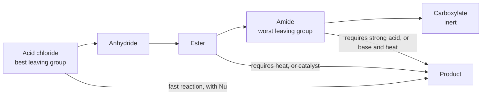
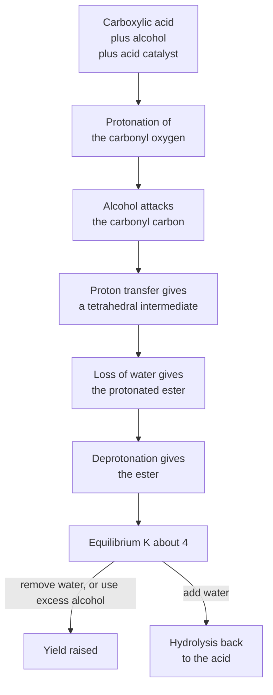
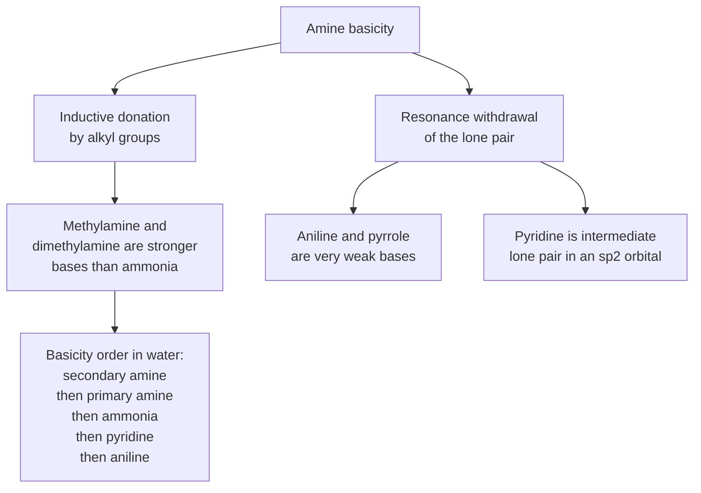
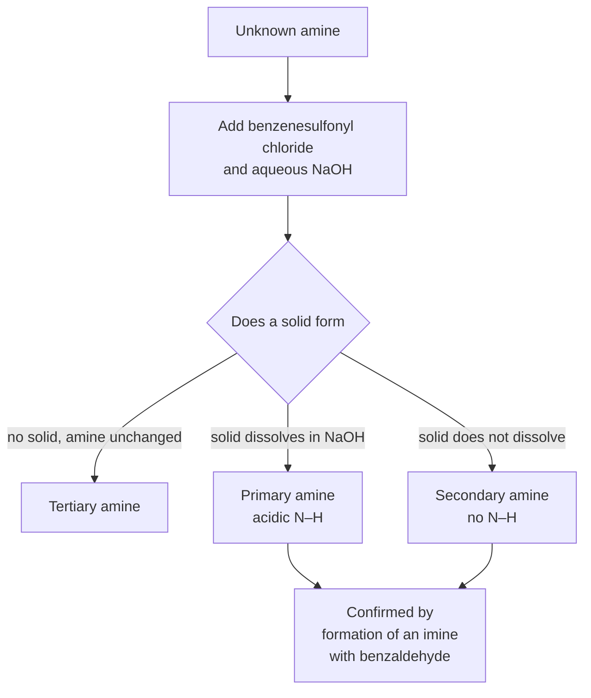

# Chapter 11 — Carboxylic Acids, Esters, Amines and Amides

> **Level:** Advanced (Level 4 — Organic Chemistry)
> **Estimated study time:** 9 hours (6 h reading + 3 h exercises)
> **Prerequisites:** Chapter 8 (substitution and elimination); Chapter 9 (alcohols and phenols); Chapter 10 (carbonyl addition and enolates)
> **Related chapters:** [Aldehydes, Ketones and Carbonyl Chemistry](10-aldehydes-ketones-and-carbonyl-chemistry.md), [Oxidation, Reduction and Organometallic Chemistry](12-oxidation-reduction-and-organometallic-chemistry.md), [Retrosynthetic Analysis and Synthesis Strategy](14-retrosynthetic-analysis-and-synthesis-strategy.md)
> **Difficulty:** ★★★★☆ (3–4)

---

## 1. Learning Objectives

After working through this chapter you will be able to:

- Describe the structure of the carboxyl group, explain why carboxylic acids are far more acidic than alcohols, and rank acids using $\mathrm{p}K_a$ values and substituent effects.
- Prepare a carboxylic acid by oxidation, nitrile hydrolysis, Grignard carboxylation or ester hydrolysis.
- Write the reactions of carboxylic acids with bases, reducing agents, halogenating agents and alcohols.
- Explain the reactivity ladder of acid derivatives in terms of leaving-group ability and the addition–elimination mechanism.
- Write the mechanism of Fischer esterification, explain why it is an equilibrium, and describe two ways of shifting it.
- Explain saponification, transesterification and the industrial production of biodiesel.
- Form amides from acids and amines, explain the partial double-bond character of the peptide bond, and hydrolyse amides under acid and base.
- Classify amines, rank their basicities using inductive and resonance effects, and prepare them by the Gabriel synthesis, reduction or reductive amination.
- Use the Hinsberg test to distinguish primary, secondary and tertiary amines, and describe diazotisation and azo coupling.
- Explain the properties of amino acids as zwitterions and calculate an isoelectric point.

---

## 2. Introduction

The carboxyl group is the functional group that defines organic acids. It combines a carbonyl and a hydroxyl on the same carbon, and the combination is more than the sum of its parts: the $\ce{O-H}$ bond is far more acidic than an alcohol's, the $\ce{C-O}$ bond is far harder to break than an alcohol's, and the group can be converted into a family of derivatives — acid chlorides, anhydrides, esters and amides — whose interconversion is the backbone of peptide, polyester and pharmaceutical synthesis.

The same chapter must also cover the nitrogen-containing functional groups, because acids and amines are opposite poles of the same acid–base story. Amines are the organic bases: their lone pair accepts a proton, and the resulting ammonium ion is water-soluble. Amides combine both worlds — a carbonyl and a nitrogen — and the delocalisation of the nitrogen lone pair into the carbonyl makes amides essentially non-basic and gives the peptide bond its planarity and rigidity. Every protein is a polyamide, and the difference between a protein that folds and one that does not is written in the same conjugation that makes an amide unreactive.

The industrial reach is enormous. Carboxylic acids are intermediates in the manufacture of polymers (terephthalic acid for PET), food preservatives (benzoic and sorbic acids), pharmaceuticals (ibuprofen, aspirin) and soaps. Esters are solvents, plasticisers, flavours and fragrances; the ester linkage is also the repeating unit of polyesters and the labile bond that makes biodiesel renewable. Amines are intermediates for dyes, drugs and agrochemicals, and the azo coupling reaction that makes a diazonium salt react with a phenol or an amine is the basis of the entire azo dye industry.

This chapter therefore closes the functional-group survey that began in Chapter 8. After it, the reader has seen every major functional group, the mechanisms that connect them, and the acid–base logic that underlies their behaviour. Chapter 12 turns to oxidation, reduction and organometallic chemistry, and Chapter 14 shows how to use the whole set in retrosynthetic planning.

---

## 3. Fundamental Concepts

### 3.1 Structure of the carboxyl group

The carboxyl carbon is $sp^2$ hybridised and bonded to three atoms, so the group is planar. The $\ce{C-O}$ and $\ce{C=O}$ bonds are not equivalent: the carbonyl bond is about 121 pm and the hydroxyl bond about 134 pm, but both are shorter than a normal $\ce{C-O}$ single bond because the oxygen lone pair is delocalised into the carbonyl $\pi$ system.

$$
\ce{R-C(=O)OH <-> R-C(O^-)=O^+H}
$$

The delocalisation has two consequences. First, the carboxylate anion formed by loss of a proton is symmetric: the two $\ce{C-O}$ bonds are equal (about 125 pm) and the negative charge is shared equally between the two oxygens. Second, the group is flat and polar, so carboxylic acids associate strongly. Acetic acid forms a cyclic hydrogen-bonded dimer in the gas phase and in non-polar solvents, which is why its boiling point (118 °C) is higher than that of propan-1-ol (97 °C) despite a similar molar mass.

| Property | Acetic acid | Ethanol |
|---|---|---|
| Molar mass / g mol⁻¹ | 60.05 | 46.07 |
| Boiling point / °C | 118 | 78 |
| $\mathrm{p}K_a$ | 4.76 | 16.0 |
| Solubility in water | Miscible | Miscible |
| Hydrogen bonding | Cyclic dimer | Chain |

### 3.2 Nomenclature and the derivative family

Carboxylic acids take the suffix *-oic acid*: ethanoic acid (acetic acid), 2-methylpropanoic acid, benzoic acid. Dicarboxylic acids are named with *-dioic acid*: ethanedioic acid (oxalic acid), hexanedioic acid (adipic acid). The salts are named as carboxylates: sodium ethanoate, potassium benzoate.

The **derivatives** all contain the same acyl group, $\ce{RCO-}$, bonded to a different leaving group:

| Derivative | General formula | Leaving group on substitution | Relative reactivity |
|---|---|---|---|
| Acid chloride | $\ce{RCOCl}$ | $\ce{Cl^-}$ | Highest |
| Anhydride | $\ce{(RCO)2O}$ | $\ce{RCOO^-}$ | High |
| Ester | $\ce{RCOOR'}$ | $\ce{R'O^-}$ | Moderate |
| Amide | $\ce{RCONR'2}$ | $\ce{R'2N^-}$ | Lowest |
| Carboxylate | $\ce{RCOO^-}$ | $\ce{O^{2-}}$ | Inert to substitution |

Esters are named alkyl alkanoates (ethyl ethanoate, methyl benzoate) and amides are named alkanamides (ethanamide, $N$-methylethanamide). Amines are classified as primary, secondary or tertiary by the number of carbon substituents on nitrogen; an amine with four substituents is a quaternary ammonium salt.

### 3.3 Acidity of carboxylic acids

A carboxylic acid dissociates to a carboxylate and a proton. The equilibrium lies well to the left for a weak acid, but the acid is enormously stronger than an alcohol:

$$
\ce{CH3COOH + H2O <=> CH3COO^- + H3O+}
\qquad \mathrm{p}K_a = 4.76
$$

| Acid | $\mathrm{p}K_a$ | Structural feature |
|---|---|---|
| Trifluoroacetic acid | 0.23 | Three fluorines withdraw inductively |
| Trichloroacetic acid | 0.65 | Three chlorines |
| Dichloroacetic acid | 1.25 | Two chlorines |
| Oxalic acid, first ionisation | 1.25 | Adjacent carboxyl group |
| Chloroacetic acid | 2.86 | One chlorine |
| Formic acid | 3.75 | No alkyl group; no electron donation |
| Benzoic acid | 4.20 | Ring conjugated with the carboxyl |
| 4-Nitrobenzoic acid | 3.44 | Nitro group withdraws |
| Acetic acid | 4.76 | Reference |
| Propanoic acid | 4.87 | Methyl donation |
| 4-Methoxybenzoic acid | 4.47 | Methoxy donates by resonance |

Three effects explain the table.

1. **Resonance in the carboxylate.** The negative charge is shared equally by two oxygens, so the anion is far more stable than an alkoxide, where the charge sits on one oxygen. This single effect accounts for the factor of about $10^{11}$ between acetic acid ($\mathrm{p}K_a$ 4.76) and ethanol ($\mathrm{p}K_a$ 16).
2. **Inductive withdrawal.** Electron-withdrawing substituents stabilise the anion further. The effect falls rapidly with distance: a chlorine on the $\alpha$-carbon shifts the $\mathrm{p}K_a$ by about 1.9 units, a chlorine on the $\beta$-carbon by about 0.3, and one on the $\gamma$-carbon hardly at all. Three chlorines on the $\alpha$-carbon give a $\mathrm{p}K_a$ of 0.65, comparable to a mineral acid.
3. **Conjugation.** A substituent that can conjugate with the carboxyl group changes the acidity by a resonance effect. A *para*-nitro group withdraws by both induction and resonance and increases acidity; a *para*-methoxy group donates by resonance and decreases it relative to benzoic acid.

Alkyl groups donate inductively and therefore weaken the acid: formic acid ($\mathrm{p}K_a$ 3.75) is stronger than acetic acid (4.76), which is stronger than propanoic acid (4.87). The first alkyl group has the largest effect; further alkyl groups add little.

### 3.4 The reactivity ladder of acid derivatives

All acid derivatives react by the same **nucleophilic acyl substitution** mechanism: the nucleophile adds to the carbonyl carbon to give a tetrahedral intermediate, and the intermediate collapses by expelling the leaving group. The overall result is replacement of the leaving group, and the rate depends on two factors: how electrophilic the carbonyl carbon is, and how good the leaving group is.

| Derivative | Leaving group | $\mathrm{p}K_a$ of conjugate acid | Relative rate of hydrolysis |
|---|---|---|---|
| Acid chloride | $\ce{Cl^-}$ | −7 | $10^{11}$ |
| Anhydride | $\ce{RCOO^-}$ | 4.8 | $10^{9}$ |
| Ester | $\ce{RO^-}$ | 16 | $1$ |
| Amide | $\ce{R2N^-}$ | 38 | $10^{-5}$ |
| Carboxylate | — | — | No reaction |

The same ordering is obtained from the electrophilicity of the carbonyl: chlorine withdraws inductively and makes the carbonyl carbon more positive, whereas nitrogen donates its lone pair into the carbonyl and makes it less positive. The amide is therefore doubly deactivated — poor leaving group and electron-rich carbonyl — which is why amides are so stable and why they require strong acid or base and prolonged heating to hydrolyse.

This ordering is the single most useful fact in the chapter. It predicts that an acid chloride reacts with an alcohol, an amine or a carboxylate, that an ester reacts with an amine but not with an alcohol, and that an amide reacts with almost nothing short of hydrolysis.

### 3.5 Amines: structure and basicity

An amine nitrogen is $sp^3$ hybridised in the simplest case, with a lone pair occupying the fourth tetrahedral position. Primary, secondary and tertiary amines are all pyramidal, and the nitrogen inverts rapidly at room temperature by a process analogous to an umbrella turning inside out. The inversion is fast enough that most simple amines cannot be resolved into enantiomers, but it is slow enough in some strained rings and in some drug molecules to matter.

Amines are bases because the lone pair can accept a proton:

$$
\ce{RNH2 + H2O <=> RNH3+ + OH^-}
\qquad
K_b = \frac{[\ce{RNH3+}][\ce{OH^-}]}{[\ce{RNH2}]}
$$

It is more convenient to quote the $\mathrm{p}K_a$ of the conjugate acid, $\ce{RNH3+}$, because a stronger base has a weaker conjugate acid and therefore a higher $\mathrm{p}K_a$:

| Amine | $\mathrm{p}K_a$ of conjugate acid | Comment |
|---|---|---|
| Ammonia | 9.25 | Reference |
| Methylamine | 10.64 | One alkyl group donates |
| Dimethylamine | 10.73 | Two alkyl groups; strongest of the methylamines |
| Trimethylamine | 9.79 | Three alkyl groups, but steric and solvation penalties |
| Ethylamine | 10.65 | Similar to methylamine |
| Piperidine | 11.22 | Secondary cyclic amine; strongly basic |
| Aniline | 4.60 | Lone pair conjugated with the ring |
| 4-Methylaniline | 5.08 | Methyl donates into the ring |
| 4-Nitroaniline | 1.0 | Nitro group withdraws strongly |
| Pyridine | 5.23 | Lone pair in an $sp^2$ orbital, not conjugated |
| Pyrrole | −3.8 | Lone pair is part of the aromatic sextet |
| Imidazole | 6.95 | One basic and one non-basic nitrogen |

Two effects explain the table. **Inductive donation** by alkyl groups increases electron density on nitrogen and raises basicity, which is why methylamine is stronger than ammonia. The effect saturates, and trimethylamine is weaker than dimethylamine because the third methyl group hinders solvation of the ammonium ion and because the amine itself is destabilised by steric crowding. **Resonance** removes the lone pair from the nitrogen: in aniline the lone pair is delocalised into the ring, and in pyrrole it is part of the aromatic sextet, so both are very weak bases. Pyridine is intermediate because its lone pair lies in an $sp^2$ orbital in the plane of the ring, orthogonal to the $\pi$ system, and is therefore available for protonation even though the ring is aromatic.

Substituents on an aniline ring act through both effects. A *para*-nitro group withdraws inductively and by resonance and drops the basicity by more than three orders of magnitude; a *para*-methoxy group donates by resonance and raises it. This is the same logic as for phenol acidity, with the sign reversed.

### 3.6 Amides as bases

An amide is essentially non-basic at nitrogen, because the lone pair is delocalised into the carbonyl. Protonation occurs on the carbonyl oxygen instead, and the resulting $\ce{O}$-protonated amide has a $\mathrm{p}K_a$ of about $-1$: amides are protonated only in strong acids such as concentrated sulfuric acid.

$$
\ce{RCONH2 + H+ <=> RCONH3+}
$$

The same delocalisation gives the $\ce{C-N}$ bond partial double-bond character, which is the structural basis of the peptide bond (Section 4.6).

---

## 4. Detailed Scientific Explanation

### 4.1 Preparation of carboxylic acids

**Oxidation of primary alcohols and aldehydes.** Strong aqueous oxidants — potassium permanganate, acidified dichromate, or Jones reagent — convert a primary alcohol through the aldehyde to the carboxylic acid:

$$
\ce{CH3CH2CH2OH ->[K2Cr2O7,\ H2SO4] CH3CH2COOH}
$$

**Hydrolysis of nitriles.** A nitrile is hydrolysed by aqueous acid or base to an amide, which is hydrolysed further to the acid:

$$
\ce{CH3CH2CN + 2H2O + H+ -> CH3CH2COOH + NH4+}
$$

This is the standard way to add one carbon to a chain, because the nitrile is made from a halide and cyanide by $S_N2$.

**Grignard carboxylation.** A Grignard reagent reacts with carbon dioxide to give a carboxylate, which is protonated on work-up:

$$
\ce{RMgX + CO2 -> RCO2MgX ->[H3O+] RCOOH}
$$

**Hydrolysis of esters and amides.** Both are hydrolysed by aqueous acid or base, and the carboxylate salt is obtained directly under basic conditions.

**Industrial routes.** Acetic acid is made by carbonylation of methanol (Monsanto and Cativa processes, rhodium and iridium catalysts), by oxidation of acetaldehyde, and by fermentation. Terephthalic acid, the monomer for PET, is made by oxidation of *p*-xylene. Formic acid is made from carbon monoxide and sodium hydroxide.

### 4.2 Reactions of carboxylic acids

**Salt formation.** Carboxylic acids react with bases to give carboxylate salts:

$$
\ce{CH3COOH + NaOH -> CH3COO^-Na+ + H2O}
$$

The reaction with sodium bicarbonate releases carbon dioxide, which is the standard test that distinguishes a carboxylic acid from a phenol:

$$
\ce{CH3COOH + NaHCO3 -> CH3COO^-Na+ + CO2 ^ + H2O}
$$

**Reduction.** Lithium aluminium hydride reduces a carboxylic acid all the way to a primary alcohol; sodium borohydride does not react:

$$
\ce{CH3COOH + LiAlH4 ->[C2H5OC2H5] CH3CH2OH}
$$

**Decarboxylation.** Simple carboxylic acids are stable to heat, but $\beta$-keto acids and malonic acids lose carbon dioxide at 100–200 °C because the transition state is stabilised by the enol that forms:

$$
\ce{CH3COCH2COOH ->[\Delta] CH3COCH3 + CO2}
$$

The malonic ester synthesis exploits this: diethyl malonate is alkylated twice, hydrolysed to the malonic acid, and decarboxylated to give a substituted acetic acid. The acetoacetic ester synthesis does the same with ethyl acetoacetate to give a substituted ketone.

**$\alpha$-Halogenation.** Carboxylic acids react with bromine in the presence of a catalytic amount of phosphorus, which converts a little of the acid into the acid bromide; the acid bromide then enolises and is brominated. The Hell–Volhard–Zelinsky reaction gives the $\alpha$-bromo acid:

$$
\ce{CH3COOH + Br2 ->[P] CH2BrCOOH + HBr}
$$

**Acid chloride formation.** Thionyl chloride, oxalyl chloride or phosphorus pentachloride converts a carboxylic acid into the acid chloride:

$$
\ce{CH3COOH + SOCl2 -> CH3COCl + SO2 ^ + HCl ^}
$$

The by-products are gases, so the product is easily isolated. Oxalyl chloride is preferred for acid-sensitive substrates because the by-products are carbon dioxide, carbon monoxide and hydrogen chloride, all volatile.

**Esterification.** Covered in Section 4.4.

### 4.3 Nucleophilic acyl substitution

The mechanism is a two-stage addition–elimination:

1. The nucleophile adds to the carbonyl carbon, and the $\pi$ electrons move onto oxygen, giving a tetrahedral intermediate.
2. The intermediate collapses, reforming the carbonyl and expelling the leaving group.

$$
\ce{RCOCl + Nu^- -> [RC(O^-)(Nu)Cl] -> RCONu + Cl^-}
$$

The first stage is usually rate-determining, and its rate is increased by electron withdrawal at the carbonyl carbon. The second stage requires a leaving group that can accept the electron pair, so it is fast when the leaving group is a weak base.

Three practical consequences follow. First, acid catalysis is used for esters and amides because protonation of the carbonyl makes it more electrophilic. Second, the reaction is driven forward by removing the leaving group or by using an excess of the nucleophile. Third, the reactivity ladder allows selective transformations: an acid chloride can be converted into an ester in the presence of an amide, and an ester can be aminolysed in the presence of an amide.

### 4.4 Fischer esterification

A carboxylic acid and an alcohol react in the presence of an acid catalyst to give an ester and water:

$$
\ce{RCOOH + R'OH <=> RCOOR' + H2O}
$$

The mechanism, in numbered steps with the curly arrows described, is:

1. Protonation of the carbonyl oxygen by the acid catalyst.
2. Attack of the alcohol oxygen on the carbonyl carbon, giving a protonated tetrahedral intermediate.
3. Proton transfer from the incoming alcohol oxygen to one of the hydroxyl groups.
4. Loss of water from the protonated hydroxyl, giving a protonated ester.
5. Deprotonation to give the ester and regenerate the catalyst.

Isotopic labelling with $\ce{H2^{18}O}$ shows that the alcohol oxygen is retained in the ester and the acid hydroxyl is lost, which is consistent with this mechanism: the bond broken is the acyl–oxygen bond, not the alkyl–oxygen bond.

The equilibrium constant is of order unity for simple partners ($K \approx 4$ for acetic acid and ethanol), so the yield is controlled by Le Châtelier's principle. Two strategies are used: an excess of the cheaper reagent (usually the alcohol), and removal of water as it forms, either by azeotropic distillation with a Dean–Stark apparatus or by molecular sieves. Because the reaction is acid-catalysed, it is also reversed by acid, so the same conditions that form the ester hydrolyse it if water is present in excess.

### 4.5 Saponification and transesterification

**Saponification** is the base-promoted hydrolysis of an ester:

$$
\ce{RCOOR' + NaOH -> RCOO^-Na+ + R'OH}
$$

The reaction is irreversible because the carboxylate is unreactive towards nucleophilic attack. Applied to a triglyceride, it produces three carboxylate ions (soap) and glycerol. Soap molecules have a hydrophobic tail and a hydrophilic carboxylate head, which is why they form micelles and solubilise grease.

**Transesterification** is the exchange of the alkoxy group of an ester for another alcohol:

$$
\ce{RCOOR' + R''OH <=> RCOOR'' + R'OH}
$$

The reaction is catalysed by acid or base and is driven by an excess of the incoming alcohol or by removing the displaced alcohol. The same reaction is used in the laboratory to convert a methyl ester into a benzyl ester for selective deprotection.

### 4.6 Amides and the peptide bond

**Formation.** Amides are made from acid chlorides and amines, or from acids and amines with a coupling agent:

$$
\ce{CH3COCl + 2CH3NH2 -> CH3CONHCH3 + CH3NH3+Cl^-}
$$

Two equivalents of amine are needed because one neutralises the hydrogen chloride produced. In the laboratory, the reaction is often run under Schotten–Baumann conditions, with the amine in aqueous base and the acid chloride in an organic solvent, so that the acid chloride reacts with the amine faster than it hydrolyses.

Direct reaction of a carboxylic acid with an amine gives only the ammonium carboxylate salt, because the acid protonates the amine before any condensation can occur. To form an amide from an acid and an amine, a coupling agent such as dicyclohexylcarbodiimide (DCC) or a uronium salt is used; the agent activates the carboxyl group by converting it into a good leaving group. This is the chemistry of solid-phase peptide synthesis.

**The peptide bond.** In an amide the nitrogen lone pair is delocalised into the carbonyl, so the $\ce{C-N}$ bond has about 40% double-bond character. The bond length is about 132 pm, between a single bond (147 pm) and a double bond (127 pm); rotation about it is restricted, and the amide group is planar. In a peptide, the $\omega$ dihedral angle is close to $180^\circ$ (the *trans* arrangement), and the rigidity of the peptide bond is what limits the conformations available to a protein backbone.

**Hydrolysis.** Amides are hydrolysed by refluxing aqueous acid or base:

$$
\ce{CH3CONHCH3 + H2O ->[H+,\ \Delta] CH3COOH + CH3NH3+}
$$

$$
\ce{CH3CONHCH3 + OH^- ->[\Delta] CH3COO^- + CH3NH2}
$$

Because the amide is the least reactive acid derivative, the conditions are harsh: several hours at reflux in 6 mol dm⁻³ hydrochloric acid or concentrated sodium hydroxide. Proteins are hydrolysed in this way for amino acid analysis.

### 4.7 Amines: preparation and reactions

**Gabriel synthesis.** Phthalimide is deprotonated by potassium hydroxide and alkylated with a primary alkyl halide; the resulting $N$-alkylphthalimide is then cleaved with hydrazine to give a primary amine:

$$
\ce{C8H5NO2 + KOH -> C8H4KNO2 + H2O}
$$

$$
\ce{C8H4KNO2 + RCH2Br -> C8H4NO2CH2R + KBr}
$$

$$
\ce{C8H4NO2CH2R + H2NNH2 -> RCH2NH2 + C8H8N2O2}
$$

The method gives a pure primary amine without over-alkylation, which is its advantage over direct reaction with ammonia. It fails with secondary and tertiary halides because they eliminate.

**Direct alkylation.** Ammonia reacts with a primary halide to give a primary amine, but the product is more nucleophilic than ammonia and reacts again, so a mixture of primary, secondary and tertiary amines results. A large excess of ammonia improves the yield of the primary amine but does not eliminate the problem.

**Reduction of nitrogen-containing groups.** Nitro compounds, nitriles and amides are reduced to amines:

$$
\ce{C6H5NO2 ->[H2,\ Pd/C] C6H5NH2}
$$

$$
\ce{CH3CH2CN ->[LiAlH4] CH3CH2CH2NH2}
$$

**Reductive amination.** An aldehyde or ketone is condensed with an amine and reduced in one pot, which is the most general route to secondary and tertiary amines (Chapter 10).

**Basicity and salt formation.** Amines dissolve in aqueous acid to give ammonium salts, and the salt is converted back to the free amine by base. This is the basis of the extraction and purification of amines and of the formulation of many drugs as hydrochloride salts, which are more water-soluble and more stable than the free bases.

**The Hinsberg test.** Benzenesulfonyl chloride reacts with primary and secondary amines but not with tertiary amines:

- A primary amine gives an $N$-alkylbenzenesulfonamide with an acidic $\ce{N-H}$ that dissolves in aqueous sodium hydroxide.
- A secondary amine gives an $N,N$-dialkylbenzenesulfonamide with no $\ce{N-H}$, which is insoluble in alkali.
- A tertiary amine does not react; the sulfonyl chloride hydrolyses, and the amine remains in a separate layer.

The test therefore distinguishes the three classes with one reagent and one observation.

**Diazotisation and azo coupling.** A primary aromatic amine reacts with nitrous acid, generated in situ from sodium nitrite and hydrochloric acid, at 0–5 °C to give a diazonium salt:

$$
\ce{C6H5NH2 + NaNO2 + 2HCl -> C6H5N2+Cl^- + NaCl + 2H2O}
$$

The diazonium ion is unstable above about 5 °C and decomposes to phenol and nitrogen, so it is used immediately. It is a strong electrophile and couples with phenols in weakly alkaline solution and with aromatic amines in weakly acidic solution to give azo compounds:

$$
\ce{C6H5N2+ + C6H5OH ->[pH\ 9] HOC6H4N=NC6H5 + H+}
$$

Azo compounds are intensely coloured because the extended conjugated system absorbs visible light, and the azo coupling reaction is the basis of the dye industry. Methyl orange, used as a pH indicator, is made by coupling diazotised sulfanilic acid with $N,N$-dimethylaniline.

### 4.8 Nitriles

Nitriles contain a carbon–nitrogen triple bond and are made by $S_N2$ displacement of a halide with cyanide:

$$
\ce{CH3CH2Br + NaCN ->[DMF] CH3CH2CN + NaBr}
$$

Hydrolysis gives a carboxylic acid in two stages (amide then acid), reduction with $\ce{LiAlH4}$ gives a primary amine, and reduction with DIBAL-H at low temperature gives an aldehyde. The nitrile carbon is electrophilic, so Grignard reagents add to nitriles to give ketones after hydrolysis.

### 4.9 The Hofmann rearrangement

A primary amide reacts with bromine and sodium hydroxide to give a primary amine with one carbon fewer:

$$
\ce{RCONH2 + Br2 + 4NaOH -> RNH2 + Na2CO3 + 2NaBr + 2H2O}
$$

The mechanism involves bromination of the amide nitrogen, deprotonation, rearrangement of the $N$-bromoamide anion to an isocyanate with loss of bromide, and hydrolysis of the isocyanate to a carbamic acid, which decarboxylates. The rearrangement step is a concerted migration of the alkyl group from carbon to nitrogen with its bonding electrons, and the migrating group retains its configuration. The reaction is used to remove a carboxyl group or to make amines that are difficult to obtain otherwise.

### 4.10 Amino acids and zwitterions

An $\alpha$-amino acid contains an amine and a carboxyl group on the same carbon. In neutral aqueous solution the acid is deprotonated and the amine is protonated, so the molecule exists as a **zwitterion**, with no net charge but with separated charges:

$$
\ce{H3N+-CH2-COO^-}
$$

The zwitterion explains the physical properties: amino acids are crystalline, high-melting and water-soluble, and they are insoluble in non-polar solvents, because they behave like salts. The pH at which the net charge is zero is the **isoelectric point**, $\mathrm{pI}$, and it is the average of the $\mathrm{p}K_a$ values that bracket the neutral form. For glycine, $\mathrm{pI} = (2.34 + 9.60)/2 = 5.97$. For lysine, which has a basic side chain, $\mathrm{pI} = (8.95 + 10.53)/2 = 9.74$; for glutamic acid, which has an acidic side chain, $\mathrm{pI} = (2.19 + 4.25)/2 = 3.22$.

At a pH below the $\mathrm{pI}$ the molecule is positively charged and migrates towards the cathode in an electric field; above the $\mathrm{pI}$ it is negatively charged and migrates towards the anode. This is the principle of electrophoresis, which separates proteins and peptides by charge and is the basis of isoelectric focusing.

---

## 5. Visual Diagrams

**Figure 11.1 — The reactivity ladder of carboxylic acid derivatives.** The horizontal chain orders the derivatives by the quality of the leaving group, which is also the order of reactivity towards nucleophiles. The arrows to the product show that each derivative can be converted into the one below it, but not into the one above it, under mild conditions. The practical rule is that synthesis descends the ladder: acid chlorides are made first and then converted into anhydrides, esters or amides.

**Figure 11.2 — Fischer esterification as a reversible cycle.** Every step is reversible, which is why the position of the equilibrium, and not the rate, determines the yield. The two arrows at the bottom show the two ways of controlling that equilibrium: removing a product or adding an excess of a reactant. The same cycle run in reverse, with excess water, is acid-catalysed ester hydrolysis.

**Figure 11.3 — Two competing effects on amine basicity.** Inductive donation increases electron density on nitrogen and raises the $\mathrm{p}K_a$ of the conjugate acid; resonance removes the lone pair from nitrogen and lowers it. The figure places the standard amines on the resulting scale and shows why the simple rule that more alkyl groups mean more basicity fails at trimethylamine, where steric and solvation effects intervene.

**Figure 11.4 — The Hinsberg test as a decision procedure.** The test uses one reagent and two observations: whether a sulfonamide forms, and whether it dissolves in alkali. The solubility step works because only the primary sulfonamide retains an acidic $\ce{N-H}$; the tertiary amine cannot react because it has no hydrogen to lose after the first addition. The figure is a useful reminder that classification tests are usually elimination procedures rather than confirmations of a single positive result.

---

## 6. Mathematical Formulas

### 6.1 Acid dissociation and pH

$$
K_a = \frac{[\ce{H3O+}][\ce{A^-}]}{[\ce{HA}]}
\qquad
\mathrm{pH} = \mathrm{p}K_a + \log_{10}\frac{[\ce{A^-}]}{[\ce{HA}]}
$$

| Symbol | Meaning | SI unit |
|---|---|---|
| $K_a$ | acid dissociation constant | mol dm⁻³ |
| $\mathrm{p}K_a$ | negative logarithm of $K_a$ | dimensionless |
| $[\ce{A^-}]$ | concentration of carboxylate | mol dm⁻³ |
| $[\ce{HA}]$ | concentration of acid | mol dm⁻³ |

The second form is the Henderson–Hasselbalch equation. For a weak acid at concentration $c$ with $K_a \ll c$, the hydrogen-ion concentration is $[\ce{H+}] \approx \sqrt{K_a c}$.

### 6.2 Degree of ionisation of an amine

For a base with conjugate acid $\mathrm{p}K_a$, the fraction protonated at a given pH is

$$
f_{\text{protonated}} = \frac{1}{1 + 10^{\,\mathrm{pH} - \mathrm{p}K_a}}
$$

This expression is used constantly in pharmacology. A drug that is a weak base with $\mathrm{p}K_a$ 8.1 is 83% protonated at blood pH 7.4, and the charged form does not cross lipid membranes readily; the same drug is largely uncharged in the acidic stomach and is absorbed there. The equation also shows that the change from mostly protonated to mostly deprotonated occurs over about two pH units centred on the $\mathrm{p}K_a$.

### 6.3 Isoelectric point

For an amino acid with two relevant $\mathrm{p}K_a$ values bracketing the zwitterion,

$$
\mathrm{pI} = \frac{\mathrm{p}K_{a1} + \mathrm{p}K_{a2}}{2}
$$

For a side chain that is itself ionisable, the two $\mathrm{p}K_a$ values that bracket the neutral species are used. Glycine: $(2.34 + 9.60)/2 = 5.97$. Lysine: $(8.95 + 10.53)/2 = 9.74$. Glutamic acid: $(2.19 + 4.25)/2 = 3.22$.

### 6.4 Esterification equilibrium

For an acid and an alcohol at concentrations $a$ and $b$ with an equilibrium constant $K$ and extent of reaction $x$,

$$
K = \frac{x^2}{(a-x)(b-x)}
$$

Solving for $x$ gives the equilibrium yield. For $K = 4$ and equimolar amounts, $x/(a-x) = 2$ and the yield is 67%; with a twofold excess of alcohol the yield rises to about 85%. The calculation is identical in form to the one used for weak-acid dissociation, because both are equilibria with a quadratic mass balance.

### 6.5 Degree of polymerisation and average molar mass

For a polyester made from a diacid and a diol, the number-average degree of polymerisation at extent of reaction $p$ is given by the Carothers equation:

$$
\bar{X}_n = \frac{1}{1-p}
$$

At $p = 0.99$, $\bar{X}_n = 100$; at $p = 0.999$, $\bar{X}_n = 1000$. The equation explains why polyester and nylon production requires very high conversion and careful stoichiometry: a 1% imbalance in the monomer ratio caps the molar mass far below the value needed for useful fibres.

---

## 7. Chemical Equations

### 7.1 Acid–base reactions

$$
\ce{CH3COOH + NaOH -> CH3COO^-Na+ + H2O}
$$

$$
\ce{CH3COOH + NaHCO3 -> CH3COO^-Na+ + CO2 ^ + H2O}
$$

Phenol does not react with sodium bicarbonate, because its $\mathrm{p}K_a$ of about 10 is not low enough to protonate the bicarbonate ion. That difference is the standard test that distinguishes a carboxylic acid from a phenol.

### 7.2 Reduction and decarboxylation

$$
\ce{CH3COOH + LiAlH4 ->[C2H5OC2H5] CH3CH2OH}
$$

$$
\ce{CH3COCH2COOH ->[\Delta] CH3COCH3 + CO2 ^}
$$

$$
\ce{HOOCCH2CH2COOH ->[\Delta] CH3COOH + CO2 ^}
$$

### 7.3 Acid chloride formation and reactions

$$
\ce{CH3COOH + SOCl2 -> CH3COCl + SO2 ^ + HCl ^}
$$

$$
\ce{CH3COCl + CH3CH2OH -> CH3COOCH2CH3 + HCl}
$$

$$
\ce{CH3COCl + 2CH3NH2 -> CH3CONHCH3 + CH3NH3+Cl^-}
$$

### 7.4 Esterification, saponification and transesterification

$$
\ce{CH3COOH + C2H5OH <=> CH3COOC2H5 + H2O}
$$

$$
\ce{CH3COOC2H5 + NaOH -> CH3COO^-Na+ + C2H5OH}
$$

$$
\ce{RCOOCH3 + C2H5OH <=> RCOOC2H5 + CH3OH}
$$

$$
\ce{C3H5(O2CR)3 + 3CH3OH ->[NaOH] 3RCO2CH3 + C3H5(OH)3}
$$

### 7.5 Amide formation and hydrolysis

$$
\ce{CH3COOH + CH3NH2 -> CH3COO^-CH3NH3+}
\qquad \text{the salt, not the amide}
$$

$$
\ce{CH3CONHCH3 + H2O ->[H+,\ \Delta] CH3COOH + CH3NH3+}
$$

$$
\ce{CH3CONHCH3 + OH^- ->[\Delta] CH3COO^- + CH3NH2}
$$

$$
\ce{RCONH2 + Br2 + 4OH^- -> RNH2 + CO3^2- + 2Br^- + 2H2O}
$$

### 7.6 Amine reactions

$$
\ce{CH3NH2 + HCl -> CH3NH3+Cl^-}
$$

$$
\ce{C6H5NH2 + NaNO2 + 2HCl ->[0\ ^\circ C] C6H5N2+Cl^- + NaCl + 2H2O}
$$

$$
\ce{C6H5N2+ + C6H5OH ->[pH\ 9] HOC6H4N=NC6H5 + H+}
$$

### 7.7 Nitrile chemistry

$$
\ce{CH3CH2Br + NaCN ->[DMF] CH3CH2CN + NaBr}
$$

$$
\ce{CH3CH2CN + 2H2O + HCl -> CH3CH2COOH + NH4+Cl^-}
$$

$$
\ce{CH3CH2CN + LiAlH4 ->[C2H5OC2H5] CH3CH2CH2NH2}
$$

---

## 8. Worked Examples

### Worked Example 11.1 — Ranking acidities and comparing $K_a$

**Problem.** Arrange chloroacetic acid, acetic acid, benzoic acid and 4-nitrobenzoic acid in order of increasing acidity. Calculate the ratio of the acid dissociation constants of chloroacetic acid and acetic acid.

**Strategy.** Use the $\mathrm{p}K_a$ table and identify the dominant substituent effect in each compound. Convert $\mathrm{p}K_a$ to $K_a$ with $K_a = 10^{-\mathrm{p}K_a}$.

**Solution.** The values are chloroacetic acid 2.86, 4-nitrobenzoic acid 3.44, benzoic acid 4.20 and acetic acid 4.76, so the order of increasing acidity is acetic acid < benzoic acid < 4-nitrobenzoic acid < chloroacetic acid.

The ratio is

$$
\frac{K_a(\ce{ClCH2COOH})}{K_a(\ce{CH3COOH})} = \frac{10^{-2.86}}{10^{-4.76}} = 10^{1.90} = 79
$$

Chloroacetic acid is about 80 times stronger than acetic acid. The chlorine withdraws electron density inductively through the $\sigma$ framework; the effect is powerful because chlorine is only one bond from the carboxyl carbon. The nitro group in 4-nitrobenzoic acid acts through both induction and resonance but is further away, so its effect is smaller than that of a single $\alpha$-chlorine.

**Check.** Benzoic acid is stronger than acetic acid because the $sp^2$ ring carbon is less electron-donating than a methyl group; the difference is small, as expected for a weak inductive effect transmitted through an aromatic ring.

### Worked Example 11.2 — Using the reactivity ladder to plan a sequence

**Problem.** Starting from butanoic acid, propose syntheses of (a) ethyl butanoate and (b) $N$-ethylbutanamide, and explain why the order of steps matters.

**Strategy.** The acid must be activated before it will react with an alcohol or an amine, so convert it into the acid chloride first. Then choose the nucleophile.

**Solution.**

(a) Convert butanoic acid into butanoyl chloride with thionyl chloride, then add ethanol:

$$
\ce{CH3CH2CH2COOH ->[SOCl2] CH3CH2CH2COCl ->[C2H5OH] CH3CH2CH2COOC2H5}
$$

(b) Convert the acid into the acid chloride, then add two equivalents of ethylamine:

$$
\ce{CH3CH2CH2COCl + 2C2H5NH2 -> CH3CH2CH2CONHC2H5 + C2H5NH3+Cl^-}
$$

Direct reaction of the acid with ethanol under acid catalysis would also give the ester, but the amide cannot be made directly: the acid protonates the amine to give an unreactive salt, and heating the salt does not give an amide in useful yield.

**Check.** Both products contain the four-carbon acyl group unchanged, which confirms that only the carboxyl group was modified. The second equivalent of amine is consumed as base, so the stoichiometry is two, not one.

### Worked Example 11.3 — Fischer esterification with excess alcohol

**Problem.** Acetic acid (1.0 mol) is heated with ethanol (2.0 mol) and a catalytic amount of sulfuric acid. Taking $K = 4.0$, calculate the equilibrium yield of ethyl ethanoate and compare it with the yield from equimolar amounts.

**Strategy.** Set up the equilibrium expression in terms of the extent $x$ and solve the quadratic.

**Solution.** With $a = 1.0$ and $b = 2.0$,

$$
K = \frac{x^2}{(1.0-x)(2.0-x)} = 4.0
$$

Expanding gives $3x^2 - 12x + 8 = 0$, so

$$
x = \frac{12 - \sqrt{144-96}}{6} = \frac{12 - 6.93}{6} = 0.845\ \text{mol}
$$

The yield is 85%. With equimolar amounts the equation gives $x = 0.67\ \text{mol}$, a yield of 67%.

**Check.** The excess alcohol shifts the equilibrium towards the ester, as Le Châtelier's principle requires, and the yield rises by 18 percentage points. Removing water instead would have the same effect, and industrial processes often do both.

### Worked Example 11.4 — Basicity and the protonated fraction of a drug

**Problem.** A drug is a weak base with $\mathrm{p}K_a(\text{conjugate acid}) = 8.1$. Calculate the fraction protonated at blood pH 7.4 and at stomach pH 1.5, and comment on the significance.

**Strategy.** Use $f = 1/(1 + 10^{\mathrm{pH} - \mathrm{p}K_a})$.

**Solution.** At pH 7.4,

$$
f = \frac{1}{1 + 10^{7.4-8.1}} = \frac{1}{1 + 10^{-0.7}} = \frac{1}{1 + 0.20} = 0.83
$$

so 83% of the drug is protonated. At pH 1.5,

$$
f = \frac{1}{1 + 10^{1.5-8.1}} = \frac{1}{1 + 10^{-6.6}} \approx 1.000
$$

so essentially all of the drug is protonated.

**Check.** The protonated form is charged and water-soluble but does not cross lipid membranes readily; the uncharged form does. The calculation therefore predicts that the drug is largely trapped in the acidic stomach and absorbed slowly, and that its distribution depends on the pH of each compartment. This is the pH-partition hypothesis of drug absorption.

### Worked Example 11.5 — Isoelectric point and electrophoresis

**Problem.** Lysine has $\mathrm{p}K_a$ values of 2.18 (carboxyl), 8.95 (side-chain ammonium) and 10.53 (backbone ammonium). Calculate its isoelectric point and state the direction in which it migrates during electrophoresis at pH 7.0.

**Strategy.** Identify the two $\mathrm{p}K_a$ values that bracket the neutral zwitterion and average them. Then compare the experimental pH with the $\mathrm{pI}$.

**Solution.** For a basic amino acid the neutral zwitterion lies between the second and third ionisations, so

$$
\mathrm{pI} = \frac{8.95 + 10.53}{2} = 9.74
$$

At pH 7.0, which is below the $\mathrm{pI}$, the molecule carries a net positive charge, because the carboxyl group is deprotonated (charge −1) and both ammonium groups are protonated (charge +2). It therefore migrates towards the cathode.

**Check.** A basic amino acid has a high $\mathrm{pI}$ and is positively charged at neutral pH; an acidic amino acid has a low $\mathrm{pI}$ and is negatively charged at neutral pH. The direction of migration follows directly from the comparison of pH with $\mathrm{pI}$.

---

## 9. Real-World Applications

**Soaps and detergents.** Saponification of animal fats and vegetable oils with sodium hydroxide produces soap — a mixture of sodium carboxylates — and glycerol. The carboxylate head is hydrophilic and the hydrocarbon tail lipophilic, so soap forms micelles that suspend grease in water. Calcium and magnesium salts of fatty acids are insoluble, which is why soap performs poorly in hard water and why synthetic detergents, based on sulfonates, were developed. **Biodiesel.** Triglycerides are transesterified with methanol and a sodium hydroxide catalyst to give fatty acid methyl esters, which burn cleanly in diesel engines, and glycerol, which is sold or upgraded. The process is an industrial application of the same transesterification that is used in the laboratory, and its economics depend on the price of the glycerol by-product. **Polymers.** Poly(ethylene terephthalate) is a polyester made by transesterification or direct esterification of terephthalic acid with ethane-1,2-diol, followed by polycondensation. Nylon-6,6 is a polyamide made from hexanedioic acid and hexane-1,6-diamine. The Carothers equation explains why both processes require high conversion and precise stoichiometry.

**Pharmaceuticals.** Aspirin is an ester of salicylic acid, and it is hydrolysed slowly in the body to release the active salicylate. Ibuprofen is a carboxylic acid, and benzocaine is an ester that is hydrolysed by plasma esterases. Many drugs are formulated as hydrochloride salts of amines to improve aqueous solubility, and the protonation calculation of Section 6.2 determines how much of the drug is charged at physiological pH.

**Peptides and proteins.** The peptide bond is the amide linkage, and its partial double-bond character fixes the planarity of the backbone. Solid-phase peptide synthesis builds chains by repeated amide formation with coupling agents, and the hydrolysis of peptides in 6 mol dm⁻³ hydrochloric acid is the first step in amino acid analysis. Enzymes called proteases catalyse the same hydrolysis under physiological conditions by using a catalytic triad to activate the carbonyl.

**Dyes and indicators.** Diazotisation followed by azo coupling is the basis of the azo dye industry; methyl orange, congo red and many textile dyes are azo compounds. The colour depends on the extent of conjugation and on the protonation state, which is why azo dyes can act as pH indicators.

---

## 10. Common Mistakes

| Mistake | Why it happens | Correct approach |
|---|---|---|
| Writing that a carboxylic acid reacts with an amine to give an amide directly | The reaction is written as a simple condensation | The acid protonates the amine to give a salt; amide formation needs an acid chloride or a coupling agent |
| Assuming phenol reacts with sodium bicarbonate | Both are "weak acids" | Phenol ($\mathrm{p}K_a$ 10) cannot protonate bicarbonate; only carboxylic acids ($\mathrm{p}K_a \approx 5$) effervesce |
| Treating an amide as a base at nitrogen | Amines are basic, so amides are assumed to be basic too | The nitrogen lone pair is delocalised into the carbonyl; protonation occurs on oxygen and requires strong acid |
| Expecting an acid chloride to be stable in water | The reactivity ladder is memorised but not applied | Acid chlorides hydrolyse rapidly; they must be kept dry and used immediately |
| Using $\ce{NaBH4}$ to reduce a carboxylic acid | Hydride reagents are treated as interchangeable | $\ce{NaBH4}$ does not reduce acids; $\ce{LiAlH4}$ is required |
| Predicting that trimethylamine is the strongest methylamine | Alkyl groups are assumed to increase basicity without limit | Steric hindrance and the solvation penalty make trimethylamine weaker than dimethylamine |
| Confusing the Hinsberg test results | The solubility observation is reversed | The primary sulfonamide has an acidic $\ce{N-H}$ and dissolves in alkali; the secondary does not; the tertiary does not react |
| Writing a diazonium salt as stable at room temperature | The reagent is drawn without conditions | Diazonium salts decompose above about 5 °C and must be used immediately |
| Using the average of all three $\mathrm{p}K_a$ values to find $\mathrm{pI}$ | The definition of the zwitterion is overlooked | Average only the two $\mathrm{p}K_a$ values that bracket the neutral form |

---

## 11. Chapter Summary

- The carboxyl group is planar and delocalised; the carboxylate anion is symmetric, with the negative charge shared between two oxygens.
- Carboxylic acids are about $10^{11}$ times more acidic than alcohols because the carboxylate is resonance-stabilised; $\mathrm{p}K_a$ falls with electron-withdrawing substituents and rises with electron-donating ones.
- Carboxylic acids are prepared by oxidation, nitrile hydrolysis, Grignard carboxylation and ester hydrolysis.
- They form salts with bases, are reduced to primary alcohols by $\ce{LiAlH4}$, decarboxylate when activated by a $\beta$-carbonyl, and are converted to acid chlorides by thionyl or oxalyl chloride.
- Acid derivatives react by nucleophilic acyl substitution, and their reactivity follows the leaving-group ability: acid chloride > anhydride > ester > amide > carboxylate.
- Fischer esterification is an acid-catalysed equilibrium with $K \approx 4$; the yield is raised by removing water or using an excess of the alcohol.
- Saponification is irreversible because the carboxylate is unreactive; transesterification is the industrial route to biodiesel.
- Amides are formed from acid chlorides or by coupling agents, are planar and rigid because of $\ce{C-N}$ partial double-bond character, and are hydrolysed only by strong acid or base with heat.
- Amine basicity is increased by inductive donation and decreased by resonance delocalisation; the order in water is secondary > primary > ammonia > pyridine > aniline.
- Amines are prepared by the Gabriel synthesis, by reduction of nitro compounds, nitriles and amides, and by reductive amination; the Hinsberg test classifies them.
- Diazotisation of a primary aromatic amine followed by azo coupling is the route to azo dyes.
- Amino acids exist as zwitterions, and their isoelectric points follow from the two $\mathrm{p}K_a$ values that bracket the neutral form.

---

## 12. Exercises

### 12.1 Conceptual questions

1. Explain why ethanoic acid is about $10^{11}$ times more acidic than ethanol, referring to the structures of the two conjugate bases.
2. Explain why an amide is essentially non-basic at nitrogen, and why the same delocalisation makes the peptide bond planar.

### 12.2 Basic problems

3. Give the major organic product: (a) propanoic acid with sodium bicarbonate; (b) ethanoic acid with thionyl chloride; (c) ethyl ethanoate with aqueous sodium hydroxide and heat; (d) ethanamide with $\ce{LiAlH4}$; (e) aniline with hydrochloric acid.
4. Arrange ethanoyl chloride, ethanoic anhydride, ethyl ethanoate and ethanamide in order of decreasing reactivity towards nucleophilic acyl substitution, and give the reason for the order.

### 12.3 Intermediate problems

5. Show how propanoic acid can be converted into $N$-methylpropanamide, and explain why the direct reaction with methylamine gives only a salt.
6. Show how 1-bromobutane can be converted into butan-1-amine by the Gabriel synthesis, giving the reagents for each step.
7. A compound is either a primary or a secondary amine. Describe how the Hinsberg test distinguishes them, including the observations.

### 12.4 Advanced problems

8. Explain why 2,4,6-trinitroaniline is a much weaker base than aniline, using resonance and inductive arguments.
9. Outline the mechanism of the Hofmann rearrangement of a primary amide and explain why the migrating group retains its configuration.
10. Propose a synthesis of methyl orange from sulfanilic acid and $N,N$-dimethylaniline, naming the key intermediate and the pH used for coupling.

### 12.5 Calculation problems

11. Calculate the pH of a $0.10\ \text{mol dm}^{-3}$ solution of acetic acid, taking $K_a = 1.74 \times 10^{-5}$.
12. Calculate the isoelectric point of glutamic acid ($\mathrm{p}K_a$ 2.19, 4.25 and 9.67) and state the net charge of the molecule at pH 7.0.

### 12.6 Answers

1. The carboxylate ion delocalises its negative charge over two equivalent oxygens, whereas the ethoxide ion localises it on one oxygen. The resonance stabilisation of the carboxylate, together with the electron-withdrawing carbonyl carbon, accounts for the difference of about eleven orders of magnitude.
2. The nitrogen lone pair is delocalised into the carbonyl $\pi$ system, so it is unavailable for protonation; protonation occurs on oxygen and requires a strong acid. The same delocalisation gives the $\ce{C-N}$ bond about 40% double-bond character, which fixes the planarity of the amide group.
3. (a) Sodium propanoate, carbon dioxide and water; (b) ethanoyl chloride; (c) sodium ethanoate and ethanol; (d) ethylamine; (e) anilinium chloride.
4. Ethanoyl chloride > ethanoic anhydride > ethyl ethanoate > ethanamide. The order follows the stability of the leaving group and the electrophilicity of the carbonyl carbon.
5. Convert the acid into propanoyl chloride with thionyl chloride, then add two equivalents of methylamine. Direct reaction gives the ammonium carboxylate salt because the acid protonates the amine before condensation; heating the salt does not give the amide in useful yield.
6. Deprotonate phthalimide with potassium hydroxide, alkylate with 1-bromobutane, then cleave the $N$-alkylphthalimide with hydrazine to give butan-1-amine and phthalhydrazide.
7. Add benzenesulfonyl chloride and aqueous sodium hydroxide. A primary amine gives a sulfonamide that dissolves in the alkali because it retains an acidic $\ce{N-H}$; a secondary amine gives a sulfonamide that remains insoluble; a tertiary amine does not react.
8. The three nitro groups withdraw inductively and by resonance from the ring, and the *ortho* and *para* nitro groups can delocalise the positive charge that develops on nitrogen when the amine is protonated. The combination reduces the basicity by many orders of magnitude relative to aniline.
9. Bromination of the amide nitrogen, deprotonation to the $N$-bromoamide anion, concerted migration of the alkyl group with loss of bromide to give an isocyanate, then hydrolysis to a carbamic acid and decarboxylation. Migration occurs with retention because the migrating group carries its bonding electrons in a concerted shift.
10. Diazotise sulfanilic acid with sodium nitrite and hydrochloric acid at 0–5 °C, then couple the diazonium salt with $N,N$-dimethylaniline in weakly acidic solution (about pH 5–7) to give methyl orange.
11. $[\ce{H+}] = \sqrt{K_a c} = \sqrt{1.74 \times 10^{-5} \times 0.10} = 1.32 \times 10^{-3}\ \text{mol dm}^{-3}$, so $\mathrm{pH} = 2.88$.
12. The neutral zwitterion lies between the second and third ionisations, so $\mathrm{pI} = (2.19 + 4.25)/2 = 3.22$; at pH 7.0 the molecule is above its $\mathrm{pI}$ and carries a net negative charge.

---

## 13. Further Reading

- Clayden, J.; Greeves, N.; Warren, S. *Organic Chemistry*, 2nd ed., Oxford University Press, 2012. The chapters on carboxylic acids, acid derivatives and amines develop the reactivity ladder used here.
- McMurry, J. *Organic Chemistry*, 9th ed., Cengage Learning. Carboxylic acids, esters, amines and amides, with the standard preparations and tests.
- Carey, F. A.; Sundberg, R. J. *Advanced Organic Chemistry, Part B: Reactions and Synthesis*, 5th ed., Springer. A systematic treatment of acyl substitution, esterification and amide formation.
- Smith, M. B. *March's Advanced Organic Chemistry: Reactions, Mechanisms, and Structure*, 7th ed., Wiley. The reference for the Hofmann rearrangement, the Gabriel synthesis and diazotisation.
- Sewald, N.; Jakubke, H.-D. *Peptides: Chemistry and Biology*, Wiley-VCH, 2002. Peptide bond geometry, coupling reagents and solid-phase synthesis.
- Wuts, P. G. M. *Greene's Protective Groups in Organic Synthesis*, 5th ed., Wiley, 2014. Protection of acids and amines in multi-step synthesis.
- IUPAC. *Compendium of Chemical Terminology* (the "Gold Book"), 2nd ed. (corrected version). <https://goldbook.iupac.org/>
- National Center for Biotechnology Information. *PubChem*. <https://pubchem.ncbi.nlm.nih.gov/> Physical and safety data for the compounds discussed.
- [CURRICULUM.md](../CURRICULUM.md) — where this chapter sits in the full programme.
- [REFERENCES.md](../REFERENCES.md) — the repository's verified source list.

> Only sources that can be checked are cited here. No DOI, page number or edition is invented beyond the verifiable edition statements above.

