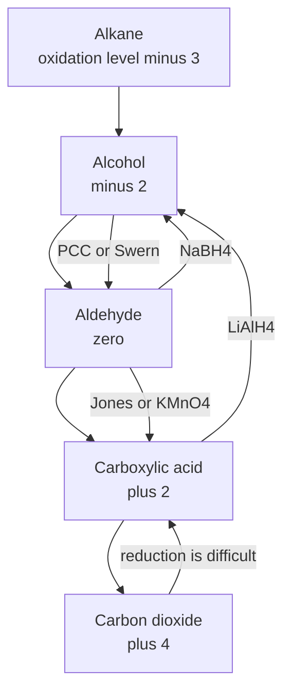
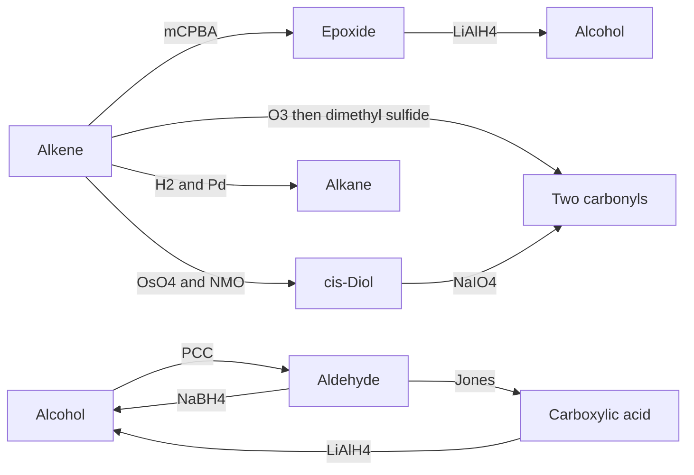
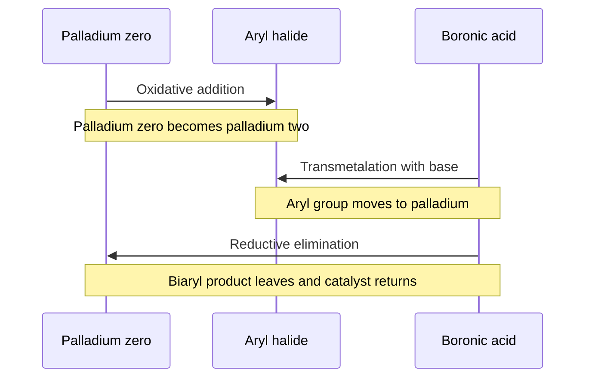
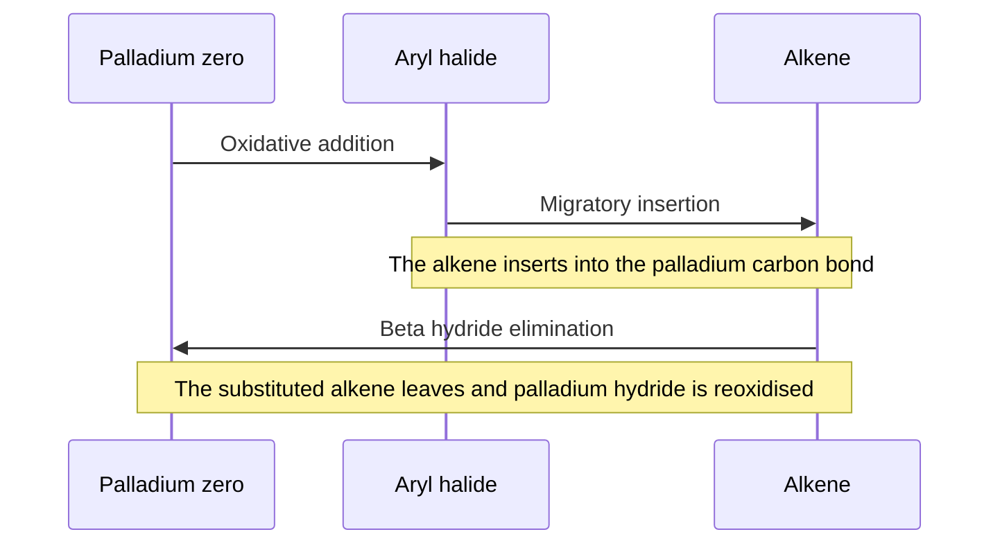

# Chapter 12 — Oxidation, Reduction and Organometallic Chemistry

> **Level:** Advanced (Level 4 — Organic Chemistry)
> **Estimated study time:** 8 hours (5.5 h reading + 2.5 h exercises)
> **Prerequisites:** Chapter 9 (alcohols and phenols); Chapter 10 (carbonyl chemistry); Chapter 11 (acid derivatives); Level 3 Chapter 8 (electrochemistry)
> **Related chapters:** [Alcohols, Phenols and Ethers](09-alcohols-phenols-and-ethers.md), [Aldehydes, Ketones and Carbonyl Chemistry](10-aldehydes-ketones-and-carbonyl-chemistry.md), [Retrosynthetic Analysis and Synthesis Strategy](14-retrosynthetic-analysis-and-synthesis-strategy.md)
> **Difficulty:** ★★★★★ (4–5)

---

## 1. Learning Objectives

After working through this chapter you will be able to:

- Assign an oxidation level to every carbon atom in an organic molecule using the bond-counting convention.
- Select an oxidant for a given transformation and justify the choice in terms of selectivity, conditions and by-products.
- Select a reductant for a given transformation and distinguish catalytic hydrogenation, dissolving-metal reduction and hydride reduction.
- Construct a functional-group interconversion map and use it to plan a sequence of redox steps.
- Explain the polarity of the carbon–metal bond and relate it to the electronegativity of the metal.
- Prepare and use Grignard reagents, organolithiums, organocuprates and organozincs, and state the limitations of each.
- Predict the products of Grignard addition to aldehydes, ketones, esters, acid chlorides, epoxides, carbon dioxide and nitriles.
- Describe the catalytic cycle of palladium cross-coupling and distinguish Suzuki, Heck, Sonogashira, Stille and Negishi couplings.
- Apply cross-coupling retrosynthetically to the construction of biaryls and substituted alkenes.
- Calculate turnover number, turnover frequency and atom economy for a catalytic process.

---

## 2. Introduction

Organic synthesis is largely a matter of changing the oxidation level of carbon and forming carbon–carbon bonds. The two activities are linked: an oxidation creates an electrophile, a reduction creates a nucleophile, and an organometallic reagent supplies a nucleophilic carbon that can be joined to either. This chapter is therefore the toolbox chapter — the one that says which reagent to reach for, and why.

The oxidation-level bookkeeping is simple but powerful. Every carbon atom can be assigned a formal oxidation number from the number of bonds it has to hydrogen and to heteroatoms, and most functional-group interconversions are changes in that number. Methane is at the lowest level, carbon dioxide at the highest, and the alcohols, aldehydes, ketones and acids sit in between. Once a target is placed on the ladder, the number of redox steps needed to reach it from a given starting material becomes a matter of arithmetic rather than memory.

The reducing and oxidising agents are equally systematic. Permanganate and dichromate are strong, cheap and unselective; PCC, Dess–Martin and Swern are mild and stop at the aldehyde; mCPBA, osmium tetroxide and ozone each attack a specific functional group. On the reduction side, hydrogen with a catalyst reduces alkenes and alkynes, sodium in liquid ammonia reduces alkynes to *trans* alkenes, borohydride reduces aldehydes and ketones, aluminium hydride reduces almost everything, and DIBAL-H stops at the aldehyde. The skill is not memorising the list but knowing what each reagent will and will not touch.

Organometallic chemistry supplies the carbon nucleophiles. A carbon–magnesium bond is strongly polarised towards carbon, so the carbon behaves as a carbanion: it adds to carbonyl groups, opens epoxides, carboxylates carbon dioxide and attacks nitriles. Palladium catalysis does something different and more modern: it couples two carbon electrophiles by a cycle of oxidative addition, transmetalation and reductive elimination, and it does so with high selectivity and under mild conditions. The Suzuki, Heck, Sonogashira, Stille and Negishi reactions have transformed what can be made, and the 2010 Nobel Prize in Chemistry recognised their importance.

---

## 3. Fundamental Concepts

### 3.1 Oxidation levels of carbon

The oxidation level of a carbon atom is obtained by counting its bonds to more electronegative atoms (oxygen, nitrogen, halogen, sulfur) as $+1$ each and its bonds to hydrogen as $-1$ each; bonds to other carbon atoms count as zero. The sum is the formal oxidation number of that carbon.

| Compound | Structural formula | Count | Oxidation level |
|---|---|---|---|
| Methane | $\ce{CH4}$ | four $\ce{C-H}$ | −4 |
| Ethane | $\ce{CH3CH3}$ | six $\ce{C-H}$, one $\ce{C-C}$ | −3 per carbon |
| Methanol | $\ce{CH3OH}$ | three $\ce{C-H}$, one $\ce{C-O}$ | −2 |
| Formaldehyde | $\ce{HCHO}$ | two $\ce{C-H}$, one $\ce{C=O}$ | 0 |
| Formic acid | $\ce{HCOOH}$ | one $\ce{C-H}$, one $\ce{C=O}$, one $\ce{C-O}$ | +2 |
| Carbon dioxide | $\ce{CO2}$ | two $\ce{C=O}$ | +4 |
| Chloromethane | $\ce{CH3Cl}$ | three $\ce{C-H}$, one $\ce{C-Cl}$ | −2 |
| Acetone, carbonyl carbon | $\ce{(CH3)2CO}$ | two $\ce{C-C}$, one $\ce{C=O}$ | +2 |

A double bond to oxygen counts twice because the carbon has lost two electrons to oxygen. The convention is formal, not physical — carbon and oxygen share electrons rather than transferring them — but it is consistent, and it makes redox bookkeeping possible.

Two consequences follow immediately. First, an oxidation is a reaction in which the oxidation level of a carbon rises, and a reduction is one in which it falls. Second, the same functional group can be reached by oxidation from below or by reduction from above, which is why the functional-group interconversions form a ladder rather than a set of isolated reactions.

### 3.2 The oxidation ladder

| Oxidation level | Functional group | Typical oxidant from the level below | Typical reductant from the level above |
|---|---|---|---|
| −4 to −2 | Alkane, alcohol, alkyl halide | — | — |
| −2 | Primary alcohol | $\ce{NaBH4}$ reverse; oxidation by PCC | $\ce{LiAlH4}$ from aldehyde |
| 0 | Aldehyde | PCC, Dess–Martin, Swern | $\ce{NaBH4}$ |
| +2 | Carboxylic acid | Jones reagent, hot $\ce{KMnO4}$ | $\ce{LiAlH4}$ to alcohol |
| +4 | Carbon dioxide | Combustion | — |

The ladder is the reason oxidation and reduction are strategic, not merely functional. A synthesis that needs an aldehyde must either stop an oxidation at the right level or reduce an ester carefully; both routes are valid, and the choice depends on which other groups are present.

### 3.3 Organometallic basics

A carbon–metal bond is polarised towards carbon whenever the metal is less electronegative than carbon. Pauling electronegativities make the trend explicit:

| Element | Electronegativity | Bond to carbon | Character of carbon |
|---|---|---|---|
| Li | 0.98 | $\ce{C-Li}$ | Strongly carbanionic |
| Na | 0.93 | $\ce{C-Na}$ | Strongly carbanionic |
| Mg | 1.31 | $\ce{C-Mg}$ | Carbanionic |
| Al | 1.61 | $\ce{C-Al}$ | Carbanionic |
| Zn | 1.65 | $\ce{C-Zn}$ | Weakly carbanionic |
| Cu | 1.90 | $\ce{C-Cu}$ | Weakly carbanionic; soft |
| B | 2.04 | $\ce{C-B}$ | Nearly covalent |
| Si | 1.90 | $\ce{C-Si}$ | Nearly covalent |
| Sn | 1.96 | $\ce{C-Sn}$ | Nearly covalent |
| Pd | 2.20 | $\ce{C-Pd}$ | Covalent; catalytic |
| C | 2.55 | $\ce{C-C}$ | Covalent |

Three reactivity classes emerge. The strongly polar organometallics — organolithiums and Grignard reagents — behave as carbanions and are destroyed by any proton source. The moderately polar reagents — organozincs and organocuprates — are milder and tolerate more functional groups. The nearly covalent reagents — organoboranes and organostannanes — are stable enough to be handled in air and water and are used as partners in palladium-catalysed couplings.

The nucleophilicity of the carbon follows the polarity: organolithiums are the most reactive and the least selective, Grignard reagents are next, organozincs and cuprates are milder and more selective, and boronic acids are so mild that they react only after transmetalation onto palladium.

---

## 4. Detailed Scientific Explanation

### 4.1 Oxidants and their selectivity

**Potassium permanganate.** Permanganate contains manganese(VII) and is a strong, inexpensive oxidant. In acidic or neutral solution it is reduced to manganese(II); in alkaline solution it gives manganese(IV) oxide, the brown precipitate that makes the end-point of a permanganate titration visible. It oxidises primary alcohols to carboxylic acids, secondary alcohols to ketones, aldehydes to acids, and it cleaves alkenes and alkynes. Hot concentrated permanganate also oxidises the side chains of alkylbenzenes to benzoic acids, which is a useful way to make aromatic acids but a nuisance when a side chain must be preserved.

$$
\ce{MnO4^- + 8H+ + 5e^- -> Mn^2+ + 4H2O}
\qquad E^\circ = +1.51\ \text{V}
$$

**Chromium(VI) reagents.** Dichromate in sulfuric acid is the classical oxidant; the Jones reagent is a solution of chromium trioxide in aqueous sulfuric acid and acetone, added at $0\ ^\circ\text{C}$, and it oxidises primary alcohols to carboxylic acids and secondary alcohols to ketones. PCC — pyridinium chlorochromate — is a dry, mild alternative that stops at the aldehyde, because the reaction is run in dichloromethane with no water to form the hydrate. The chromium(VI) species is reduced to chromium(III), which is why chromium waste is coloured green and why the reagents are now avoided where possible on toxicity grounds.

$$
\ce{Cr2O7^2- + 14H+ + 6e^- -> 2Cr^3+ + 7H2O}
\qquad E^\circ = +1.33\ \text{V}
$$

**Dess–Martin periodinane.** A hypervalent iodine(V) reagent that oxidises primary alcohols to aldehydes and secondary alcohols to ketones under very mild, anhydrous conditions. It is expensive and is used when acid-sensitive or oxidation-sensitive groups are present, because it produces no acidic by-products and does not over-oxidise.

**Swern oxidation.** Dimethyl sulfoxide is activated by oxalyl chloride at $-78\ ^\circ\text{C}$ to give a chlorosulfonium ion; the alcohol attacks, and the resulting alkoxysulfonium ion is deprotonated by triethylamine and collapses to the aldehyde or ketone with expulsion of dimethyl sulfide. The conditions are extremely mild, and the reaction is the standard method for oxidising a primary alcohol to an aldehyde in a molecule that contains acid-labile groups. The disadvantage is the smell of dimethyl sulfide and the need for low temperatures.

**mCPBA.** *meta*-Chloroperoxybenzoic acid is a peroxy acid that transfers an oxygen atom to an alkene in a concerted, suprafacial epoxidation. The reaction is electrophilic, so more substituted and more electron-rich alkenes react faster. The same reagent performs the Baeyer–Villiger oxidation of ketones to esters, in which the migratory aptitude order is tertiary alkyl > secondary alkyl > phenyl > primary alkyl > methyl.

**Osmium tetroxide.** Adds two hydroxyl groups to an alkene in a concerted *syn* fashion, giving a *cis*-1,2-diol. The reagent is volatile and toxic, so it is used catalytically with a co-oxidant such as *N*-methylmorpholine *N*-oxide (NMO), which reoxidises the osmium(VI) product back to osmium(VIII). Potassium permanganate under cold, dilute, alkaline conditions gives the same *cis*-diol.

**Ozone.** Ozonolysis cleaves a $\ce{C=C}$ bond to two carbonyl compounds. The mechanism proceeds through a molozonide and an ozonide, and the work-up determines the product: a reductive work-up with dimethyl sulfide or zinc and acetic acid preserves aldehydes, whereas an oxidative work-up with hydrogen peroxide converts them to carboxylic acids. Ozonolysis is used industrially to make vanillin from eugenol and to locate double bonds by analysis of the fragments.

| Oxidant | Typical substrate | Product | Selectivity note |
|---|---|---|---|
| $\ce{KMnO4}$, hot, alkaline | Primary alcohol | Carboxylic acid | Also cleaves alkenes |
| $\ce{KMnO4}$, cold, dilute | Alkene | *cis*-Diol | Mild and aqueous |
| Jones reagent | Primary alcohol | Carboxylic acid | Aqueous acid |
| PCC | Primary alcohol | Aldehyde | Anhydrous, stops at aldehyde |
| Dess–Martin | Primary alcohol | Aldehyde | No acidic by-products |
| Swern | Primary alcohol | Aldehyde | Very mild, low temperature |
| mCPBA | Alkene | Epoxide | Electrophilic; electron-rich alkenes faster |
| mCPBA | Ketone | Ester | Baeyer–Villiger rearrangement |
| $\ce{OsO4}$, NMO | Alkene | *cis*-Diol | Catalytic, *syn* addition |
| $\ce{O3}$, then $\ce{(CH3)2S}$ | Alkene | Aldehydes or ketones | Cleaves the double bond |

### 4.2 Reductants and their selectivity

**Catalytic hydrogenation.** Hydrogen gas with palladium on carbon, platinum oxide or Raney nickel adds hydrogen to alkenes and alkynes *syn*, reduces nitro groups to amines and cleaves benzyl ethers. Isolated arenes are reduced only under forcing conditions, and carbonyl groups are untouched under the usual conditions. The reaction is heterogeneous and its stereochemistry is *syn* because both hydrogen atoms are delivered from the metal surface.

**Lindlar catalyst.** Palladium on calcium carbonate poisoned with lead acetate and quinoline reduces an alkyne to a *cis*-alkene and stops there, because the poisoned surface cannot adsorb the alkene strongly enough for a second hydrogenation.

**Dissolving-metal reduction.** Sodium or lithium in liquid ammonia reduces an alkyne to a *trans*-alkene by a radical-anion mechanism, and reduces aromatic rings to 1,4-cyclohexadienes (the Birch reduction). The *trans* selectivity arises because the radical anion adopts the geometry that minimises repulsion between the alkyl groups.

**Sodium borohydride.** A mild hydride donor that reduces aldehydes and ketones in alcohol or water, and reduces acid chlorides; it does not reduce esters, acids or amides under normal conditions.

**Lithium aluminium hydride.** A powerful hydride donor that reduces aldehydes, ketones, esters, carboxylic acids, amides and nitriles; it does not reduce isolated alkenes. It reacts violently with water and must be used in dry ether or THF.

**DIBAL-H.** Diisobutylaluminium hydride reduces esters to aldehydes at $-78\ ^\circ\text{C}$ and nitriles to aldehydes, because the tetrahedral intermediate is stable at low temperature and collapses only on work-up.

**Sodium cyanoborohydride.** A weak hydride donor that reduces iminium ions selectively at pH 5–6, which is the basis of reductive amination.

| Reductant | Reduces | Leaves untouched |
|---|---|---|
| $\ce{H2}$, Pd/C | Alkenes, alkynes, nitro, benzyl ethers | Carbonyls, arenes |
| $\ce{H2}$, Lindlar | Alkynes to *cis*-alkenes | Alkenes |
| Na, $\ce{NH3}$ | Alkynes to *trans*-alkenes; arenes to dienes | Carbonyls |
| $\ce{NaBH4}$ | Aldehydes, ketones | Esters, acids, amides |
| $\ce{LiAlH4}$ | Aldehydes, ketones, esters, acids, amides, nitriles | Isolated alkenes |
| DIBAL-H | Esters and nitriles to aldehydes | Alcohols at low temperature |
| $\ce{NaBH3CN}$ | Iminium ions | Ketones and aldehydes |

### 4.3 The interconversion map

The reagents above can be arranged as a map in which each arrow is a transformation and each label is a reagent. The map is the working form of the oxidation ladder: an alkene can be converted into a diol, an epoxide, an aldehyde or a carboxylic acid; an alcohol into an aldehyde or an acid; an ester into an alcohol or an aldehyde; and an amide into an amine. Planning a synthesis often consists of finding a path on this map from a cheap starting material to the target, then checking that every other functional group in the molecule survives each step.

### 4.4 Grignard reagents

**Preparation.** Magnesium turnings are stirred in dry diethyl ether or THF with a small crystal of iodine to activate the surface, and the alkyl or aryl halide is added slowly:

$$
\ce{R-X + Mg ->[dry\ C2H5OC2H5] R-MgX}
$$

The reaction is exothermic and is initiated by the direct electron transfer from magnesium to the halide. Bromides and iodides react more readily than chlorides; aryl and vinyl bromides require THF, which coordinates the magnesium more strongly than diethyl ether. The reagent exists in equilibrium with the dialkylmagnesium and magnesium dihalide (the Schlenk equilibrium), but the equilibrium lies well towards the monoalkyl species in ether.

**Limitations.** A Grignard reagent is a strong base as well as a nucleophile, so it is destroyed by any acidic proton:

$$
\ce{RMgX + H2O -> RH + Mg(OH)X}
$$

Alcohols, amines, carboxylic acids, terminal alkynes and even moderately acidic $\ce{C-H}$ bonds all quench the reagent. Oxygen and carbon dioxide also react, and the reagent must be prepared and used under an inert atmosphere in dry glassware. A substrate that contains an incompatible group must be protected before the Grignard is formed, or the Grignard must be made on a fragment that lacks the group and coupled later.

**Reactions.** The additions follow the pattern of Chapter 10:

$$
\ce{RMgX + R'CHO -> RCH(OH)R'}
\qquad \text{secondary alcohol}
$$

$$
\ce{RMgX + R'2CO -> RCR'2OH}
\qquad \text{tertiary alcohol}
$$

$$
\ce{RMgX + CO2 -> RCO2MgX ->[H3O+] RCOOH}
$$

$$
\ce{RMgX + \text{oxirane} -> RCH2CH2OMgX ->[H3O+] RCH2CH2OH}
$$

$$
\ce{RMgX + R'CN -> RC(=NMgX)R' ->[H3O+] RC(=O)R'}
$$

Two practical points deserve emphasis. A ketone that has $\alpha$-hydrogens can be enolised by the Grignard instead of attacked, especially if the reagent is hindered or the reaction is slow; inverse addition — adding the ketone to the Grignard — suppresses enolisation. And esters react twice, so a Grignard and an ester give a tertiary alcohol with two identical groups; to stop at the ketone, an organocuprate or a Weinreb amide is used.

### 4.5 Organolithiums

Organolithiums are more reactive than Grignard reagents and are prepared either by direct reaction of lithium metal with a halide or by halogen–metal exchange:

$$
\ce{R-X + 2Li ->[hexane] R-Li + LiX}
\qquad
\ce{Ar-Br + C4H9Li -> Ar-Li + n-BuBr}
$$

The exchange is an equilibrium that lies towards the more stable carbanion, so an aryl or alkyne lithium is formed in preference to an alkyl lithium. Organolithiums react with carbonyl compounds, epoxides, carbon dioxide and nitriles, and they deprotonate weakly acidic $\ce{C-H}$ bonds that a Grignard would leave alone. They are also used to generate lithium enolates and lithium diisopropylamide, the base of choice for kinetic enolate formation.

### 4.6 Organocuprates

A Gilman reagent is a lithium dialkylcuprate, formed from two equivalents of an organolithium and copper(I) iodide:

$$
\ce{2R-Li + CuI -> R2CuLi + LiI}
$$

The carbon–copper bond is much less polar than a carbon–lithium bond, so the reagent is milder and more selective. Two reactions define its use. First, it adds to the $\beta$-carbon of an $\alpha$,$\beta$-unsaturated carbonyl compound (1,4-addition) rather than to the carbonyl carbon, which is the opposite of what a Grignard often does. Second, it couples with primary alkyl halides, vinyl halides and aryl halides in the Corey–House reaction:

$$
\ce{R2CuLi + R'CH2I -> R-CH2R' + R-Cu + LiI}
$$

The coupling is an $S_N2$ reaction at the alkyl halide, so it works for primary and activated halides and fails for tertiary ones.

### 4.7 Organozincs

Organozinc reagents are less reactive than Grignards and tolerate esters, nitriles and even some acidic protons, which makes them useful when a more reactive organometallic would destroy the substrate.

**Reformatsky reaction.** Zinc inserts into an $\alpha$-bromoester, and the resulting organozinc adds to an aldehyde or ketone to give a $\beta$-hydroxy ester:

$$
\ce{BrCH2COOC2H5 + Zn -> BrZnCH2COOC2H5}
$$

$$
\ce{BrZnCH2COOC2H5 + RCHO -> RCH(OH)CH2COOC2H5}
$$

**Simmons–Smith cyclopropanation.** Iodomethylzinc iodide, generated from diiodomethane and zinc–copper couple, transfers a methylene group to an alkene with *syn* stereochemistry, giving a cyclopropane.

**Negishi coupling.** Organozinc halides couple with aryl or vinyl halides in the presence of a palladium catalyst (Section 4.8); the mildness of the organozinc makes the reaction tolerant of many functional groups.

### 4.8 Palladium-catalysed cross-coupling

All palladium-catalysed couplings share a three-stage cycle:

1. **Oxidative addition.** Palladium(0) inserts into the carbon–halogen bond of an aryl or vinyl halide, giving a palladium(II) complex with the organic group on palladium and the halide on palladium. This step is usually rate-determining.
2. **Transmetalation.** A nucleophilic organic group from a boronic acid, organozinc, organotin or organosilicon reagent replaces the halide on palladium.
3. **Reductive elimination.** The two organic groups couple and leave as the product, regenerating palladium(0).

The Heck reaction differs in the second step: instead of transmetalation there is a **migratory insertion** of an alkene into the palladium–carbon bond, followed by $\beta$-hydride elimination to give a substituted alkene.

| Reaction | Coupling partners | Catalyst and conditions | By-product |
|---|---|---|---|
| Suzuki–Miyaura | Aryl halide + boronic acid | $\ce{Pd(PPh3)4}$, base, aqueous dioxane | Borate |
| Heck | Aryl halide + alkene | $\ce{Pd(OAc)2}$, phosphine, amine base | Hydrogen halide |
| Sonogashira | Aryl halide + terminal alkyne | Pd/CuI, amine base | Ammonium salt |
| Stille | Aryl halide + organotin | $\ce{Pd(PPh3)4}$ | Organotin waste |
| Negishi | Aryl halide + organozinc | Pd or Ni catalyst | Zinc halide |

The Suzuki reaction is the most widely used in industry because boronic acids are stable, non-toxic and available in great variety, and because the boron by-product is benign. The Heck reaction is valuable because it uses an alkene rather than an organometallic partner. The Sonogashira reaction is the standard route to aryl alkynes and to the enynes found in natural products. The Stille reaction is powerful but has been largely replaced because of the toxicity of organotin compounds.

**Ligands and conditions.** Triphenylphosphine is the classical ligand for palladium(0); bulky electron-rich phosphines and *N*-heterocyclic carbenes accelerate oxidative addition; bidentate ligands such as dppf improve stability and selectivity. Bases neutralise the hydrogen halide, and the choice of base and solvent controls the rate of transmetalation and the solubility of the partners.

### 4.9 Organometallics in industry

Hydroformylation adds carbon monoxide and hydrogen to an alkene to give an aldehyde, catalysed by rhodium complexes; it is the largest homogeneous catalysis process in the world and produces butanal and higher aldehydes for plasticisers and detergents. The Monsanto and Cativa processes carbonylate methanol to acetic acid with rhodium and iridium catalysts. Ziegler–Natta polymerisation uses titanium and aluminium alkyls to make high-density polyethylene and polypropylene with controlled stereochemistry. Cross-coupling is used in the manufacture of pharmaceuticals, agrochemicals and organic light-emitting diodes, and the 2010 Nobel Prize in Chemistry was awarded to Heck, Negishi and Suzuki for it.

---

## 5. Visual Diagrams

**Figure 12.1 — The oxidation ladder for carbon.** Each upward step is an oxidation and each downward step is a reduction, and the reagents on the arrows are the ones that perform the transformation selectively. The ladder explains why an aldehyde is difficult to obtain by oxidation: it lies between two more stable levels and is itself the most easily oxidised compound in the series. The reverse route, from acid down to alcohol, is equally informative: it requires a powerful reductant because it crosses two levels at once.

**Figure 12.2 — A functional-group interconversion map for the common redox reagents.** Every arrow is a reaction with a named reagent, and the map is used in both directions: forwards to choose a reagent for a target, backwards to choose a starting material. The pairs that share a product — for example the two routes from an alkene to a carbonyl compound — differ in the number of steps, the selectivity and the stereochemistry, and those differences are the substance of synthesis planning.

**Figure 12.3 — The Suzuki–Miyaura catalytic cycle as a sequence.** The three stages are oxidative addition, transmetalation and reductive elimination, and the catalyst returns to its starting state at the end of each turnover. The base is not shown as a separate partner but is essential: it activates the boronic acid towards transmetalation and neutralises the hydrogen halide. Because the palladium is regenerated, a small amount — typically 1 to 5 mol% — suffices for a complete conversion.

**Figure 12.4 — The Heck reaction differs at the second stage.** There is no transmetalation because there is no organometallic partner; instead the alkene inserts into the palladium–carbon bond, and $\beta$-hydride elimination releases the product. The cycle is completed by reductive elimination of hydrogen halide with the aid of a base. The comparison with Figure 12.3 is the point: the same catalyst and the same first and last steps support a completely different bond-forming event.

---

## 6. Mathematical Formulas

### 6.1 Oxidation number from structure

For a carbon atom bonded to $h$ hydrogen atoms, $x$ heteroatoms by single bonds, and $d$ heteroatoms by double bonds,

$$
\text{oxidation level} = x + 2d - h
$$

| Symbol | Meaning | Unit |
|---|---|---|
| $h$ | number of bonds to hydrogen | dimensionless |
| $x$ | number of single bonds to heteroatoms | dimensionless |
| $d$ | number of double bonds to heteroatoms | dimensionless |

For acetic acid, the carboxyl carbon has $h = 0$, $x = 1$ (the $\ce{C-O}$ bond) and $d = 1$ (the $\ce{C=O}$ bond), so the level is $1 + 2 - 0 = +3$. The methyl carbon has $h = 3$, $x = 0$ and $d = 0$, so its level is $-3$. The molecule as a whole contains carbon at two different levels, which is why "the oxidation state of acetic acid" is not a meaningful phrase without specifying which carbon.

### 6.2 Electron balance in a redox half-reaction

$$
\ce{MnO4^- + 8H+ + 5e^- -> Mn^2+ + 4H2O}
$$

The number of electrons transferred per mole of oxidant is obtained by balancing charge and oxygen. For permanganate in acid, manganese falls from +7 to +2, a five-electron change; for dichromate, chromium falls from +6 to +3, a three-electron change per chromium and therefore six per dichromate ion. The equivalents per mole are used in titration calculations:

$$
n(\text{electrons}) = n(\text{oxidant}) \times \Delta(\text{oxidation number})
$$

### 6.3 Turnover number and turnover frequency

$$
\text{TON} = \frac{n(\text{product})}{n(\text{catalyst})}
\qquad
\text{TOF} = \frac{\text{TON}}{t}
$$

| Symbol | Meaning | SI unit |
|---|---|---|
| TON | turnover number | dimensionless |
| TOF | turnover frequency | s⁻¹ |
| $t$ | reaction time | s |

A catalyst with a TON of 1000 and a TOF of $0.14\ \text{s}^{-1}$ converts 1000 molecules of substrate per molecule of catalyst over about two hours. TON measures robustness and TOF measures activity; a good industrial catalyst needs both.

### 6.4 Atom economy of a cross-coupling

$$
\text{Atom economy} = \frac{M(\text{product})}{\sum M(\text{reactants})} \times 100\%
$$

For the Suzuki coupling of bromobenzene ($M = 157.0\ \text{g mol}^{-1}$) with phenylboronic acid ($M = 121.9\ \text{g mol}^{-1}$) to give biphenyl ($M = 154.2\ \text{g mol}^{-1}$),

$$
\text{Atom economy} = \frac{154.2}{157.0 + 121.9} \times 100\% = 55.3\%
$$

The missing 45% becomes boric acid and hydrogen bromide; counting the water consumed as a reactant would lower the figure to about 52%. The figure looks poor by the standards of an addition reaction, but the Suzuki coupling replaces a stoichiometric organometallic reagent with a catalytic one and avoids the far larger waste streams of the classical routes, which is why atom economy must be read alongside the E-factor of the whole process.

---

## 7. Chemical Equations

### 7.1 Oxidations

$$
\ce{CH3CH2OH ->[K2Cr2O7,\ H2SO4] CH3COOH}
$$

$$
\ce{CH3CH2OH ->[PCC,\ CH2Cl2] CH3CHO}
$$

$$
\ce{(CH3)2CHOH ->[PCC] (CH3)2C=O}
$$

$$
\ce{C6H5CH3 ->[KMnO4,\ hot] C6H5COOH}
$$

$$
\ce{CH3(CH2)5CH=CH2 ->[KMnO4,\ hot] CH3(CH2)5COOH + CO2}
$$

### 7.2 Epoxidation, dihydroxylation and ozonolysis

$$
\ce{CH3CH=CH2 + C7H5ClO3 -> C3H6O + C7H5ClO2}
$$

$$
\ce{RCH=CHR' + H2O2 ->[OsO4] RCH(OH)CH(OH)R'}
$$

$$
\ce{CH3CH=CHCH3 + O3 + (CH3)2S -> 2CH3CHO + (CH3)2SO}
$$

### 7.3 Reductions

$$
\ce{RCH=CHR' + H2 ->[Pd/C] RCH2CH2R'}
$$

$$
\ce{RC#CR' + H2 ->[Lindlar] RCH=CHR'}
$$

$$
\ce{RC#CR' + Na ->[NH3] RCH=CHR'}
$$

$$
\ce{CH3CHO + NaBH4 ->[CH3OH] CH3CH2OH}
$$

$$
\ce{CH3COOH + LiAlH4 ->[THF] CH3CH2OH}
$$

$$
\ce{CH3COOC2H5 + DIBAL-H ->[-78\ ^\circ C] CH3CHO}
$$

### 7.4 Grignard formation and reactions

$$
\ce{CH3CH2CH2Br + Mg ->[dry\ C2H5OC2H5] CH3CH2CH2MgBr}
$$

$$
\ce{CH3CH2CH2MgBr + H2O -> CH3CH2CH3 + Mg(OH)Br}
\qquad \text{quenching}
$$

$$
\ce{CH3CH2CH2MgBr + CO2 -> CH3CH2CH2CO2MgBr ->[H3O+] CH3CH2CH2COOH}
$$

$$
\ce{CH3CH2CH2MgBr + \text{oxirane} -> CH3CH2CH2CH2CH2OH}
$$

### 7.5 Organocuprate and organozinc reactions

$$
\ce{2CH3Li + CuI -> (CH3)2CuLi + LiI}
$$

$$
\ce{(CH3)2CuLi + \text{cyclohex-2-enone} -> \text{3-methylcyclohexanone}}
$$

$$
\ce{BrCH2COOC2H5 + Zn -> BrZnCH2COOC2H5}
$$

$$
\ce{BrZnCH2COOC2H5 + C6H5CHO -> C6H5CH(OH)CH2COOC2H5}
$$

### 7.6 Palladium-catalysed couplings

$$
\ce{C6H5Br + C6H5B(OH)2 + H2O ->[Pd(PPh3)4,\ Na2CO3] C12H10 + B(OH)3 + HBr}
$$

$$
\ce{C6H5Br + CH2=CHCO2CH3 ->[Pd(OAc)2,\ (C2H5)3N] C6H5CH=CHCO2CH3 + HBr}
$$

$$
\ce{C6H5I + HC#C-C6H5 ->[Pd/CuI,\ (C2H5)3N] C6H5C#C-C6H5 + HI}
$$

---

## 8. Worked Examples

### Worked Example 12.1 — Assigning oxidation levels

**Problem.** Assign the oxidation level of every carbon atom in (a) ethanol, (b) ethanal, (c) ethanoic acid and (d) propanone, and state the change in oxidation level for each step of the sequence ethanol → ethanal → ethanoic acid.

**Strategy.** Apply the rule: each bond to hydrogen counts $-1$, each bond to a heteroatom counts $+1$ (double bonds twice), and bonds to carbon count zero.

**Solution.**

(a) Ethanol, $\ce{CH3CH2OH}$: the methyl carbon has three $\ce{C-H}$ bonds, so $-3$; the carbinol carbon has two $\ce{C-H}$ bonds and one $\ce{C-O}$ bond, so $+1 - 2 = -1$.

(b) Ethanal, $\ce{CH3CHO}$: the methyl carbon is $-3$; the carbonyl carbon has one $\ce{C-H}$ ($-1$) and one $\ce{C=O}$ ($+2$), so $+1$.

(c) Ethanoic acid, $\ce{CH3COOH}$: the methyl carbon is $-3$; the carboxyl carbon has one $\ce{C=O}$ ($+2$) and one $\ce{C-O}$ ($+1$), so $+3$.

(d) Propanone, $\ce{CH3COCH3}$: both methyl carbons are $-3$; the carbonyl carbon has two $\ce{C-C}$ bonds (0) and one $\ce{C=O}$ ($+2$), so $+2$.

The sequence ethanol → ethanal → ethanoic acid is therefore a two-electron oxidation at each step, from $-1$ to $+1$ to $+3$.

**Check.** Each oxidation removes two hydrogen atoms or adds one oxygen atom, which is the same as a two-electron change. The arithmetic is consistent with the reagents: PCC performs the first step and Jones reagent the second.

### Worked Example 12.2 — Choosing a selective oxidant

**Problem.** Choose reagents for each transformation and explain the selectivity: (a) hex-5-en-1-ol to hex-5-enal; (b) cyclohexene to *cis*-cyclohexane-1,2-diol; (c) cyclohexene to cyclohexene oxide; (d) benzyl alcohol to benzaldehyde in the presence of an isolated alkene.

**Strategy.** Identify the functional group that must change and the groups that must survive, then select the mildest reagent that does the job.

**Solution.**

(a) PCC in dichloromethane. The primary alcohol is oxidised to the aldehyde, and the isolated alkene is untouched by PCC; the anhydrous conditions prevent over-oxidation to the acid.

(b) Osmium tetroxide with NMO as the terminal oxidant. The addition is *syn*, so the two hydroxyl groups end up on the same face, giving the *cis*-diol.

(c) mCPBA in dichloromethane. The peroxy acid transfers a single oxygen atom to the alkene in a concerted suprafacial epoxidation.

(d) PCC, Dess–Martin or Swern. All three oxidise the benzylic alcohol to the aldehyde without touching the isolated alkene; Jones reagent would over-oxidise to benzoic acid and would also attack the alkene.

**Check.** In each case the reagent is matched to the functional group that changes, and the conditions are anhydrous where over-oxidation must be avoided. The presence of an alkene rules out hot permanganate and ozone in every case.

### Worked Example 12.3 — A Grignard that cannot be made

**Problem.** Explain why a Grignard reagent cannot be prepared directly from 4-bromophenol, and propose two routes to a 4-substituted phenyl Grignard equivalent.

**Strategy.** Identify the acidic proton in the substrate and the fate of a Grignard reagent in its presence.

**Solution.** 4-Bromophenol contains a phenolic $\ce{O-H}$ with a $\mathrm{p}K_a$ of about 10, and a Grignard reagent is the conjugate base of an alkane ($\mathrm{p}K_a \approx 50$). The Grignard is therefore protonated as fast as it forms:

$$
\ce{ArMgBr + Ar'OH -> ArH + Ar'OMgBr}
$$

Only one equivalent of the phenol is consumed per equivalent of reagent, so no useful Grignard survives.

Two solutions are standard. First, protect the phenol as a methyl ether (iodomethane and potassium carbonate) or as a silyl ether, prepare the Grignard from the protected bromide, carry out the addition, and then cleave the protecting group — with boron tribromide for the methyl ether or fluoride for the silyl ether. Second, avoid the phenol altogether: prepare the Grignard from 4-bromoanisole, use it in the coupling step, and unmask the phenol at the end. Both routes convert an incompatible substrate into a compatible one by changing the protecting group rather than the carbon skeleton.

**Check.** The protection must be stable to the Grignard and removable after it. A methyl ether satisfies both requirements, which is why it is the classical choice for a phenolic oxygen.

### Worked Example 12.4 — A Suzuki disconnection

**Problem.** Propose two Suzuki disconnections of 4-methoxybiphenyl and explain which is preferred.

**Strategy.** A biaryl can be disconnected at either of the two bonds joining the rings, giving an aryl halide and an arylboronic acid in each case. Compare the availability of the partners and the risk of side reactions.

**Solution.** Disconnection A gives 4-bromoanisole and phenylboronic acid; disconnection B gives bromobenzene and 4-methoxyphenylboronic acid. Both are formally valid, and both use commercially available partners.

Disconnection A is usually preferred for two reasons. 4-Bromoanisole is cheap and is a good oxidative-addition substrate, and phenylboronic acid is one of the least expensive boronic acids. Disconnection B requires 4-methoxyphenylboronic acid, which is more expensive and is prone to protodeboronation under the basic aqueous conditions of the coupling. In general, the partnership is chosen so that the more valuable and more sensitive fragment is the halide, because the halide is consumed in the rate-determining oxidative addition and the boronic acid is used in slight excess.

**Check.** Both disconnections give the same product, so the choice is made on practical grounds — cost, availability and stability — rather than on mechanism. This is typical of real retrosynthetic decisions, where several routes are chemically valid and only one is economical.

### Worked Example 12.5 — Turnover number and turnover frequency

**Problem.** A palladium-catalysed coupling uses $0.50\ \text{mol}\%$ of catalyst to convert $2.0\ \text{mol}$ of aryl halide completely in $4.0\ \text{h}$. Calculate the turnover number and the turnover frequency.

**Strategy.** Convert the catalyst loading to an amount in moles, divide the product amount by the catalyst amount, then divide by the reaction time in seconds.

**Solution.** The amount of catalyst is

$$
n(\text{Pd}) = 0.0050 \times 2.0\ \text{mol} = 1.0 \times 10^{-2}\ \text{mol}
$$

The turnover number is

$$
\text{TON} = \frac{2.0\ \text{mol}}{1.0 \times 10^{-2}\ \text{mol}} = 200
$$

and the turnover frequency, with $t = 4.0\ \text{h} = 1.44 \times 10^{4}\ \text{s}$, is

$$
\text{TOF} = \frac{200}{1.44 \times 10^{4}\ \text{s}} = 1.4 \times 10^{-2}\ \text{s}^{-1}
$$

**Check.** A TON of 200 means each palladium atom has run 200 catalytic cycles, which is modest for a laboratory reaction but acceptable for a small-scale synthesis; industrial processes often require TONs in the thousands. The TOF of about $0.014\ \text{s}^{-1}$ corresponds to roughly one cycle every 70 seconds.

---

## 9. Real-World Applications

**Pharmaceutical manufacturing.** Palladium-catalysed couplings are used in the commercial synthesis of many drugs, including the antihypertensive losartan and the antiviral remdesivir, because they allow complex biaryl and aryl–alkene fragments to be assembled late in a sequence under mild conditions. The ability to couple a functionalised aryl halide with a boronic acid without protecting every other group is the reason the Suzuki reaction displaced older stoichiometric methods. **Agrochemicals and materials.** Cross-coupling is equally important in agrochemical manufacture and in the synthesis of organic light-emitting diodes and liquid-crystal materials, where biaryl and aryl–alkyne units control the electronic properties.

**Bulk chemicals.** Hydroformylation converts alkenes into aldehydes on a scale of millions of tonnes per year; the aldehydes are hydrogenated to alcohols for plasticisers and detergents. The Monsanto and Cativa processes carbonylate methanol to acetic acid with rhodium and iridium catalysts, and the Wacker process oxidises ethene to ethanal with a palladium–copper catalyst. These are the largest applications of homogeneous catalysis.

**Polymers.** Ziegler–Natta and metallocene catalysts polymerise ethene and propene with controlled stereochemistry, and the properties of the resulting plastics depend on the catalyst as much as on the monomer. The same principles of ligand control that govern cross-coupling govern polymerisation.

**Oxidation in water treatment and sanitation.** Potassium permanganate is used to oxidise iron and manganese in drinking water and to control taste and odour; ozone is used to disinfect water and to oxidise micropollutants; hydrogen peroxide with an iron catalyst (Fenton chemistry) destroys organic contaminants in soil and groundwater. The selectivity that matters in the laboratory is replaced by the need for complete mineralisation in environmental applications.

**Green chemistry.** Modern oxidation chemistry aims to replace stoichiometric chromium and manganese reagents with catalytic systems that use oxygen or hydrogen peroxide as the terminal oxidant. The atom economy and E-factor calculations introduced in Section 6 are the tools used to compare routes, and the replacement of a stoichiometric oxidant by a catalytic one is one of the clearest examples of green chemistry in practice.

**Biology.** Biological oxidations use oxygenases and dehydrogenases rather than permanganate. Cytochrome P450 enzymes oxidise unactivated $\ce{C-H}$ bonds with a haem iron centre, and alcohol dehydrogenases interconvert alcohols and carbonyl compounds with NAD⁺ as the hydride acceptor. The mechanistic logic — hydride or oxygen-atom transfer at a metal centre — is the same as in the laboratory reagents.

---

## 10. Common Mistakes

| Mistake | Why it happens | Correct approach |
|---|---|---|
| Counting bonds to carbon as oxidation | The convention is applied loosely | Bonds to carbon count as zero; only bonds to hydrogen and to heteroatoms change the oxidation level |
| Using hot permanganate when an alkene must survive | Permanganate is treated as a general oxidant | Hot permanganate cleaves alkenes; use PCC, Dess–Martin or Swern for alcohols bearing alkenes |
| Expecting PCC to oxidise a primary alcohol to an acid | The reagent is confused with Jones reagent | PCC is anhydrous and stops at the aldehyde; Jones reagent is aqueous and gives the acid |
| Using $\ce{NaBH4}$ to reduce an ester | Hydride reagents are assumed to be interchangeable | $\ce{NaBH4}$ leaves esters alone; use $\ce{LiAlH4}$ or DIBAL-H |
| Adding a Grignard to a ketone that bears an acidic group | The basicity of the reagent is forgotten | Protect the acidic group first, or build the molecule by a different disconnection |
| Trying to make a Grignard from a tertiary chloride in diethyl ether | The reagent is used without considering the halide | Tertiary chlorides react slowly; use the bromide in THF or use an organolithium |
| Assuming a Grignard gives a ketone from an ester | Only one addition is considered | Esters react twice; use an organocuprate or a Weinreb amide to stop at the ketone |
| Writing a palladium cycle without reductive elimination | The cycle is memorised as two steps | Oxidative addition, transmetalation and reductive elimination are all required to regenerate palladium(0) |
| Reporting a catalyst loading as a mass percentage | TON and TOF are confused with yield | TON is moles of product per mole of catalyst; TOF is TON per unit time |

---

## 11. Chapter Summary

- The oxidation level of a carbon is obtained by counting $\ce{C-H}$ bonds as $-1$ and bonds to heteroatoms as $+1$; most functional-group interconversions are changes in this level.
- Strong oxidants such as permanganate and dichromate are cheap but unselective; PCC, Dess–Martin and Swern stop at the aldehyde under anhydrous conditions.
- mCPBA epoxidises alkenes and performs the Baeyer–Villiger oxidation; osmium tetroxide gives *cis*-diols; ozone cleaves alkenes to carbonyl compounds.
- Catalytic hydrogenation reduces alkenes, alkynes and nitro groups; Lindlar gives *cis*-alkenes; sodium in ammonia gives *trans*-alkenes and Birch reduction of arenes.
- $\ce{NaBH4}$ reduces aldehydes and ketones; $\ce{LiAlH4}$ reduces esters, acids, amides and nitriles; DIBAL-H stops at the aldehyde.
- The carbon–metal bond is polarised towards carbon, and the carbanion character increases as the metal becomes more electropositive: Li > Mg > Zn > Cu > B.
- Grignard reagents add to carbonyls, epoxides, carbon dioxide and nitriles but are destroyed by acidic protons, water and oxygen.
- Organolithiums are more reactive than Grignards and are made by halogen–metal exchange; organocuprates are milder and give 1,4-addition and Corey–House coupling; organozincs tolerate many functional groups.
- Palladium-catalysed cross-coupling proceeds by oxidative addition, transmetalation and reductive elimination, and the Heck reaction replaces transmetalation with migratory insertion.
- Suzuki coupling is the most widely used because boronic acids are stable and non-toxic; Sonogashira makes aryl alkynes; Stille is limited by tin toxicity.
- TON, TOF and atom economy quantify catalyst efficiency and the waste inherent in a stoichiometric coupling.

---

## 12. Exercises

### 12.1 Conceptual questions

1. Explain why the carbon atom of a Grignard reagent is nucleophilic, using electronegativity values and the polarity of the carbon–magnesium bond.
2. Explain why DIBAL-H can stop at the aldehyde when it reduces an ester, whereas $\ce{LiAlH4}$ cannot.

### 12.2 Basic problems

3. Give the major organic product: (a) propan-1-ol with PCC; (b) cyclohexene with mCPBA; (c) but-2-yne with $\ce{H2}$ and Lindlar catalyst; (d) benzaldehyde with $\ce{NaBH4}$; (e) ethyl benzoate with DIBAL-H at $-78\ ^\circ\text{C}$.
4. Assign the oxidation level of each carbon atom in (a) ethanol, (b) ethanal, (c) ethanoic acid and (d) carbon dioxide.

### 12.3 Intermediate problems

5. Choose reagents to convert cyclohexene into (a) *cis*-cyclohexane-1,2-diol, (b) cyclohexene oxide and (c) hexanedial.
6. Show how 1-bromopropane can be converted into pentan-1-ol using a Grignard reaction and an epoxide, giving the reagents for each step.
7. Explain why a Grignard reagent cannot be prepared from 4-bromophenol, and propose two routes that avoid the problem.

### 12.4 Advanced problems

8. Propose a Suzuki synthesis of 4-methoxybiphenyl, giving both possible disconnections and explaining which is preferred and why.
9. Outline the mechanism of the Heck reaction and explain why a base is required even though no transmetalation occurs.
10. Explain why organocuprates give 1,4-addition to $\alpha$,$\beta$-unsaturated ketones while Grignard reagents often give 1,2-addition.

### 12.5 Calculation problems

11. A palladium-catalysed reaction uses $0.50\ \text{mol}\%$ of catalyst to convert $2.0\ \text{mol}$ of aryl halide in $4.0\ \text{h}$. Calculate the turnover number and the turnover frequency in $\text{s}^{-1}$.
12. Calculate the atom economy of the Suzuki coupling of 4-bromoanisole ($M = 187.0\ \text{g mol}^{-1}$) with phenylboronic acid ($M = 121.9\ \text{g mol}^{-1}$) to give 4-methoxybiphenyl ($M = 184.2\ \text{g mol}^{-1}$), counting the water consumed.

### 12.6 Answers

1. Magnesium (electronegativity 1.31) is much less electronegative than carbon (2.55), so the bond is polarised towards carbon, which carries a partial negative charge and behaves as a carbanion.
2. DIBAL-H forms a stable tetrahedral alkoxide at $-78\ ^\circ\text{C}$ that does not collapse to the aldehyde until aqueous work-up; $\ce{LiAlH4}$ operates at higher temperature, where collapse and a second reduction occur.
3. (a) Propanal; (b) cyclohexene oxide; (c) *cis*-but-2-ene; (d) benzyl alcohol; (e) benzaldehyde.
4. (a) $-3$ and $-1$; (b) $-3$ and $+1$; (c) $-3$ and $+3$; (d) $+4$.
5. (a) $\ce{OsO4}$ with NMO; (b) mCPBA; (c) ozone followed by reductive work-up with dimethyl sulfide.
6. Convert 1-bromopropane into propylmagnesium bromide with magnesium in dry ether; add oxirane, then aqueous acid, to give pentan-1-ol.
7. The phenolic $\ce{O-H}$ ($\mathrm{p}K_a \approx 10$) protonates the Grignard as fast as it forms. Protect the phenol as a methyl or silyl ether before forming the Grignard and cleave it afterwards, or start from 4-bromoanisole and unmask the phenol at the end.
8. Disconnection A: 4-bromoanisole plus phenylboronic acid. Disconnection B: bromobenzene plus 4-methoxyphenylboronic acid. A is preferred because 4-bromoanisole is a good oxidative-addition substrate and phenylboronic acid is cheaper and more stable than the methoxy-substituted boronic acid, which protodeboronates readily.
9. Oxidative addition, migratory insertion of the alkene, $\beta$-hydride elimination to give a palladium hydride, and reductive elimination of hydrogen halide. The base is needed to neutralise the hydrogen halide and shift the equilibrium; without it the palladium hydride is not reoxidised to palladium(0).
10. Copper is less electropositive than magnesium, so the carbon–copper bond is less polar and the reagent is softer; it attacks the soft $\beta$-carbon of the enone in a conjugate addition. The harder Grignard carbon attacks the harder carbonyl carbon, although the outcome depends on the substrate and conditions.
11. $n(\text{Pd}) = 0.0050 \times 2.0 = 1.0 \times 10^{-2}\ \text{mol}$; TON $= 2.0/1.0 \times 10^{-2} = 200$; TOF $= 200/(4.0 \times 3600) = 1.4 \times 10^{-2}\ \text{s}^{-1}$.
12. Atom economy $= 184.2/(187.0 + 121.9 + 18.0) \times 100\% = 56.3\%$.

---

## 13. Further Reading

- Clayden, J.; Greeves, N.; Warren, S. *Organic Chemistry*, 2nd ed., Oxford University Press, 2012. The chapters on oxidation, reduction and organometallic reagents cover the material of this chapter at the same level.
- Hartwig, J. F. *Organotransition Metal Chemistry: From Bonding to Catalysis*, University Science Books, 2010. The standard advanced treatment of cross-coupling mechanisms and catalyst design.
- Carey, F. A.; Sundberg, R. J. *Advanced Organic Chemistry, Part B: Reactions and Synthesis*, 5th ed., Springer. Oxidation, reduction and organometallic chemistry in systematic form.
- Tojo, G.; Fernández, M. *Oxidation of Alcohols to Aldehydes and Ketones: A Guide to Current Common Practice*, Springer, 2006. Practical guidance on PCC, Dess–Martin, Swern and related methods.
- Smith, M. B. *March's Advanced Organic Chemistry: Reactions, Mechanisms, and Structure*, 7th ed., Wiley. The reference for the named oxidations, reductions and couplings.
- Wuts, P. G. M. *Greene's Protective Groups in Organic Synthesis*, 5th ed., Wiley, 2014. Protecting groups for the acidic groups that quench organometallic reagents.
- Nobel Prize Outreach. *The Nobel Prize in Chemistry 2010* — Heck, Negishi and Suzuki, for palladium-catalysed cross-coupling. <https://www.nobelprize.org/prizes/chemistry/2010/summary/>
- IUPAC. *Compendium of Chemical Terminology* (the "Gold Book"), 2nd ed. (corrected version). <https://goldbook.iupac.org/>
- [CURRICULUM.md](../CURRICULUM.md) — where this chapter sits in the full programme.
- [REFERENCES.md](../REFERENCES.md) — the repository's verified source list.

> Only sources that can be checked are cited here. No DOI, page number or edition is invented beyond the verifiable edition statements above.

