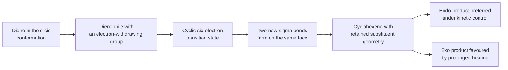
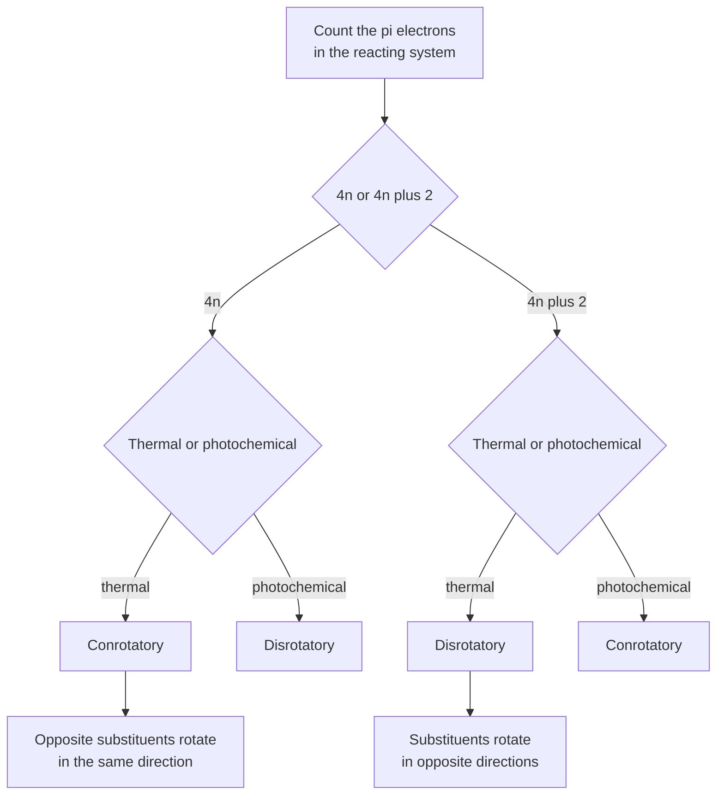
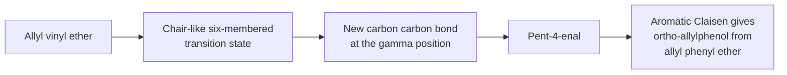
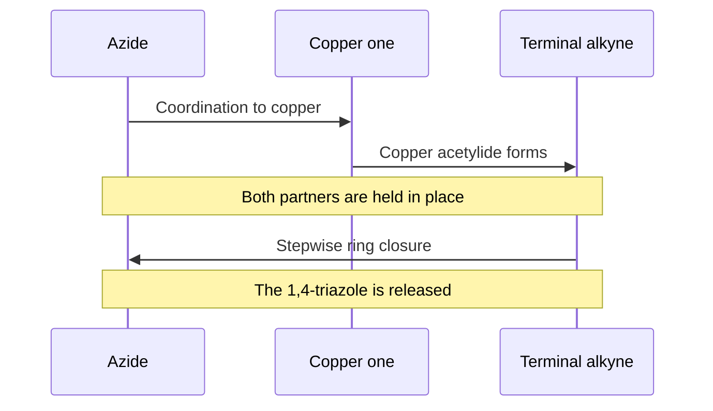

# Chapter 13 — Pericyclic Reactions

> **Level:** Advanced (Level 4 — Organic Chemistry)
> **Estimated study time:** 6 hours (4 h reading + 2 h exercises)
> **Prerequisites:** Chapter 6 (alkenes and dienes); Chapter 7 (aromaticity); Level 3 Chapter 3 (molecular orbital theory)
> **Related chapters:** [Aldehydes, Ketones and Carbonyl Chemistry](10-aldehydes-ketones-and-carbonyl-chemistry.md), [Retrosynthetic Analysis and Synthesis Strategy](14-retrosynthetic-analysis-and-synthesis-strategy.md)
> **Difficulty:** ★★★★★ (5)

---

## 1. Learning Objectives

After working through this chapter you will be able to:

- Define a pericyclic reaction and distinguish it from a stepwise polar or radical process.
- Explain what a frontier molecular orbital is and why the symmetry of the highest occupied and lowest unoccupied orbitals controls whether a concerted reaction is allowed.
- Apply the Woodward–Hoffmann rules to thermal and photochemical electrocyclic reactions, cycloadditions and sigmatropic rearrangements.
- Predict the regio-, stereo- and endo/exo selectivity of a Diels–Alder reaction.
- Explain the requirement for an *s*-*cis* diene and an electron-poor dienophile, and describe how Lewis acids accelerate the reaction.
- Draw the product of a Claisen or Cope rearrangement and explain its chair-like transition state.
- Recognise the ene reaction and the 1,3-dipolar cycloaddition, and explain why the copper-catalysed azide–alkyne cycloaddition is the archetypal "click" reaction.
- Use pericyclic reactions as stereospecific steps in synthetic planning.

---

## 2. Introduction

Most organic reactions proceed through polar intermediates: a carbocation, a carbanion, an enolate or a radical. Pericyclic reactions do not. They proceed through a single cyclic transition state in which several bonds break and form at once, with no intermediate and with an extraordinary degree of stereochemical control. The Diels–Alder reaction, the Claisen rearrangement, the electrocyclic ring opening of a cyclohexadiene and the azide–alkyne cycloaddition all belong to this family.

The unifying explanation is orbital symmetry. In a concerted reaction the participating $\pi$ systems must overlap continuously along the reaction coordinate, and whether they can do so depends on the phases of their frontier orbitals. If the phases match, the reaction is symmetry-allowed and proceeds with a low activation energy; if they do not, the reaction is symmetry-forbidden and either does not occur or occurs only under forcing conditions by a different, stepwise mechanism. Woodward and Hoffmann formulated this as a set of selection rules in 1965, and Hoffmann shared the 1981 Nobel Prize in Chemistry with Fukui for the frontier-orbital interpretation.

Pericyclic chemistry matters for three reasons. First, it is conceptually beautiful: a small number of symmetry rules predicts a large number of stereochemical outcomes. Second, it is synthetically powerful: the Diels–Alder reaction forms two carbon–carbon bonds and up to four stereocentres in one step with complete stereospecificity, and the Claisen rearrangement transfers chirality from an allylic alcohol to a new stereocentre. Third, it is biologically important: the biosynthesis of vitamin D begins with a photochemical electrocyclic ring opening, and the biosynthesis of many terpenes and polyketides uses Diels–Alder-like cyclisations.

The chapter proceeds from the general principle to the four reaction classes, then to the frontier-orbital explanation, and finally to the use of pericyclic reactions in synthesis.

---

## 3. Fundamental Concepts

### 3.1 What makes a reaction pericyclic

A **pericyclic reaction** is a concerted reaction in which the bonding changes occur through a cyclic array of interacting orbitals. Three features follow from the definition.

- **Concertedness.** All bond-breaking and bond-making happen in one step, so there is a single transition state and no intermediate. The activation energy is low when the orbital symmetry is right and high when it is not.
- **Stereospecificity.** Because the geometry of the transition state is fixed by the orbital overlap, a given stereoisomer of the starting material gives a specific stereoisomer of the product. This is a much stronger statement than stereoselectivity, which merely favours one product over another.
- **Insensitivity to solvent and to polar effects.** There are no charged intermediates, so the rate changes little with solvent polarity, and substituent effects are modest compared with those in $S_N1$ or $S_N2$ reactions. A pericyclic reaction with a large solvent effect is usually not pericyclic.

The classes are defined by the number of $\sigma$ bonds that change:

| Class | Change | Example |
|---|---|---|
| Electrocyclic | One $\sigma$ bond forms or breaks, with a change in the number of $\pi$ bonds | Cyclobutene ⇌ buta-1,3-diene |
| Cycloaddition | Two $\sigma$ bonds form, two $\pi$ bonds are lost | Diels–Alder |
| Sigmatropic | One $\sigma$ bond migrates along a $\pi$ system | Claisen, Cope, [1,5]-H shift |
| Ene | One $\sigma$ bond forms, one $\sigma$ bond breaks, one $\pi$ bond shifts | Propene + acrolein |
| Group transfer | Several bonds change in a cyclic array | Ene, some rearrangements |

### 3.2 Orbitals, phases and the frontier

A $\pi$ molecular orbital has lobes above and below the molecular plane, and each lobe has a phase, conventionally shaded or unshaded. Bonding occurs when lobes of the same phase overlap; antibonding results when lobes of opposite phase overlap. The **highest occupied molecular orbital** (HOMO) and the **lowest unoccupied molecular orbital** (LUMO) are the frontier orbitals, and a reaction is controlled by the interaction between the HOMO of one component and the LUMO of the other.

For a thermal reaction, the electrons come from the HOMO of the nucleophilic component; for a photochemical reaction, excitation promotes an electron from the HOMO to the LUMO, so the frontier orbital roles change. That single fact explains why photochemical pericyclic reactions often have the opposite stereochemistry to the thermal ones.

The overlap between two components is classified as **suprafacial** if the new bonds form on the same face of each $\pi$ system, and **antarafacial** if they form on opposite faces. A suprafacial component must rotate its substituents in one direction, an antarafacial component in the other. The allowed combination of suprafacial and antarafacial terms is what the Woodward–Hoffmann rules specify.

### 3.3 The Woodward–Hoffmann rules

| Reaction type | Number of $\pi$ electrons | Thermal | Photochemical |
|---|---|---|---|
| Electrocyclic | $4n$ | Conrotatory | Disrotatory |
| Electrocyclic | $4n+2$ | Disrotatory | Conrotatory |
| Cycloaddition | $4n$ | Suprafacial–antarafacial allowed | Suprafacial–suprafacial allowed |
| Cycloaddition | $4n+2$ | Suprafacial–suprafacial allowed | Suprafacial–antarafacial allowed |
| Sigmatropic [1,$j$] | $4n$ | Antarafacial | Suprafacial |
| Sigmatropic [1,$j$] | $4n+2$ | Suprafacial | Antarafacial |

The table is compact but complete for the reactions in this chapter. The Diels–Alder reaction is a $4n+2$ cycloaddition ($n = 1$, six electrons), so it is thermally allowed as a suprafacial–suprafacial process — which is why it occurs so readily and why the two new bonds form on the same face of each component. The [1,5]-hydrogen shift is a $4n+2$ sigmatropic rearrangement and is thermally allowed as a suprafacial process; the [1,3]-hydrogen shift is a $4n$ process and is thermally forbidden, which is why it is rarely observed.

**Conrotatory** means that both ends of the reacting system rotate in the same direction; **disrotatory** means that they rotate in opposite directions. The terms describe the motion of the substituents as the new $\sigma$ bond forms or breaks, and they are the origin of the stereochemical outcomes in electrocyclic reactions.

### 3.4 A note on the language

"Allowed" and "forbidden" are statements about orbital symmetry, not about thermodynamics. A forbidden reaction can still occur if it has a large enough driving force and can find a stepwise pathway; it simply cannot occur by the concerted pericyclic mechanism. Conversely, an allowed reaction is fast only if it is also thermodynamically favourable and kinetically accessible. The rules predict mechanism and stereochemistry, not feasibility.

---

## 4. Detailed Scientific Explanation

### 4.1 The Diels–Alder reaction

The Diels–Alder reaction is a [4+2] cycloaddition between a conjugated diene and a dienophile, giving a cyclohexene:

$$
\ce{C4H6 + C2H4 -> C6H10}
$$

Six $\pi$ electrons are involved: four from the diene and two from the dienophile. The reaction is concerted, suprafacial on both components, and thermally allowed. It forms two new carbon–carbon $\sigma$ bonds and up to four stereocentres in a single step.

**Requirements.** The diene must be able to adopt an *s*-*cis* conformation, because only then can both ends of the diene reach the dienophile. Buta-1,3-diene is *s*-*trans* in its most stable conformation and must rotate to the less stable *s*-*cis* form before reacting; cyclopentadiene is locked in the *s*-*cis* conformation and is therefore exceptionally reactive. A diene with a substituent at the 2-position that prevents *s*-*cis* adoption reacts very slowly or not at all.

The dienophile is usually electron-poor. Substituents such as carbonyl, nitrile, nitro, sulfonyl and trifluoromethyl lower the LUMO of the alkene and increase the HOMO–LUMO interaction with the diene. The archetypal dienophiles are maleic anhydride, acrolein, methyl acrylate and benzyne; electron-rich alkenes react only with electron-poor dienes, in the inverse-electron-demand variant.

**Stereospecificity.** The *cis* principle states that the relative configuration of substituents on the diene and on the dienophile is retained in the product. A *cis* dienophile gives a *cis* product and a *trans* dienophile gives a *trans* product. This follows directly from the suprafacial nature of the addition: both new bonds form on the same face of each component, so substituents that were on the same face remain on the same face.

**Endo and exo.** When the dienophile carries a substituent, two diastereomeric products can form: *endo*, in which the substituent points towards the diene bridge, and *exo*, in which it points away. The *endo* product usually dominates under kinetic control, because secondary orbital interactions between the dienophile's substituent and the back lobes of the diene stabilise the *endo* transition state. The *exo* product is more stable thermodynamically, so prolonged heating or a reversible reaction can give the *exo* product instead.

**Regiochemistry.** With unsymmetrical partners, the product is predicted by matching the larger coefficient of the diene HOMO with the larger coefficient of the dienophile LUMO. In practice, a 1-substituted diene with an electron-donating substituent and a 1-substituted dienophile with an electron-withdrawing substituent gives mainly the "ortho" product, with the two substituents on adjacent carbons. A 1-substituted diene with a 1,1-disubstituted dienophile gives mainly the "para" product.

**Lewis acid catalysis.** Lewis acids such as aluminium chloride, boron trifluoride and zinc chloride coordinate to the dienophile's carbonyl group, lower its LUMO and accelerate the reaction by several orders of magnitude. The same coordination can change the regiochemistry and the *endo*/*exo* ratio, and chiral Lewis acids are used to make the reaction enantioselective.

**The retro-Diels–Alder reaction.** The Diels–Alder reaction is reversible. Heating a cyclohexene at high temperature can cleave it back to a diene and a dienophile, and this is used in synthesis to release a protected diene or to generate a reactive diene in situ. It is also the basis of thermally reversible cross-links in self-healing polymers.

### 4.2 Electrocyclic reactions

An electrocyclic reaction forms or breaks one $\sigma$ bond at the ends of a conjugated $\pi$ system, with a change in the number of $\pi$ bonds. The stereochemistry is governed by the Woodward–Hoffmann rules:

- A $4n$ system opens or closes conrotatorily under thermal conditions and disrotatorily under photochemical conditions.
- A $4n+2$ system opens or closes disrotatorily under thermal conditions and conrotatorily under photochemical conditions.

The simplest example is the ring opening of cyclobutene to buta-1,3-diene, a $4\pi$ system that opens conrotatorily on heating:

$$
\ce{C4H6 ->[150\ ^\circ C] C4H6}
$$

The stereochemical consequence is striking. *cis*-3,4-Dimethylcyclobutene opens conrotatorily to give $(2E,4Z)$-hexa-2,4-diene, with one double bond *E* and the other *Z*; the *trans* isomer gives $(2E,4E)$-hexa-2,4-diene. The two methyl groups rotate in the same direction, so one ends up on each side of the diene framework in a fixed relationship. No stepwise mechanism could give this result so cleanly.

The hexatriene–cyclohexadiene interconversion is a $6\pi$ system and is thermally disrotatory:

$$
\ce{C6H8 ->[\Delta] C6H8}
$$

The most important biological example is the photochemical ring opening of 7-dehydrocholesterol to previtamin D$_{3}$, a $6\pi$ electrocyclic process that occurs in the skin under ultraviolet light. Previtamin D$_{3}$ then undergoes a [1,7]-hydrogen shift to give vitamin D$_{3}$:

$$
\ce{C27H44O ->[h\nu] C27H44O ->[\Delta] C27H44O}
$$

The sequence is a beautiful example of two pericyclic reactions in succession, and it explains why vitamin D synthesis requires sunlight and why the wavelength of the light matters.

### 4.3 Sigmatropic rearrangements

A sigmatropic rearrangement moves a $\sigma$ bond from one position to another across a conjugated system. The numbering [i,j] describes the two fragments that are joined by the migrating bond.

**The Claisen rearrangement.** An allyl vinyl ether rearranges to a $\gamma$,$\delta$-unsaturated carbonyl compound through a six-membered cyclic transition state:

$$
\ce{CH2=CHCH2OCH=CH2 ->[200\ ^\circ C] CH2=CHCH2CH2CH2CHO}
$$

The reaction is a [3,3] sigmatropic shift, suprafacial on both fragments and thermally allowed. The transition state is chair-like, which means that substituents on the allyl fragment adopt equatorial or axial positions in a predictable way; this is the basis of the stereochemical transfer of chirality from an allylic alcohol to the product. The aromatic Claisen rearrangement of an allyl phenyl ether gives an *ortho*-allylphenol:

$$
\ce{C6H5OCH2CH=CH2 ->[200\ ^\circ C] HOC6H4CH2CH=CH2}
$$

**The Cope rearrangement.** A 1,5-diene rearranges to another 1,5-diene by the same [3,3] mechanism:

$$
\ce{CH2=CHCH(CH3)CH2CH=CH2 ->[\Delta] CH2=CHCH2CH2CH=CHCH3}
$$

The reaction is degenerate when the substrate is symmetrical, which makes it a useful probe of mechanism: isotopic labels scramble in a way that is only consistent with a concerted [3,3] shift. The oxy-Cope variant, in which a hydroxyl group is present at C3, is accelerated by deprotonation and gives a carbonyl compound by tautomerisation of the enol.

**The [1,5]-hydrogen shift.** A hydrogen atom migrates across a diene or triene framework:

$$
\ce{CH3CH=CHCH=CH2 ->[\Delta] CH2=CHCH2CH=CH2}
$$

The [1,5] shift is a $4n+2$ system and is thermally allowed as a suprafacial process. The [1,3] shift, in contrast, is a $4n$ system, thermally forbidden as a suprafacial process, and therefore rare; it occurs only photochemically or by a stepwise radical mechanism.

### 4.4 The ene reaction

The ene reaction combines an alkene with an allylic hydrogen (the "ene") and an electron-poor multiple bond (the "enophile") to give a new carbon–carbon bond and a shifted double bond:

$$
\ce{CH3CH=CH2 + CH2=CHCHO -> CH2=CHCH2CH2CH2CHO}
$$

The reaction is concerted and passes through a six-membered transition state in which the allylic $\ce{C-H}$ bond breaks, the hydrogen transfers to the enophile, the ene double bond shifts, and a new $\sigma$ bond forms between the two fragments. It is closely related to the Diels–Alder reaction — both are concerted additions with a cyclic transition state — but the ene reaction does not require a diene and is therefore more general, at the cost of being less predictable in its regiochemistry.

The ene reaction is used in synthesis to make homoallylic alcohols and to functionalise isoprenoid side chains, and the carbonyl-ene reaction is used with glyoxylate esters to make $\alpha$-hydroxy esters.

### 4.5 1,3-Dipolar cycloaddition and click chemistry

A 1,3-dipole is a molecule with a delocalised system of four $\pi$ electrons over three atoms, such as an azide, a nitrile oxide or a diazo compound. It reacts with a dipolarophile, usually an alkene or alkyne, in a [3+2] cycloaddition to give a five-membered ring.

The azide–alkyne cycloaddition gives a 1,2,3-triazole:

$$
\ce{C6H5N3 + C2H2 ->[CuI] C8H7N3}
$$

The thermal reaction was discovered by Huisgen and requires high temperatures; the copper(I)-catalysed version, reported independently by the groups of Meldal and Sharpless in 2002, proceeds at room temperature and gives the 1,4-disubstituted triazole regioselectively. The reaction is the archetypal "click" reaction: fast, high-yielding, tolerant of water and of most functional groups, and free of problematic by-products. It is used for bioconjugation, for labelling proteins and oligonucleotides, and for the assembly of materials.

$$

$$

The copper-free variants, using strained cyclooctynes, are fast enough for live-cell labelling, and the ruthenium-catalysed version gives the 1,5-disubstituted regioisomer.

### 4.6 Stereospecificity as a synthetic tool

A stereospecific reaction is one in which a defined stereoisomer of the starting material gives a defined stereoisomer of the product. Pericyclic reactions are stereospecific by construction, and this makes them unusually valuable in synthesis, because a stereocentre can be set by choosing the geometry of a starting material rather than by relying on a later separation.

Three consequences are worth naming. First, the *cis* principle of the Diels–Alder reaction allows a *cis* or *trans* relationship in the product to be fixed by the geometry of the dienophile, so a single reaction can set two adjacent stereocentres with known relative configuration. Second, the conrotatory or disrotatory mode of an electrocyclic reaction converts a ring stereochemistry into a diene geometry and back again, which is how a cyclic molecule can be opened to a chain with the double bonds in a chosen configuration. Third, the chair-like transition state of the Claisen rearrangement transfers the configuration of an allylic alcohol to a new carbon–carbon bond, so a single enantiomer of the alcohol gives a single enantiomer of the product.

The strategic point is that pericyclic reactions are *programmable*. An acyclic stereocentre that would be difficult to set by substitution or by enolate alkylation can often be set by a pericyclic step from a starting material whose geometry is easy to control. The vitamin D synthesis of Section 4.2 and the endiandric acid cascade of Section 9 are both examples of this logic: a polyene with defined geometry is folded into a complex skeleton by a sequence of allowed reactions, with each step delivering the stereochemistry that the previous step demands.

### 4.7 The frontier-orbital explanation in words

The rules can be derived by considering the phases of the frontier orbitals. Picture the diene HOMO of buta-1,3-diene: it has two lobes above the plane, one with a positive phase at C1 and one with a negative phase at C4, with a node in the middle. Picture the dienophile LUMO of ethene: it has a positive lobe above C1 and a negative lobe above C2. When the two molecules approach face-to-face, the positive lobe of the diene at C1 overlaps with the positive lobe of the dienophile, and the negative lobe of the diene at C4 overlaps with the negative lobe of the dienophile. Both overlaps are constructive, so the reaction is allowed.

If the diene is excited by light, its HOMO becomes the previous LUMO, which has the opposite phase relationship at the termini. The same face-to-face approach then produces one constructive and one destructive overlap, so the suprafacial–suprafacial reaction becomes forbidden and a different geometry is required. This is the origin of the photochemical reversal of the rules.

The same reasoning explains the *endo* rule: the *endo* transition state allows a secondary orbital overlap between the dienophile's carbonyl $\pi^*$ orbital and the back lobes of the diene, which is not available in the *exo* arrangement. The extra stabilisation is small but decisive when the reaction is under kinetic control.

---

## 5. Visual Diagrams

**Figure 13.1 — The Diels–Alder reaction as a single concerted event.** The diagram emphasises three requirements that must be satisfied simultaneously: the diene must be *s*-*cis*, the dienophile must be electron-poor, and the two components must approach so that both new bonds form on the same face. The final branch shows the kinetic and thermodynamic products; the *endo* product forms faster, the *exo* product is more stable, and the outcome depends on whether the reaction is irreversible.

**Figure 13.2 — The Woodward–Hoffmann decision tree for electrocyclic reactions.** The chart takes the reader from the electron count to the allowed rotational mode in three questions. The same logic applies to cycloadditions and sigmatropic shifts, with the terms suprafacial and antarafacial replacing conrotatory and disrotatory. The tree is worth memorising in this form because it can be reconstructed from the orbital-phase argument if it is forgotten.

**Figure 13.3 — The Claisen rearrangement as a [3,3] sigmatropic shift.** The chair-like transition state is the key to the stereochemistry: substituents that would be equatorial in the chair end up with a defined relationship in the product. The lower branch shows the aromatic variant, in which the rearrangement is followed by tautomerisation to restore aromaticity, and that driving force is why the aromatic Claisen occurs at a much lower temperature than the aliphatic one.

**Figure 13.4 — The copper-catalysed azide–alkyne cycloaddition.** The copper(I) centre coordinates the azide and forms a copper acetylide, holding the two partners in the geometry required for the 1,4-selective ring closure. The reaction is formally a [3+2] cycloaddition but the copper changes the mechanism from a concerted thermal process to a stepwise, catalysed one, which is why it proceeds at room temperature and with high regioselectivity. The same principle — a metal template that preorganises two reactants — underlies many "click" reactions.

---

## 6. Mathematical Formulas

### 6.1 Frontier-orbital energy gap

The strength of the interaction between the HOMO of one component and the LUMO of the other is approximated by second-order perturbation theory:

$$
\Delta E \approx \frac{\left(c_1 c_2 \beta\right)^2}{E_{\text{LUMO}} - E_{\text{HOMO}}}
$$

| Symbol | Meaning | Unit |
|---|---|---|
| $c_1, c_2$ | orbital coefficients at the reacting atoms | dimensionless |
| $\beta$ | resonance integral, negative | J |
| $E_{\text{LUMO}} - E_{\text{HOMO}}$ | frontier-orbital gap | J |

A smaller gap gives a stronger interaction and a faster reaction. This is why electron-withdrawing groups on the dienophile accelerate the Diels–Alder reaction: they lower the LUMO and shrink the gap.

### 6.2 Endo and exo product ratios

For two diastereomeric transition states differing in Gibbs energy by $\Delta\Delta G^\ddagger$,

$$
\frac{[\text{endo}]}{[\text{exo}]} = e^{-\Delta\Delta G^\ddagger/(RT)}
$$

At $298\ \text{K}$, a difference of $5.7\ \text{kJ mol}^{-1}$ gives a ratio of 10:1, and a difference of $11.4\ \text{kJ mol}^{-1}$ gives 100:1. The *endo* preference in a typical Diels–Alder reaction corresponds to a difference of only a few kilojoules, which is why the ratio is sensitive to temperature, solvent and Lewis acid.

### 6.3 Atom economy of a cycloaddition

$$
\text{Atom economy} = \frac{M(\text{product})}{M(\text{diene}) + M(\text{dienophile})} \times 100\%
$$

For the Diels–Alder reaction of cyclopentadiene ($M = 66.1\ \text{g mol}^{-1}$) with maleic anhydride ($M = 98.1\ \text{g mol}^{-1}$) to give the adduct ($M = 164.2\ \text{g mol}^{-1}$), the atom economy is exactly 100%:

$$
\frac{164.2}{66.1 + 98.1} \times 100\% = 100\%
$$

This is the ideal case: every atom of both reactants ends up in the product, and no by-product is formed. It is the reason cycloadditions are considered green reactions, and it contrasts sharply with the Wittig reaction, where the phosphorus-containing by-product dominates the mass balance.

### 6.4 Rate acceleration by a Lewis acid

If a Lewis acid lowers the activation energy by $20\ \text{kJ mol}^{-1}$ at $298\ \text{K}$, the rate increases by

$$
\frac{k_2}{k_1} = e^{\Delta\Delta G^\ddagger/(RT)} = e^{20000/(8.314 \times 298)} \approx 3 \times 10^{3}
$$

so the reaction becomes about three thousand times faster. Rate accelerations of $10^3$ to $10^6$ are typical for Diels–Alder reactions catalysed by aluminium or boron Lewis acids, which is why such catalysts turn sluggish reactions into practical ones.

---

## 7. Chemical Equations

### 7.1 Diels–Alder reactions

$$
\ce{C4H6 + C2H4 -> C6H10}
\qquad \text{buta-1,3-diene plus ethene gives cyclohexene}
$$

$$
\ce{C5H6 + C4H2O3 -> C9H8O3}
\qquad \text{cyclopentadiene plus maleic anhydride gives the endo adduct}
$$

$$
\ce{C4H6 + C3H4O -> C7H10O}
\qquad \text{buta-1,3-diene plus acrolein gives cyclohex-3-ene-1-carbaldehyde}
$$

$$
\ce{C6H10 ->[\Delta] C4H6 + C2H4}
\qquad \text{retro-Diels–Alder}
$$

### 7.2 Electrocyclic reactions

$$
\ce{C4H6 ->[150\ ^\circ C] C4H6}
\qquad \text{cyclobutene gives buta-1,3-diene, conrotatory}
$$

$$
\ce{C6H8 ->[\Delta] C6H8}
\qquad \text{hexa-1,3,5-triene gives cyclohexa-1,3-diene, disrotatory}
$$

$$
\ce{C27H44O ->[h\nu] C27H44O}
\qquad \text{7-dehydrocholesterol gives previtamin D3}
$$

### 7.3 Sigmatropic rearrangements

$$
\ce{CH2=CHCH2OCH=CH2 ->[200\ ^\circ C] CH2=CHCH2CH2CH2CHO}
\qquad \text{Claisen}
$$

$$
\ce{C6H5OCH2CH=CH2 ->[200\ ^\circ C] HOC6H4CH2CH=CH2}
\qquad \text{aromatic Claisen}
$$

$$
\ce{CH2=CHCH(CH3)CH2CH=CH2 ->[\Delta] CH2=CHCH2CH2CH=CHCH3}
\qquad \text{Cope}
$$

$$
\ce{CH3CH=CHCH=CH2 ->[\Delta] CH2=CHCH2CH=CH2}
\qquad \text{1,5-hydrogen shift}
$$

### 7.4 Ene and 1,3-dipolar reactions

$$
\ce{CH3CH=CH2 + CH2=CHCHO -> CH2=CHCH2CH2CH2CHO}
\qquad \text{ene reaction}
$$

$$
\ce{C6H5N3 + C2H2 ->[CuI] C8H7N3}
\qquad \text{copper-catalysed azide–alkyne cycloaddition}
$$

---

## 8. Worked Examples

### Worked Example 13.1 — Diels–Alder regiochemistry and stereochemistry

**Problem.** Cyclopentadiene reacts with acrolein at room temperature. Predict the major product, stating the regiochemistry and the *endo*/*exo* relationship, and explain both.

**Strategy.** Identify the diene, which is locked *s*-*cis* in cyclopentadiene, and the dienophile, which carries an electron-withdrawing aldehyde. Apply the *endo* rule and the coefficient-matching rule for regiochemistry.

**Solution.** Cyclopentadiene is a cyclic diene and cannot adopt an *s*-*trans* conformation, so it is highly reactive. Acrolein is electron-poor at the $\beta$-carbon, and the larger coefficient of its LUMO is at that carbon. The major product is the *endo* adduct, bicyclo[2.2.1]hept-5-ene-2-carbaldehyde, in which the aldehyde group points towards the bridge.

The *endo* preference is kinetic and arises from secondary orbital overlap between the carbonyl $\pi^*$ orbital and the back lobes of the diene. The reaction is stereospecific: the dienophile's substituents retain their relative configuration, and the diene's bridge holds the two new bonds on the same face.

**Check.** The product has the correct formula, $\ce{C8H10O}$, from $\ce{C5H6} + \ce{C3H4O}$, and the two new $\sigma$ bonds are on the same face of the cyclopentadiene framework, which is what "suprafacial" means in practice.

### Worked Example 13.2 — The *cis* principle

**Problem.** Dimethyl maleate (*cis*) and dimethyl fumarate (*trans*) are each treated with buta-1,3-diene. Predict the stereochemistry of the two adducts.

**Strategy.** The *cis* principle states that the relative configuration of substituents on the dienophile is preserved in the product.

**Solution.** Dimethyl maleate gives the *cis*-diester adduct, with both ester groups on the same face of the cyclohexene ring. Dimethyl fumarate gives the *trans*-diester adduct, with the ester groups on opposite faces.

The result follows from the suprafacial nature of the addition: both new bonds form on the same face of the alkene, so a substituent that was *cis* to its partner remains *cis*. In a stepwise mechanism, rotation about the intermediate carbon–carbon bond would scramble the geometry, so the clean preservation of configuration is evidence for a concerted process.

**Check.** Both reactions give the same molecular formula but different diastereomers, which is exactly what a stereospecific reaction should do. If the two products were identical, the *cis* principle would be violated and the mechanism would have to be reconsidered.

### Worked Example 13.3 — Electrocyclic ring opening

**Problem.** *cis*-3,4-Dimethylcyclobutene is heated to $150\ ^\circ\text{C}$. Predict the structure and stereochemistry of the product, and state whether the ring opening is conrotatory or disrotatory.

**Strategy.** Count the $\pi$ electrons in the ring-opening system, apply the Woodward–Hoffmann rule, and follow the rotation of the two methyl groups.

**Solution.** Cyclobutene has two $\pi$ electrons in the double bond plus the $\sigma$ bond that breaks, giving a $4\pi$-electron system. For $4n$ systems, the thermal ring opening is conrotatory. Both ends of the breaking $\sigma$ bond rotate in the same direction, so the two methyl groups, which start on the same face, end up on opposite faces of the resulting diene.

The product is $(2E,4Z)$-hexa-2,4-diene: one double bond is *E* and the other is *Z*. The *trans* isomer of the starting material gives $(2E,4E)$-hexa-2,4-diene under the same conditions.

**Check.** The product has the same formula as the starting material, $\ce{C6H10}$, and the stereochemical outcome is consistent with conrotatory motion. A disrotatory opening would give the $(2E,4E)$ or $(2Z,4Z)$ isomer, which is not observed.

### Worked Example 13.4 — The aromatic Claisen rearrangement

**Problem.** Allyl 4-methylphenyl ether is heated to $200\ ^\circ\text{C}$. Give the structure of the product and explain why the reaction occurs at a lower temperature than the rearrangement of an aliphatic allyl vinyl ether.

**Strategy.** Recognise the [3,3] sigmatropic shift, then consider the additional driving force available when the product can restore aromaticity.

**Solution.** The allyl group migrates from oxygen to the *ortho* position of the ring, giving 2-allyl-4-methylphenol after tautomerisation:

$$
\ce{CH3C6H4OCH2CH=CH2 ->[200\ ^\circ C] HOC6H3(CH3)CH2CH=CH2}
$$

The initial product of the [3,3] shift is a cyclohexadienone, which rapidly tautomerises to the phenol. The rearomatisation is strongly exergonic and pulls the equilibrium towards the product, so the aromatic Claisen rearrangement occurs under milder conditions than the aliphatic version, which has no such driving force.

**Check.** The product is a phenol, not an ether, and the allyl group is *ortho* to the hydroxyl. If both *ortho* positions were blocked, a second shift would move the allyl group to the *para* position (the *para*-Claisen rearrangement), which is a useful diagnostic for the mechanism.

### Worked Example 13.5 — Applying the rules to a hydrogen shift

**Problem.** Explain why the [1,5]-hydrogen shift of penta-1,3-diene occurs readily on heating, whereas the [1,3]-hydrogen shift of the same compound is not observed under thermal conditions.

**Strategy.** Count the electrons involved in the cyclic transition state for each migration and apply the Woodward–Hoffmann rules for sigmatropic rearrangements.

**Solution.** A [1,5]-shift involves the migrating hydrogen and four $\pi$ electrons, a $4n+2$ system, and is thermally allowed as a suprafacial process:

$$
\ce{CH3CH=CHCH=CH2 ->[\Delta] CH2=CHCH2CH=CH2}
$$

A [1,3]-shift involves the hydrogen and two $\pi$ electrons, a $4n$ system, and is thermally allowed only as an antarafacial process. The small hydrogen atom can in principle migrate antarafacially, but the geometry required is strained, so the thermal reaction is not observed; photochemically the suprafacial [1,3]-shift becomes allowed.

**Check.** Both reactions are isomerisations of $\ce{C5H8}$ and both are theoretically possible; the difference is kinetic, and it follows from the electron count. The example shows that the rules predict which mechanism is available, not which product is more stable.

---

## 9. Real-World Applications

**Vitamin D and sunlight.** The synthesis of vitamin D$_{3}$ in the skin is a two-step pericyclic sequence: a photochemical $6\pi$ electrocyclic ring opening of 7-dehydrocholesterol gives previtamin D$_{3}$, which undergoes a [1,7]-hydrogen shift to vitamin D$_{3}$. The ultraviolet wavelength is critical because the reaction requires electronic excitation, and the thermal step that follows is slow enough that previtamin D$_{3}$ can also isomerise to lumisterol and tachysterol, which is why excessive sun exposure does not produce unlimited vitamin D.

**Prostaglandins and natural product synthesis.** The Diels–Alder reaction is one of the most used reactions in total synthesis, and several prostaglandin and steroid syntheses rely on it to set multiple stereocentres in one step. The endiandric acids were synthesised by Black by a biomimetic cascade of electrocyclic and Diels–Alder reactions, which showed that a complex natural product can arise from a simple polyene by a sequence of allowed pericyclic steps.

**Click chemistry and bioconjugation.** The copper-catalysed azide–alkyne cycloaddition is used to attach fluorescent labels, drugs and polymers to proteins, antibodies and oligonucleotides. Because the azide and the alkyne are absent from biological molecules, the reaction is bioorthogonal: it proceeds in water at room temperature without interfering with the chemistry of the cell. Copper-free variants using strained cyclooctynes are used for live-cell imaging, and the 2022 Nobel Prize in Chemistry recognised the development of click chemistry and bioorthogonal chemistry.

**Self-healing materials.** The Diels–Alder reaction is reversible, and polymers cross-linked by Diels–Alder adducts can be healed by heating: the adducts open by retro-Diels–Alder, the chains flow, and on cooling the adducts re-form. The same principle is used in recyclable thermosets and in shape-memory materials.

**Industrial chemistry.** Cyclopentadiene dimerises by Diels–Alder on standing, which is why it must be cracked thermally before use, and the dimer is the source of the norbornene skeleton used in hydrocarbon resins and in the insecticide chlordane. Tetrahydrophthalic anhydride, made by Diels–Alder from butadiene and maleic anhydride, is a curing agent for epoxy resins.

**Terpene and alkaloid biosynthesis.** Enzymes called Diels–Alderases catalyse [4+2] cycloadditions in the biosynthesis of terpenes and alkaloids, and the discovery of these enzymes settled a long-standing debate about whether such reactions occur in nature. The pericyclic logic of this chapter therefore applies as much to biosynthesis as to the flask.

---

## 10. Common Mistakes

| Mistake | Why it happens | Correct approach |
|---|---|---|
| Describing the Diels–Alder reaction as stepwise | The two new bonds look as if they must form one after the other | It is a single concerted step through one cyclic transition state; the stereospecificity is the evidence |
| Using an *s*-*trans* diene in a Diels–Alder reaction | The most stable conformation is drawn without checking | The diene must be *s*-*cis*; a diene that cannot adopt that conformation is unreactive |
| Expecting an electron-rich alkene to react with an electron-rich diene | Reactivity is not related to electron richness alone | Normal-demand Diels–Alder needs an electron-poor dienophile; inverse demand reverses the roles |
| Forgetting that the *endo* product is kinetic, not thermodynamic | The *endo* rule is remembered as a stability rule | *Endo* is favoured by secondary orbital overlap; *exo* is more stable and can dominate on heating |
| Applying the thermal rules to a photochemical reaction | The rules are memorised for one set of conditions | Photochemical reactions reverse the allowed rotational mode and the suprafacial/antarafacial preference |
| Assuming a [1,3]-hydrogen shift is allowed | The [1,5]-shift is familiar and the two are confused | [1,3] is a $4n$ system and is thermally forbidden suprafacially; [1,5] is $4n+2$ and allowed |
| Drawing a Claisen product with the new bond at the wrong carbon | The [3,3] numbering is not followed | The new $\ce{C-C}$ bond forms between the terminal allyl carbon and the $\gamma$-carbon of the enol ether |
| Treating "forbidden" as "impossible" | The word is read literally | Forbidden means forbidden by orbital symmetry for the concerted pathway; a stepwise route may still operate |

---

## 11. Chapter Summary

- A pericyclic reaction is a concerted reaction with a cyclic transition state, no intermediate and a high degree of stereospecificity.
- The frontier orbitals — the HOMO of one component and the LUMO of the other — control whether the orbital overlap is constructive.
- The Woodward–Hoffmann rules relate the electron count, the thermal or photochemical conditions and the allowed rotational or facial mode.
- The Diels–Alder reaction is a thermally allowed [4+2] cycloaddition that requires an *s*-*cis* diene and usually an electron-poor dienophile.
- The *cis* principle makes the Diels–Alder reaction stereospecific, and the *endo* rule makes it diastereoselective under kinetic control.
- Electrocyclic reactions are conrotatory for $4n$ systems and disrotatory for $4n+2$ systems under thermal conditions, with the reverse under photochemical conditions.
- The Claisen and Cope rearrangements are [3,3] sigmatropic shifts that proceed through chair-like transition states and transfer stereochemistry predictably.
- The [1,5]-hydrogen shift is thermally allowed; the [1,3]-shift is not, and the difference follows from the electron count.
- The ene reaction is a concerted addition that forms one new $\ce{C-C}$ bond and shifts a double bond.
- The copper-catalysed azide–alkyne cycloaddition is the archetypal click reaction and is used for bioorthogonal labelling and materials assembly.
- Pericyclic reactions are green by construction: a cycloaddition can have 100% atom economy and produces no by-product.

---

## 12. Exercises

### 12.1 Conceptual questions

1. Explain what is meant by a concerted reaction, and give two experimental observations that support a concerted mechanism for the Diels–Alder reaction.
2. Explain why cyclopentadiene reacts much faster than buta-1,3-diene with the same dienophile.

### 12.2 Basic problems

3. Give the major product: (a) buta-1,3-diene with maleic anhydride; (b) cyclopentadiene with acrolein; (c) cyclobutene heated to $150\ ^\circ\text{C}$; (d) allyl vinyl ether heated to $200\ ^\circ\text{C}$.
4. Classify each reaction: (a) the Claisen rearrangement; (b) the Diels–Alder reaction; (c) the ring opening of cyclobutene; (d) the [1,5]-hydrogen shift.

### 12.3 Intermediate problems

5. Predict the major product of the Diels–Alder reaction between 1-methoxybuta-1,3-diene and methyl acrylate, and explain the regiochemistry.
6. *cis*-3,4-Dimethylcyclobutene is heated. Give the product, its stereochemistry and the rotational mode, and state what the *trans* isomer would give.
7. Explain why the [1,3]-hydrogen shift is not observed thermally while the [1,5]-shift is.

### 12.4 Advanced problems

8. Predict the major product of the Diels–Alder reaction between cyclopentadiene and (*E*)-cinnamaldehyde, stating the *endo*/*exo* preference and the stereochemistry at each new centre.
9. Design a Diels–Alder synthesis of 4-phenylcyclohexene, choosing the diene and dienophile and explaining why the alternatives are inferior.
10. Explain how the copper-catalysed azide–alkyne cycloaddition achieves 1,4-selectivity, and why the uncatalysed thermal reaction gives a mixture of regioisomers.

### 12.5 Calculation problems

11. Calculate the atom economy of the Diels–Alder reaction between buta-1,3-diene ($M = 54.09\ \text{g mol}^{-1}$) and maleic anhydride ($M = 98.06\ \text{g mol}^{-1}$), given that the adduct has $M = 152.15\ \text{g mol}^{-1}$.
12. An *endo*:*exo* ratio of 95:5 is observed at $298\ \text{K}$. Calculate the difference in activation Gibbs energy between the two transition states.

### 12.6 Answers

1. A concerted reaction has a single transition state and no intermediate. The evidence is the clean stereospecificity (the *cis* principle) and the insensitivity of the rate to solvent polarity, both of which are inconsistent with a free intermediate.
2. Cyclopentadiene is locked in the *s*-*cis* conformation, whereas buta-1,3-diene must rotate from its more stable *s*-*trans* form before reacting; the population of the reactive conformer is therefore much lower for the acyclic diene.
3. (a) *cis*-Cyclohex-4-ene-1,2-dicarboxylic anhydride; (b) the *endo* adduct, bicyclo[2.2.1]hept-5-ene-2-carbaldehyde; (c) buta-1,3-diene; (d) pent-4-enal.
4. (a) Sigmatropic; (b) cycloaddition; (c) electrocyclic; (d) sigmatropic.
5. The major product is the "ortho" adduct, methyl 2-methoxycyclohex-3-ene-1-carboxylate, because the larger coefficient of the diene HOMO is at the carbon bearing the methoxy group and the larger coefficient of the dienophile LUMO is at the $\beta$-carbon.
6. $(2E,4Z)$-Hexa-2,4-diene by a conrotatory opening; the *trans* isomer gives $(2E,4E)$-hexa-2,4-diene.
7. The [1,3]-shift is a $4n$ system and is thermally allowed only antarafacially, which is geometrically strained for a hydrogen; the [1,5]-shift is a $4n+2$ system and is thermally allowed suprafacially.
8. The *endo* adduct is favoured, with the phenyl group of the cinnamaldehyde pointing away from the bridge and the new stereocentres set by the suprafacial addition; the *E* alkene gives the corresponding *trans* relationship in the product.
9. Use buta-1,3-diene and styrene, or cyclopentadiene and a phenyl-substituted dienophile. Styrene is electron-rich and a poor dienophile, so the better choice is a diene bearing the phenyl group and an electron-poor dienophile such as methyl acrylate.
10. Copper forms a copper acetylide and coordinates the azide, holding the partners in the geometry that leads to the 1,4-product; the uncatalysed reaction has no such template and the two regioisomeric transition states are close in energy.
11. Atom economy $= 152.15/(54.09 + 98.06) \times 100\% = 100\%$.
12. The ratio 95:5 corresponds to 19:1, so $\Delta\Delta G^\ddagger = -RT \ln 19 = -8.314 \times 298 \times 2.944 = -7.3\ \text{kJ mol}^{-1}$; the *endo* transition state is lower by about $7.3\ \text{kJ mol}^{-1}$.

---

## 13. Further Reading

- Woodward, R. B.; Hoffmann, R. *The Conservation of Orbital Symmetry*, Verlag Chemie, 1970. The original monograph in which the rules were systematised.
- Fleming, I. *Frontier Orbitals and Organic Chemical Reactions*, Wiley, 1976. A concise, pictorial derivation of the rules from orbital phases.
- Clayden, J.; Greeves, N.; Warren, S. *Organic Chemistry*, 2nd ed., Oxford University Press, 2012. The pericyclic chapter develops the same examples in the same order.
- Carey, F. A.; Sundberg, R. J. *Advanced Organic Chemistry, Part A: Structure and Mechanisms*, 5th ed., Springer. A rigorous treatment of orbital symmetry and concerted reactions.
- Nicolaou, K. C.; Sorensen, E. J. *Classics in Total Synthesis*, VCH, 1996. Case studies in which pericyclic steps set the key stereocentres.
- Smith, M. B. *March's Advanced Organic Chemistry: Reactions, Mechanisms, and Structure*, 7th ed., Wiley. The reference for named pericyclic reactions and their scope.
- Nobel Prize Outreach. *The Nobel Prize in Chemistry 1981* — Fukui and Hoffmann, for theories of the course of chemical reactions. <https://www.nobelprize.org/prizes/chemistry/1981/summary/>
- Nobel Prize Outreach. *The Nobel Prize in Chemistry 2022* — Bertozzi, Meldal and Sharpless, for click chemistry and bioorthogonal chemistry. <https://www.nobelprize.org/prizes/chemistry/2022/summary/>
- IUPAC. *Compendium of Chemical Terminology* (the "Gold Book"), 2nd ed. (corrected version). <https://goldbook.iupac.org/>
- [CURRICULUM.md](../CURRICULUM.md) — where this chapter sits in the full programme.
- [REFERENCES.md](../REFERENCES.md) — the repository's verified source list.

> Only sources that can be checked are cited here. No DOI, page number or edition is invented beyond the verifiable edition statements above.

