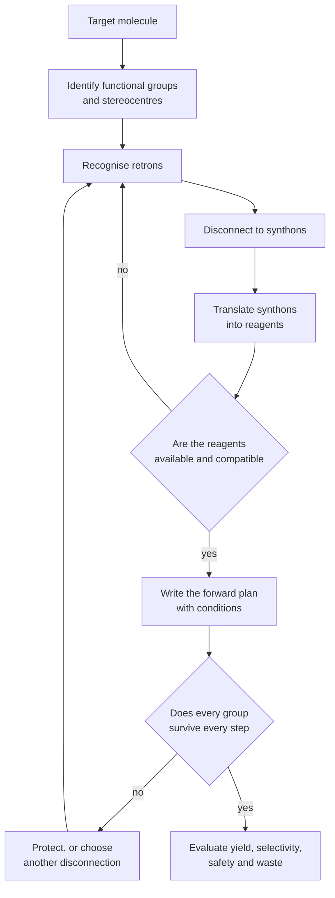
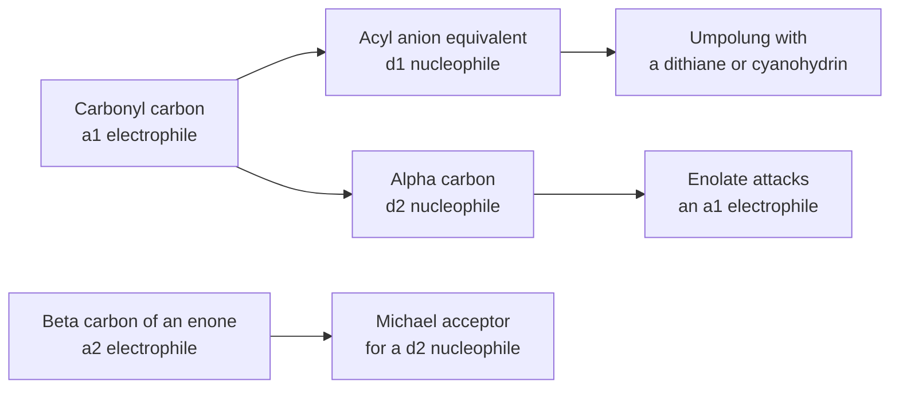
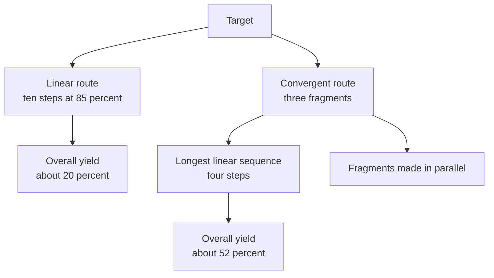
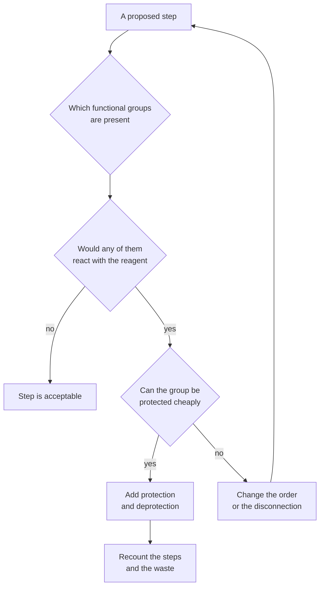

# Chapter 14 — Retrosynthetic Analysis and Synthesis Strategy

> **Level:** Advanced (Level 4 — Organic Chemistry)
> **Estimated study time:** 8 hours (5 h reading + 3 h exercises)
> **Prerequisites:** Chapters 8–13 (the complete functional-group and mechanistic toolkit); Level 2 Chapter 2 (stoichiometry and yield)
> **Related chapters:** [Haloalkanes: Nucleophilic Substitution and Elimination](08-haloalkanes-substitution-and-elimination.md), [Pericyclic Reactions](13-pericyclic-reactions.md), [Carboxylic Acids, Esters, Amines and Amides](11-carboxylic-acids-esters-and-amines.md)
> **Difficulty:** ★★★★★ (5)

---

## 1. Learning Objectives

After working through this chapter you will be able to:

- Explain the retrosynthetic method: working backwards from a target through disconnections, synthons and reagents.
- Identify and name the polarity of a synthon, including the a1, d1, a2 and d2 designations.
- Apply functional group interconversion and protecting-group strategy to make a route chemically feasible.
- Choose a disconnection that is supported by a reliable reaction rather than by an attractive-looking bond.
- Distinguish chemo-, regio- and stereoselectivity, and propose how each can be controlled.
- Compare linear and convergent routes using the longest linear sequence, overall yield and step count.
- Apply the retrons for Grignard addition, aldol, Wittig, Diels–Alder, Suzuki and Friedel–Crafts to the design of carbon–carbon bonds.
- Plan a multi-step synthesis with reagents and conditions, and check it for incompatible groups.
- Calculate atom economy and E-factor for a route and use them to compare alternatives.
- Describe the logic of a classic total synthesis without inventing details.

---

## 2. Introduction

Everything in the preceding six chapters is a reaction: a bond is made or broken under specified conditions. This chapter is about the order in which to use those reactions. It is the difference between owning a set of tools and being able to build a table.

**Retrosynthetic analysis** is the process of working backwards from a target molecule to simpler precursors. The target is disconnected at a strategic bond, the two fragments are imagined as **synthons** — idealised fragments that may not exist as such — and each synthon is translated into a real **reagent** that can be bought or made. The resulting tree of disconnections is evaluated against the reactions available, the functional groups present and the selectivity required, and the best branch is carried forward into a forward plan.

The method was codified by E. J. Corey in the 1960s and earned him the 1990 Nobel Prize in Chemistry. Before Corey, total synthesis was often an exercise in improvisation; after him, it became a discipline with an explicit logic that could be taught and checked. The same logic is used today in medicinal chemistry, process chemistry and chemical biology, where the question is rarely "can this molecule be made?" but "which of the possible routes is best?".

"Best" is a compound question. A route must be chemically feasible — every step must work, and every functional group must survive the conditions used elsewhere. It should be short, because each step costs time, money and material, and because yields multiply. It should be selective, because separating isomers is expensive. It should be safe, because some reagents are toxic or explosive. And it should be green, because waste is a cost and an environmental burden. This chapter treats each of these criteria explicitly, because a synthesis that ignores them is a drawing rather than a plan.

The chapter is deliberately practical. It presents the retrosynthetic vocabulary, the retrons that connect targets to reactions, the strategies for selectivity and protection, and then a series of worked retrosyntheses of increasing difficulty, two of which are carried through to complete forward plans with reagents and conditions.

---

## 3. Fundamental Concepts

### 3.1 The retrosynthetic vocabulary

| Term | Definition | Example |
|---|---|---|
| Target | The molecule to be synthesised | Ibuprofen |
| Disconnection | An imaginary bond-breaking operation that simplifies the target | Breaking the bond between the aryl ring and the $\ce{CH(CH3)CO2H}$ group |
| Synthon | An idealised fragment with the polarity and functionality required for the forward reaction | Aryl anion, $\ce{Ar^-}$; a carbocation, $\ce{R+}$ |
| Reagent | The real chemical that delivers the synthon | Aryl bromide plus magnesium, or an arylboronic acid |
| FGI | Functional group interconversion: changing one group into another without altering the skeleton | Acid to ester, alcohol to bromide |
| Retron | A structural motif in the target that is the signature of a known reaction | The $\beta$-hydroxy carbonyl of an aldol |

A disconnection is not a reaction; it is a question. "If this bond were broken, what fragments would I need, and is there a reaction that joins those fragments in the forward direction?" The answer must be a reaction that actually exists, with the right polarity and the right functional groups. A disconnection that requires a nucleophile at a carbon that is normally electrophilic is a signal that an umpolung is needed (Section 3.5) or that the disconnection is wrong.

Two conventions are used to describe the polarity of a synthon. A **donor** synthon supplies electrons and is labelled $d$; an **acceptor** synthon accepts electrons and is labelled $a$. The superscript gives the position relative to the functional group: $a^1$ is the electrophilic carbonyl carbon, $d^1$ is its nucleophilic equivalent, $a^2$ is the electrophilic $\beta$-carbon of an enone, and $d^2$ is the nucleophilic $\alpha$-carbon of an enolate. The notation makes it easy to see whether a proposed disconnection is "natural" ($d^2$ attacking $a^1$, as in the aldol) or requires an inversion of polarity.

### 3.2 The polarity of synthons

| Synthon | Polarity | Real equivalent | Typical reaction |
|---|---|---|---|
| $\ce{RCO^+}$ | $a^1$ | Acid chloride, aldehyde | Nucleophilic acyl substitution |
| $\ce{RCO^-}$ | $d^1$ | Dithiane anion, cyanohydrin anion | Umpolung addition to carbonyls |
| $\ce{R-CH2-C(=O)R'}$ at the $\alpha$-carbon | $d^2$ | Enolate, enamine | Aldol, alkylation, Michael donor |
| $\ce{C=C-C(=O)R}$ at the $\beta$-carbon | $a^2$ | Enone, acrylate | Michael acceptor |
| $\ce{R-CH2^+}$ | $a^1$ (alkyl) | Alkyl halide, tosylate | $S_N2$ |
| $\ce{R-CH2^-}$ | $d^1$ (alkyl) | Grignard, organolithium | Addition, substitution |
| $\ce{Ar^+}$ | $a^1$ (aryl) | Diazonium salt, aryl halide with Pd | Azo coupling, cross-coupling |
| $\ce{Ar^-}$ | $d^1$ (aryl) | Aryl Grignard, arylboronic acid | Addition, Suzuki coupling |

The table is the bridge between the retrosynthetic drawing and the laboratory. Once the polarity of each fragment is known, the reagent follows: an $a^1$ carbonyl is an acid chloride or an aldehyde; a $d^1$ acyl anion is a dithiane; a $d^2$ enolate is generated with LDA or an alkoxide; an $a^2$ enone is an acrylate or a vinyl ketone.

### 3.3 Types of disconnection

Disconnections are classified by the bond that is broken and by the functional groups that result.

**Carbon–carbon disconnections** are the most valuable, because they build the skeleton. They are named after the atoms on either side, using the $\alpha$, $\beta$, $\gamma$ notation relative to a functional group. A $1,2$-disconnection (between an $\alpha$- and a $\beta$-carbon) is the signature of the aldol; a $1,4$-disconnection is the signature of the Michael addition; a $1,5$-dicarbonyl suggests a Michael addition followed by aldol.

**Carbon–heteroatom disconnections** install functional groups: $\ce{C-O}$ by substitution or esterification, $\ce{C-N}$ by substitution or reductive amination, $\ce{C-X}$ by halogenation.

**Two-group disconnections** remove a functional group and the carbon that bears it, usually by an FGI. For example, a carboxylic acid can be disconnected to a methyl ketone by a haloform reaction, or to an alcohol by reduction and substitution.

The order in which disconnections are made matters. The general strategy is to disconnect the carbon skeleton first, then adjust functional groups, and finally check the polarity and the protecting groups. A route that starts with FGIs and only then tries to build the skeleton usually runs into incompatibilities.

### 3.4 Functional group interconversion

An FGI changes one functional group into another without changing the carbon skeleton. It is used for three purposes: to convert a commercially available group into the one needed for a disconnection, to adjust the oxidation level, and to protect a group temporarily.

| From | To | Reagent |
|---|---|---|
| Alcohol | Aldehyde | PCC, Dess–Martin, Swern |
| Alcohol | Carboxylic acid | Jones reagent, hot $\ce{KMnO4}$ |
| Alcohol | Alkyl halide | $\ce{SOCl2}$, $\ce{PBr3}$, $\ce{HI}$ |
| Aldehyde | Carboxylic acid | Jones reagent, $\ce{NaClO2}$ |
| Carboxylic acid | Acid chloride | $\ce{SOCl2}$, oxalyl chloride |
| Acid chloride | Ester | Alcohol, pyridine |
| Ester | Alcohol | $\ce{LiAlH4}$ |
| Nitrile | Carboxylic acid | Aqueous acid, heat |
| Nitro | Amine | $\ce{H2}$, Pd/C |
| Ketone | Amine | Reductive amination |

An FGI is not free: it adds steps, and it may require protection of other groups. A route that uses many FGIs is usually longer and lower-yielding than one that disconnects the skeleton directly, which is why the retrons of Section 4.1 are so valuable.

### 3.5 Umpolung

**Umpolung** means reversing the normal polarity of a functional group. The carbonyl carbon is normally electrophilic ($a^1$); an umpolung makes it nucleophilic ($d^1$), which allows it to be joined to electrophiles that would otherwise repel it.

The classical $d^1$ equivalents are:

- **Dithianes.** 1,3-Propanedithiol converts an aldehyde or ketone into a 1,3-dithiane, and deprotonation between the two sulfurs gives a nucleophile that adds to alkyl halides and carbonyl compounds. Removal of the dithiane with mercury(II) or an iodonium reagent restores the carbonyl.
- **Cyanohydrins.** The cyanohydrin anion is a masked acyl anion, and hydrolysis of the nitrile gives an $\alpha$-hydroxy acid or ketone.
- **Nitroalkanes.** The $\alpha$-carbon of a nitroalkane is nucleophilic, and the nitro group can be converted into a carbonyl by the Nef reaction.
- **Enamines.** The $\beta$-carbon of an enamine is nucleophilic, which is the reverse of the normal $\beta$-electrophilicity of an enone.

A second kind of umpolung is the **$d^2$** or homoenolate equivalent, in which the $\beta$-carbon of a carbonyl becomes nucleophilic. It is less common but appears in N-heterocyclic carbene catalysis and in cyclopropanol chemistry.

The practical importance of umpolung is that it doubles the number of disconnections available. A target that cannot be made by joining an enolate to an electrophile may be accessible by joining an acyl anion equivalent to an alkyl halide, and the choice between the two is a matter of which bond is easier to form and which groups survive.

### 3.6 Protecting groups as strategy

A protecting group converts a reactive group into an unreactive one for the duration of a sequence. The strategic questions are which groups need protection, in what order, and with which orthogonal set.

**Orthogonality** means that each protecting group can be removed under conditions that leave the others intact. A typical orthogonal set is: TBS ether (removed by fluoride), THP ether or acetal (removed by aqueous acid), benzyl ether (removed by hydrogenolysis), Boc carbamate (removed by acid), Fmoc carbamate (removed by base), and methyl or tert-butyl ester (removed by acid or base). A route that uses two groups from the same orthogonal class cannot remove them independently.

Protecting groups also change reactivity. A free phenol is an activating *ortho*/*para* director; a phenoxide is even more strongly activating; a phenyl ether is less so. An aniline is a strong activator and a nucleophile; an acetamide is a much weaker activator. Choosing a protecting group therefore changes the regiochemistry of a subsequent electrophilic substitution, not merely its chemoselectivity.

The cost of protection is two steps per group, plus the mass of the protecting group in the waste stream. Modern synthesis tries to avoid protecting groups by using chemoselective reactions, catalytic methods and protecting-group-free strategies, but the logic remains essential for complex targets.

### 3.7 Selectivity

**Chemoselectivity** is the ability to make one functional group react while others are present. It is achieved by choosing a reagent that is intrinsically selective ($\ce{NaBH4}$ reduces ketones but not esters), by using a protecting group, or by using catalysis.

**Regioselectivity** is the ability to make one position of a molecule react. It is achieved by substrate control (the existing groups direct the reaction), by reagent control (a bulky base removes the less hindered proton), or by catalysis (a directing group coordinates the catalyst).

**Stereoselectivity** is the ability to favour one stereoisomer. It is **diastereoselective** when the products are diastereomers and **enantioselective** when they are enantiomers. The control can be substrate-based (a chiral centre already in the molecule biases the new one, as in the Felkin–Anh model), auxiliary-based (a removable chiral group, such as the Evans oxazolidinone, is attached to the substrate), or catalyst-based (a chiral ligand on a metal, as in the Sharpless epoxidation, the Noyori hydrogenation or the Jacobsen epoxidation).

The distinction between substrate control and reagent control is important in planning. Substrate control is cheap but depends on the existing stereocentres and often gives the "matched" or "mismatched" outcome; reagent control is general but requires a chiral catalyst or auxiliary, which adds cost and may add steps if the auxiliary must be removed.

### 3.8 Linear and convergent routes

A **linear** synthesis makes the target by a single sequence of steps, each building on the last. A **convergent** synthesis makes two or more fragments separately and joins them at the end.

The decisive quantity is the **longest linear sequence** (LLS), not the total number of steps. If every step proceeds in yield $y$, the overall yield is approximately $y^{\text{LLS}}$:

$$
Y_{\text{overall}} \approx y^{\text{LLS}}
$$

A linear route to a target requiring ten steps at 85% per step gives $0.85^{10} = 20\%$. A convergent route with three fragments, each made in three steps and joined in one, has an LLS of four and gives $0.85^4 = 52\%$. The convergent route has more total steps but a much better overall yield, and it also allows the fragments to be made in parallel.

The trade-off is that convergence requires a reliable final coupling, and the fragments must be compatible with each other's functional groups. Convergence is therefore most valuable when the final bond can be formed cleanly — a Suzuki coupling, an amide bond or a Diels–Alder reaction — and least valuable when the final step is a low-yielding or unselective transformation.

**Step economy** is the modern refinement: the goal is not merely to reduce the number of steps but to reduce the number of *operations*, including protections, purifications and redox adjustments. A route with fewer steps but three protecting-group manipulations may be less efficient than one with more steps and no protection.

---

## 4. Detailed Scientific Explanation

### 4.1 Retrons for carbon–carbon bond formation

A **retron** is the structural pattern in a target that corresponds to a known bond-forming reaction. Recognising retrons is the core skill of retrosynthesis, because it converts an open-ended search into a pattern-matching exercise.

| Retron in the target | Disconnection | Forward reaction | Reagents |
|---|---|---|---|
| Secondary or tertiary alcohol | $\ce{C-C}$ bond to the carbinol carbon | Grignard addition to an aldehyde or ketone | $\ce{RMgX}$, then $\ce{H3O+}$ |
| $\beta$-Hydroxy carbonyl | $\alpha$-$\beta$ $\ce{C-C}$ bond | Aldol addition | Enolate plus carbonyl |
| $\alpha$,$\beta$-Unsaturated carbonyl | $\alpha$-$\beta$ $\ce{C-C}$ bond | Aldol condensation or Wittig | Enolate plus carbonyl, heat; or ylide plus aldehyde |
| 1,5-Dicarbonyl | bond $\beta$ to one carbonyl | Michael addition | Enolate plus enone |
| Cyclohexenone | two bonds of the ring | Robinson annulation | Ketone plus methyl vinyl ketone, base |
| Cyclohexene | two $\ce{C-C}$ bonds of the ring | Diels–Alder | Diene plus dienophile |
| Biaryl | $\ce{C-C}$ bond between the rings | Suzuki coupling | Aryl halide plus boronic acid, Pd |
| Aryl ketone or alkylarene | $\ce{C-C}$ bond to the ring | Friedel–Crafts acylation or alkylation | Acyl chloride or alkyl halide, $\ce{AlCl3}$ |
| $\beta$-Keto ester | $\ce{C-C}$ bond to the ester | Claisen condensation | Two esters, alkoxide |
| Alkene | $\ce{C=C}$ bond | Wittig or Horner–Wadsworth–Emmons | Ylide or phosphonate plus carbonyl |

Two rules govern the use of this table. First, the disconnection must match the polarity of the available reagents: a Grignard supplies a $d^1$ carbon, so the target alcohol must be disconnected so that the carbanion is on the carbon that can carry a metal. Second, the disconnection must leave functional groups that survive the forward reaction: a Grignard cannot be used on a substrate that contains an acidic proton, so the route must either protect that group or choose a different disconnection.

### 4.2 Strategic ordering

Once a disconnection has been chosen, the route must be ordered. Three principles apply.

**Build the skeleton first, then adjust the functional groups.** Skeleton-building reactions are usually the least tolerant of functional groups, so they should be performed early, when the molecule is simplest. Oxidation and reduction are usually performed late, when the skeleton is fixed.

**Protect before you need to.** A protecting group must be installed before the step that would destroy the group, not after. This sounds obvious, but a route that installs a protecting group and then performs a reaction that does not threaten the group has wasted two steps.

**Check every step against every group.** For each step, list the functional groups present and ask which of them would survive the reagent. A Grignard step destroys acidic protons; a hydrogenation step reduces alkenes, alkynes and nitro groups; an oxidation step may oxidise alcohols, aldehydes and alkenes; a strong base may epimerise a stereocentre next to a carbonyl. The check is the most common source of failure in a written synthesis.

### 4.3 Worked retrosyntheses

The worked examples in Section 8 present five targets of increasing difficulty. The pattern is the same in each case: identify the functional groups, look for retrons, disconnect to fragments of similar complexity, translate each synthon into a reagent, and check the polarity and the compatibility. The first two targets require a single disconnection; the third requires a functional-group strategy; the fourth requires a ring-forming reaction; the fifth combines an aldol with a chemoselective reduction.

### 4.4 Full multi-step plans

A retrosynthesis becomes a synthesis only when every step is written with reagents and conditions. Two full plans are given in Section 8: ibuprofen, a three-step industrial route, and raspberry ketone, a two-step route with a chemoselective hydrogenation. In each case the plan is checked step by step against the functional groups present.

### 4.5 Green metrics

**Atom economy** (Trost, 1991) measures the fraction of the reactant mass that ends up in the desired product:

$$
\text{Atom economy} = \frac{M(\text{product})}{\sum M(\text{reactants})} \times 100\%
$$

It is a property of the reaction equation alone, independent of yield, and it captures the waste inherent in a stoichiometric by-product. A Diels–Alder reaction has 100% atom economy; a Wittig reaction has 20–40%, because triphenylphosphine oxide carries most of the mass away.

**E-factor** (Sheldon) measures the mass of waste produced per mass of product:

$$
E = \frac{\text{mass of waste}}{\text{mass of product}}
$$

Typical values are below 1 for bulk chemicals, 5–50 for fine chemicals and 25–100 for pharmaceuticals, because pharmaceutical synthesis involves many steps, protecting groups and chromatographic purifications. The **process mass intensity** (PMI) is closely related: the total mass of materials input divided by the mass of product, so that $\text{PMI} = E + 1$.

The metrics are used to compare routes, not to score individual reactions. A route with a low-yielding step but a benign waste stream may be preferable to a high-yielding route that generates chlorinated solvent and chromium waste. The choice depends on the scale, the application and the regulations, and it is a judgment rather than a calculation.

### 4.6 Classic total syntheses

The history of total synthesis is the history of retrosynthetic strategy. Woodward's synthesis of quinine (1944) and of cholesterol (1951), Corey's synthesis of longifolene (1961) and of prostaglandins (1969), and Nicolaou's synthesis of taxol (1994) are milestones in which a new strategy or a new reaction changed what was possible. The details of these syntheses are beyond this chapter, but the pattern is constant: a complex target is simplified by a small number of strategic disconnections, and the resulting fragments are made by reactions whose selectivity is understood.

The point of reading these syntheses is not to memorise them but to see the logic. In each case the author identified the retrons, chose the order of operations, and solved the selectivity problems with protecting groups, catalysts or substrate control. That is exactly the method described in this chapter, applied at the highest level.

---

## 5. Visual Diagrams

**Figure 14.1 — The retrosynthetic cycle.** The diagram is a loop, not a line: most targets require several attempts before a route survives the compatibility check. The two failure branches return to the retron-recognition step rather than to the start, because a failed route usually contains a good disconnection that was made in the wrong order. The final box is the evaluation step that distinguishes a valid route from a practical one.

**Figure 14.2 — Synthon polarity and the meaning of umpolung.** The left-hand column shows the natural polarity of a carbonyl compound: the carbonyl carbon is electrophilic and the $\alpha$-carbon becomes nucleophilic after deprotonation. The upper arrow shows the inversion: an acyl anion equivalent makes the carbonyl carbon nucleophilic. Recognising which polarity a target requires, and whether it is natural or inverted, is the first check on any proposed disconnection.

**Figure 14.3 — Linear and convergent routes compared.** The two routes reach the same target, but the convergent one has a shorter longest linear sequence and therefore a higher overall yield for the same average step yield. The comparison is a simplification: convergence also requires a reliable final coupling and compatible fragments, and the figure does not show the extra work of making and purifying three fragments. It shows why the longest linear sequence, rather than the total step count, is the quantity to minimise.

**Figure 14.4 — The compatibility check applied to a single step.** The check is repeated for every step of the forward plan, and it is the step most often skipped in a written answer. The right-hand branch is a reminder that protection is not the only solution: changing the order of steps or choosing a different disconnection is often cheaper than adding two protecting-group operations.

---

## 6. Mathematical Formulas

### 6.1 Overall yield and longest linear sequence

$$
Y_{\text{overall}} = \prod_{i=1}^{n} y_i
\qquad
Y_{\text{overall}} \approx y^{\text{LLS}}
$$

| Symbol | Meaning | Unit |
|---|---|---|
| $y_i$ | fractional yield of step $i$ | dimensionless |
| $n$ | number of steps in the sequence | dimensionless |
| LLS | longest linear sequence | dimensionless |

For a linear route of ten steps at 85%, $Y = 0.85^{10} = 0.197$, or about 20%. For a convergent route with an LLS of four, $Y = 0.85^{4} = 0.522$, or about 52%. The difference is not a property of the chemistry but of the architecture.

### 6.2 Atom economy

$$
\text{AE} = \frac{M(\text{product})}{\sum_{i} M(\text{reactants}_i)} \times 100\%
$$

For the Diels–Alder reaction of buta-1,3-diene ($54.09\ \text{g mol}^{-1}$) with maleic anhydride ($98.06\ \text{g mol}^{-1}$) to give the adduct ($152.15\ \text{g mol}^{-1}$),

$$
\text{AE} = \frac{152.15}{54.09 + 98.06} \times 100\% = 100\%
$$

For the Wittig synthesis of styrene from benzaldehyde ($106.1\ \text{g mol}^{-1}$) and methylenetriphenylphosphorane ($276.3\ \text{g mol}^{-1}$), giving styrene ($104.2\ \text{g mol}^{-1}$),

$$
\text{AE} = \frac{104.2}{106.1 + 276.3} \times 100\% = 27.3\%
$$

The comparison is the point: a reaction that forms water as its only by-product can be near-perfect, whereas a reaction that forms a stoichiometric phosphorus waste cannot.

### 6.3 E-factor and process mass intensity

$$
E = \frac{m_{\text{waste}}}{m_{\text{product}}}
\qquad
\text{PMI} = \frac{m_{\text{total input}}}{m_{\text{product}}} = E + 1
$$

| Symbol | Meaning | Unit |
|---|---|---|
| $m_{\text{waste}}$ | mass of all waste, including solvents and reagents | kg |
| $m_{\text{product}}$ | mass of isolated product | kg |
| $m_{\text{total input}}$ | mass of all materials entering the process | kg |

If a process produces $1.0\ \text{kg}$ of product and $30\ \text{kg}$ of waste, $E = 30$ and PMI $= 31$. A pharmaceutical process with $E = 30$ generates thirty kilograms of waste for every kilogram of active ingredient, which is why solvent recovery and catalytic steps are so valuable at scale.

### 6.4 Step economy and the ideal synthesis

Trost's criteria for an ideal synthesis are that all of the starting materials end up in the product, the reaction is a single step, the conditions are mild and safe, and the reagents are readily available. No real synthesis meets all four, but the criteria provide a direction: fewer steps, fewer protecting groups, catalytic rather than stoichiometric reagents, and reactions with high atom economy. A useful summary measure is the **number of operations**, which counts every reaction, protection, deprotection and purification as one operation, because each one costs time and material.

---

## 7. Chemical Equations

### 7.1 The retrons in forward form

$$
\ce{RMgX + R'2C=O -> R'2C(OH)R}
\qquad \text{Grignard disconnection}
$$

$$
\ce{2CH3CHO ->[OH^-] CH3CH(OH)CH2CHO ->[\Delta] CH3CH=CHCHO + H2O}
\qquad \text{aldol disconnection}
$$

$$
\ce{R2C=O + (C6H5)3P=CHR' -> R2C=CHR' + (C6H5)3P=O}
\qquad \text{Wittig disconnection}
$$

$$
\ce{C4H6 + C2H4 -> C6H10}
\qquad \text{Diels–Alder disconnection}
$$

$$
\ce{ArBr + Ar'B(OH)2 + H2O ->[Pd] Ar-Ar' + B(OH)3 + HBr}
\qquad \text{Suzuki disconnection}
$$

$$
\ce{C6H6 + CH3COCl ->[AlCl3] C6H5COCH3 + HCl}
\qquad \text{Friedel–Crafts disconnection}
$$

### 7.2 Steps in the ibuprofen plan

$$
\ce{C6H5CH2CH(CH3)2 + CH3COCl ->[AlCl3] (CH3)2CHC6H4COCH3 + HCl}
$$

$$
\ce{(CH3)2CHC6H4COCH3 + H2 ->[Pd/C] (CH3)2CHC6H4CH(OH)CH3}
$$

$$
\ce{(CH3)2CHC6H4CH(OH)CH3 + CO ->[Pd] (CH3)2CHC6H4CH(CH3)CO2H}
$$

The first step is a Friedel–Crafts acylation, the second a hydrogenation, and the third a palladium-catalysed carbonylation. The overall sequence is three steps; the industrial version uses acetic anhydride in place of acetyl chloride, which raises the atom economy because the acetyl group is largely incorporated into the product.

### 7.3 Steps in the raspberry ketone plan

$$
\ce{HOC6H4CHO + CH3COCH3 ->[NaOH] HOC6H4CH=CHCOCH3 + H2O}
$$

$$
\ce{HOC6H4CH=CHCOCH3 + H2 ->[Pd/C] HOC6H4CH2CH2COCH3}
$$

The first step is a crossed aldol condensation between an aldehyde with no $\alpha$-hydrogen and acetone; the second is a chemoselective hydrogenation of the enone, in which the carbon–carbon double bond is reduced while the carbonyl and the phenol are left intact.

---

## 8. Worked Examples

### Worked Example 14.1 — 2-Phenylethanol

**Problem.** Propose a retrosynthesis and a forward plan for 2-phenylethanol, $\ce{C6H5CH2CH2OH}$.

**Strategy.** The target is a primary alcohol with a two-carbon chain attached to a benzene ring. Disconnect the bond between the ring and the $\ce{CH2}$ group, and translate the resulting fragments into a nucleophilic aryl synthon and an electrophilic two-carbon unit.

**Solution.** The disconnection gives an aryl anion ($d^1$) and a two-carbon electrophile bearing the oxygen. The aryl anion is supplied by phenylmagnesium bromide, and the two-carbon electrophile by oxirane (ethylene oxide), which is a masked $\ce{HOCH2CH2^+}$ equivalent:

$$
\ce{C6H5MgBr + \text{oxirane} -> C6H5CH2CH2OMgBr ->[H3O+] C6H5CH2CH2OH}
$$

The forward plan is: prepare phenylmagnesium bromide from bromobenzene and magnesium in dry ether; add oxirane at low temperature; hydrolyse the alkoxide with dilute acid; distill the product.

An alternative disconnection gives phenylacetic acid plus a one-carbon reduction, but that requires the reduction of a carboxylic acid and is less convergent. A third route, Friedel–Crafts alkylation of benzene with 2-chloroethanol, fails because the alcohol coordinates the Lewis acid and because the primary carbocation rearranges.

**Check.** The product has eight carbons, matching bromobenzene (six) plus oxirane (two), and the oxygen is retained from the epoxide. The Grignard route is preferred because it is a single carbon–carbon bond-forming step with no competing elimination.

### Worked Example 14.2 — 4-Phenylbutan-2-one

**Problem.** Propose a retrosynthesis of 4-phenylbutan-2-one (benzylacetone) and give the forward conditions.

**Strategy.** The target is a methyl ketone with an aryl group two carbons away. Look for the $\beta$-hydroxy ketone or enone retron: the target can be reached by hydrogenating the corresponding enone, which in turn comes from a crossed aldol.

**Solution.** Disconnecting the bond between C3 and C4 gives benzaldehyde and acetone. Benzaldehyde has no $\alpha$-hydrogen, so it can only act as the electrophile, and the enolate of acetone attacks it:

$$
\ce{C6H5CHO + CH3COCH3 ->[NaOH,\ H2O] C6H5CH=CHCOCH3 + H2O}
$$

The product is benzylideneacetone, an enone. Hydrogenation with palladium on carbon reduces the carbon–carbon double bond and leaves the ketone intact:

$$
\ce{C6H5CH=CHCOCH3 + H2 ->[Pd/C] C6H5CH2CH2COCH3}
$$

The two-step route is short, uses cheap reagents, and has high atom economy because the aldol step loses only water.

**Check.** The crossed aldol is clean because only acetone can enolise; the hydrogenation is chemoselective because the enone is conjugated and the isolated ketone is not reduced under these conditions. A direct Friedel–Crafts route would require 4-chlorobutan-2-one and would give a mixture of products.

### Worked Example 14.3 — Ibuprofen, a full plan

**Problem.** Ibuprofen is 2-(4-isobutylphenyl)propanoic acid. Construct a retrosynthesis and a three-step forward plan with reagents and conditions.

**Strategy.** Identify the aryl–carbon bond and the propanoic acid side chain. A Friedel–Crafts acylation installs the acetyl group, hydrogenation gives the alcohol, and palladium-catalysed carbonylation converts the alcohol into the acid.

**Solution.** The retrosynthesis disconnects the target at the bond between the ring and the $\ce{CH(CH3)CO2H}$ group, giving isobutylbenzene and a two-carbon acid equivalent; the isobutyl group is already present in the starting material and is installed by Friedel–Crafts alkylation or is available commercially.

The forward plan is:

1. **Friedel–Crafts acylation.** Isobutylbenzene reacts with acetyl chloride and aluminium chloride to give 4-isobutylacetophenone. The isobutyl group is *ortho*/*para* directing and bulky, so the *para* product dominates.
2. **Hydrogenation.** The ketone is reduced to the secondary alcohol with hydrogen over palladium on carbon.
3. **Carbonylation.** The alcohol is converted into the carboxylic acid with carbon monoxide in the presence of a palladium catalyst, which gives the branched acid directly.

$$
\ce{(CH3)2CHCH2C6H5 + CH3COCl ->[AlCl3] (CH3)2CHC6H4COCH3 + HCl}
$$

The industrial BHC process achieves this sequence in three steps with an atom economy of about 77%, compared with the original six-step Boots route at about 40%. The improvement comes from replacing stoichiometric oxidants with catalytic carbonylation and from avoiding the recovery of large quantities of inorganic salts.

**Check.** Each step is compatible with the groups present: the Friedel–Crafts reaction is performed before the ketone exists, the hydrogenation does not touch the arene, and the carbonylation is chemoselective for the benzylic alcohol. The *para* selectivity in step 1 is reinforced by the steric bulk of the isobutyl group.

### Worked Example 14.4 — The Wieland–Miescher ketone

**Problem.** The Wieland–Miescher ketone is a bicyclic enone formed from 2-methylcyclohexane-1,3-dione and methyl vinyl ketone. Identify the retron, give the retrosynthesis and explain why the reaction needs no protecting groups.

**Strategy.** The product contains a cyclohexenone ring fused to a cyclohexanone, which is the signature of a Robinson annulation. Disconnect the two bonds of the new ring to reveal a Michael donor and an enone.

**Solution.** The retrosynthesis disconnects the enone at the $\alpha$-$\beta$ bond and the ring at the bond formed by the Michael addition, giving 2-methylcyclohexane-1,3-dione as the Michael donor and methyl vinyl ketone as the acceptor.

The forward sequence is:

1. **Michael addition.** The enolate of the dione attacks the $\beta$-carbon of methyl vinyl ketone, giving a 1,5-dicarbonyl.
2. **Intramolecular aldol.** The remaining enolate closes the second ring onto the methyl ketone.
3. **Dehydration.** Loss of water gives the conjugated enone.

No protecting groups are needed because the dione is the only nucleophilic site, the enone is the only electrophile, and the product is more conjugated and more stable than the intermediate.

**Check.** The product has the correct fused bicyclic skeleton and a conjugated enone; the two new rings are six-membered, which is the thermodynamically favoured outcome of the intramolecular aldol. The reaction is a classic demonstration that a well-chosen cascade can replace several steps and several protecting groups.

### Worked Example 14.5 — Raspberry ketone

**Problem.** Raspberry ketone is 4-(4-hydroxyphenyl)butan-2-one. Propose a retrosynthesis and a full plan, and explain the chemoselectivity of the final step.

**Strategy.** The target is a methyl ketone with a phenolic ring two carbons away, so the enone retron applies. The phenol must survive the aldol and the hydrogenation.

**Solution.** Disconnecting between the aryl ring and the side chain gives 4-hydroxybenzaldehyde and acetone. The aldehyde has no $\alpha$-hydrogen, so the crossed aldol is clean:

$$
\ce{HOC6H4CHO + CH3COCH3 ->[NaOH] HOC6H4CH=CHCOCH3 + H2O}
$$

Hydrogenation over palladium on carbon reduces the enone to the saturated ketone:

$$
\ce{HOC6H4CH=CHCOCH3 + H2 ->[Pd/C] HOC6H4CH2CH2COCH3}
$$

The phenol survives because catalytic hydrogenation of an enone does not reduce an aromatic ring under these conditions, and the ketone survives because the conjugated alkene is hydrogenated much faster than the isolated carbonyl.

**Check.** Sodium borohydride would have reduced the ketone as well as, or instead of, the alkene, so the choice of hydrogenation is essential. The aldol step is regiochemically unambiguous because only acetone can enolise, and the *para* substitution pattern is set by the starting aldehyde.

---

## 9. Real-World Applications

**Process chemistry.** Every pharmaceutical and agrochemical manufactured on scale has a route that was chosen by retrosynthetic analysis and then optimised for cost, safety and waste. The replacement of a stoichiometric oxidant by a catalytic one, or of a chromatographic purification by a crystallisation, is often worth more than a higher yield. **Medicinal chemistry.** In drug discovery, retrosynthetic analysis is used to decide which analogues of a lead compound can be made quickly, and library design depends on identifying a common intermediate from which many analogues can be branched.

**Materials and polymers.** Retrosynthetic logic applies to monomers as well as to drugs: the choice of a polyester or polyamide route determines the monomer specification, the plant design and the recycling strategy. **Green chemistry.** Atom economy and E-factor are now used routinely in process selection, and the 1990s redesign of the ibuprofen process is a standard case study in which a cleaner route was also cheaper.

**Total synthesis.** Classic total syntheses are the testing ground for new strategies. Woodward's quinine and cholesterol syntheses, Corey's longifolene and prostaglandin syntheses, and Nicolaou's taxol synthesis each introduced a strategic idea that later became standard. The 1990 Nobel Prize in Chemistry recognised Corey's development of the theory and methodology of retrosynthetic analysis. **Computer-assisted design.** Corey's LHASA program was the first practical computer system for retrosynthesis, and modern machine-learning approaches continue the same idea: represent the target as a graph, apply known reaction templates in reverse, and score the resulting routes.

---

## 10. Common Mistakes

| Mistake | Why it happens | Correct approach |
|---|---|---|
| Proposing a disconnection with the wrong polarity | The bond is chosen for its position rather than for the reagents available | Check that each synthon corresponds to a real reagent with the required polarity; use umpolung if it does not |
| Confusing a synthon with a reagent | The idealised fragment is written as if it were a bottle of chemical | A synthon is a formal fragment; the reagent is the real species, such as a Grignard or an enolate |
| Ignoring protecting groups until the end | The route is written with the skeleton only | Check every step against every functional group and protect before the incompatible step |
| Disconnecting a bond that no reaction can form | The disconnection looks structurally elegant | Match every disconnection to a named reaction with known scope |
| Using a Grignard in a molecule that contains an acidic proton | The basicity of the reagent is forgotten | Protect the acidic group, or use a milder organometallic such as an organozinc or a cuprate |
| Choosing a linear route when the target has obvious convergent fragments | The synthesis is written from the starting material forwards | Identify the final coupling first and make the fragments in parallel |
| Quoting atom economy as if it were a yield | The two quantities are both percentages | Atom economy is a property of the equation; yield is a property of the experiment |
| Leaving the final step as a low-yielding or unselective reaction | The earlier steps are optimised and the last one is neglected | Choose a reliable final coupling, such as an amide bond, a Suzuki coupling or a Diels–Alder reaction |
| Forgetting that a protecting group changes reactivity | Protection is treated as a purely passive operation | A protected phenol or aniline has different directing effects from the free group; check the regiochemistry again |

---

## 11. Chapter Summary

- Retrosynthetic analysis works backwards from the target through disconnections, synthons and reagents, and forwards again through a checked plan.
- A synthon has a polarity, labelled $a$ or $d$ with a position number; the polarity determines which reagent can supply it.
- Umpolung reverses the natural polarity of a carbonyl group and is achieved with dithianes, cyanohydrins, nitroalkanes or enamines.
- Functional group interconversion adjusts the oxidation level or the leaving group but adds steps; the best routes minimise it.
- Protecting groups must be orthogonal, must be installed before the incompatible step, and may change the reactivity of the group they protect.
- Chemo-, regio- and stereoselectivity can be controlled by substrate, reagent, auxiliary or catalyst.
- The longest linear sequence, not the total number of steps, determines the overall yield of a route.
- The retrons for Grignard addition, aldol, Wittig, Diels–Alder, Suzuki and Friedel–Crafts cover most carbon–carbon bond disconnections.
- Every step of a forward plan must be checked against every functional group present.
- Atom economy measures the waste inherent in a reaction, and the E-factor measures the waste of a whole process; both are now standard in route selection.
- Classic total syntheses are the historical testing ground of retrosynthetic strategy, and computer-assisted design continues the same logic.

---

## 12. Exercises

### 12.1 Conceptual questions

1. Define target, disconnection, synthon and reagent, and illustrate each term with the Grignard synthesis of 2-phenylethanol.
2. Explain why the longest linear sequence, rather than the total number of steps, determines the overall yield of a convergent synthesis.

### 12.2 Basic problems

3. Propose a disconnection and the reagents for (a) 1-phenylethanol, (b) 4-phenylbutan-2-one and (c) 2-methylpentan-2-ol.
4. Identify the retron and the forward reaction for each target: (a) 3-hydroxybutanal, (b) 4-methoxybiphenyl, (c) cyclohex-2-enone.

### 12.3 Intermediate problems

5. Explain why the Friedel–Crafts acylation of aniline fails, and propose a route to 4-aminoacetophenone.
6. Propose a synthesis of raspberry ketone from 4-hydroxybenzaldehyde and acetone, giving reagents and conditions for both steps.
7. A target contains a ketone and an alcohol, and the route requires a Grignard addition. Explain why the ketone must be protected and propose a protecting group with its cleavage conditions.

### 12.4 Advanced problems

8. Design a convergent route to 4-phenylcyclohexene and compare it with a linear alternative in terms of longest linear sequence.
9. Propose a Robinson annulation route to the Wieland–Miescher ketone, identify the retron and explain why no protecting group is required.
10. Explain why the benzoin condensation requires an umpolung, identify the $d^1$ equivalent involved, and give the product of the reaction between benzaldehyde and cyanide.

### 12.5 Calculation problems

11. A seven-step linear synthesis proceeds at 88% per step. Calculate the overall yield, and compare it with a convergent route that has a longest linear sequence of four steps at the same yield.
12. Calculate the atom economy of the aldol condensation of 4-hydroxybenzaldehyde ($M = 122.12\ \text{g mol}^{-1}$) with acetone ($M = 58.08\ \text{g mol}^{-1}$) to give the enone ($M = 162.19\ \text{g mol}^{-1}$) and water.

### 12.6 Answers

1. The target is 2-phenylethanol. Disconnecting the bond between the ring and the chain gives an aryl anion and a two-carbon electrophile; the synthons are $\ce{C6H5^-}$ ($d^1$) and $\ce{HOCH2CH2^+}$ ($a^1$); the reagents are phenylmagnesium bromide and oxirane.
2. Each step multiplies the yield, and the product can only be isolated after the longest path through the route is complete; fragments made in parallel do not add to the number of sequential steps on that path.
3. (a) 1-Phenylethanol: break the bond to the carbinol carbon, giving benzaldehyde and methylmagnesium bromide; (b) 4-phenylbutan-2-one: crossed aldol of benzaldehyde with acetone, then hydrogenation; (c) 2-methylpentan-2-ol: break one bond to the tertiary carbon, giving 2-pentanone and methylmagnesium bromide.
4. (a) Aldol, from acetaldehyde; (b) Suzuki coupling, from 4-bromoanisole and phenylboronic acid; (c) Robinson annulation, from cyclohexanone and methyl vinyl ketone.
5. Aniline is protonated by the Lewis acid and the resulting complex is deactivated; the amino group must be protected as an acetamide, which is a weaker activator and tolerates the Lewis acid, and the acetyl group is removed by hydrolysis after the acylation.
6. Condense 4-hydroxybenzaldehyde with acetone in aqueous sodium hydroxide to give the enone, then hydrogenate over palladium on carbon to reduce the carbon–carbon double bond and leave the ketone and phenol intact.
7. The Grignard would be destroyed by the alcohol proton, so the alcohol is protected as a silyl ether (TBSCl and imidazole) or as a THP ether; the silyl group is removed with tetrabutylammonium fluoride and the THP group with aqueous acid.
8. Make cyclopentadiene and a phenyl-substituted dienophile separately and couple them by Diels–Alder, giving an LLS of two or three steps; a linear alternative that builds the ring step by step would have an LLS of six or more.
9. The retron is the cyclohexenone ring of the Robinson annulation; the disconnection gives 2-methylcyclohexane-1,3-dione and methyl vinyl ketone. No protecting group is needed because the dione is the only nucleophile and the enone the only electrophile.
10. The carbonyl carbon is normally electrophilic, but the benzoin product has a new carbon–carbon bond between two carbonyl carbons, which requires one of them to become nucleophilic. Cyanide forms a cyanohydrin anion, a $d^1$ equivalent, which attacks the second benzaldehyde; the product is benzoin, $\ce{C6H5CH(OH)COC6H5}$.
11. Linear: $0.88^7 = 0.41$, or 41%. Convergent: $0.88^4 = 0.60$, or 60%. The convergent route gains about 19 percentage points for the same average step yield.
12. Atom economy $= 162.19/(122.12 + 58.08) \times 100\% = 90.0\%$; the remaining 10% is water.

---

## 13. Further Reading

- Corey, E. J.; Cheng, X.-M. *The Logic of Chemical Synthesis*, Wiley, 1989. The foundational text on retrosynthetic analysis by its principal architect.
- Warren, S. *Organic Synthesis: The Disconnection Approach*, 2nd ed., Wiley, 2008. A systematic, exercise-driven introduction to disconnection and synthon logic.
- Wyatt, P.; Warren, S. *Organic Synthesis: Strategy and Control*, Wiley, 2007. The companion volume on selectivity, protecting groups and strategy.
- Clayden, J.; Greeves, N.; Warren, S. *Organic Chemistry*, 2nd ed., Oxford University Press, 2012. The closing chapters apply the retrosynthetic method to real targets.
- Nicolaou, K. C.; Sorensen, E. J. *Classics in Total Synthesis*, VCH, 1996. Detailed case studies that show the method in action.
- Trost, B. M. "The atom economy — a search for synthetic efficiency." *Science*, 1991. The original statement of atom economy as a design criterion.
- Sheldon, R. A. "The E factor: fifteen years on." *Green Chemistry*, 2007. A review of waste metrics in the chemical industry.
- Anastas, P. T.; Warner, J. C. *Green Chemistry: Theory and Practice*, Oxford University Press, 1998. The twelve principles that underlie the green metrics used here.
- Nobel Prize Outreach. *The Nobel Prize in Chemistry 1990* — E. J. Corey, for the development of the theory and methodology of organic synthesis. <https://www.nobelprize.org/prizes/chemistry/1990/summary/>
- IUPAC. *Compendium of Chemical Terminology* (the "Gold Book"), 2nd ed. (corrected version). <https://goldbook.iupac.org/>
- [CURRICULUM.md](../CURRICULUM.md) — where this chapter sits in the full programme.
- [REFERENCES.md](../REFERENCES.md) — the repository's verified source list.

> Only sources that can be checked are cited here. No DOI, page number or edition is invented beyond the verifiable edition statements above.

