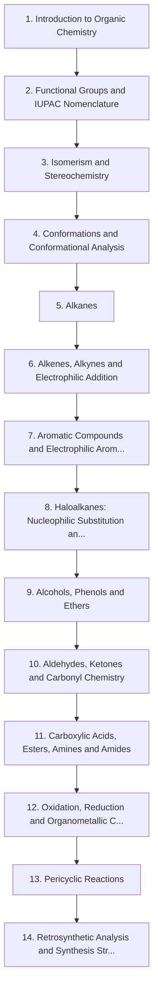

# Level 4 — Organic Chemistry

> **Audience:** Undergraduate organic chemistry  
> **Chapters:** 14  
> **Estimated study time:** ≈ 109 h  
> **Difficulty:** ★★★☆☆ – ★★★★★

Structure, stereochemistry and the mechanistic logic of carbon chemistry, moving from functional groups and nomenclature to named reactions, pericyclic chemistry and retrosynthetic design.

Organic chemistry is often described as memorisation. It is not. Roughly a dozen mechanistic patterns explain the overwhelming majority of reactions, and this level is organised to make those patterns visible early and reuse them constantly.

---

## Chapters

| # | Chapter | Difficulty | Hours | Prerequisites |
|---|---|---|---|---|
| 1 | [Introduction to Organic Chemistry](01-introduction-to-organic-chemistry.md) | ★★★☆☆ | 5 | Level 1 Ch. 5; Level 2 Ch. 7 |
| 2 | [Functional Groups and IUPAC Nomenclature](02-functional-groups-and-iupac-nomenclature.md) | ★★★☆☆ | 7 | Ch. 1 |
| 3 | [Isomerism and Stereochemistry](03-isomerism-and-stereochemistry.md) | ★★★★☆ | 9 | Ch. 2 |
| 4 | [Conformations and Conformational Analysis](04-conformations.md) | ★★★★☆ | 7 | Ch. 3 |
| 5 | [Alkanes](05-alkanes.md) | ★★★☆☆ | 5 | Ch. 2–4 |
| 6 | [Alkenes, Alkynes and Electrophilic Addition](06-alkenes-alkynes-and-electrophilic-addition.md) | ★★★★☆ | 9 | Ch. 5 |
| 7 | [Aromatic Compounds and Electrophilic Aromatic Substitution](07-aromatic-compounds-and-electrophilic-aromatic-substitution.md) | ★★★★☆ | 9 | Ch. 6 |
| 8 | [Haloalkanes: Nucleophilic Substitution and Elimination](08-haloalkanes-substitution-and-elimination.md) | ★★★★☆ | 9 | Ch. 3–6 |
| 9 | [Alcohols, Phenols and Ethers](09-alcohols-phenols-and-ethers.md) | ★★★★☆ | 8 | Ch. 8 |
| 10 | [Aldehydes, Ketones and Carbonyl Chemistry](10-aldehydes-ketones-and-carbonyl-chemistry.md) | ★★★★★ | 10 | Ch. 9 |
| 11 | [Carboxylic Acids, Esters, Amines and Amides](11-carboxylic-acids-esters-and-amines.md) | ★★★★☆ | 9 | Ch. 10 |
| 12 | [Oxidation, Reduction and Organometallic Chemistry](12-oxidation-reduction-and-organometallic-chemistry.md) | ★★★★★ | 8 | Ch. 9–11 |
| 13 | [Pericyclic Reactions](13-pericyclic-reactions.md) | ★★★★★ | 6 | Ch. 6–7 |
| 14 | [Retrosynthetic Analysis and Synthesis Strategy](14-retrosynthetic-analysis-and-synthesis-strategy.md) | ★★★★★ | 8 | Ch. 8–13 |

---

## Knowledge map

The chain is the *recommended* order. Chapters that share prerequisites can be
read out of order; the table above tells you what each one actually needs.

---

## Study routine for this level

1. Read the chapter once without taking notes, to see the shape of the argument.
2. Re-read with the chapter's learning objectives in front of you and answer them in writing.
3. Reproduce every Mermaid diagram from memory, then check it.
4. Do the exercises **before** opening the solutions file.
5. Record every mistake in a log; re-test yourself on those specific items a week later.

---

## Practice

- Exercise set: [`exercises/level-4-exercises.md`](exercises/level-4-exercises.md)
- Worked solutions: [`solutions/level-4-solutions.md`](solutions/level-4-solutions.md)

---

## Navigation

- Level index: [CURRICULUM.md](../CURRICULUM.md)
- Study methods: [00-learning-guide](../00-learning-guide/learning-path.md)
- Terminology: [GLOSSARY.md](../GLOSSARY.md)
- Sources: [REFERENCES.md](../REFERENCES.md)
