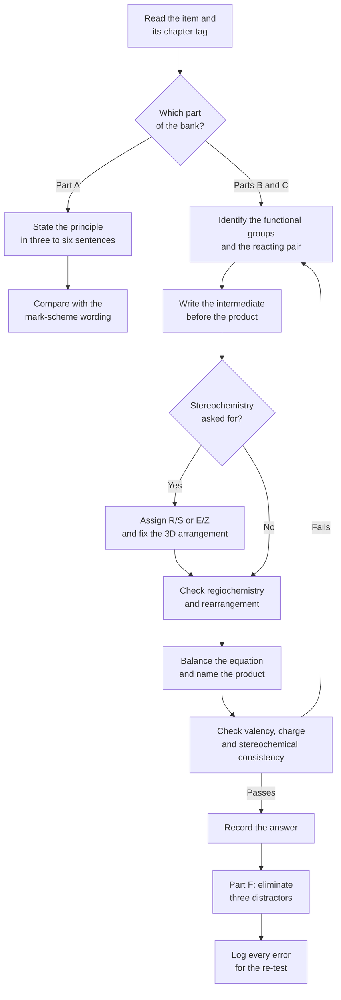

# Level 4 — Exercise Bank: Organic Chemistry

> **Level:** Advanced (Level 4 — Organic Chemistry)
> **Estimated time:** 240 minutes
> **Items:** 58
> **Covers:** [Ch. 1](../01-introduction-to-organic-chemistry.md), [Ch. 2](../02-functional-groups-and-iupac-nomenclature.md), [Ch. 3](../03-isomerism-and-stereochemistry.md), [Ch. 4](../04-conformations.md), [Ch. 5](../05-alkanes.md), [Ch. 6](../06-alkenes-alkynes-and-electrophilic-addition.md), [Ch. 7](../07-aromatic-compounds-and-electrophilic-aromatic-substitution.md), [Ch. 8](../08-haloalkanes-substitution-and-elimination.md), [Ch. 9](../09-alcohols-phenols-and-ethers.md), [Ch. 10](../10-aldehydes-ketones-and-carbonyl-chemistry.md), [Ch. 11](../11-carboxylic-acids-esters-and-amines.md), [Ch. 12](../12-oxidation-reduction-and-organometallic-chemistry.md), [Ch. 13](../13-pericyclic-reactions.md), [Ch. 14](../14-retrosynthetic-analysis-and-synthesis-strategy.md)
> **Solutions:** [`../solutions/level-4-solutions.md`](../solutions/level-4-solutions.md)

Work through the bank with the chapters closed. Every item names the chapter that
supplies the method, so an error can be traced to a section rather than to
"organic chemistry" in general. Part E requires written arrow-pushing: state each
electron movement in words, name the intermediate and state the stereochemical
consequence.

**Figure 1 — Working order for this bank.** The loop on the left is the one that
costs marks: a failed consistency check sends you back to the functional-group
analysis, not to the arithmetic.

---

## Data sheet

| Quantity | Value |
|---|---|
| Relative reactivity per hydrogen, chlorination at 25 °C | 3° : 2° : 1° : CH₃ = 5.0 : 3.8 : 1.0 : 1 |
| Relative reactivity per hydrogen, bromination at 125 °C | 3° : 2° : 1° : CH₃ = 1600 : 82 : 1 : 1 |
| A-value of $\ce{-CH3}$ | $7.6\ \text{kJ mol}^{-1}$ |
| A-value of $\ce{-OH}$ | $3.9\ \text{kJ mol}^{-1}$ |
| A-value of $\ce{-Cl}$ | $2.0\ \text{kJ mol}^{-1}$ |
| A-value of $\ce{-C6H5}$ | $12.1\ \text{kJ mol}^{-1}$ |
| A-value of $\ce{-C(CH3)3}$ | $>20\ \text{kJ mol}^{-1}$ |
| $\mathrm{p}K_a$ of ethanol | 16.0 |
| $\mathrm{p}K_a$ of water | 15.7 |
| $\mathrm{p}K_a$ of phenol | 9.95 |
| $\mathrm{p}K_a$ of 4-nitrophenol | 7.15 |
| $\mathrm{p}K_a$ of ethanoic acid | 4.76 |
| Specific rotation of pure $(R)$-butan-2-ol | $[\alpha]_{\mathrm{D}}^{20} = +13.5^\circ$ |
| Gas constant | $R = 8.314\ \text{J mol}^{-1}\ \text{K}^{-1}$ |

---

## Part A — Conceptual questions

1. **[Ch. 1]** Carbon forms stable chains and rings; silicon, directly below it,
   does not. Explain the difference using the bond enthalpies $\ce{C-C}$ 348,
   $\ce{Si-Si}$ 222, $\ce{C-O}$ 358 and $\ce{Si-O}$ 452 kJ mol⁻¹, and state why
   the presence of oxygen decides the outcome.

2. **[Ch. 2]** Explain why exactly one functional group can be expressed as a
   suffix. Use a compound containing both $\ce{-OH}$ and $\ce{-CO2H}$ to show how
   the seniority order decides the name.

3. **[Ch. 3]** Distinguish enantiomers from diastereomers in terms of symmetry and
   physical properties, and explain why a racemic mixture cannot be separated by
   fractional distillation while a mixture of diastereomers can be separated by
   chromatography.

4. **[Ch. 4]** Explain why cyclohexane adopts a chair rather than a planar hexagon,
   naming the two forms of strain relieved. Explain why a ring flip changes the
   conformation but not the configuration of a substituted cyclohexane.

5. **[Ch. 5]** State the Hammond postulate and use it to explain why chlorination
   is only moderately selective between tertiary and primary C–H bonds whereas
   bromination is highly selective.

6. **[Ch. 6]** Explain why electrophilic addition of $\ce{HX}$ to an alkene is
   regioselective, and why the peroxide effect reverses the regiochemistry for
   $\ce{HBr}$ but not for $\ce{HCl}$ or $\ce{HI}$.

7. **[Ch. 7]** Explain why the halogens are deactivating yet *ortho*/*para*
   directors. Your answer must distinguish the effect that controls the rate from
   the effect that controls the orientation.

8. **[Ch. 8]** Set out the four variables that decide between substitution and
   elimination, and explain why a tertiary substrate cannot undergo $S_N2$ at a
   useful rate.

9. **[Ch. 10]** Distinguish the kinetic and the thermodynamic enolate of
   2-methylcyclohexanone. Give the base, the temperature and the regioisomer
   formed in each case, and state which orbital or steric feature controls each.

10. **[Ch. 14]** Distinguish a synthon from a reagent. Explain why the disconnection
    of a ketone into an acyl anion and an alkyl halide requires umpolung, and name
    two $d^1$ equivalents that deliver an acyl anion.

---

## Part B — Basic problems

11. **[Ch. 2]** Give the IUPAC name of each compound.
    - (a) $\ce{(CH3)2CHCH2CH2OH}$
    - (b) $\ce{CH3CH2CO2CH(CH3)2}$
    - (c) $\ce{CH3CH=C(CH3)CHO}$
    - (d) $\ce{CH3CON(CH3)(CH2CH3)}$

12. **[Ch. 2]** Draw the structure of each compound.
    - (a) 3-ethyl-2,4-dimethylhexane
    - (b) 2-methylbut-2-ene
    - (c) ethyl 2-hydroxypropanoate
    - (d) $N,N$-dimethylbenzamide

13. **[Ch. 2]** For each compound, name the principal functional group, give the
    suffix that it contributes, and give the full IUPAC name.
    - (a) $\ce{CH3CH(OH)CH2CHO}$
    - (b) $\ce{CH3CH2CN}$
    - (c) $\ce{CH3COCH2CO2CH3}$
    - (d) $\ce{C6H5CH2NH2}$
    - (e) $\ce{CH3CH2SO3H}$

14. **[Ch. 1]** Calculate the degree of unsaturation of (a) $\ce{C8H9ClO}$,
    (b) $\ce{C6H5NO2}$ and (c) $\ce{C10H16}$.

15. **[Ch. 3]** (a) Rank the four groups at C2 of 2-chlorobutane in Cahn–Ingold–Prelog
    order. (b) A molecule has its lowest-priority group pointing away from the
    viewer and the sequence 1 → 2 → 3 is anticlockwise; assign its configuration.
    (c) A second molecule has its lowest-priority group pointing towards the viewer
    and the sequence 1 → 2 → 3 is clockwise; assign its configuration.

16. **[Ch. 3]** Assign the $(E)/(Z)$ descriptor.
    - (a) $\ce{CH3C(Br)=CHCl}$, with the bromine and the chlorine on the same side
    - (b) $\ce{HO2CCH=CHCO2H}$, with the two carboxyl groups on opposite sides
    - (c) $\ce{ClCH=CHCl}$, with the two chlorines on the same side

17. **[Ch. 4]** Sketch the three staggered conformers of butane in a Newman
    projection along C2–C3, identify the *anti* and the two *gauche* conformers, and
    state their relative energies.

18. **[Ch. 4]** For *cis*-1,3-dimethylcyclohexane and *trans*-1,3-dimethylcyclohexane,
    state the arrangement of the two methyl groups in the more stable chair
    (axial/equatorial), and hence state which isomer is more stable.

19. **[Ch. 5]** Monochlorination of propane at 25 °C gives two products. Using the
    relative reactivities in the data sheet, calculate the expected percentage of
    each.

20. **[Ch. 6]** Give the major product of each reaction, including regiochemistry
    and stereochemistry where these are defined.
    - (a) propene + $\ce{HBr}$
    - (b) propene + $\ce{HBr}$ with $\ce{ROOR}$
    - (c) 2-methylbut-2-ene + $\ce{Br2}$ in $\ce{H2O}$
    - (d) but-1-ene + 1. $\ce{BH3}$; 2. $\ce{H2O2/OH-}$

21. **[Ch. 7]** State whether each species is aromatic, antiaromatic or
    non-aromatic, and give the $\pi$-electron count.
    - (a) the cyclopentadienyl anion
    - (b) the cycloheptatrienyl cation
    - (c) cyclobutadiene
    - (d) cyclooctatetraene
    - (e) [18]annulene
    - (f) pyridine

22. **[Ch. 12]** Assign the oxidation level of the specified carbon.
    - (a) C1 of ethanol
    - (b) the carbonyl carbon of methanal
    - (c) the carbon of methanoic acid
    - (d) the methyl carbon of ethanoic acid
    - (e) the carbon of tetrachloromethane
    - (f) the carbonyl carbon of propanone

---

## Part C — Intermediate problems

23. **[Ch. 2]** Give the full IUPAC name of $\ce{HO2C-CH(CH3)-CH(OH)-CH3}$ and
    state how many stereoisomers the constitution allows.

24. **[Ch. 3]** 2,3-Dibromobutane has three stereoisomers. Identify them by
    configuration, state which is *meso*, and explain why the *meso* form is
    optically inactive.

25. **[Ch. 3]** A sample of butan-2-ol of concentration $0.100\ \text{g cm}^{-3}$
    gives an observed rotation of $+0.81^\circ$ in a $1.0\ \text{dm}$ tube. The pure
    $(R)$ enantiomer has $[\alpha]_{\mathrm{D}}^{20} = +13.5^\circ$. Calculate the
    specific rotation of the sample, its enantiomeric excess and the percentage of
    each enantiomer.

26. **[Ch. 4]** The A-value of a methyl group is $7.6\ \text{kJ mol}^{-1}$.
    Calculate the percentage of methylcyclohexane molecules that have the methyl
    group equatorial at 298 K.

27. **[Ch. 4]** *cis*- and *trans*-1-bromo-4-*tert*-butylcyclohexane are treated
    separately with sodium ethoxide in ethanol. State which diastereomer undergoes
    $E2$ elimination rapidly, identify the conformation that makes this possible,
    and explain why the other diastereomer reacts only slowly.

28. **[Ch. 5]** Bromination of 2,3-dimethylbutane at 125 °C gives essentially one
    product. Calculate the expected product distribution and name the major
    product.

29. **[Ch. 6]** Starting from hex-3-yne, give the structure and stereochemistry of
    the product of each sequence.
    - (a) $\ce{H2}$, Lindlar catalyst
    - (b) $\ce{Na}$ in liquid $\ce{NH3}$
    - (c) one equivalent of $\ce{HBr}$
    - (d) $\ce{HgSO4}$, $\ce{H2SO4}$, $\ce{H2O}$

30. **[Ch. 6]** An alkene of formula $\ce{C6H12}$ gives propanone as the only
    carbonyl product on ozonolysis. Identify the alkene, show the reasoning from the
    degree of unsaturation, and explain why no other structure fits.

31. **[Ch. 7]** Devise a two-step synthesis of *m*-bromonitrobenzene from benzene.
    State the order of the two reactions and explain why the reverse order fails to
    give the *meta* product.

32. **[Ch. 7]** Arrange benzene, toluene, chlorobenzene and nitrobenzene in order
    of increasing rate of nitration, and state the orientation that each substituent
    imposes on a second electrophile.

33. **[Ch. 8]** 2-Bromo-2-methylbutane is treated with three reagents. For each,
    name the mechanism, give the major organic product and justify the outcome.
    - (a) $\ce{NaOCH3}$ in $\ce{CH3OH}$ at 25 °C
    - (b) $\ce{H2O}$ at 25 °C
    - (c) $\ce{KOtBu}$ in *tert*-butanol at reflux

34. **[Ch. 9]** (a) Arrange ethanol, water, phenol, 4-nitrophenol and ethanoic acid
    in order of increasing acidity, and justify each step in the series.
    (b) Explain why phenol dissolves in aqueous sodium hydroxide but ethanol does
    not.
    (c) Give a Williamson synthesis of ethoxybenzene and explain why the aryl
    halide cannot serve as the electrophile.

35. **[Ch. 10]** Give the major product of each carbonyl reaction.
    - (a) benzaldehyde + acetophenone in aqueous $\ce{NaOH}$, then heat
    - (b) propanal with aqueous $\ce{NaOH}$ followed by heating
    - (c) cyclohexanone + $\ce{CH3MgBr}$, then aqueous acid
    - (d) ethanal + $\ce{NaBH4}$ in methanol

36. **[Ch. 11]** Convert ethanoyl chloride into each compound, naming the reagent
    and the mechanism class.
    - (a) ethyl ethanoate
    - (b) ethanamide
    - (c) $N$-methylethanamide
    - (d) ethanoic acid
    - (e) $N,N$-dimethylethanamide

---

## Part D — Advanced problems

37. **[Ch. 3]** A Fischer projection of 3-bromobutan-2-ol is drawn with the carbon
    chain vertical and $\ce{CH3}$ at the top and bottom. At C2 the $\ce{OH}$ is on
    the left and the $\ce{H}$ on the right; at C3 the $\ce{Br}$ is on the left and
    the $\ce{H}$ on the right. Assign the configuration at each stereocentre and
    give the full name, showing how the Fischer convention is converted into a
    three-dimensional arrangement.

38. **[Ch. 4]** Compare *cis*- and *trans*-1,2-dimethylcyclohexane. Give the chair
    arrangement of the methyl groups in each, calculate the energy difference
    between the two isomers using the A-value in the data sheet, and state which is
    more stable.

39. **[Ch. 5]** Chlorination of 2-methylpropane at 25 °C gives two monochloro
    products. Calculate the expected distribution and explain why the tertiary
    product is not the major one even though a tertiary C–H bond is five times more
    reactive than a primary one.

40. **[Ch. 6]** 3,3-Dimethylbut-1-ene reacts with $\ce{HCl}$ to give a single
    constitutional isomer. Identify it, give the complete mechanism including the
    rearrangement, and explain why the unrearranged product is not formed.

41. **[Ch. 7]** Nitration of naphthalene gives 1-nitronaphthalene, whereas
    sulfonation at 160 °C gives naphthalene-2-sulfonic acid. Explain both outcomes
    using arenium-ion structures and the principle of kinetic versus thermodynamic
    control.

42. **[Ch. 8]** The solvolysis of 2-bromo-2-methylpropane in aqueous ethanol is
    first order with $k = 2.4\times10^{-5}\ \text{s}^{-1}$ at 25 °C. Calculate the
    half-life and the time required for 90 % conversion, and state the rate law that
    the mechanism predicts.

43. **[Ch. 11]** Outline a malonic ester synthesis of 2-methylbutanoic acid from
    diethyl malonate. Give each reagent, the intermediate after each step, and the
    reason why the final step requires acid and heat.

44. **[Ch. 12]** (a) Give two different Grignard reagent/carbonyl combinations that
    both give 2-methylpentan-2-ol. (b) Explain why a Grignard reagent cannot be
    prepared from 4-bromobutan-2-ol, and state how the problem is solved in
    practice.

45. **[Ch. 13]** (a) Cyclopentadiene reacts with methyl prop-2-enoate to give a
    bicyclic adduct. Draw the product, state whether the *endo* or the *exo* isomer
    dominates under kinetic control and why. (b) 1-Methoxybuta-1,3-diene reacts with
    the same dienophile; state the regiochemistry and justify it.

46. **[Ch. 14]** Propose a retrosynthesis of 3-methyl-1-phenylpentan-3-ol. Give two
    different disconnections, identify the synthons and the reagents, and state
    which route you would choose and why.

---

## Part E — Mechanism and diagram problems

47. **[Ch. 5]** Write the complete mechanism for the chlorination of
    2-methylpropane. Give every initiation, propagation and termination step, state
    each electron movement in words, and use the mechanism to explain the product
    ratio you calculated in Question 39.

48. **[Ch. 6]** Write the complete mechanism for the addition of $\ce{HCl}$ to
    3,3-dimethylbut-1-ene. Show each electron movement, name every intermediate,
    identify the rearrangement step, and state the stereochemical consequence of
    the final step.

49. **[Ch. 7]** Write the complete mechanism for the nitration of toluene. Show the
    formation of the electrophile, draw the arenium ion formed by attack at the
    *ortho*, *meta* and *para* positions, and use the structures to explain the
    orientation and the *ortho*/*para* ratio.

50. **[Ch. 8]** (a) Write the $S_N2$ mechanism for the reaction of
    $(R)$-2-bromobutane with hydroxide, showing the transition state and stating the
    stereochemical outcome. (b) Write the $S_N1$ mechanism for the solvolysis of the
    same substrate in aqueous ethanol, and explain why the optical purity of the
    product is not zero.

51. **[Ch. 10]** Write the complete base-catalysed aldol condensation of propanal,
    including the dehydration step. Show each electron movement, name each
    intermediate, and explain why the elimination is favourable.

52. **[Ch. 13]** The thermal ring opening of *cis*-3,4-dimethylcyclobutene gives
    $(2E,4Z)$-hexa-2,4-diene. Show, using orbital phases and the sense of rotation,
    why the reaction is conrotatory and why the product has one *E* and one *Z*
    double bond.

---

## Part F — Multiple-choice self-check

53. **[Ch. 2]** The correct IUPAC name of $\ce{(CH3)3CCH2CH2CH3}$ is:
    - A. 2,2-dimethylpentane
    - B. 3,3-dimethylpentane
    - C. 2,2-dimethylhexane
    - D. 4,4-dimethylpentane

54. **[Ch. 3]** The number of stereoisomers of 2,3-dichlorobutane is:
    - A. 1
    - B. 2
    - C. 3
    - D. 4

55. **[Ch. 7]** Which species is aromatic?
    - A. cyclooctatetraene
    - B. the cyclopentadienyl cation
    - C. the cycloheptatrienyl cation
    - D. cyclobutadiene

56. **[Ch. 8]** The fastest $S_N2$ reaction of 1-bromobutane occurs with:
    - A. water at 25 °C
    - B. sodium iodide in acetone
    - C. potassium *tert*-butoxide in *tert*-butanol at 60 °C
    - D. ethanol at reflux

57. **[Ch. 11]** Ethanol reacts fastest, in the presence of pyridine, with:
    - A. ethanamide
    - B. ethyl ethanoate
    - C. ethanoyl chloride
    - D. ethanoic acid

58. **[Ch. 12]** A ketone is reduced to a secondary alcohol without reduction of an
    ester by:
    - A. $\ce{LiAlH4}$ in ether
    - B. $\ce{NaBH4}$ in methanol
    - C. $\ce{H2}$ over palladium on carbon
    - D. hot aqueous $\ce{KMnO4}$

---

## Marks

| Part | Type | Items | Marks per item | Total |
|---|---|---|---|---|
| A | Conceptual | 10 | 2 | 20 |
| B | Basic problems | 12 | 3 | 36 |
| C | Intermediate problems | 14 | 5 | 70 |
| D | Advanced problems | 10 | 8 | 80 |
| E | Mechanism and diagram problems | 6 | 10 | 60 |
| F | Multiple-choice | 6 | 2 | 12 |
| **Total** | | **58** | | **278** |

**Total marks: 278**

**Solutions:** [`../solutions/level-4-solutions.md`](../solutions/level-4-solutions.md)
