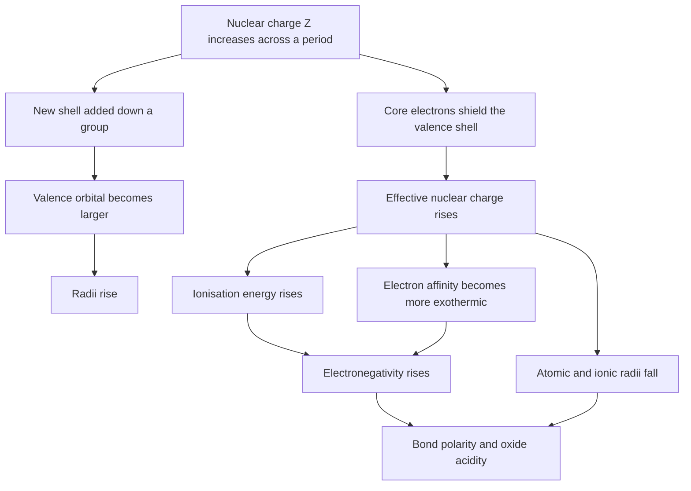
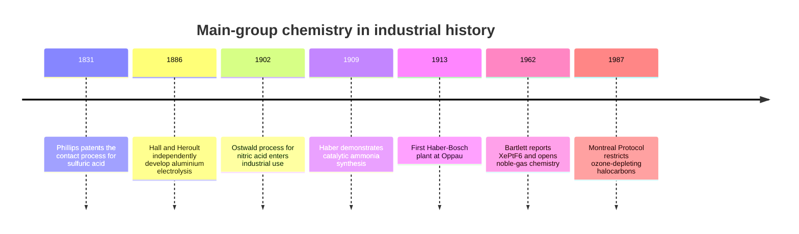
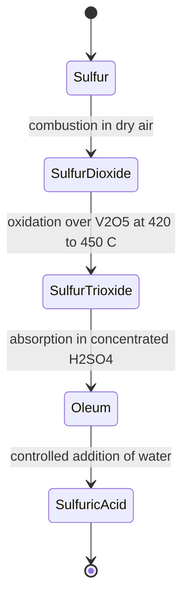

# Chapter 1 — Periodic Chemistry and the Main-Group Elements

> **Level:** University (Level 5 — Inorganic Chemistry)
> **Estimated study time:** 8 hours (5 h reading + 3 h exercises)
> **Prerequisites:** [Introduction to the Periodic Table](../01-foundations/07-introduction-to-the-periodic-table.md); [Atomic Structure](../02-elementary-chemistry/01-atomic-structure.md); [Electron Shells and Electron Configurations](../02-elementary-chemistry/03-electron-shells-and-electron-configurations.md)
> **Difficulty:** ★★★☆☆ (3/5)
> **Related chapters:** [Level 5 index](README.md); [Transition Metals](02-transition-metals.md); [Coordination Compounds](03-coordination-compounds.md)

---

## 1. Learning Objectives

After working through this chapter you will be able to:

- Compute the effective nuclear charge on any electron using Slater's rules, and use the result to explain trends in atomic radius, ionisation energy and electronegativity.
- Distinguish covalent, metallic, ionic and van der Waals radii, and explain why an ionic radius depends on coordination number and oxidation state.
- Account for the anomalies in the first ionisation energies of Be/B, N/O and Mg/Al, and in the electron affinities of F/Cl.
- Convert between the Pauling, Mulliken and Allen electronegativity scales and state the definition and limitation of each.
- Explain the diagonal relationships Li–Mg, Be–Al and B–Si in terms of charge density and polarising power.
- Describe the inert-pair effect and relativistic contraction, and use them to rationalise the chemistry of Tl(I), Pb(II) and Bi(III).
- Survey the descriptive chemistry of groups 1–2 and 13–18, including the oxides, hydrides, oxoacids and the principal industrial processes.
- Apply Fajans' rules to predict the covalent character of an ionic compound.
- Construct and use a Born–Haber cycle to obtain a lattice enthalpy or an electron affinity.

---

## 2. Introduction

The periodic table is the most compressed statement in chemistry. A single grid of boxes encodes the electron configurations of roughly one hundred elements, and from those configurations follow the sizes of atoms, the energies needed to remove their electrons, the strengths of the bonds they form and the acid–base character of their oxides. Chapter 7 of Level 0 introduced the table as a map. This chapter uses it as an instrument: the aim is not to memorise a catalogue of reactions but to predict them.

The predictive power rests on one quantity, the effective nuclear charge $Z_{\text{eff}}$, and on one structural fact, that the valence shell of a main-group element is made of $s$ and $p$ orbitals whose energies rise across a period and down a group. Once those two ideas are secure, the chemistry of group 1 follows from the low ionisation energy of a single $s$ electron; the chemistry of group 17 follows from the high electron affinity of a nearly complete $p$ shell; and the inert-pair behaviour of thallium follows from the relativistic stabilisation of its $6s$ orbital. Descriptive facts become consequences.

Inorganic chemistry nevertheless retains a descriptive core that no trend can supply. Sulfuric acid is made by the contact process because $\ce{SO3}$ is easier to absorb in concentrated sulfuric acid than in water; ammonia is made at 200 bar because the equilibrium is exothermic and Le Chatelier's principle rewards pressure; xenon forms fluorides but not chlorides because fluorine is the only oxidant capable of removing an electron from xenon under practical conditions. This chapter therefore pairs the quantitative trends of Section 3 with a systematic survey in Section 4, and closes the loop with thermochemical cycles in Section 8 that connect the two.

The chapter assumes that you can write electron configurations, draw Lewis structures and use Hess's law. The Level 0 chapter on the periodic table supplies the first, Level 2 the second, and any first-year thermochemistry course the third. Everything else is built here.

---

## 3. Fundamental Concepts

### 3.1 Effective nuclear charge and shielding

An electron in a many-electron atom experiences the attraction of the nucleus, $+Ze$, reduced by the repulsion of the other electrons. The net attraction is modelled as a single positive charge $Z_{\text{eff}}$ acting on that electron:

$$ Z_{\text{eff}} = Z - S $$

where $Z$ is the atomic number and $S$ is the **shielding constant**, a dimensionless number that counts how much of the nuclear charge the other electrons screen. The quantity $Z_{\text{eff}}$ is not an observable; it is a parameter of a model, and different definitions (Slater's, Clementi's Hartree–Fock values) give different numbers. What matters is the trend, and the trend is robust.

Shielding is not uniform. An electron in the same shell screens poorly because it is at a similar distance from the nucleus; an electron in an inner shell screens almost completely because it lies between the nucleus and the valence electron. The $s$ and $p$ orbitals of a given shell penetrate the core more than $d$ and $f$ orbitals do, so an $ns$ electron is shielded less than an $nd$ electron of the same $n$. This single fact explains why the $4s$ orbital fills before $3d$ in potassium and calcium, and why the $4s$ orbital empties first when transition metals are ionised.

### 3.2 Slater's rules

Slater (1930) gave a set of empirical rules for estimating $S$. Group the orbitals by principal quantum number and, within a shell, separate $ns/np$ from $nd/nf$. For the electron of interest:

- electrons in the same group (same $n$, same $l$ type) contribute $0.35$ each, except that a $1s$ electron is shielded by its partner by only $0.30$;
- electrons in the $n-1$ shell contribute $0.85$ each;
- electrons in shells $n-2$ and lower contribute $1.00$ each;
- for an $nd$ or $nf$ electron, all electrons in groups to its left contribute $1.00$, and electrons in the same $nd/nf$ group contribute $0.35$ each.

The rules are a simplification: they ignore the detailed radial form of the orbitals and take no account of the different shielding of $s$ and $p$ within a shell. They nevertheless reproduce the qualitative trend across the table and give values of $Z_{\text{eff}}$ accurate to perhaps $\pm 0.3$ for valence electrons. Table 1.1 gives worked values.

**Table 1.1 — Slater effective nuclear charges for selected valence electrons**

| Atom | Configuration | Electron | $S$ | $Z_{\text{eff}}$ |
|---|---|---|---|---|
| $\ce{Na}$ ($Z=11$) | $[\ce{Ne}]\,3s^1$ | $3s$ | $8(0.85) + 2(1.00) = 8.80$ | $2.20$ |
| $\ce{K}$ ($Z=19$) | $[\ce{Ar}]\,4s^1$ | $4s$ | $8(0.85) + 10(1.00) = 16.80$ | $2.20$ |
| $\ce{Sc}$ ($Z=21$) | $[\ce{Ar}]\,3d^1\,4s^2$ | $4s$ | $1(0.35) + 9(0.85) + 10(1.00) = 18.00$ | $3.00$ |
| $\ce{Cl}$ ($Z=17$) | $[\ce{Ne}]\,3s^2\,3p^5$ | $3p$ | $6(0.35) + 8(0.85) + 2(1.00) = 10.90$ | $6.10$ |
| $\ce{Cl-}$ ($Z=17$) | $[\ce{Ar}]$ | $3p$ | $7(0.35) + 8(0.85) + 2(1.00) = 11.25$ | $5.75$ |

Two results in the table carry most of the explanatory weight. First, sodium and potassium have the same $Z_{\text{eff}}$ on their valence $s$ electron ($2.20$) despite having very different nuclear charges: adding a complete shell adds ten protons and ten core electrons, and the screening nearly cancels the increase. Down a group, $Z_{\text{eff}}$ is almost constant while $n$ increases, so the valence electron is farther from the nucleus and easier to remove. Second, chlorine has $Z_{\text{eff}} = 6.10$, nearly three times that of sodium, because across a period protons are added to the same shell while the added electrons screen each other poorly. This is the origin of the left-to-right trends.

### 3.3 Atomic radii

Atomic size is not a property of an isolated atom in the way that mass is. It is inferred from the distance between atoms in a structure, and the inference depends on the bonding type. Four radii are in common use:

- **Covalent radius** — half the distance between two identical atoms joined by a single covalent bond, as in $\ce{Cl2}$ ($r = 99\ \text{pm}$).
- **Metallic radius** — half the distance between nearest neighbours in a metallic lattice, as in sodium ($r = 186\ \text{pm}$ at 298 K).
- **Ionic radius** — derived from the internuclear distance in an ionic crystal by partitioning it between cation and anion, using a reference such as $\ce{O^2-}$ ($r = 140\ \text{pm}$).
- **Van der Waals radius** — half the closest non-bonded approach of two atoms, as in a molecular crystal; always the largest of the four.

Only radii of the same type may be compared. A statement that "chlorine is smaller than sodium" is true for covalent versus metallic radii but would be misleading if the numbers came from different definitions.

Three trends are quantitative. Down a group the radius increases because a new shell is added; across a period it decreases because $Z_{\text{eff}}$ rises while the shell stays the same. The decrease flattens at the transition series because the $d$ electrons being added screen one another effectively, and it resumes only slightly in the $p$ block. For ions, the radius of a cation is smaller than that of its parent atom (loss of the valence shell and, often, of a whole shell), a cation of higher charge is smaller than one of lower charge ($r(\ce{Fe^3+}) = 55\ \text{pm}$ versus $r(\ce{Fe^2+}) = 61\ \text{pm}$ in octahedral coordination), and an anion is larger than its parent atom.

Isoelectronic series make the last point precise. The ions $\ce{N^3-}$, $\ce{O^2-}$, $\ce{F-}$, $\ce{Na+}$, $\ce{Mg^2+}$ and $\ce{Al^3+}$ all have ten electrons. Their radii fall monotonically along the series ($171$, $140$, $133$, $102$, $72$, $53.5\ \text{pm}$) because the nuclear charge rises from $7$ to $13$ while the electron count stays at ten: the same electrons are pulled by an increasing charge.

### 3.4 Ionisation energy

The **first ionisation energy** $I_1$ is the enthalpy change when one mole of gaseous atoms loses one electron:

$$ \ce{M(g) -> M+(g) + e-} \qquad \Delta H = I_1 > 0 $$

It is always endothermic. The second ionisation energy $I_2$ removes an electron from the gaseous cation, and so on. Successive ionisation energies increase, and they jump sharply when an electron is removed from a closed shell: for sodium, $I_1 = 496$, $I_2 = 4562\ \text{kJ mol}^{-1}$, the second value corresponding to removal of a $2p$ electron from the neon core.

Two periodic trends follow from Section 3.1. Down a group $I_1$ decreases because the valence electron occupies a larger, more diffuse orbital and $Z_{\text{eff}}$ changes little. Across a period $I_1$ generally increases because $Z_{\text{eff}}$ rises and the radius falls.

The general trend has three well-known exceptions, each of which is diagnostic of subshell structure:

- **Be → B** ($899 \to 801\ \text{kJ mol}^{-1}$) and **Mg → Al** ($738 \to 578$): the electron removed from boron or aluminium is a $2p$ or $3p$ electron, which is higher in energy and better shielded than the $2s$ or $3s$ electron removed from the preceding element.
- **N → O** ($1402 \to 1314$) and **P → S** ($1012 \to 1000$): nitrogen and phosphorus have half-filled $p$ subshells. Removing an electron from oxygen or sulfur relieves the electron–electron repulsion of a doubly occupied $p$ orbital, so the process costs less than the trend predicts.

### 3.5 Electron affinity

The **electron affinity** is the enthalpy change when a gaseous atom gains an electron:

$$ \ce{X(g) + e- -> X-(g)} \qquad \Delta_{\text{ea}}H^\circ $$

Sign conventions differ between textbooks, and the difference causes real confusion. This book quotes $\Delta_{\text{ea}}H^\circ$, which is negative when the process releases energy. For chlorine, $\Delta_{\text{ea}}H^\circ = -349\ \text{kJ mol}^{-1}$; when the older literature says "electron affinity of chlorine is $3.61\ \text{eV}$", it is quoting the energy released, with the opposite sign convention. State the convention whenever you quote a value.

Halogens have the most exothermic electron affinities, and fluorine is the exception that proves the rule: $\Delta_{\text{ea}}H^\circ(\ce{F}) = -328$ against $-349\ \text{kJ mol}^{-1}$ for chlorine. The fluorine atom is so small that the incoming electron experiences strong repulsion from the existing electron density; in chlorine the larger $3p$ orbital accommodates the extra charge more comfortably. The same compression explains why $\ce{F2}$ has an unusually weak bond ($158\ \text{kJ mol}^{-1}$ against $242$ for $\ce{Cl2}$): the lone pairs on two small fluorine atoms repel each other strongly.

The second electron affinity is always endothermic because an anion repels an incoming electron. For oxygen, $\Delta_{\text{ea}}H^\circ$ for the first electron is $-141\ \text{kJ mol}^{-1}$ and for the second $+744\ \text{kJ mol}^{-1}$. Divalent anions such as $\ce{O^2-}$ exist in crystals only because the lattice enthalpy more than pays for the second electron.

### 3.6 Electronegativity

**Electronegativity** is the power of an atom in a molecule to attract electrons to itself. It is not a property of an isolated atom and has no single operational definition; three scales are in standard use.

**Pauling's scale** is thermochemical. For a bond A–B, the extra stabilisation over the average of the A–A and B–B bonds is related to the electronegativity difference:

$$ \left|\chi_{\text{A}} - \chi_{\text{B}}\right| = 0.102\sqrt{\Delta E_{\text{d}}} $$

where $\Delta E_{\text{d}} = E_{\text{d}}(\ce{A-B}) - \tfrac{1}{2}\left[E_{\text{d}}(\ce{A-A}) + E_{\text{d}}(\ce{B-B})\right]$ is in $\text{kJ mol}^{-1}$; the factor $0.102 = 1/\sqrt{96.5}$ converts from $\text{kJ mol}^{-1}$ to the dimensionless Pauling unit. The scale is anchored by fixing hydrogen at $2.20$ (modern value). Pauling electronegativities run from $0.79$ for caesium to $3.98$ for fluorine.

**Mulliken's scale** is spectroscopic. It defines electronegativity as the average of the ionisation energy and the electron affinity:

$$ \chi_{\text{M}} = \tfrac{1}{2}\left(I_1 + \left|\Delta_{\text{ea}}H^\circ\right|\right) $$

in $\text{eV}$ per atom. The definition is transparent: an atom that holds its own electrons tightly (high $I_1$) and attracts extra ones strongly (large negative $\Delta_{\text{ea}}H^\circ$) is electronegative. For fluorine, $I_1 = 17.42\ \text{eV}$ and the electron affinity is $3.40\ \text{eV}$, giving $\chi_{\text{M}} = 10.41\ \text{eV}$, the highest value of any element. Mulliken values are usually rescaled by a linear transformation to sit on the Pauling scale.

**Allen's scale** is based on the energies of the valence electrons obtained from atomic spectroscopy. The configuration energy is the average energy of the valence $s$ and $p$ electrons, weighted by their occupation numbers, and the electronegativity is this average expressed in $\text{eV}$ and scaled. Allen's scale has the advantage of being defined for every element, including the noble gases: it places neon ($4.79$) above fluorine ($4.19$), which Pauling's thermochemical definition cannot do because neon forms no compounds.

All three scales agree on the periodic trends: electronegativity increases across a period and decreases down a group, so fluorine is the most electronegative element on the Pauling and Allen scales and caesium or francium the least. The absolute values differ, and a calculation that mixes scales is meaningless. Table 1.2 collects representative values.

**Table 1.2 — Pauling electronegativities (dimensionless)**

| Element | $\chi_{\text{P}}$ | Element | $\chi_{\text{P}}$ | Element | $\chi_{\text{P}}$ |
|---|---|---|---|---|---|
| $\ce{Na}$ | $0.93$ | $\ce{Al}$ | $1.61$ | $\ce{Cl}$ | $3.16$ |
| $\ce{Mg}$ | $1.31$ | $\ce{Si}$ | $1.90$ | $\ce{Br}$ | $2.96$ |
| $\ce{K}$ | $0.82$ | $\ce{P}$ | $2.19$ | $\ce{I}$ | $2.66$ |
| $\ce{Ca}$ | $1.00$ | $\ce{S}$ | $2.58$ | $\ce{F}$ | $3.98$ |
| $\ce{B}$ | $2.04$ | $\ce{N}$ | $3.04$ | $\ce{O}$ | $3.44$ |

### 3.7 Diagonal relationships

The elements at the top-left of the $p$ block resemble the element one period below and one group to the right. Lithium resembles magnesium, beryllium resembles aluminium, and boron resembles silicon. The resemblance is not accidental. Moving down a group increases size and decreases charge density; moving right across a period increases charge density by raising the charge and shrinking the radius. The two effects partly cancel along the diagonal.

The consequences are concrete. Lithium, like magnesium, forms a nitride on standing in air ($\ce{Li3N}$), whereas sodium forms only the oxide and peroxide; lithium carbonate decomposes on heating like magnesium carbonate, whereas sodium carbonate is stable; lithium fluoride is only sparingly soluble, like magnesium fluoride, whereas sodium fluoride is soluble. Beryllium chloride is a covalent polymer with bridging chlorides, like aluminium chloride; both are Lewis acids and both hydrolyse. Boron and silicon both form volatile, spontaneously flammable hydrides, both form acidic oxides that give weak acids in water ($\ce{H3BO3}$ and $\ce{H4SiO4}$), and both form carbide-like refractory borides and silicides.

The diagonal relationship is a rule of thumb, not a law: it works best for the light elements of groups 1–13 and fails for the heavier pairs, where size differences dominate.

### 3.8 The inert-pair effect

Heavy $p$-block elements in groups 13–15 show a pronounced preference for an oxidation state two below the group maximum. Thallium is almost always Tl(I), lead is almost always Pb(II), and bismuth is almost always Bi(III), even though the group oxidation states are $+3$, $+4$ and $+5$. This is the **inert-pair effect**. It is not a single effect but the sum of two contributions.

The first is thermodynamic. Down group 14 the sum $I_1 + I_2$ falls from $3439\ \text{kJ mol}^{-1}$ for carbon to $2120$ for tin, but the bond enthalpies available to repay that cost fall faster, so the higher oxidation state becomes progressively less stable relative to the lower one. The standard potential of the $\ce{M(IV)/M(II)}$ couple makes the point quantitatively: $+0.15\ \text{V}$ for tin against $+1.46\ \text{V}$ for lead in acid solution, so lead(IV) is a strong oxidant while tin(IV) is not. The second contribution is relativistic: for the sixth period the $6s$ orbital is contracted and stabilised, which raises the energy needed to ionise it.

The practical chemistry follows. $\ce{Tl2O3}$ loses oxygen on mild heating to give $\ce{Tl2O}$; $\ce{PbO2}$ is a strong oxidant that oxidises $\ce{Mn^2+}$ to $\ce{MnO4^-}$ in acid; $\ce{SnCl2}$ is a reducing agent, whereas $\ce{PbCl4}$ is an unstable liquid that decomposes to $\ce{PbCl2}$ and $\ce{Cl2}$. The lower oxidation state of the heavy element is the more stable one, and the higher state, where it can be reached, is strongly oxidising.

### 3.9 Relativistic effects

For elements near the bottom of the table the inner electrons move at a substantial fraction of the speed of light. The $1s$ electron of gold has a mean speed of about $0.58c$, and the resulting relativistic mass increase contracts the $s$ orbitals and, indirectly, contracts and stabilises all $s$ orbitals while expanding the $d$ and $f$ orbitals that screen them.

The observable consequences are not subtle. The $6s$ contraction stabilises the $6s^2$ pair of thallium, lead and bismuth, reinforcing the inert-pair effect. The same contraction lowers the energy of the $5d$ band in gold enough that the $5d \to 6s$ transition falls in the visible, giving gold its yellow colour and its nobility. It makes mercury a liquid at room temperature: the $6s^2$ pair is so stabilised that the metal–metal bonding in the solid is weak, and the melting point falls to $234\ \text{K}$. It contributes to the high density of the third-row transition metals and to the unusually high oxidising power of $\ce{Au(III)}$ and $\ce{Pt(IV)}$.

A quantitative marker is the lattice parameter of the metals. Non-relativistic calculations predict that gold would have a lattice parameter close to that of silver; the experimental value is smaller by about $12\ \text{pm}$, and only relativistic calculations reproduce it. When a periodic trend fails for the sixth period, relativity is the first explanation to test.

### 3.10 Fajans' rules

**Fajans' rules** predict the degree of covalent character in a predominantly ionic compound. A bond that is formally ionic becomes covalent to the extent that the cation distorts the anion's electron cloud. The rules state that covalent character increases with:

1. increasing charge on the cation and decreasing cation size, both of which raise the polarising power;
2. increasing anion size and charge, both of which raise the polarisability;
3. a cation with a pseudo-noble-gas configuration ($d^{10}$ or $d^{10}s^2$, as in $\ce{Ag+}$, $\ce{Cu+}$, $\ce{Zn^2+}$, $\ce{Hg^2+}$), which is more polarising than a noble-gas cation of the same size and charge;
4. an incomplete outer shell on the cation, as in the transition metals.

The rules explain a long list of facts. Among the alkali chlorides, $\ce{LiCl}$ is the most covalent and sublimes at a relatively low temperature, while $\ce{CsCl}$ is the most ionic. $\ce{BeCl2}$ is a covalent polymer; $\ce{AlCl3}$ sublimes as $\ce{Al2Cl6}$ dimers; $\ce{AgI}$ is insoluble in water and has substantial covalent character, whereas $\ce{AgF}$ is soluble. The melting points of the chlorides of period 3 fall across the period ($\ce{NaCl}$ $801\ ^\circ\mathrm{C}$, $\ce{MgCl2}$ $714\ ^\circ\mathrm{C}$, $\ce{AlCl3}$ sublimes at $180\ ^\circ\mathrm{C}$, $\ce{SiCl4}$ is a liquid at room temperature) because the bonding changes from ionic to molecular.

Fajans' rules are qualitative. They correlate with, but do not replace, a quantitative treatment based on lattice enthalpy, hydration enthalpy and the Born–Haber cycle, which is developed in Section 8.

---

## 4. Detailed Scientific Explanation

### 4.1 The table as an electron-configuration map

The periodic table is a plot of energy order. Reading left to right and top to bottom, the building-up principle fills $1s$, $2s$, $2p$, $3s$, $3p$, $4s$, $3d$, $4p$, $5s$, $4d$, $5p$, $6s$, $4f$, $5d$, $6p$, $7s$, $5f$, $6d$, $7p$. The blocks of the table correspond to the subshell being filled, and the eighteen columns of the $d$ block to the five $d$ orbitals accommodating ten electrons in two columns of five.

Two deviations from the simple filling order matter for the main-group elements. The first is that the $4s$ orbital fills before $3d$ because $4s$ penetrates the argon core and is better shielded from the $3d$ electrons that follow: the $3d$ subshell is only occupied after the $4s$ level is filled at potassium and calcium. The second is that the $4f$ and $5f$ subshells are buried inside the $5d$ and $6d$ levels respectively, which is why the lanthanides and actinides appear as footnotes. Neither deviation changes the main-group chemistry of this chapter, but both explain why the transition-metal chemistry of Chapter 2 behaves as it does.

The group number gives the number of valence electrons for the main-group elements, but the correspondence is direct only for groups 1, 2 and 13–18. Group 13 has three valence electrons ($ns^2np^1$), group 14 four, group 15 five, group 16 six, group 17 seven and group 18 eight. The maximum positive oxidation state is normally the group number minus ten for groups 13–17, and the minimum oxidation state is the group number minus eighteen. Both rules follow from the octet: an element can lose all its valence electrons or gain enough to complete the shell.

### 4.2 Group 1 — the alkali metals

The alkali metals have a single $s$ electron outside a noble-gas core. The first ionisation energy falls from lithium ($520\ \text{kJ mol}^{-1}$) to caesium ($376\ \text{kJ mol}^{-1}$) because the valence orbital grows while $Z_{\text{eff}}$ stays nearly constant, and the metal becomes more reactive in consequence. The elements are soft (Mohs hardness $0.6$ for sodium), low-melting (potassium $63.4\ ^\circ\mathrm{C}$) and low-density (lithium $0.534\ \text{g cm}^{-3}$, the least dense solid element).

**Oxides and hydroxides.** Combustion in excess oxygen gives the normal oxide $\ce{M2O}$ for lithium and sodium; potassium, rubidium and caesium give increasing amounts of the peroxide $\ce{M2O2}$ and the superoxide $\ce{MO2}$, because the larger cations stabilise the larger anions. All the oxides are strongly basic:

$$ \ce{Na2O(s) + H2O(l) -> 2NaOH(aq)} $$

The hydroxides are strong bases that are completely dissociated in water. Solubility increases down the group from lithium hydroxide ($12.8\ \text{g}$ per $100\ \text{g}$ of water at $20\ ^\circ\mathrm{C}$) to caesium hydroxide, which is deliquescent. The trend follows the decreasing lattice enthalpy of the hydroxide as the cation grows; the hydration enthalpy also falls, but less steeply.

**Hydrides.** The alkali metals form saline hydrides $\ce{MH}$ with the hydride ion $\ce{H-}$, a strong base and a powerful reducing agent:

$$ \ce{NaH(s) + H2O(l) -> NaOH(aq) + H2(g)} $$

Lithium hydride is the most stable ($\Delta_f H^\circ = -90\ \text{kJ mol}^{-1}$) and is used as a hydrogen source; sodium hydride is the standard strong base for deprotonating alkynes and alcohols in organic synthesis.

**Anomalous lithium.** Lithium differs from the rest of the group in several ways, all traceable to its small size and high charge density. It reacts directly with nitrogen to give the nitride $\ce{Li3N}$, a reaction that no other alkali metal undergoes at room temperature. Its carbonate, phosphate and fluoride are sparingly soluble, whereas the corresponding sodium salts are soluble. Its hydroxide is the weakest base of the group. These anomalies are the first appearance of the diagonal relationship with magnesium discussed in Section 3.7.

**Flame colours.** The alkali metals give characteristic flame colours because the heat of the flame excites valence electrons and the emission on relaxation is characteristic of the element: lithium crimson, sodium yellow ($589\ \text{nm}$), potassium lilac, rubidium red-violet, caesium blue. The colours are the basis of the classical flame test and of sodium-vapour street lighting.

### 4.3 Group 2 — the alkaline-earth metals

The alkaline-earth metals have two $s$ electrons outside a noble-gas core. Their first ionisation energies are higher than those of the alkali metals in the same period, and their second ionisation energies are accessible, so the characteristic oxidation state is $+2$ rather than $+1$. The metals are harder and denser than the alkali metals and have higher melting points (beryllium $1287\ ^\circ\mathrm{C}$, magnesium $650\ ^\circ\mathrm{C}$, calcium $842\ ^\circ\mathrm{C}$).

**Oxides and hydroxides.** All the oxides $\ce{MO}$ are basic except beryllium oxide, which is amphoteric:

$$ \ce{BeO(s) + 2OH-(aq) + H2O(l) -> [Be(OH)4]^2-(aq)} $$

$$ \ce{BeO(s) + 2H+(aq) -> Be^2+(aq) + H2O(l)} $$

Magnesium oxide (magnesia) is a refractory basic oxide with a melting point of $2852\ ^\circ\mathrm{C}$, used to line steel furnaces. Calcium oxide (quicklime) is made by calcining limestone and is the basis of the lime industry. Barium oxide and peroxide are used in specialised applications.

The hydroxides become more soluble and more strongly basic down the group. Beryllium hydroxide is amphoteric and essentially insoluble in water; magnesium hydroxide is sparingly soluble ($K_{\text{sp}} = 5.6 \times 10^{-12}$) and is the active ingredient of milk of magnesia; calcium hydroxide is moderately soluble ($1.7\ \text{g L}^{-1}$ at $20\ ^\circ\mathrm{C}$) and gives limewater; strontium and barium hydroxides are soluble strong bases, and baryta water is a standard reagent for carbon dioxide.

**Solubility trends of the sulfates.** The sulfates become less soluble down the group, in the opposite direction to the hydroxides:

| Salt | Solubility at $25\ ^\circ\mathrm{C}$ | $K_{\text{sp}}$ |
|---|---|---|
| $\ce{MgSO4}$ | $35.1\ \text{g}$ per $100\ \text{g}$ water | very large |
| $\ce{CaSO4}$ | $0.21\ \text{g}$ per $100\ \text{g}$ water | $2.4 \times 10^{-5}$ |
| $\ce{SrSO4}$ | $0.013\ \text{g}$ per $100\ \text{g}$ water | $3.2 \times 10^{-7}$ |
| $\ce{BaSO4}$ | $2.4 \times 10^{-4}\ \text{g}$ per $100\ \text{g}$ water | $1.1 \times 10^{-10}$ |

The explanation is a competition between two enthalpies of similar magnitude. Dissolution requires breaking the lattice (endothermic) and is helped by hydration of the ions (exothermic). The sulfate ion is large, so the lattice enthalpy depends only weakly on the size of the cation; the hydration enthalpy of the cation, by contrast, falls steeply as the cation grows. The net enthalpy of solution therefore becomes less favourable down the group, and solubility falls. For the hydroxides the anion is small, so the lattice enthalpy is very sensitive to cation size and falls faster than the hydration enthalpy; the net enthalpy of solution becomes more favourable and solubility rises. The general lesson is that solubility trends in a group cannot be read from a single factor, and Section 8.4 makes the argument quantitative.

The insolubility of barium sulfate is analytically useful: the precipitation of $\ce{BaSO4}$ from acidified solution is the gravimetric determination of sulfate, and the same compound is used as a radiological contrast medium because it is opaque to X-rays and, being insoluble, is not absorbed.

**Carbonates and nitrates.** The thermal stability of the carbonates increases down the group: magnesium carbonate decomposes at about $350\ ^\circ\mathrm{C}$, calcium carbonate at $840\ ^\circ\mathrm{C}$, strontium carbonate at $1289\ ^\circ\mathrm{C}$ and barium carbonate at $1360\ ^\circ\mathrm{C}$.

$$ \ce{MCO3(s) -> MO(s) + CO2(g)} $$

The decomposition is driven by the polarising power of the cation: a small, highly charged cation such as $\ce{Mg^2+}$ distorts the electron cloud of the carbonate ion and weakens a C–O bond, lowering the temperature at which the carbonate decomposes. The same argument, framed as Fajans' rules, explains why the nitrates decompose more readily than the sulfates and why beryllium carbonate does not exist as a simple compound.

**Biological roles.** Magnesium is the central atom of chlorophyll and a required cofactor for every enzyme that uses ATP; the $\ce{Mg^2+}$ ion neutralises the charge of the phosphate groups. Calcium is the principal cation of bone mineral (hydroxyapatite, $\ce{Ca5(PO4)3OH}$) and the trigger for muscle contraction, neurotransmitter release and blood clotting.

### 4.4 Group 13 — boron to thallium

The group 13 elements have the configuration $ns^2np^1$. Moving down the group, the metallic character increases sharply: boron is a hard, refractory metalloid with a band gap of about $1.5\ \text{eV}$; aluminium is a soft metal; gallium melts at $29.8\ ^\circ\mathrm{C}$, low enough to melt in the hand; indium and thallium are soft metals. The +3 oxidation state dominates from boron to indium; for thallium the +1 state is the more stable.

**Boron.** Crystalline boron is a network of $\ce{B12}$ icosahedra held together by two-centre and three-centre bonds; it is the second hardest element after diamond and is used in composite fibres. The oxide $\ce{B2O3}$ is acidic and dissolves in water to boric acid, $\ce{B(OH)3}$, which behaves as a Lewis rather than a Brønsted acid:

$$ \ce{B(OH)3(aq) + 2H2O(l) <=> [B(OH)4]-(aq) + H3O+(aq)} \qquad \mathrm{p}K_{\text{a}} = 9.24 $$

The mechanism is hydration of the empty $p$ orbital to give the tetrahedral anion, not dissociation of a proton from an O–H group. This is the defining test for a Lewis acid in aqueous solution: if the acidity requires water to complete the coordination sphere, the compound is a Lewis acid.

**Boron hydrides.** Boron forms an extensive family of hydrides — the boranes — whose structures cannot be described by ordinary two-centre two-electron bonds. Diborane, $\ce{B2H6}$, has four terminal B–H bonds ($119\ \text{pm}$) and two bridging hydrogens ($133\ \text{pm}$) lying above and below the B–B axis. Each bridge is a three-centre two-electron bond: two boron $sp^3$ hybrids and one hydrogen $1s$ orbital combine to give one bonding molecular orbital occupied by two electrons, binding three atoms. Diborane is therefore electron-deficient, and the higher boranes ($\ce{B4H10}$, $\ce{B5H9}$, $\ce{B10H14}$) adopt cage structures classified as *closo*, *nido* or *arachno* according to how many vertices of a closed polyhedron are occupied.

The boranes are Lewis acids and are spontaneously flammable in air:

$$ \ce{B2H6(g) + 6H2O(l) -> 2B(OH)3(aq) + 6H2(g)} $$

**Boron trihalides and Lewis acidity.** $\ce{BF3}$ is a planar molecule with an empty $2p$ orbital on boron and is the archetypal Lewis acid; it forms adducts with ammonia, amines, ethers and halide ions:

$$ \ce{BF3(g) + NH3(g) -> F3B<-NH3(s)} $$

The relative Lewis acidity of the boron trihalides towards a given base is $\ce{BF3} < \ce{BCl3} < \ce{BBr3}$, which is the opposite of what electronegativity alone predicts. The explanation is $\pi$ back-bonding: fluorine lone pairs donate into the empty boron $p$ orbital, and this donation is strongest for fluorine, so the boron in $\ce{BF3}$ is already partly satisfied and less able to accept a new donor. The same effect shortens the B–F bond ($130\ \text{pm}$) relative to a single bond ($152\ \text{pm}$). The order is base-dependent, and a hard base such as fluoride ion binds $\ce{BF3}$ most strongly; the statement "$\ce{BF3}$ is the weakest Lewis acid" must always be qualified by the reference base. $\ce{BF3}$ is used industrially as a polymerisation catalyst and in the manufacture of borosilicate glass.

**Aluminium.** Aluminium is the most abundant metal in the earth's crust. Its oxide $\ce{Al2O3}$ (corundum) is amphoteric and extremely hard; emery and sapphire are forms of it, and $\ce{Al2O3}$ is the support for most industrial catalysts. The metal is extracted by the Hall–Héroult process, the electrolysis of alumina dissolved in molten cryolite ($\ce{Na3AlF6}$) at about $960\ ^\circ\mathrm{C}$:

$$ \ce{2Al2O3(l) ->[electrolysis] 4Al(l) + 3O2(g)} $$

Aluminium is passivated by a thin, adherent oxide film, which is why it resists corrosion despite its strongly negative standard potential ($E^\circ = -1.66\ \text{V}$). Aluminium chloride is a dimer, $\ce{Al2Cl6}$, with bridging chlorides, and is a strong Lewis acid used in Friedel–Crafts reactions; it hydrolyses violently:

$$ \ce{Al2Cl6(s) + 6H2O(l) -> 2[Al(H2O)6]^3+(aq) + 6Cl-(aq)} $$

**Thallium and the inert pair.** Thallium(I) is the stable oxidation state. $\ce{TlOH}$ is a soluble strong base, $\ce{Tl2CO3}$ is soluble, and the sulfate is isomorphous with the alkali-metal sulfates — Tl(I) behaves as a heavy alkali metal. Thallium(III) compounds are strongly oxidising and decompose on heating:

$$ \ce{Tl2O3(s) ->[> 100 ^\circ C] Tl2O(s) + O2(g)} $$

The contrast with boron, where +3 is the only accessible state, spans the whole group and is the clearest illustration of the inert-pair effect in the $p$ block.

### 4.5 Group 14 — carbon to lead

**Allotropes of carbon.** Carbon exists as several structurally distinct allotropes, and their properties differ because their bonding differs. Diamond is a three-dimensional network of $sp^3$ carbons, each bonded tetrahedrally to four others at $154\ \text{pm}$; the result is the hardest natural material (Mohs 10), an electrical insulator with a band gap of $5.5\ \text{eV}$, and a thermal conductor. Graphite is a stack of $sp^2$ sheets with in-plane C–C distances of $142\ \text{pm}$ and an interlayer spacing of $335\ \text{pm}$; each carbon contributes one electron to a delocalised $\pi$ band, so graphite conducts in the plane and is used as an electrode and lubricant. Graphene is a single graphite sheet, isolated in 2004, with a linear band structure near the Fermi level. Fullerenes, of which $\ce{C60}$ (buckminsterfullerene) is the archetype, are closed cages of pentagons and hexagons; $\ce{C60}$ was characterised in 1985 and the work recognised by the 1996 Nobel Prize in Chemistry. Carbon nanotubes are rolled graphene cylinders with metallic or semiconducting behaviour depending on their chirality.

**Carbon oxides.** $\ce{CO2}$ is linear and acidic; $\ce{CO}$ is a neutral oxide and a powerful $\pi$-acceptor ligand, binding to the iron of haemoglobin about $200$ times more strongly than oxygen does, which is why carbon monoxide poisoning is so effective. The carbonate ion is planar and is the structural unit of limestone, chalk and marble.

**Silicon and the silicates.** Silicon is a semiconductor with a diamond structure and is the basis of the electronics industry. Its dioxide, silica, occurs as quartz, cristobalite and amorphous flint. The fundamental unit of silicate chemistry is the $\ce{SiO4}$ tetrahedron ($\ce{Si-O}$ $162\ \text{pm}$). Silicates are classified by how these tetrahedra are linked:

| Class | Linking | Example | Formula unit |
|---|---|---|---|
| Orthosilicate | isolated $\ce{SiO4^4-}$ | olivine | $\ce{Mg2SiO4}$ |
| Pyrosilicate | pairs sharing one O | thortveitite | $\ce{Sc2Si2O7}$ |
| Chain | sharing two O | pyroxene | $\ce{(Mg,Fe)SiO3}$ |
| Double chain | sharing two or three O | amphibole | $\ce{Ca2Mg5Si8O22(OH)2}$ |
| Sheet | sharing three O | mica, clay | $\ce{Al2Si2O5(OH)4}$ |
| Framework | sharing four O | quartz, feldspar, zeolite | $\ce{SiO2}$, $\ce{KAlSi3O8}$ |

Replacing some silicon by aluminium produces aluminosilicates with a negatively charged framework; the charge is balanced by cations such as $\ce{Na+}$, $\ce{K+}$ or $\ce{Ca^2+}$, and the resulting open frameworks are the zeolites, whose molecular-sized channels make them shape-selective catalysts and ion exchangers.

**Tin and lead.** Both elements show +2 and +4 oxidation states, with the stability order inverted relative to carbon and silicon. Tin(II) is a reducing agent and is readily oxidised to tin(IV):

$$ \ce{SnCl2(aq) + 2HgCl2(aq) -> SnCl4(aq) + Hg2Cl2(s)} $$

Lead(IV) is a strong oxidant and lead(II) the stable state:

$$ \ce{PbO2(s) + 4HCl(conc) -> PbCl2(s) + Cl2(g) + 2H2O(l)} $$

The lead–acid battery exploits both states: the anode is lead, the cathode is lead(IV) oxide, and the overall discharge reaction is

$$ \ce{Pb(s) + PbO2(s) + 2H2SO4(aq) -> 2PbSO4(s) + 2H2O(l)} \qquad E^\circ_{\text{cell}} = 2.05\ \text{V} $$

**Carbides.** Carbon combines with electropositive metals to give ionic carbides containing $\ce{C2^2-}$ or $\ce{C^4-}$ (calcium carbide, $\ce{CaC2}$, gives acetylene with water), with less electropositive elements to give covalent carbides (silicon carbide, $\ce{SiC}$), and with transition metals to give interstitial carbides (tungsten carbide, $\ce{WC}$) that are extremely hard and are used as cutting tools.

### 4.6 Group 15 — nitrogen to bismuth

**Nitrogen fixation.** The $\ce{N#N}$ triple bond has a bond enthalpy of $945\ \text{kJ mol}^{-1}$, and this is why dinitrogen is inert. Breaking it requires either very high temperature (the Birkeland–Eyde arc process, superseded), a catalyst at high pressure (Haber–Bosch), or the nitrogenase enzyme (biological fixation). The Haber–Bosch process is treated in Section 7.3; nitrogenase is treated in Chapter 5.

**Ammonia.** Ammonia is a colourless gas ($\mathrm{b.p.}$ $-33.3\ ^\circ\mathrm{C}$) with a lone pair on nitrogen. It is a weak Brønsted base ($\mathrm{p}K_{\text{b}} = 4.75$), a ligand, and a solvent whose self-ionisation

$$ \ce{2NH3(l) <=> NH4+(am) + NH2-(am)} $$

produces the amide ion, a far stronger base than hydroxide. Liquid ammonia dissolves the alkali metals to give solvated electrons and intensely coloured solutions, an early demonstration that electrons can exist as stable species in a solvent.

**Oxides of nitrogen.** The nitrogen oxides span oxidation states from $+1$ to $+5$: $\ce{N2O}$ (nitrous oxide, "laughing gas", linear), $\ce{NO}$ (nitric oxide, an odd-electron radical), $\ce{N2O3}$ (dinitrogen trioxide, blue liquid), $\ce{NO2}$ (brown radical, dimerises reversibly to colourless $\ce{N2O4}$), and $\ce{N2O5}$ (dinitrogen pentoxide, the anhydride of nitric acid). Nitric oxide is produced in combustion and is a signal molecule in mammals; nitrogen dioxide is the brown gas responsible for the colour of urban smog and is the precursor of nitric acid.

**The Ostwald process.** Nitric acid is manufactured from ammonia by catalytic oxidation:

$$ \ce{4NH3(g) + 5O2(g) ->[Pt/Rh, 850-900 ^\circ C] 4NO(g) + 6H2O(g)} \qquad \Delta H^\circ = -905\ \text{kJ mol}^{-1} $$

$$ \ce{2NO(g) + O2(g) -> 2NO2(g)} $$

$$ \ce{3NO2(g) + H2O(l) -> 2HNO3(aq) + NO(g)} $$

The last step regenerates nitric oxide, which is recycled. The overall yield is limited by the exothermic and thermodynamically favourable first step, which is run at the highest temperature compatible with catalyst life and with the reverse reaction $\ce{NO -> N2 + O2}$.

**Nitric acid.** Pure nitric acid is a colourless liquid that decomposes in light:

$$ \ce{4HNO3(l) -> 4NO2(g) + O2(g) + 2H2O(l)} $$

It is a strong acid and a strong oxidant, and it passivates aluminium and iron by forming a protective oxide film. Its oxidising power depends on concentration: dilute acid gives $\ce{NO}$, concentrated acid gives $\ce{NO2}$:

$$ \ce{Cu(s) + 4HNO3(conc) -> Cu(NO3)2(aq) + 2NO2(g) + 2H2O(l)} $$

$$ \ce{3Cu(s) + 8HNO3(dilute) -> 3Cu(NO3)2(aq) + 2NO(g) + 4H2O(l)} $$

A mixture of concentrated nitric and hydrochloric acids (aqua regia, roughly $1:3$ by volume) dissolves gold, because the chloride complexes the metal and the nitrate oxidises it:

$$ \ce{Au(s) + 4H+(aq) + NO3-(aq) + 4Cl-(aq) -> [AuCl4]-(aq) + NO(g) + 2H2O(l)} $$

**Phosphorus allotropes.** White phosphorus consists of discrete $\ce{P4}$ tetrahedra with strained $60^\circ$ angles and P–P bonds of $221\ \text{pm}$; it is waxy, soluble in carbon disulfide, spontaneously flammable in air and highly toxic. Red phosphorus is a polymeric material obtained by heating white phosphorus at about $250\ ^\circ\mathrm{C}$; the $\ce{P4}$ units are linked into chains, the substance is air-stable and is the form used on matchbox striking surfaces. Black phosphorus is a layered allotrope, thermodynamically the most stable at room temperature, with a structure analogous to graphite and a small band gap.

**Phosphorus oxides and acids.** Combustion of phosphorus in excess oxygen gives $\ce{P4O10}$, a powerful dehydrating agent:

$$ \ce{P4(s) + 5O2(g) -> P4O10(s)} $$

$$ \ce{P4O10(s) + 6H2O(l) -> 4H3PO4(aq)} $$

Phosphoric acid is a weak tribasic acid ($\mathrm{p}K_{\text{a1}} = 2.15$, $\mathrm{p}K_{\text{a2}} = 7.20$, $\mathrm{p}K_{\text{a3}} = 12.35$); the successive ionisation constants fall by about five orders of magnitude each time, as the growing negative charge resists further deprotonation. Most of the world's phosphoric acid is used for fertiliser, and the rest for detergents and food acidulants.

**Arsenic, antimony and bismuth.** The heavier members of the group are metalloids or metals. Arsenic forms the highly toxic arsine, $\ce{AsH3}$, and the oxides $\ce{As2O3}$ and $\ce{As2O5}$; the +3 state is the stable one. Bismuth is the most metallic and the least toxic of the group; its +3 state dominates, and the +5 state is a very strong oxidant (sodium bismuthate, $\ce{NaBiO3}$, oxidises $\ce{Mn^2+}$ to permanganate). The inert-pair effect is clearly visible: Bi(V) compounds are unstable oxidants, while Sb(III) and Bi(III) are the ordinary states.

### 4.7 Group 16 — oxygen to polonium

**The oxygen species.** Oxygen forms a series of related species distinguished by the number of electrons in the $\pi^*$ orbitals:

| Species | Bond order | O–O distance | Magnetic behaviour |
|---|---|---|---|
| $\ce{O2+}$ | $2.5$ | $112\ \text{pm}$ | paramagnetic |
| $\ce{O2}$ | $2$ | $121\ \text{pm}$ | paramagnetic |
| $\ce{O2^-}$ | $1.5$ | $133\ \text{pm}$ | paramagnetic |
| $\ce{O2^2-}$ | $1$ | $149\ \text{pm}$ | diamagnetic |

Molecular orbital theory explains the sequence: $\ce{O2}$ has two unpaired electrons in degenerate $\pi^*$ orbitals, $\ce{O2^-}$ (superoxide) has three electrons in the $\pi^*$ set, and $\ce{O2^2-}$ (peroxide) has four, filling the set and pairing the spins. The bond order and bond length follow directly. Superoxides such as $\ce{KO2}$ are formed by the larger alkali metals; peroxides such as $\ce{Na2O2}$ and $\ce{BaO2}$ by the intermediate ones.

**Ozone.** Ozone is a bent molecule ($\ce{O-O}$ $127.8\ \text{pm}$, angle $116.8^\circ$) that is best described as a resonance hybrid of two equivalent structures with a bond order of $1.5$. It is diamagnetic, thermodynamically unstable with respect to oxygen ($\Delta_f G^\circ = +163\ \text{kJ mol}^{-1}$) and a stronger oxidant than oxygen ($E^\circ(\ce{O3/O2}) = +2.07\ \text{V}$). It is formed in the stratosphere by ultraviolet photolysis of oxygen, and it absorbs ultraviolet radiation in the Hartley band ($200$–$310\ \text{nm}$), which is why the ozone layer is essential to life on land. Catalytic destruction by chlorine radicals is the chemistry behind the Montreal Protocol:

$$ \ce{Cl(g) + O3(g) -> ClO(g) + O2(g)} $$

$$ \ce{ClO(g) + O(g) -> Cl(g) + O2(g)} $$

The net reaction is $\ce{O + O3 -> 2O2}$, with chlorine regenerated at each pass; a single chlorine atom can destroy of the order of $10^5$ ozone molecules before it is removed as $\ce{HCl}$ or $\ce{ClONO2}$.

**Sulfur.** The element occurs as $\ce{S8}$ crowns with S–S bonds of $205\ \text{pm}$ and S–S–S angles of $108^\circ$. It burns in air to sulfur dioxide:

$$ \ce{S8(s) + 8O2(g) -> 8SO2(g)} $$

Sulfur dioxide is a colourless, pungent gas that is both a reducing agent and a bleach; it reduces dichromate and permanganate, and it decolourises dyes by forming colourless addition compounds rather than by oxidising them. Sulfur trioxide is made from sulfur dioxide and is the anhydride of sulfuric acid.

**The contact process.** Sulfuric acid is produced in three stages:

$$ \ce{S(s) + O2(g) -> SO2(g)} $$

$$ \ce{2SO2(g) + O2(g) <=>[V2O5, 420-450 ^\circ C, 1-2 bar] 2SO3(g)} \qquad \Delta H^\circ = -197\ \text{kJ mol}^{-1} $$

$$ \ce{SO3(g) + H2SO4(l) -> H2S2O7(l)} $$

$$ \ce{H2S2O7(l) + H2O(l) -> 2H2SO4(l)} $$

The second step is exothermic and reversible, so Le Chatelier's principle favours low temperature and high pressure; the temperature is nevertheless held at $420$–$450\ ^\circ\mathrm{C}$ because the vanadium catalyst is inactive below about $400\ ^\circ\mathrm{C}$, and the pressure is kept near atmospheric because the equilibrium is already favourable. The third and fourth steps are the reason $\ce{SO3}$ is not absorbed directly in water: the reaction with water is violently exothermic and produces a sulfuric acid mist that is difficult to condense. Absorption in concentrated acid gives oleum, $\ce{H2S2O7}$ (disulfuric acid), which is diluted in a controlled way.

**Hydrogen peroxide.** Hydrogen peroxide is a pale blue, strongly hydrogen-bonded liquid ($\mathrm{m.p.}$ $-0.4\ ^\circ\mathrm{C}$, $\mathrm{b.p.}$ $150\ ^\circ\mathrm{C}$) with a non-planar skew structure and a dihedral angle of about $111^\circ$. It is a weak acid ($\mathrm{p}K_{\text{a1}} = 11.6$) and both an oxidant and a reductant; the disproportionation

$$ \ce{2H2O2(aq) -> 2H2O(l) + O2(g)} \qquad \Delta H^\circ = -196\ \text{kJ mol}^{-1} $$

is thermodynamically favourable but slow unless catalysed by transition-metal ions, $\ce{MnO2}$ or catalase. This kinetic stability is what makes peroxide a useful disinfectant and bleach; the same reaction is the basis of the classical demonstration of catalysis.

**Selenium and tellurium.** Selenium and tellurium are metalloids that form $\ce{H2Se}$ and $\ce{H2Te}$, and oxoacids in the +4 and +6 states ($\ce{H2SeO3}$, $\ce{H2SeO4}$). Selenium is an essential trace element in the selenocysteine residue of glutathione peroxidase.

### 4.8 Group 17 — the halogens

The halogens have the configuration $ns^2np^5$ and need one electron to complete the octet. Their properties vary smoothly down the group:

| Property | $\ce{F2}$ | $\ce{Cl2}$ | $\ce{Br2}$ | $\ce{I2}$ |
|---|---|---|---|---|
| Appearance | pale yellow gas | yellow-green gas | red-brown liquid | violet solid |
| $\mathrm{b.p.}$ / $^\circ\mathrm{C}$ | $-188$ | $-34.0$ | $58.8$ | $184.3$ |
| Bond enthalpy / $\text{kJ mol}^{-1}$ | $158$ | $242$ | $193$ | $151$ |
| $E^\circ(\ce{X2/X-})$ / V | $+2.87$ | $+1.36$ | $+1.07$ | $+0.54$ |
| $\Delta_{\text{ea}}H^\circ$ / $\text{kJ mol}^{-1}$ | $-328$ | $-349$ | $-325$ | $-295$ |

The bond enthalpy of fluorine is anomalously low, for the reason given in Section 3.5, and this is one reason why fluorine is such a reactive element despite its high bond enthalpy being expected. Fluorine oxidises water, and no fluorine oxoacid is stable in aqueous solution.

**Hydrogen halides.** The acidity of the hydrogen halides increases down the group ($\mathrm{p}K_{\text{a}}$: $\ce{HF}$ $3.2$, $\ce{HCl}$ $-6$, $\ce{HBr}$ $-9$, $\ce{HI}$ $-10$) because the H–X bond weakens faster than the halide's solvation energy falls. Hydrogen fluoride is the exception: its high bond enthalpy and strong hydrogen bonding make it a weak acid, and it attacks glass:

$$ \ce{SiO2(s) + 4HF(aq) -> SiF4(g) + 2H2O(l)} $$

**Interhalogens.** Halogens combine with one another to give interhalogen compounds of the types $\ce{XY}$ ($\ce{ClF}$, $\ce{BrCl}$, $\ce{ICl}$), $\ce{XY3}$ ($\ce{ClF3}$, $\ce{BrF3}$, $\ce{ICl3}$), $\ce{XY5}$ ($\ce{ClF5}$, $\ce{BrF5}$, $\ce{IF5}$) and $\ce{XY7}$ ($\ce{IF7}$). VSEPR theory predicts their shapes: $\ce{ClF3}$ is T-shaped, $\ce{BrF5}$ square pyramidal and $\ce{IF7}$ pentagonal bipyramidal. Interhalogens are more reactive than the parent halogens because the bond between two different halogens is weaker than either homonuclear bond, and they are fluorinating and halogenating agents; $\ce{ClF3}$ is used to convert uranium metal to $\ce{UF6}$ in nuclear fuel processing.

**Oxoacids of chlorine.** Chlorine forms the series $\ce{HClO}$, $\ce{HClO2}$, $\ce{HClO3}$ and $\ce{HClO4}$. Acid strength increases sharply with the number of oxo groups ($\mathrm{p}K_{\text{a}}$: $7.5$, $2.0$, $-1$, about $-10$), because the terminal oxygens withdraw electron density and the resulting anion delocalises the negative charge over more oxygen atoms. Oxidising power follows the opposite order: hypochlorous acid is the strongest oxidant and perchloric acid the weakest, because the perchlorate ion is the most stable anion and therefore the least willing to accept electrons.

The disproportionation of hypochlorite is temperature-dependent and is the basis of the bleach industry:

$$ \ce{Cl2(g) + 2OH-(aq) ->[cold] Cl-(aq) + ClO-(aq) + H2O(l)} $$

$$ \ce{3ClO-(aq) ->[hot] ClO3-(aq) + 2Cl-(aq)} $$

**Halide salts.** The silver halides become progressively less soluble down the group ($K_{\text{sp}}$: $\ce{AgCl}$ $1.8 \times 10^{-10}$, $\ce{AgBr}$ $5.0 \times 10^{-13}$, $\ce{AgI}$ $8.3 \times 10^{-17}$), and the decreasing solubility is used in the classical qualitative analysis of the halides and in photographic emulsions. Fluoride is the exception again: $\ce{AgF}$ is soluble.

### 4.9 Group 18 — the noble gases

The noble gases were long regarded as chemically inert, and the reason is their very high ionisation energies and negative electron affinities. The first compound, $\ce{XePtF6}$, was reported by Neil Bartlett in 1962; the discovery followed from the observation that the first ionisation energy of xenon ($1170\ \text{kJ mol}^{-1}$) is almost identical to that of the dioxygen molecule ($1175\ \text{kJ mol}^{-1}$), and that $\ce{O2+[PtF6]-}$ was already known.

The chemistry of xenon is the richest of the group. Xenon combines with fluorine to give $\ce{XeF2}$ (linear), $\ce{XeF4}$ (square planar) and $\ce{XeF6}$ (a distorted octahedron that is fluxional in the gas phase). The compounds are powerful fluorinating agents and are hydrolysed by water:

$$ \ce{XeF2(s) + H2O(l) -> Xe(g) + \tfrac{1}{2}O2(g) + 2HF(aq)} $$

$$ \ce{3XeF4(s) + 6H2O(l) -> 2Xe(g) + XeO3(aq) + 12HF(aq) + \tfrac{3}{2}O2(g)} $$

Xenon trioxide is an explosive white solid, and xenon tetroxide, $\ce{XeO4}$, is even less stable; both are strong oxidants. Krypton forms only $\ce{KrF2}$, and radon forms $\ce{RnF2}$ transiently. Helium and neon form no stable compounds.

The noble gases also form **clathrates**, in which the atom is trapped in a cage of water or organic molecules without forming a chemical bond. Xenon, krypton and argon form hydrates under pressure, and methane clathrates are a large natural reservoir of carbon. The distinction between a clathrate and a compound is the absence of a chemical bond: a clathrate is a solid solution, and the guest can often be removed by pumping.

Applications follow the inertness: argon is the shielding gas for welding and the atmosphere of incandescent lamps; helium is the coolant for superconducting magnets and the lifting gas for balloons; xenon is used in high-intensity lamps, in ion thrusters and as an anaesthetic; krypton is used in some lasers.

---

## 5. Visual Diagrams

**Figure 1.1 — The causal chain from nuclear charge to chemical behaviour.** Every quantitative trend in Section 3 is a consequence of the two arrows leaving the top node. Reading the diagram left to right gives the order in which the ideas should be applied: establish $Z_{\text{eff}}$, derive the radius, derive the ionisation energy and electron affinity, and only then predict electronegativity and bond polarity. The one branch that reverses direction is the group trend, where the addition of a shell outweighs the near-constant $Z_{\text{eff}}$ and the radius grows instead of shrinking.

**Figure 1.2 — A timeline of the processes discussed in this chapter.** The dates are chosen to show that the descriptive chemistry of the main group is not a closed historical subject: the contact process and aluminium electrolysis are nineteenth-century technologies that still dominate their industries, whereas noble-gas chemistry began only in 1962 and ozone regulation is younger than the personal computer. The sequence also shows how a single quantitative measurement — Bartlett's comparison of the ionisation energies of $\ce{Xe}$ and $\ce{O2}$ — can open an entire field.

**Figure 1.3 — The contact process as a sequence of states.** The diagram separates the four operations that the textbook equation collapses into one line. Two features deserve attention: sulfur trioxide is never absorbed directly in water, because the heat release would produce an uncondensable acid mist, and the catalytic step is the only reversible one, so it is the only step where temperature and pressure are chosen by equilibrium rather than by stoichiometry.

---

## 6. Mathematical Formulas

The Born–Landé equation estimates the lattice enthalpy of an ionic crystal from electrostatics:

$$ \Delta H_{\text{L}} = -\frac{N_{\text{A}} M z_+ z_- e^2}{4\pi\varepsilon_0 r_0}\left(1 - \frac{1}{n}\right) $$

| Symbol | Meaning | SI unit |
|---|---|---|
| $\Delta H_{\text{L}}$ | Lattice enthalpy, formation direction | $\text{J mol}^{-1}$ |
| $N_{\text{A}}$ | Avogadro constant | $\text{mol}^{-1}$ |
| $M$ | Madelung constant, dimensionless | $1$ |
| $z_+, z_-$ | Ionic charges as multiples of $e$ | $1$ |
| $e$ | Elementary charge | $\text{C}$ |
| $\varepsilon_0$ | Vacuum permittivity | $\text{F m}^{-1}$ |
| $r_0$ | Shortest cation–anion distance | $\text{m}$ |
| $n$ | Born exponent, dimensionless | $1$ |

The equation assumes a perfect ionic lattice, point charges and a purely $1/r^n$ repulsion; it therefore overestimates the magnitude by a few per cent for soft ions and fails for compounds with substantial covalent character. The Born exponent $n$ is taken as $5$ for $\ce{He}$-like, $7$ for $\ce{Ne}$-like, $9$ for $\ce{Ar}$-like and $10$ for $\ce{Kr}$-like ions.

The Kapustinskii equation eliminates the Madelung constant and the structure type:

$$ \Delta H_{\text{L}} \approx -\frac{120.2\ \text{kJ mol}^{-1}\ \text{pm}}{r_+ + r_-}\,\nu\,|z_+ z_-|\left(1 - \frac{34.5\ \text{pm}}{r_+ + r_-}\right) $$

where $\nu$ is the number of ions in the formula unit and the radii are in $\text{pm}$. It reproduces experimental lattice enthalpies to about $5\%$ and is the standard estimate when the structure is unknown.

Electronegativity scales are related by definition rather than by derivation:

$$ \chi_{\text{M}} = \tfrac{1}{2}\left(I_1 + \left|\Delta_{\text{ea}}H^\circ\right|\right), \qquad \left|\chi_{\text{A}} - \chi_{\text{B}}\right| = 0.102\sqrt{\Delta E_{\text{d}}} $$

where $I_1$ and the electron affinity are in $\text{eV}$ for the Mulliken expression and $\Delta E_{\text{d}}$ is in $\text{kJ mol}^{-1}$ for the Pauling expression. A frequently used empirical mapping between the scales is $\chi_{\text{P}} \approx 1.35\chi_{\text{M}}^{0.64} - 1.37$, but the coefficients are fitted, not derived, and should not be quoted as a definition.

The radius of a hydrogenic orbital scales as

$$ r \approx \frac{n^2 a_0}{Z_{\text{eff}}} $$

with $a_0 = 52.9\ \text{pm}$. The expression is quantitatively valid only for one-electron systems; for many-electron atoms it is a scaling argument that correctly predicts the direction of the trend, not its magnitude.

---

## 7. Chemical Equations

**Haber–Bosch ammonia synthesis.** The reaction is exothermic and accompanied by a decrease in the number of gas molecules, so high pressure and low temperature favour the product; the temperature is raised to $400$–$500\ ^\circ\mathrm{C}$ for rate, and the pressure to $150$–$250\ \text{bar}$ for equilibrium.

$$ \ce{N2(g) + 3H2(g) <=>[Fe, K2O/Al2O3, 450 ^\circ C, 200 bar] 2NH3(g)} \qquad \Delta H^\circ = -92.4\ \text{kJ mol}^{-1} $$

**Ostwald oxidation of ammonia.**

$$ \ce{4NH3(g) + 5O2(g) ->[Pt/Rh gauze, 850-900 ^\circ C] 4NO(g) + 6H2O(g)} $$

**Contact process.** The catalysed step is reversible and is the one that determines the reactor design.

$$ \ce{2SO2(g) + O2(g) <=>[V2O5] 2SO3(g)} \qquad \Delta H^\circ = -197\ \text{kJ mol}^{-1} $$

**Hall–Héroult electrolysis.** Alumina is dissolved in molten cryolite to lower the working temperature from $2054\ ^\circ\mathrm{C}$ to about $960\ ^\circ\mathrm{C}$.

$$ \ce{2Al2O3(l) ->[electrolysis, cryolite flux, 960 ^\circ C] 4Al(l) + 3O2(g)} $$

**Lime and cement chemistry.**

$$ \ce{CaCO3(s) ->[900-1000 ^\circ C] CaO(s) + CO2(g)} $$

$$ \ce{CaO(s) + H2O(l) -> Ca(OH)2(s)} \qquad \Delta H^\circ = -64\ \text{kJ mol}^{-1} $$

**Thermite reduction.** Aluminium reduces iron(III) oxide because the Al–O bond is much stronger than the Fe–O bond.

$$ \ce{2Al(s) + Fe2O3(s) -> Al2O3(s) + 2Fe(l)} \qquad \Delta H^\circ = -852\ \text{kJ mol}^{-1} $$

**Disproportionation of hydrogen peroxide.**

$$ \ce{2H2O2(aq) -> 2H2O(l) + O2(g)} $$

---

## 8. Worked Examples

### Worked Example 8.1 — Slater's rules across the fourth period

**Problem.** Calculate $Z_{\text{eff}}$ on the $4s$ electron of calcium ($Z=20$) and of zinc ($Z=30$), and use the results to explain why zinc has a first ionisation energy of $906\ \text{kJ mol}^{-1}$ against $590\ \text{kJ mol}^{-1}$ for calcium.

**Strategy.** Apply Slater's rules to an $ns$ electron: $0.35$ for each other electron in the same shell, $0.85$ for each electron in the $n-1$ shell, $1.00$ for each electron in lower shells.

**Solution.** For calcium, $[\ce{Ar}]\,4s^2$: the other $4s$ electron contributes $0.35$, the eight $3s3p$ electrons contribute $8(0.85) = 6.80$, and the ten core electrons contribute $10.00$. Hence $S = 17.15$ and

$$ Z_{\text{eff}}(\ce{Ca}) = 20 - 17.15 = 2.85 $$

For zinc, $[\ce{Ar}]\,3d^{10}4s^2$: the other $4s$ electron contributes $0.35$, and the eighteen $n-1$ electrons ($3s^2 3p^6 3d^{10}$) contribute $18(0.85) = 15.30$, plus $10.00$ from the core. Hence $S = 25.65$ and

$$ Z_{\text{eff}}(\ce{Zn}) = 30 - 25.65 = 4.35 $$

The $4s$ electron of zinc is held by an effective charge $1.5$ units larger than that of calcium, so it is removed at higher energy.

**Check.** The Slater value for calcium ($2.85$) is close to the value for potassium ($2.20$) calculated in Table 1.1, as it should be for two adjacent elements with the same valence configuration; the jump at zinc is the expected consequence of the ten $3d$ electrons screening at only $0.85$ each. The predicted order matches the experimental ionisation energies.

### Worked Example 8.2 — Born–Haber cycle for sodium chloride

**Problem.** Given $\Delta_f H^\circ(\ce{NaCl}) = -411\ \text{kJ mol}^{-1}$, $\Delta_{\text{sub}}H^\circ(\ce{Na}) = +107$, $I_1(\ce{Na}) = +496$, $\tfrac{1}{2}D(\ce{Cl2}) = +122$ and $\Delta_{\text{ea}}H^\circ(\ce{Cl}) = -349\ \text{kJ mol}^{-1}$, calculate the lattice enthalpy of sodium chloride.

**Strategy.** Write the formation reaction as a sum of steps: sublimation of sodium, ionisation of sodium, dissociation of chlorine, electron gain by chlorine, and lattice formation. Apply Hess's law and solve for the unknown.

**Solution.** The cycle is

$$ \ce{Na(s) ->[sub] Na(g) ->[I1] Na+(g) + e-} $$

$$ \ce{\tfrac{1}{2}Cl2(g) ->[diss] Cl(g) ->[ea] Cl-(g)} $$

$$ \ce{Na+(g) + Cl-(g) ->[lattice] NaCl(s)} $$

Summing the enthalpy changes and setting the total equal to the enthalpy of formation:

$$ -411 = 107 + 496 + 122 - 349 + \Delta H_{\text{L}} $$

$$ \Delta H_{\text{L}} = -411 - 376 = -787\ \text{kJ mol}^{-1} $$

**Check.** The Kapustinskii estimate with $r_+ = 102\ \text{pm}$, $r_- = 181\ \text{pm}$, $\nu = 2$ and $|z_+z_-| = 1$ gives

$$ \Delta H_{\text{L}} \approx -\frac{120.2}{283}(2)(1)\left(1 - \frac{34.5}{283}\right) = -746\ \text{kJ mol}^{-1} $$

which is $5\%$ smaller in magnitude than the cycle value, exactly the accuracy expected of the approximation. The sign is negative, as it must be for lattice formation.

### Worked Example 8.3 — Predicting the enthalpy of formation of magnesium oxide

**Problem.** Estimate $\Delta_f H^\circ(\ce{MgO})$ from the data $\Delta_{\text{sub}}H^\circ(\ce{Mg}) = +148$, $I_1 = +738$, $I_2 = +1451$, $\tfrac{1}{2}D(\ce{O2}) = +249$, $\Delta_{\text{ea}}H^\circ(\ce{O}) = -141$ and $\Delta_{\text{ea}}H^\circ(\ce{O^-}) = +744\ \text{kJ mol}^{-1}$, using the ionic radii $r(\ce{Mg^2+}) = 72\ \text{pm}$ and $r(\ce{O^2-}) = 140\ \text{pm}$.

**Strategy.** Estimate the lattice enthalpy with the Kapustinskii equation, then sum the Born–Haber steps. Note that the second electron affinity of oxygen is endothermic.

**Solution.** With $r_+ + r_- = 212\ \text{pm}$, $\nu = 2$ and $|z_+z_-| = 4$:

$$ \Delta H_{\text{L}} \approx -\frac{120.2}{212}(2)(4)\left(1 - \frac{34.5}{212}\right) = -3.80 \times 10^3\ \text{kJ mol}^{-1} $$

Summing the steps:

$$ \Delta_f H^\circ = 148 + 738 + 1451 + 249 - 141 + 744 - 3800 $$

$$ \Delta_f H^\circ \approx -611\ \text{kJ mol}^{-1} $$

**Check.** The experimental value is $-602\ \text{kJ mol}^{-1}$, a difference of about $1.5\%$, well inside the accuracy of the Kapustinskii approximation. The calculation also shows why $\ce{MgO}$ is far more stable than $\ce{NaCl}$: the $2+/2-$ charges multiply the lattice enthalpy by roughly five, more than paying for the second ionisation energy and the endothermic second electron affinity.

### Worked Example 8.4 — Why barium sulfate is insoluble

**Problem.** The lattice enthalpy of $\ce{CaSO4}$ is $-2610\ \text{kJ mol}^{-1}$ and that of $\ce{BaSO4}$ is $-2470\ \text{kJ mol}^{-1}$. The hydration enthalpies are $-1650$ and $-1360\ \text{kJ mol}^{-1}$ respectively. Calculate the enthalpy of solution of each salt and account for the solubility trend.

**Strategy.** The enthalpy of solution is the sum of the (endothermic) lattice breakdown and the (exothermic) hydration of the gaseous ions.

**Solution.** For calcium sulfate:

$$ \Delta_{\text{sol}}H = +2610 - 1650 = +960\ \text{kJ mol}^{-1} $$

For barium sulfate:

$$ \Delta_{\text{sol}}H = +2470 - 1360 = +1110\ \text{kJ mol}^{-1} $$

Both are strongly endothermic, so both salts dissolve only because the entropy of solution is favourable; barium sulfate is the less soluble because its enthalpy penalty is $150\ \text{kJ mol}^{-1}$ larger.

**Check.** The lattice enthalpy falls by $140\ \text{kJ mol}^{-1}$ from calcium to barium, but the hydration enthalpy falls by $290\ \text{kJ mol}^{-1}$. The hydration term wins, consistent with the rule stated in Section 4.3: for a large anion, the cation's hydration enthalpy dominates the trend. The observed solubilities fall in the same order, so the sign of the prediction is right.

---

## 9. Real-World Applications

**Fertiliser and food.** The Haber–Bosch process fixes about $1.5 \times 10^8$ tonnes of nitrogen per year, and roughly half of the nitrogen atoms in the average human body have passed through an ammonia plant. Phosphoric acid from phosphate rock and sulfuric acid from the contact process are the other two pillars of the fertiliser industry.

**Sulfuric acid.** World production exceeds $2.5 \times 10^8$ tonnes per year, more than any other industrial chemical. Its uses follow from its properties: as a strong acid in ore processing and pickling, as a dehydrating agent, as a catalyst, and as the electrolyte in lead–acid batteries.

**Chlorine and bleach.** Chlor-alkali electrolysis produces chlorine and sodium hydroxide in equimolar amounts, and the hypochlorite generated from them disinfects drinking water and swimming pools. The same chemistry, unintentionally, produced the chlorinated by-products that motivated the move to chloramine and ozone disinfection.

**Materials.** Borosilicate glass exploits the low thermal expansion of $\ce{B2O3}$-modified silica; zeolites crack petroleum and separate gases; silicon carbide and boron nitride abrasives exploit the refractory covalent solids of groups 13 and 14. Aluminium, magnesium and titanium alloys depend on the passivating oxide films described here.

**Energy and storage.** The lead–acid battery is still the standard starter battery; lithium-ion cells depend on the intercalation chemistry of layered oxides and graphite; sodium–sulfur and sodium–nickel chloride cells use molten-sodium chemistry at $300\ ^\circ\mathrm{C}$.

**Lighting and medicine.** Sodium-vapour lamps use the $589\ \text{nm}$ emission line; xenon arc lamps and xenon anaesthesia exploit the inertness of group 18; barium sulfate is a radiological contrast agent; boric acid is an antiseptic and a neutron absorber in control rods.

---

## 10. Common Mistakes

| Mistake | Why it happens | Correct approach |
|---|---|---|
| Using $Z$ instead of $Z_{\text{eff}}$ to explain trends | Nuclear charge is the quantity printed in the table | Shielding changes as fast as $Z$; only $Z_{\text{eff}}$ explains the trends |
| Comparing radii of different types | All are quoted in picometres | Compare covalent with covalent, ionic with ionic, and state the coordination number for ionic radii |
| Writing "electron affinity is negative" without a sign convention | Two conventions are in use | Quote $\Delta_{\text{ea}}H^\circ$ explicitly and state its sign |
| Assuming that higher oxidation state is always more stable | The group number suggests a maximum | The inert-pair effect makes the lower state stable for heavy $p$-block elements |
| Predicting solubility from lattice enthalpy alone | Lattice enthalpy is the largest single term | Include hydration enthalpy and entropy; the balance differs between hydroxides and sulfates |
| Absorbing $\ce{SO3}$ directly in water | The equations balance | The reaction is too exothermic and forms a mist; absorb in concentrated acid to give oleum |
| Treating $\ce{BF3}$ as the strongest boron Lewis acid | Fluorine is the most electronegative halogen | $\pi$ back-bonding saturates boron; the order depends on the reference base |
| Calling a clathrate a compound | The guest is trapped in a cage | A clathrate has no chemical bond between host and guest |

---

## 11. Chapter Summary

- $Z_{\text{eff}} = Z - S$, and Slater's rules estimate $S$ well enough to explain all the main-group trends.
- Across a period, $Z_{\text{eff}}$ rises and radii fall; down a group, a new shell is added and radii rise while $Z_{\text{eff}}$ is nearly constant.
- First ionisation energies fall down a group and rise across a period, with anomalies at Be/B, N/O, Mg/Al and P/S caused by subshell structure.
- Electron affinity is most exothermic for chlorine, not fluorine; the sign convention must always be stated.
- Pauling, Mulliken and Allen electronegativities agree on trends and disagree on absolute values; they are not interchangeable.
- Diagonal relationships and the inert-pair effect are consequences of charge density and of the energy required to remove an $ns^2$ pair.
- Relativistic contraction of $6s$ orbitals explains the colour of gold, the liquidity of mercury and part of the inert-pair effect.
- Group 1 and 2 chemistry is dominated by basic oxides and hydroxides, saline hydrides, and opposing solubility trends for hydroxides and sulfates.
- Group 13 is dominated by electron-deficient boron hydrides and Lewis acidity; group 14 by the allotropes of carbon and by silicate frameworks.
- Group 15 chemistry runs from the inertness of dinitrogen to the Ostwald process; group 16 from ozone to the contact process.
- Group 17 shows the halogen trend in bond strength, oxidising power and oxoacid strength; group 18 is chemically active only for xenon and krypton.
- Fajans' rules and Born–Haber cycles turn qualitative polarisation arguments into quantitative predictions.

---

## 12. Exercises

### 12.1 Conceptual questions

1. Explain why the first ionisation energy of oxygen is lower than that of nitrogen even though oxygen has the larger nuclear charge.
2. Why is $\ce{BF3}$ a weaker Lewis acid than $\ce{BCl3}$ towards a given base, and why is the order not universal?

### 12.2 Basic problems

3. Write the electron configuration of $\ce{Sn}$, $\ce{Pb}$ and $\ce{Tl}$ and state which oxidation state each element prefers.
4. Name the products of the reaction of $\ce{BaO2}$ with water and of $\ce{KO2}$ with water.

### 12.3 Intermediate problems

5. Arrange $\ce{Mg(OH)2}$, $\ce{Ca(OH)2}$, $\ce{Sr(OH)2}$ and $\ce{Ba(OH)2}$ in order of increasing solubility and justify the order.
6. Explain why $\ce{PbO2}$ oxidises $\ce{Mn^2+}$ to $\ce{MnO4^-}$ whereas $\ce{SnO2}$ does not oxidise $\ce{Mn^2+}$.
7. Account for the fact that $\ce{HClO4}$ is a stronger acid but a weaker oxidant than $\ce{HClO}$.

### 12.4 Advanced problems

8. Use Fajans' rules to explain why $\ce{AgI}$ is insoluble in water while $\ce{AgF}$ is soluble, and why $\ce{AlCl3}$ sublimes whereas $\ce{NaCl}$ melts at $801\ ^\circ\mathrm{C}$.
9. The first ionisation energy of gold ($890\ \text{kJ mol}^{-1}$) is higher than that of silver ($731\ \text{kJ mol}^{-1}$). Explain this using relativistic effects.
10. Predict the shape of $\ce{ClF3}$ and $\ce{IF7}$ and state the number of lone pairs on the central atom in each.

### 12.5 Calculation problems

11. Calculate $Z_{\text{eff}}$ on the $3p$ electron of argon ($Z=18$) using Slater's rules.
12. Use the Kapustinskii equation to estimate the lattice enthalpy of $\ce{KBr}$ ($r_+ = 138\ \text{pm}$, $r_- = 196\ \text{pm}$) and compare it with the Born–Haber value of $-682\ \text{kJ mol}^{-1}$.

### 12.6 Answers

1. Oxygen has one doubly occupied $p$ orbital; removing one of those electrons relieves electron–electron repulsion, which offsets the increase in nuclear charge.
2. Fluorine $\pi$ donation into the empty boron $p$ orbital saturates the acceptor; the order reverses for hard bases such as $\ce{F-}$, which bind $\ce{BF3}$ most strongly.
3. $\ce{Sn}$: $[\ce{Kr}]4d^{10}5s^25p^2$, prefers $+4$; $\ce{Pb}$: $[\ce{Xe}]4f^{14}5d^{10}6s^26p^2$, prefers $+2$; $\ce{Tl}$: $[\ce{Xe}]4f^{14}5d^{10}6s^26p^1$, prefers $+1$.
4. $\ce{BaO2 + 2H2O -> Ba(OH)2 + H2O2}$; $\ce{2KO2 + 2H2O -> 2KOH + H2O2 + O2}$.
5. $\ce{Mg(OH)2 < Ca(OH)2 < Sr(OH)2 < Ba(OH)2}$; the small hydroxide anion makes the lattice enthalpy fall steeply as the cation grows, outweighing the fall in hydration enthalpy.
6. $\ce{Pb(IV)}$ is strongly oxidising because the $6s^2$ pair is relativistically stabilised and the higher state is unstable; $\ce{Sn(IV)}$ is the stable state and is not a strong oxidant.
7. More terminal oxygens delocalise the negative charge of the conjugate base, increasing acidity, and stabilise the central atom in its high oxidation state, decreasing oxidising power.
8. $\ce{Ag+}$ is a $d^{10}$ cation of high polarising power and $\ce{I-}$ is large and polarisable, so the bond is largely covalent; $\ce{F-}$ is small and hardly polarised, so $\ce{AgF}$ is ionic. $\ce{AlCl3}$ forms covalent $\ce{Al2Cl6}$ dimers and sublimes; $\ce{NaCl}$ is ionic.
9. The $6s$ orbital of gold is relativistically contracted and stabilised, so the $6s$ electron is bound more tightly than the $5s$ electron of silver.
10. $\ce{ClF3}$ is T-shaped with two lone pairs; $\ce{IF7}$ is pentagonal bipyramidal with no lone pair on iodine.
11. $S = 7(0.35) + 8(0.85) + 2(1.00) = 11.25$, so $Z_{\text{eff}} = 18 - 11.25 = 6.75$.
12. With $r_+ + r_- = 334\ \text{pm}$, $\nu = 2$, $|z_+z_-| = 1$: $\Delta H_{\text{L}} \approx -(120.2/334)(2)(1 - 34.5/334) = -0.646\ \text{kJ mol}^{-1}\ \text{pm}^{-1} \times 10^{3} \approx -646\ \text{kJ mol}^{-1}$, about $5\%$ smaller in magnitude than the cycle value.

---

## 13. Further Reading

- Housecroft, C. E.; Sharpe, A. G. *Inorganic Chemistry*, 5th ed., Pearson, 2018. Chapters 1, 9–18 cover periodicity and the main-group elements.
- Greenwood, N. N.; Earnshaw, A. *Chemistry of the Elements*, 2nd ed., Butterworth-Heinemann, 1997. The standard descriptive reference for every group treated here.
- Shriver, D. F.; Atkins, P. W. *Inorganic Chemistry*, 6th ed., Oxford University Press, 2014. Chapters 1–2 and 6–11 give the periodic-trend and main-group treatment.
- Cotton, F. A.; Wilkinson, G. *Advanced Inorganic Chemistry*, 6th ed., Wiley, 1999. A more advanced survey with extensive thermochemical data.
- IUPAC. *Nomenclature of Inorganic Chemistry: IUPAC Recommendations 2005* (the "Red Book"). Royal Society of Chemistry, 2005. The authority for the formulae and names used throughout.
- IUPAC. *Compendium of Chemical Terminology* (the "Gold Book"). <https://goldbook.iupac.org/> Definitions of effective nuclear charge, electronegativity and lattice enthalpy.
- [REFERENCES.md](../REFERENCES.md) — the repository's verified source list.
- [GLOSSARY.md](../GLOSSARY.md) — definitions of the terms introduced in this chapter.
