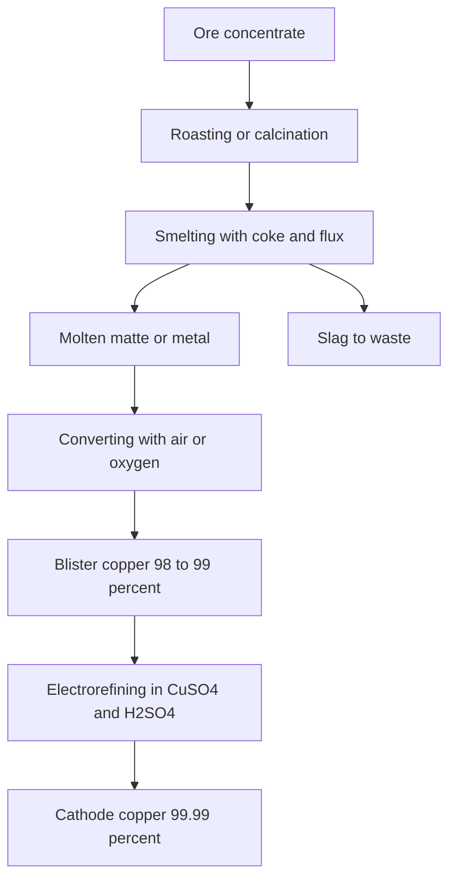
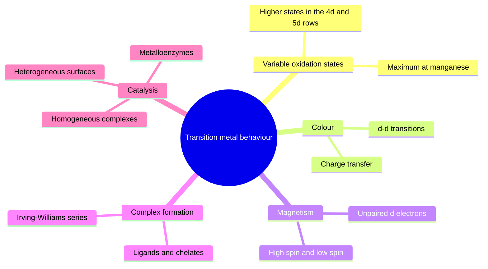
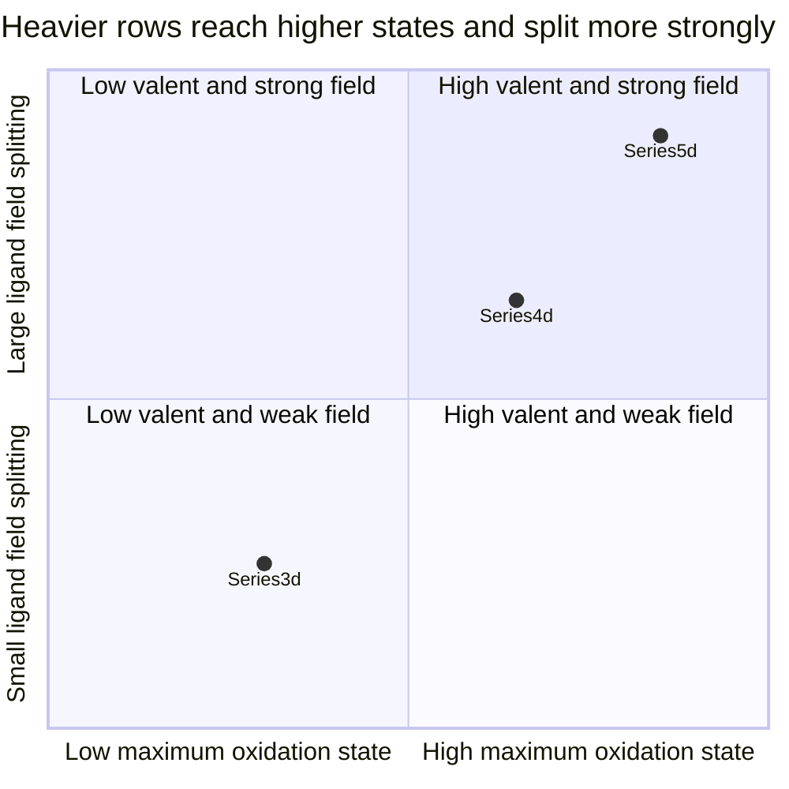

# Chapter 2 — Transition Metals

> **Level:** University (Level 5 — Inorganic Chemistry)
> **Estimated study time:** 8 hours (5 h reading + 3 h exercises)
> **Prerequisites:** [Periodic Chemistry and the Main-Group Elements](01-periodic-chemistry-and-main-group-elements.md); [Electron Shells and Electron Configurations](../02-elementary-chemistry/03-electron-shells-and-electron-configurations.md)
> **Difficulty:** ★★★★☆ (4/5)
> **Related chapters:** [Level 5 index](README.md); [Coordination Compounds](03-coordination-compounds.md); [Organometallic Compounds](04-organometallic-compounds.md)

---

## 1. Learning Objectives

After working through this chapter you will be able to:

- Distinguish a $d$-block element from a transition element using the IUPAC definition, and classify zinc, scandium and copper correctly.
- Write the electron configurations of the first-row transition metals and their ions, including the chromium and copper anomalies, and explain both from exchange energy and $3d$–$4s$ energy ordering.
- Rationalise the pattern of maximum and common oxidation states across the $3d$ series and contrast it with the $4d$ and $5d$ series.
- Read a Latimer diagram and a Frost diagram, identify thermodynamically unstable species, and predict disproportionation.
- Explain the origin of colour in transition-metal compounds, distinguishing $d$–$d$ transitions from charge-transfer transitions.
- Calculate spin-only magnetic moments and use them to assign high-spin and low-spin configurations.
- Apply the Irving–Williams series to the stability of first-row complexes.
- Describe the extraction and refining of iron, copper and titanium, and write the balanced equations for each stage.
- Relate the chemistry of $\ce{KMnO4}$, $\ce{K2Cr2O7}$, $\ce{FeCl3}$ and $\ce{CuSO4.5H2O}$ to their structures and oxidation states.

---

## 2. Introduction

The transition metals occupy the centre of the periodic table and the centre of industrial civilisation. Iron and steel, copper wiring, titanium airframes, nickel superalloys, platinum catalysts and cobalt magnets all depend on elements whose valence electrons occupy $d$ orbitals. What distinguishes them chemically is not simply that they are metals — the alkali metals are metals too — but that they have partially filled $d$ subshells, and those subshells are close in energy to the $4s$ and $4p$ levels. The closeness produces the three signatures of the block: variable oxidation states, strong and tunable coordination to ligands, and unpaired electrons that give colour and magnetism.

The $3d$ series is the one that matters most commercially, and it is the one with the most anomalous behaviour. Chromium and copper adopt configurations that the filling rules do not predict; manganese reaches the highest oxidation state of any first-row element; iron is stable in two oxidation states that interconvert readily, which is why it carries oxygen in blood and catalyses ammonia synthesis. The heavier $4d$ and $5d$ series behave differently: their $d$ orbitals are more spatially extended, their ligand-field splittings are larger, and their higher oxidation states are more accessible. Osmium tetroxide contains osmium(VIII); tungsten and rhenium reach +6 and +7 routinely, whereas the first row stops at +6 for chromium and +7 for manganese only in oxo species.

This chapter builds the electronic framework first, then applies it to redox behaviour, colour, magnetism and complex formation, and only then turns to the descriptive and industrial chemistry. The order matters: the extraction of titanium by the Kroll process, for example, is unintelligible without the thermodynamic reason why titanium cannot be reduced by carbon, and that reason is the very high lattice enthalpy and oxide bond enthalpy of $\ce{TiO2}$.

The chapter assumes the periodic trends of Chapter 1 and the basics of redox and electrode potentials. Coordination chemistry is developed only as far as the transition-metal survey requires; the systematic treatment of ligands, isomerism and nomenclature is Chapter 3.

---

## 3. Fundamental Concepts

### 3.1 What counts as a transition element

The **$d$-block** consists of the elements in which the $d$ subshell is being filled: groups 3 to 12. Not all of them are transition elements. IUPAC defines a **transition element** as an element whose atom has an incomplete $d$ subshell, or which can form cations with an incomplete $d$ subshell.

The definition excludes zinc: its atom is $[\ce{Ar}]3d^{10}4s^2$ and its only common ion, $\ce{Zn^2+}$, is $3d^{10}$. Zinc is a $d$-block element but not a transition element, and its chemistry is that of a main-group-like $d^{10}$ cation: colourless, diamagnetic, fixed +2 oxidation state, no ligand-field stabilisation. Scandium is included because its atom is $3d^1 4s^2$, even though its only common ion, $\ce{Sc^3+}$, is $3d^0$. Copper is included because $\ce{Cu^2+}$ is $3d^9$, even though the metal itself is $3d^{10}4s^1$.

The distinction is not pedantic. It predicts which elements show the characteristic properties: variable oxidation states, colour and paramagnetism. Zinc fails all three tests, and a chemist who expects $\ce{Zn^2+}$ complexes to be coloured will be wrong.

### 3.2 Electronic configurations

The $3d$ series runs from scandium to zinc. The configurations of the atoms are:

| Element | Configuration | Element | Configuration |
|---|---|---|---|
| $\ce{Sc}$ | $[\ce{Ar}]3d^1 4s^2$ | $\ce{Fe}$ | $[\ce{Ar}]3d^6 4s^2$ |
| $\ce{Ti}$ | $[\ce{Ar}]3d^2 4s^2$ | $\ce{Co}$ | $[\ce{Ar}]3d^7 4s^2$ |
| $\ce{V}$ | $[\ce{Ar}]3d^3 4s^2$ | $\ce{Ni}$ | $[\ce{Ar}]3d^8 4s^2$ |
| $\ce{Cr}$ | $[\ce{Ar}]3d^5 4s^1$ | $\ce{Cu}$ | $[\ce{Ar}]3d^{10}4s^1$ |
| $\ce{Mn}$ | $[\ce{Ar}]3d^5 4s^2$ | $\ce{Zn}$ | $[\ce{Ar}]3d^{10}4s^2$ |

Two entries break the pattern. Chromium has $3d^5 4s^1$ rather than $3d^4 4s^2$, and copper has $3d^{10}4s^1$ rather than $3d^9 4s^2$. Both are explained by the small energy gap between the $3d$ and $4s$ levels and by the exchange energy of a half-filled or filled $d$ subshell. The exchange interaction stabilises a set of parallel spins: for $d^5$ the stabilisation is $10K$, where $K$ is the exchange integral, and for $d^{10}$ it is $20K$. When that stabilisation exceeds the promotion energy, the configuration with the extra $d$ electron wins. The heavier analogues show the same pattern for the same reason: niobium is $4d^4 5s^1$, molybdenum $4d^5 5s^1$, ruthenium $4d^7 5s^1$, rhodium $4d^8 5s^1$, palladium $4d^{10}$, silver $4d^{10}5s^1$, platinum $5d^9 6s^1$ and gold $5d^{10}6s^1$.

The configurations of the ions are more important than those of the atoms, because the chemistry is ionic. When a transition metal is ionised, the $4s$ electrons are removed first, even though $4s$ was filled before $3d$. The reason is that once the $3d$ subshell is occupied, its electrons are less effectively shielded than the $4s$ electrons and lie lower in energy; the $4s$ orbital is the outermost and is lost first. Thus $\ce{Fe^2+}$ is $3d^6$ and $\ce{Fe^3+}$ is $3d^5$, not $3d^4 4s^2$ and $3d^3 4s^2$. The order in which orbitals are filled is not the order in which they are emptied.

### 3.3 Variable oxidation states

The possibility of variable oxidation states follows from the small energy difference between the $3d$, $4s$ and $4p$ levels and from the ability of the $d$ electrons to participate in bonding. The common and maximum oxidation states of the $3d$ series are:

| Element | Group | Common states | Maximum | Notes |
|---|---|---|---|---|
| $\ce{Sc}$ | 3 | $+3$ | $+3$ | $3d^0$ ion, colourless, diamagnetic |
| $\ce{Ti}$ | 4 | $+3$, $+4$ | $+4$ | $\ce{TiCl3}$ is a Ziegler–Natta catalyst |
| $\ce{V}$ | 5 | $+2$, $+4$, $+5$ | $+5$ | $\ce{VO2+}$, $\ce{VO4^3-}$ |
| $\ce{Cr}$ | 6 | $+3$, $+6$ | $+6$ | $\ce{Cr2O7^2-}$, $\ce{CrO4^2-}$ |
| $\ce{Mn}$ | 7 | $+2$, $+4$, $+7$ | $+7$ | $\ce{MnO4^-}$ |
| $\ce{Fe}$ | 8 | $+2$, $+3$ | $+6$ | $\ce{FeO4^2-}$ is rare and strongly oxidising |
| $\ce{Co}$ | 9 | $+2$, $+3$ | $+4$ (rare) | $\ce{Co^3+}$ stabilised by ligands |
| $\ce{Ni}$ | 10 | $+2$ | $+4$ (rare) | $\ce{Ni^2+}$ dominates |
| $\ce{Cu}$ | 11 | $+1$, $+2$ | $+3$ (rare) | $\ce{Cu^2+}$ is the aqueous ion |
| $\ce{Zn}$ | 12 | $+2$ | $+2$ | $d^{10}$, no variable valence |

The pattern is an inverted V. The maximum oxidation state rises from scandium to manganese because the number of valence electrons rises and the $3d$ and $4s$ orbitals are all available for bonding. After manganese the maximum falls, even though the nuclear charge continues to rise, because the $3d$ orbitals become progressively more contracted and more strongly bound; removing a $d$ electron from iron or cobalt costs more than the bonds that the higher oxidation state could form. The result is that iron(VI) exists only as the intensely purple ferrate ion in strongly alkaline solution, and cobalt(IV) and nickel(IV) require stabilising ligands such as fluoride or oxo.

The heavy series behave differently. The $4d$ and $5d$ orbitals are larger and more diffuse, so they overlap better with ligand orbitals and form stronger bonds; the higher oxidation states are correspondingly more stable. Osmium(VIII) in $\ce{OsO4}$, ruthenium(VIII) in $\ce{RuO4}$, tungsten(VI) in $\ce{WO3}$, rhenium(VII) in $\ce{ReF7}$ and platinum(VI) in $\ce{PtF6}$ have no first-row counterparts of comparable stability.

### 3.4 Redox chemistry and stability

A transition metal in a given oxidation state may be stable, may disproportionate, or may be oxidised or reduced by water, oxygen or acid. Two graphical devices summarise the thermodynamics.

A **Latimer diagram** writes the oxidation states in order of decreasing oxidation number, with the standard potential for each consecutive reduction written above the arrow:

$$ \ce{MnO4^- ->[+1.51 V] Mn^2+ ->[-1.18 V] Mn} $$

The convention is that the arrow points in the direction of reduction. A species tends to disproportionate if the potential to its right is greater than the potential to its left. Reading the manganese diagram, the potential for $\ce{MnO4^-/Mn^2+}$ ($+1.51\ \text{V}$) is much greater than that for $\ce{Mn^2+/Mn}$ ($-1.18\ \text{V}$), so permanganate will oxidise manganese metal, and $\ce{Mn^2+}$ is the stable ion in acid solution.

A **Frost diagram** plots $nE^\circ$ for each oxidation state against the oxidation number $n$, taking the element in its standard state as the zero of energy. The quantity $nE^\circ$ is proportional to $-\Delta G^\circ/F$ for the conversion of the element into that oxidation state, so a lower point means a more stable species. The slope of the line joining two points is the standard potential between them. A species that lies above the line joining its neighbours is thermodynamically unstable with respect to disproportionation into them.

### 3.5 Complex formation

A transition-metal ion in solution is a Lewis acid surrounded by ligands. The product is a **complex**, and the bonds are coordinate bonds in which the ligand donates an electron pair into a vacant metal orbital. The number of donor atoms bound to the metal is the **coordination number**, most commonly six (octahedral) for the $3d$ series, with four (tetrahedral or square planar) for larger ligands or $d^8$ and $d^{10}$ ions.

Complex formation changes the redox behaviour, the colour and the solubility of the metal ion, and it is the basis of analytical separations, of catalysis and of biological function. The stability of a complex is measured by the formation constant $\beta$, defined in Section 6. The general trend for a given ligand across the first row is the **Irving–Williams series**: stability increases from $\ce{Mn^2+}$ to $\ce{Cu^2+}$ and then falls sharply at $\ce{Zn^2+}$.

$$ \ce{Mn^2+ < Fe^2+ < Co^2+ < Ni^2+ < Cu^2+ > Zn^2+} $$

The series is a consequence of two competing effects. The ionic radius decreases from manganese to zinc, which increases the electrostatic attraction and the stability. Against that, the ligand-field stabilisation energy is zero for $d^5$ high-spin manganese, rises to a maximum at $d^8$ nickel and falls again at $d^{10}$ zinc; and copper(II) gains an additional Jahn–Teller stabilisation from its $d^9$ configuration. The result is the characteristic maximum at copper and the collapse at zinc.

### 3.6 Colour

Most transition-metal compounds are coloured because the energy gap between occupied and vacant $d$ orbitals falls in the visible range. An electron absorbs a photon of the appropriate energy and is promoted from a lower to a higher $d$ orbital; the transmitted light is missing that wavelength, and the compound appears in the complementary colour. The energy gap $\Delta$ is typically $10\,000$–$30\,000\ \text{cm}^{-1}$, corresponding to wavelengths of $1000$–$330\ \text{nm}$.

Two selection rules govern the intensity. The **Laporte rule** forbids $d$–$d$ transitions in a centrosymmetric complex, so octahedral complexes have molar absorption coefficients of only $1$–$100\ \text{dm}^3\ \text{mol}^{-1}\ \text{cm}^{-1}$ and their colours are pale. Tetrahedral complexes lack a centre of symmetry, so their colours are more intense. **Spin selection** forbids transitions that change the total spin, which is why high-spin manganese(II) ($d^5$, all spins parallel) is almost colourless: every $d$–$d$ transition would require a spin flip. **Charge-transfer** transitions, in which an electron moves from a ligand orbital to a metal orbital (LMCT) or from metal to ligand (MLCT), are fully allowed and give intense colours: the deep purple of permanganate ($\varepsilon \approx 2300\ \text{dm}^3\ \text{mol}^{-1}\ \text{cm}^{-1}$) is a ligand-to-metal charge transfer, not a $d$–$d$ transition.

### 3.7 Magnetism

A transition-metal ion with unpaired $d$ electrons is **paramagnetic**; an ion with all electrons paired is **diamagnetic**. The magnetic moment of a paramagnetic complex is usually close to the **spin-only** value

$$ \mu_{\text{so}} = \sqrt{n(n+2)}\ \mu_{\text{B}} $$

where $n$ is the number of unpaired electrons and $\mu_{\text{B}} = 9.274 \times 10^{-24}\ \text{J T}^{-1}$ is the Bohr magneton. The formula ignores orbital angular momentum, which is largely quenched in octahedral complexes of the first row; the measured moments of such complexes are usually within $0.3\ \mu_{\text{B}}$ of the spin-only value.

Magnetism distinguishes **high-spin** from **low-spin** configurations. In an octahedral field the five $d$ orbitals split into a lower $t_{2g}$ set of three and an upper $e_g$ set of two, separated by $\Delta_o$. If $\Delta_o$ is smaller than the spin-pairing energy $P$, electrons occupy all five orbitals singly before pairing, giving the high-spin configuration with the maximum number of unpaired electrons. If $\Delta_o > P$, the lower three orbitals are filled in pairs before the upper two are occupied, giving the low-spin configuration with fewer unpaired electrons. The magnitudes of $\Delta_o$ and $P$ both depend on the metal and the ligand, and the balance is the subject of ligand-field theory, developed in Chapter 3.

### 3.8 Catalysis

Transition metals catalyse because they can change oxidation state, coordinate substrates and provide a surface on which bonds are broken and formed. Three classes dominate.

**Heterogeneous catalysis** uses a solid metal surface: iron for ammonia synthesis, platinum–rhodium gauze for ammonia oxidation, vanadium(V) oxide for sulfur dioxide oxidation, nickel for alkene hydrogenation, and platinum–palladium–rhodium in automotive three-way catalysts. The metal surface adsorbs the reactants, weakens their bonds, and allows the products to desorb.

**Homogeneous catalysis** uses a soluble complex: rhodium or cobalt carbonyls for hydroformylation, palladium phosphine complexes for cross-coupling, and Grubbs' ruthenium carbenes for olefin metathesis. These systems are discussed in Chapter 4.

**Enzyme catalysis** uses metal ions in a protein environment: iron in catalase and cytochrome P450, manganese in superoxide dismutase and the oxygen-evolving complex, copper in laccase, molybdenum in nitrogenase. Chapter 5 treats these systems.

### 3.9 The $3d$ series against the $4d$ and $5d$ series

Three differences recur.

First, the heavier metals show larger ligand-field splittings. The $4d$ and $5d$ orbitals extend further from the nucleus, overlap more strongly with ligand orbitals, and give $\Delta_o$ values roughly $30$–$50\%$ larger than their $3d$ analogues. Low-spin configurations are therefore the rule rather than the exception for the second and third rows.

Second, the heavier metals reach higher oxidation states more easily, as discussed in Section 3.3, and form stronger metal–metal bonds. The quadruple bond in $\ce{[Re2Cl8]^2-}$ has no stable first-row analogue.

Third, relativistic effects are significant for the third row. The $6s$ orbital is contracted and stabilised, which raises the ionisation energies of gold and mercury, contributes to the nobility of gold and to the liquidity of mercury, and stabilises the higher oxidation states of platinum and iridium relative to their lighter congeners.

The practical consequence is that a chemist who knows the first row cannot extrapolate safely. Nickel(II) is almost always octahedral or square planar; palladium(II) and platinum(II) are square planar. Iron(II) is high-spin with weak-field ligands; ruthenium(II) and osmium(II) are low-spin. Chromium(VI) is a strong oxidant; tungsten(VI) is the stable terminus of tungsten chemistry.

---
CHEM_CHUNK_EOF
## 4. Detailed Scientific Explanation

### 4.1 Why the $d$ electrons matter

The chemical identity of a transition metal is set by the energy and spatial extent of its $d$ orbitals. Four properties follow.

The radial distribution of $3d$ orbitals peaks inside the $4s$ distribution, so $3d$ electrons are closer to the nucleus and more tightly bound once they are occupied. This is why the $4s$ electrons are lost first on ionisation and why the $3d$ electrons dominate the redox chemistry of the ion rather than the atom.

The $3d$ orbitals are compact, with radial extent comparable to the $3s$ and $3p$ cores, so direct $d$–$d$ overlap between neighbouring metal atoms is weak. Metal–metal bonding therefore requires the larger $4d$ and $5d$ orbitals, which is why cluster compounds and quadruple bonds are the preserve of the heavier rows.

The $3d$ orbitals are directional, with lobes pointing between the axes of an octahedron or towards the faces of a tetrahedron. Their energies therefore depend strongly on the arrangement of the surrounding ligands, and this dependence is the origin of ligand-field splitting, colour and magnetism.

The ionisation energies of the $3d$ metals rise across the series from scandium ($631\ \text{kJ mol}^{-1}$) to zinc ($906\ \text{kJ mol}^{-1}$) because $Z_{\text{eff}}$ rises, but the increase is modest compared with the main-group trend of the same period. The standard reduction potentials of the $\ce{M^2+/M}$ couples of the later members are similar, between $-0.28\ \text{V}$ (cobalt) and $-0.76\ \text{V}$ (zinc), whereas the early metals are much more negative ($-1.63\ \text{V}$ for titanium, $-1.18\ \text{V}$ for vanadium and manganese). This is why nearly all first-row metals dissolve in dilute acid and why they are found in nature as oxides and sulfides rather than as native metals.

### 4.2 The pattern of oxidation states

Two factors decide which oxidation states are accessible: the total ionisation energy required to reach a given state, and the extra bonding energy that the state can recover by forming bonds to ligands. In the gas phase only the ionisation energies matter; in a compound the ligand bonds can pay back a large fraction of the cost.

For the $3d$ series the balance produces a maximum at manganese. The $3d$ and $4s$ electrons of manganese are all available, and the +7 state is reached in the permanganate ion because the four oxide ligands form strong $\pi$ bonds that stabilise the highly charged metal. Beyond manganese the $3d$ orbitals contract, the ionisation energies rise steeply, and the maximum oxidation state falls: iron(VI) requires a strongly basic solution to prevent reduction by water, and cobalt(IV) and nickel(IV) require fluoride or oxo ligands that resist oxidation.

The stability of a given oxidation state also depends on the ligand. Cobalt(II) is the stable aquo ion, but cobalt(III) is stabilised by ammonia, cyanide and ethylenediamine because the low-spin $d^6$ configuration gains a large ligand-field stabilisation energy. The standard potential of the $\ce{Co^3+/Co^2+}$ couple falls from $+1.92\ \text{V}$ for the aquo ions to about $+0.1\ \text{V}$ in the presence of ammonia — a change of nearly two volts produced by coordination alone. This is the clearest illustration of the general principle that redox potentials of transition metals are ligand-dependent quantities, not constants of the element.

### 4.3 Reading Latimer and Frost diagrams

Latimer diagrams are compact but require care with the additivity of potentials. Potentials are not additive; Gibbs energies are. For the conversion of $\ce{MnO4^-}$ to $\ce{Mn^2+}$ through $\ce{MnO2}$,

$$ E^\circ(\ce{MnO4^-/Mn^2+}) = \frac{3E^\circ(\ce{MnO4^-/MnO2}) + 2E^\circ(\ce{MnO2/Mn^2+})}{5} $$

because the three-electron and two-electron steps must be weighted by the number of electrons transferred. Substituting $+1.70\ \text{V}$ and $+1.23\ \text{V}$ gives $1.51\ \text{V}$, the tabulated value.

A species disproportionates when the potential on its right exceeds the potential on its left. In acid solution, manganese(III) has $E^\circ(\ce{Mn^3+/Mn^2+}) = +1.51\ \text{V}$ and $E^\circ(\ce{MnO2/Mn^3+}) = +0.95\ \text{V}$; the left-hand potential is the smaller, so

$$ \ce{2Mn^3+(aq) + 2H2O(l) -> Mn^2+(aq) + MnO2(s) + 4H+(aq)} $$

is spontaneous, with $E^\circ_{\text{cell}} = 1.51 - 0.95 = +0.56\ \text{V}$. Manganese(III) is therefore stable only when complexed, as in $\ce{Mn(acac)3}$ or in the manganese centre of a protein.

The Frost diagram makes the same information visible as geometry. In the manganese diagram of Section 8.3, manganese(II) sits at the lowest point, so it is the most stable state in acid. Manganese(III) lies above the straight line joining manganese(II) and manganese(IV), so it disproportionates. Permanganate sits at the top right and its steep connecting lines show that it is a strong oxidant towards every lower state.

### 4.4 Colour in detail

The colour of a complex is determined by the magnitude of $\Delta_o$ and by the selection rules. Three cases are worth distinguishing.

**$d$–$d$ transitions in an octahedral complex.** The absorption is Laporte-forbidden and weak. The hexaaquacopper(II) ion is pale blue ($\varepsilon \approx 12\ \text{dm}^3\ \text{mol}^{-1}\ \text{cm}^{-1}$) because a single $d$–$d$ absorption in the red removes a small fraction of the transmitted light. The hexaaquatitanium(III) ion is purple because its single $d$ electron absorbs at $20\,300\ \text{cm}^{-1}$ ($493\ \text{nm}$, green), leaving the complementary purple.

**$d$–$d$ transitions in a tetrahedral complex.** The absence of a centre of symmetry relaxes the Laporte rule and the absorptions are ten to a hundred times more intense. The tetrahedral $\ce{[CoCl4]^2-}$ ion is an intense blue, whereas the octahedral $\ce{[Co(H2O)6]^2+}$ ion is pale pink.

**Charge transfer.** An electron moves between metal and ligand. Ligand-to-metal charge transfer is responsible for the intense purple of permanganate and the orange of dichromate; metal-to-ligand charge transfer gives the deep red of $\ce{[Ru(bpy)3]^2+}$ and is the basis of dye-sensitised solar cells. Charge-transfer bands are fully allowed, with $\varepsilon$ of $10^3$–$10^5\ \text{dm}^3\ \text{mol}^{-1}\ \text{cm}^{-1}$, and their energy depends on the redox potentials of the two partners rather than on $\Delta_o$.

The colour of a compound therefore reports on its electronic structure, and a colour change on adding a ligand is evidence that a complex has formed. The classic demonstration is the addition of ammonia to aqueous copper(II): the pale blue aquo ion is converted to the deep blue $\ce{[Cu(NH3)4(H2O)2]^2+}$ ion, and the shift of the absorption maximum from $800$ to $600\ \text{nm}$ shows that ammonia has increased $\Delta_o$.

### 4.5 Magnetism in detail

The spin-only formula is the first tool of magnetochemistry, and its failures are informative. For an octahedral $d^6$ iron(II) complex, high spin gives $n = 4$ and $\mu_{\text{so}} = 4.90\ \mu_{\text{B}}$, low spin gives $n = 0$ and $\mu = 0$. The measured value therefore decides the spin state directly.

Where the measured moment exceeds the spin-only value by more than about $0.5\ \mu_{\text{B}}$, orbital angular momentum is contributing. This occurs when the ground state is orbitally degenerate, as in tetrahedral cobalt(II) ($\mu_{\text{obs}} \approx 4.4$–$4.8\ \mu_{\text{B}}$ against a spin-only $3.87$ for $n = 3$) and in octahedral cobalt(II) ($4.7$–$5.2$ against $3.87$). Where the moment is lower than the spin-only value, antiferromagnetic coupling between metal centres is usually responsible, as in dimeric copper(II) carboxylates.

Temperature dependence distinguishes the cases. A simple paramagnet follows the Curie law, $\chi_{\text{M}} = C/T$, so $\chi_{\text{M}}T$ is constant; a system with antiferromagnetic coupling shows a maximum in $\chi_{\text{M}}$ at the Néel temperature; a ferromagnet shows spontaneous magnetisation below the Curie temperature. Chapter 7 develops the theory.

### 4.6 Extraction and refining

**Iron.** Iron is extracted in a blast furnace from haematite ($\ce{Fe2O3}$), magnetite ($\ce{Fe3O4}$) or siderite ($\ce{FeCO3}$), charged with coke and limestone and heated by a blast of air preheated to about $1200\ ^\circ\mathrm{C}$. Three zones do the work. At the tuyeres the coke burns to carbon dioxide, providing the heat:

$$ \ce{C(s) + O2(g) -> CO2(g)} \qquad \Delta H^\circ = -394\ \text{kJ mol}^{-1} $$

Above the tuyeres the carbon dioxide is reduced by more coke to carbon monoxide, the actual reducing agent:

$$ \ce{CO2(g) + C(s) -> 2CO(g)} \qquad \Delta H^\circ = +172\ \text{kJ mol}^{-1} $$

In the upper part of the furnace the iron oxide is reduced stepwise, hematite to magnetite to wustite to iron:

$$ \ce{Fe2O3(s) + 3CO(g) -> 2Fe(l) + 3CO2(g)} $$

Limestone decomposes and the lime combines with silica to form a molten slag that removes the acidic gangue:

$$ \ce{CaCO3(s) -> CaO(s) + CO2(g)} $$

$$ \ce{CaO(s) + SiO2(s) -> CaSiO3(l)} $$

The product is pig iron, containing about $4\%$ carbon together with silicon, manganese, phosphorus and sulfur. Steelmaking removes the excess carbon and the impurities by blowing oxygen through the molten metal (the basic oxygen process), with lime as flux:

$$ \ce{C(s) + O2(g) -> CO2(g)} $$

$$ \ce{2P(s) + \tfrac{5}{2}O2(g) + 3CaO(s) -> Ca3(PO4)2(l)} $$

**Copper.** Copper occurs mainly as chalcopyrite, $\ce{CuFeS2}$, at grades of about $0.5\%$. After froth flotation the concentrate is roasted and smelted, and the molten matte of copper(I) sulfide is converted by air:

$$ \ce{2Cu2S(l) + 3O2(g) -> 2Cu2O(l) + 2SO2(g)} $$

$$ \ce{Cu2S(l) + 2Cu2O(l) -> 6Cu(l) + SO2(g)} $$

The blister copper is $98$–$99\%$ pure and is refined electrolytically in acidified copper(II) sulfate at about $0.3\ \text{V}$. The anode dissolves, copper plates onto the cathode at $99.99\%$ purity, and the noble-metal impurities report to the anode slime, from which gold and silver are recovered. The electrorefining step is the reason that copper conductivity is reproducible enough for electrical engineering.

**Titanium.** Titanium cannot be extracted by carbon reduction: $\ce{TiO2}$ is so stable ($\Delta_f G^\circ \approx -890\ \text{kJ mol}^{-1}$) that carbon monoxide cannot reduce it at any practical temperature, and titanium forms a stable carbide that contaminates the product. The Kroll process avoids both problems by converting the oxide to the volatile chloride and reducing that with magnesium:

$$ \ce{TiO2(s) + 2Cl2(g) + 2C(s) ->[900 ^\circ C] TiCl4(g) + 2CO(g)} $$

$$ \ce{TiCl4(g) + 2Mg(l) ->[800-900 ^\circ C, Ar] Ti(s) + 2MgCl2(l)} $$

The titanium is produced as a porous sponge, purified by vacuum distillation to remove residual magnesium and magnesium chloride, and melted under vacuum or in an inert atmosphere because it oxidises rapidly at high temperature. The process is batch, energy-intensive and the reason titanium is expensive despite being the ninth most abundant element in the crust.

### 4.7 Important compounds

**Potassium permanganate, $\ce{KMnO4}$.** Dark purple, diamagnetic ($\ce{Mn(VII)}$ is $d^0$) and strongly oxidising. It is made from pyrolusite by alkaline oxidation to manganate(VI) followed by electrolytic or chlorine oxidation:

$$ \ce{2MnO2(s) + 4KOH(aq) + O2(g) -> 2K2MnO4(aq) + 2H2O(l)} $$

$$ \ce{2K2MnO4(aq) + Cl2(g) -> 2KMnO4(aq) + 2KCl(aq)} $$

The oxidising behaviour depends on pH. In acid the product is manganese(II):

$$ \ce{MnO4^-(aq) + 8H+(aq) + 5e- -> Mn^2+(aq) + 4H2O(l)} \qquad E^\circ = +1.51\ \text{V} $$

In neutral or weakly alkaline solution the product is manganese(IV) oxide:

$$ \ce{MnO4^-(aq) + 2H2O(l) + 3e- -> MnO2(s) + 4OH-(aq)} \qquad E^\circ = +0.59\ \text{V} $$

In strongly alkaline solution the product is the green manganate(VI):

$$ \ce{MnO4^-(aq) + e- -> MnO4^2-(aq)} \qquad E^\circ = +0.56\ \text{V} $$

Permanganate is used as a volumetric oxidant, as a disinfectant and in the industrial oxidation of organic compounds.

**Potassium dichromate, $\ce{K2Cr2O7}$.** Orange, diamagnetic ($\ce{Cr(VI)}$ is $d^0$), a primary standard and a strong oxidant. It is manufactured from chromite by alkaline oxidative fusion followed by acidification:

$$ \ce{4FeCr2O4(s) + 8Na2CO3(s) + 7O2(g) -> 8Na2CrO4(s) + 2Fe2O3(s) + 8CO2(g)} $$

$$ \ce{2CrO4^2-(aq) + 2H+(aq) <=> Cr2O7^2-(aq) + H2O(l)} $$

The chromate–dichromate equilibrium is a pH indicator: yellow chromate dominates in base, orange dichromate in acid. The reduction half-reaction is

$$ \ce{Cr2O7^2-(aq) + 14H+(aq) + 6e- -> 2Cr^3+(aq) + 7H2O(l)} \qquad E^\circ = +1.33\ \text{V} $$

Dichromate is used in volumetric analysis, in tanning, in the manufacture of pigments such as lead(II) chromate, and in the oxidation of alcohols. Chromium(VI) is carcinogenic and its industrial use is increasingly restricted.

**Iron(III) chloride, $\ce{FeCl3}$.** A dark green-black, hygroscopic solid that exists as $\ce{Fe2Cl6}$ dimers in the vapour. It is a Lewis acid, used to catalyse the chlorination and Friedel–Crafts reactions of aromatic compounds, and in solution it hydrolyses strongly:

$$ \ce{[Fe(H2O)6]^3+(aq) + H2O(l) <=> [Fe(H2O)5(OH)]^2+(aq) + H3O+(aq)} \qquad \mathrm{p}K_{\text{a}} = 2.2 $$

Aqueous iron(III) chloride is therefore acidic enough to corrode metals, which is the basis of its use in etching copper circuit boards.

**Copper(II) sulfate pentahydrate, $\ce{CuSO4.5H2O}$.** Blue, triclinic, and a standard source of copper(II) in the laboratory. Four of the five water molecules are coordinated to copper in a distorted octahedron, with two at a longer axial distance (a Jahn–Teller distortion of the $d^9$ ion); the fifth is hydrogen-bonded to the sulfate ion and is not coordinated. Heating drives off the water in stages, and the colour changes from blue to white as the aquo complex is destroyed:

$$ \ce{CuSO4.5H2O(s) ->[250 ^\circ C] CuSO4(s) + 5H2O(g)} $$

The white anhydrous salt is used as a test for water, and the pentahydrate as a fungicide (Bordeaux mixture) and a dietary supplement.

### 4.8 Biological roles

Iron is the most important biological transition metal. It is the oxygen-binding centre of haemoglobin and myoglobin, the electron-transfer centre of the cytochromes and ferredoxins, and the catalytic centre of catalase and the cytochrome P450 family. Copper carries electrons in plastocyanin and azurin, reduces oxygen in cytochrome c oxidase and hydroxylates substrates in tyrosinase. Manganese oxidises water in photosystem II. Cobalt is the metal of cobalamin (vitamin B$_{12}$). Molybdenum is the metal of nitrogenase and nitrate reductase, and nickel that of urease and hydrogenase. Chapter 5 treats each system.

---

## 5. Visual Diagrams

**Figure 2.1 — Pyrometallurgical route from sulfide ore to refined copper.** The diagram separates the four operations that are often compressed into the phrase "copper smelting". Roasting and smelting remove iron and sulfur as slag and sulfur dioxide, converting removes the remaining sulfur by exploiting the reaction between copper(I) sulfide and copper(I) oxide, and electrorefining removes the noble metals and the residual base metals that would degrade conductivity. The same logic — concentrate, reduce, refine — underlies iron, nickel and lead metallurgy, with the details changed by the thermodynamics of each oxide.

**Figure 2.2 — The five properties that follow from a partially filled $d$ subshell.** The mind map is a diagnostic checklist rather than a classification: an element that lacks one of the five branches, as zinc lacks variable oxidation states and colour, is unlikely to be a transition element in the IUPAC sense. Each branch also points to the chapter where it is developed — colour and magnetism in Chapter 7, complexes in Chapter 3, catalysis in Chapter 4 and Chapter 5.

**Figure 2.3 — A qualitative comparison of the three transition series.** The horizontal axis tracks the accessibility of high oxidation states and the vertical axis the magnitude of $\Delta_o$. Both increase from $3d$ to $5d$, so the two series that are chemically most different are $3d$ and $5d$; the $4d$ series lies between them and usually resembles the $5d$ series more closely than the $3d$ series. The coordinates are illustrative, not measured, and should be read as a ranking rather than as data.

---

## 6. Mathematical Formulas

The spin-only magnetic moment follows from the number of unpaired electrons:

$$ \mu_{\text{so}} = \sqrt{n(n+2)}\ \mu_{\text{B}}, \qquad \mu_{\text{B}} = \frac{e\hbar}{2m_e} = 9.274 \times 10^{-24}\ \text{J T}^{-1} $$

| Symbol | Meaning | SI unit |
|---|---|---|
| $\mu_{\text{so}}$ | Spin-only magnetic moment | $\mu_{\text{B}}$ or $\text{J T}^{-1}$ |
| $n$ | Number of unpaired electrons | $1$ |
| $\mu_{\text{B}}$ | Bohr magneton | $\text{J T}^{-1}$ |
| $e$ | Elementary charge | $\text{C}$ |
| $\hbar$ | Reduced Planck constant | $\text{J s}$ |
| $m_e$ | Electron mass | $\text{kg}$ |

The relation between the ligand-field splitting and the wavelength of the absorption maximum is

$$ \Delta_o = \frac{hc}{\lambda} = hc\tilde{\nu}, \qquad \lambda\ (\text{nm}) = \frac{10^{7}}{\tilde{\nu}\ (\text{cm}^{-1})} $$

with $h = 6.626 \times 10^{-34}\ \text{J s}$, $c = 2.998 \times 10^{8}\ \text{m s}^{-1}$, and $\tilde{\nu}$ the wavenumber in $\text{cm}^{-1}$. A $\Delta_o$ of $20\,300\ \text{cm}^{-1}$ corresponds to $493\ \text{nm}$, in the green.

The thermodynamic driving force for a redox couple is

$$ \Delta G^\circ = -nFE^\circ, \qquad E = E^\circ - \frac{RT}{nF}\ln Q $$

where $n$ is the number of electrons transferred, $F = 96\,485\ \text{C mol}^{-1}$ is the Faraday constant, and $Q$ is the reaction quotient. Because Gibbs energies are additive and potentials are not, a multi-step couple is combined as

$$ E^\circ_{\text{overall}} = \frac{\sum_i n_i E_i^\circ}{\sum_i n_i} $$

The ligand-field stabilisation energy of an octahedral complex, relative to the barycentre of the $d$ orbitals, is

$$ \text{LFSE} = \left(-0.4\,n_{t_{2g}} + 0.6\,n_{e_g}\right)\Delta_o $$

in $\text{J mol}^{-1}$ when $\Delta_o$ is expressed per mole. The expression is quoted per mole of complex and is valid for both high-spin and low-spin configurations once the occupation numbers are known.

---

## 7. Chemical Equations

**Blast furnace.** The three reducing steps and the slag-forming step, all at about $1200$–$1900\ \text{K}$:

$$ \ce{Fe2O3(s) + 3CO(g) -> 2Fe(l) + 3CO2(g)} $$

$$ \ce{CaCO3(s) -> CaO(s) + CO2(g)} $$

$$ \ce{CaO(s) + SiO2(s) -> CaSiO3(l)} $$

**Copper converting and refining.**

$$ \ce{Cu2S(l) + 2Cu2O(l) -> 6Cu(l) + SO2(g)} $$

$$ \ce{Cu(s) ->[anode] Cu^2+(aq) + 2e-} \qquad \ce{Cu^2+(aq) + 2e- ->[cathode] Cu(s)} $$

**Kroll process for titanium.**

$$ \ce{TiCl4(g) + 2Mg(l) -> Ti(s) + 2MgCl2(l)} \qquad \Delta H^\circ = -520\ \text{kJ mol}^{-1} $$

**Permanganate in acid and in base.**

$$ \ce{2MnO4^-(aq) + 5H2O2(aq) + 6H+(aq) -> 2Mn^2+(aq) + 5O2(g) + 8H2O(l)} $$

$$ \ce{2MnO4^-(aq) + SO3^2-(aq) + 2OH-(aq) -> 2MnO4^2-(aq) + SO4^2-(aq) + H2O(l)} $$

**Dichromate oxidation of iron(II).**

$$ \ce{Cr2O7^2-(aq) + 6Fe^2+(aq) + 14H+(aq) -> 2Cr^3+(aq) + 6Fe^3+(aq) + 7H2O(l)} $$

**Disproportionation of manganese(III).**

$$ \ce{2Mn^3+(aq) + 2H2O(l) -> Mn^2+(aq) + MnO2(s) + 4H+(aq)} \qquad E^\circ_{\text{cell}} = +0.56\ \text{V} $$

**Precipitation of iron(III) hydroxide.**

$$ \ce{Fe^3+(aq) + 3OH-(aq) -> Fe(OH)3(s)} $$

---

## 8. Worked Examples

### Worked Example 8.1 — Oxidation states and $d$ counts

**Problem.** Assign the oxidation state of the metal and the $d^n$ configuration in (a) $\ce{KMnO4}$, (b) $\ce{K2Cr2O7}$, (c) $\ce{[Fe(CN)6]^3-}$, (d) $\ce{[Cu(NH3)4]^2+}$ and (e) $\ce{Ni(CO)4}$.

**Strategy.** Treat each ligand as the closed-shell ion or molecule it is, sum the charges to the overall charge of the species, and then subtract the core configuration of the metal.

**Solution.** (a) Four oxide ligands contribute $-8$; potassium is $+1$, so manganese is $+7$: $3d^0$. (b) Seven oxides contribute $-14$, two potassiums $+2$, so the two chromium atoms share $+12$ and each is $+6$: $3d^0$. (c) Six cyanides contribute $-6$ and the complex has charge $-3$, so iron is $+3$: $3d^5$. (d) Four neutral ammines contribute nothing and the complex has charge $+2$, so copper is $+2$: $3d^9$. (e) Four neutral carbonyls contribute nothing, so nickel is $0$: $3d^{10}$.

**Check.** Every result reproduces a known configuration: permanganate and dichromate are $d^0$ and diamagnetic, ferricyanide is low-spin $d^5$, tetraamminecopper(II) is $d^9$ and Jahn–Teller distorted, and nickel tetracarbonyl is $d^{10}$ and tetrahedral. The charge sums are internally consistent: $-8 + 1 = -7$ for (a), $-14 + 2 = -12$ for (b), $-6 = -3 + 3$ for (c).

### Worked Example 8.2 — Magnetic moments and spin states

**Problem.** The measured magnetic moments are $5.9\ \mu_{\text{B}}$ for $\ce{[Fe(H2O)6]^3+}$, $2.3\ \mu_{\text{B}}$ for $\ce{[Fe(CN)6]^3-}$ and $0\ \mu_{\text{B}}$ for $\ce{[Co(NH3)6]^3+}$. Deduce the spin state of each complex.

**Strategy.** Calculate $\mu_{\text{so}}$ for each possible number of unpaired electrons and compare with the measurement. Use $\Delta_o$ versus $P$ to explain the assignment chemically.

**Solution.** For $n = 5$, $\sqrt{35} = 5.92\ \mu_{\text{B}}$; for $n = 3$, $\sqrt{15} = 3.87\ \mu_{\text{B}}$; for $n = 1$, $\sqrt{3} = 1.73\ \mu_{\text{B}}$; for $n = 0$, $0$.

$\ce{[Fe(H2O)6]^3+}$ is $d^5$ and the measured $5.9\ \mu_{\text{B}}$ matches $n = 5$: high spin. Water is a weak-field ligand, so $\Delta_o < P$ and the fifth electron occupies the upper $e_g$ set.

$\ce{[Fe(CN)6]^3-}$ is also $d^5$, but $2.3\ \mu_{\text{B}}$ lies between the $n = 1$ value ($1.73$) and the $n = 2$ value ($2.83$); the accepted assignment is low spin with one unpaired electron, the excess over $1.73$ coming from spin–orbit coupling. Cyanide is a strong-field ligand, so $\Delta_o > P$.

$\ce{[Co(NH3)6]^3+}$ is $d^6$ and the moment is zero: all electrons paired, low spin. The low-spin $d^6$ configuration gains a large ligand-field stabilisation, which is why cobalt(III) ammine complexes are so stable.

**Check.** The assignments are consistent with the spectrochemical series: $\ce{CN-}$ > $\ce{NH3}$ > $\ce{H2O}$ in field strength. The measured moment of the high-spin $d^5$ complex equals the spin-only value exactly, as expected because a $^6A_{1g}$ ground state has no orbital contribution.

### Worked Example 8.3 — Interpreting a Frost diagram for manganese

**Problem.** The Frost diagram values $nE^\circ$ (in volts) for manganese in acid solution are $0$ for $\ce{Mn}$, $-2.36$ for $\ce{Mn^2+}$, $-0.85$ for $\ce{Mn^3+}$, $+0.10$ for $\ce{MnO2}$, $+4.64$ for $\ce{MnO4^2-}$ and $+5.20$ for $\ce{MnO4^-}$. Identify the stable species and any species that disproportionates.

**Strategy.** A species is unstable to disproportionation if its point lies above the straight line joining its two neighbours. The stable species is the one with the lowest $nE^\circ$.

**Solution.** Manganese(II) lies lowest, at $-2.36\ \text{V}$, so it is the thermodynamically stable form in acid solution. Consider manganese(III): the line joining $\ce{Mn^2+}$ ($n = 2$) to $\ce{MnO2}$ ($n = 4$) has slope

$$ \frac{0.10 - (-2.36)}{4 - 2} = +1.23\ \text{V} $$

and therefore a value of $-2.36 + 1.23 = -1.13\ \text{V}$ at $n = 3$. The actual value is $-0.85\ \text{V}$, which is $0.28\ \text{V}$ above the line: manganese(III) disproportionates into manganese(II) and manganese(IV).

Permanganate lies at $+5.20\ \text{V}$, above the line from $\ce{MnO2}$ to $\ce{MnO4^-}$, and its connecting slopes ($2.49\ \text{V}$ from $\ce{MnO2}$, $0.56\ \text{V}$ from $\ce{MnO4^2-}$) show that it is a strong oxidant but not unstable to disproportionation.

**Check.** The slope between $\ce{Mn^2+}$ and $\ce{MnO2}$ is exactly the tabulated $E^\circ(\ce{MnO2/Mn^2+}) = +1.23\ \text{V}$, and the slope between $\ce{MnO4^2-}$ and $\ce{MnO4^-}$ is the tabulated $+0.56\ \text{V}$; both confirm that the vertical axis is $nE^\circ$ and not $E^\circ$. The conclusion that $\ce{Mn^3+}$ is unstable agrees with the Latimer analysis in Section 4.3.

### Worked Example 8.4 — Permanganate titration of an iron ore

**Problem.** A $0.5000\ \text{g}$ sample of iron ore is dissolved in acid and the iron reduced to $\ce{Fe^2+}$. The solution requires $24.50\ \text{mL}$ of $0.02000\ \text{mol L}^{-1}$ $\ce{KMnO4}$ to reach the end-point. Calculate the mass percentage of iron in the ore.

**Strategy.** Use the stoichiometry of the balanced redox equation to convert moles of permanganate to moles of iron, then to mass, then to a percentage.

**Solution.** The reaction is

$$ \ce{MnO4^-(aq) + 5Fe^2+(aq) + 8H+(aq) -> Mn^2+(aq) + 5Fe^3+(aq) + 4H2O(l)} $$

The amount of permanganate is

$$ n(\ce{MnO4^-}) = 0.02000\ \text{mol L}^{-1} \times 0.02450\ \text{L} = 4.900 \times 10^{-4}\ \text{mol} $$

so the amount of iron is $5 \times 4.900 \times 10^{-4} = 2.450 \times 10^{-3}\ \text{mol}$, with mass

$$ m(\ce{Fe}) = 2.450 \times 10^{-3}\ \text{mol} \times 55.85\ \text{g mol}^{-1} = 0.1368\ \text{g} $$

The percentage is

$$ w(\ce{Fe}) = \frac{0.1368\ \text{g}}{0.5000\ \text{g}} \times 100\% = 27.4\% $$

**Check.** The electron balance is exact: permanganate accepts five electrons and each iron(II) donates one, so five iron atoms are oxidised per permanganate ion. The result, $27.4\%$, is plausible for a low-grade ore; a high-grade haematite would give about $70\%$, and would require a larger titre for the same sample mass.

### Worked Example 8.5 — Material balance of the Kroll process

**Problem.** Calculate the masses of $\ce{TiCl4}$ and magnesium required to produce $1.00\ \text{kg}$ of titanium by the Kroll process, and check the mass balance.

**Strategy.** Use the stoichiometry $\ce{TiCl4 + 2Mg -> Ti + 2MgCl2}$ with molar masses $M(\ce{Ti}) = 47.87$, $M(\ce{TiCl4}) = 189.68$, $M(\ce{Mg}) = 24.31$ and $M(\ce{MgCl2}) = 95.21\ \text{g mol}^{-1}$.

**Solution.** The amount of titanium is

$$ n(\ce{Ti}) = \frac{1000\ \text{g}}{47.87\ \text{g mol}^{-1}} = 20.89\ \text{mol} $$

which requires $20.89\ \text{mol}$ of $\ce{TiCl4}$ and $41.78\ \text{mol}$ of magnesium:

$$ m(\ce{TiCl4}) = 20.89 \times 189.68 = 3.96 \times 10^{3}\ \text{g} = 3.96\ \text{kg} $$

$$ m(\ce{Mg}) = 41.78 \times 24.31 = 1.02 \times 10^{3}\ \text{g} = 1.02\ \text{kg} $$

**Check.** The mass balance closes: $3.96 + 1.02 = 4.98\ \text{kg}$ of reactants give $1.00\ \text{kg}$ of titanium plus $41.78 \times 95.21 = 3.98\ \text{kg}$ of $\ce{MgCl2}$, and $1.00 + 3.98 = 4.98\ \text{kg}$. The magnesium chloride by-product is recycled electrolytically to magnesium and chlorine in the industrial process, which is what makes the route economically viable despite its batch nature.

---

## 9. Real-World Applications

**Steel.** About $1.9 \times 10^9$ tonnes of steel are produced each year, and the blast furnace and basic oxygen converter described in Section 4.6 account for most of it. Alloying elements — chromium for stainless steel, nickel for toughness, molybdenum for high-temperature strength, vanadium and niobium for grain refinement — are transition metals chosen for their effects on microstructure.

**Catalysis.** Platinum–rhodium gauze oxidises ammonia in every nitric acid plant; vanadium(V) oxide catalyses the contact process; iron catalyses ammonia synthesis; palladium and platinum in catalytic converters oxidise carbon monoxide and hydrocarbons and reduce nitrogen oxides; nickel hydrogenates vegetable oils.

**Energy storage and conversion.** Lithium-ion battery cathodes are layered oxides of cobalt, nickel and manganese; the anode is graphite; the electrolyte contains lithium hexafluorophosphate. Fuel cells use platinum catalysts, and solid oxide fuel cells use nickel cermet anodes.

**Medicine.** Cisplatin and its analogues are platinum(II) coordination compounds used in cancer chemotherapy; gadolinium(III) complexes are magnetic resonance contrast agents; technetium-99m complexes are the workhorses of nuclear medicine; iron supplements treat anaemia.

**Pigments and materials.** Titanium dioxide is the whitest and most widely used pigment, with a refractive index of $2.7$; iron oxides give red and yellow ochres; chromium(III) oxide gives the green of some ceramics; cobalt compounds give the deep blue of cobalt glass.

**Environmental chemistry.** Iron nanoparticles remediate contaminated groundwater; the redox chemistry of iron and manganese controls the mobility of trace metals in sediments; vanadium and molybdenum are essential cofactors in enzymes that cycle nitrogen and sulfur.

---

## 10. Common Mistakes

| Mistake | Why it happens | Correct approach |
|---|---|---|
| Treating zinc as a typical transition metal | It sits in the $d$ block | Zinc is $d^{10}$ in atom and ion: no variable valence, no colour, no ligand-field stabilisation |
| Removing $3d$ electrons before $4s$ when ionising | Filling order is $4s$ before $3d$ | The $4s$ orbital is higher in energy once $3d$ is occupied; remove $4s$ first |
| Explaining the chromium anomaly by "half-filled stability" alone | The phrase is memorable but incomplete | Exchange energy competes with the $3d$–$4s$ gap; both must be considered |
| Adding electrode potentials directly for a multi-step couple | They look like ordinary numbers | Convert to Gibbs energies, add those, then convert back: $E = \sum n_iE_i/\sum n_i$ |
| Assuming a colour is always a $d$–$d$ transition | Most coloured complexes are transition-metal compounds | Permanganate and dichromate are $d^0$; their colour is charge transfer |
| Predicting a magnetic moment from the formula alone | The spin state is not fixed by the configuration | Measure the moment, then infer high or low spin from $\Delta_o$ versus $P$ |
| Expecting carbon to reduce every metal oxide | Carbon reduces iron oxide readily | $\ce{TiO2}$, $\ce{Al2O3}$ and $\ce{MgO}$ are too stable; use chlorination or electrolysis |
| Quoting a reduction potential without the ligand and pH | Potentials are tabulated for standard conditions | State the medium: $\ce{Co^3+/Co^2+}$ differs by nearly $2\ \text{V}$ between water and ammonia |

---

## 11. Chapter Summary

- A transition element has an incomplete $d$ subshell in the atom or in a common cation; zinc is $d$-block but not a transition element.
- Chromium and copper adopt $d^5s^1$ and $d^{10}s^1$ configurations because exchange energy outweighs the $3d$–$4s$ gap; the heavier analogues show the same pattern.
- Ions lose $4s$ electrons first, so $\ce{Fe^3+}$ is $3d^5$, not $3d^3 4s^2$.
- Maximum oxidation states rise to manganese and then fall; the $4d$ and $5d$ metals reach higher states because their orbitals are more extended.
- Latimer and Frost diagrams convert tabulated potentials into predictions of stability and disproportionation; manganese(III) and copper(I) are the standard examples.
- Colour arises from $d$–$d$ transitions, which are weak because they are Laporte-forbidden, or from charge transfer, which is intense.
- Spin-only moments identify high-spin and low-spin configurations; deviations report spin–orbit coupling or magnetic exchange.
- Complex stability across the first row follows the Irving–Williams series, with a maximum at copper and a collapse at zinc.
- Iron is extracted by carbon reduction in the blast furnace, copper by sulfide smelting and electrorefining, and titanium by the Kroll process because $\ce{TiO2}$ cannot be reduced by carbon.
- Permanganate, dichromate, iron(III) chloride and copper(II) sulfate illustrate the link between oxidation state, structure and reactivity.

---

## 12. Exercises

### 12.1 Conceptual questions

1. Explain why zinc is a $d$-block element but not a transition element, and give two chemical observations that support the distinction.
2. Why does the maximum oxidation state fall after manganese in the $3d$ series but continue to rise into the $5d$ series?

### 12.2 Basic problems

3. Write the electron configurations of $\ce{Cr}$, $\ce{Cu}$, $\ce{Cr^3+}$ and $\ce{Cu+}$, and state which are paramagnetic.
4. Assign the oxidation state of the metal in $\ce{VO2+}$, $\ce{MnO4^2-}$, $\ce{[Ni(CN)4]^2-}$ and $\ce{Fe(CO)5}$.

### 12.3 Intermediate problems

5. Calculate the spin-only magnetic moment of $\ce{[Mn(H2O)6]^2+}$ and of $\ce{[Mn(CN)6]^3-}$, and state which is high spin.
6. Use the Latimer diagram of manganese in acid to decide whether $\ce{MnO4^2-}$ disproportionates at pH 0, given $E^\circ(\ce{MnO4^-/MnO4^2-}) = +0.56\ \text{V}$ and $E^\circ(\ce{MnO4^2-/MnO2}) = +2.27\ \text{V}$.
7. Explain why $\ce{[Co(NH3)6]^3+}$ is stable in air whereas $\ce{[Co(H2O)6]^2+}$ is oxidised only slowly.

### 12.4 Advanced problems

8. The measured moment of $\ce{K3[Fe(CN)6]}$ is $2.3\ \mu_{\text{B}}$ rather than the spin-only $1.73\ \mu_{\text{B}}$. Explain the discrepancy and state what it reveals about the ground state.
9. Titanium tetrachloride is a liquid at room temperature whereas titanium dioxide is a refractory solid. Relate both facts to the bonding and to the extraction route.
10. Sketch the Frost diagram of copper in acid ($nE^\circ$: $\ce{Cu}$ $0$, $\ce{Cu+}$ $+0.52$, $\ce{Cu^2+}$ $+0.68$) and use it to explain why copper(I) disproportionates in water but is stable in the presence of cyanide.

### 12.5 Calculation problems

11. A $0.2500\ \text{g}$ sample of steel is dissolved and the manganese oxidised to permanganate. The solution is made up to $100.0\ \text{mL}$ and its absorbance at $525\ \text{nm}$ is $0.420$ in a $1.00\ \text{cm}$ cell, with $\varepsilon = 2.24 \times 10^{3}\ \text{dm}^3\ \text{mol}^{-1}\ \text{cm}^{-1}$. Calculate the mass percentage of manganese.
12. Calculate the volume of $0.0150\ \text{mol L}^{-1}$ $\ce{K2Cr2O7}$ needed to oxidise the iron in $1.000\ \text{g}$ of $\ce{FeSO4.7H2O}$ ($M = 278.01\ \text{g mol}^{-1}$).

### 12.6 Answers

1. Zinc is $3d^{10}4s^2$ and $\ce{Zn^2+}$ is $3d^{10}$; it forms no coloured or paramagnetic complexes and shows only the +2 state.
2. After manganese the $3d$ orbitals contract and rise in energy; the $4d$ and $5d$ orbitals are more diffuse and bond more strongly, so high oxidation states are stabilised.
3. $\ce{Cr}$: $[\ce{Ar}]3d^5 4s^1$, paramagnetic; $\ce{Cu}$: $[\ce{Ar}]3d^{10}4s^1$, paramagnetic; $\ce{Cr^3+}$: $3d^3$, paramagnetic; $\ce{Cu+}$: $3d^{10}$, diamagnetic.
4. $\ce{VO2+}$: $+5$; $\ce{MnO4^2-}$: $+6$; $\ce{[Ni(CN)4]^2-}$: $+2$; $\ce{Fe(CO)5}$: $0$.
5. $\ce{[Mn(H2O)6]^2+}$ is $d^5$ high spin, $n = 5$, $\mu = 5.92\ \mu_{\text{B}}$; $\ce{[Mn(CN)6]^3-}$ is $d^4$ low spin, $n = 2$, $\mu = 2.83\ \mu_{\text{B}}$.
6. Right-hand potential ($+2.27\ \text{V}$) exceeds left-hand ($+0.56\ \text{V}$), so manganate(VI) disproportionates to permanganate and manganese(IV) oxide.
7. The low-spin $d^6$ cobalt(III) ammine complex gains a large ligand-field stabilisation and is inert; the aquo cobalt(II) ion is high spin and labile, and oxidation is slow for kinetic reasons.
8. The $^2T_{2g}$ ground state of low-spin $d^5$ has an orbital contribution; spin–orbit coupling mixes it with excited states and raises the moment above the spin-only value.
9. $\ce{TiCl4}$ is a molecular covalent liquid; $\ce{TiO2}$ is a covalent network with a very large enthalpy of formation, which is why it is chlorinated rather than reduced directly.
10. Copper(I) lies above the line joining copper(0) and copper(II), so it disproportionates; cyanide binds copper(I) strongly and lowers its free energy, moving the point below the line.
11. $A = \varepsilon c l$ gives $c = 0.420/(2240 \times 1.00) = 1.875 \times 10^{-4}\ \text{mol L}^{-1}$; in $0.1000\ \text{L}$ this is $1.875 \times 10^{-5}\ \text{mol}$, mass $1.030 \times 10^{-3}\ \text{g}$, so $w(\ce{Mn}) = 0.41\%$.
12. $n(\ce{FeSO4.7H2O}) = 1.000/278.01 = 3.597 \times 10^{-3}\ \text{mol}$; $\ce{Cr2O7^2-}$ oxidises $6\ce{Fe^2+}$, so $n(\ce{Cr2O7^2-}) = 5.995 \times 10^{-4}\ \text{mol}$ and $V = 5.995 \times 10^{-4}/0.0150 = 0.0400\ \text{L} = 40.0\ \text{mL}$.

---

## 13. Further Reading

- Housecroft, C. E.; Sharpe, A. G. *Inorganic Chemistry*, 5th ed., Pearson, 2018. Chapters 19–24 cover the $d$ block, coordination chemistry and the descriptive chemistry of the transition metals.
- Greenwood, N. N.; Earnshaw, A. *Chemistry of the Elements*, 2nd ed., Butterworth-Heinemann, 1997. Chapters 24–27 give the extraction metallurgy and compound chemistry in detail.
- Shriver, D. F.; Atkins, P. W. *Inorganic Chemistry*, 6th ed., Oxford University Press, 2014. Chapters 19–20 treat ligand-field theory, magnetism and redox stability.
- Cotton, F. A.; Wilkinson, G. *Advanced Inorganic Chemistry*, 6th ed., Wiley, 1999. The reference for Latimer and Frost diagrams and for the heavier transition series.
- IUPAC. *Compendium of Chemical Terminology* (the "Gold Book"). <https://goldbook.iupac.org/> Entries on transition element, ligand field and standard electrode potential.
- [REFERENCES.md](../REFERENCES.md) — the repository's verified source list.
- [GLOSSARY.md](../GLOSSARY.md) — definitions used in this chapter.
