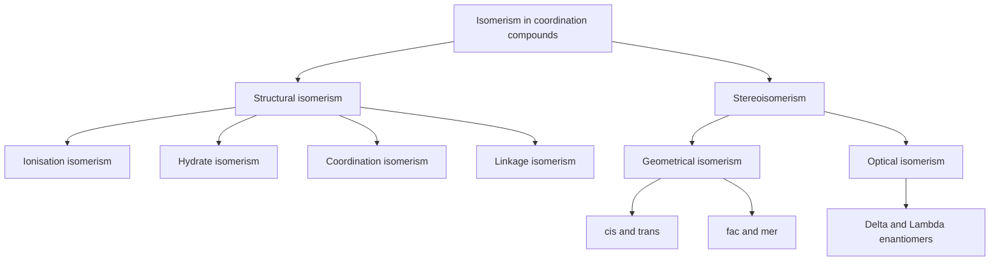
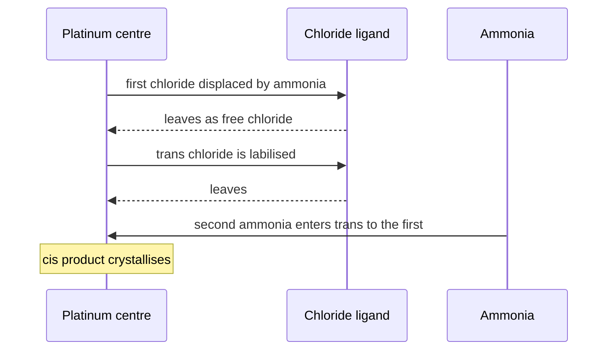
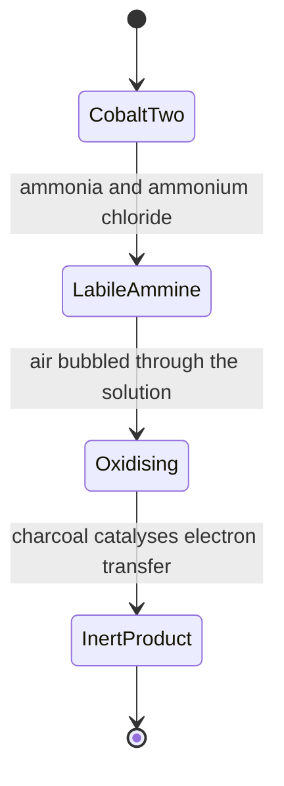

# Chapter 3 — Coordination Compounds

> **Level:** University (Level 5 — Inorganic Chemistry)
> **Estimated study time:** 8 hours (5 h reading + 3 h exercises)
> **Prerequisites:** [Transition Metals](02-transition-metals.md); [Chemical Nomenclature](../02-elementary-chemistry/07-chemical-nomenclature.md)
> **Difficulty:** ★★★★☆ (4/5)
> **Related chapters:** [Level 5 index](README.md); [Organometallic Compounds](04-organometallic-compounds.md); [Bioinorganic Chemistry](05-bioinorganic-chemistry.md)

---

## 1. Learning Objectives

After working through this chapter you will be able to:

- State Werner's primary and secondary valences and describe the conductivity evidence that established octahedral coordination.
- Classify ligands by charge, donor atom and denticity, and explain chelation in terms of entropy.
- Assign coordination numbers from 2 to 12 and predict the geometry adopted in each case.
- Identify and construct examples of geometrical, optical, linkage, ionisation, hydrate and coordination isomerism.
- Name coordination compounds in full according to IUPAC rules, and write the formula from a name.
- Define stepwise and overall stability constants and use them to compare complexes, including the chelate effect.
- Apply the 18-electron rule to coordination and organometallic complexes and recognise its systematic exceptions.
- Classify complexes as labile or inert using Taube's criterion, and explain the trans effect and its use in synthesis.
- Describe the synthesis, reactivity and applications of coordination compounds from cisplatin to gadolinium contrast agents.

---

## 2. Introduction

A solution of cobalt(II) chloride is pink. Add ammonia and it turns straw-coloured; add ammonium chloride and hydrogen peroxide and it turns deep orange-red; add hydrochloric acid to the orange solution and a purple solid separates. The sequence involves no change in the cobalt–ligand stoichiometry that a formula alone would reveal: the colour changes because the ligands around the metal change, and with them the energy gaps between the metal $d$ orbitals. Coordination chemistry is the systematic study of those changes.

The field began with Alfred Werner's work on cobalt ammines in the 1890s. Werner proposed that a metal has a **primary valence** satisfied by ions and a **secondary valence** satisfied by neutral molecules or anions bound directly to the metal, and that the secondary valence — now called the coordination number — is often six and is spatially directed. The proposal explained why $\ce{CoCl3.6NH3}$ conducts as a four-ion electrolyte while $\ce{CoCl3.4NH3}$ conducts as a two-ion electrolyte, and it predicted isomers that were subsequently found. X-ray crystallography later confirmed the octahedral geometry directly.

Coordination compounds matter far beyond the historical interest. Chlorophyll is a magnesium porphyrin complex, haemoglobin an iron porphyrin, vitamin B$_{12}$ a cobalt corrin. Cisplatin is a platinum(II) coordination compound that cures testicular cancer. EDTA is a hexadentate ligand used to titrate calcium, to preserve food and to treat lead poisoning. Gadolinium(III) complexes shorten the relaxation time of water protons and make magnetic resonance images legible. Industrial catalysts from Ziegler–Natta polymerisation to cross-coupling are coordination compounds. The vocabulary and rules of this chapter are the grammar of all of that chemistry.

The chapter assumes the electronic structure and redox behaviour of Chapter 2 and a working knowledge of VSEPR and molecular geometry. Bonding theory is developed qualitatively: crystal-field theory is presented as the model that explains colour and magnetism, with the ligand-field and molecular-orbital refinements indicated where the simple model fails.

---

## 3. Fundamental Concepts

### 3.1 Werner's theory and the evidence for octahedral coordination

Werner's model of the cobalt ammines assigns to cobalt(III) a primary valence of three, satisfied by three chloride ions, and a secondary valence of six, satisfied by six ligands bound directly to the metal. The compounds $\ce{CoCl3.nNH3}$ for $n = 3$–$6$ are then formulated as coordination complexes in which some chlorides are ligands and some are counter-ions:

| Compound | Formulation | Ions in solution | Molar conductivity |
|---|---|---|---|
| $\ce{CoCl3.6NH3}$ | $\ce{[Co(NH3)6]Cl3}$ | $4$ | highest |
| $\ce{CoCl3.5NH3}$ | $\ce{[Co(NH3)5Cl]Cl2}$ | $3$ | high |
| $\ce{CoCl3.4NH3}$ | $\ce{[Co(NH3)4Cl2]Cl}$ | $2$ | low |
| $\ce{CoCl3.3NH3}$ | $\ce{[Co(NH3)3Cl3]}$ | $0$ | zero |

The conductivity measurements of the 1890s gave exactly this pattern, and precipitation of chloride with silver nitrate confirmed the number of ionic chlorides: three, two, one and zero respectively. The model also predicted that $\ce{[Co(NH3)4Cl2]+}$ should exist as two isomers, and the *cis* and *trans* forms were isolated. Octahedral coordination was the only geometry consistent with both the ion counts and the isomer count.

Werner's primary valence is the modern **oxidation state** of the metal; his secondary valence is the modern **coordination number**. The reformulation is convenient but loses the historical point, which is that coordination number is a structural property that must be determined, not a consequence of valence rules.

### 3.2 Ligands and denticity

A **ligand** is a Lewis base that donates one or more electron pairs to the metal. Ligands are classified by charge, by donor atom and by the number of donor atoms they use.

**By charge.** Anionic ligands include $\ce{Cl-}$, $\ce{CN-}$, $\ce{OH-}$, $\ce{NO2-}$, $\ce{C2O4^2-}$ and $\ce{acac-}$; neutral ligands include $\ce{H2O}$, $\ce{NH3}$, $\ce{CO}$, $\ce{PPh3}$ and $\ce{en}$; cationic ligands are rare and include $\ce{NO+}$ and $\ce{NH2NH3+}$.

**By donor atom.** The donor is the atom that carries the lone pair: N in ammonia and amines, O in water, ethers and carboxylates, S in thiolates and thiocyanate, P in phosphines, C in carbon monoxide and cyanide, and the halides.

**By denticity.** The number of donor atoms that a single ligand uses to bind one metal is its **denticity**:

| Denticity | Name | Example | Donor set |
|---|---|---|---|
| 1 | monodentate | $\ce{NH3}$, $\ce{Cl-}$, $\ce{CN-}$ | one atom |
| 2 | bidentate | ethane-1,2-diamine ($\ce{en}$), oxalate, acetylacetonate | $\ce{N,N}$; $\ce{O,O}$ |
| 3 | tridentate | diethylenetriamine (dien), terpyridine | $\ce{N,N,N}$ |
| 4 | tetradentate | salen, porphyrin (dianionic) | $\ce{N2O2}$; $\ce{N4}$ |
| 6 | hexadentate | EDTA$^{4-}$ | $\ce{N2O4}$ |

A ligand that can bind through two different donor atoms is **ambidentate**, and the choice of donor produces **linkage isomers** (Section 3.5).

**Chelation** is the binding of a polydentate ligand to a single metal through two or more donor atoms, forming a ring. Five- and six-membered chelate rings are the most stable because their bond angles match the preferred geometry. Ethane-1,2-diamine forms a five-membered ring; acetylacetonate forms a six-membered ring. Chelation increases the stability of the complex, for reasons developed in Section 4.3.

### 3.3 Coordination numbers and geometries

Coordination numbers from 2 to 12 are known, and the geometry follows from the number and from the electronic preferences of the metal.

| CN | Geometry | Example | Notes |
|---|---|---|---|
| 2 | linear | $\ce{[Ag(NH3)2]+}$, $\ce{[Cu(CN)2]-}$ | $d^{10}$ metals, weak field |
| 3 | trigonal planar | $\ce{[HgI3]-}$ | rare |
| 4 | tetrahedral | $\ce{[CoCl4]^2-}$, $\ce{[Zn(OH)4]^2-}$ | weak-field, $d^{10}$ or halide |
| 4 | square planar | $\ce{[PtCl4]^2-}$, $\ce{[Ni(CN)4]^2-}$ | $d^8$ metals, strong field |
| 5 | trigonal bipyramidal | $\ce{[Fe(CO)5]}$, $\ce{[CuCl5]^3-}$ | fluxional in solution |
| 5 | square pyramidal | $\ce{[Ni(CN)5]^3-}$, $\ce{[VO(acac)2]}$ | common intermediate |
| 6 | octahedral | $\ce{[Co(NH3)6]^3+}$, $\ce{[Fe(CN)6]^4-}$ | the dominant geometry |
| 6 | trigonal prismatic | $\ce{[Re(S2C2Ph2)3]}$ | rare, favoured by rigid ligands |
| 7 | pentagonal bipyramidal | $\ce{[ZrF7]^3-}$, $\ce{[NbF7]^2-}$ | large metal, small ligands |
| 7 | capped octahedron | $\ce{[Mo(CN)7]^4-}$ | second common seven-coordinate form |
| 8 | square antiprismatic | $\ce{[Mo(CN)8]^4-}$, $\ce{[TaF8]^3-}$ | large metal |
| 8 | dodecahedral | $\ce{[Mo(CN)8]^3-}$ | depends on oxidation state |
| 9 | tricapped trigonal prismatic | $\ce{[ReH9]^2-}$, $\ce{[TcH9]^2-}$ | hydride ligands only |
| 12 | icosahedral or bicapped square antiprism | $\ce{[Ce(NO3)6]^3-}$ | six bidentate nitrates |

The $d^8$ configuration is the reason square planar geometry exists. A $d^8$ ion in a square-planar field fills the four low-lying orbitals and leaves the strongly antibonding $d_{x^2-y^2}$ empty, gaining a large ligand-field stabilisation; this is why platinum(II), palladium(II) and gold(III) are almost always square planar, and why nickel(II) switches between octahedral, tetrahedral and square planar according to the ligand field strength.

### 3.4 Isomerism

Isomerism in coordination compounds is either structural (the atoms are connected differently) or stereochemical (the connections are the same but the spatial arrangement differs).

**Geometrical isomerism** arises from different arrangements of ligands around the metal. In square-planar $\ce{[Pt(NH3)2Cl2]}$ the two ammonias may be adjacent (*cis*) or opposite (*trans*); the two isomers have different dipole moments, colours and biological activities, and *cis*-platin is the anticancer drug while *trans*-platin is inactive. In octahedral $\ce{[Co(NH3)4Cl2]+}$ the two chlorides may be *cis* or *trans*; in $\ce{[Co(NH3)3Cl3]}$ the three chlorides may occupy one face (*fac*) or a meridian (*mer*).

**Optical isomerism** arises when a complex is not superimposable on its mirror image. The tris(bidentate) complex $\ce{[Co(en)3]^3+}$ exists as the $\Delta$ and $\Lambda$ enantiomers, which rotate plane-polarised light in opposite directions and have identical chemical properties in achiral environments. The *cis* isomer of $\ce{[Co(en)2Cl2]+}$ is optically active; the *trans* isomer has a plane of symmetry and is not.

**Linkage isomerism** arises from ambidentate ligands. The nitrite ion can bind through nitrogen (*nitro*, $\ce{-NO2}$) or through oxygen (*nitrito*, $\ce{-ONO}$); the thiocyanate ion can bind through sulfur (*thiocyanato*) or nitrogen (*isothiocyanato*). The two forms have different colours and reactivities, and the interconversion is a classic photochemical experiment.

**Ionisation isomerism** arises when the counter-ion can itself be a ligand: $\ce{[Co(NH3)5Br]SO4}$ (violet) and $\ce{[Co(NH3)5SO4]Br}$ (red) are distinct compounds that give different ions in solution.

**Hydrate isomerism** is the special case of ionisation isomerism with water as the ligand: $\ce{[Cr(H2O)6]Cl3}$ (violet), $\ce{[Cr(H2O)5Cl]Cl2.H2O}$ (pale green) and $\ce{[Cr(H2O)4Cl2]Cl.2H2O}$ (dark green) differ in which water molecules are coordinated.

**Coordination isomerism** arises when both cation and anion are complexes and the ligands can be distributed differently: $\ce{[Co(NH3)6][Cr(CN)6]}$ and $\ce{[Cr(NH3)6][Co(CN)6]}$ are constitutional isomers.

### 3.5 Bonding: crystal-field theory

**Crystal-field theory** treats the ligands as point negative charges and asks how their electrostatic field splits the five degenerate $d$ orbitals. In an octahedral field the two orbitals pointing along the axes ($d_{z^2}$ and $d_{x^2-y^2}$) point directly at the ligands and are raised in energy; the three orbitals pointing between the axes ($d_{xy}$, $d_{xz}$, $d_{yz}$) are lowered. The separation is $\Delta_o$ (also written $10Dq$), and the barycentre of the five orbitals is unchanged, so the upper $e_g$ set lies $+0.6\Delta_o$ above it and the lower $t_{2g}$ set $-0.4\Delta_o$ below.

Two quantities compete. The **spin-pairing energy** $P$ is the energy cost of placing two electrons in the same orbital. If $\Delta_o < P$ the electrons spread out singly, giving a **high-spin** complex; if $\Delta_o > P$ they pair in the lower set, giving a **low-spin** complex. The magnitude of $\Delta_o$ depends on the metal, its oxidation state and the ligand, and the empirical ordering of ligands by the size of the splitting they produce is the **spectrochemical series**:

$$ \ce{I-} < \ce{Br-} < \ce{S^2-} < \ce{SCN-} < \ce{Cl-} < \ce{NO3-} < \ce{F-} < \ce{OH-} < \ce{H2O} < \ce{NCS-} < \ce{NH3} < \ce{en} < \ce{bpy} < \ce{phen} < \ce{NO2-} < \ce{CN-} < \ce{CO} $$

The series cannot be explained by electrostatics alone: $\ce{I-}$ is more polarisable and would be expected to split more strongly than $\ce{F-}$ on a purely ionic model, yet it splits less. The explanation requires covalent metal–ligand overlap, which is the content of **ligand-field theory**. The order is nevertheless reliable, and it is the working tool for predicting spin states.

Crystal-field theory also accounts for the **Jahn–Teller effect**: a complex with a degenerate electronic ground state distorts to remove the degeneracy. The effect is strong for $d^9$ octahedral copper(II), which elongates along one axis, and for high-spin $d^4$ chromium(II) and manganese(III).

### 3.6 Stability constants and the chelate effect

Complex formation in solution is an equilibrium. For a metal $\ce{M}$ and a monodentate ligand $\ce{L}$,

$$ \ce{M + L <=> ML} \qquad K_1 = \frac{[\ce{ML}]}{[\ce{M}][\ce{L}]} $$

and the successive constants $K_1, K_2, \ldots, K_n$ describe the stepwise addition of each ligand. The **overall formation constant** is the product:

$$ \beta_n = K_1K_2\cdots K_n $$

Because the constants are products of concentrations, $\beta_n$ is dimensionless when standard states are specified, and values are conventionally quoted as $\log \beta_n$. A larger $\log \beta$ means a more stable complex. The corresponding standard Gibbs energy is

$$ \Delta G^\circ = -RT\ln\beta_n $$

The **chelate effect** is the observation that a polydentate ligand binds more strongly than the corresponding number of monodentate ligands, even when the donor atoms are chemically identical. The classic comparison is $\ce{[Ni(en)3]^2+}$ ($\log\beta_3 \approx 18.3$) against $\ce{[Ni(NH3)6]^2+}$ ($\log\beta_6 \approx 8.6$). The difference is almost entirely entropic. Replacing six bound water molecules by three ethylenediamine molecules increases the number of independent particles in solution:

$$ \ce{[Ni(H2O)6]^2+(aq) + 3en(aq) <=> [Ni(en)3]^2+(aq) + 6H2O(l)} $$

Three ligands in, six out: the translational entropy of the system rises, and $-T\Delta S$ contributes several tens of kilojoules per mole to the favourable Gibbs energy. The enthalpy change is usually small and sometimes unfavourable.

### 3.7 The 18-electron rule

The **18-electron rule** states that a transition-metal complex is most stable when the metal has 18 valence electrons, corresponding to a filled $ns^2(n-1)d^{10}np^6$ shell. The rule works best for carbonyls, metallocenes and low-valent complexes of the first row, and it fails systematically for $d^8$ square-planar complexes (16 electrons) and for early transition metals in high oxidation states.

Electron counting uses the ionic or the covalent convention. In the **ionic convention**, the ligand is removed with its bonding pair if it is anionic, and the metal oxidation state is calculated; in the **covalent convention**, each ligand contributes the number of electrons it donates neutrally. Both give the same total, and the working rule for common ligands is:

| Ligand | Electrons donated | Ligand | Electrons donated |
|---|---|---|---|
| $\ce{CO}$ | 2 | $\ce{CN-}$ | 2 |
| $\ce{NH3}$ | 2 | $\ce{H-}$ | 2 |
| $\ce{Cl-}$ | 2 | $\ce{PR3}$ | 2 |
| $\eta^2$-alkene | 2 | $\eta^3$-allyl | 3 or 4 |
| $\eta^5$-cyclopentadienyl | 6 | $\eta^6$-benzene | 6 |
| $\eta^4$-diene | 4 | bridging $\ce{CO}$ ($\mu_2$) | 1 per metal |

A worked count for $\ce{[Fe(CO)5]}$: iron is in group 8, so the neutral atom contributes 8 electrons, and five carbonyls donate $10$, giving 18. For $\ce{[Ni(CN)4]^2-}$: nickel(0) contributes 10, four cyanides donate 8, and the complex has a charge of $-2$ that is carried by the ligands, so the metal count stays at 10 and the total is 18. For $\ce{[PtCl4]^2-}$: platinum(II) is $d^8$, 8 electrons, plus four chlorides at 2 each gives 16 — a stable 16-electron square-planar complex, not an exception but a different structural class.

### 3.8 Lability and inertness

Kinetic stability is not thermodynamic stability. A complex may be thermodynamically very stable and yet exchange its ligands within milliseconds, or moderately stable and exchange them over days. Taube introduced the classification: a complex is **labile** if ligand substitution is complete within about one minute at $25\ ^\circ\mathrm{C}$, and **inert** otherwise. The distinction is kinetic, and it has nothing to do with $\beta$.

The pattern follows the electronic configuration. $d^0$, $d^1$, $d^2$ and high-spin $d^5$ and $d^{10}$ ions are labile; $d^3$ (chromium(III)) and low-spin $d^6$ (cobalt(III)) are inert; $d^8$ square-planar platinum(II) is inert because substitution requires an associative step that is blocked by the filled coordination sphere. Water exchange rate constants span more than fifteen orders of magnitude, from about $10^9\ \text{s}^{-1}$ for copper(II) to $10^{-6}\ \text{s}^{-1}$ for chromium(III).

The practical consequence is that cobalt(III) and chromium(III) complexes can be isolated as distinct isomers and handled as ordinary compounds, whereas nickel(II) and copper(II) complexes equilibrate so rapidly that only the thermodynamic product is observed.

### 3.9 The trans effect

The **trans effect** is the kinetic effect of a ligand on the rate of substitution of the ligand *trans* to it. Ligands high in the trans-effect series labilise the position opposite them:

$$ \ce{CO} \approx \ce{CN-} \approx \ce{C2H4} > \ce{PR3} \approx \ce{H-} > \ce{CH3-} > \ce{NO2-} > \ce{I-} > \ce{SCN-} > \ce{Br-} > \ce{Cl-} > \ce{py} \approx \ce{NH3} > \ce{OH-} > \ce{H2O} $$

The effect is used synthetically. In $\ce{[PtCl4]^2-}$, ammonia substitutes one chloride; the chloride *trans* to the new ammine is labilised, so the second ammonia enters opposite the first, giving *cis*-diamminedichloridoplatinum(II). If the starting material is $\ce{[Pt(NH3)4]^2+}$ and chloride is the entering ligand, the product is *trans*-dichloridodiammineplatinum(II), because chloride has the higher trans effect and directs the second chloride opposite the first.

Two mechanisms contribute. The **polarisation** mechanism invokes the inductive effect of a strongly polarisable ligand, which weakens the bond opposite it. The **π-bonding** mechanism, which dominates for carbon monoxide, alkenes and phosphines, invokes competition for the metal $d$ electrons: a π-acceptor withdraws electron density from the metal and stabilises the five-coordinate transition state in which the *trans* ligand leaves.

---
CHEM_CHUNK_EOF
## 4. Detailed Scientific Explanation

### 4.1 IUPAC nomenclature of coordination compounds

The current rules are those of the 2005 IUPAC Red Book. They are mechanical, and once learned they generate an unambiguous name for any complex. The rules, in the order in which they are applied:

1. **Cation first, anion second**, as in any ionic compound. $\ce{[Co(NH3)6]Cl3}$ is named as a cation followed by an anion.
2. **Ligands before the metal**, in alphabetical order of the ligand name. The multiplicative prefixes *di-*, *tri-*, *tetra-* are ignored for alphabetisation; *bis-*, *tris-*, *tetrakis-* are used, with the ligand name in parentheses, when the ligand name already contains a numerical prefix (as in 2,2'-bipyridine) or is itself a complex name.
3. **Anionic ligands end in -o**: chlorido, bromido, cyanido, hydroxido, oxido, nitrato, sulfato, oxalato, acetato. **Neutral ligands keep their name**, with four traditional exceptions: water is **aqua**, ammonia is **ammine**, carbon monoxide is **carbonyl**, and nitric oxide is **nitrosyl**.
4. **The metal carries its oxidation state as a Roman numeral in parentheses**, immediately after the metal name and without a space: cobalt(III), iron(II), platinum(0).
5. **An anionic complex ends in -ate**: ferrate, cuprate, argentate, aurate, cobaltate, nickelate, platininate, stannate, plumbate, manganate, chromate, tungstate. The Latin stem is used for the traditional elements: iron → ferrate, copper → cuprate, silver → argentate, gold → aurate, tin → stannate, lead → plumbate.
6. **Multiplicative prefixes** indicate the number of each ligand: di, tri, tetra, penta, hexa, hepta, octa. For polydentate ligands the denticity may be indicated with $\kappa^n$, as in $\kappa^2$-$\ce{N,O}$ for a bidentate glycinate.
7. **Hapticity** for π-bound ligands is indicated by $\eta^n$, where $n$ is the number of contiguous atoms bound to the metal.
8. **Structural prefixes** such as *cis-*, *trans-*, *fac-* and *mer-* are italicised and placed at the front of the name; they are separated from the rest by a hyphen.

The eight worked names below cover the rules that appear in practice.

| Formula | IUPAC name | Rules exercised |
|---|---|---|
| $\ce{[Co(NH3)6]Cl3}$ | hexaamminecobalt(III) chloride | 1, 3, 4, 6 |
| $\ce{K3[Fe(CN)6]}$ | potassium hexacyanidoferrate(III) | 1, 3, 5, 6 |
| $\ce{[Co(en)3]2(SO4)3}$ | tris(ethane-1,2-diamine)cobalt(III) sulfate | 2, 4, 6 |
| *cis*-$\ce{[Pt(NH3)2Cl2]}$ | *cis*-diamminedichloridoplatinum(II) | 2, 3, 4, 8 |
| $\ce{[Cu(NH3)4(H2O)2]SO4}$ | tetraammineaquadicopper(II) sulfate | 2, 3, 4, 6 |
| $\ce{Na2[Fe(CN)5(NO)]}$ | sodium pentacyanidonitrosylferrate(II) | 1, 3, 4, 5 |
| $\ce{[Ru(bpy)3]Cl2}$ | tris(2,2'-bipyridine)ruthenium(II) chloride | 2, 4, 6 |
| $\ce{[Cr(CO)6]}$ | hexacarbonylchromium(0) | 3, 4, 6 |

Two entries need comment. In $\ce{[Cu(NH3)4(H2O)2]SO4}$ the alphabetical order places *ammine* before *aqua*, so the name is tetraammineaqua- and not aquatetraammine-. In $\ce{Na2[Fe(CN)5(NO)]}$ the nitrosyl ligand is treated as $\ce{NO+}$, which leaves iron in the $+2$ state; assigning iron(III) would require a nitrosyl anion that does not exist, and the oxidation state in the name must be consistent with a chemically sensible ligand description.

### 4.2 Beyond crystal-field theory

Crystal-field theory treats the ligand as a point charge, and it fails in three places: it cannot explain the order of the spectrochemical series, it predicts that all complexes of a given metal and geometry should have the same $\Delta_o$ regardless of covalency, and it says nothing about the intensity of the absorptions.

**Ligand-field theory** repairs the first two failures by allowing the ligand orbitals to overlap with the metal $d$ orbitals. The $e_g$ orbitals, which point at the ligands, form $\sigma$ bonds and are raised in energy; the $t_{2g}$ orbitals, which point between the ligands, can form $\pi$ bonds if the ligand has suitable orbitals. A ligand with filled $\pi$ orbitals that can donate into the metal (a $\pi$ donor, such as $\ce{Cl-}$ or $\ce{OH-}$) raises the $t_{2g}$ level and therefore decreases $\Delta_o$; a ligand with empty $\pi^*$ orbitals that can accept electron density from the metal (a $\pi$ acceptor, such as $\ce{CO}$, $\ce{CN-}$ or phosphines) lowers the $t_{2g}$ level and increases $\Delta_o$. The spectrochemical series is then a ranking of π-acceptor ability superimposed on a ranking of σ-donor strength. This is why $\ce{CO}$ and $\ce{CN-}$ produce the largest splittings and why they stabilise low-spin configurations.

The **nephelauxetic effect** — the reduction of the interelectronic repulsion in a complex relative to the free ion — is direct evidence for covalency. The effect is smallest for fluoride and largest for iodide and sulfur donors, in the order $\ce{F-} < \ce{H2O} < \ce{NH3} < \ce{Cl-} < \ce{CN-} < \ce{Br-} < \ce{I-} < \ce{S^2-}$, which is the order of increasing delocalisation of the metal electrons onto the ligands.

**Molecular-orbital theory** gives the complete picture: the metal $d$, $s$ and $p$ orbitals combine with symmetry-adapted ligand orbitals to give bonding, non-bonding and antibonding molecular orbitals. The $t_{2g}$ set is non-bonding in a $\sigma$-only complex and becomes bonding when $\pi$ donation is possible; the $e_g$ set is antibonding. $\Delta_o$ is then the gap between the non-bonding or weakly bonding $t_{2g}$ set and the antibonding $e_g$ set. The qualitative predictions — spin state, colour, magnetic moment — are the same as those of crystal-field theory, but the magnitudes and the spectrochemical series follow from the orbital overlap.

### 4.3 Complex formation in solution

Formation constants are measured by potentiometry, spectrophotometry or calorimetry, and they are conditional quantities: a value of $\log\beta$ applies at a stated ionic strength and temperature, and for ligands that are bases it applies only at a stated pH.

The pH dependence is important in practice. EDTA binds metals as the fully deprotonated $\ce{Y^4-}$ ion, but at pH 7 only a small fraction of EDTA is in that form. The **conditional formation constant** is

$$ \beta' = \alpha_{\ce{Y^4-}}\beta $$

where $\alpha_{\ce{Y^4-}}$ is the fraction of the ligand present as $\ce{Y^4-}$ at the working pH. At pH 10 the fraction is close to unity and the tabulated constants apply; at pH 4 it may be $10^{-6}$ or smaller, and a metal that is strongly complexed at pH 10 may not be complexed at all at pH 4. This is why EDTA titrations of calcium and magnesium are buffered at pH 10 and why the same reagent can be used to mask one metal while titrating another.

Selectivity between metals follows the Irving–Williams series for the first row and, more generally, the **hard and soft acids and bases** principle: hard metals such as $\ce{Mg^2+}$, $\ce{Ca^2+}$ and $\ce{Fe^3+}$ prefer hard donors (O, F), and soft metals such as $\ce{Hg^2+}$, $\ce{Cd^2+}$, $\ce{Pb^2+}$ and $\ce{Cu+}$ prefer soft donors (S, I). The preference is the basis of chelation therapy: dimercaprol presents two thiol groups to a soft heavy-metal ion, while EDTA presents carboxylate oxygens to hard ions.

### 4.4 Substitution mechanisms

Ligand substitution at an octahedral metal centre can proceed by a **dissociative** (D) mechanism, in which the leaving ligand departs first to give a five-coordinate intermediate; by an **associative** (A) mechanism, in which the entering ligand attacks first to give a seven-coordinate intermediate; or by an **interchange** (I) mechanism, in which the entering and leaving ligands exchange in a single concerted step. The labels $I_d$ and $I_a$ denote interchange with dissociative or associative character.

The rate law distinguishes the extremes. A purely dissociative mechanism gives a rate independent of the entering ligand concentration; a purely associative mechanism gives a rate proportional to it. Most octahedral substitutions are interchange, with the rate only weakly dependent on the entering ligand because bond breaking dominates.

**Acid and base hydrolysis** are important special cases. Acid hydrolysis of an ammine complex proceeds by protonation of the coordinated ammonia, which converts it into a better leaving group:

$$ \ce{[Co(NH3)5Cl]^2+(aq) + H+(aq) <=> [Co(NH3)4(NH3H)Cl]^3+(aq) -> [Co(NH3)4(H2O)Cl]^2+(aq) + NH4+(aq)} $$

Base hydrolysis of a cobalt(III) ammine is much faster than acid hydrolysis and follows a rate law second order overall, first order in complex and first order in hydroxide. The accepted mechanism is conjugate-base formation: hydroxide deprotonates a coordinated ammine, and the resulting amide labilises the *trans* position and departs in an $S_N1$CB process.

**Isomerisation** is a substitution that reverses. *cis*-$\ce{[Pt(NH3)2Cl2]}$ converts slowly to the *trans* isomer in solution, and the interconversion is catalysed by chloride because a substitution step is required to invert the geometry. The biological consequence is direct: *cis*-platin is an anticancer drug and *trans*-platin is not, so any formulation that allows isomerisation loses activity.

### 4.5 Synthesis of coordination compounds

Four routes cover most laboratory preparations.

**Direct combination** in solution: the metal salt and the ligand are mixed and the product crystallises. This works when the product is thermodynamically favoured and sparingly soluble:

$$ \ce{CuSO4(aq) + 4NH3(aq) -> [Cu(NH3)4]^2+(aq) + SO4^2-(aq)} $$

**Ligand substitution** with a labile starting material: $\ce{[Ni(H2O)6]^2+}$ reacts with cyanide to give $\ce{[Ni(CN)4]^2-}$ because nickel(II) is labile and the product is favoured.

**Oxidation-state adjustment**: many inert complexes are made from a labile lower oxidation state that is oxidised in situ. The classical preparation of hexaamminecobalt(III) chloride starts from cobalt(II) chloride, ammonia and ammonium chloride, and passes air through the solution with charcoal as a catalyst:

$$ \ce{4[Co(H2O)6]^2+(aq) + 4NH4+(aq) + 20NH3(aq) + O2(g) -> 4[Co(NH3)6]^3+(aq) + 26H2O(l)} $$

The cobalt(II) intermediate is labile and equilibrates rapidly; oxidation to cobalt(III) then locks the ligand arrangement in place because cobalt(III) is inert. The charcoal catalyses the electron transfer and provides nucleation sites. The same strategy is used for chromium(III) complexes, which are made from labile chromium(II) and then oxidised.

**Template synthesis**: the metal ion holds the reactants in the geometry needed for ring closure. Schiff-base macrocycles are made by condensing a diamine with a dialdehyde in the presence of a metal ion that coordinates both ends; the metal acts as a template, and the macrocycle is obtained in high yield under conditions where the metal-free reaction gives polymers.

### 4.6 Structure and function: the case of cisplatin

Cisplatin, *cis*-$\ce{[Pt(NH3)2Cl2]}$, is a square-planar platinum(II) complex. In blood, the chloride concentration is about $0.1\ \text{mol L}^{-1}$ and the complex survives; inside a cell the chloride concentration is about $0.004\ \text{mol L}^{-1}$, and the low-chloride environment promotes aquation:

$$ \ce{cis-[Pt(NH3)2Cl2] + H2O -> cis-[Pt(NH3)2Cl(H2O)]+ + Cl-} $$

The aquated species binds to the N7 atom of guanine in DNA, and the second chloride is lost to allow a second guanine to bind, forming an intrastrand cross-link that bends and unwinds the helix. The distortion is recognised by damage-response proteins, and the cell cycle arrests or the cell dies by apoptosis. The *trans* isomer cannot form the same cross-link because its two leaving groups are opposite one another and the geometry of the adduct is different; it is also more reactive and is deactivated by serum proteins before it reaches DNA.

The lesson generalises: in coordination chemistry, the spatial arrangement of ligands — not only their identity — determines biological and catalytic function. That is why isomer counting and nomenclature are practical skills rather than formal exercises.

---

## 5. Visual Diagrams

**Figure 3.1 — A decision tree for the isomerism of coordination compounds.** The first branch separates compounds that differ in which atoms are bonded to which — structural isomerism — from compounds that differ only in the spatial arrangement of the same bonds. Every isomerism question should start at the top of the tree, because the diagnostic evidence differs: ionisation and hydrate isomers give different ions in solution, linkage isomers differ in the donor atom and therefore in colour and infrared spectrum, and optical isomers are distinguished only by their interaction with polarised light or with a chiral resolving agent.

**Figure 3.2 — Why the trans effect gives the cis isomer.** The sequence shows the two substitution steps in the synthesis of cisplatin from tetrachloridoplatinate(II). After the first ammonia binds, the chloride opposite it is the more labile position because chloride has the higher trans effect; the second ammonia therefore enters opposite the first ammonia rather than opposite the first chloride, and the product is the *cis* isomer. Reverse the order — start from tetrammineplatinum(II) and add chloride — and the *trans* isomer is obtained, which is the practical demonstration that the trans effect is a synthetic tool rather than a curiosity.

**Figure 3.3 — The oxidation-state strategy for making an inert cobalt(III) complex.** The diagram makes the kinetic logic explicit. Cobalt(II) is labile, so the ammine complex equilibrates rapidly and the ligand positions are not fixed. Oxidation to cobalt(III) produces the inert $d^6$ configuration, which freezes that arrangement; the product can then be isolated without the ligands rearranging. Every synthesis of an inert complex from a labile metal exploits this sequence, and the alternative — substituting ligands directly on an inert centre — is slow by definition.

---

## 6. Mathematical Formulas

Stepwise formation constants multiply to give the overall constant:

$$ K_n = \frac{[\ce{ML}_n]}{[\ce{ML}_{n-1}][\ce{L}]}, \qquad \beta_n = \prod_{i=1}^{n} K_i = \frac{[\ce{ML}_n]}{[\ce{M}][\ce{L}]^n} $$

| Symbol | Meaning | SI unit |
|---|---|---|
| $K_n$ | Stepwise formation constant | $\text{dm}^3\ \text{mol}^{-1}$ |
| $\beta_n$ | Overall formation constant | $(\text{dm}^3\ \text{mol}^{-1})^n$ |
| $[\ce{M}]$ | Free metal concentration | $\text{mol dm}^{-3}$ |
| $[\ce{L}]$ | Free ligand concentration | $\text{mol dm}^{-3}$ |
| $n$ | Number of ligands bound | $1$ |

Because $\beta_n$ carries units raised to the power $n$, numerical comparisons are made on the dimensionless $\log\beta$ at a stated ionic strength. The standard Gibbs energy of formation is

$$ \Delta G^\circ = -RT\ln\beta_n $$

with $R = 8.314\ \text{J K}^{-1}\ \text{mol}^{-1}$ and $T$ in kelvin; a tenfold increase in $\beta$ lowers $\Delta G^\circ$ by $5.7\ \text{kJ mol}^{-1}$ at $298\ \text{K}$.

The conditional constant corrects for the fraction of ligand in the binding form:

$$ \beta' = \alpha_{\ce{L}}\beta_n, \qquad \alpha_{\ce{L}} = \frac{[\ce{L}^{n-}]}{c_{\ce{L}}} $$

where $c_{\ce{L}}$ is the total analytical concentration of the ligand. The factor $\alpha_{\ce{L}}$ is calculated from the acid dissociation constants of the ligand and the pH.

The ligand-field stabilisation energy of an octahedral complex is

$$ \text{LFSE} = \left(-0.4\,n_{t_{2g}} + 0.6\,n_{e_g}\right)\Delta_o $$

per mole of complex, and the corresponding crystal-field activation energy for the first absorption band is $\Delta_o = hc\tilde{\nu}$.

Taube's lability criterion uses the half-life of substitution:

$$ t_{1/2} = \frac{\ln 2}{k_{\text{obs}}} $$

with $k_{\text{obs}}$ in $\text{s}^{-1}$. A complex with $t_{1/2} < 60\ \text{s}$ at $25\ ^\circ\mathrm{C}$ is labile; a longer half-life makes it inert. The boundary is a convention, not a discontinuity in mechanism.

---

## 7. Chemical Equations

**Formation of the tetraamminecopper(II) ion.** The deep blue colour is the usual test for copper(II) in qualitative analysis.

$$ \ce{[Cu(H2O)6]^2+(aq) + 4NH3(aq) <=> [Cu(NH3)4(H2O)2]^2+(aq) + 4H2O(l)} \qquad \log\beta_4 = 13.3 $$

**Formation of the diamminesilver(I) ion.** The same equilibrium dissolves silver chloride, which is the basis of a qualitative separation.

$$ \ce{AgCl(s) + 2NH3(aq) -> [Ag(NH3)2]+(aq) + Cl-(aq)} $$

**Formation of hexacyanidoferrate(II).** Cyanide is a strong-field ligand and the product is low spin and diamagnetic.

$$ \ce{Fe^2+(aq) + 6CN-(aq) -> [Fe(CN)6]^4-(aq)} \qquad \log\beta_6 = 35 $$

**Oxidative synthesis of hexaamminecobalt(III).**

$$ \ce{4[Co(H2O)6]^2+(aq) + 4NH4+(aq) + 20NH3(aq) + O2(g) -> 4[Co(NH3)6]^3+(aq) + 26H2O(l)} $$

**Aquation of cisplatin and binding to guanine.** The N7 nitrogen of guanine is the donor; the cross-link forms after the second chloride is replaced.

$$ \ce{cis-[Pt(NH3)2Cl2] (aq) + H2O(l) -> cis-[Pt(NH3)2Cl(H2O)]+ (aq) + Cl-(aq)} $$

**EDTA complexation of calcium.** EDTA is hexadentate and wraps the metal with two nitrogen and four carboxylate oxygen donors.

$$ \ce{[Ca(H2O)6]^2+(aq) + Y^4-(aq) -> [CaY]^2-(aq) + 6H2O(l)} $$

**Formation of Prussian blue.** The intense colour arises from intervalence charge transfer between iron(II) and iron(III) centres.

$$ \ce{4Fe^3+(aq) + 3[Fe(CN)6]^4-(aq) -> Fe4[Fe(CN)6]3(s)} $$

**Cyanide binding by hydroxocobalamin.** The cobalt(III) centre exchanges its coordinated water for cyanide, giving cyanocobalamin.

$$ \ce{[Co(OH2)(corrin)]+ + CN- -> [Co(CN)(corrin)]} $$

---

## 8. Worked Examples

### Worked Example 8.1 — Naming and writing formulae

**Problem.** Name (a) $\ce{[Co(NH3)4Cl2]Cl}$ and (b) $\ce{K2[PtCl6]}$, and write the formulae of (c) potassium tris(oxalato)ferrate(III) and (d) tetraammineplatinum(II) tetrachloridoplatinate(II).

**Strategy.** Apply the rules of Section 4.1 in order: identify the coordination entity, alphabetise the ligands, assign the oxidation state from the overall charge, and use *-ate* for an anionic complex.

**Solution.** (a) The complex cation contains four ammines and two chlorides, with a charge of $+1$; cobalt is therefore $+3$. Alphabetically, ammine precedes chlorido: **tetraamminedichloridocobalt(III) chloride**. (b) Six chlorides and a charge of $-2$ give platinum $+4$; the complex is anionic, so platinum becomes platinate: **potassium hexachloridoplatinate(IV)**. (c) Three bidentate oxalates give $\ce{[Fe(C2O4)3]^3-}$ and the potassium salt is $\ce{K3[Fe(C2O4)3]}$. (d) The cation is $\ce{[Pt(NH3)4]^2+}$ and the anion is $\ce{[PtCl4]^2-}$, so the compound is $\ce{[Pt(NH3)4][PtCl4]}$.

**Check.** In (a) the charge balance is $+3 - 2 - 1 = 0$ with one outer chloride, consistent with the formula. In (b) $2(+1) + (-2) = 0$, so the anion carries $-2$ and platinum is $+4$. In (d) the two complex ions have equal and opposite charges, which is why no additional counter-ion appears.

### Worked Example 8.2 — Counting isomers

**Problem.** How many isomers exist for (a) $\ce{[Co(NH3)4Cl2]+}$ and (b) $\ce{[Co(en)2Cl2]+}$, and which of them are optically active?

**Strategy.** Fix one ligand and place the others; check for a plane of symmetry in each arrangement.

**Solution.** (a) The two chlorides may be *cis* or *trans*: two geometrical isomers. The *trans* isomer has a plane of symmetry through the four ammines and is achiral; the *cis* isomer also has a mirror plane (the plane containing the two chlorides and the metal) and is achiral. Total: **two isomers, neither optically active**.

(b) Again *cis* and *trans*. The *trans* isomer has a plane of symmetry and is achiral. The *cis* isomer has no plane and no centre of symmetry, and exists as a pair of enantiomers. Total: **three isomers**, of which two are optically active.

**Check.** The count for (a) agrees with the classical Werner result, and the count for (b) is the standard textbook result for a bis(bidentate) complex with two identical monodentate ligands. A useful check is to look for a $C_2$ axis: the *cis* isomer has one, the *trans* isomer has one too, but only the *cis* isomer lacks an $S_n$ axis.

### Worked Example 8.3 — Stability constants and the chelate effect

**Problem.** For copper(II) with ammonia, $\log K_1 = 4.31$, $\log K_2 = 3.67$, $\log K_3 = 3.04$ and $\log K_4 = 2.30$. Calculate $\beta_4$ and $\Delta G^\circ$ for formation of $\ce{[Cu(NH3)4]^2+}$. Then compare $\ce{[Ni(en)3]^2+}$ ($\log\beta_3 = 18.3$) with $\ce{[Ni(NH3)6]^2+}$ ($\log\beta_6 = 8.6$) and comment.

**Strategy.** Add the logarithms of the stepwise constants to obtain $\log\beta_4$, then use $\Delta G^\circ = -RT\ln\beta$. For the comparison, convert the difference in $\log\beta$ to a difference in Gibbs energy.

**Solution.** The overall constant is

$$ \log\beta_4 = 4.31 + 3.67 + 3.04 + 2.30 = 13.32 $$

so $\beta_4 = 2.1 \times 10^{13}$. The Gibbs energy is

$$ \Delta G^\circ = -RT\ln\beta_4 = -(8.314)(298)(2.303)(13.32)\ \text{J mol}^{-1} = -76.0\ \text{kJ mol}^{-1} $$

For the nickel complexes,

$$ \Delta\Delta G^\circ = -RT(18.3 - 8.6)\ln 10 = -(5.708)(9.7)\ \text{kJ mol}^{-1} = -55.4\ \text{kJ mol}^{-1} $$

The ethylenediamine complex is about $55\ \text{kJ mol}^{-1}$ more stable than the ammonia complex at the same number of donor atoms.

**Check.** The stepwise constants decrease monotonically, as they must: each successive ligand binds to a more crowded, less positively charged centre. The sum reproduces the tabulated $\log\beta_4$ of about $13.3$ for tetraamminecopper(II). The chelate advantage of $55\ \text{kJ mol}^{-1}$ is of the magnitude expected from the entropy term, which is the dominant contribution for a neutral bidentate ligand displacing water.

### Worked Example 8.4 — Electron counting

**Problem.** Count the valence electrons in $\ce{[Fe(CN)6]^4-}$, $\ce{[Ni(CO)4]}$, $\ce{[Co(NH3)6]^3+}$, $\ce{[Cr(CO)6]}$, $\ce{[PtCl4]^2-}$ and $\ce{[Cu(NH3)4]^2+}$ and comment on which obey the 18-electron rule.

**Strategy.** Use the ionic convention: assign the oxidation state, take the $d^n$ count of the metal, and add two electrons for each two-electron donor ligand.

**Solution.** (1) $\ce{[Fe(CN)6]^4-}$: iron(II) is $d^6$, 6 electrons, plus $6 \times 2 = 12$, total 18. (2) $\ce{[Ni(CO)4]}$: nickel(0) is $d^{10}$, 10 electrons, plus 8, total 18. (3) $\ce{[Co(NH3)6]^3+}$: cobalt(III) is $d^6$, 6 electrons, plus 12, total 18. (4) $\ce{[Cr(CO)6]}$: chromium(0) is $d^6$, 6 electrons, plus 12, total 18. (5) $\ce{[PtCl4]^2-}$: platinum(II) is $d^8$, 8 electrons, plus 8, total 16. (6) $\ce{[Cu(NH3)4]^2+}$: copper(II) is $d^9$, 9 electrons, plus 8, total 17.

**Check.** Four of the six are 18-electron complexes, as expected for octahedral and tetrahedral geometries. The platinum complex is a stable 16-electron square-planar $d^8$ species, a systematic class rather than an error. The copper complex is a 17-electron odd-electron species, which is why copper(II) is substitution-labile and readily reduced: the odd electron occupies an antibonding orbital.

### Worked Example 8.5 — Ligand-field stabilisation and spin state

**Problem.** $\ce{[CoF6]^3-}$ has $\mu_{\text{eff}} = 5.3\ \mu_{\text{B}}$ and $\ce{[Co(NH3)6]^3+}$ has $\mu_{\text{eff}} = 0$. Identify the spin states and calculate the difference in ligand-field stabilisation energy, taking $\Delta_o(\ce{NH3}) = 22\,900\ \text{cm}^{-1}$.

**Strategy.** The moment gives $n$, and $n$ gives the occupancy of the $t_{2g}$ and $e_g$ sets. Then apply $\text{LFSE} = (-0.4n_{t_{2g}} + 0.6n_{e_g})\Delta_o$.

**Solution.** For cobalt(III), $d^6$. A moment of $5.3\ \mu_{\text{B}}$ corresponds to $n = 4$ (spin-only $4.90$): high spin, $t_{2g}^4e_g^2$. A moment of zero corresponds to $n = 0$: low spin, $t_{2g}^6e_g^0$.

$$ \text{LFSE}_{\text{high}} = \left(-0.4(4) + 0.6(2)\right)\Delta_o = -0.4\Delta_o $$

$$ \text{LFSE}_{\text{low}} = \left(-0.4(6)\right)\Delta_o = -2.4\Delta_o $$

The difference is $2.0\Delta_o = 45\,800\ \text{cm}^{-1}$, or about $548\ \text{kJ mol}^{-1}$.

**Check.** The high-spin assignment is consistent with fluoride's position at the weak-field end of the spectrochemical series, and the low-spin assignment with ammonia's position in the middle. The raw $2.0\Delta_o$ advantage of the low-spin form is partly cancelled by the extra pairing energy: two additional electron pairs at roughly $21\,000\ \text{cm}^{-1}$ each leave a net stabilisation of about $3\,800\ \text{cm}^{-1}$, which is why cobalt(III) ammines are stable but not thermodynamically extravagant.

### Worked Example 8.6 — Conditional formation constants

**Problem.** For $\ce{CaY^2-}$, $\log\beta = 10.7$. The fraction of EDTA present as $\ce{Y^4-}$ is $0.35$ at pH 10 and $3.6 \times 10^{-9}$ at pH 4. Calculate the conditional constant at each pH and decide whether a titration is feasible.

**Strategy.** Multiply the absolute constant by the fraction of ligand in the binding form, then compare the result with the concentration regime of a typical titration.

**Solution.** At pH 10:

$$ \beta' = 0.35 \times 10^{10.7} = 1.8 \times 10^{10}, \qquad \log\beta' = 10.3 $$

At pH 4:

$$ \beta' = 3.6 \times 10^{-9} \times 10^{10.7} = 1.8 \times 10^{2}, \qquad \log\beta' = 2.3 $$

**Check.** A titration requires a conditional constant of roughly $10^8$ or greater for a sharp end-point at $0.01\ \text{mol L}^{-1}$. The pH 10 value exceeds this comfortably, whereas the pH 4 value would give an end-point indistinguishable from the background. This is why all EDTA titrations of calcium and magnesium are buffered at pH 10 with an ammonia–ammonium chloride buffer.

---

## 9. Real-World Applications

**Cancer chemotherapy.** Cisplatin, carboplatin and oxaliplatin are platinum(II) coordination compounds. About half of all cytotoxic chemotherapy regimens include a platinum drug, and the difference between the active *cis* isomer and the inactive *trans* isomer is one of the clearest examples of geometry determining biological function.

**Chelation therapy and analysis.** EDTA is the standard titrant for calcium and magnesium in water hardness, the preservative that sequesters trace metals in food and cosmetics, and the chelating agent for lead and cadmium poisoning. Dimercaprol, DMSA and penicillamine are softer chelators used where sulfur donors are required.

**Medical imaging.** Gadolinium(III) complexes such as Gd-DTPA are paramagnetic and shorten the relaxation time of nearby water protons, which increases contrast in magnetic resonance images. The ligand must be macrocyclic or octadentate to prevent release of free $\ce{Gd^3+}$, which is toxic.

**Antidotes and sequestration.** Hydroxocobalamin binds cyanide at its cobalt(III) centre and is used in smoke inhalation; Prussian blue, $\ce{Fe4[Fe(CN)6]3}$, binds caesium and thallium in the gut; desferrioxamine chelates iron in thalassaemia.

**Catalysis.** Wilkinson's catalyst, $\ce{[RhCl(PPh3)3]}$, hydrogenates alkenes homogeneously; Ziegler–Natta titanium complexes polymerise ethylene; palladium phosphine complexes couple aryl halides. Chapter 4 develops the organometallic side of this chemistry.

**Pigments and materials.** Prussian blue is the oldest synthetic coordination pigment; chrome yellow is lead(II) chromate; the deep red of ruby and the blue of sapphire come from trace transition-metal ions substituting into a corundum lattice.

---

## 10. Common Mistakes

| Mistake | Why it happens | Correct approach |
|---|---|---|
| Naming ligands in the order they appear in the formula | Formula order is arbitrary | Alphabetise ligand names, ignoring *di-*, *tri-* and *tetra-* |
| Using "ironate" for an anionic iron complex | The element name is iron | Use the Latin stem: ferrate, cuprate, argentate, aurate, stannate, plumbate |
| Assigning the oxidation state from the metal's group number | Group number works for main-group ions | Compute the charge balance of the whole complex |
| Calling a stable complex "inert" | Stability and inertness sound alike | Stability is thermodynamic ($\beta$); inertness is kinetic (Taube's criterion) |
| Counting the chelate effect as an enthalpy effect | Chelation feels like stronger bonding | It is mainly entropic: more particles released than bound |
| Writing $\ce{[Co(NH3)3Cl3]}$ as *cis*/*trans* | The two-ligand case suggests it | With three of each, the isomers are *fac* and *mer* |
| Forgetting that $\ce{NO}$ is treated as $\ce{NO+}$ | Nitrosyl looks like a neutral ligand | $\ce{NO+}$ is the usual description; the metal is then one oxidation state lower |
| Using 18 electrons as a universal rule | It works for carbonyls and metallocenes | 16-electron square-planar $d^8$ and 17-electron odd-electron complexes are common |

---

## 11. Chapter Summary

- Werner's primary valence is the oxidation state and his secondary valence the coordination number; conductivity and isomer counts established octahedral coordination.
- Ligands are classified by charge, donor atom and denticity; chelation stabilises complexes mainly through the entropy of displacing bound water.
- Coordination numbers from 2 to 12 occur, with octahedral and tetrahedral dominant and square planar characteristic of $d^8$.
- Structural isomerism (ionisation, hydrate, coordination, linkage) and stereoisomerism (*cis*/*trans*, *fac*/*mer*, $\Delta$/*$\Lambda$*) are distinguished by different experiments.
- IUPAC names list ligands alphabetically before the metal, use *-o* for anionic ligands and *-ate* for anionic complexes, and give the oxidation state in Roman numerals.
- Crystal-field theory explains colour and magnetism through $\Delta_o$; ligand-field theory explains the spectrochemical series through $\sigma$ donation and $\pi$ back-bonding.
- Stepwise and overall formation constants quantify stability, and conditional constants correct them for pH.
- The 18-electron rule rationalises carbonyl and metallocene chemistry and fails informatively for 16-electron $d^8$ complexes.
- Taube's classification separates labile from inert complexes, and the trans effect controls the stereochemistry of substitution.
- Cisplatin illustrates how geometry, lability and ligand substitution combine into biological function.

---

## 12. Exercises

### 12.1 Conceptual questions

1. Explain how conductivity measurements on the cobalt ammines distinguish $\ce{[Co(NH3)6]Cl3}$ from $\ce{[Co(NH3)4Cl2]Cl}$.
2. Why is the chelate effect predominantly entropic, and why is it larger for a hexadentate ligand than for three bidentate ligands?

### 12.2 Basic problems

3. Give the denticity and donor atoms of (a) oxalate, (b) diethylenetriamine, (c) EDTA$^{4-}$ and (d) 2,2'-bipyridine.
4. Assign the coordination number and geometry of $\ce{[Ag(CN)2]-}$, $\ce{[ZnCl4]^2-}$, $\ce{[Fe(CN)6]^3-}$ and $\ce{[Mo(CN)8]^4-}$.

### 12.3 Intermediate problems

5. Name $\ce{[CrCl2(H2O)4]Cl}$, $\ce{[Co(NH3)5(NO2)]Cl2}$ (N-bound) and $\ce{(NH4)2[Fe(CN)5(NO)]}$.
6. Draw all isomers of $\ce{[Co(NH3)3Cl3]}$ and identify the *fac* and *mer* forms.
7. Explain why *cis*-$\ce{[Pt(NH3)2Cl2]}$ is a drug and *trans*-$\ce{[Pt(NH3)2Cl2]}$ is not.

### 12.4 Advanced problems

8. Predict the effect of replacing ammonia by cyanide on the spin state, the magnetic moment and the colour of an octahedral iron(II) complex, and justify the prediction with ligand-field theory.
9. The water-exchange rate constant of $\ce{[Cr(H2O)6]^3+}$ is about $10^{-6}\ \text{s}^{-1}$ and that of $\ce{[Cu(H2O)6]^2+}$ is about $10^{9}\ \text{s}^{-1}$. Explain the difference in terms of electronic configuration and mechanism.
10. A complex of formula $\ce{[Co(NH3)4Cl2]Cl}$ gives a precipitate with $\ce{AgNO3}$ corresponding to one chloride per formula unit and has a dipole moment. Identify its geometry and isomerism.

### 12.5 Calculation problems

11. Given $\log K_1 = 10.6$ for $\ce{[Ag(NH3)]+}$ and $\log\beta_2 = 7.2$ for $\ce{[Ag(NH3)2]+}$, calculate $K_2$ and $\Delta G^\circ$ for the second step.
12. Calculate the LFSE of high-spin $d^5$ $\ce{[Mn(H2O)6]^2+}$ and of low-spin $d^5$ $\ce{[Mn(CN)6]^3-}$ in units of $\Delta_o$, and state which is more stabilised.

### 12.6 Answers

1. $\ce{[Co(NH3)6]Cl3}$ gives four ions and the higher conductivity; $\ce{[Co(NH3)4Cl2]Cl}$ gives two ions and a much lower conductivity.
2. Binding a polydentate ligand releases several bound water molecules while consuming only one ligand, so the number of independent particles rises; the entropic advantage is larger when one ligand displaces six waters.
3. (a) 2, $\ce{O,O}$; (b) 3, $\ce{N,N,N}$; (c) 6, $\ce{N2O4}$; (d) 2, $\ce{N,N}$.
4. $\ce{[Ag(CN)2]-}$: 2, linear; $\ce{[ZnCl4]^2-}$: 4, tetrahedral; $\ce{[Fe(CN)6]^3-}$: 6, octahedral; $\ce{[Mo(CN)8]^4-}$: 8, square antiprismatic.
5. Tetraaquadichloridochromium(III) chloride; pentaamminenitrocobalt(III) chloride; ammonium pentacyanidonitrosylferrate(II).
6. *fac*: the three chlorides occupy one triangular face; *mer*: they lie on a meridian, with two *trans* to each other.
7. The *cis* isomer forms an intrastrand guanine–guanine cross-link that distorts DNA; the *trans* isomer cannot form the same adduct and is deactivated by serum proteins.
8. Cyanide is a strong-field ligand, so the complex becomes low spin with $n = 0$ and $\mu = 0$; the larger $\Delta_o$ shifts the absorption to higher energy and the colour changes or is lost.
9. Chromium(III) is $d^3$ and inert, and water exchange is dissociative with a large activation barrier; copper(II) is $d^9$ and Jahn–Teller distorted, and exchange is fast and associative.
10. Octahedral; one chloride is ionic and the complex cation carries two *cis* chlorides, so the isomer is *cis*-tetraamminedichloridocobalt(III) chloride.
11. $K_2 = \beta_2/K_1 = 10^{7.2}/10^{10.6} = 10^{-3.4}$, so $\Delta G^\circ = -RT\ln K_2 = +19.4\ \text{kJ mol}^{-1}$.
12. High-spin $d^5$: LFSE $= 0$; low-spin $d^5$: LFSE $= -2.0\Delta_o$, so the low-spin complex is stabilised by $2.0\Delta_o$ relative to the barycentre.

---

## 13. Further Reading

- Housecroft, C. E.; Sharpe, A. G. *Inorganic Chemistry*, 5th ed., Pearson, 2018. Chapters 20–21 treat coordination chemistry, isomerism and ligand-field theory.
- Shriver, D. F.; Atkins, P. W. *Inorganic Chemistry*, 6th ed., Oxford University Press, 2014. Chapters 20–22 give a fuller treatment of bonding and substitution mechanisms.
- Cotton, F. A.; Wilkinson, G. *Advanced Inorganic Chemistry*, 6th ed., Wiley, 1999. Chapters on coordination chemistry and on the trans effect.
- Greenwood, N. N.; Earnshaw, A. *Chemistry of the Elements*, 2nd ed., Butterworth-Heinemann, 1997. The descriptive background for the metals used as examples.
- IUPAC. *Nomenclature of Inorganic Chemistry: IUPAC Recommendations 2005* (the "Red Book"). Royal Society of Chemistry, 2005. The authoritative source for every naming rule in Section 4.1.
- IUPAC. *Compendium of Chemical Terminology* (the "Gold Book"). <https://goldbook.iupac.org/> Definitions of ligand, chelate, coordination number and formation constant.
- [REFERENCES.md](../REFERENCES.md) — the repository's verified source list.
- [GLOSSARY.md](../GLOSSARY.md) — definitions used in this chapter.
