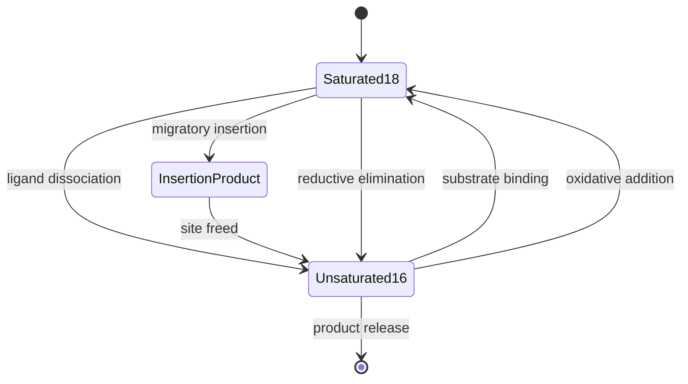
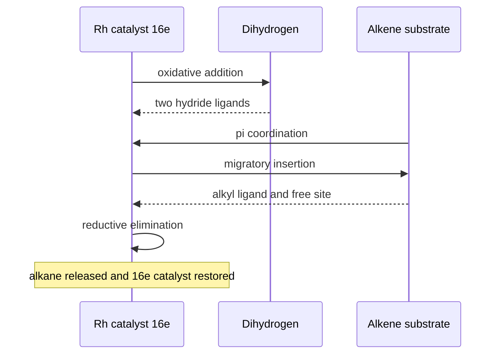
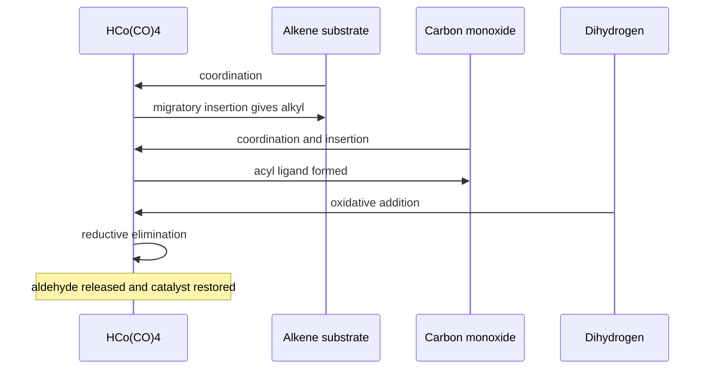
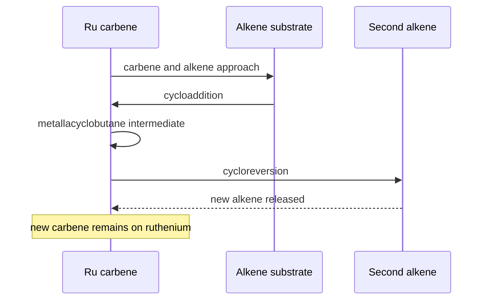
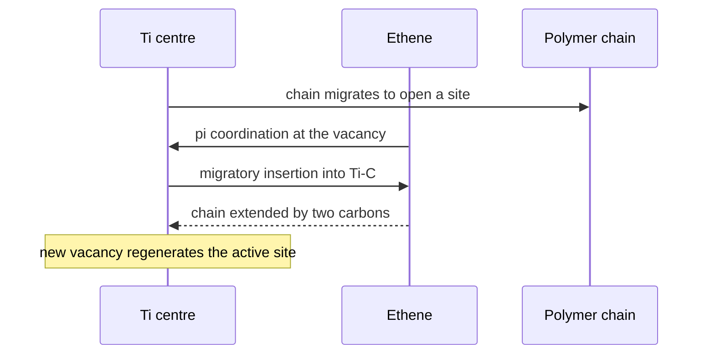
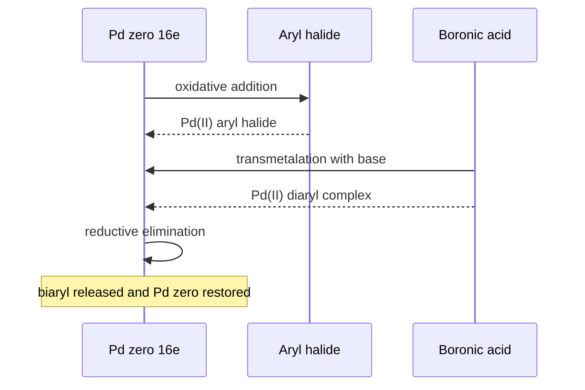

# Chapter 4 — Organometallic Compounds

> **Level:** University (Level 5 — Inorganic Chemistry)
> **Estimated study time:** 9 hours (6 h reading + 3 h exercises)
> **Prerequisites:** [Transition Metals](02-transition-metals.md); [Coordination Compounds](03-coordination-compounds.md); [Introduction to Organic Chemistry](../05-organic-chemistry/01-introduction-to-organic-chemistry.md)
> **Difficulty:** ★★★★★ (5/5)
> **Related chapters:** [Level 5 index](README.md); [Bioinorganic Chemistry](05-bioinorganic-chemistry.md); [Catalysis](../04-advanced-chemistry/06-catalysis.md)

---

## 1. Learning Objectives

After working through this chapter you will be able to:

- Describe the metal–carbon bond in terms of electronegativity, polarity and the three limiting bonding descriptions.
- Define hapticity and identify the $\eta^1$ to $\eta^6$ coordination modes of common unsaturated ligands.
- Count valence electrons for organometallic complexes using both the ionic and the covalent convention, and apply the 18-electron rule to at least ten complexes.
- Explain the bonding in metal carbonyls with the Dewar–Chatt–Duncanson model, and use $\nu(\ce{CO})$ as an electronic probe of metal electron density.
- Account for the stability and reactivity of metal alkyls, including $\beta$-hydride elimination and its suppression.
- Describe the structure and bonding of ferrocene and the general properties of metallocenes.
- Recognise metal–metal bonds of bond order up to four and explain the $\sigma$, $\pi$ and $\delta$ components.
- Draw and interpret catalytic cycles for hydrogenation, hydroformylation, olefin metathesis, Ziegler–Natta polymerisation and cross-coupling.
- Relate organometallic chemistry to industrial production and to laboratory synthesis.

---

## 2. Introduction

An organometallic compound contains a direct metal–carbon bond. The definition excludes metal carboxylates and cyanides, in which the metal is bound to oxygen or nitrogen, and it excludes the organometallic reagents of biology only in the sense that the metal–carbon bond there is enzyme-bound rather than isolated. Within that boundary lie some of the most useful substances in chemistry: the Grignard reagents that build carbon skeletons, the Ziegler–Natta catalysts that make most of the world's polyethylene and polypropylene, the rhodium complexes that produce more than ten million tonnes of aldehydes a year, and the ruthenium carbenes that close rings in drug synthesis.

The subject is unified by electron counting. A transition metal has nine valence orbitals — five $d$, one $s$ and three $p$ — which can accommodate eighteen electrons. Ligands donate electron pairs, and the metal's own $d$ electrons fill the rest of the set. When the count reaches eighteen the complex is usually stable; when it does not, the complex is usually reactive, and the reactivity is precisely what makes it a catalyst. Oxidative addition adds two electrons and two ligands; migratory insertion frees a coordination site; reductive elimination removes two ligands and two electrons. A catalytic cycle is a closed loop through configurations that are each close to eighteen electrons.

The organic side supplies the ligands and the reaction types. Alkenes, alkynes, arenes, allyls and cyclopentadienyls bind through their $\pi$ systems with hapticities from one to six. Carbon monoxide is the archetypal $\pi$-acceptor, and its stretching frequency is the most convenient single measurement in the field because it reports directly on how much electron density the metal has to give away. Alkyls are the $\sigma$-bonded counterparts, and their stability is governed by the availability of a $\beta$ hydrogen.

This chapter is the most demanding in the level because it combines orbital arguments, electron bookkeeping and mechanistic reasoning. The reward is that a large part of contemporary catalysis becomes legible: a catalytic cycle is no longer a list of steps to memorise but a sequence of electron-count changes that can be predicted.

---

## 3. Fundamental Concepts

### 3.1 The metal–carbon bond

The metal–carbon bond spans the range from almost purely ionic to almost purely covalent, and the position depends on the metal's electronegativity.

The **ionic limit** is the carbanion: an electropositive metal such as lithium or magnesium transfers electron density to carbon, and the organic group behaves as $\ce{R-}$. Methyllithium is best described as $\ce{Li+[CH3]-}$, and Grignard reagents as $\ce{RMgX}$ with substantial carbanion character at carbon. These reagents are nucleophilic, attack carbonyl groups and are destroyed by water.

The **covalent limit** is a two-centre two-electron bond between a metal and an $sp^n$ carbon, as in $\ce{Hg(CH3)2}$ or $\ce{Sn(CH3)4}$. The bond is polarised towards the more electronegative atom — carbon for electropositive metals, the metal for gold and platinum — and the organic group behaves more like an alkyl radical than a carbanion.

The **π-bonding limit** is characteristic of unsaturated ligands, where the ligand donates a filled $\pi$ orbital to the metal and accepts electron density from a filled metal $d$ orbital into an empty $\pi^*$ orbital. This synergic bonding is the subject of Section 3.4 and is what makes carbon monoxide such a strong ligand.

A **carbene** or **carbyne** ligand — a neutral $\ce{CR2}$ or anionic $\ce{CR^3-}$ fragment — lies outside the three limits and has its own rich chemistry, which is central to olefin metathesis.

### 3.2 Hapticity and coordination modes

**Hapticity** is the number of contiguous atoms of a ligand that are bound to the metal, denoted $\eta^n$. The concept is distinct from denticity: a bidentate ligand such as ethylenediamine uses two donor atoms that are not part of a contiguous π system, whereas an $\eta^5$-cyclopentadienyl ligand binds through five contiguous carbon atoms of an aromatic ring.

| Hapticity | Ligand | Example | Electron donation |
|---|---|---|---|
| $\eta^1$ | alkyl, aryl, allyl | $\ce{[Ti(CH3)4]}$, $\ce{[Hg(C6H5)2]}$ | 1 or 2 |
| $\eta^1$ | carbon monoxide | $\ce{[Ni(CO)4]}$ | 2 |
| $\eta^2$ | alkene | $\ce{K[PtCl3(C2H4)].H2O}$ | 2 |
| $\eta^2$ | alkyne | $\ce{[Pt(PPh3)2(C2H4)]}$ | 2 |
| $\eta^3$ | allyl | $\ce{[Pd(C3H5)Cl]2}$ | 3 or 4 |
| $\eta^4$ | diene | $\ce{[Fe(C4H4)(CO)3]}$ | 4 |
| $\eta^5$ | cyclopentadienyl | $\ce{[Fe(C5H5)2]}$ | 6 |
| $\eta^6$ | arene | $\ce{[Cr(C6H6)(CO)3]}$ | 6 |

Two complications recur. First, hapticity can change during a reaction, and the change is often the step that opens a coordination site: an $\eta^5$-cyclopentadienyl ligand slips to $\eta^3$ or $\eta^1$ when the metal needs a vacancy. Second, the number of electrons donated depends on the counting convention. An allyl ligand is a three-electron donor in the covalent convention when treated as a radical and a four-electron donor in the ionic convention when treated as an anion; both conventions give the same metal total, but the intermediate numbers differ.

### 3.3 The 18-electron rule and counting conventions

The rule states that a complex is thermodynamically favoured when the metal has eighteen valence electrons. The count uses the metal's group number, adjusted for charge, plus two electrons for each two-electron donor:

$$ N = \underbrace{(g - q)}_{\text{metal}} + 2n_{\text{L}} + \sum_{\text{other}} e_{\text{ligand}} $$

where $g$ is the group number, $q$ the oxidation state of the metal, and $n_{\text{L}}$ the number of two-electron donors. Bridging ligands and metal–metal bonds require care: a $\mu_2$-carbonyl contributes one electron to each metal.

The **ionic convention** assigns the bonding electrons to the more electronegative atom, so an anionic ligand such as $\ce{Cl-}$ or $\ce{C5H5-}$ is a closed-shell anion and the metal is left with a formal charge. The **covalent convention** splits each metal–ligand bond equally, so the ligand is treated as a radical and the metal is neutral. The two conventions are bookkeeping devices, and mixing them within one calculation produces nonsense.

The rule is obeyed by most carbonyls, metallocenes and low-valent complexes, and it fails in a systematic and informative way:

- **16-electron square-planar $d^8$ complexes** — $\ce{[PtCl4]^2-}$, $\ce{[RhCl(PPh3)3]}$ — are stable because the empty $p_z$ orbital is accessible and the metal can readily add a ligand, which is why they are catalysts.
- **17-electron complexes** such as $\ce{[Cu(NH3)4]^2+}$ or $\ce{V(CO)6}$ are radicals and are usually reactive.
- **20-electron complexes** such as nickelocene, $\ce{[Ni(C5H5)2]}$, populate antibonding orbitals and are less stable than their 18-electron analogues.
- **Early metals in high oxidation states** such as $\ce{[TiCl4]}$ or $\ce{[Ti(C5H5)2Cl2]}$ have fewer than 18 electrons because the metal has no low-lying $d$ electrons to fill.

### 3.4 Carbonyl complexes and the Dewar–Chatt–Duncanson model

Carbon monoxide binds through a $\sigma$ donation from its carbon lone pair into an empty metal orbital, accompanied by $\pi$ back-donation from a filled metal $d$ orbital into the empty $\pi^*$ orbitals of the ligand. The two components reinforce each other: σ donation increases electron density on the metal, which increases back-donation, which in turn increases the ligand's ability to accept σ donation. This **synergic** bonding is the **Dewar–Chatt–Duncanson model**, originally formulated for alkenes and applied to carbonyls by Blyholder.

The model makes a testable prediction. Back-donation populates the $\pi^*$ orbital of $\ce{CO}$, which weakens the C–O bond and lowers its stretching frequency. Free carbon monoxide absorbs at $2143\ \text{cm}^{-1}$; a terminal carbonyl on an electron-rich metal absorbs at $1750$–$2000\ \text{cm}^{-1}$; a bridging carbonyl absorbs at $1700$–$1860\ \text{cm}^{-1}$ because the bridging carbon shares its $\pi^*$ orbitals with two metals and accepts more electron density.

| Complex | $\tilde{\nu}(\ce{CO})$ / $\text{cm}^{-1}$ | Interpretation |
|---|---|---|
| $\ce{CO}$ | $2143$ | free ligand |
| $\ce{[Mn(CO)6]+}$ | $2090$ | cationic, weak back-donation |
| $\ce{[Cr(CO)6]}$ | $2000$ | neutral reference |
| $\ce{[V(CO)6]-}$ | $1860$ | anionic, strong back-donation |
| $\ce{[Ti(CO)6]^2-}$ | $1748$ | dianionic, very strong back-donation |
| $\ce{[Fe2(CO)9]}$ (bridging) | $1828$ | $\mu_2$ carbonyl |

The series is a continuous electronic probe: any change that increases electron density at the metal — a more negative charge, a more electron-donating co-ligand, a lower oxidation state — lowers $\nu(\ce{CO})$. Any change that withdraws electron density raises it. This is why infrared spectroscopy of carbonyl complexes is the standard method for comparing ligand donor strengths, and why the CO stretching band is used to monitor catalysts in operando.

### 3.5 Metal alkyls and their stability

Metal alkyls span the same range as the metal–carbon bond itself. The stability trends differ between the main group and the transition metals.

For the main group, the M–C bond weakens down a group because the orbitals become more diffuse and overlap less effectively: the tetraalkyls of silicon are stable, those of germanium and tin less so, and tetraethyllead was used as an antiknock additive precisely because it is volatile and decomposes readily to give lead atoms. For the alkali metals, the alkyls are ionic, pyrophoric and extremely reactive.

For the transition metals, the dominant decomposition pathway is **$\beta$-hydride elimination**: a hydrogen atom on the carbon $\beta$ to the metal is transferred to the metal, generating a metal hydride and an alkene.

$$ \ce{L_nM-CH2-CH2-R -> L_nM(H)(CH2=CHR)} $$

The reaction requires a $\beta$ hydrogen and a vacant coordination site *cis* to the alkyl. It is the reason why methyl, benzyl and neopentyl complexes are relatively stable — they have no $\beta$ hydrogen — and why ethyl and propyl complexes are short-lived unless the metal is coordinatively saturated or the geometry prevents the required four-membered transition state. Bulky ligands and chelating alkyls suppress the elimination by blocking the vacant site or by forcing the $\beta$ hydrogen away from the metal.

The reverse reaction, **migratory insertion** of an alkene into a metal–hydride bond, is the propagation step of polymerisation and hydroformylation. The two reactions are the same elementary step running in opposite directions, and the equilibrium between them is the central control element of organometallic catalysis.

**Agostic interactions** — a three-centre two-electron bond between a C–H bond and the metal — are the frozen intermediate of the same process. They are detected by a lowered C–H stretching frequency and by a characteristic upfield $^1$H NMR shift, and they stabilise electron-deficient complexes by donating a C–H σ bond to the metal.

### 3.6 Metallocenes

Ferrocene, $\ce{[Fe(C5H5)2]}$, was discovered in 1951 and its structure — an iron atom sandwiched between two parallel cyclopentadienyl rings — was established shortly afterwards. The molecule is a **sandwich complex**, and it is the parent of a large family of metallocenes with metals across the transition series.

The geometry is $D_{5d}$ (staggered) in the solid and $D_{5h}$ (eclipsed) in the gas phase, with an Fe–C distance of about $204\ \text{pm}$ and free rotation of the rings in solution. The iron is iron(II) ($d^6$) and each cyclopentadienyl is a six-electron donor, so the electron count is $6 + 2(6) = 18$.

Ferrocene is diamagnetic, thermally stable to above $400\ ^\circ\mathrm{C}$, soluble in organic solvents, and sublimes unchanged. Its reactivity is that of an aromatic system rather than of an iron centre: it undergoes Friedel–Crafts acylation, lithiation and Mannich reactions on the rings, and it is oxidised reversibly to the ferrocenium ion at about $+0.4\ \text{V}$ versus the saturated calomel electrode. The ferrocene/ferrocenium couple is a convenient internal reference for electrochemistry.

The bonding is described by molecular orbital theory. The two cyclopentadienyl rings provide symmetry-adapted combinations that overlap with the metal $s$, $p$ and $d$ orbitals; the eighteen electrons fill the resulting bonding and non-bonding levels, and the stability of the molecule is a consequence of that filling. The important qualitative point is that the metal is bound to the whole ring rather than to a single carbon, which is why ferrocene behaves as an aromatic hydrocarbon with a metal inside it.

### 3.7 Metal–metal bonds

Transition metals form direct metal–metal bonds, and the bond order can exceed three because $d$ orbitals can overlap in three distinct ways. A $\sigma$ bond uses $d_{z^2}$ orbitals head-on; two $\pi$ bonds use $d_{xz}$ and $d_{yz}$ side-on; and a $\delta$ bond uses $d_{xy}$ or $d_{x^2-y^2}$ face-on, with two lobes of each orbital overlapping in a four-lobed pattern.

The archetype is $\ce{[Re2Cl8]^2-}$, in which two $\ce{ReCl4}$ square planes are eclipsed and the Re–Re distance is $224\ \text{pm}$ — far shorter than a single bond. The bond order is four: one $\sigma$, two $\pi$ and one $\delta$. The eclipsed geometry is required by the $\delta$ component, which would be cancelled in a staggered arrangement; this is one of the clearest structural signatures of a multiple metal–metal bond. The quadruple bond is also found in $\ce{[Mo2(OAc)4]}$ and in $\ce{[W2Cl8]^2-}$.

Even higher formal bond orders have been proposed, notably the quintuple bond in $\ce{[Cr2(C6H5)2]}$ and in chromium(II) dimers, where a second $\delta$ component is added. The assignment is debated, which is a useful reminder that bond order in metal dimers is a model rather than a measurable integer.

Metal–metal bonding is also the organising principle of **clusters**: compounds with three or more metal atoms held together by M–M bonds and bridged by ligands. $\ce{[Fe3(CO)12]}$ has a triangular metal framework with two bridging carbonyls; $\ce{[Os3(CO)12]}$ has the same triangle but only terminal carbonyls; $\ce{[Rh6(CO)16]}$ has an octahedral metal core. Electron counting in clusters extends the 18-electron rule by treating each M–M bond as contributing one electron to each metal, and the resulting **Wade–Mingos rules** predict the framework geometry from the electron count. The rules are a useful first approximation, not a law, and they are developed in the specialist literature.

### 3.8 Catalytic cycles

A catalytic cycle is a sequence of elementary steps that returns the catalyst to its starting state. Five reaction types recur.

**Ligand dissociation** opens a coordination site and lowers the electron count by two. **Oxidative addition** inserts the metal into an A–B bond, raising the oxidation state by two and the electron count by two. **Migratory insertion** combines two ligands into one and frees a site. **$\beta$-hydride elimination** is the reverse of insertion. **Reductive elimination** couples two ligands and lowers the oxidation state by two.

The loop is constrained by the 18-electron rule: each intermediate is typically 16 or 18 electrons, and the alternation between them drives the cycle. A catalyst that is always 18-electron is inactive because it has no site for the substrate; a catalyst that is always 16-electron is unstable. Section 4.7 works through five named cycles, and Section 5 presents two of them as sequence diagrams.

---
CHEM_CHUNK_EOF
## 4. Detailed Scientific Explanation

### 4.1 Bonding models

The **Dewar–Chatt–Duncanson model** describes the metal–alkene bond as the sum of two components. The filled $\pi$ orbital of the alkene donates into an empty metal orbital of suitable symmetry, and a filled metal $d$ orbital donates back into the empty $\pi^*$ orbital of the alkene. The first component transfers electron density to the metal and the second transfers it away, so the two are synergistic: each makes the other stronger. The model explains why alkene complexes are stable only when the metal is electron-rich enough to back-donate, and why the C–C bond lengthens from $134\ \text{pm}$ in free ethene to about $140$–$143\ \text{pm}$ on coordination — population of $\pi^*$ reduces the bond order.

The same model, applied to carbon monoxide, is the **Blyholder model**. Carbon monoxide is a better $\pi$ acceptor than an alkene because its $\pi^*$ orbitals are lower in energy, and a better $\sigma$ donor because its lone pair is localised on carbon. Both features make it a strong-field ligand, which is why it sits at the top of the spectrochemical series and why carbonyl complexes are usually low spin.

A third limit applies to **carbenes** and **carbynes**. A carbene ligand $\ce{CR2}$ can be a singlet, donating a σ pair and accepting π density, or a triplet, binding as two one-electron donors. The Schrock carbene of olefin metathesis is nucleophilic and behaves as a singlet; the Fischer carbene of early work has a metal-stabilised positive charge on carbon and behaves as an electrophile. The distinction matters because it changes which end of the carbene reacts with an alkene.

### 4.2 Carbonyl stretching frequency as a probe

The carbonyl stretching band is the most useful diagnostic in organometallic chemistry because it is intense, sharp and sensitive. Three effects shift it.

**Metal electron density.** More electron-rich metals back-donate more, populate $\pi^*$ more, and lower $\nu(\ce{CO})$. The isoelectronic series $\ce{[Mn(CO)6]+}$ ($2090$), $\ce{[Cr(CO)6]}$ ($2000$), $\ce{[V(CO)6]-}$ ($1860$) and $\ce{[Ti(CO)6]^2-}$ ($1748\ \text{cm}^{-1}$) changes only the metal charge, and the frequency falls by about $110\ \text{cm}^{-1}$ per unit of negative charge.

**Co-ligand donor strength.** Replacing one carbonyl by a stronger donor raises the electron density on the metal, increases back-donation to the remaining carbonyls, and lowers their frequencies. The shift is additive to a good approximation, which is why the CO bands of a series of substituted carbonyls can be used to rank ligands: a phosphine that lowers $\nu(\ce{CO})$ more than another phosphine is the stronger donor.

**Bridging.** A $\mu_2$-carbonyl shares its $\pi^*$ orbitals with two metals, accepts more electron density, and absorbs at $1700$–$1860\ \text{cm}^{-1}$, well below the terminal range. The number of bridging carbonyls is also structurally diagnostic: $\ce{[Fe2(CO)9]}$ has three, $\ce{[Co2(CO)8]}$ has two in the solid state and none in solution, and the difference is visible in the infrared spectrum.

The inverse relation between $\nu(\ce{CO})$ and metal electron density is the basis of **in situ** infrared monitoring of catalytic reactions. A shift of the carbonyl band during a reaction reports on the oxidation state of the metal and on which ligands are bound, and it is used to identify resting states in hydroformylation and in the Monsanto process.

### 4.3 Carbonyl clusters

A **cluster** contains at least three metal atoms joined by metal–metal bonds. The carbonyls both stabilise the cluster and provide a spectroscopic handle, and the metal framework can be triangular, tetrahedral, octahedral or more complex.

$\ce{[Fe3(CO)12]}$ has a triangle of iron atoms with two bridging carbonyls and ten terminal ones; $\ce{[Os3(CO)12]}$ is isostructural in the metal framework but has no bridging carbonyls, a difference attributed to the stronger Os–Os bonds and the greater radial extension of the $5d$ orbitals. $\ce{[Co4(CO)12]}$ has a tetrahedral metal core, and $\ce{[Rh6(CO)16]}$ an octahedral one.

Electron counting in clusters extends the 18-electron rule: each metal–metal bond contributes one electron to each of the two metals it joins. A metal atom with three M–M bonds therefore receives three electrons from its neighbours and needs fifteen from ligands to reach eighteen. The **Wade–Mingos rules** invert the calculation and predict the framework geometry from the total electron count, in the same way that Wade's rules predict the shapes of boranes. Clusters are important as models for metal surfaces, as precursors to heterogeneous catalysts, and as catalysts in their own right — $\ce{[Rh6(CO)16]}$ catalyses hydroformylation and the water-gas shift.

### 4.4 Stability and decomposition of metal alkyls

Four decomposition pathways compete.

**$\beta$-Hydride elimination** is the most common. It requires a hydrogen on the $\beta$ carbon and a vacant site cis to the alkyl, and it produces a metal hydride and an alkene. The reaction is reversible and is the microscopic reverse of alkene insertion, which is why the same catalysts that polymerise alkenes can also degrade the polymer if the chain is not released cleanly.

**$\alpha$-Hydride elimination** gives a metal carbene and a hydride, and it is favoured when no $\beta$ hydrogen is available. It is the route from a methyl complex to a methylidene, and it underlies the chemistry of Schrock carbenes.

**Reductive elimination** couples the alkyl with another ligand — a hydride, another alkyl or an aryl — and lowers the oxidation state by two. It is the productive step in cross-coupling and the termination step in polymerisation.

**Homolysis** of the M–C bond gives two radicals. It is important for the main-group alkyls, where the bond is weak, and for photochemical initiation.

The practical consequences are that stable transition-metal alkyls usually have no $\beta$ hydrogen (methyl, benzyl, neopentyl, trimethylsilylmethyl), are coordinatively saturated, or are stabilised by bulky ligands that block the vacant site. $\ce{[Ti(CH3)4]}$ is unstable and decomposes at low temperature; $\ce{[Ti(CH2C(CH3)3)4]}$ is much more robust; $\ce{[W(CH3)6]}$ is stable and is used as a precursor in materials chemistry.

### 4.5 Ferrocene and the metallocenes

The structure of ferrocene is a sandwich: an iron atom between two parallel cyclopentadienyl rings, with all ten carbon atoms equidistant from the metal. The rings rotate freely in solution, and the rotational barrier in the solid is small.

The bonding follows from the fragment orbitals. Each cyclopentadienyl anion has a set of π molecular orbitals of $a_1$, $e_1$ and $e_2$ symmetry; the two rings combine to give symmetry-adapted pairs that match the metal $s$, $p$ and $d$ orbitals. The result is a set of nine bonding or non-bonding molecular orbitals that accommodate the eighteen valence electrons: six from iron(II) and six from each ring. The molecule is diamagnetic, and the gap to the first excited state is large, which is why ferrocene is unusually robust.

The **metallocene family** follows the same structural pattern with different electron counts. $\ce{[Co(C5H5)2]+}$ is isoelectronic with ferrocene and equally stable; neutral cobaltocene has 19 electrons and is a strong reductant; nickelocene has 20 electrons, is paramagnetic and readily loses a ring. $\ce{[V(C5H5)2]}$ has 15 electrons and is paramagnetic. Bent metallocenes of titanium and zirconium — $\ce{[Ti(C5H5)2Cl2]}$, $\ce{[Zr(C5H5)2Cl2]}$ — have 16 electrons, a wedge-shaped geometry and two vacant sites, which is exactly what makes them Ziegler–Natta and Kaminsky catalysts.

Substitution on the rings tunes both sterics and electronics, and the modern polymerisation catalysts use bulky substituted cyclopentadienyls — *rac*-ethylenebis(indenyl)zirconium dichloride, for example — to control the stereochemistry of propene insertion and produce isotactic polypropylene.

### 4.6 Metal–metal multiple bonds

The quadruple bond of $\ce{[Re2Cl8]^2-}$ is the canonical example, and its geometry is the strongest evidence for the $\delta$ component. The two $\ce{ReCl4}$ units are eclipsed rather than staggered, which is the arrangement that maximises $\delta$ overlap. Rotation by $45^\circ$ would convert the $\delta$ bond into a $\delta^*$ antibond, and the barrier to that rotation is substantial.

The bond order is calculated by counting the metal–metal bonding electrons and dividing by two: eight $d$ electrons per rhenium, four bonding pairs, bond order four. The same count applies to $\ce{[Mo2(OAc)4]}$, where the four acetate bridges hold the dimetal unit rigidly and the Mo–Mo distance is $211\ \text{pm}$.

Multiple metal–metal bonds are not confined to dimers. The triangular cluster of $\ce{[Fe3(CO)12]}$ contains three Fe–Fe bonds, and the octahedral cluster of $\ce{[Rh6(CO)16]}$ contains twelve. In the limit, metal–metal bonding merges into the metallic state, and cluster chemistry is a bridge between molecular and solid-state chemistry.

### 4.7 The named catalytic cycles

**Hydrogenation: Wilkinson's catalyst.** $\ce{[RhCl(PPh3)3]}$ is a 16-electron rhodium(I) complex. The cycle begins with dissociation of a phosphine or with direct oxidative addition of dihydrogen, giving an 18-electron dihydride. The alkene coordinates, and migratory insertion gives a 16-electron alkyl. Reductive elimination releases the alkane and regenerates the 16-electron catalyst. The rate law is first order in catalyst and in alkene and independent of hydrogen pressure at high pressure, which identifies the oxidative addition as the step that precedes the turnover-limiting insertion. The catalyst hydrogenates alkenes but not arenes or carbonyls, and it is the standard laboratory method for selective hydrogenation.

**Hydroformylation.** The addition of $\ce{H2}$ and $\ce{CO}$ across an alkene gives an aldehyde, and the industrial importance of the reaction lies in the plasticiser alcohols made from the products. The cobalt catalyst is $\ce{HCo(CO)4}$, formed from $\ce{Co2(CO)8}$ under synthesis gas. The cycle is alkene coordination, migratory insertion into the Co–H bond, carbon monoxide insertion into the Co–alkyl bond to give an acyl, oxidative addition of $\ce{H2}$, and reductive elimination of the aldehyde. The rhodium–phosphine system operates at lower pressure and gives a higher ratio of linear to branched product, which is why it displaced cobalt for most applications. The regioselectivity is controlled by steric bulk: bulky phosphines favour the linear alkyl intermediate and therefore the linear aldehyde.

**Olefin metathesis.** Two alkenes exchange substituents through a metal carbene. The **Chauvin mechanism** has three steps: the alkene coordinates to the metal carbene, the two form a four-membered metallacyclobutane, and the ring opens in the opposite direction to give a new carbene and a new alkene. Grubbs' ruthenium catalysts are tolerant of functional groups and water, which is why ring-closing metathesis became a standard tool in drug synthesis. Schrock's molybdenum and tungsten catalysts are more active but more sensitive. The 2005 Nobel Prize in Chemistry was awarded to Chauvin, Grubbs and Schrock for this work.

**Ziegler–Natta polymerisation.** $\ce{TiCl4}$ activated by $\ce{Al(C2H5)3}$ polymerises ethylene at low pressure. The **Cossee–Arlman mechanism** has four steps: a vacant site on titanium, coordination of the alkene, migratory insertion of the alkene into the Ti–C bond, and regeneration of the vacancy. The polymer chain grows by repeated insertion, and the stereochemistry of the site determines whether the product is isotactic, syndiotactic or atactic. The modern catalyst is $\ce{TiCl4}$ on a magnesium chloride support with an internal electron donor, which produces highly isotactic polypropylene.

**Cross-coupling.** Palladium(0) catalyses the coupling of an aryl halide with an organometallic nucleophile. The cycle is oxidative addition of the aryl halide to give a palladium(II) aryl complex, transmetalation with a boronic acid (Suzuki), an organozinc (Negishi) or a stannane (Stille), and reductive elimination to give the biaryl and regenerate palladium(0). The Suzuki reaction, which uses boronic acids and a base, is the workhorse of pharmaceutical process chemistry because the reagents are stable and the by-products are inorganic. The 2010 Nobel Prize in Chemistry was awarded to Heck, Negishi and Suzuki; Heck's variant replaces transmetalation with alkene insertion and $\beta$-hydride elimination.

### 4.8 Organometallics in industry and synthesis

**Bulk chemicals.** Hydroformylation produces more than $10^{7}$ tonnes of aldehydes per year. The Monsanto process makes acetic acid from methanol and carbon monoxide with a rhodium iodide catalyst at $150$–$200\ ^\circ\mathrm{C}$ and $30$–$60\ \text{bar}$; the catalytic cycle is oxidative addition of methyl iodide, carbon monoxide insertion to an acyl, and reductive elimination of acetyl iodide, which is hydrolysed to acetic acid. The Wacker process oxidises ethylene to acetaldehyde with palladium(II) chloride and a copper(II) co-catalyst.

**Polymers.** Ziegler–Natta and metallocene catalysts produce polyethylene and polypropylene, the two largest-volume plastics. Single-site metallocene catalysts give narrow molecular weight distributions and precise stereocontrol, which is why they are used for high-performance grades.

**Fine chemicals.** Cross-coupling, metathesis, asymmetric hydrogenation and C–H activation are routine in process chemistry. The 2001 Nobel Prize in Chemistry recognised Knowles, Noyori and Sharpless for asymmetric catalysis, including the BINAP–ruthenium hydrogenation of alkenes.

**Reagents.** Grignard reagents, organolithiums and organozinc compounds are the standard carbon nucleophiles of organic synthesis. Organoboron reagents are the partners of the Suzuki reaction. Organosilicon and organotin reagents are used in radical and coupling chemistry.

**Energy and materials.** Metal carbonyls are precursors to metal films by chemical vapour deposition; $\ce{[Fe(CO)5]}$ and $\ce{[Ni(CO)4]}$ are used for carbonyl metallurgy (the Mond process); organometallic precursors are used for graphene growth and for atomic layer deposition.

### 4.9 Comparing the five cycles

| Cycle | Metal and state | Key elementary steps | Turnover-limiting step | Main product |
|---|---|---|---|---|
| Hydrogenation | Rh(I)/Rh(III) | oxidative addition, insertion, reductive elimination | migratory insertion | saturated hydrocarbons |
| Hydroformylation | Co(-I)/Co(I) or Rh(I)/Rh(III) | insertion, CO insertion, oxidative addition, elimination | CO insertion or elimination | aldehydes |
| Metathesis | Ru(II) or Mo(VI) carbene | cycloaddition, cycloreversion | metallacyclobutane opening | new alkenes |
| Ziegler-Natta | Ti(IV)/Ti(III) | alkene coordination, insertion | insertion | polyolefins |
| Cross-coupling | Pd(0)/Pd(II) | oxidative addition, transmetalation, elimination | oxidative addition | biaryls, aryl-alkenes |

The table makes the design logic visible. Each cycle needs one step that forms a new metal-carbon bond, one step that assembles the product on the metal, and one step that releases it and restores the resting state. The oxidation state may change by two, as in hydrogenation and cross-coupling, or remain essentially constant, as in Ziegler-Natta insertion and in metathesis, where the carbene is conserved. The turnover-limiting step is the one that determines the ligand design: if oxidative addition is limiting, electron-rich ligands help; if insertion is limiting, steric control dominates.

**Catalyst deactivation** is the practical counterpoint. Phosphine ligands are oxidised by traces of oxygen, metal particles aggregate into inactive colloids, and strongly binding impurities such as thiols or carbon monoxide poison the active site. Industrial processes therefore include ligand excess, filter aids and guard beds, and the choice of catalyst often reflects robustness as much as intrinsic activity.

**C-H activation** and **σ-bond metathesis** are the frontier. A metal inserts into an unactivated C-H bond, converting an alkane into an alkyl complex without a prefunctionalised halide; the reaction is thermodynamically feasible but kinetically difficult, and the best systems use electron-rich, bulky ligands and a concerted four-centre transition state. The same σ-bond metathesis step operates in Ziegler-Natta chain growth and in some hydrogen-transfer reactions, and it is the basis of the long-standing goal of converting methane directly into methanol or into liquid fuels.

---

## 5. Visual Diagrams

**Figure 4.1 — The generic catalytic cycle as an alternation of electron counts.** Every step in the diagram changes the valence electron count by two, and every productive cycle oscillates between a saturated 18-electron resting state and an unsaturated 16-electron active state. The diagram is the master template for the five cycles that follow: read each sequence diagram in Section 5 as a particular path through this state machine, with the identity of the substrate and of the product filled in.

**Figure 4.2 — The Wilkinson hydrogenation cycle.** The sequence shows why the reaction is selective for alkenes: the catalyst offers a vacant site and two hydrides, and the alkene is the only functional group that both coordinates and accepts insertion under these conditions. The oxidative addition of dihydrogen is fast and reversible, and the migratory insertion is turnover-limiting; the note marks the point at which the product leaves and the 16-electron catalyst returns to the start of the loop.

**Figure 4.3 — The hydroformylation cycle.** Two insertions occur in sequence: the alkene inserts into the cobalt–hydride bond, and carbon monoxide inserts into the cobalt–alkyl bond. The order matters, because insertion of CO first would give an acyl that cannot accept the alkene. The regiochemistry is decided at the first insertion, and the bulky phosphine ligands of the rhodium variant bias that step towards the linear alkyl, which is why the industrial process gives predominantly the linear aldehyde.

**Figure 4.4 — The Chauvin mechanism for olefin metathesis.** The four-membered metallacyclobutane is the key intermediate: it forms by a formal [2+2] cycloaddition between the metal–carbon double bond and the alkene, and it opens in the opposite sense to exchange the partners. The net result is that the carbene fragment on the metal and one alkene fragment swap places, which is why the reaction can be used to close rings or to cross two alkenes. Grubbs' contribution was to find ruthenium carbenes that survive functional groups while still performing this step.

**Figure 4.5 — The Cossee–Arlman mechanism for Ziegler–Natta polymerisation.** The cycle is a repeated migratory insertion: the chain oscillates between a coordinated alkyl and a vacant site, and each turn adds one monomer unit. Because the insertion is stereospecific at a well-defined chiral titanium site, the substituent orientation of each monomer is controlled, and that is how isotactic polypropylene is made. The figure also shows why the process needs a continuous supply of monomer but only a catalytic amount of metal.

**Figure 4.6 — The Suzuki cross-coupling cycle.** Oxidative addition raises the palladium oxidation state from zero to two and is usually the turnover-limiting step for electron-rich aryl bromides; transmetalation delivers the second aryl group; reductive elimination forms the C–C bond and returns the metal to palladium(0). The base is not a spectator: it converts the boronic acid into a more reactive boronate and removes the halide from the metal's coordination sphere.

---

## 6. Mathematical Formulas

The electron count of a complex is

$$ N = (g - q) + 2n_{\text{L}} + \sum_i e_i $$

| Symbol | Meaning | SI unit |
|---|---|---|
| $N$ | Total valence electrons on the metal | $1$ |
| $g$ | Group number of the metal | $1$ |
| $q$ | Oxidation state of the metal | $1$ |
| $n_{\text{L}}$ | Number of two-electron donor ligands | $1$ |
| $e_i$ | Electrons donated by ligand $i$ of another type | $1$ |

The carbonyl stretching frequency is related to the force constant of the C–O bond by the harmonic oscillator expression

$$ \tilde{\nu} = \frac{1}{2\pi c}\sqrt{\frac{k}{\mu}}, \qquad \mu = \frac{m_{\ce{C}}m_{\ce{O}}}{m_{\ce{C}} + m_{\ce{O}}} $$

where $k$ is the force constant in $\text{N m}^{-1}$, $\mu$ the reduced mass in $\text{kg}$, and $c$ the speed of light. A lower frequency means a smaller force constant, that is, a weaker C–O bond and more electron density in the $\pi^*$ orbital.

Catalyst performance is described by the turnover number and turnover frequency:

$$ \text{TON} = \frac{n_{\text{product}}}{n_{\text{catalyst}}}, \qquad \text{TOF} = \frac{\text{TON}}{t} $$

with $t$ in seconds and TOF in $\text{s}^{-1}$. Industrial hydroformylation catalysts operate at TOF of the order of $10^{-1}$–$10^{2}\ \text{s}^{-1}$, and the TOF is the quantity that determines reactor size for a given production rate.

The temperature dependence of the turnover-limiting step follows the Eyring equation:

$$ k = \frac{k_{\text{B}}T}{h}\exp\left(-\frac{\Delta G^\ddagger}{RT}\right) $$

with $k_{\text{B}}$ the Boltzmann constant, $h$ the Planck constant and $\Delta G^\ddagger$ the Gibbs energy of activation. A tenfold increase in rate corresponds to a decrease of about $5.7\ \text{kJ mol}^{-1}$ in $\Delta G^\ddagger$ at $298\ \text{K}$, which is why ligand modifications that change the barrier by a few kilojoules per mole can change a catalyst's rate by an order of magnitude.

---

## 7. Chemical Equations

**Formation of Zeise's salt.** The first organometallic compound, prepared in 1827 and correctly formulated only in the twentieth century.

$$ \ce{K2[PtCl4] (aq) + C2H4(g) -> K[PtCl3(C2H4)] (s) + KCl(aq)} $$

**Synthesis of ferrocene.** The original route uses cyclopentadienylmagnesium bromide and iron(II) chloride.

$$ \ce{2C5H5MgBr + FeCl2 -> [Fe(C5H5)2] + 2MgCl2} $$

**Oxidation of ferrocene.** The ferrocenium ion is stable and the couple is reversible.

$$ \ce{[Fe(C5H5)2] <=> [Fe(C5H5)2]+ + e-} \qquad E^\circ \approx +0.4\ \text{V vs SCE} $$

**Hydroformylation of propene.** The linear aldehyde is the desired product; the branched isomer is the by-product.

$$ \ce{CH3CH=CH2(g) + CO(g) + H2(g) ->[Rh/PPh3] CH3CH2CH2CHO(l)} $$

**Hydrogenation of an alkene with Wilkinson's catalyst.**

$$ \ce{RCH=CH2 + H2 ->[RhCl(PPh3)3] RCH2CH3} $$

**Ring-closing metathesis.** A diene loses ethene to give a cyclic alkene.

$$ \ce{CH2=CH(CH2)_nCH=CH2 ->[Ru carbene] (CH2)_nCH=CH + C2H4} $$

**Monsanto acetic acid process.**

$$ \ce{CH3OH(l) + CO(g) ->[RhI3, 150-200 ^\circ C] CH3COOH(l)} $$

**Oxidative addition of dihydrogen to a metal centre.**

$$ \ce{[IrCl(CO)(PPh3)2] + H2 -> [IrCl(H)2(CO)(PPh3)2]} $$

---

## 8. Worked Examples

### Worked Example 8.1 — Electron counting in ten complexes

**Problem.** Count the valence electrons and state whether each complex obeys the 18-electron rule: $\ce{[Ni(CO)4]}$, $\ce{[Fe(CO)5]}$, $\ce{[Cr(CO)6]}$, $\ce{[Mn(CO)5]-}$, $\ce{[Co(CO)4]-}$, $\ce{[Fe(C5H5)2]}$, $\ce{[Cr(C6H6)(CO)3]}$, $\ce{[Ti(C5H5)2Cl2]}$, $\ce{[RhCl(PPh3)3]}$ and $\ce{[Ni(C5H5)2]}$.

**Strategy.** Use the ionic convention throughout: the metal contributes its group number minus its oxidation state, each two-electron donor contributes two, a cyclopentadienyl anion contributes six, and benzene contributes six.

**Solution.** The counts are collected in the table.

| Complex | Metal contribution | Ligand contribution | Total | Comment |
|---|---|---|---|---|
| $\ce{[Ni(CO)4]}$ | $\ce{Ni(0)}$: $10$ | $4 \times 2 = 8$ | $18$ | obeys |
| $\ce{[Fe(CO)5]}$ | $\ce{Fe(0)}$: $8$ | $5 \times 2 = 10$ | $18$ | obeys |
| $\ce{[Cr(CO)6]}$ | $\ce{Cr(0)}$: $6$ | $6 \times 2 = 12$ | $18$ | obeys |
| $\ce{[Mn(CO)5]-}$ | $\ce{Mn(-I)}$: $8$ | $5 \times 2 = 10$ | $18$ | obeys |
| $\ce{[Co(CO)4]-}$ | $\ce{Co(-I)}$: $10$ | $4 \times 2 = 8$ | $18$ | obeys |
| $\ce{[Fe(C5H5)2]}$ | $\ce{Fe(II)}$: $6$ | $2 \times 6 = 12$ | $18$ | obeys |
| $\ce{[Cr(C6H6)(CO)3]}$ | $\ce{Cr(0)}$: $6$ | $6 + 6 = 12$ | $18$ | obeys |
| $\ce{[Ti(C5H5)2Cl2]}$ | $\ce{Ti(IV)}$: $0$ | $12 + 4 = 16$ | $16$ | 16-electron |
| $\ce{[RhCl(PPh3)3]}$ | $\ce{Rh(I)}$: $8$ | $2 + 6 = 8$ | $16$ | 16-electron |
| $\ce{[Ni(C5H5)2]}$ | $\ce{Ni(II)}$: $8$ | $2 \times 6 = 12$ | $20$ | 20-electron |

**Check.** The seven 18-electron complexes are all diamagnetic and thermally robust, as the rule predicts. The two 16-electron complexes are both catalysts: $\ce{[RhCl(PPh3)3]}$ hydrogenates alkenes and $\ce{[Ti(C5H5)2Cl2]}$ becomes a polymerisation catalyst on activation, precisely because they have room to accept a substrate. Nickelocene has two electrons in antibonding orbitals, is paramagnetic with two unpaired electrons, and readily loses a ring — the expected fate of a 20-electron complex.

### Worked Example 8.2 — Interpreting a carbonyl infrared spectrum

**Problem.** The infrared spectrum of $\ce{[Fe2(CO)9]}$ shows strong bands at $2080$ and $2019\ \text{cm}^{-1}$ and a band at $1828\ \text{cm}^{-1}$. Assign the bands and explain why the third lies so much lower. Then calculate the force constant of free carbon monoxide from its frequency of $2143\ \text{cm}^{-1}$.

**Strategy.** Terminal carbonyls absorb between $1850$ and $2150\ \text{cm}^{-1}$, bridging carbonyls between $1700$ and $1860\ \text{cm}^{-1}$. For the force constant, rearrange the harmonic oscillator expression.

**Solution.** The two high-frequency bands arise from terminal carbonyls, split by the different environments in the molecule; the band at $1828\ \text{cm}^{-1}$ is the bridging $\mu_2$ carbonyl. Bridging lowers the frequency because the $\pi^*$ orbitals of the bridging carbonyl accept electron density from two metals instead of one, so the C–O bond order falls further.

For free carbon monoxide, the reduced mass is

$$ \mu = \frac{(12.00)(15.995)}{12.00 + 15.995} \times 1.66054 \times 10^{-27}\ \text{kg} = 1.139 \times 10^{-26}\ \text{kg} $$

and the frequency in $\text{s}^{-1}$ is $\tilde{\nu}c = (2.143 \times 10^{5})(2.998 \times 10^{8}) = 6.425 \times 10^{13}\ \text{s}^{-1}$. Hence

$$ k = (2\pi\tilde{\nu}c)^2\mu = (4.037 \times 10^{14})^2(1.139 \times 10^{-26}) = 1.86 \times 10^{3}\ \text{N m}^{-1} $$

**Check.** The force constant of $1860\ \text{N m}^{-1}$ is the standard value for a C–O triple bond, and it is much larger than the value for a C–O single bond (about $450\ \text{N m}^{-1}$), as it must be. The assignment of the $1828\ \text{cm}^{-1}$ band to a bridging carbonyl is consistent with the structure of $\ce{[Fe2(CO)9]}$, which contains three bridging carbonyls.

### Worked Example 8.3 — Predicting alkyl stability

**Problem.** Predict which complex in each pair is more stable and explain: (a) $\ce{[W(CH3)6]}$ or $\ce{[W(CH2CH3)6]}$; (b) $\ce{[Pt(CH3)2(PPh3)2]}$ or $\ce{[Pt(CH2CH2CH3)2(PPh3)2]}$.

**Strategy.** Look for a $\beta$ hydrogen and for a vacant coordination site cis to the alkyl.

**Solution.** (a) $\ce{[W(CH3)6]}$ is the more stable. The methyl ligand has no $\beta$ hydrogen, so $\beta$-hydride elimination is impossible; the ethyl ligand has three $\beta$ hydrogens, and the 12-electron fragment left after loss of one ligand has ample room for the required four-membered transition state.

(b) $\ce{[Pt(CH3)2(PPh3)2]}$ is the more stable, but for a different reason. Platinum(II) is square planar and coordinatively saturated, and the propyl complex would need a vacant site cis to the alkyl for $\beta$-hydride elimination; the bulky phosphines make that site inaccessible. The propyl complex is nevertheless more prone to decomposition than the methyl complex, and it decomposes on heating by dissociation of a phosphine followed by elimination.

**Check.** Both predictions agree with the general rule that stable transition-metal alkyls either lack $\beta$ hydrogens or lack a cis vacancy. They also explain why the most robust alkyls used as precursors — neopentyl, trimethylsilylmethyl, benzyl — are precisely those with no $\beta$ hydrogen.

### Worked Example 8.4 — Turnover number and turnover frequency

**Problem.** A hydroformylation experiment uses $1.0 \times 10^{-5}\ \text{mol}$ of rhodium catalyst and produces $2.50 \times 10^{-3}\ \text{mol}$ of aldehyde in $1.00\ \text{h}$. Calculate the turnover number and the turnover frequency, and compare the TOF with an industrial value of $0.10\ \text{s}^{-1}$.

**Strategy.** TON is product moles divided by catalyst moles; TOF is TON divided by the reaction time in seconds.

**Solution.** The turnover number is

$$ \text{TON} = \frac{2.50 \times 10^{-3}}{1.0 \times 10^{-5}} = 250 $$

Over $3600\ \text{s}$,

$$ \text{TOF} = \frac{250}{3600\ \text{s}} = 6.9 \times 10^{-2}\ \text{s}^{-1} $$

**Check.** The laboratory TOF is within a factor of two of the industrial value, which is the expected order of magnitude for a well-behaved homogeneous catalyst. The TON of $250$ is modest; industrial catalysts are designed for TON of $10^{5}$–$10^{6}$ so that the metal cost is negligible per tonne of product, and the gap between $250$ and $10^{5}$ is the space in which catalyst stability is engineered.

### Worked Example 8.5 — Bond order in a metal–metal dimer

**Problem.** Assign the formal oxidation state of rhenium in $\ce{[Re2Cl8]^2-}$, count the metal–metal bonding electrons, and determine the bond order.

**Strategy.** Treat each chloride as $\ce{Cl-}$, balance the charge to find the metal oxidation state, count the $d$ electrons per metal, and pair them in the metal–metal bonding orbitals $\sigma$, $\pi$, $\pi$, $\delta$.

**Solution.** Eight chlorides contribute $-8$ and the complex has charge $-2$, so the two rhenium atoms share $+6$ and each is $+3$. Rhenium is group 7, so $\ce{Re^3+}$ is $d^4$; two such centres give eight $d$ electrons. These fill four metal–metal bonding orbitals — one $\sigma$, two $\pi$ and one $\delta$ — so

$$ \text{bond order} = \frac{8}{2} = 4 $$

**Check.** The observed Re–Re distance of $224\ \text{pm}$ is much shorter than a Re–Re single bond (about $275\ \text{pm}$), consistent with a bond order of four, and the eclipsed geometry of the two $\ce{ReCl4}$ squares is the arrangement that maximises $\delta$ overlap. A staggered geometry would break the $\delta$ bond and is not observed.

---

## 9. Real-World Applications

**Polymers.** Ziegler–Natta and metallocene catalysis produce polyethylene and polypropylene on a scale of more than $10^{8}$ tonnes per year. Single-site metallocenes control molecular weight distribution and tacticity, which determines whether the plastic is a rigid container, a flexible film or an elastomer.

**Aldehydes and plasticisers.** Hydroformylation converts alkenes, carbon monoxide and hydrogen into aldehydes, which are hydrogenated to alcohols and esterified to plasticisers. The linear-to-branched ratio, controlled by the ligand, determines the properties of the final PVC plasticiser.

**Pharmaceuticals.** Cross-coupling assembles biaryl and heteroaryl frameworks in modern drug synthesis; ring-closing metathesis builds macrocycles; asymmetric hydrogenation with BINAP–ruthenium sets stereocentres. Organometallic steps appear in the majority of small-molecule drugs approved in the past two decades.

**Acetic acid and carbonylation.** The Monsanto and Cativa processes produce more than $10^{7}$ tonnes of acetic acid per year from methanol and carbon monoxide. The same chemistry underlies the carbonylation of alcohols, esters and amines.

**Materials and electronics.** Metal carbonyls are used for chemical vapour deposition of iron, nickel and tungsten films; $\ce{[Ni(CO)4]}$ is the intermediate in the Mond process for nickel purification; organometallic precursors deposit graphene and thin oxide layers.

**Energy.** Homogeneous catalysts convert syngas to fuels and chemicals, and organometallic complexes are the active species in dye-sensitised solar cells and in some water-oxidation catalysts.

---

## 10. Common Mistakes

| Mistake | Why it happens | Correct approach |
|---|---|---|
| Mixing the ionic and covalent counting conventions | Both give 18 when used consistently | Choose one convention and apply it to every ligand in the complex |
| Counting a bridging carbonyl as two electrons to each metal | It looks like two terminal ligands | A $\mu_2$-CO contributes one electron to each metal |
| Treating $\eta^5$-cyclopentadienyl as a five-electron donor | Five carbons suggests five electrons | The aromatic anion donates six electrons |
| Assuming 18 electrons is compulsory | The rule is stated as a rule | Stable 16-electron square-planar and 20-electron metallocenes exist |
| Calling any metal–carbon compound an organometallic | Cyanides and carboxylates contain M–C bonds | Exclude ligands bound through N or O and metal carbides |
| Explaining $\nu(\ce{CO})$ shifts by mass effects | The ligand is always CO | The shift reports back-donation and C–O bond order |
| Predicting that all alkyls decompose by $\beta$-hydride elimination | It is the most common pathway | Methyl and neopentyl complexes have no $\beta$ hydrogen and decompose by other routes |
| Writing a catalytic cycle without closing it | The steps are easier to list than to balance | Check that the catalyst is regenerated and that every electron count is 16 or 18 |

---

## 11. Chapter Summary

- Organometallic compounds contain a direct metal–carbon bond; the bond ranges from carbanion-like to covalent to synergic π bonding.
- Hapticity counts contiguous bound atoms and explains the $\eta^1$ to $\eta^6$ coordination modes of unsaturated ligands.
- The 18-electron rule organises the field; 16-electron square-planar and 20-electron metallocene complexes are systematic exceptions with their own reactivity.
- Carbonyls bind by σ donation and π back-donation; the CO stretching frequency is a quantitative probe of metal electron density and bridging.
- Metal alkyls decompose by $\beta$-hydride elimination unless the $\beta$ position is blocked or the metal is coordinatively saturated.
- Ferrocene is a diamagnetic 18-electron sandwich complex that undergoes aromatic substitution on its rings.
- Metal–metal bonds reach bond order four, with $\sigma$, $\pi$ and $\delta$ components; the eclipsed geometry of $\ce{[Re2Cl8]^2-}$ is the structural signature of the $\delta$ bond.
- Catalytic cycles alternate between 16- and 18-electron intermediates through oxidative addition, insertion, elimination and ligand dissociation.
- Hydrogenation, hydroformylation, metathesis, Ziegler–Natta polymerisation and cross-coupling are the five industrial cycles that define the subject.
- Organometallic catalysis underpins polymers, plasticisers, pharmaceuticals, acetic acid and thin-film materials.

---

## 12. Exercises

### 12.1 Conceptual questions

1. Explain why the C–C bond in ethene lengthens when the alkene coordinates to a metal.
2. Why does ferrocene undergo electrophilic substitution on the rings rather than reactions at iron?

### 12.2 Basic problems

3. Give the hapticity of the cyclopentadienyl ligand in $\ce{[Fe(C5H5)2]}$ and of the benzene ligand in $\ce{[Cr(C6H6)(CO)3]}$.
4. Count the electrons in $\ce{[Mo(CO)6]}$, $\ce{[Co(C5H5)(CO)2]}$ and $\ce{[PdCl2(PPh3)2]}$.

### 12.3 Intermediate problems

5. Explain the order of $\nu(\ce{CO})$: $\ce{[Mn(CO)6]+}$ $2090$, $\ce{[Cr(CO)6]}$ $2000$, $\ce{[V(CO)6]-}$ $1860\ \text{cm}^{-1}$.
6. Predict the product of the reaction of $\ce{[RhCl(PPh3)3]}$ with $\ce{H2}$ and state the electron count of the product.
7. Why is $\ce{[Ti(C5H5)2Cl2]}$ a 16-electron complex, and why does that make it useful in polymerisation?

### 12.4 Advanced problems

8. $\ce{[Fe3(CO)12]}$ has two bridging carbonyls, whereas $\ce{[Os3(CO)12]}$ has none. Suggest a reason.
9. Outline the Chauvin mechanism for the cross-metathesis of two terminal alkenes and explain why the reaction produces ethene as a by-product.
10. The catalytic hydrogenation of a prochiral alkene with a chiral rhodium diphosphine gives 95% ee. Explain which step determines the enantioselectivity and why the other enantiomer is disfavoured.

### 12.5 Calculation problems

11. A palladium-catalysed coupling uses $2.0 \times 10^{-4}\ \text{mol}$ of catalyst and produces $0.150\ \text{mol}$ of product in $7200\ \text{s}$. Calculate the TON and TOF.
12. Calculate the C–O force constant for a terminal carbonyl absorbing at $1985\ \text{cm}^{-1}$, using $\mu = 1.139 \times 10^{-26}\ \text{kg}$, and compare it with the value for free CO.

### 12.6 Answers

1. Back-donation populates the alkene $\pi^*$ orbital, lowering the C–C bond order and lengthening the bond.
2. The iron centre is coordinatively saturated and the rings carry the aromatic π system; substitution preserves the 18-electron count and the aromaticity.
3. $\eta^5$ in ferrocene and $\eta^6$ in the arene complex.
4. $\ce{[Mo(CO)6]}$: 18; $\ce{[Co(C5H5)(CO)2]}$: 18; $\ce{[PdCl2(PPh3)2]}$: 16.
5. Increasing negative charge on the metal increases back-donation and lowers $\nu(\ce{CO})$.
6. Oxidative addition gives $\ce{[RhCl(H)2(PPh3)3]}$, an 18-electron dihydride.
7. Titanium(IV) is $d^0$ and the two chlorides and two cyclopentadienyls donate 16 electrons; the vacant sites allow alkene coordination.
8. Osmium forms stronger M–M bonds and its $5d$ orbitals are more diffuse, so the metal framework is held together without bridging carbonyls, which are needed to stabilise the more weakly bonded iron triangle.
9. The metal carbene adds to the alkene to give a metallacyclobutane, which opens to release a new alkene; a terminal alkene produces ethene when the other terminal carbon becomes the new carbene.
10. The enantioselectivity is set in the migratory insertion step, where the chiral diphosphine makes the two diastereomeric transition states differ in energy.
11. $\text{TON} = 0.150/2.0 \times 10^{-4} = 750$; $\text{TOF} = 750/7200 = 0.104\ \text{s}^{-1}$.
12. $k = (2\pi\tilde{\nu}c)^2\mu$ with $\tilde{\nu}c = 5.951 \times 10^{13}\ \text{s}^{-1}$, giving $k = 1.60 \times 10^{3}\ \text{N m}^{-1}$, about 14% lower than free CO, consistent with reduced bond order.

---

## 13. Further Reading

- Housecroft, C. E.; Sharpe, A. G. *Inorganic Chemistry*, 5th ed., Pearson, 2018. Chapters 22–24 cover organometallic chemistry, carbonyls and catalysis.
- Shriver, D. F.; Atkins, P. W. *Inorganic Chemistry*, 6th ed., Oxford University Press, 2014. Chapters 24–26 treat bonding, electron counting and catalytic cycles.
- Cotton, F. A.; Wilkinson, G. *Advanced Inorganic Chemistry*, 6th ed., Wiley, 1999. The classical reference for metal carbonyls, clusters and metal–metal bonds.
- Greenwood, N. N.; Earnshaw, A. *Chemistry of the Elements*, 2nd ed., Butterworth-Heinemann, 1997. Descriptive background on carbonyls and organometallic compounds of the main group.
- Crabtree, R. H. *The Organometallic Chemistry of the Transition Metals*, 6th ed., Wiley, 2014. The standard advanced text on mechanisms and catalysis.
- IUPAC. *Compendium of Chemical Terminology* (the "Gold Book"). <https://goldbook.iupac.org/> Definitions of hapticity, agostic interaction and oxidative addition.
- [REFERENCES.md](../REFERENCES.md) — the repository's verified source list.
- [GLOSSARY.md](../GLOSSARY.md) — definitions used in this chapter.
