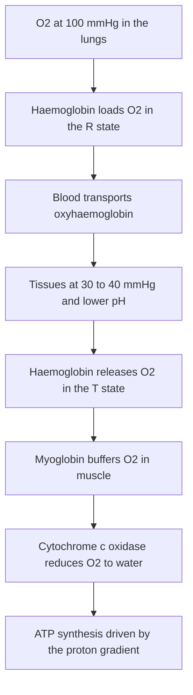
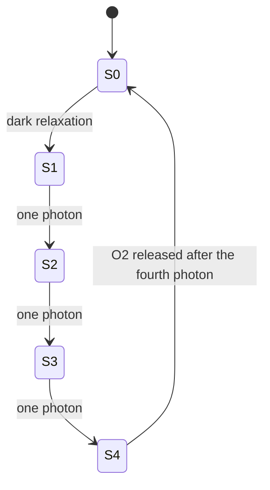
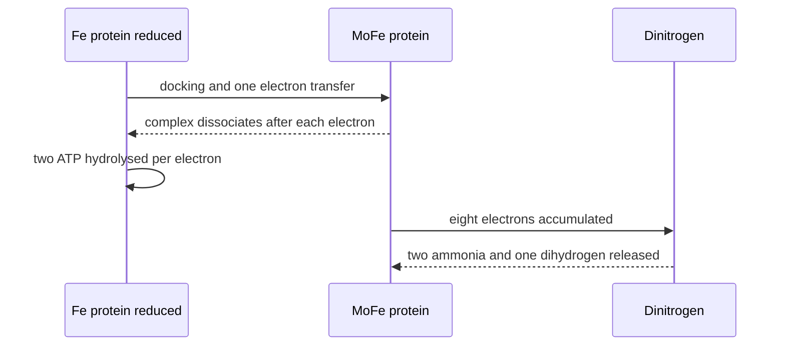
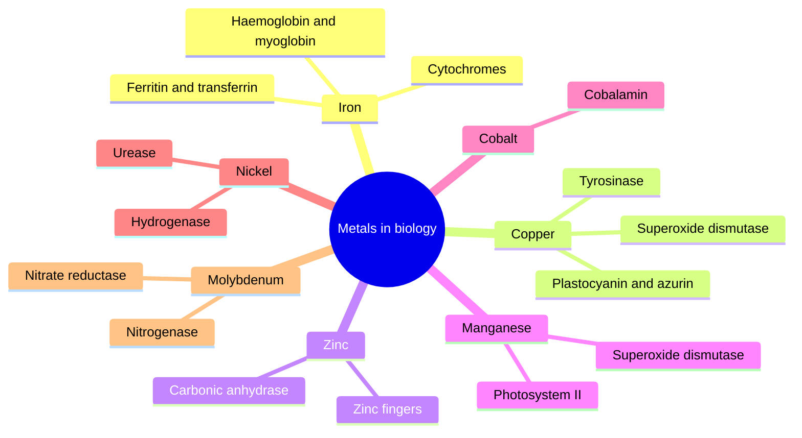

# Chapter 5 — Bioinorganic Chemistry

> **Level:** University (Level 5 — Inorganic Chemistry)
> **Estimated study time:** 7 hours (5 h reading + 2 h exercises)
> **Prerequisites:** [Transition Metals](02-transition-metals.md); [Coordination Compounds](03-coordination-compounds.md)
> **Difficulty:** ★★★★★ (5/5)
> **Related chapters:** [Level 5 index](README.md); [Organometallic Compounds](04-organometallic-compounds.md); [Biochemistry](../09-biochemistry/README.md)

---

## 1. Learning Objectives

After working through this chapter you will be able to:

- Explain why biology uses the metal ions it does, in terms of availability, Lewis acidity, redox potential and ligand preference.
- Describe the coordination environments of the common metalloprotein sites and the donor atoms that define them.
- Explain the structure, spin-state change and cooperativity of haemoglobin, and the roles of myoglobin, cytochromes, ferritin and transferrin.
- Distinguish the copper sites of plastocyanin, azurin, tyrosinase and superoxide dismutase, and state the function of each.
- Describe the catalytic mechanism of carbonic anhydrase and the structural role of zinc fingers.
- Outline the S-state cycle of the oxygen-evolving complex of photosystem II.
- Identify the metal and cofactor in cobalamin, urease, hydrogenase and nitrogenase, and state the reaction each catalyses.
- Explain the roles of sodium, potassium and calcium in signalling and homeostasis.
- Account for the toxicity of lead, mercury, cadmium and arsenic and describe the chelating agents used to treat poisoning.
- Explain what EPR, Mössbauer and X-ray absorption spectroscopy reveal about metal centres.

---

## 2. Introduction

Roughly one third of all proteins require a metal ion to function, and the list of metals used is short: sodium, potassium, magnesium, calcium, manganese, iron, cobalt, nickel, copper, zinc and molybdenum, with vanadium and tungsten in a few specialised systems. This economy is not arbitrary. It reflects the abundance of the elements in the environment, the solubility of their ions, the range of oxidation states they can access and the rates at which they exchange ligands.

Bioinorganic chemistry studies the interface between coordination chemistry and biology. Its central question is how a protein — a folded polymer of amino acids with a low dielectric constant and a precisely arranged set of donor groups — turns a metal ion into a selective catalyst. The protein does three things that a solvent cannot: it holds the metal in an unusual geometry, it excludes water from sites where water would compete, and it positions substrates at a fixed distance and orientation. The result is a rate enhancement that can exceed $10^{10}$ over the uncatalysed reaction and a selectivity that no small-molecule catalyst matches.

The subject also explains why metals are toxic. The same properties that make a metal useful — high charge density, softness, redox activity, similarity to an essential ion — make it dangerous when it appears in the wrong place. Lead displaces zinc and calcium, mercury binds thiols, cadmium mimics zinc and generates oxidative stress, and arsenate mimics phosphate. The treatment of metal poisoning is applied coordination chemistry: a chelating agent with a higher affinity for the toxic metal than for the enzyme that the metal has hijacked.

This chapter surveys the main systems by metal, then treats homeostasis, toxicity and therapy, and closes with the spectroscopic methods that made the field possible. It assumes the ligand-field and stability-constant material of Chapter 3 and enough biochemistry to know what an enzyme and a protein fold are. The treatment of mechanism is mechanistic rather than structural: crystal structures are cited where they settle a question, not catalogued.

---

## 3. Fundamental Concepts

### 3.1 Why biology chose these metals

Four criteria determine which metal an organism uses.

**Availability.** Iron is the fourth most abundant element in the crust and the most abundant transition metal; zinc, copper, manganese and cobalt are progressively scarcer, and the proteins that use them are correspondingly more specialised. The chemistry of life on Earth is a chemistry of the elements that were soluble in the early ocean: $\ce{Fe^2+}$ under anoxic conditions, and $\ce{Fe^3+}$ — almost insoluble at pH 7 — after oxygen appeared.

**Lewis acidity and charge density.** A metal ion polarises a bound water molecule or substrate and lowers the $\mathrm{p}K_{\text{a}}$ of a coordinated water. $\ce{Zn^2+}$ is the best compromise: it is a strong enough Lewis acid to activate water at physiological pH, but it is redox-inactive ($d^{10}$), so it cannot catalyse unwanted electron transfer. Magnesium(II) is used where the requirement is electrostatic — stabilising ATP and phosphate esters — because it is abundant, mobile and kinetically labile.

**Redox accessibility.** Iron, copper, manganese, molybdenum and cobalt have accessible oxidation states in the biological window between about $-0.5$ and $+1.0\ \text{V}$. Sodium, potassium, magnesium, calcium and zinc do not, and they are used for structure, signalling and electrostatics rather than for electron transfer.

**Ligand preference.** The hard and soft acids and bases principle predicts the donor sets. Hard $\ce{Mg^2+}$ and $\ce{Ca^2+}$ prefer carboxylate and phosphate oxygens; borderline $\ce{Fe^2+}$, $\ce{Co^2+}$, $\ce{Ni^2+}$ and $\ce{Zn^2+}$ prefer histidine nitrogen and mixed N/O sets; soft $\ce{Cu+}$ and $\ce{Hg^2+}$ prefer cysteine sulfur and methionine.

### 3.2 Coordination environments in metalloproteins

The donor atoms available to a protein are limited to the side chains of its amino acids and to the backbone:

| Donor | Residue | Typical metal | Function |
|---|---|---|---|
| Imidazole N | histidine | $\ce{Fe}$, $\ce{Cu}$, $\ce{Zn}$, $\ce{Mn}$ | most common donor; acid–base and redox |
| Thiolate S | cysteine | $\ce{Fe}$, $\ce{Cu}$, $\ce{Zn}$, $\ce{Mo}$ | soft donor; redox; structural |
| Thioether S | methionine | $\ce{Cu}$ | weak axial donor in blue copper proteins |
| Carboxylate O | aspartate, glutamate | $\ce{Ca}$, $\ce{Mg}$, $\ce{Fe}$ | hard donor; charge neutralisation |
| Phenolate O | tyrosine | $\ce{Fe}$, $\ce{Cu}$, $\ce{Mn}$ | redox-active; can be oxidised to a radical |
| Hydroxyl O | serine, threonine | $\ce{Mn}$, $\ce{Ca}$ | occasional donor |
| Backbone carbonyl O | any residue | $\ce{Ca}$, $\ce{Mg}$ | structural |

Three features distinguish a protein site from a small-molecule complex.

**Low dielectric.** The interior of a protein has a dielectric constant of about $4$, against $78$ for water. Electrostatic interactions are therefore much stronger, and the protein can stabilise a high or unusual oxidation state that water would not.

**Constrained geometry.** The protein fold holds the metal in a geometry that may be strained relative to the ideal. The **entatic state** is the proposal that this strain raises the ground-state energy of the metal and lowers the activation barrier for the reaction it must catalyse. The idea is qualitative but useful: blue copper sites are distorted tetrahedral rather than square planar, and the distortion facilitates the change between copper(II) and copper(I).

**Exclusion of water.** A buried metal site has no competing solvent. Where water is required as a substrate, it is admitted through a specific channel and held in place, as in carbonic anhydrase.

### 3.3 Iron

**Haemoglobin and myoglobin.** Haemoglobin is a tetramer of two $\alpha$ and two $\beta$ subunits, each carrying a haem $b$ group — an iron(II) protoporphyrin IX complex — held in a hydrophobic pocket. Myoglobin is a monomer with a single haem. The iron is coordinated by four pyrrole nitrogens, by the imidazole of a conserved histidine (the proximal histidine F8), and by water or dioxygen in the sixth position; a second histidine (the distal histidine E7) hydrogen-bonds to the bound dioxygen and discourages carbon monoxide binding.

Deoxyhaemoglobin is in the **T state**: the iron(II) is high spin and too large to fit into the porphyrin plane, so it sits about $40\ \text{pm}$ out of plane towards the proximal histidine. Binding of dioxygen gives the **R state**: dioxygen is a strong-field ligand, the iron becomes low spin and moves into the plane, and the movement is transmitted through the proximal histidine and the F helix to the subunit interfaces. The change in quaternary structure raises the oxygen affinity of the remaining subunits, so binding is **cooperative**. The oxygen dissociation curve is sigmoid rather than hyperbolic, and the empirical Hill coefficient is about $2.8$ for human haemoglobin against $1.0$ for myoglobin.

Cooperative binding is the reason haemoglobin can load oxygen in the lungs at $p\ce{O2} \approx 100\ \text{mmHg}$ and unload it in the tissues at $p\ce{O2} \approx 30$–$40\ \text{mmHg}$, whereas myoglobin, with a much higher affinity, would not release it. Three allosteric effectors tune the curve. Protons lower the affinity (the **Bohr effect**), which is why active muscle, which produces acid and carbon dioxide, extracts more oxygen. Carbon dioxide binds to the N-terminal amino groups as carbamate and stabilises the T state. 2,3-Bisphosphoglycerate binds in the central cavity of the T state and lowers the affinity, which is the basis of adaptation to high altitude.

**Cytochromes.** Cytochromes are haem proteins that transfer electrons rather than bind oxygen. The haem is usually haem $c$, covalently attached to the protein through two thioether bonds, and the iron alternates between $+2$ and $+3$. The protein tunes the reduction potential over a range of about $0.8\ \text{V}$ by adjusting the hydrophobicity of the pocket and the donor set. Cytochrome $c$ transfers electrons from complex III to complex IV of the respiratory chain; cytochrome P450 hydroxylates substrates using a high-valent iron(IV) oxo intermediate.

**Ferritin and transferrin.** Iron is essential but toxic when free, because it catalyses the Fenton reaction and generates hydroxyl radicals. **Transferrin** binds two iron(III) ions with high affinity ($\log K \approx 20$) using two tyrosinate oxygens, one histidine nitrogen and a synergistically bound carbonate ion; the diferric complex is taken up by receptor-mediated endocytosis, and the iron is released in the acidic endosome. **Ferritin** is a hollow 24-subunit shell that stores up to about $4500$ iron atoms as a ferrihydrite-like iron(III) oxyhydroxide core; iron enters as iron(II), is oxidised at a ferroxidase site, and is released in a controlled way when needed.

### 3.4 Copper

Copper is used where a single-electron redox couple is required at a potential above that of iron.

**Type I copper.** The blue copper proteins — plastocyanin, azurin, stellacyanin — have a single copper ion coordinated by two histidine nitrogens and one cysteine sulfur in a distorted tetrahedral geometry, with a methionine sulfur at a longer axial distance. The intense blue colour ($\varepsilon \approx 2000$–$6000\ \text{dm}^3\ \text{mol}^{-1}\ \text{cm}^{-1}$ at about $600\ \text{nm}$) is a ligand-to-metal charge transfer from the cysteine thiolate. The EPR spectrum has an unusually small copper hyperfine coupling, which is diagnostic of the highly covalent site. Plastocyanin transfers electrons from cytochrome $f$ to photosystem I; azurin is a small electron carrier in bacteria.

**Type II copper.** A normal tetragonal copper site with a high hyperfine coupling constant, found in superoxide dismutase and in amine oxidases.

**Type III copper.** A dinuclear copper site with antiferromagnetic coupling through a bridging ligand, which makes the site EPR-silent. Tyrosinase and haemocyanin use this motif. **Tyrosinase** catalyses the hydroxylation of tyrosine to DOPA and the oxidation of DOPA to dopaquinone, the first two steps of melanin biosynthesis; the dinuclear centre binds dioxygen and performs both reactions at the same site.

**Superoxide dismutase.** The Cu/Zn enzyme catalyses the dismutation of superoxide:

$$ \ce{2O2^.-(aq) + 2H+(aq) -> H2O2(aq) + O2(g)} $$

The copper centre is reduced by one superoxide and reoxidised by a second; the zinc plays a structural role and does not change oxidation state. The enzyme is one of the fastest known, with a rate constant near $10^{9}\ \text{dm}^3\ \text{mol}^{-1}\ \text{s}^{-1}$, close to the diffusion limit.

**Cytochrome $c$ oxidase.** The terminal enzyme of the respiratory chain reduces dioxygen to water. It contains two copper centres — the dinuclear $\ce{Cu_A}$ site that receives electrons and the $\ce{Cu_B}$ site that is coupled to haem $a_3$ — and two haem groups. Four electrons and four protons reduce one dioxygen molecule, and four additional protons are pumped across the membrane, so the enzyme contributes directly to the proton gradient that drives ATP synthesis.

### 3.5 Zinc

Zinc is the second most abundant transition metal in the body and is present in more than three thousand human proteins. It has three roles.

**Catalytic.** **Carbonic anhydrase** catalyses the hydration of carbon dioxide:

$$ \ce{CO2(aq) + H2O(l) <=> HCO3-(aq) + H+(aq)} $$

The zinc ion is coordinated by three histidine nitrogens and a water molecule. The zinc lowers the $\mathrm{p}K_{\text{a}}$ of the bound water from about $15.7$ to about $7$, so a significant fraction of the enzyme is present as a zinc hydroxide at physiological pH. The hydroxide attacks the carbon dioxide carbon, and the resulting bicarbonate is displaced by a water molecule, which is then deprotonated to regenerate the hydroxide. The catalytic constant is about $10^{6}\ \text{s}^{-1}$ per site, a rate enhancement of about $10^{7}$ over the uncatalysed reaction, and the enzyme is among the fastest known.

**Structural.** **Zinc fingers** are small domains in which a zinc ion is tetrahedrally coordinated by two cysteine and two histidine residues (the $\ce{Cys2His2}$ class) or by other combinations. The zinc holds the folded structure together so that the finger can insert into the major groove of DNA and recognise a specific base sequence. Zinc fingers are the most common DNA-binding motif in eukaryotes and are the basis of designed genome-editing nucleases.

**Regulatory.** Zinc is stored in synaptic vesicles and modulates the activity of receptors and enzymes; it is also a signal in immune cells.

### 3.6 Manganese and photosystem II

Photosystem II uses light to oxidise water, and the reaction is the source of essentially all the oxygen in the atmosphere:

$$ \ce{2H2O(l) -> O2(g) + 4H+(aq) + 4e-} \qquad E^\circ = +1.23\ \text{V at pH 0} $$

The catalytic centre is the **oxygen-evolving complex**, a $\ce{Mn4CaO5}$ cluster held in a protein pocket and coordinated by carboxylate and histidine residues. The four manganese ions cycle through oxidation states as the complex accumulates four oxidising equivalents, one per photon, in the **S-state cycle** (Kok cycle): $\ce{S0 -> S1 -> S2 -> S3 -> S4}$, with the oxygen–oxygen bond formed at $\ce{S4}$ and dioxygen released as the cycle returns to $\ce{S0}$. The resting state is $\ce{S1}$, which contains two manganese(III) and two manganese(IV) ions; the $\ce{S2}$ state is EPR-active and is one of the best-characterised intermediates.

The electrons are removed from the cluster by a tyrosine radical, which is in turn reduced by the chlorophyll dimer P680, and the chlorophyll is re-reduced by electrons from water through the cluster. Calcium is essential for activity, and chloride is required as a cofactor. The structure of the cluster was resolved by X-ray crystallography at increasing resolution from 2001 onwards, and the mechanism of O–O bond formation remains an active research question.

### 3.7 Cobalt and cobalamin

**Cobalamin** (vitamin B$_{12}$) is a cobalt corrin complex. The cobalt is normally in the $+3$ state, coordinated by the four nitrogens of the corrin ring and by a dimethylbenzimidazole nucleotide that hangs below the ring; the sixth, upper coordination site carries the functional group — adenosyl, methyl, hydroxyl or cyanide.

Two cofactor forms are important. **Adenosylcobalamin** is used by mutases that rearrange carbon skeletons, such as methylmalonyl-CoA mutase, which converts methylmalonyl-CoA to succinyl-CoA; the reaction proceeds by homolysis of the cobalt–carbon bond to give cob(II)alamin and an adenosyl radical. **Methylcobalamin** is the cofactor of methionine synthase, which transfers a methyl group from methyltetrahydrofolate to homocysteine; the cobalt alternates between $+1$ and $+3$.

Dietary deficiency causes pernicious anaemia and neurological damage. The vitamin is absorbed through a complex with intrinsic factor secreted by the stomach, which is why autoimmune destruction of the parietal cells causes the disease.

### 3.8 Nickel

**Urease** hydrolyses urea to ammonia and carbon dioxide:

$$ \ce{(NH2)2CO(aq) + H2O(l) -> 2NH3(aq) + CO2(g)} $$

The active site contains two nickel(II) ions bridged by a hydroxide and by a carbamylated lysine residue. One nickel binds urea, the other provides the nucleophilic hydroxide, and the reaction proceeds through a tetrahedral intermediate. Urease was the first enzyme to be crystallised, by James Sumner in 1926, and the demonstration that it is a protein rather than a colloid was part of the argument that enzymes are proteins.

**Hydrogenase** catalyses the reversible oxidation of dihydrogen:

$$ \ce{H2(g) <=> 2H+(aq) + 2e-} $$

The [NiFe] and [FeFe] hydrogenases contain dinuclear metal centres with carbon monoxide and cyanide ligands — a remarkable case of biological organometallic chemistry. The enzyme is a model for artificial hydrogen production, and its active site has inspired synthetic catalysts.

### 3.9 Molybdenum and nitrogenase

Molybdenum is used in enzymes that catalyse oxygen-atom transfer, and molybdenum and vanadium are the metals of biological nitrogen fixation.

**Nitrogenase** reduces dinitrogen to ammonia:

$$ \ce{N2(g) + 8H+(aq) + 8e- -> 2NH3(aq) + H2(g)} $$

The enzyme is a two-component system: the iron protein transfers electrons to the molybdenum–iron protein, and the latter contains the **FeMo cofactor**, a $\ce{MoFe7S9C}$ cluster with homocitrate coordinated to molybdenum. Each molecule of dinitrogen requires eight electrons and at least sixteen ATP, and the reaction always evolves one molecule of dihydrogen, so the stoichiometry is not the simple six-electron reduction. The nitrogenase reaction is the biological counterpart of the Haber–Bosch process and operates at ambient temperature and pressure, which is why its mechanism is a long-standing target for synthetic chemists.

### 3.10 Sodium, potassium and calcium

**Sodium and potassium** carry the action potential. The **$\ce{Na+/K+}$-ATPase** pumps three sodium ions out and two potassium ions in per molecule of ATP hydrolysed, generating the gradients that neurons and muscle cells use. The pump is electrogenic — one net positive charge leaves per cycle — and consumes a large fraction of the resting metabolic energy of the brain.

The **action potential** depends on the opening of voltage-gated sodium channels, which allow sodium to rush in and depolarise the membrane, followed by potassium channels that repolarise it. The ion gradients are maintained by the pump, and the selectivity of the channels depends on a narrow pore that strips the hydration shell from the ion and coordinates it with backbone carbonyls.

**Calcium** is a second messenger. The cytosolic concentration is kept near $10^{-7}\ \text{mol L}^{-1}$ against $10^{-3}\ \text{mol L}^{-1}$ outside the cell, so a small influx produces a large relative change. Calcium binds to **calmodulin**, a small protein with four EF-hand motifs, and the calcium–calmodulin complex activates kinases, phosphatases and the contractile apparatus. In muscle, calcium binds troponin C and triggers contraction; the **SERCA** pump returns calcium to the sarcoplasmic reticulum at the cost of one ATP per two calcium ions.

### 3.11 Metal homeostasis and toxicity

Organisms regulate metal uptake, distribution, storage and excretion with transporters, chaperones and storage proteins. When regulation fails, or when a non-essential metal enters the same pathways, toxicity follows. The mechanisms are always chemical:

**Lead.** $\ce{Pb^2+}$ resembles $\ce{Ca^2+}$ and $\ce{Zn^2+}$ in charge and size, and it inhibits $\delta$-aminolevulinic acid dehydratase and ferrochelatase in the haem biosynthetic pathway, causing anaemia. It also interferes with calcium signalling and with N-methyl-D-aspartate receptors in the brain, which is why chronic exposure impairs cognitive development.

**Mercury.** $\ce{Hg^2+}$ and methylmercury have a very high affinity for thiolates and bind to cysteine residues in enzymes and in the protein glutathione. Methylmercury is lipophilic, crosses the blood–brain barrier and the placenta, and bioaccumulates in fish; the Minamata outbreak established the neurotoxicity of the methylmercury ion. Mercury also inhibits selenoenzymes by binding the selenocysteine residue.

**Cadmium.** $\ce{Cd^2+}$ mimics $\ce{Zn^2+}$ and is taken up by zinc transporters. It binds metallothionein, a cysteine-rich protein that normally handles zinc and copper, and it depletes glutathione, producing oxidative stress. The kidney is the target organ; the itai-itai disease in Japan was caused by cadmium-contaminated rice.

**Arsenic.** Arsenate ($\ce{AsO4^3-}$) is a phosphate analogue and uncouples oxidative phosphorylation by replacing phosphate in the glyceraldehyde-3-phosphate dehydrogenase reaction. Arsenite ($\ce{As(OH)3}$) binds thiols, including the lipoic acid cofactor of pyruvate dehydrogenase, and inhibits pyruvate metabolism. The toxicity of arsenic is therefore both a phosphate-mimicry problem and a thiol problem.

### 3.12 Chelation therapy and metallodrugs

**Chelation therapy** removes a toxic metal by administering a ligand that binds it more strongly than the biological target and is excreted. The choice of ligand follows hard–soft theory:

| Agent | Donor set | Metal targeted | Clinical use |
|---|---|---|---|
| EDTA (as $\ce{CaNa2EDTA}$) | $\ce{N2O4}$ | $\ce{Pb^2+}$ | lead poisoning |
| Dimercaprol (BAL) | $\ce{S2}$ | $\ce{As}$, $\ce{Hg}$ | arsenic and mercury poisoning |
| DMSA (succimer) | $\ce{S2O2}$ | $\ce{Pb^2+}$, $\ce{Hg^2+}$ | oral lead chelation in children |
| Penicillamine | $\ce{NS}$ | $\ce{Cu^2+}$ | Wilson's disease |
| Deferoxamine | hydroxamate $\ce{O}$ | $\ce{Fe^3+}$ | iron overload (thalassaemia) |
| Deferasirox | $\ce{N2O2}$ | $\ce{Fe^3+}$ | oral iron chelation |

The design constraint is selectivity: EDTA binds calcium as well as lead, so it is given as the calcium complex to avoid hypocalcaemia, and it is not used for iron because it is not selective enough.

**Metallodrugs.** Cisplatin and its analogues are platinum(II) complexes that cross-link DNA (Chapter 3). **Auranofin** is a gold(I) phosphine complex with a thioglucose ligand, used for rheumatoid arthritis and under investigation as an anticancer and antiparasitic agent; gold(I) is soft and binds thiols, and its anti-inflammatory action is attributed to inhibition of thioredoxin reductase and of NF-$\kappa$B signalling. **Lithium carbonate** remains the standard treatment for bipolar disorder, although its mechanism is still debated; it inhibits glycogen synthase kinase-3 and inositol monophosphatase. **Bismuth** compounds are used against *Helicobacter pylori*, and **silver sulfadiazine** releases silver ions that bind bacterial thiols and DNA.

### 3.13 Imaging agents

Metal complexes are used to make the inside of the body visible. **Gadolinium(III)** has seven unpaired electrons and shortens the relaxation time of nearby water protons, so its chelates — Gd-DTPA and Gd-DOTA — increase contrast in magnetic resonance imaging. The ligand must be kinetically inert, because free $\ce{Gd^3+}$ is toxic and deposits in tissue. **Technetium-99m** is a gamma emitter with a six-hour half-life and is used in more than $80\%$ of nuclear medicine scans; it is administered as complexes such as sestamibi for cardiac imaging. **Iodine** and **barium sulfate** are used as X-ray contrast agents, and **fluorine-18** labelled deoxyglucose is the standard positron-emission tomography tracer for metabolically active tissue.

### 3.14 Spectroscopic probes

Three methods dominate the study of metal sites, and each answers a different question.

**Electron paramagnetic resonance** detects unpaired electrons. It identifies the oxidation state and geometry of copper(II), manganese(II), iron(III) and radicals such as the tyrosyl radical of photosystem II. The $g$ values and the hyperfine coupling to the metal nucleus are fingerprints: type I copper has a small copper hyperfine coupling, type II copper a large one, and the difference is how the two sites were distinguished long before their structures were known.

**Mössbauer spectroscopy** uses the recoil-free absorption of gamma rays by iron-57. The **isomer shift** reports the oxidation state and covalency, and the **quadrupole splitting** reports the electric field gradient and therefore the spin state and geometry. Iron(II) and iron(III) are cleanly separated, and high-spin and low-spin forms of the same oxidation state differ in both parameters. The method is ideal for haem and iron–sulfur proteins.

**X-ray absorption spectroscopy** uses synchrotron radiation. The **XANES** region near the absorption edge reports the oxidation state and the coordination geometry, and the **EXAFS** region above the edge gives the distances and numbers of neighbouring atoms. XAS works on dilute, non-crystalline samples and is therefore the method of choice for metalloproteins that resist crystallisation; it was used to determine the manganese–manganese distances in the oxygen-evolving complex before the crystal structure was available.

---
CHEM_CHUNK_EOF
## 4. Detailed Scientific Explanation

### 4.1 The thermodynamics of metal selection

The preference of a metal for a donor set is quantified by the formation constant, and the pattern across the first row is the Irving–Williams series. For a protein, the relevant comparison is not between metals in water but between metals in competition for the same site, and the selectivity is the ratio of the two formation constants:

$$ \Delta\Delta G^\circ = -RT\ln\frac{\beta_{\text{M1}}}{\beta_{\text{M2}}} $$

A factor of $10^{6}$ in the ratio corresponds to $34\ \text{kJ mol}^{-1}$ at $298\ \text{K}$, which is enough to make a site essentially specific. This is why a protein can select $\ce{Zn^2+}$ over the tenfold more abundant $\ce{Mg^2+}$: the two ions differ in radius, in preferred coordination number and in ligand-field preference, and a site with three histidines and a cysteine binds zinc far more strongly than magnesium.

Redox selectivity works the same way. The physiological window is set by the redox couples available to the cell: the $\ce{NAD+/NADH}$ couple at about $-0.32\ \text{V}$, the $\ce{O2/H2O}$ couple at $+0.82\ \text{V}$ at pH 7, and the thiol/disulfide couples in between. A metal that cannot reach a potential inside this window cannot be used for electron transfer, which is why zinc and calcium are used for structure and signalling rather than for redox catalysis.

The **hard and soft acids and bases** classification explains the donor preferences. $\ce{Fe^3+}$ is hard and prefers carboxylate and phenolate oxygens; $\ce{Fe^2+}$ is borderline and accepts histidine and sulfur; $\ce{Cu+}$ is soft and requires cysteine or methionine; $\ce{Cu^2+}$ is intermediate and accepts histidine. The same principle explains toxicity: a soft toxic metal such as $\ce{Hg^2+}$ out-competes zinc for cysteine sites.

### 4.2 How proteins tune redox potentials

A metal ion in a protein can have a reduction potential more than $1\ \text{V}$ away from that of the same ion in water. Four mechanisms do the tuning.

**Ligand donor set.** Replacing a hard oxygen donor by a soft sulfur donor stabilises the softer, lower oxidation state and lowers the potential. The classic demonstration is the series of blue copper proteins, where the cysteine thiolate stabilises copper(II) and produces a potential of $+0.3$ to $+0.5\ \text{V}$, well above the aquo couple.

**Hydrogen bonding and protonation.** A hydrogen bond to a coordinated ligand changes its donor strength. In cytochrome $c$, the methionine ligand is hydrogen-bonded in a way that raises the potential by about $0.1\ \text{V}$ relative to a solvent-exposed analogue.

**Electrostatics.** A nearby charged residue shifts the potential by tens of millivolts through the low-dielectric medium. The effect is used in the respiratory chain to arrange the cytochromes in order of increasing potential, so that electrons flow in one direction.

**Conformational strain.** The entatic state raises the energy of the resting geometry and lowers the reorganisation energy for the change of oxidation state. The blue copper site is the best-documented case: the copper is held in a geometry intermediate between the preferred four-coordinate copper(II) and copper(I) structures, so both oxidation states are accommodated with little structural change. The result is a very fast electron transfer, with rate constants of $10^{4}$–$10^{6}\ \text{s}^{-1}$ over distances of $1$–$2\ \text{nm}$.

**Electron transfer theory** makes the distance dependence quantitative. The rate falls exponentially with distance,

$$ k_{\text{ET}} \propto \exp\left(-\beta r\right) $$

with $\beta \approx 10\ \text{nm}^{-1}$ for a protein medium, so a $1\ \text{nm}$ increase in distance slows transfer by about $e^{10} \approx 2 \times 10^{4}$. This is why redox centres in a protein are placed at specific distances and why the respiratory chain is a chain of closely spaced carriers rather than a solution of freely diffusing ions.

### 4.3 Haemoglobin and the two-state model

The **Monod–Wyman–Changeux** model treats haemoglobin as an equilibrium between two quaternary states, T (low affinity) and R (high affinity), with the ligand binding preferentially to R. In the absence of ligand the equilibrium lies far towards T; as oxygen binds, the equilibrium shifts towards R, and the remaining sites become easier to fill. The model reproduces the sigmoid curve and the Hill coefficient of about $2.8$ without requiring direct interaction between the haem sites.

The structural basis is the iron–histidine linkage described in Section 3.3. In the T state the iron is high spin and out of plane; oxygen binding converts it to low spin and pulls it into the plane, dragging the F helix and breaking the salt bridges that hold the T state together. The salt bridges are between the C-terminal carboxylates and the opposite subunits, and their rupture is the origin of the Bohr effect: protonation of these groups stabilises the T state, so lowering the pH lowers the oxygen affinity.

**Mutant haemoglobins** test the model. Sickle-cell haemoglobin carries a single glutamate-to-valine substitution at position 6 of the $\beta$ chain; the hydrophobic valine creates a sticky patch that allows deoxyhaemoglobin to polymerise into fibres, deforming the red cell. The mutant has a higher oxygen affinity in the deoxy state and a lower solubility, and the pathology is a direct consequence of the quaternary structure.

**Carbon monoxide** binds to the iron(II) haem with an affinity about $200$ times that of oxygen in free haem, but only about $20$ times in haemoglobin because the distal histidine forces the bound CO to bend. Even so, CO poisoning shifts the remaining sites to the R state and prevents oxygen release, so the victim suffocates at the tissue level even when arterial oxygen is adequate.

### 4.4 Carbonic anhydrase: a complete mechanism

The catalytic cycle of carbonic anhydrase II has two half-reactions.

In the first, the zinc-bound hydroxide attacks the carbon dioxide carbon to give bicarbonate:

$$ \ce{[Zn-OH]^-(aq) + CO2(aq) -> [Zn-OCO2H]^-(aq) -> [Zn-OH2]+(aq) + HCO3^-(aq)} $$

In the second, a water molecule displaces the bicarbonate and is deprotonated, restoring the hydroxide:

$$ \ce{[Zn-OH2]^+(aq) + B(aq) -> [Zn-OH]^-(aq) + BH+(aq)} $$

The base B is a histidine residue that shuttles protons to the bulk solvent through a chain of hydrogen-bonded waters; the proton transfer is rate-limiting in the absence of a buffer and is accelerated by the buffer in solution.

Three features make the enzyme fast. The zinc lowers the $\mathrm{p}K_{\text{a}}$ of the bound water to about $7$, so the nucleophile is present at physiological pH. The hydrophobic pocket next to the zinc binds carbon dioxide and orients it for attack. The proton shuttle removes the product proton before it can reverse the reaction. The result is a catalytic constant of about $10^{6}\ \text{s}^{-1}$, within an order of magnitude of the diffusion limit for carbon dioxide.

### 4.5 Photosystem II and the energetics of water oxidation

Water is a poor electron donor: the $\ce{O2/H2O}$ couple is at $+0.82\ \text{V}$ at pH 7, and oxidising water requires an oxidant more positive than that. Photosystem II generates one: the excited chlorophyll P680* donates an electron to a pheophytin, leaving P680$^+$ with a potential estimated at $+1.1$ to $+1.3\ \text{V}$, strong enough to oxidise the manganese cluster and, ultimately, water.

The **S-state cycle** accumulates four oxidising equivalents. Each photon produces charge separation, and the oxidised P680$^+$ takes an electron from a tyrosine residue (Tyr$_{\text{Z}}$), which takes an electron from the manganese cluster. The cluster therefore advances by one oxidation state per photon, and after four advances it has accumulated enough oxidising power to form the O–O bond and release dioxygen.

The cycle is written $\ce{S0 -> S1 -> S2 -> S3 -> S4}$ with $\ce{S4}$ decaying to $\ce{S0}$ plus dioxygen. The $\ce{S1}$ state is the dark-stable resting state, and the $\ce{S2}$ state is EPR-active, which is how the cycle was first characterised. The manganese ions are oxidised in sequence, with the calcium ion playing a structural and possibly catalytic role; the mechanism of O–O bond formation is still debated between a radical coupling and a nucleophilic attack pathway.

The overall energy budget is striking. Four photons at $680\ \text{nm}$ deliver about $700\ \text{kJ mol}^{-1}$ of energy, of which about $470\ \text{kJ mol}^{-1}$ is stored in the oxygen–water couple; the rest is lost as heat and as the entropy of the charge-separation machinery. The quantum requirement of about eight to ten photons per oxygen molecule makes photosynthesis roughly $30\%$ efficient in energy terms, which is remarkable for a biological system operating at ambient temperature.

### 4.6 Nitrogenase: coupling ATP to electron transfer

Nitrogenase reduces dinitrogen at ambient temperature and pressure, a reaction that the chemical industry performs at $450\ ^\circ\mathrm{C}$ and $200\ \text{bar}$. The enzyme pays for the difference with ATP.

The **iron protein** binds ATP and transfers one electron at a time to the **molybdenum–iron protein**. The transfer is accompanied by ATP hydrolysis, and the complex dissociates after each electron transfer, so the cycle is:

$$ \ce{Fe_{red} + ATP -> Fe_{red}.ATP ->[MoFe] Fe_{ox} + MoFe_{red} + ADP + P_i} $$

Two ATP are hydrolysed per electron transferred. The reduction of one dinitrogen molecule requires eight electrons, so at least sixteen ATP are consumed, and one molecule of dihydrogen is obligatorily evolved. The hydrogen evolution is not a waste: it is thought to be required to reduce the metal cluster to a state that can bind dinitrogen, and it is one reason the enzyme is so energy-expensive.

The **FeMo cofactor** is a $\ce{MoFe7S9C}$ cluster with a central carbide and homocitrate coordinated to molybdenum. The substrate is thought to bind at a coordinatively unsaturated iron site after the cluster is reduced, and the mechanism proceeds through diazene and hydrazine intermediates. The enzyme is inhibited by oxygen, which destroys the metal clusters, so nitrogen fixation is confined to anaerobic organisms or to specialised heterocysts.

### 4.7 Metal trafficking and homeostasis

A cell cannot allow free metal ions to accumulate, because the same reactivity that makes them useful makes them dangerous. Metal ions are therefore chaperoned from the point of entry to the point of use.

**Copper** enters through the CTR1 transporter, is delivered by chaperones (ATOX1 for the copper-transporting ATPases, CCS for superoxide dismutase, COX17 for cytochrome $c$ oxidase) and is exported by ATP7A and ATP7B. Mutations in ATP7B cause Wilson's disease, in which copper accumulates in the liver and brain; mutations in ATP7A cause Menkes disease, in which copper is trapped in the intestine and the body is copper-deficient.

**Iron** is absorbed by enterocytes through DMT1, exported through ferroportin, and carried by transferrin. The hormone hepcidin controls ferroportin degradation and therefore the rate of iron release into plasma; the system is a feedback loop that keeps plasma iron within a narrow range. Disorders of the loop cause haemochromatosis (iron overload) and the anaemia of chronic disease (iron restriction).

**Zinc** is imported by ZIP transporters and exported by ZnT transporters, and its intracellular concentration is buffered by metallothionein, a cysteine-rich protein that binds up to seven zinc ions. Metallothionein also binds cadmium and mercury, which is why it is both a detoxification agent and a target of toxicity.

**Calcium** is buffered in the cytosol at about $10^{-7}\ \text{mol L}^{-1}$ by pumps, exchangers and binding proteins; the low resting concentration is what makes a transient rise a usable signal.

### 4.8 From bioinorganic chemistry to bioinspired catalysis

The study of metalloenzymes has produced synthetic catalysts that mimic their active sites. The hydrogenase active site has inspired nickel and iron complexes that evolve hydrogen at low overpotential. The manganese cluster of photosystem II has inspired manganese and cobalt oxides for water oxidation, and the artificial leaf is an engineering attempt to couple such catalysts to a photovoltaic. Carbonic anhydrase has inspired zinc complexes for carbon capture, and nitrogenase has inspired molybdenum and iron complexes for dinitrogen reduction.

The general lesson is that the protein does not perform magic; it provides a specific coordination environment and a controlled proton-transfer pathway. Once those are understood, the same principles can be reproduced, at least in part, in a synthetic system.

---

## 5. Visual Diagrams

**Figure 5.1 — The oxygen pathway from lung to mitochondrion.** The diagram shows why two oxygen-binding proteins with different affinities are needed. Haemoglobin must load at high $p\ce{O2}$ and unload at low $p\ce{O2}$, which requires a sigmoid curve and a moderate affinity; myoglobin must hold oxygen at the low tensions found in working muscle, which requires a hyperbolic curve and a high affinity. The final step is the only one that consumes oxygen chemically, and it is coupled to proton pumping and therefore to ATP synthesis.

**Figure 5.2 — The Kok S-state cycle of the oxygen-evolving complex.** Each photon advances the manganese cluster by one oxidising equivalent, and dioxygen is released only when four equivalents have accumulated. The cycle explains why oxygen evolution is inhibited by short flashes at low flash number and why the yield oscillates with a period of four, which was the original experimental evidence for the model. The dark-stable state is $\ce{S1}$, not $\ce{S0}$, and the numbering is conventional.

**Figure 5.3 — Electron transfer in nitrogenase.** The iron protein docks, transfers a single electron, and dissociates; the cycle must repeat eight times before one dinitrogen molecule can be reduced. The coupling of each electron transfer to the hydrolysis of two ATP is the reason the reaction is so expensive in energy, and the obligation to evolve dihydrogen means that the biological fixation of nitrogen is intrinsically less efficient than the industrial process, but it operates at ambient temperature and pressure.

**Figure 5.4 — A map of the metals discussed in this chapter and their principal biological roles.** The map is organised by metal rather than by function because the same metal usually appears in several unrelated roles. Iron is the most versatile, spanning oxygen transport, electron transfer and storage; zinc is the most abundant catalytic metal; copper specialises in single-electron chemistry at high potential; and molybdenum and nickel appear in the most demanding reductions, nitrogen fixation and hydrogen activation.

---

## 6. Mathematical Formulas

Oxygen binding is described by the Hill equation:

$$ Y = \frac{p\ce{O2}^{n}}{P_{50}^{n} + p\ce{O2}^{n}} $$

| Symbol | Meaning | SI unit |
|---|---|---|
| $Y$ | Fractional saturation | $1$ |
| $p\ce{O2}$ | Partial pressure of oxygen | $\text{kPa}$ (or mmHg) |
| $P_{50}$ | Partial pressure at half saturation | $\text{kPa}$ (or mmHg) |
| $n$ | Hill coefficient, dimensionless | $1$ |

A Hill coefficient of $1$ indicates independent sites and a hyperbolic curve; a value greater than $1$ indicates positive cooperativity and a sigmoid curve. Human haemoglobin has $n \approx 2.8$ and $P_{50} \approx 3.5\ \text{kPa}$ ($26\ \text{mmHg}$); myoglobin has $n = 1$ and $P_{50} \approx 0.3\ \text{kPa}$ ($2.8\ \text{mmHg}$).

The Gibbs energy available from a redox couple is

$$ \Delta G = -nF\Delta E, \qquad E = E^\circ - \frac{0.0592\ \text{V}}{n}\log Q $$

where $E^\circ$ is the standard potential at pH 0 and the second expression is the Nernst equation at $298\ \text{K}$. For a reaction that consumes or releases protons, the potential shifts by $0.0592\ \text{V}$ per pH unit divided by the number of electrons, which is why the $\ce{O2/H2O}$ couple falls from $+1.23\ \text{V}$ at pH 0 to $+0.82\ \text{V}$ at pH 7.

The selectivity of a metal-binding site between two competing ions is

$$ \Delta\Delta G^\circ = -RT\ln\frac{\beta_{\text{M1}}}{\beta_{\text{M2}}} $$

with $\beta$ the formation constants at the same pH and ionic strength. A tenfold preference costs $5.7\ \text{kJ mol}^{-1}$; a $10^{6}$-fold preference costs $34\ \text{kJ mol}^{-1}$.

The rate of electron transfer falls exponentially with distance:

$$ k_{\text{ET}} = k_0\exp\left(-\beta r\right) $$

with $\beta$ the decay constant in $\text{nm}^{-1}$ and $r$ the edge-to-edge distance in $\text{nm}$. For proteins $\beta \approx 10\ \text{nm}^{-1}$, so each additional nanometre slows transfer by a factor of about $2 \times 10^{4}$.

---

## 7. Chemical Equations

**Carbonic anhydrase.** The net reaction and the two half-reactions of the ping-pong mechanism.

$$ \ce{CO2(aq) + H2O(l) <=> HCO3-(aq) + H+(aq)} $$

$$ \ce{[Zn-OH]^-(aq) + CO2(aq) -> [Zn-OCO2H]^-(aq) -> [Zn-OH2]+(aq) + HCO3^-(aq)} $$

**Catalase.** The dismutation of hydrogen peroxide, catalysed by a haem enzyme.

$$ \ce{2H2O2(aq) -> 2H2O(l) + O2(g)} $$

**Superoxide dismutase.** The copper centre alternates between $+1$ and $+2$.

$$ \ce{2O2^.-(aq) + 2H+(aq) -> H2O2(aq) + O2(g)} $$

**Cytochrome $c$ oxidase.** Four electrons and four protons reduce one dioxygen molecule.

$$ \ce{O2(g) + 4e- + 4H+(aq) -> 2H2O(l)} $$

**Photosystem II.** Water is oxidised at the manganese cluster.

$$ \ce{2H2O(l) -> O2(g) + 4H+(aq) + 4e-} $$

**Nitrogenase.** The biological reduction of dinitrogen, with the obligatory hydrogen evolution.

$$ \ce{N2(g) + 8H+(aq) + 8e- -> 2NH3(aq) + H2(g)} $$

**Urease.** The hydrolysis of urea.

$$ \ce{(NH2)2CO(aq) + H2O(l) -> 2NH3(aq) + CO2(g)} $$

**The Fenton reaction.** Free iron(II) generates hydroxyl radicals; this is why iron must be sequestered.

$$ \ce{Fe^2+(aq) + H2O2(aq) -> Fe^3+(aq) + OH^.(aq) + OH-(aq)} $$

---

## 8. Worked Examples

### Worked Example 8.1 — Oxygen saturation and cooperativity

**Problem.** Human haemoglobin has $P_{50} = 26\ \text{mmHg}$ and $n = 2.8$. Calculate the fractional saturation at $p\ce{O2} = 100$, $40$ and $20\ \text{mmHg}$, and compare the unloading between the lungs and the tissues with that of myoglobin ($P_{50} = 2.8\ \text{mmHg}$, $n = 1$).

**Strategy.** Substitute into the Hill equation. For the comparison, calculate the myoglobin saturation at the same two pressures.

**Solution.** At $100\ \text{mmHg}$:

$$ Y = \frac{100^{2.8}}{26^{2.8} + 100^{2.8}} = \frac{3.96 \times 10^{5}}{3.96 \times 10^{5} + 9.15 \times 10^{3}} = 0.977 $$

At $40\ \text{mmHg}$:

$$ Y = \frac{40^{2.8}}{26^{2.8} + 40^{2.8}} = \frac{3.07 \times 10^{4}}{3.07 \times 10^{4} + 9.15 \times 10^{3}} = 0.770 $$

At $20\ \text{mmHg}$:

$$ Y = \frac{20^{2.8}}{26^{2.8} + 20^{2.8}} = \frac{4.40 \times 10^{3}}{4.40 \times 10^{3} + 9.15 \times 10^{3}} = 0.325 $$

Haemoglobin therefore releases $21\%$ of its oxygen between the lungs and resting tissue and $65\%$ at $20\ \text{mmHg}$. Myoglobin at $40\ \text{mmHg}$ is $93\%$ saturated and at $20\ \text{mmHg}$ is $88\%$ saturated, so it releases almost nothing over the same range.

**Check.** The calculated arterial saturation of $97.7\%$ agrees with the measured value of $97$–$98\%$ in healthy adults, which validates both the parameters and the equation. The steepness of the haemoglobin curve between $20$ and $40\ \text{mmHg}$ is the functional signature of cooperativity, and its absence in myoglobin is why myoglobin is a storage protein rather than a transport protein.

### Worked Example 8.2 — Oxygen-carrying capacity of blood

**Problem.** Blood contains about $15\ \text{g}$ of haemoglobin per $100\ \text{mL}$, and each gram of haemoglobin binds $1.34\ \text{mL}$ of dioxygen at standard conditions. Calculate the volume of oxygen carried by $5.0\ \text{L}$ of blood and the number of moles of dioxygen bound per mole of haemoglobin ($M = 64\,458\ \text{g mol}^{-1}$).

**Strategy.** Multiply the binding capacity per gram by the haemoglobin concentration and the blood volume. For the molar ratio, convert the volume of oxygen to moles using the molar volume at standard conditions.

**Solution.** The oxygen content is

$$ 1.34\ \text{mL g}^{-1} \times 15\ \text{g} = 20.1\ \text{mL per } 100\ \text{mL} $$

so $5.0\ \text{L}$ of blood carries $20.1 \times 50 = 1.0 \times 10^{3}\ \text{mL} = 1.0\ \text{L}$ of dioxygen. Per gram of haemoglobin, $1.34\ \text{mL}$ corresponds to

$$ n(\ce{O2}) = \frac{1.34 \times 10^{-3}\ \text{L}}{22.4\ \text{L mol}^{-1}} = 5.98 \times 10^{-5}\ \text{mol} $$

and one gram contains $1/64\,458 = 1.551 \times 10^{-5}\ \text{mol}$ of haemoglobin, so the ratio is $5.98/1.551 = 3.86 \approx 4$.

**Check.** The ratio of four dioxygen molecules per haemoglobin tetramer is the expected stoichiometry, and the calculated carrying capacity of $1.0\ \text{L}$ of oxygen in $5\ \text{L}$ of blood is close to the textbook value of about $1.0\ \text{L}$. Dissolved oxygen contributes only $0.015\ \text{L}$ at normal partial pressure, which is why haemoglobin is essential for animals larger than a few millimetres.

### Worked Example 8.3 — Selectivity of chelation therapy

**Problem.** $\log K$ for $\ce{PbY^2-}$ is $18.0$ and for $\ce{CaY^2-}$ is $10.7$. In blood, $[\ce{Ca^2+}] = 1.2 \times 10^{-3}\ \text{mol L}^{-1}$ and a lead-poisoned patient might have $[\ce{Pb^2+}] = 1.0 \times 10^{-7}\ \text{mol L}^{-1}$. Calculate the ratio of lead complex to calcium complex at equilibrium and comment on the clinical implications.

**Strategy.** The ratio of the two complexes is the ratio of the formation constants multiplied by the ratio of the free metal concentrations.

**Solution.** The equilibrium ratio is

$$ \frac{[\ce{PbY^2-}]}{[\ce{CaY^2-}]} = \frac{K_{\ce{Pb}}[\ce{Pb^2+}]}{K_{\ce{Ca}}[\ce{Ca^2+}]} = 10^{18.0 - 10.7} \times \frac{1.0 \times 10^{-7}}{1.2 \times 10^{-3}} $$

$$ = 2.0 \times 10^{7} \times 8.3 \times 10^{-5} = 1.7 \times 10^{3} $$

**Check.** Lead is bound about $1700$ times more than calcium despite being four orders of magnitude less abundant, so EDTA is selective enough to be therapeutically useful. The calculation also shows why EDTA is administered as the calcium complex: the free ligand would bind calcium and could cause hypocalcaemia, whereas $\ce{CaNa2EDTA}$ exchanges its calcium for lead only where the lead concentration is significant.

### Worked Example 8.4 — The energy cost of biological nitrogen fixation

**Problem.** Nitrogenase consumes at least $16$ molecules of ATP per molecule of dinitrogen reduced, and the standard free energy of ATP hydrolysis is $30.5\ \text{kJ mol}^{-1}$. Calculate the energy cost per mole of ammonia produced and compare it with the enthalpy of the Haber–Bosch reaction ($-46\ \text{kJ mol}^{-1}$ per mole of ammonia).

**Strategy.** Divide the ATP consumption by the number of ammonia molecules produced, then multiply by the free energy per ATP.

**Solution.** One dinitrogen gives two ammonia, so

$$ n_{\text{ATP}} = \frac{16}{2} = 8\ \text{per NH}_3 $$

and the energy cost is

$$ \Delta G = 8 \times 30.5\ \text{kJ mol}^{-1} = 244\ \text{kJ mol}^{-1} $$

**Check.** The biological cost of $244\ \text{kJ mol}^{-1}$ is about five times the enthalpy released by the Haber–Bosch reaction. The comparison is fair only in order of magnitude, because the industrial process also pays for compression and heating, but it captures the central trade-off: nitrogenase operates at ambient temperature and pressure and pays for it in ATP, whereas the industrial catalyst operates at extreme conditions and pays for it in energy and capital.

### Worked Example 8.5 — Quantum efficiency of photosystem II

**Problem.** Photosystem II requires about eight photons at $680\ \text{nm}$ to release one molecule of dioxygen. Calculate the energy delivered by those photons and compare it with the standard Gibbs energy of water oxidation ($E^\circ = +1.23\ \text{V}$ for the $\ce{O2/H2O}$ couple).

**Strategy.** Use $E = hc/\lambda$ per photon, multiply by Avogadro's number and by eight. For the stored energy, use $\Delta G^\circ = nFE^\circ$ with $n = 4$.

**Solution.** The energy per photon is

$$ E = \frac{hc}{\lambda} = \frac{(6.626 \times 10^{-34})(2.998 \times 10^{8})}{680 \times 10^{-9}} = 2.92 \times 10^{-19}\ \text{J} $$

Per mole of photons this is $2.92 \times 10^{-19} \times 6.022 \times 10^{23} = 176\ \text{kJ mol}^{-1}$, and eight photons deliver $1.41 \times 10^{3}\ \text{kJ mol}^{-1}$.

The stored energy is

$$ \Delta G^\circ = nFE^\circ = 4 \times 96\,485 \times 1.23 = 4.75 \times 10^{5}\ \text{J mol}^{-1} = 475\ \text{kJ mol}^{-1} $$

The efficiency is therefore $475/1407 = 34\%$.

**Check.** The result is consistent with the accepted quantum requirement of eight to ten photons per oxygen and with the $30$–$40\%$ energy efficiency usually quoted for the light reactions. The remaining energy is lost as heat and as the free-energy cost of building and maintaining the photosynthetic apparatus; the calculation assumes that all eight photons are absorbed and that no energy is lost in charge recombination, so it is an upper bound.

---

## 9. Real-World Applications

**Medicine and diagnosis.** Haemoglobin A$_{1c}$ measures long-term glucose control; transferrin saturation and ferritin diagnose iron disorders; troponin and myoglobin are cardiac markers. Contrast agents for magnetic resonance imaging are gadolinium complexes, and technetium-99m complexes are used in bone, cardiac and renal scanning.

**Pharmacology.** Cisplatin, carboplatin and oxaliplatin are platinum coordination compounds; auranofin is a gold(I) antiarthritic drug; lithium carbonate treats bipolar disorder; bismuth compounds treat peptic ulcer disease. Chelating agents treat Wilson's disease, thalassaemia and heavy-metal poisoning.

**Nutrition and agriculture.** Iron, zinc and iodine deficiencies are among the most common nutritional disorders worldwide. Biofortification and supplementation depend on understanding how the body absorbs and stores these metals. Nitrogen fixation by rhizobia supplies a large fraction of the nitrogen used in agriculture and is the target of engineering efforts to extend it to cereals.

**Environmental monitoring.** Metallothionein and phytochelatin concentrations are biomarkers of metal exposure in fish and plants. Mercury methylation by bacteria determines whether inorganic mercury enters the food chain as methylmercury, and the chemistry of that methylation is a bioinorganic problem.

**Energy and sustainability.** Hydrogenases are models for hydrogen production; the oxygen-evolving complex is the model for artificial water oxidation; carbonic anhydrase is a model for carbon capture. The design of catalysts that work in water at ambient temperature is the central challenge of sustainable chemistry, and biology has already solved it.

**Biotechnology.** Zinc-finger nucleases and CRISPR-associated proteins depend on metal-containing domains; the design of metal-binding sites into proteins is a test of our understanding of coordination chemistry.

---

## 10. Common Mistakes

| Mistake | Why it happens | Correct approach |
|---|---|---|
| Assuming the metal in a metalloprotein is free in solution | The protein is usually purified as a complex | The metal is bound by a specific donor set and often by a chaperone before delivery |
| Treating haemoglobin as a simple carrier with a hyperbolic curve | Myoglobin has a hyperbolic curve | Haemoglobin is cooperative: the curve is sigmoid and the Hill coefficient is about $2.8$ |
| Explaining cooperativity by direct haem–haem interaction | The haems are far apart | The signal is transmitted through the protein quaternary structure |
| Calling zinc a redox catalyst | Zinc is a transition metal in the $d$ block | Zinc is $d^{10}$ and redox-inactive; it is a Lewis acid catalyst |
| Writing the nitrogenase reaction as a six-electron reduction | Six electrons balance the nitrogen | The enzyme transfers eight electrons and evolves dihydrogen |
| Forgetting the proton stoichiometry of water oxidation | The oxygen atoms balance without protons | Four protons are released per dioxygen, and the potential is pH-dependent |
| Using EDTA as the first choice for iron overload | EDTA is the best-known chelator | EDTA is not selective for iron; use deferoxamine or deferasirox |
| Treating EPR, Mössbauer and XAS as interchangeable | All three probe metal centres | EPR sees unpaired electrons, Mössbauer sees iron oxidation and spin state, XAS sees oxidation state and bond distances |

---

## 11. Chapter Summary

- Biology uses a small set of metals chosen for availability, Lewis acidity, redox accessibility and ligand preference.
- Protein sites differ from small-molecule complexes in dielectric, geometry and solvent exclusion; the entatic state describes the strain that tunes reactivity.
- Haemoglobin is a cooperative tetramer that changes spin state and quaternary structure on binding oxygen; the Bohr effect and 2,3-BPG tune the affinity.
- Cytochromes transfer electrons, ferritin stores iron and transferrin transports it, all with careful control of redox state and solubility.
- Copper sites are classified by spectroscopy: type I blue copper transfers electrons, type II catalyses, and type III dinuclear sites activate dioxygen.
- Carbonic anhydrase uses a zinc-bound hydroxide to hydrate carbon dioxide at a rate near the diffusion limit; zinc fingers use zinc for structure rather than catalysis.
- Photosystem II oxidises water at a $\ce{Mn4CaO5}$ cluster through the four-step S-state cycle.
- Cobalamin, urease, hydrogenase and nitrogenase extend the range of biological chemistry to cobalt, nickel and molybdenum.
- Sodium, potassium and calcium are used for electrical signalling and for second-messenger control, maintained by ATP-driven pumps.
- Lead, mercury, cadmium and arsenic are toxic because they mimic essential ions or bind thiols; chelation therapy exploits differences in hardness and formation constants.
- EPR, Mössbauer and XAS are the methods that make metal centres visible and are introduced by what they reveal rather than by their theory.

---

## 12. Exercises

### 12.1 Conceptual questions

1. Why does biology use zinc for Lewis acid catalysis rather than iron or copper?
2. Explain why myoglobin is a storage protein and haemoglobin a transport protein, using their oxygen-binding curves.

### 12.2 Basic problems

3. Name the metal and the cofactor in (a) carbonic anhydrase, (b) cobalamin, (c) urease and (d) nitrogenase.
4. State the donor atoms at the type I copper site and explain the origin of its intense blue colour.

### 12.3 Intermediate problems

5. Explain how the distal histidine of haemoglobin discriminates against carbon monoxide.
6. Why is arsenate toxic whereas arsenite attacks different targets?
7. Describe the four steps of the S-state cycle and state at which step dioxygen is released.

### 12.4 Advanced problems

8. The $\ce{Cu_A}$ site of cytochrome $c$ oxidase is a mixed-valence dimer. Explain why it is an effective electron acceptor and why the unpaired electron is delocalised over both copper ions.
9. A patient with Wilson's disease is treated with penicillamine rather than EDTA. Justify the choice in terms of hard–soft acid–base theory.
10. Nitrogenase is inhibited by oxygen and by carbon monoxide. Suggest a chemical explanation for each inhibition.

### 12.5 Calculation problems

11. A haemoglobin variant has $P_{50} = 40\ \text{mmHg}$ and $n = 1.0$. Calculate its fractional saturation at $100\ \text{mmHg}$ and at $40\ \text{mmHg}$, and compare with normal haemoglobin.
12. Calculate the energy required to pump $1.0\ \text{mol}$ of sodium ions against a membrane potential of $70\ \text{mV}$, given that the $\ce{Na+/K+}$-ATPase moves three sodium ions per ATP and that ATP hydrolysis provides $30.5\ \text{kJ mol}^{-1}$ under cellular conditions.

### 12.6 Answers

1. Zinc is $d^{10}$ and redox-inactive, so it activates water without catalysing unwanted redox chemistry; it is also abundant and kinetically labile.
2. Myoglobin has a hyperbolic curve with a low $P_{50}$, so it holds oxygen at tissue tensions; haemoglobin has a sigmoid curve with a higher $P_{50}$, so it loads in the lungs and unloads in tissues.
3. (a) Zinc, no cofactor beyond protein donors; (b) cobalt, corrin ring; (c) nickel, dinuclear nickel site; (d) molybdenum and iron, FeMo cofactor.
4. Two histidine nitrogens, one cysteine sulfur and a long methionine sulfur; the blue colour is a cysteine-to-copper charge transfer.
5. The distal histidine hydrogen-bonds to bound oxygen and sterically forces carbon monoxide to bend, which reduces its advantage from about $200$-fold to about $20$-fold.
6. Arsenate mimics phosphate and uncouples oxidative phosphorylation; arsenite binds thiols and inhibits pyruvate dehydrogenase.
7. $\ce{S0 -> S1 -> S2 -> S3 -> S4}$, with one photon per step; dioxygen is released at the $\ce{S4 -> S0}$ step.
8. The mixed-valence dimer has a delocalised hole over two copper ions, giving a low reorganisation energy and a potential suited to accepting electrons from cytochrome $c$.
9. Copper is a soft acid and penicillamine provides a soft sulfur donor, whereas EDTA provides hard oxygen donors and is not selective for copper.
10. Oxygen oxidises the metal–sulfur clusters and destroys them; carbon monoxide binds to the iron sites and competes with dinitrogen.
11. At $100\ \text{mmHg}$, $Y = 100/(40+100) = 0.714$; at $40\ \text{mmHg}$, $Y = 0.500$. Normal haemoglobin gives $0.977$ and $0.770$ at the same pressures. Both proteins release about $21$ percentage points of saturation between the lungs and the tissues, but the variant never loads properly: its arterial saturation is $71\%$ against $98\%$ for normal haemoglobin.
12. The electrical work is $nF\Delta V = 1.0 \times 96\,485 \times 0.070 = 6.75\ \text{kJ}$; the ATP cost is $30.5/3 = 10.2\ \text{kJ}$ per sodium ion, so the pump operates at about $66\%$ thermodynamic efficiency.

---

## 13. Further Reading

- Housecroft, C. E.; Sharpe, A. G. *Inorganic Chemistry*, 5th ed., Pearson, 2018. Chapters 25–26 cover bioinorganic chemistry and the roles of metals in biology.
- Shriver, D. F.; Atkins, P. W. *Inorganic Chemistry*, 6th ed., Oxford University Press, 2014. Chapter 26 gives the coordination chemistry of biological systems.
- Greenwood, N. N.; Earnshaw, A. *Chemistry of the Elements*, 2nd ed., Butterworth-Heinemann, 1997. Descriptive background for the metals discussed here.
- Cotton, F. A.; Wilkinson, G. *Advanced Inorganic Chemistry*, 6th ed., Wiley, 1999. Reference material on coordination and organometallic aspects of bioinorganic systems.
- Fraústo da Silva, J. J. R.; Williams, R. J. P. *The Biological Chemistry of the Elements*, 2nd ed., Oxford University Press, 2001. A systematic treatment of metal selection and homeostasis.
- IUPAC. *Compendium of Chemical Terminology* (the "Gold Book"). <https://goldbook.iupac.org/> Definitions of chelation, ligand and formation constant.
- [REFERENCES.md](../REFERENCES.md) — the repository's verified source list.
- [GLOSSARY.md](../GLOSSARY.md) — definitions used in this chapter.
