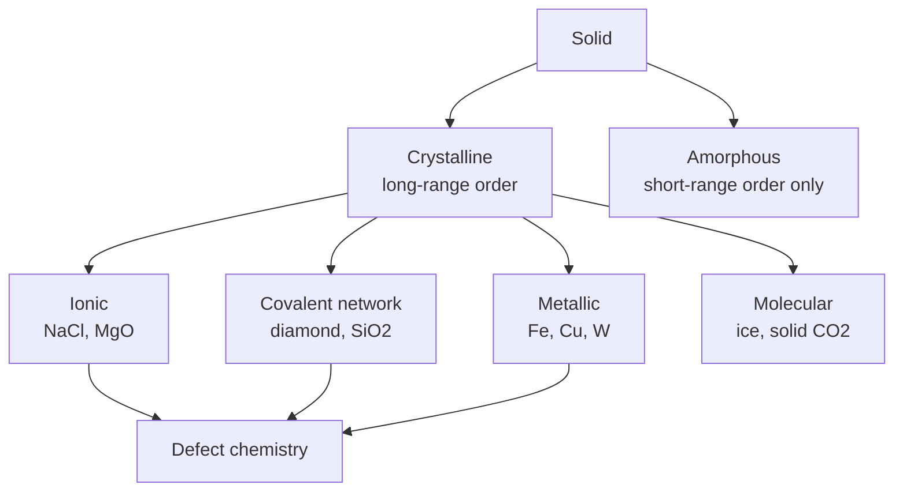
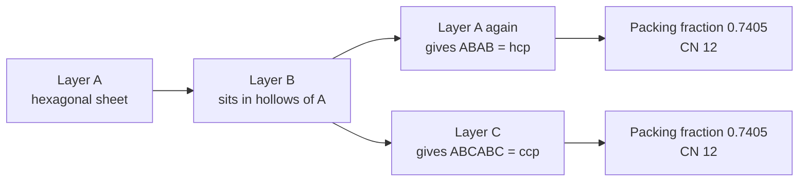
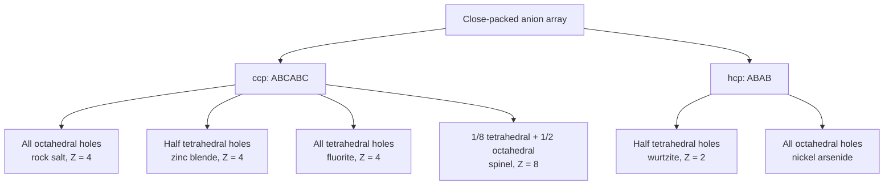
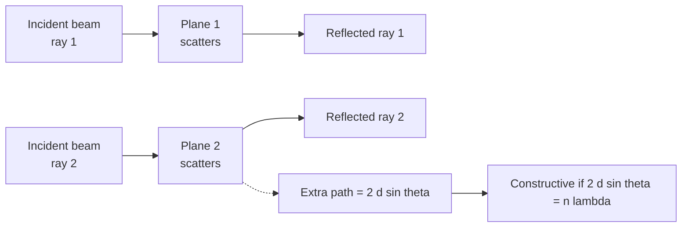
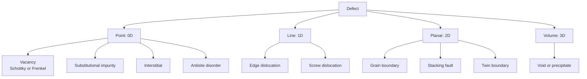

# Chapter 6 — Solid-State Chemistry: Crystal Structures and Defects

> **Level:** Level 5 — Advanced Inorganic Chemistry
> **Estimated study time:** 9 hours (6 h reading + 3 h exercises)
> **Prerequisites:** [Periodic Chemistry and the Main-Group Elements](01-periodic-chemistry-and-main-group-elements.md); Level 3 bonding and intermolecular forces; level-4 thermodynamics
> **Related chapters:** [Magnetic and Electronic Properties](07-magnetic-and-electronic-properties.md), [Descriptive Inorganic Chemistry](10-descriptive-inorganic-chemistry.md), [Coordination Compounds](03-coordination-compounds.md)
> **Difficulty:** ★★★★★ (5/5)

---

## 1. Learning Objectives

After working through this chapter you will be able to:

- Distinguish a crystal lattice from a basis, and state what a unit cell must reproduce under translation.
- Assign a solid to one of the seven crystal systems and one of the 14 Bravais lattices from its cell parameters.
- Calculate the number of formula units per cell, the density, and the packing fraction for the simple cubic, body-centred cubic, face-centred cubic and hexagonal close-packed structures.
- Describe cubic close packing and hexagonal close packing in terms of layer stacking, and count octahedral and tetrahedral holes per close-packed sphere.
- Apply the radius-ratio rules to predict the coordination number of a cation, and state the limitations of those rules.
- Recognise and describe the rock-salt, caesium chloride, zinc blende, wurtzite, fluorite, rutile, perovskite, spinel, diamond and graphite structure types.
- Summarise Pauling's rules and use the electrostatic valence rule to check a proposed structure.
- Derive the Bragg condition and interpret a powder X-ray diffraction pattern, including systematic absences for body-centred and face-centred lattices.
- Calculate lattice energy with the Born–Landé and Kapustinskii equations and construct a Born–Haber cycle.
- Classify point, line and planar defects, write them in Kröger–Vink notation, and explain colour centres and non-stoichiometry.
- Explain how doping controls the conductivity of a semiconductor and how defects control ionic conduction in solid electrolytes.

---

## 2. Introduction

Most of the chemical elements, and almost all of the materials a practising chemist handles, are solids. A rock, a catalyst pellet, a battery cathode, a laser crystal, a ceramic turbine blade and a grain of table salt are all built from the same small set of structural motifs: close-packed arrays of ions or atoms with smaller species occupying the gaps. The purpose of this chapter is to make those motifs quantitative, so that a crystal structure can be read from a unit cell, a diffraction pattern or a density measurement rather than memorised.

The subject sits at the junction of three traditions. Crystallography supplies the language of lattices and symmetry. Thermodynamics supplies lattice energy and the Born–Haber cycle, which explain why ionic solids form at all. Defect chemistry supplies the link between the ideal crystal and the real material: almost every useful property of a solid — colour, conductivity, catalytic activity, mechanical strength, even the operation of a lithium-ion battery — is controlled by departures from the perfect lattice rather than by the lattice itself.

The chapter is deliberately structured around three questions. First, *how is a solid built?* Lattices, unit cells, close packing and the radius-ratio rules answer this. Second, *how do we know?* Bragg's law and powder diffraction convert a measured angle into an interplanar spacing, and systematic absences into a lattice type. Third, *what happens when the building is imperfect?* Point defects, dislocations, non-stoichiometry and doping answer this, and they carry most of the technological interest.

A word about the level of the treatment. Structural chemistry uses models that are honestly approximate: ions are treated as hard spheres, bonds as purely ionic, and defects as dilute non-interacting species. Those approximations fail in interesting places — in the anisotropic bonding of graphite, in the mixed ionic–covalent character of oxides, in the correlated behaviour of defects at high concentration — and the text flags each simplification where it occurs. The models are nonetheless worth mastering, because they predict the correct structure type for the great majority of binary and ternary solids.

---

## 3. Fundamental Concepts

### 3.1 Crystals, lattices and bases

A **crystal** is a solid in which the constituent particles are arranged in a periodic three-dimensional pattern that extends over macroscopic distances. The periodicity is what distinguishes a crystal from a glass, where the same local coordination may exist but the pattern does not repeat.

The description of a crystal separates into two independent ideas:

- The **lattice** is the infinite array of points generated by translating a single point by all integer combinations of three vectors $\mathbf{a}$, $\mathbf{b}$, $\mathbf{c}$. It contains no chemical information.
- The **basis** (or motif) is the atom or group of atoms attached to each lattice point. It carries all the chemical information.

The crystal structure is the convolution of the two: lattice plus basis. This separation is powerful because a small number of lattices (14 in three dimensions) supports an unlimited number of structures.

A **unit cell** is the parallelepiped spanned by $\mathbf{a}$, $\mathbf{b}$ and $\mathbf{c}$. It is the smallest repeating unit that generates the whole crystal by translation. A unit cell may be **primitive** (contains exactly one lattice point) or **centred** (contains additional lattice points at the body centre, face centres or edge centres). The number of formula units in the cell, denoted $Z$, is obtained by counting atoms with the rule that a corner atom is shared by eight cells, an edge atom by four, a face atom by two, and a body-centre atom belongs wholly to one cell.

### 3.2 The seven crystal systems and the 14 Bravais lattices

Crystal systems are classified by the minimum symmetry of the lattice, which is expressed through the relationships among the cell edges $a$, $b$, $c$ and the interaxial angles $\alpha$ (between $\mathbf{b}$ and $\mathbf{c}$), $\beta$ (between $\mathbf{a}$ and $\mathbf{c}$) and $\gamma$ (between $\mathbf{a}$ and $\mathbf{b}$).

| System | Cell constraints | Bravais lattices | Minimum symmetry |
|---|---|---|---|
| Triclinic | $a\neq b\neq c$; $\alpha\neq\beta\neq\gamma$ | P | None (1-fold) |
| Monoclinic | $a\neq b\neq c$; $\alpha=\gamma=90^\circ\neq\beta$ | P, C | One 2-fold axis |
| Orthorhombic | $a\neq b\neq c$; $\alpha=\beta=\gamma=90^\circ$ | P, C, I, F | Three perpendicular 2-fold axes |
| Tetragonal | $a=b\neq c$; $\alpha=\beta=\gamma=90^\circ$ | P, I | One 4-fold axis |
| Trigonal | $a=b=c$; $\alpha=\beta=\gamma\neq90^\circ$ | R | One 3-fold axis |
| Hexagonal | $a=b\neq c$; $\alpha=\beta=90^\circ$, $\gamma=120^\circ$ | P | One 6-fold axis |
| Cubic | $a=b=c$; $\alpha=\beta=\gamma=90^\circ$ | P, I, F | Four 3-fold axes |

The seven systems generate 14 distinct lattices once centring is allowed, a result established by Bravais in 1848. Centring is not free: a C-centred tetragonal cell can always be redrawn as a smaller primitive cell of lower symmetry, so only the 14 combinations survive. The cubic system is the most important for inorganic chemistry because it contains the rock-salt, caesium chloride, zinc blende, fluorite, spinel and perovskite families.

### 3.3 Coordination number and packing efficiency

The **coordination number** (CN) of an atom or ion is the number of nearest neighbours of opposite type in contact with it. For spheres of equal radius, three arrangements are geometrically distinct and a fourth (hexagonal close packing) is a stacking variant of the cubic close packing.

| Structure | Relation between $a$ and $r$ | Atoms per cell $Z$ | CN | Packing fraction |
|---|---|---|---|---|
| Simple cubic (SC) | $a = 2r$ | 1 | 6 | $\pi/6 = 0.5236$ |
| Body-centred cubic (BCC) | $\sqrt{3}\,a = 4r$ | 2 | 8 | $\sqrt{3}\pi/8 = 0.6802$ |
| Face-centred cubic (FCC, ccp) | $\sqrt{2}\,a = 4r$ | 4 | 12 | $\sqrt{2}\pi/6 = 0.7405$ |
| Hexagonal close-packed (HCP) | $a = 2r$, $c = 2\sqrt{2/3}\,a$ | 2 | 12 | $0.7405$ |

The packing fraction is the fraction of the cell volume occupied by spheres. Close packing achieves 0.7405, which is the maximum possible for equal spheres in three dimensions; this was proved by Hales in 2005 (the Kepler conjecture). No sphere packing can exceed it, so any structure with a lower value contains void space that a smaller atom can occupy.

### 3.4 Close packing and the holes between spheres

Two stacking sequences of close-packed layers give the two close-packed structures:

- **Hexagonal close packing (hcp)**: layers stack ABABAB. The third layer lies directly over the first.
- **Cubic close packing (ccp)**, also called **face-centred cubic (fcc)**: layers stack ABCABC. The fourth layer repeats the first.

Both have CN 12 and a packing fraction of 0.7405; they differ only in the third-nearest-neighbour environment and in the shape of the holes.

Between close-packed spheres there are two kinds of interstice:

- **Octahedral holes**, formed by six spheres at the vertices of an octahedron. There is **one octahedral hole per close-packed sphere**. The largest sphere that fits has radius $0.414r$.
- **Tetrahedral holes**, formed by four spheres at the vertices of a tetrahedron. There are **two tetrahedral holes per close-packed sphere**. The largest sphere that fits has radius $0.225r$.

This counting rule is the single most useful piece of arithmetic in structural inorganic chemistry. It immediately explains the stoichiometries of the rock-salt structure (all octahedral holes filled by a cation in a 1:1 ratio), the fluorite structure (all tetrahedral holes filled, giving 2:1), and the zinc blende structure (half the tetrahedral holes filled, giving 1:1).

### 3.5 Ionic solids and the radius-ratio rules

An ionic structure can be modelled as a close-packed array of large anions with smaller cations in the holes. Whether a cation prefers a tetrahedral, octahedral or cubic hole is controlled chiefly by the ratio of the cation radius to the anion radius, $r_+/r_-$.

| $r_+/r_-$ | Preferred CN | Geometry | Example |
|---|---|---|---|
| 0.155–0.225 | 3 | Trigonal planar | $\ce{B2O3}$-type units |
| 0.225–0.414 | 4 | Tetrahedral | $\ce{ZnS}$, $\ce{SiO2}$ |
| 0.414–0.732 | 6 | Octahedral | $\ce{NaCl}$, $\ce{MgO}$, $\ce{TiO2}$ |
| 0.732–1.000 | 8 | Cubic | $\ce{CsCl}$, $\ce{CaF2}$ |
| $>1.000$ | 12 | Close-packed | Metal alloys |

The limits are derived by requiring the cation and anion to touch while the anions remain in contact. For the octahedral case, the critical ratio is $\sqrt{2}-1 = 0.414$; for the cubic case it is $\sqrt{3}-1 = 0.732$; for the tetrahedral case it is $\sqrt{3/2}-1 = 0.225$. Below the lower limit the cation rattles; above the upper limit the anions are pushed apart and a higher coordination number becomes favourable.

**Limitations.** The rules are a hard-sphere approximation. They fail when bonding is substantially covalent (ZnS is tetrahedral despite borderline ratios; $\ce{BeF2}$ is tetrahedral rather than octahedral), when ions are polarisable (AgI and CuCl adopt zinc blende structures), and when the cation has a stereochemically active lone pair ($\ce{PbO}$, $\ce{SnO}$). They also say nothing about the ordering of cations in mixed systems. They remain, however, an excellent first guess.

### 3.6 Pauling's rules

Pauling's five rules, formulated in 1929, rationalise and predict ionic structures:

1. **Coordination polyhedron.** A coordination polyhedron of anions forms around each cation, with the cation–anion distance set by the sum of radii and the coordination number set by the radius ratio.
2. **Electrostatic valence.** In a stable structure, the sum of bond strengths reaching an anion equals its charge:
   $$ \sum_i \frac{z_i}{\nu_i} = |z_{\text{anion}}| $$
   where $z_i$ is the charge of cation $i$ and $\nu_i$ its coordination number.
3. **Polyhedron sharing.** Sharing of corners is favoured, sharing of edges destabilises, and sharing of faces strongly destabilises, because shared polyhedra bring cations close together.
4. **Highly charged cations.** Cations of high charge and low coordination number tend not to share polyhedron elements at all.
5. **Parsimony.** The number of chemically distinct cation sites in a crystal tends to be small.

Rule 2 is the most used in practice, because it converts a proposed structure into an arithmetic test. In the rutile structure, each $\ce{Ti^4+}$ is octahedral ($\nu=6$), so each Ti–O bond has strength $4/6 = 2/3$. Each oxide ion is bonded to three Ti centres, and $3 \times 2/3 = 2$, exactly the anion charge. In the perovskite $\ce{SrTiO3}$, Ti(IV) is octahedral (strength $4/6$), Sr(II) is 12-coordinate (strength $2/12 = 1/6$), and each O is bonded to two Ti and four Sr: $2(4/6) + 4(1/6) = 2$. Both pass.

### 3.7 The principal structure types

**Rock salt, $\ce{NaCl}$.** Chloride ions form a ccp array; sodium ions fill every octahedral hole. Both ions are 6-coordinate, $Z = 4$, and the cell edge is $a = 564.0\ \text{pm}$. The same type is adopted by most alkali halides (except CsCl, CsBr, CsI), by MgO, CaO, NiO, and by many transition-metal monoxides and monosulfides.

**Caesium chloride, $\ce{CsCl}$.** Chloride ions form a simple cubic array with caesium in the cubic hole at the body centre. Both ions are 8-coordinate and $Z = 1$. The structure is not close-packed (packing fraction 0.728), which is why it appears only when the cation is large ($r_+/r_- > 0.732$) or under pressure.

**Zinc blende, $\ce{ZnS}$.** Sulfide ions form a ccp array; zinc ions occupy half of the tetrahedral holes in an ordered pattern. Both ions are 4-coordinate and $Z = 4$. The wurtzite polymorph has an hcp sulfide array with the same filling. The tetrahedral coordination, the relatively short Zn–S distance and the substantial covalent character make zinc blende the prototype for III–V semiconductors such as GaAs.

**Fluorite, $\ce{CaF2}$.** Calcium ions form a ccp array and fluoride ions fill every tetrahedral hole. Calcium is 8-coordinate, fluoride 4-coordinate, $Z = 4$. The antifluorite structure ($\ce{Na2O}$, $\ce{Li2O}$) reverses the roles: oxide ions are ccp and cations fill the tetrahedral holes. Fluorite-type oxides such as $\ce{ZrO2}$ and $\ce{UO2}$ are important because the anion sublattice can lose fluoride or oxide ions, giving high ionic conductivity.

**Rutile, $\ce{TiO2}$.** Titanium ions are octahedral and share edges to form chains along $c$; oxide ions are 3-coordinate. The cell is tetragonal ($a = 459.4\ \text{pm}$, $c = 295.9\ \text{pm}$) with $Z = 2$. Edge-sharing is permitted because the Ti–Ti distance along the chain (357 pm) is short but the structure tolerates it through Ti–Ti bonding in the conduction band.

**Perovskite, $\ce{ABO3}$.** The A cation sits at the cube corners (12-coordinate), the B cation at the body centre (6-coordinate) and oxygen at the face centres. The ideal cell is cubic with $Z = 1$; $\ce{SrTiO3}$ has $a = 390.5\ \text{pm}$. The tolerance factor
$$ t = \frac{r_{\text{A}} + r_{\text{O}}}{\sqrt{2}\,(r_{\text{B}} + r_{\text{O}})} $$
lies between about 0.80 and 1.00 for a stable cubic perovskite; values outside that range give distorted (orthorhombic, rhombohedral) or layered structures. The family is enormous because both A and B sites accept mixtures of cations, which is the basis of ferroelectric (BaTiO3), piezoelectric (PZT) and superconducting (YBa2Cu3O7−δ) materials.

**Spinel, $\ce{AB2O4}$.** Oxide ions form a ccp array. In a **normal** spinel, A occupies one-eighth of the tetrahedral holes and B occupies half of the octahedral holes, so $Z = 8$; $\ce{MgAl2O4}$ is the prototype ($a = 808.3\ \text{pm}$). In an **inverse** spinel, half the B ions occupy the tetrahedral sites and the remaining B plus A occupy octahedral sites; $\ce{Fe3O4}$ (magnetite) is inverse, with $\ce{Fe^3+}$ tetrahedral and a mixed $\ce{Fe^2+/Fe^3+}$ octahedral sublattice. The cation distribution controls magnetism, as Chapter 7 shows.

**Diamond.** Carbon atoms occupy an fcc lattice with a two-atom basis at $(0,0,0)$ and $(\tfrac14,\tfrac14,\tfrac14)$. Each atom is tetrahedrally bonded to four others, CN 4, $Z = 8$, $a = 356.7\ \text{pm}$, C–C 154.4 pm. The structure is the archetype of the tetrahedral semiconductor family (Si, Ge, α-Sn) and the reason diamond is an electrical insulator with the highest thermal conductivity of any bulk material.

**Graphite.** Carbon atoms form hexagonal layers with $sp^2$ hybridisation, C–C 142 pm within a layer and 335 pm between layers. The hexagonal cell has $a = 246.1\ \text{pm}$ and $c = 670.8\ \text{pm}$, with $Z = 4$. The layers are held by dispersion forces, which is why graphite cleaves, lubricates and intercalates; the delocalised $\pi$ system within each layer makes graphite a semimetal.

### 3.8 Defects: an overview

No real crystal is perfect. **Defects** are classified by dimensionality:

- **Point defects** (0D): vacancies, interstitials, substitutional impurities, antisite defects.
- **Line defects** (1D): dislocations.
- **Planar defects** (2D): grain boundaries, twin boundaries, stacking faults, surfaces.
- **Volume defects** (3D): voids, precipitates, inclusions.

Point defects are thermodynamically inevitable: creating a vacancy costs enthalpy but gains configurational entropy, so every crystal at finite temperature contains a finite equilibrium concentration. The equilibrium fraction follows a Boltzmann form,
$$ x_{\text{vac}} \approx \exp\!\left(-\frac{\Delta H_{\text{vac}}}{RT}\right) $$
so a defect enthalpy of $100\ \text{kJ mol}^{-1}$ gives $x \approx 10^{-18}$ at 300 K but $x \approx 10^{-6}$ at 1000 K. Defects are therefore a high-temperature phenomenon in most solids, and quenching can freeze in concentrations far above equilibrium.

---

## 4. Detailed Scientific Explanation

### 4.1 From lattice to diffraction: Bragg's law

X-rays have wavelengths comparable to interatomic distances, so a crystal acts as a three-dimensional diffraction grating. W. L. Bragg's 1913 formulation treats diffraction as reflection from sets of parallel lattice planes separated by a spacing $d_{hkl}$, indexed by Miller indices $h$, $k$, $l$.

Constructive interference occurs when the extra path length travelled by a ray reflected from successive planes, $2d\sin\theta$, is an integer number of wavelengths:

$$ n\lambda = 2d_{hkl}\sin\theta $$

For a cubic crystal the interplanar spacing is related to the cell edge by

$$ \frac{1}{d_{hkl}^2} = \frac{h^2 + k^2 + l^2}{a^2} $$

so a measured set of Bragg angles yields both the cell edge and the indices of each reflection. The Bragg formulation is geometrically equivalent to the Laue treatment of scattering from a lattice; it is preferred pedagogically because it reduces diffraction to a simple path-difference argument.

### 4.2 Powder X-ray diffraction and systematic absences

A single crystal gives a pattern of discrete spots. A **powder** contains millions of randomly oriented crystallites, so each set of planes is present at every orientation and the pattern becomes a set of concentric cones, recorded as intensity versus $2\theta$. Powder diffraction is the workhorse of solid-state characterisation because it needs no single crystal and because the pattern is a fingerprint of the phase.

Two pieces of information are extracted:

- **Peak positions** give $d$-spacings, hence the cell parameters.
- **Peak intensities** give the arrangement of atoms within the cell, since intensity is proportional to $|F_{hkl}|^2$, where the structure factor $F_{hkl} = \sum_j f_j \exp[2\pi i(hx_j + ky_j + lz_j)]$.

The structure factor also produces **systematic absences**:

| Lattice type | Condition for observable reflection | Consequence |
|---|---|---|
| Primitive (P) | All $hkl$ | No restriction |
| Body-centred (I) | $h + k + l$ even | (100), (111), (210) absent |
| Face-centred (F) | $h$, $k$, $l$ all even or all odd | (100), (110), (210) absent |
| C-centred (C) | $h + k$ even | (100), (011) absent |

The absence of a reflection is therefore evidence for centring, and this is how a powder pattern distinguishes primitive from body-centred and face-centred cells without any prior knowledge of the structure.

**Rietveld** refinement extends the analysis: a full profile is fitted by least squares with cell parameters, atomic positions, occupancies and thermal parameters as variables. Rietveld refinement is now the standard method for determining the structures of polycrystalline materials, including battery electrodes and catalysts that cannot be grown as single crystals.

### 4.3 Lattice energy: the Born–Landé and Kapustinskii equations

The **lattice energy** $U$ is the energy released when one mole of an ionic solid is formed from its constituent gaseous ions at infinite separation. It is a large negative quantity and it controls melting point, hardness, solubility and thermal stability.

The Born–Landé equation sums the electrostatic attraction between all ion pairs, corrects for the short-range repulsion of overlapping electron clouds, and includes a Madelung constant $M$ that depends only on the structure type:

$$ U = -\frac{N_{\text{A}} M z_+ z_- e^2}{4\pi\varepsilon_0 r_0}\left(1 - \frac{1}{n}\right) $$

where $r_0$ is the equilibrium cation–anion distance, $z_+$ and $z_-$ are the charge numbers, and $n$ is the Born exponent, an average of the compressibilities of the two ions (5 for He configuration, 7 for Ne, 9 for Ar, 10 for Kr, 12 for Xe). Typical Madelung constants are 1.7476 (rock salt), 1.7627 (caesium chloride), 1.6381 (zinc blende) and 2.5194 (fluorite).

The **Kapustinskii equation** avoids the need for a Madelung constant by using only the stoichiometry and the interionic distance:

$$ U \approx -\frac{1201\,\nu z_+ z_-}{r_0}\left(1 - \frac{0.345}{r_0}\right)\ \text{kJ mol}^{-1} $$

with $r_0$ in ångström and $\nu$ the number of ions in the formula unit. It is accurate to a few per cent for simple salts and is useful when the structure type is unknown.

### 4.4 The Born–Haber cycle

Lattice energy cannot be measured directly, because gaseous ions cannot be assembled in a calorimeter. It is obtained from the **Born–Haber cycle**, a Hess's-law loop that connects the standard enthalpy of formation to sublimation, ionisation, dissociation and electron-affinity steps:

$$ \Delta H_{\text{f}}^\circ = \Delta H_{\text{sub}} + \text{IE} + \tfrac12 D + \Delta H_{\text{EA}} + U $$

For $\ce{NaCl}$ the cycle is

$$
\ce{Na(s) -> Na(g)} \qquad \Delta H = +107\ \text{kJ mol}^{-1}
$$
$$
\ce{Na(g) -> Na+(g) + e-} \qquad \Delta H = +496\ \text{kJ mol}^{-1}
$$
$$
\ce{\tfrac12 Cl2(g) -> Cl(g)} \qquad \Delta H = +122\ \text{kJ mol}^{-1}
$$
$$
\ce{Cl(g) + e- -> Cl-(g)} \qquad \Delta H = -349\ \text{kJ mol}^{-1}
$$
$$
\ce{Na+(g) + Cl-(g) -> NaCl(s)} \qquad \Delta H = U
$$

Summing and setting the total equal to the measured $\Delta H_{\text{f}}^\circ = -411\ \text{kJ mol}^{-1}$ gives $U = -787\ \text{kJ mol}^{-1}$. The second electron affinity of oxygen is positive, which is why oxides are stable only when the lattice energy is large enough to pay for it; this explains the stability of MgO ($U = -3795\ \text{kJ mol}^{-1}$) and the instability of hypothetical $\ce{O^{2-}}$ salts of large, singly charged cations.

### 4.5 Defect chemistry in Kröger–Vink notation

Kröger–Vink notation describes point defects by site, species and effective charge relative to the perfect lattice:

- A superscript prime ($'$) denotes one negative effective charge.
- A superscript dot ($^{\bullet}$) denotes one positive effective charge.
- A superscript cross ($^{\times}$) denotes neutrality.

Thus $\mathrm{V_{Na}^{\prime}}$ is a sodium vacancy (one negative charge relative to the ideal lattice), $\mathrm{V_{Cl}^{\bullet}}$ is a chloride vacancy, and $\mathrm{e^{\prime}}$ is a quasi-free electron.

The two intrinsic defect types in ionic crystals are:

- **Schottky defects**: a stoichiometric pair of vacancies, one cation and one anion. They preserve the stoichiometry, lower the density, and dominate in NaCl, KCl and CsCl. Formation may be written
  $$ \text{null} \rightarrow \mathrm{V_{Na}^{\prime}} + \mathrm{V_{Cl}^{\bullet}} $$
- **Frenkel defects**: a vacancy and an interstitial of the same species. They preserve stoichiometry and density, and dominate in AgCl, AgBr and $\ce{CaF2}$, where the silver or fluoride ion is small enough to occupy an interstitial site:
  $$ \mathrm{Ag_{Ag}^{\times}} \rightarrow \mathrm{V_{Ag}^{\prime}} + \mathrm{Ag_i^{\bullet}} $$

**Colour centres.** An anion vacancy that traps one or two electrons is an **F-centre** (from German *Farbe*, colour). The trapped electron has particle-in-a-box energy levels separated by a few electronvolts, so it absorbs visible light. Sodium chloride heated in sodium vapour acquires a yellow-brown colour; potassium chloride becomes violet. The same centres are responsible for the blue colour of some natural fluorite and for the darkening of irradiated alkali halides.

**Non-stoichiometry.** Many transition-metal oxides deviate from ideal composition because the metal can adopt a second oxidation state. Wüstite is $\ce{Fe_{1-x}O}$ with $x$ between about 0.05 and 0.15: some $\ce{Fe^2+}$ is oxidised to $\ce{Fe^3+}$ and cation vacancies are created to maintain charge balance. The defect equation is
$$ 2\ce{Fe_{Fe}^{\times}} + \tfrac12 \ce{O2(g)} \rightarrow 2\ce{Fe_{Fe}^{\bullet}} + \mathrm{V_{Fe}^{\prime\prime}} + \ce{O_O^{\times}} $$
The resulting material is a p-type semiconductor, because the $\ce{Fe^3+}$ centres are hole donors. Uranium dioxide, $\ce{UO_{2+x}}$, is the opposite case: excess oxygen is accommodated as interstitial $\ce{O^{2-}}$ with accompanying oxidation of $\ce{U^4+}$ to $\ce{U^5+}$ or $\ce{U^6+}$.

### 4.6 Line and planar defects

**Dislocations** are line defects that carry plastic deformation. An **edge dislocation** is the termination of an extra half-plane of atoms; a **screw dislocation** is a helical distortion of the lattice about a line. Both are characterised by a **Burgers vector** $\mathbf{b}$, which measures the closure failure of a circuit around the dislocation line. Dislocation motion — glide on close-packed planes — is the microscopic mechanism of metal plasticity, and dislocation pinning by precipitates or solutes is the basis of alloy strengthening.

**Planar defects** include:

- **Grain boundaries**, where two crystals of different orientation meet. They impede dislocation motion (Hall–Petch strengthening) and provide fast diffusion paths.
- **Twin boundaries**, where the lattice is mirrored across a plane.
- **Stacking faults**, an error in the ABCABC sequence of a close-packed lattice, which creates a local region of hcp stacking within ccp.
- **Surfaces**, which are unavoidable and dominate the chemistry of catalysts and nanoparticles.

Defect concentrations and mobilities are the central variables of **solid-state ionics**: a solid electrolyte is simply a crystal with a high concentration of mobile vacancies or interstitials.

### 4.7 Doping, semiconductors and solid electrolytes

A **semiconductor** has a filled valence band separated from an empty conduction band by a gap of order 1 eV. Pure silicon (band gap 1.12 eV) is an intrinsic semiconductor with a small concentration of thermally generated electron–hole pairs. Adding a group-15 donor such as phosphorus creates **n-type** material, because the extra electron is only weakly bound; adding a group-13 acceptor such as boron creates **p-type** material, because the missing electron behaves as a mobile hole. Doping concentrations of $10^{15}$–$10^{19}\ \text{cm}^{-3}$ change conductivity by many orders of magnitude, which is the physical basis of the transistor, the diode and the solar cell.

**Solid electrolytes** conduct ions rather than electrons. Three important families illustrate the design principles:

- **Yttria-stabilised zirconia (YSZ)**, in which two $\ce{Y^3+}$ ions replace two $\ce{Zr^4+}$ ions, so that one oxygen vacancy maintains charge neutrality:
  $$ \ce{Y2O3 -> 2Y_{Zr}' + 3O_O^{\times} + V_O^{\bullet\bullet}} $$
  YSZ conducts $\ce{O^{2-}}$ at 700–1000 °C and is the electrolyte in solid-oxide fuel cells and oxygen sensors.
- **β-alumina**, a layered sodium aluminate with mobile $\ce{Na+}$ between spinel-like blocks, used in the sodium–sulfur battery.
- **Garnet-type $\ce{Li7La3Zr2O12}$ (LLZO)** and sulfide glasses, which conduct $\ce{Li+}$ at room temperature and are candidates for solid-state lithium batteries.

**Superconductors** are a separate phenomenon and are treated in Chapter 7; for the purposes of solid-state chemistry, the key structural point is that all known high-temperature superconductors are layered or perovskite-derived copper oxides in which doping controls the carrier concentration.

---

## 5. Visual Diagrams

### 5.1 Classification of solids

**Figure 6.1 — Classification of solids by bonding type.** The four crystalline classes differ in what holds the lattice together: delocalised electrons in metals, electrostatic attraction in ionic solids, shared electron pairs in network solids, and dispersion forces in molecular solids. The classification is a spectrum rather than a set of boxes, and most real solids sit between categories — graphite is a layered semi-metal, and $\ce{TiO2}$ is ionic with substantial covalent character. The arrow from all three non-molecular classes to defect chemistry marks the theme of the second half of this chapter: useful behaviour is usually controlled by imperfection, not by the ideal lattice.

### 5.2 Close packing and layer stacking

**Figure 6.2 — The two close-packed structures differ only in stacking sequence.** Every close-packed layer is a hexagonal sheet in which each sphere touches six neighbours in the plane and three in each adjacent layer. The third layer has two inequivalent choices of position: directly above the first layer (ABAB, hexagonal close packing) or over the remaining hollow (ABCABC, cubic close packing). Both achieve the maximum packing fraction of 0.7405 and both have coordination number 12. The distinction matters because the stacking sequence determines the shape and connectivity of the interstitial holes, and therefore which structure types can be built from a given close-packed array.

### 5.3 Filling the holes: from array to structure type

**Figure 6.3 — Structure types generated by filling interstitial holes.** The counting rules — one octahedral hole and two tetrahedral holes per close-packed sphere — fix the stoichiometry of each family before any chemistry is considered. Rock salt fills every octahedral hole of a ccp array, giving 1:1. Zinc blende fills half the tetrahedral holes, also 1:1 but with a different coordination number and a different connectivity. Fluorite fills all tetrahedral holes, giving 2:1. Spinel fills a combination, giving 3:4. Recognising which of these patterns a formula could support is the fastest route from composition to a plausible structure.

### 5.4 The geometry of Bragg diffraction

**Figure 6.4 — Derivation of Bragg's law from two adjacent lattice planes.** The lower ray travels an extra distance equal to $2d\sin\theta$ because it must descend to the second plane and climb back. When that extra distance is an integer number of wavelengths the two reflected rays emerge in phase and a peak is observed. The equation is a condition on the crystal, not on the apparatus: for fixed $\lambda$, each set of planes with spacing $d$ produces a peak at a specific angle, so measuring angles measures structure. The derivation assumes specular reflection and elastic scattering, both of which hold to good approximation for X-rays.

### 5.5 A taxonomy of defects

**Figure 6.5 — Dimensional classification of crystal defects.** The taxonomy is not merely descriptive: dimensionality determines mobility and therefore consequences. Point defects can diffuse at appreciable rates above about two-thirds of the melting temperature and control colour, conductivity and diffusion. Dislocations move under stress and control plasticity. Grain boundaries and surfaces dominate sintering, catalysis and corrosion. A single material may exploit all four: a heterogeneous catalyst is a metal particle (point and line defects) supported on an oxide (grain boundaries) with a high surface area.

---

## 6. Mathematical Formulas

### 6.1 Density from the unit cell

$$ \rho = \frac{Z M}{N_{\text{A}} V_{\text{cell}}} $$

| Symbol | Meaning | SI unit |
|---|---|---|
| $\rho$ | density | $\text{kg m}^{-3}$ |
| $Z$ | formula units per unit cell | dimensionless |
| $M$ | molar mass | $\text{kg mol}^{-1}$ |
| $N_{\text{A}}$ | Avogadro constant, $6.02214076\times10^{23}$ | $\text{mol}^{-1}$ |
| $V_{\text{cell}}$ | unit-cell volume | $\text{m}^{3}$ |

For a cubic cell $V_{\text{cell}} = a^3$. Assumptions: the cell is fully occupied, the composition is exact, and there are no vacancies or impurities. Density measured by flotation or pycnometry can therefore be used to *test* a proposed structure, and a discrepancy signals either a wrong $Z$ or a defective crystal.

### 6.2 Packing fraction

$$ \text{PF} = \frac{Z \cdot \tfrac{4}{3}\pi r^3}{a^3} $$

| Symbol | Meaning | SI unit |
|---|---|---|
| $\text{PF}$ | packing fraction | dimensionless |
| $Z$ | spheres per cell | dimensionless |
| $r$ | sphere radius | m |
| $a$ | cell edge | m |

The packing fraction is a property of the geometry alone; it does not depend on the identity of the atoms. It is therefore a quick diagnostic: a calculated value below 0.7405 for a purported close-packed structure indicates an error.

### 6.3 Radius ratio

$$ \frac{r_+}{r_-} = \sqrt{2} - 1 = 0.414 \quad \text{(octahedral limit)} $$

$$ \frac{r_+}{r_-} = \sqrt{3} - 1 = 0.732 \quad \text{(cubic limit)} $$

$$ \frac{r_+}{r_-} = \sqrt{\tfrac{3}{2}} - 1 = 0.225 \quad \text{(tetrahedral limit)} $$

| Symbol | Meaning | SI unit |
|---|---|---|
| $r_+$ | cation radius | m |
| $r_-$ | anion radius | m |

These limits assume rigid, incompressible spheres and complete anion–anion contact. They are lower bounds: a cation larger than the limit simply pushes the anions apart, which is allowed if the lattice energy gained by higher coordination outweighs the strain.

### 6.4 Bragg's law and the cubic $d$-spacing relation

$$ n\lambda = 2d_{hkl}\sin\theta \qquad \frac{1}{d_{hkl}^2} = \frac{h^2+k^2+l^2}{a^2} $$

| Symbol | Meaning | SI unit |
|---|---|---|
| $n$ | order of reflection | dimensionless |
| $\lambda$ | X-ray wavelength | m |
| $d_{hkl}$ | interplanar spacing | m |
| $\theta$ | Bragg angle, half the scattering angle | rad or degree |
| $a$ | cubic cell edge | m |
| $h,k,l$ | Miller indices | dimensionless |

The relation $2\theta$ is the experimentally measured angle; $\theta$ must be used in the equation. For non-cubic cells the $d$-spacing formula is replaced by the appropriate metric tensor expression.

### 6.5 Born–Landé and Kapustinskii lattice energies

$$ U = -\frac{N_{\text{A}} M z_+ z_- e^2}{4\pi\varepsilon_0 r_0}\left(1-\frac{1}{n}\right) $$

$$ U \approx -\frac{1201\,\nu z_+ z_-}{r_0}\left(1-\frac{0.345}{r_0}\right)\ \text{kJ mol}^{-1} $$

| Symbol | Meaning | SI unit |
|---|---|---|
| $U$ | lattice energy | $\text{J mol}^{-1}$ (or kJ mol⁻¹) |
| $M$ | Madelung constant | dimensionless |
| $z_+, z_-$ | charge numbers | dimensionless |
| $e$ | elementary charge, $1.602176634\times10^{-19}$ | C |
| $\varepsilon_0$ | vacuum permittivity, $8.8541878128\times10^{-12}$ | $\text{F m}^{-1}$ |
| $r_0$ | equilibrium interionic distance | m |
| $n$ | Born exponent | dimensionless |
| $\nu$ | ions per formula unit | dimensionless |

The constant $N_{\text{A}}e^2/(4\pi\varepsilon_0) = 1.38935\times10^{-4}\ \text{J m mol}^{-1}$ is worth memorising; it converts the electrostatic term directly into molar units.

### 6.6 The perovskite tolerance factor

$$ t = \frac{r_{\text{A}} + r_{\text{O}}}{\sqrt{2}\,(r_{\text{B}} + r_{\text{O}})} $$

| Symbol | Meaning | SI unit |
|---|---|---|
| $t$ | tolerance factor | dimensionless |
| $r_{\text{A}}$, $r_{\text{B}}$ | ionic radii of A and B cations | m |
| $r_{\text{O}}$ | oxide ion radius | m |

A cubic perovskite is stable for $0.80 \lesssim t \lesssim 1.00$. Below 0.80 the A cation is too small and the octahedral framework tilts; above 1.00 the B cation is too small and hexagonal or layered structures compete.

---

## 7. Chemical Equations

### 7.1 Formation of an ionic solid

$$
\ce{2Na(s) + Cl2(g) -> 2NaCl(s)} \qquad \Delta H^\circ = -822\ \text{kJ mol}^{-1}
$$

The reaction is strongly exothermic because the lattice energy of $\ce{NaCl}$ ($-787\ \text{kJ mol}^{-1}$) more than compensates for the endothermic ionisation of sodium and the dissociation of chlorine. The solid is an insulator at room temperature because the valence band is full and the band gap exceeds 8 eV.

### 7.2 Preparation of a perovskite

$$
\ce{CaCO3(s) + TiO2(s) -> CaTiO3(s) + CO2(g)} \qquad \Delta H^\circ \approx +100\ \text{kJ mol}^{-1}
$$

The reaction is carried out by heating mixed oxides or carbonates at 1000–1300 °C. It is entropy-driven by the release of carbon dioxide; the perovskite phase nucleates at the interfaces between the reactant grains, so repeated grinding and heating (the ceramic method) is needed to obtain a single phase.

### 7.3 Preparation of a spinel

$$
\ce{MgO(s) + Al2O3(s) -> MgAl2O4(s)}
$$

This is the prototype solid-state synthesis. Because the reaction proceeds by counter-diffusion of ions through a growing product layer, the yield is limited by the thickness of that layer; the **Wagner mechanism** describes the parabolic growth kinetics, and the practical remedy is to use fine, intimately mixed powders and intermediate firing.

### 7.4 Doping and defect generation

$$
\ce{Y2O3 -> 2Y_{Zr}' + 3O_O^{\times} + V_O^{\bullet\bullet}}
$$

This Kröger–Vink equation describes the creation of one oxygen vacancy per two yttrium ions in yttria-stabilised zirconia. Charge balance is exact: the two $\ce{Y^3+}$ ions substituting for $\ce{Zr^4+}$ carry a total effective charge of $-2$, which is compensated by one doubly positive oxygen vacancy.

$$
\ce{Si(s) + P -> Si:P}
$$

Phosphorus doping of silicon is written schematically: each P atom substitutes for a Si atom and donates one electron to the conduction band, giving n-type conductivity.

### 7.5 A superconducting cuprate

$$
\ce{\tfrac12 Y2O3 + 2BaCO3 + 3CuO + \tfrac14 O2 -> YBa2Cu3O7 + 2CO2}
$$

The 123 superconductor is made by the ceramic route at 900–950 °C in flowing oxygen, followed by a slow cool. The product is slightly oxygen-deficient, $\ce{YBa2Cu3O_{7-\delta}}$ with $\delta \approx 0.1$–$0.2$; the oxygen stoichiometry, not the cation ratio, controls the carrier concentration and therefore the critical temperature.

---

## 8. Worked Examples

### Worked Example 8.1 — Density of rock salt from the unit cell

**Problem.** Sodium chloride crystallises in the rock-salt structure with $a = 564.0\ \text{pm}$. Calculate its density and compare it with the experimental value of $2.165\ \text{g cm}^{-3}$.

**Strategy.** Count the ions in the cubic cell, compute the cell volume, then apply $\rho = ZM/(N_{\text{A}}a^3)$.

**Solution.** The cell has four $\ce{Na+}$ at the cube corners and edge centres and four $\ce{Cl-}$ at the face centres and body centre. Because each ion is shared with neighbouring cells, the count is $Z = 4$ formula units.

The cell volume is

$$
V = a^3 = (564.0\times10^{-12}\ \text{m})^3 = 1.794\times10^{-28}\ \text{m}^{3}
$$

The mass of one cell is

$$
m = \frac{ZM}{N_{\text{A}}} = \frac{4 \times 58.44\ \text{g mol}^{-1}}{6.022\times10^{23}\ \text{mol}^{-1}} = 3.882\times10^{-22}\ \text{g}
$$

Dividing mass by volume:

$$
\rho = \frac{3.882\times10^{-22}\ \text{g}}{1.794\times10^{-22}\ \text{cm}^{3}} = 2.164\ \text{g cm}^{-3}
$$

**Check.** The calculated value differs from the experimental $2.165\ \text{g cm}^{-3}$ by 0.05 %, which confirms both the structure assignment and the value of $Z$. A wrong $Z$ would produce a factor-of-two error; a wrong structure type would usually produce a much larger discrepancy.

### Worked Example 8.2 — Packing fraction of a face-centred cubic lattice

**Problem.** Show that the packing fraction of an fcc lattice of identical spheres is $\sqrt{2}\pi/6$, and evaluate it as a percentage.

**Strategy.** Express the cell edge in terms of the sphere radius by requiring spheres to touch along the face diagonal, then divide the total sphere volume by the cell volume.

**Solution.** In an fcc cell, spheres touch along a face diagonal, which is four radii long:

$$
\sqrt{2}\,a = 4r \qquad \Longrightarrow \qquad a = 2\sqrt{2}\,r
$$

The cell volume is

$$
V_{\text{cell}} = a^3 = (2\sqrt{2}\,r)^3 = 16\sqrt{2}\,r^3 = 22.63\,r^3
$$

Four spheres occupy the cell, so

$$
V_{\text{spheres}} = 4 \times \frac{4}{3}\pi r^3 = \frac{16}{3}\pi r^3 = 16.76\,r^3
$$

Therefore

$$
\text{PF} = \frac{16\pi r^3/3}{16\sqrt{2}\,r^3} = \frac{\pi}{3\sqrt{2}} = \frac{\sqrt{2}\pi}{6} = 0.7405
$$

**Check.** The result is 74.05 %, the density of the Kepler packing and the maximum attainable for equal spheres. Simple cubic gives 52.36 % and body-centred cubic 68.02 %, both lower, as they must be.

### Worked Example 8.3 — Radius ratio and structure prediction

**Problem.** Predict the coordination number and likely structure type of (a) KBr and (b) CsI, using the ionic radii $r_{\text{K}^+} = 138\ \text{pm}$, $r_{\text{Cs}^+} = 167\ \text{pm}$, $r_{\text{Br}^-} = 196\ \text{pm}$ and $r_{\text{I}^-} = 220\ \text{pm}$.

**Strategy.** Compute $r_+/r_-$ and compare with the tabulated limits.

**Solution.** For KBr:

$$
\frac{r_+}{r_-} = \frac{138}{196} = 0.704
$$

This lies between 0.414 and 0.732, so the cation is octahedral, CN 6, and the rock-salt structure is expected. For CsI:

$$
\frac{r_+}{r_-} = \frac{167}{220} = 0.759
$$

This exceeds 0.732, so the cation is cubic, CN 8, and the caesium chloride structure is expected.

**Check.** Both predictions agree with experiment: KBr is rock salt and CsI is caesium chloride. Note that CsCl itself has a ratio of $167/181 = 0.923$, comfortably cubic, whereas NaCl has $102/181 = 0.563$, comfortably octahedral. The borderline cases — RbCl, with a ratio of 0.74 — are exactly where the rules become unreliable and where the actual structure is decided by lattice-energy differences of only a few kilojoules.

### Worked Example 8.4 — Interplanar spacing from a powder pattern

**Problem.** The (200) reflection of a cubic powder is observed at $2\theta = 31.70^\circ$ using Cu Kα radiation of wavelength 154.06 pm. Calculate $d_{200}$ and the cell edge $a$.

**Strategy.** Convert $2\theta$ to $\theta$, apply Bragg's law with $n = 1$, then use the cubic $d$-spacing relation with $h^2+k^2+l^2 = 4$.

**Solution.** The Bragg angle is $\theta = 15.85^\circ$, so

$$
d_{200} = \frac{\lambda}{2\sin\theta} = \frac{154.06\ \text{pm}}{2 \times 0.2731} = 282.0\ \text{pm}
$$

For a cubic cell with $h^2+k^2+l^2 = 4$:

$$
a = d_{200}\sqrt{h^2+k^2+l^2} = 282.0 \times 2 = 564.0\ \text{pm}
$$

**Check.** The value matches the known cell edge of NaCl to four significant figures, and the (200) reflection is allowed for an fcc lattice because $h$, $k$ and $l$ are all even. If the pattern instead showed a (100) reflection, the lattice could not be fcc.

### Worked Example 8.5 — Lattice energy by two routes

**Problem.** Calculate the lattice energy of NaCl using (a) the Born–Landé equation with $M = 1.7476$, $r_0 = 282\ \text{pm}$ and $n = 8$, and (b) the Kapustinskii equation. Compare both with the Born–Haber value of $-787\ \text{kJ mol}^{-1}$.

**Strategy.** Use the electrostatic constant $N_{\text{A}}e^2/(4\pi\varepsilon_0) = 1.38935\times10^{-4}\ \text{J m mol}^{-1}$ and carry the units through.

**Solution.** For the Born–Landé equation:

$$
U = -\frac{1.38935\times10^{-4} \times 1.7476 \times 1 \times 1}{2.82\times10^{-10}}\left(1-\frac{1}{8}\right)
$$

$$
U = -8.611\times10^{5} \times 0.875\ \text{J mol}^{-1} = -7.535\times10^{5}\ \text{J mol}^{-1} = -753.5\ \text{kJ mol}^{-1}
$$

For Kapustinskii, with $\nu = 2$ and $r_0 = 2.82\ \text{Å}$:

$$
U_{\text{Kap}} = -\frac{1201 \times 2 \times 1 \times 1}{2.82}\left(1 - \frac{0.345}{2.82}\right) = -851.8 \times 0.8777 = -747.6\ \text{kJ mol}^{-1}
$$

**Check.** The two calculated values, $-753.5$ and $-747.6\ \text{kJ mol}^{-1}$, agree within 1 % and lie within 5 % of the Born–Haber value of $-787\ \text{kJ mol}^{-1}$. The residual discrepancy is expected: the Born–Landé model ignores van der Waals attraction, zero-point motion and the partial covalent character of the Na–Cl bond, all of which increase the magnitude of the true lattice energy.

### Worked Example 8.6 — A Born–Haber cycle for NaCl

**Problem.** Given $\Delta H_{\text{f}}^\circ(\ce{NaCl}) = -411\ \text{kJ mol}^{-1}$, $\Delta H_{\text{sub}}(\ce{Na}) = +107$, $\text{IE}_1(\ce{Na}) = +496$, $\tfrac12 D(\ce{Cl2}) = +122$ and $\Delta H_{\text{EA}}(\ce{Cl}) = -349\ \text{kJ mol}^{-1}$, calculate the lattice energy and comment on the sign of the electron affinity term.

**Strategy.** Sum the five steps of the cycle and set the total equal to the enthalpy of formation, then solve for $U$.

**Solution.** The cycle requires

$$
\Delta H_{\text{f}}^\circ = \Delta H_{\text{sub}} + \text{IE}_1 + \tfrac12 D + \Delta H_{\text{EA}} + U
$$

Substituting:

$$
-411 = 107 + 496 + 122 - 349 + U
$$

$$
-411 = 376 + U \qquad \Longrightarrow \qquad U = -787\ \text{kJ mol}^{-1}
$$

**Check.** The value is close to the Born–Landé estimate of $-753\ \text{kJ mol}^{-1}$ calculated in Worked Example 8.5, which is the expected level of agreement between an electrostatic model and the thermochemical truth. The electron-affinity term is negative because adding an electron to a chlorine atom releases energy; the second electron affinity of oxygen, by contrast, is positive, which is why oxide lattices must be very stable to exist at all.

---

## 9. Real-World Applications

**Construction materials.** Portland cement is a mixture of calcium silicates and aluminates whose hydration products — calcium silicate hydrate gel and calcium hydroxide — form a porous solid with a high surface area. The setting reaction is a dissolution–precipitation process controlled by the defect chemistry of the clinker phases. Concrete durability, sulphate attack and alkali–silica reaction are all solid-state and interfacial chemistry.

**Batteries.** Lithium-ion cathodes are layered oxides ($\ce{LiCoO2}$), spinels ($\ce{LiMn2O4}$) or olivines ($\ce{LiFePO4}$). Their capacity is limited by how many lithium ions can be removed while preserving the host structure, and their degradation is caused by transition-metal dissolution and lattice oxygen loss. Solid electrolytes such as LLZO promise safer cells by replacing the flammable liquid electrolyte.

**Catalysis.** Heterogeneous catalysts are typically metal nanoparticles on high-surface-area oxides. Activity depends on particle size, facet orientation, step and corner sites (which are line and point defects in the exposed surface) and on metal–support interactions. The classic example is the iron–potassium oxide catalyst for ammonia synthesis, in which the potassium promoter modifies the electronic structure of the iron surface.

**Semiconductors and optoelectronics.** Every integrated circuit is built from doped silicon; every light-emitting diode and laser is a doped III–V heterostructure; every solar panel is a doped junction. The dopant concentration is controlled to parts per million, and the device physics depends entirely on the defect chemistry described in Section 4.7.

**Ceramics and refractories.** Alumina, zirconia and silicon carbide are used where metals would melt or corrode. Their mechanical behaviour is governed by grain size, porosity and grain-boundary chemistry; transformation toughening in partially stabilised zirconia exploits the volume change of the tetragonal-to-monoclinic transition to blunt cracks.

**Gemstones and pigments.** The colour of ruby is a $\ce{Cr^3+}$ impurity in corundum; sapphire is $\ce{Fe^2+}$ and $\ce{Ti^4+}$ in the same host; the blue of lapis lazuli is the trisulfide radical anion $\ce{S3^-}$ in a silicate cage. Pigments such as titanium white ($\ce{TiO2}$) and cadmium yellow ($\ce{CdS}$) are chosen for their stability, refractive index and low toxicity.

---

## 10. Common Mistakes

| Mistake | Why it happens | Correct approach |
|---|---|---|
| Counting every atom drawn in a unit cell as belonging to the cell | Diagrams show complete spheres at corners and faces | Apply the sharing rules: corner 1/8, edge 1/4, face 1/2, body 1 |
| Assuming an fcc cell contains two atoms because it looks small | Confusing the number of *lattice points* (4) with the number of spheres | Use $Z$ from the structure; fcc metals have $Z = 4$ |
| Using $2\theta$ in Bragg's law | Diffractometers report $2\theta$ | Convert to $\theta$ before calculating $d$ |
| Believing close-packed structures contain no empty space | Spheres cannot fill space | Close packing leaves 26 % void, which hosts interstitial atoms |
| Treating the radius-ratio rules as exact | Textbooks present them as sharp thresholds | Use them as a guide; polarisability and covalency override them near the limits |
| Confusing lattice energy with enthalpy of formation | Both are large negative quantities in ionic solids | Lattice energy refers to gaseous ions; formation refers to elements in standard states |
| Ignoring the sign convention in the Born–Haber cycle | Cycles are written in different directions in different texts | Write every step in one direction and sum to the formation enthalpy |
| Assuming a real crystal is stoichiometric | Ideal formulae are written in textbooks | Check for non-stoichiometry; wüstite is $\ce{Fe_{1-x}O}$, not FeO |
| Calling an F-centre an impurity | It is an electron trapped at a vacancy | Distinguish intrinsic colour centres from transition-metal chromophores |

---

## 11. Chapter Summary

- A crystal is a lattice plus a basis; the unit cell is the repeating unit, and $Z$ counts formula units per cell.
- Seven crystal systems and 14 Bravais lattices exhaust the translational possibilities in three dimensions.
- Packing fractions: SC 52.4 %, BCC 68.0 %, FCC and HCP 74.05 %. Close packing is the densest possible arrangement of equal spheres.
- Close packing provides one octahedral and two tetrahedral holes per sphere, which fixes the stoichiometry of rock salt, zinc blende, fluorite and spinel.
- Radius-ratio rules predict coordination number from $r_+/r_-$: 4 below 0.414, 6 between 0.414 and 0.732, 8 above 0.732.
- Bragg's law, $n\lambda = 2d\sin\theta$, converts diffraction angles into interplanar spacings; systematic absences identify the lattice centring.
- Lattice energy is calculated from the Born–Landé or Kapustinskii equation and measured through a Born–Haber cycle.
- Real crystals contain point defects (Schottky, Frenkel, colour centres), line defects (dislocations) and planar defects (grain boundaries, stacking faults).
- Non-stoichiometry and doping control colour, conductivity and ionic transport, and therefore most of the technological usefulness of solids.

---

## 12. Exercises

### 12.1 Conceptual questions

1. Explain why the lattice and the basis must be specified separately to define a crystal structure, using the rock-salt structure as an example.
2. Why is the packing fraction of hcp identical to that of ccp even though the stacking sequences differ?

### 12.2 Basic problems

3. Assign each cell to a crystal system: (a) $a = b = c$, $\alpha = \beta = \gamma = 90^\circ$; (b) $a = b \neq c$, $\alpha = \beta = 90^\circ$, $\gamma = 120^\circ$; (c) $a \neq b \neq c$, $\alpha = \gamma = 90^\circ$, $\beta = 105^\circ$.
4. State the number of formula units per cell for rock salt, caesium chloride, zinc blende and fluorite.

### 12.3 Intermediate problems

5. Use the electrostatic valence rule to check that the rutile structure is consistent with Pauling's second rule.
6. Explain why the fluorite structure can accommodate a high concentration of anion vacancies, and why this makes $\ce{ZrO2}$ a useful oxygen conductor when doped with $\ce{Y2O3}$.
7. Distinguish Schottky and Frenkel defects in terms of their effect on density and stoichiometry, and give one material in which each dominates.

### 12.4 Advanced problems

8. A cubic powder pattern shows reflections at $d$-spacings whose squared indices are in the ratio $3:4:8:11:12$. Identify the lattice type and explain your reasoning.
9. Wüstite is found to have the composition $\ce{Fe_{0.92}O}$. Calculate the fraction of iron sites that are vacant and the average oxidation state of iron.
10. Explain why the perovskite tolerance factor predicts a cubic structure for $\ce{SrTiO3}$ but a distorted structure for $\ce{CaTiO3}$.

### 12.5 Calculation problems

11. Copper is fcc with $a = 361.5\ \text{pm}$. Calculate the atomic radius and the density, taking $M = 63.55\ \text{g mol}^{-1}$.
12. The (111) reflection of a cubic crystal is observed at $2\theta = 38.20^\circ$ with Cu Kα radiation ($\lambda = 154.06\ \text{pm}$). Calculate $d_{111}$ and $a$.

### 12.6 Answers

1. The lattice defines the translational symmetry and the basis defines what sits at each point; a different basis on the same fcc lattice gives NaCl, ZnS or diamond. Rock salt is an fcc lattice with a two-ion basis, $\ce{Na+}$ at $(0,0,0)$ and $\ce{Cl-}$ at $(\tfrac12,0,0)$.
2. Both have the same number of nearest neighbours (12) and the same local packing; only the third-nearest-neighbour arrangement differs, and the packing fraction depends only on the first-neighbour geometry.
3. (a) cubic; (b) hexagonal; (c) monoclinic.
4. Rock salt $Z = 4$; caesium chloride $Z = 1$; zinc blende $Z = 4$; fluorite $Z = 4$.
5. Each Ti–O bond has strength $4/6 = 2/3$, and each oxide is bonded to three Ti centres, so $3 \times 2/3 = 2$, matching the oxide charge.
6. The fluorite structure has a ccp cation array with all tetrahedral holes filled; removing an anion leaves a vacancy without collapsing the framework. Substituting $\ce{Y^3+}$ for $\ce{Zr^4+}$ requires one oxygen vacancy per two yttrium ions, and the resulting vacancies are mobile at high temperature.
7. Schottky defects remove one cation and one anion, so density falls and stoichiometry is preserved; Frenkel defects move an ion to an interstitial site, so density is unchanged. NaCl is dominated by Schottky defects and AgCl by Frenkel defects.
8. The sequence $3, 4, 8, 11, 12$ corresponds to $h^2+k^2+l^2$ for 111, 200, 220, 311 and 222, all of which are allowed for an fcc lattice; the absence of 100 and 110 confirms face centring.
9. If the formula is $\ce{Fe_{0.92}O}$, then per mole of oxygen there are 0.92 mol of iron sites occupied and 0.08 mol vacant, so 8 % of cation sites are vacant. Charge balance requires $0.92 \times \bar{z} = 2$, giving $\bar{z} = +2.17$.
10. $\ce{SrTiO3}$ has $t \approx 1.00$, within the cubic stability window, whereas $\ce{CaTiO3}$ has $t \approx 0.97$ and tilts its octahedra to relieve the misfit, giving an orthorhombic distortion.
11. $r = \sqrt{2}a/4 = 127.8\ \text{pm}$; $\rho = 4 \times 63.55/(6.022\times10^{23} \times (3.615\times10^{-8})^3) = 8.96\ \text{g cm}^{-3}$.
12. $d_{111} = 154.06/(2\sin 19.10^\circ) = 235.3\ \text{pm}$; $a = d\sqrt{3} = 407.5\ \text{pm}$.

> Worked solutions for this level are maintained in the `solutions/` directory of the level.

---

## 13. Further Reading

- West, A. R. *Solid State Chemistry and its Applications*, 2nd ed., Wiley, 2014. The standard undergraduate treatment of structures, defects and diffraction.
- Smart, L. E.; Moore, E. A. *Solid State Chemistry: An Introduction*, 4th ed., CRC Press, 2012. Accessible coverage of structure types and properties.
- Atkins, P.; Overton, T.; Rourke, J.; Weller, M.; Armstrong, F. *Shriver and Atkins' Inorganic Chemistry*, 5th ed., Oxford University Press, 2010. Structure and bonding in solids.
- Greenwood, N. N.; Earnshaw, A. *Chemistry of the Elements*, 2nd ed., Butterworth-Heinemann, 1997. Comprehensive structural data for the elements.
- Pauling, L. *The Nature of the Chemical Bond*, 3rd ed., Cornell University Press, 1960. The original statement of the five rules.
- Kröger, F. A.; Vink, H. J. "Relations between the concentrations of imperfections in crystalline solids." *Solid State Physics*, 1956, 3, 307–435. The origin of the defect notation.
- IUPAC. *Compendium of Chemical Terminology* (the "Gold Book"), 2nd ed. (corrected version). <https://goldbook.iupac.org/>
- NIST. *CODATA Internationally Recommended Values of the Fundamental Physical Constants*. <https://physics.nist.gov/cuu/Constants/>
- [CURRICULUM.md](../CURRICULUM.md) — where this chapter sits in the full programme.
- [REFERENCES.md](../REFERENCES.md) — the repository's verified source list.

> Only sources that can be checked are cited here. No DOI, page number or edition is invented.
