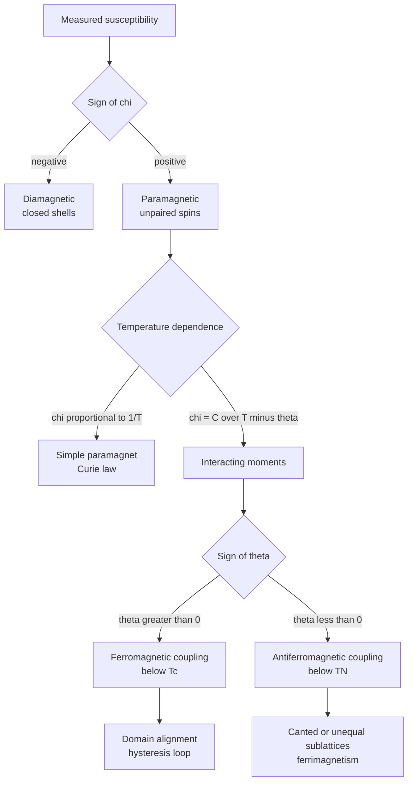
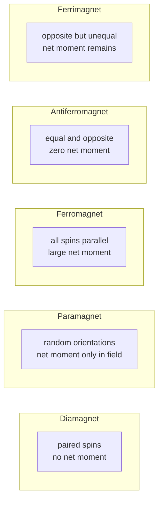
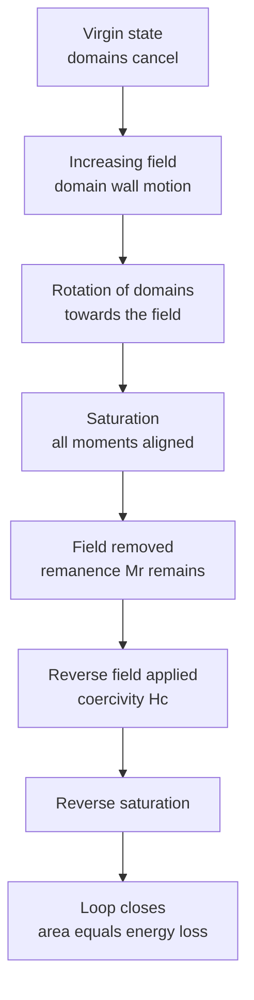
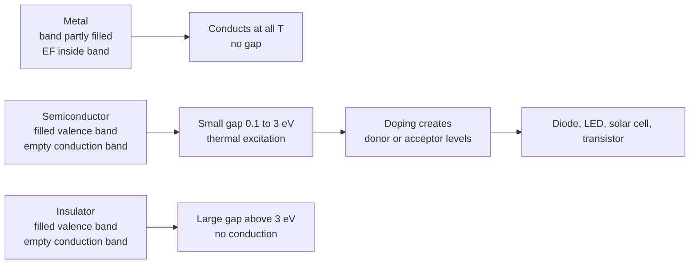
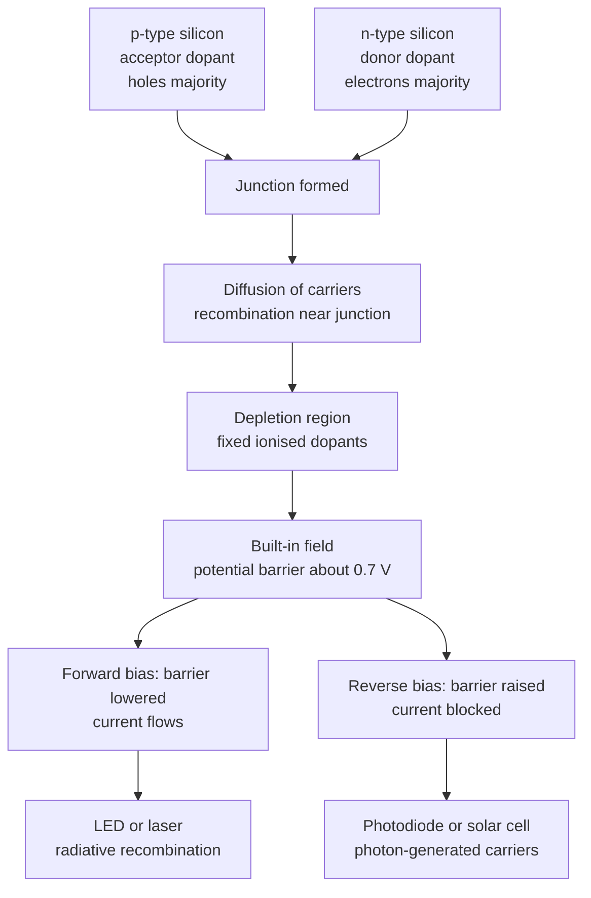

# Chapter 7 — Magnetic and Electronic Properties

> **Level:** Level 5 — Advanced Inorganic Chemistry
> **Estimated study time:** 7 hours (5 h reading + 2 h exercises)
> **Prerequisites:** [Transition Metals](02-transition-metals.md); [Solid-State Chemistry](06-solid-state-chemistry-crystal-structures-and-defects.md); level-4 quantum chemistry
> **Related chapters:** [Coordination Compounds](03-coordination-compounds.md), [Lanthanides and Actinides](09-lanthanides-and-actinides.md), [Descriptive Inorganic Chemistry](10-descriptive-inorganic-chemistry.md)
> **Difficulty:** ★★★★★ (5/5)

---

## 1. Learning Objectives

After working through this chapter you will be able to:

- Define magnetic susceptibility, magnetic moment and magnetisation, and state their SI units.
- Distinguish diamagnetism, paramagnetism, ferromagnetism, antiferromagnetism and ferrimagnetism in terms of spin alignment and temperature dependence.
- Describe the Gouy and Faraday methods for measuring susceptibility and calculate a molar susceptibility from a measured mass change.
- Apply the spin-only formula $\mu_{\text{so}} = \sqrt{n(n+2)}\,\mu_{\text{B}}$ to deduce the number of unpaired electrons in a complex.
- Use the Curie and Curie–Weiss laws to extract a Curie constant and a Weiss temperature from susceptibility data.
- Explain qualitatively why orbital angular momentum contributes to the magnetic moment of some ions and not others.
- Distinguish direct exchange, superexchange and double exchange, and predict the sign of the superexchange interaction from the Goodenough–Kanamori rules.
- Explain magnetic domains, hysteresis, coercivity and remanence, and select hard or soft magnets for a given application.
- Describe band theory for metals, insulators and semiconductors, and explain the meaning of the Fermi level and the density of states.
- Distinguish intrinsic from extrinsic semiconductors, describe n-type and p-type doping, and explain the operation of a p–n junction.
- Outline the Meissner effect, the BCS mechanism and the phenomenology of high-temperature cuprate superconductors.

---

## 2. Introduction

A magnet on a refrigerator door, the read head of a hard disk, an MRI scanner, a lithium-ion battery and a solar cell all depend on the same two questions: how do electrons arrange their spins, and how do electrons occupy available energy levels? This chapter answers both questions at the level needed to interpret experiments and to choose materials.

The magnetic part begins with a deceptively simple observation: a compound of a first-row transition metal is pulled into a magnetic field with a force that is proportional to the number of unpaired electrons. Measuring that force therefore counts unpaired electrons, and counting unpaired electrons reveals oxidation state, spin state and geometry. Before electronic structure theory was routine, magnetic susceptibility was the principal experimental probe of transition-metal coordination chemistry, and it remains the cheapest and most direct.

The electronic part begins with the failure of the isolated-atom picture in solids. When $10^{23}$ atoms are packed together, their atomic orbitals overlap into continuous bands, and the occupation of those bands determines whether the material conducts, insulates, absorbs light or becomes superconducting. The same band picture explains why silicon is a poor conductor at 300 K but a good one when doped with one phosphorus atom in a million, and why a light-emitting diode emits at a colour set by a band gap.

The chapter deliberately treats the two themes together because they share a common origin. Both magnetism and conductivity are consequences of electron spin and of the Pauli exclusion principle. Exchange interactions, which align spins, and band formation, which delocalises them, are competing consequences of the same overlap integrals.

---

## 3. Fundamental Concepts

### 3.1 Magnetic quantities

A material placed in a magnetic field $\mathbf{H}$ acquires a **magnetisation** $\mathbf{M}$ (magnetic moment per unit volume). The **volume susceptibility** is the dimensionless ratio

$$ \chi_{\text{v}} = \frac{M}{H} $$

and the **molar susceptibility** $\chi_{\text{m}}$ is the susceptibility per mole of substance, conventionally quoted in $\text{cm}^{3}\ \text{mol}^{-1}$ in the chemistry literature and in $\text{m}^{3}\ \text{mol}^{-1}$ in SI. The conversion is $1\ \text{cm}^{3}\ \text{mol}^{-1} = 10^{-6}\ \text{m}^{3}\ \text{mol}^{-1}$.

The **magnetic moment** of a single ion is measured in **Bohr magnetons**, $\mu_{\text{B}} = 9.2740100783\times10^{-24}\ \text{J T}^{-1}$. For a mole of non-interacting ions the molar susceptibility and the moment are related by the **Curie law**

$$ \chi_{\text{m}} = \frac{N_{\text{A}}\mu_0\mu_{\text{eff}}^2}{3k_{\text{B}}T} $$

which, with $\chi_{\text{m}}$ in $\text{cm}^{3}\ \text{mol}^{-1}$ and $\mu_{\text{eff}}$ in Bohr magnetons, becomes the working equation

$$ \mu_{\text{eff}} = 2.828\sqrt{\chi_{\text{m}}T} $$

### 3.2 The five magnetic behaviours

| Behaviour | Sign and size of $\chi$ | Spin arrangement | Temperature dependence | Example |
|---|---|---|---|---|
| Diamagnetism | Negative, $\sim -10^{-5}$ | No permanent moments; induced currents oppose the field | Essentially independent of $T$ | $\ce{H2O}$, $\ce{NaCl}$, $\ce{N2}$ |
| Paramagnetism | Positive, $\sim 10^{-3}$–$10^{-2}$ | Isolated moments, randomly oriented | $\chi \propto 1/T$ (Curie) | $\ce{[Ni(H2O)6]^2+}$, $\ce{Gd^3+}$ |
| Ferromagnetism | Large positive, up to $10^{6}$ | Parallel alignment below $T_{\text{C}}$ | Order below $T_{\text{C}}$, Curie–Weiss above | Fe, Co, Ni |
| Antiferromagnetism | Small positive | Antiparallel, equal moments cancel | Maximum at $T_{\text{N}}$, Curie–Weiss with $\theta < 0$ | MnO, NiO, $\ce{Cr2O3}$ |
| Ferrimagnetism | Large positive | Antiparallel but unequal moments | Order below $T_{\text{C}}$ | $\ce{Fe3O4}$, ferrites |

**Diamagnetism** is a universal property of matter: every electron pair in a closed shell produces a small induced moment opposing the applied field. It is the only contribution in closed-shell ions such as $\ce{Na+}$, $\ce{Cl-}$ and $\ce{Zn^2+}$, and it must be subtracted from measured susceptibilities before paramagnetic moments are calculated.

**Paramagnetism** requires unpaired electrons. In a transition-metal complex the moment arises mainly from electron spin, with a variable orbital contribution. In a lanthanide ion the $4f$ electrons are shielded from the ligand field, so spin and orbital angular momentum remain coupled and the full free-ion moment is observed (Chapter 9).

**Ferromagnetism** requires cooperative alignment of moments over macroscopic domains. It occurs when the exchange interaction favours parallel spins, and it disappears above the **Curie temperature** $T_{\text{C}}$ (Fe 1043 K, Co 1394 K, Ni 631 K), above which the material becomes paramagnetic.

**Antiferromagnetism** is cooperative antiparallel alignment with complete cancellation, so the net moment is zero below the **Néel temperature** $T_{\text{N}}$. The susceptibility rises to a maximum at $T_{\text{N}}$ and then falls as the temperature is lowered further, because the applied field can only cant the sublattices slightly.

**Ferrimagnetism** is antiparallel alignment of *unequal* moments, so a net spontaneous magnetisation survives. It is the dominant magnetism of oxides, including magnetite and the technical ferrites, and it arises naturally in spinels where two cation sublattices carry different moments.

### 3.3 Measuring susceptibility: Gouy and Faraday methods

The **Gouy method** suspends a cylindrical sample in a strong, inhomogeneous field and measures the apparent mass change. The force on a volume susceptibility $\chi_{\text{v}}$ in a field gradient is

$$ F = \tfrac{1}{2}\mu_0\chi_{\text{v}}H^2A $$

where $A$ is the cross-sectional area of the sample. The sample is long enough that only its lower end experiences the field, so the force is proportional to the field strength at that end. The apparent mass change $\Delta m$ gives

$$ \chi_{\text{v}} = \frac{2\Delta m\,g}{\mu_0 H^2 A} $$

and the mass susceptibility follows as $\chi_{\text{g}} = \chi_{\text{v}}/\rho$, the molar susceptibility as $\chi_{\text{m}} = \chi_{\text{g}}M$.

The **Faraday method** uses a much smaller sample and a field with a constant gradient product $H(\mathrm{d}H/\mathrm{d}z)$, measuring the force directly with a microbalance or a piezoelectric sensor. It is better suited to single crystals and to variable-temperature work, and modern instruments (SQUID magnetometers) measure the oscillating magnetic moment of a moving sample with superconducting pickup coils, achieving sensitivities below $10^{-10}\ \text{A m}^{2}$.

**Diamagnetic corrections.** Measured molar susceptibilities include the diamagnetic contribution of every filled shell and every bond. Pascal's tables assign constitutive increments to atoms and groups, and the correction is subtracted:

$$ \chi_{\text{m}}^{\text{para}} = \chi_{\text{m}}^{\text{obs}} - \chi_{\text{m}}^{\text{dia}} $$

For a transition-metal complex the correction is typically $10^{-4}$ to $10^{-3}\ \text{cm}^{3}\ \text{mol}^{-1}$, which is small but not negligible when the moment is small.

### 3.4 The spin-only moment

For an ion with $n$ unpaired electrons, each with spin $s = \tfrac12$, the total spin is $S = n/2$ and the spin-only magnetic moment is

$$ \mu_{\text{so}} = g\sqrt{S(S+1)}\,\mu_{\text{B}} = \sqrt{n(n+2)}\,\mu_{\text{B}} $$

using $g = 2$. The values are worth memorising:

| $n$ | $S$ | $\mu_{\text{so}}/\mu_{\text{B}}$ | Typical ion |
|---|---|---|---|
| 0 | 0 | 0 | $\ce{Zn^2+}$ ($d^{10}$), low-spin $\ce{Co^3+}$ ($d^{6}$) |
| 1 | 1/2 | 1.73 | $\ce{Cu^2+}$ ($d^{9}$), low-spin $\ce{Fe^3+}$ ($d^{5}$) |
| 2 | 1 | 2.83 | $\ce{Ni^2+}$ ($d^{8}$) |
| 3 | 3/2 | 3.87 | high-spin $\ce{Cr^3+}$ ($d^{3}$), high-spin $\ce{Co^2+}$ ($d^{7}$) |
| 4 | 2 | 4.90 | high-spin $\ce{Fe^2+}$ ($d^{6}$), high-spin $\ce{Co^3+}$ |
| 5 | 5/2 | 5.92 | high-spin $\ce{Mn^2+}$, $\ce{Fe^3+}$ ($d^{5}$) |

The formula is exact only when the orbital angular momentum is completely quenched and when spin–orbit coupling is negligible. It works well for first-row octahedral complexes with $A_{2g}$ or $E_{g}$ ground terms, and poorly for tetrahedral complexes and for ions with $T$ ground terms.

### 3.5 Temperature dependence: Curie and Curie–Weiss laws

The **Curie law** applies to magnetically dilute, non-interacting moments:

$$ \chi_{\text{m}} = \frac{C}{T} \qquad C = \frac{N_{\text{A}}\mu_0\mu_{\text{eff}}^2}{3k_{\text{B}}} $$

In practical units, $C = 0.125\,n(n+2)\ \text{cm}^{3}\ \text{K mol}^{-1}$ for a spin-only system.

When moments interact, the law is modified to the **Curie–Weiss law**:

$$ \chi_{\text{m}} = \frac{C}{T-\theta} $$

A plot of $1/\chi_{\text{m}}$ against $T$ is linear with slope $1/C$ and intercept $-\theta/C$. The sign of $\theta$ diagnoses the dominant interaction: $\theta \approx 0$ for an ideal paramagnet, $\theta > 0$ for ferromagnetic coupling, and $\theta < 0$ for antiferromagnetic coupling. The magnitude of $\theta$ measures the exchange energy, and $|\theta|$ is typically of the same order as $T_{\text{C}}$ or $T_{\text{N}}$.

### 3.6 Magnetic ordering and exchange

The interaction that aligns spins on different sites cannot be a direct magnetic dipole interaction: dipole energies are of order $10^{-4}\ \text{eV}$, far too small to explain ordering temperatures of hundreds of kelvin. The interaction is electrostatic in origin and is a consequence of the Pauli principle, which penalises electrons of parallel spin occupying the same region of space. This is the **exchange interaction**, with an energy usually written in the Heisenberg form

$$ \hat{H}_{\text{ex}} = -2J\sum_{i<j}\hat{\mathbf{S}}_i\cdot\hat{\mathbf{S}}_j $$

where $J > 0$ favours parallel alignment (ferromagnetic) and $J < 0$ favours antiparallel alignment (antiferromagnetic).

Three mechanisms operate in solids:

- **Direct exchange** requires overlap of magnetic orbitals on adjacent ions, which is significant only for short metal–metal distances (metals and some clusters).
- **Superexchange** operates through a diamagnetic bridging ligand, usually $\ce{O^{2-}}$ or $\ce{F-}$. It is the dominant mechanism in ionic oxides and halides.
- **Double exchange** operates when an electron can hop between ions of different oxidation state, as in mixed-valence manganites; it favours ferromagnetic alignment because hopping is allowed only when the core spins are parallel.

### 3.7 Domains and hysteresis

A ferromagnetic or ferrimagnetic solid is divided into **domains**, each uniformly magnetised but with a different orientation. In zero field the domain magnetisations cancel. As the applied field increases, domains favourably oriented grow at the expense of others (domain-wall motion), then rotate towards the field, and finally the material reaches **saturation magnetisation** $M_{\text{s}}$.

The magnetisation lags the field, producing a **hysteresis loop** with three characteristic parameters:

- **Remanence** $M_{\text{r}}$: the magnetisation remaining when the field returns to zero.
- **Coercivity** $H_{\text{c}}$: the reverse field needed to reduce the magnetisation to zero.
- **Saturation magnetisation** $M_{\text{s}}$: the maximum value, determined by the number of Bohr magnetons per formula unit and the density.

The area of the loop is the energy dissipated per cycle per unit volume, which is why **soft** magnets (narrow loop, low $H_{\text{c}}$) are used in transformers and **hard** magnets (wide loop, high $H_{\text{c}}$) in permanent magnets.

### 3.8 Band theory of solids

When $N$ atomic orbitals of the same type overlap, they form $N$ molecular orbitals whose energies are so closely spaced that they form a continuous **band**. The band derived from the valence orbitals is the **valence band**; the next band is the **conduction band**; and the energy difference between the top of the valence band and the bottom of the conduction band is the **band gap** $E_{\text{g}}$.

The occupation of the bands is governed by the Fermi–Dirac distribution

$$ f(E) = \frac{1}{\exp[(E-E_{\text{F}})/k_{\text{B}}T]+1} $$

where $E_{\text{F}}$ is the **Fermi energy**. At $T = 0$ every state below $E_{\text{F}}$ is occupied and every state above it is empty.

| Class | Band occupation | $E_{\text{g}}$ | Example |
|---|---|---|---|
| Metal | Partly filled band | 0 | Na, Cu, Al |
| Semimetal | Tiny overlap of valence and conduction bands | $\approx 0$ | graphite, Bi |
| Semiconductor | Filled valence band, empty conduction band | 0.1–3 eV | Si (1.12), Ge (0.67), GaAs (1.42) |
| Insulator | Filled valence band, empty conduction band | $>3$ eV | diamond (5.47), $\ce{SiO2}$ (9) |

The **density of states** $g(E)$ is the number of states per unit energy per unit volume. For a three-dimensional free-electron gas $g(E)\propto E^{1/2}$; for a two-dimensional system it is a step function; for a one-dimensional system it diverges at the band edge. The product $g(E)f(E)$ determines the number of carriers, and the shape of $g(E)$ near $E_{\text{F}}$ determines whether a material is a metal, a semiconductor or a Mott insulator.

### 3.9 Intrinsic and extrinsic semiconductors

An **intrinsic** semiconductor has equal numbers of electrons in the conduction band and holes in the valence band, both generated thermally. The carrier concentration is

$$ n_{\text{i}} \propto \exp\!\left(-\frac{E_{\text{g}}}{2k_{\text{B}}T}\right) $$

so it doubles roughly every 10 K for a 1 eV gap near room temperature.

An **extrinsic** semiconductor is doped with a controlled impurity:

- **n-type**: a group-15 donor (P, As, Sb) in silicon contributes an electron to the conduction band. The donor level lies just below the conduction band.
- **p-type**: a group-13 acceptor (B, Al, Ga) leaves a hole in the valence band. The acceptor level lies just above the valence band.

Doping by $10^{-6}$ changes the conductivity by many orders of magnitude at room temperature, and it is the basis of every semiconductor device.

### 3.10 Superconductivity (advanced, optional on a first reading)

Below a critical temperature $T_{\text{c}}$, a superconductor has zero electrical resistance and expels magnetic flux from its interior — the **Meissner effect**, which is a genuine thermodynamic state and not merely the consequence of zero resistance. A superconductor is a perfect diamagnet with $\chi = -1$.

Superconductors are classified as **type I** (a single critical field, complete flux expulsion) or **type II** (two critical fields, with flux penetrating as quantised vortices between $H_{\text{c}1}$ and $H_{\text{c}2}$). All practical high-field superconductors are type II, because vortex pinning allows them to carry large currents in high fields.

The **BCS theory** (Bardeen, Cooper and Schrieffer, 1957) explains conventional superconductivity as the pairing of electrons with opposite spin and momentum into **Cooper pairs**, mediated by a subtle electron–phonon attraction. The pairs condense into a single quantum state with a gap in the excitation spectrum, so scattering that would cause resistance is forbidden. The theory predicts an isotope effect ($T_{\text{c}} \propto M^{-\alpha}$ with $\alpha \approx 0.5$), which was the decisive experimental evidence.

**High-temperature superconductors** are layered copper oxides discovered by Bednorz and Müller in 1986. $\ce{La_{2-x}Sr_xCuO4}$ has $T_{\text{c}} \approx 38\ \text{K}$, $\ce{YBa2Cu3O_{7-\delta}}$ has $T_{\text{c}} \approx 92\ \text{K}$, and $\ce{HgBa2Ca2Cu3O_{8+\delta}}$ reaches 133 K at ambient pressure. Their mechanism is still debated; the pairing is not simple phonon-mediated BCS, and the normal state is an unusual "strange metal". The 2015 discovery of superconductivity at 203 K in $\ce{H3S}$ under 155 GPa, and at about 250 K in $\ce{LaH10}$ under 170 GPa, shows that conventional phonon pairing can reach high temperatures under extreme compression.

---

## 4. Detailed Scientific Explanation

### 4.1 Orbital contribution and spin–orbit coupling

The spin-only formula ignores the orbital angular momentum of the electrons. In a free ion the total moment is

$$ \mu_{\text{eff}} = g_J\sqrt{J(J+1)}\,\mu_{\text{B}} \qquad g_J = 1 + \frac{J(J+1) + S(S+1) - L(L+1)}{2J(J+1)} $$

where $J$ is the total angular momentum quantum number and $g_J$ the Landé $g$-factor. In a ligand field the orbital angular momentum is largely **quenched**: the $d$ orbitals are no longer degenerate, so an electron cannot circulate freely, and the orbital contribution to the moment disappears. Quenching is complete for $A$ and $E$ ground terms (for example high-spin $\ce{Mn^2+}$, $d^{5}$, and $\ce{Ni^2+}$ in an octahedral field, $A_{2g}$) and incomplete for $T$ ground terms (for example high-spin $\ce{Co^2+}$, $T_{1g}$, and tetrahedral $\ce{CoCl4^2-}$).

For an octahedral complex with a $T$ ground term, first-order perturbation theory gives

$$ \mu_{\text{eff}} \approx \mu_{\text{so}}\left(1 - \frac{\alpha\lambda}{\Delta_{\text{o}}}\right) $$

where $\lambda$ is the spin–orbit coupling constant (positive for less than half-filled shells, negative for more than half-filled), $\Delta_{\text{o}}$ is the ligand-field splitting, and $\alpha = 2$ for an $E$ term and $\alpha = 4$ for a $T$ term. The formula explains the two characteristic anomalies:

- **High-spin $\ce{Co^2+}$ ($d^{7}$, $T_{1g}$)**: $\lambda$ is negative and $\Delta_{\text{o}}$ is moderate, so the moment rises above the spin-only value, typically to 4.7–5.2 $\mu_{\text{B}}$ instead of 3.87.
- **High-spin $\ce{Fe^2+}$ ($d^{6}$, $T_{2g}$)**: $\lambda$ is negative and the moment rises to about 5.2–5.4 $\mu_{\text{B}}$ instead of 4.90.

When the temperature is raised, excited states become populated and the moment drifts towards the spin-only value. This temperature dependence is a useful diagnostic of an orbitally degenerate ground state.

### 4.2 Superexchange and the Goodenough–Kanamori rules

Superexchange is the coupling of two metal spins through a bridging anion. It is strongest when the metal–ligand–metal angle is close to $180^\circ$, because the $p$ orbital of the bridge then overlaps both metal orbitals. The sign and strength of the coupling can be predicted from the occupation of the magnetic orbitals:

- **Half-filled–half-filled overlap** with a $180^\circ$ bridge gives strong **antiferromagnetic** coupling, because the Pauli principle forbids the virtual hopping that would put two parallel spins in the same orbital.
- **Half-filled–empty overlap** gives **ferromagnetic** coupling, because virtual hopping is allowed only for parallel spins (the "potential exchange" mechanism).
- **Full–empty or full–half-filled overlap** gives weak coupling, since the filled orbital cannot accept an electron.

These are the **Goodenough–Kanamori rules**. They explain the antiferromagnetism of MnO and NiO, both of which have $180^\circ$ M–O–M bridges and half-filled $e_g$ or $t_{2g}$ orbitals, and the ferromagnetism of some mixed-valence oxides where double exchange operates.

A useful consequence is that the **Néel temperature scales with the number of unpaired electrons and with the M–O–M angle**. Distorting a perovskite so that the bridge angle bends away from $180^\circ$ weakens the coupling and lowers $T_{\text{N}}$, which is why the magnetic ordering temperatures of perovskites track their tolerance factors.

### 4.3 Hard and soft magnets

The distinction between hard and soft magnetic materials is microstructural as much as chemical.

**Soft magnets** need low coercivity, high permeability and low hysteresis loss. They are used in transformer cores, inductors and electric motors. Silicon steel (Fe with 3 % Si) reduces eddy-current losses by increasing resistivity; Permalloy (Ni–Fe) has very high permeability; MnZn ferrites are used at high frequency because their high resistivity suppresses eddy currents.

**Hard magnets** need high coercivity, high remanence and a large energy product $(BH)_{\max}$. They are used in motors, loudspeakers, wind turbines and magnetic resonance imaging. The progression of permanent-magnet materials is a story of increasing energy product:

| Magnet | Year | $(BH)_{\max}$ / $\text{kJ m}^{-3}$ | Comment |
|---|---|---|---|
| Carbon steel | 1900 | ≈ 2 | Historical |
| Alnico | 1930s | ≈ 40 | Shape anisotropy |
| Strontium ferrite | 1950s | ≈ 30 | Cheap, insulating |
| SmCo$_5$ | 1970 | ≈ 150 | High anisotropy, expensive |
| Nd$_2$Fe$_{14}$B | 1984 | ≈ 400 | Benchmark; Curie temperature 585 K |

Coercivity in Nd$_2$Fe$_{14}$B comes from the tetragonal crystal structure, which has a very large magnetocrystalline anisotropy, combined with a microstructure of isolated grains that prevents domain-wall motion. The weakness of NdFeB is its low Curie temperature and its susceptibility to corrosion; both are mitigated by dysprosium substitution and by protective coatings.

### 4.4 The Fermi level and the density of states

In a metal, the Fermi level lies inside a band. Only electrons within about $k_{\text{B}}T$ of $E_{\text{F}}$ can be excited, which is why the electronic heat capacity is linear in $T$ and much smaller than the classical prediction. The **Sommerfeld expansion** gives

$$ C_{\text{el}} = \frac{\pi^2}{3}g(E_{\text{F}})k_{\text{B}}^2T $$

so measuring the electronic heat capacity measures the density of states at the Fermi level.

In a semiconductor, $E_{\text{F}}$ lies inside the gap. For an intrinsic semiconductor it lies near the middle of the gap; for an n-type material it moves towards the conduction band; for a p-type material it moves towards the valence band. The position of $E_{\text{F}}$ is what makes a metal–semiconductor contact ohmic or rectifying.

The **effective mass** $m^{*}$ replaces the free-electron mass in the density of states:

$$ g(E) = \frac{1}{2\pi^2}\left(\frac{2m^{*}}{\hbar^2}\right)^{3/2}\sqrt{E} $$

A small effective mass gives a large density of states and high mobility; this is why GaAs, with $m^{*} \approx 0.067\,m_{\text{e}}$, is preferred over silicon for high-speed devices.

### 4.5 The p–n junction

When p-type and n-type silicon are joined, electrons diffuse from the n-side to the p-side and holes diffuse the other way, leaving behind fixed ionised dopant atoms. The result is a **depletion region** with a built-in electric field and a potential barrier of about 0.7 V for silicon.

The junction is rectifying: forward bias (p positive) lowers the barrier and allows a large current; reverse bias raises it and allows only a small leakage current. The same structure is the basis of:

- **Diodes**, which conduct in one direction.
- **Light-emitting diodes**, in which forward-biased electrons and holes recombine radiatively, emitting photons of energy $h\nu \approx E_{\text{g}}$.
- **Solar cells**, in which absorbed photons create electron–hole pairs that are separated by the built-in field.
- **Transistors**, in which a third terminal modulates the depletion region.

The emission wavelength follows from the band gap:

$$ \lambda = \frac{hc}{E_{\text{g}}} = \frac{1240}{E_{\text{g}}/\text{eV}}\ \text{nm} $$

This is why GaAs ($E_{\text{g}} = 1.42\ \text{eV}$) emits in the near infrared, GaP ($2.26\ \text{eV}$) in the green, and GaN ($3.4\ \text{eV}$) in the ultraviolet — the basis of white LEDs when combined with a yellow phosphor.

### 4.6 Superconductivity: BCS and beyond (advanced)

The BCS mechanism can be summarised in four steps. An electron moving through the lattice attracts the positive ions, creating a transient region of enhanced positive charge. A second electron with opposite spin and momentum is attracted to that region. The pair has lower energy than two separate electrons, and pairs of pairs condense into a coherent state separated from excitations by an energy gap $2\Delta$. The critical temperature is

$$ k_{\text{B}}T_{\text{c}} \approx 1.13\,\hbar\omega_{\text{D}}\exp\!\left(-\frac{1}{N(E_{\text{F}})V}\right) $$

where $\omega_{\text{D}}$ is the Debye frequency and $V$ the pairing interaction. The exponential dependence explains why $T_{\text{c}}$ is so sensitive to composition and why it was so hard to raise: the pre-exponential factor is at most a few hundred kelvin, and the exponent is usually small.

In the cuprates, $T_{\text{c}}$ reaches 92 K in a material with a layered perovskite structure containing $\ce{CuO2}$ planes. Doping these planes with holes (by substituting $\ce{Sr^2+}$ for $\ce{La^3+}$, or by adding oxygen) produces the superconducting state. The parent compounds are antiferromagnetic Mott insulators, and superconductivity appears when the antiferromagnetic order is suppressed — a proximity that suggests a magnetic, rather than phononic, pairing mechanism. This remains one of the major unsolved problems of condensed-matter chemistry.

### 4.7 Reading a magnetic measurement

A practical workflow for a new complex is:

1. Measure $\chi_{\text{m}}$ at several temperatures.
2. Apply Pascal corrections for diamagnetism.
3. Plot $1/\chi_{\text{m}}$ against $T$; a straight line confirms Curie–Weiss behaviour, and the intercept gives $\theta$.
4. Compute $\mu_{\text{eff}} = 2.828\sqrt{\chi_{\text{m}}T}$ in the linear region.
5. Convert $\mu_{\text{eff}}$ to $n$ by inverting the spin-only formula, and check whether the result is close to an integer.
6. Compare with the value expected from the oxidation state and spin state; a discrepancy indicates orbital contribution, spin–orbit coupling, or intermolecular exchange.

A moment below the spin-only value usually indicates antiferromagnetic coupling; a moment above it usually indicates an orbital contribution or ferromagnetic impurities. A moment that is not close to any spin-only value at all usually indicates a mixture of species or a badly calibrated balance.

---

## 5. Visual Diagrams

### 5.1 A decision map for magnetic behaviour

**Figure 7.1 — Diagnostic decision map for magnetic behaviour.** The map is read from a measured susceptibility and its temperature dependence. The first branch separates diamagnets from materials with unpaired electrons. The second separates simple paramagnets from materials with cooperative interactions. The sign of the Weiss temperature $\theta$ then identifies ferromagnetic or antiferromagnetic coupling. Real materials can show more than one regime: magnetite is ferrimagnetic below 858 K, paramagnetic above it, and its paramagnetic Curie–Weiss $\theta$ is positive because short-range ferromagnetic correlations survive in the paramagnetic phase.

### 5.2 The five spin arrangements

**Figure 7.2 — The five elementary spin arrangements.** Diamagnetism and paramagnetism are single-ion phenomena; ferromagnetism, antiferromagnetism and ferrimagnetism are cooperative. The distinction between antiferromagnetism and ferrimagnetism is not the sign of the coupling but the equality of the sublattice moments. In a spinel such as magnetite the tetrahedral $\ce{Fe^3+}$ sublattice and the octahedral $\ce{Fe^2+/Fe^3+}$ sublattice are antiparallel, but the octahedral moment is larger, so a net moment of about $4\ \mu_{\text{B}}$ per formula unit survives. This figure should be compared with Figure 7.3: the same arrangement determines the shape of the hysteresis loop.

### 5.3 The hysteresis loop and its parameters

**Figure 7.3 — The magnetisation cycle of a ferromagnet.** Starting from the unmagnetised virgin state, domain-wall motion gives the steep initial rise, rotation gives the approach to saturation, and removal of the field leaves a remanence $M_{\text{r}}$. The reverse field needed to cancel that remanence is the coercivity $H_{\text{c}}$. The area enclosed by the loop is the energy dissipated as heat per unit volume per cycle, which is why soft magnets are chosen for transformers (small area) and hard magnets for permanent magnets (large area, high remanence, high coercivity). The loop shape is controlled by microstructure: grain boundaries and precipitates pin domain walls and raise $H_{\text{c}}$.

### 5.4 Band structure of metals, semiconductors and insulators

**Figure 7.4 — Band structure and the classification of electronic materials.** The difference between a metal, a semiconductor and an insulator is not the width of the bands but the position of the Fermi level relative to them. In a metal $E_{\text{F}}$ lies inside a band, so empty states are available at infinitesimal energy cost. In a semiconductor or insulator $E_{\text{F}}$ lies in a gap, so conduction requires thermal or optical excitation across $E_{\text{g}}$. The arbitrary boundary at about 3 eV separates semiconductors from insulators, and the boundary is not sharp: diamond, with a 5.47 eV gap, is an insulator at room temperature but a semiconductor at 1000 K.

### 5.5 The p–n junction

**Figure 7.5 — Formation and behaviour of a p–n junction.** The junction is not a chemical compound but a spatial discontinuity in doping. Diffusion of majority carriers leaves behind uncompensated ionised donors and acceptors, which create the depletion region and the built-in field. The same physical structure behaves as a rectifier, a light emitter or a light absorber depending on how it is biased and on the band gap. The figure should be read alongside the band-gap equation of Section 6.6: the emission colour of an LED is fixed by the semiconductor, not by the circuit.

---

## 6. Mathematical Formulas

### 6.1 Molar susceptibility and magnetic moment

$$ \chi_{\text{m}} = \chi_{\text{g}}M = \frac{\chi_{\text{v}}M}{\rho} \qquad \mu_{\text{eff}} = 2.828\sqrt{\chi_{\text{m}}T} $$

| Symbol | Meaning | SI unit |
|---|---|---|
| $\chi_{\text{m}}$ | molar magnetic susceptibility | $\text{cm}^{3}\ \text{mol}^{-1}$ (practical) or $\text{m}^{3}\ \text{mol}^{-1}$ |
| $\chi_{\text{g}}$ | mass susceptibility | $\text{cm}^{3}\ \text{g}^{-1}$ |
| $\chi_{\text{v}}$ | volume susceptibility | dimensionless |
| $M$ | molar mass | $\text{g mol}^{-1}$ |
| $\rho$ | density | $\text{g cm}^{-3}$ |
| $\mu_{\text{eff}}$ | effective magnetic moment | $\mu_{\text{B}}$ |
| $T$ | thermodynamic temperature | K |

The constant 2.828 absorbs $N_{\text{A}}$, $\mu_0$, $k_{\text{B}}$ and the conversion from $\text{cm}^{3}$ to $\text{m}^{3}$; it is valid only when $\chi_{\text{m}}$ is in $\text{cm}^{3}\ \text{mol}^{-1}$.

### 6.2 Spin-only moment

$$ \mu_{\text{so}} = \sqrt{n(n+2)}\,\mu_{\text{B}} $$

| Symbol | Meaning | SI unit |
|---|---|---|
| $\mu_{\text{so}}$ | spin-only magnetic moment | $\mu_{\text{B}}$ |
| $n$ | number of unpaired electrons | dimensionless |
| $\mu_{\text{B}}$ | Bohr magneton, $9.274\times10^{-24}$ | $\text{J T}^{-1}$ |

Assumptions: orbital angular momentum fully quenched; spin–orbit coupling negligible; no exchange between ions.

### 6.3 Curie and Curie–Weiss laws

$$ \chi_{\text{m}} = \frac{C}{T} \qquad \chi_{\text{m}} = \frac{C}{T-\theta} \qquad C = 0.125\,n(n+2) $$

| Symbol | Meaning | SI unit |
|---|---|---|
| $C$ | Curie constant | $\text{cm}^{3}\ \text{K mol}^{-1}$ |
| $\theta$ | Weiss temperature | K |

The Curie constant in $\text{cm}^{3}\ \text{K mol}^{-1}$ is numerically $0.125\,n(n+2)$ for a spin-only system. A positive $\theta$ indicates ferromagnetic coupling; a negative $\theta$ indicates antiferromagnetic coupling.

### 6.4 Gouy balance

$$ \chi_{\text{v}} = \frac{2\Delta m\,g}{\mu_0H^2A} $$

| Symbol | Meaning | SI unit |
|---|---|---|
| $\Delta m$ | apparent mass change | kg |
| $g$ | gravitational acceleration, $9.81$ | $\text{m s}^{-2}$ |
| $\mu_0$ | vacuum permeability, $4\pi\times10^{-7}$ | $\text{H m}^{-1}$ |
| $H$ | applied field strength | $\text{A m}^{-1}$ |
| $A$ | sample cross-sectional area | $\text{m}^{2}$ |

Assumption: the sample is long and uniformly packed, and only its lower end lies in the field.

### 6.5 Fermi–Dirac occupation

$$ f(E) = \frac{1}{\exp[(E-E_{\text{F}})/k_{\text{B}}T]+1} $$

| Symbol | Meaning | SI unit |
|---|---|---|
| $f(E)$ | probability that a state at energy $E$ is occupied | dimensionless |
| $E$ | electron energy | J |
| $E_{\text{F}}$ | Fermi energy | J |
| $k_{\text{B}}$ | Boltzmann constant, $1.380649\times10^{-23}$ | $\text{J K}^{-1}$ |

At $E = E_{\text{F}}$, $f = 0.5$ at every temperature. The approximation $f \approx \exp[-(E-E_{\text{F}})/k_{\text{B}}T]$ holds when $E - E_{\text{F}} \gg k_{\text{B}}T$.

### 6.6 Photon energy and band gap

$$ E = h\nu = \frac{hc}{\lambda} \qquad \lambda/\text{nm} = \frac{1240}{E_{\text{g}}/\text{eV}} $$

| Symbol | Meaning | SI unit |
|---|---|---|
| $E$ | photon energy | J (or eV) |
| $h$ | Planck constant, $6.62607015\times10^{-34}$ | $\text{J s}$ |
| $\nu$ | frequency | Hz |
| $c$ | speed of light in vacuum, $2.99792458\times10^{8}$ | $\text{m s}^{-1}$ |
| $\lambda$ | wavelength | m |

The numerical form $\lambda = 1240/E_{\text{g}}$ is convenient but approximate; the exact value of $hc$ is $1.986\times10^{-25}\ \text{J m}$, which gives $\lambda = 1239.8/E_{\text{g}}(\text{eV})$ nm.

### 6.7 Saturation magnetisation

$$ M_{\text{s}} = \frac{n_{\text{B}}\mu_{\text{B}}\rho N_{\text{A}}}{M} $$

| Symbol | Meaning | SI unit |
|---|---|---|
| $M_{\text{s}}$ | saturation magnetisation | $\text{A m}^{-1}$ |
| $n_{\text{B}}$ | Bohr magnetons per formula unit | dimensionless |
| $\rho$ | density | $\text{kg m}^{-3}$ |
| $M$ | molar mass | $\text{kg mol}^{-1}$ |

This expression assumes complete alignment of all moments and no canting, so it gives an upper bound. Measured values are typically 5–15 % lower.

---

## 7. Chemical Equations

### 7.1 Formation of an antiferromagnetic oxide

$$
\ce{Mn(s) + \tfrac12 O2(g) -> MnO(s)}
$$

MnO adopts the rock-salt structure with $\ce{Mn^2+}$ ($d^{5}$, high spin) and orders antiferromagnetically below $T_{\text{N}} = 116\ \text{K}$. The $180^\circ$ Mn–O–Mn bridges and half-filled $e_g$ orbitals give strong antiferromagnetic superexchange, exactly as the Goodenough–Kanamori rules predict.

### 7.2 Formation of a ferrimagnetic spinel

$$
\ce{NiO(s) + Fe2O3(s) -> NiFe2O4(s)}
$$

Nickel ferrite is an inverse spinel: $\ce{Ni^2+}$ occupies octahedral sites, and $\ce{Fe^3+}$ is distributed over both tetrahedral and octahedral sites. Because the tetrahedral and octahedral sublattices are antiparallel, the net moment is that of the $\ce{Ni^2+}$ ion alone ($2\ \mu_{\text{B}}$ per formula unit), and the material is ferrimagnetic with $T_{\text{C}} \approx 860\ \text{K}$.

### 7.3 Magnetite: a mixed-valence ferrimagnet

$$
\ce{3Fe(s) + 2O2(g) -> Fe3O4(s)}
$$

$$
\ce{Fe3O4(s) + 8H+(aq) -> Fe^2+(aq) + 2Fe^3+(aq) + 4H2O(l)}
$$

Magnetite is an inverse spinel with $\ce{Fe^3+}$ on tetrahedral sites and a disordered $\ce{Fe^2+/Fe^3+}$ mixture on octahedral sites. The antiparallel sublattice moments give a net moment of $4\ \mu_{\text{B}}$ per formula unit, and rapid electron hopping between $\ce{Fe^2+}$ and $\ce{Fe^3+}$ on the octahedral sites makes magnetite an electrical conductor, unlike most oxides.

### 7.4 Doping silicon

$$
\ce{Si(s) + P -> Si:P}
$$

$$
\ce{Si(s) + B -> Si:B}
$$

These are schematic: the dopant substitutes for a silicon atom in the diamond lattice. Phosphorus is a donor (n-type) and boron an acceptor (p-type). The dopant concentration is typically $10^{15}$–$10^{19}\ \text{cm}^{-3}$, that is, one dopant per $10^{4}$–$10^{8}$ silicon atoms.

### 7.5 Doping a cuprate superconductor

$$
\ce{La2CuO4 ->[x Sr] La_{2-x}Sr_xCuO4}
$$

The parent compound is an antiferromagnetic insulator. Substituting $\ce{Sr^2+}$ for $\ce{La^3+}$ introduces holes into the $\ce{CuO2}$ planes, and superconductivity appears for $x$ between about 0.05 and 0.25, with a maximum $T_{\text{c}}$ near $x = 0.15$. This is the clearest example of the general principle that the electronic properties of a solid are controlled by carrier concentration.

### 7.6 Formation of a permanent magnet phase

$$
\ce{2Nd + 14Fe + B -> Nd2Fe14B}
$$

The alloy is made by melting the elements, rapidly solidifying the melt to control grain size, milling, aligning the powder in a magnetic field, sintering and annealing. The equation gives the stoichiometry only; the properties depend critically on the microstructure, not on the bulk composition alone.

---

## 8. Worked Examples

### Worked Example 8.1 — Spin-only moments and electron counts

**Problem.** Calculate the spin-only magnetic moment expected for (a) high-spin $\ce{Fe^3+}$ ($d^{5}$), (b) low-spin $\ce{Fe^2+}$ ($d^{6}$), (c) $\ce{Ni^2+}$ ($d^{8}$) and (d) $\ce{Cu^2+}$ ($d^{9}$). Which of these complexes would be diamagnetic?

**Strategy.** Count unpaired electrons in the $d$ configuration, then apply $\mu_{\text{so}} = \sqrt{n(n+2)}$.

**Solution.** (a) High-spin $d^{5}$ has five unpaired electrons:

$$
\mu_{\text{so}} = \sqrt{5 \times 7} = 5.92\ \mu_{\text{B}}
$$

(b) Low-spin $d^{6}$ has all six electrons paired in three $t_{2g}$ orbitals, so $n = 0$ and $\mu_{\text{so}} = 0$.

(c) $d^{8}$ octahedral has two unpaired electrons in $e_g$:

$$
\mu_{\text{so}} = \sqrt{2 \times 4} = 2.83\ \mu_{\text{B}}
$$

(d) $d^{9}$ has one unpaired electron:

$$
\mu_{\text{so}} = \sqrt{1 \times 3} = 1.73\ \mu_{\text{B}}
$$

**Check.** Only the low-spin $d^{6}$ complex is diamagnetic. The high-spin $d^{6}$ isomer of the same ion would have $n = 4$ and $\mu_{\text{so}} = 4.90\ \mu_{\text{B}}$, so a magnetic measurement distinguishes the two spin states directly. This is the classical use of susceptibility in coordination chemistry.

### Worked Example 8.2 — A Gouy balance measurement

**Problem.** A Gouy balance records an apparent mass increase of $20.5\ \text{mg}$ for a $0.2000\ \text{g}$ sample of a complex with molar mass $250\ \text{g mol}^{-1}$ and density $1.50\ \text{g cm}^{-3}$. The field is $4.0\times10^{5}\ \text{A m}^{-1}$ and the tube cross-section is $1.00\ \text{cm}^{2}$. Calculate $\chi_{\text{v}}$, $\chi_{\text{g}}$, $\chi_{\text{m}}$, and the effective magnetic moment at 298 K. How many unpaired electrons does the complex have?

**Strategy.** Convert everything to SI, apply the Gouy equation, then convert to molar susceptibility and use $\mu_{\text{eff}} = 2.828\sqrt{\chi_{\text{m}}T}$.

**Solution.** With $\Delta m = 20.5\times10^{-6}\ \text{kg}$, $A = 1.00\times10^{-4}\ \text{m}^{2}$:

$$
\chi_{\text{v}} = \frac{2 \times 20.5\times10^{-6} \times 9.81}{1.2566\times10^{-6} \times (4.0\times10^{5})^2 \times 1.00\times10^{-4}} = 2.00\times10^{-5}
$$

The mass susceptibility is

$$
\chi_{\text{g}} = \frac{\chi_{\text{v}}}{\rho} = \frac{2.00\times10^{-5}}{1.50} = 1.33\times10^{-5}\ \text{cm}^{3}\ \text{g}^{-1}
$$

and the molar susceptibility is

$$
\chi_{\text{m}} = \chi_{\text{g}}M = 1.33\times10^{-5} \times 250 = 3.33\times10^{-3}\ \text{cm}^{3}\ \text{mol}^{-1}
$$

At 298 K:

$$
\mu_{\text{eff}} = 2.828\sqrt{3.33\times10^{-3} \times 298} = 2.828\sqrt{0.993} = 2.82\ \mu_{\text{B}}
$$

**Check.** The moment is within 0.5 % of the spin-only value for $n = 2$ ($2.83\ \mu_{\text{B}}$), so the complex contains two unpaired electrons — consistent with octahedral $\ce{Ni^2+}$ or a tetrahedral $\ce{Co^2+}$. The diamagnetic correction has been neglected; for a complex of this size it would be of order $10^{-4}\ \text{cm}^{3}\ \text{mol}^{-1}$, shifting the moment by less than 2 %.

### Worked Example 8.3 — Curie–Weiss analysis

**Problem.** The molar susceptibility of a solid is $4.20\times10^{-3}\ \text{cm}^{3}\ \text{mol}^{-1}$ at 300 K and $2.90\times10^{-3}\ \text{cm}^{3}\ \text{mol}^{-1}$ at 400 K. Assuming Curie–Weiss behaviour, calculate $C$, $\theta$ and $\mu_{\text{eff}}$.

**Strategy.** Write the Curie–Weiss law at both temperatures, eliminate $C$, solve for $\theta$, then back-substitute.

**Solution.** From $\chi = C/(T-\theta)$:

$$
4.20\times10^{-3}(300-\theta) = 2.90\times10^{-3}(400-\theta)
$$

$$
1.260 - 4.20\times10^{-3}\theta = 1.160 - 2.90\times10^{-3}\theta
$$

$$
0.100 = 1.30\times10^{-3}\theta \qquad \Longrightarrow \qquad \theta = 76.9\ \text{K}
$$

Then

$$
C = \chi(300-\theta) = 4.20\times10^{-3} \times 223.1 = 0.937\ \text{cm}^{3}\ \text{K mol}^{-1}
$$

and

$$
\mu_{\text{eff}} = 2.828\sqrt{0.937} = 2.74\ \mu_{\text{B}}
$$

**Check.** The moment is close to the spin-only value for two unpaired electrons ($2.83\ \mu_{\text{B}}$), and the positive Weiss temperature of 77 K indicates ferromagnetic correlations. A negative $\theta$ of the same magnitude would indicate antiferromagnetic coupling. The Curie constant corresponds to $n(n+2) = C/0.125 = 7.5$, giving $n \approx 2.1$, consistent with the moment.

### Worked Example 8.4 — Band gap from an absorption edge

**Problem.** A semiconductor absorbs strongly at wavelengths shorter than 873 nm. Estimate its band gap and identify the likely material. What colour would an LED made from it emit?

**Strategy.** Convert the threshold wavelength to photon energy with $E = hc/\lambda$, then compare with tabulated gaps.

**Solution.**

$$
E_{\text{g}} = \frac{hc}{\lambda} = \frac{6.626\times10^{-34} \times 2.998\times10^{8}}{873\times10^{-9}} = 2.28\times10^{-19}\ \text{J}
$$

Converting to electronvolts:

$$
E_{\text{g}} = \frac{2.28\times10^{-19}}{1.602\times10^{-19}} = 1.42\ \text{eV}
$$

**Check.** The gap matches GaAs ($1.42\ \text{eV}$) and also $\ce{CdTe}$ ($1.50\ \text{eV}$). An LED made from this material emits at 873 nm, in the near infrared, which is why GaAs is used for infrared emitters and detectors rather than for visible displays. Visible emission requires $E_{\text{g}} > 1.8\ \text{eV}$, corresponding to wavelengths below about 690 nm.

### Worked Example 8.5 — Saturation magnetisation of magnetite

**Problem.** Magnetite has an inverse spinel structure with a net moment of $4\ \mu_{\text{B}}$ per formula unit, a molar mass of $231.5\ \text{g mol}^{-1}$ and a density of $5.17\ \text{g cm}^{-3}$. Calculate the saturation magnetisation and compare it with the measured value of $4.8\times10^{5}\ \text{A m}^{-1}$.

**Strategy.** Convert the moment per formula unit to a moment per unit volume using the number density of formula units.

**Solution.** The number density is

$$
\frac{N}{V} = \frac{\rho N_{\text{A}}}{M} = \frac{5.17\times10^{3}\ \text{kg m}^{-3} \times 6.022\times10^{23}\ \text{mol}^{-1}}{0.2315\ \text{kg mol}^{-1}} = 1.345\times10^{28}\ \text{m}^{-3}
$$

Each formula unit carries $4\mu_{\text{B}} = 4 \times 9.274\times10^{-24} = 3.710\times10^{-23}\ \text{A m}^{2}$, so

$$
M_{\text{s}} = 1.345\times10^{28} \times 3.710\times10^{-23} = 4.99\times10^{5}\ \text{A m}^{-1}
$$

**Check.** The calculated value is 4 % above the measured $4.8\times10^{5}\ \text{A m}^{-1}$. The difference is expected because the moments are not perfectly collinear at room temperature and because the tetrahedral and octahedral sublattices are not perfectly compensated. The calculation also confirms the inverse-spinel assignment: a normal spinel would have a much smaller net moment.

### Worked Example 8.6 — Fermi–Dirac occupation

**Problem.** Calculate the probability that an electronic state 0.100 eV above the Fermi level is occupied at 300 K, and repeat for a state 0.100 eV below it.

**Strategy.** Use $f(E) = 1/\{\exp[(E-E_{\text{F}})/k_{\text{B}}T]+1\}$ with $k_{\text{B}}T = 0.02585\ \text{eV}$ at 300 K.

**Solution.** For $E - E_{\text{F}} = +0.100\ \text{eV}$:

$$
\frac{E-E_{\text{F}}}{k_{\text{B}}T} = \frac{0.100}{0.02585} = 3.869
$$

$$
f = \frac{1}{e^{3.869}+1} = \frac{1}{47.9+1} = 0.0204
$$

For $E - E_{\text{F}} = -0.100\ \text{eV}$ the exponent is $-3.869$, so

$$
f = \frac{1}{e^{-3.869}+1} = \frac{1}{0.0209+1} = 0.9796
$$

**Check.** The two probabilities sum to 1.000, as they must for a two-state system, and the result is symmetric about $E_{\text{F}}$, where $f = 0.5$. The small occupation above $E_{\text{F}}$ is the reason a metal conducts: only a thin thermal window of states is available for excitation.

---

## 9. Real-World Applications

**Medical imaging.** Magnetic resonance imaging depends on the nuclear magnetic moment of hydrogen and on superconducting magnets that provide fields of 1.5–7 T. Iron oxide nanoparticles serve as MRI contrast agents and as magnetic hyperthermia agents. Gadolinium(III) complexes exploit the seven unpaired $4f$ electrons of $\ce{Gd^3+}$ to shorten proton relaxation times (Chapter 9).

**Data storage and sensors.** Hard-disk drives once used giant magnetoresistance (GMR) read heads, a discovery that won the 2007 Nobel Prize in Physics. Magnetic tunnel junctions are now used in non-volatile magnetic random-access memory. Hall-effect sensors, magnetometers and current sensors exploit the same physics in miniature.

**Energy conversion.** Transformer cores use grain-oriented silicon steel; electric-vehicle motors use NdFeB magnets; wind-turbine generators use either NdFeB or superconducting coils. Soft ferrites are used in wireless chargers and switched-mode power supplies. The efficiency of every one of these devices is limited by hysteresis and eddy-current losses.

**Electronics and photonics.** Doped silicon dominates computing; GaAs and InP dominate high-frequency and optoelectronic devices; GaN dominates blue and ultraviolet LEDs and power electronics. Perovskite solar cells, which reached power-conversion efficiencies above 25 % within a decade, are a direct application of the defect chemistry and band theory in this chapter.

**Superconducting technology.** NbTi and Nb$_3$Sn wires are used in MRI magnets and particle accelerators; YBCO tapes are used in fault-current limiters and high-field research magnets. The Meissner effect is exploited in magnetic levitation and in superconducting quantum interference devices (SQUIDs), which measure magnetic fields at the level of $10^{-15}\ \text{T}$.

**Everyday magnetism.** Refrigerator magnets are strontium ferrite; credit cards and hotel keys use high-coercivity stripes; magnetic separators sort scrap steel; magnetic nanoparticles are used in water treatment and in immunoassays.

---

## 10. Common Mistakes

| Mistake | Why it happens | Correct approach |
|---|---|---|
| Reporting a moment without subtracting the diamagnetic correction | Measured susceptibility includes closed-shell contributions | Apply Pascal's constants and state whether the correction has been made |
| Assuming every complex obeys the spin-only formula | The formula is taught as universal | Check the ground term; $T$ terms and spin–orbit coupling require the full expression |
| Confusing magnetic moment with magnetisation | Both are quoted in magnetism | $\mu$ is a moment per ion in $\mu_{\text{B}}$; $M$ is a moment per volume in $\text{A m}^{-1}$ |
| Treating a positive Weiss temperature as proof of ferromagnetism | $\theta$ measures short-range coupling, not long-range order | Confirm ordering by the shape of $\chi(T)$ and by a hysteresis measurement |
| Confusing paramagnetism with ferromagnetism | Both give positive susceptibility | Paramagnets do not retain magnetisation when the field is removed |
| Believing a semiconductor has no charge carriers at 0 K | Textbooks describe "empty" conduction bands | At 0 K an intrinsic semiconductor has no free carriers, but dopants can supply them |
| Using $\lambda = 1240/E_{\text{g}}$ outside the visible range without checking units | The constant assumes nm and eV | State the units explicitly, or use $E = hc/\lambda$ |
| Describing a superconductor only as "zero resistance" | Resistance measurements are easier than flux expulsion | The Meissner effect is the defining thermodynamic signature |
| Assuming all ferrimagnets are spinels | Magnetite and ferrites are the common examples | Ferrimagnetism also occurs in garnets, hexaferrites and some alloys |

---

## 11. Chapter Summary

- Magnetic susceptibility distinguishes diamagnetic, paramagnetic, ferromagnetic, antiferromagnetic and ferrimagnetic behaviour.
- The spin-only moment $\mu_{\text{so}} = \sqrt{n(n+2)}\,\mu_{\text{B}}$ converts an experimental moment into a number of unpaired electrons, and hence into oxidation and spin state.
- Curie behaviour ($\chi = C/T$) indicates isolated moments; Curie–Weiss behaviour ($\chi = C/(T-\theta)$) indicates exchange coupling, with the sign of $\theta$ giving the coupling type.
- Orbital angular momentum is quenched in $A$ and $E$ ground terms but contributes substantially in $T$ terms, producing moments above the spin-only value.
- Superexchange through bridging oxide or fluoride ions, governed by the Goodenough–Kanamori rules, is the dominant mechanism of magnetic ordering in ionic solids.
- Domains and hysteresis determine whether a material is a soft magnet for transformers or a hard magnet for permanent-magnet applications.
- Band theory classifies solids as metals, semimetals, semiconductors or insulators according to band filling and gap width.
- Doping controls carrier type and concentration, and the p–n junction is the basis of diodes, LEDs, solar cells and transistors.
- Superconductivity is a macroscopic quantum state characterised by zero resistance and the Meissner effect; BCS theory explains the conventional case, while the cuprate mechanism remains open.

---

## 12. Exercises

### 12.1 Conceptual questions

1. Explain why the magnetic moment of a high-spin $\ce{Co^2+}$ complex is often larger than the spin-only value, whereas that of high-spin $\ce{Mn^2+}$ is almost exactly spin-only.
2. Why is the Meissner effect regarded as stronger evidence for superconductivity than zero resistance?

### 12.2 Basic problems

3. Calculate the spin-only moment for $d^{3}$, $d^{5}$ (high spin) and $d^{7}$ (high spin) octahedral ions.
4. Classify each material as diamagnetic, paramagnetic, ferromagnetic, antiferromagnetic or ferrimagnetic: (a) $\ce{NaCl}$; (b) $\ce{[Cu(H2O)6]^2+}$; (c) Fe; (d) NiO; (e) $\ce{Fe3O4}$.

### 12.3 Intermediate problems

5. A complex has $\mu_{\text{eff}} = 3.9\ \mu_{\text{B}}$. Deduce the likely number of unpaired electrons and comment on the possibility of an orbital contribution.
6. Explain, using the Goodenough–Kanamori rules, why MnO orders antiferromagnetically at 116 K while NiO orders at 523 K.
7. Why does doping silicon with boron increase its conductivity even though boron has one electron fewer than silicon?

### 12.4 Advanced problems

8. A ferrimagnetic oxide has two antiparallel sublattices with moments of $5\ \mu_{\text{B}}$ and $2\ \mu_{\text{B}}$ per formula unit. Calculate the net moment and explain why the material is not antiferromagnetic.
9. Sketch, in words, the temperature dependence of the susceptibility of an antiferromagnet from 0 K to well above $T_{\text{N}}$, and explain the maximum at $T_{\text{N}}$.
10. Explain why the band gap of GaN (3.4 eV) makes it suitable for blue LEDs but not for infrared detectors.

### 12.5 Calculation problems

11. A sample of mass $0.1500\ \text{g}$ and density $2.00\ \text{g cm}^{-3}$ gives a Gouy balance mass change of $15.0\ \text{mg}$ in a field of $3.5\times10^{5}\ \text{A m}^{-1}$ with a cross-section of $1.00\ \text{cm}^{2}$. Calculate $\chi_{\text{v}}$, $\chi_{\text{g}}$ and $\chi_{\text{m}}$ for $M = 300\ \text{g mol}^{-1}$, and hence $\mu_{\text{eff}}$ at 290 K.
12. The absorption edge of a semiconductor is at 620 nm. Calculate its band gap in electronvolts and state whether it is suitable for a visible-light LED.

### 12.6 Answers

1. $\ce{Co^2+}$ ($d^{7}$) has a $T_{1g}$ ground term with unquenched orbital angular momentum, which adds to the spin moment; $\ce{Mn^2+}$ ($d^{5}$) has an $A_{1g}$ ground term with zero orbital angular momentum, so the spin-only formula is exact to first order.
2. Zero resistance can also arise from percolating filaments or from a perfectly compensated metal; flux expulsion is a bulk thermodynamic property that cannot be mimicked by a resistive artefact.
3. $d^{3}$: $n = 3$, $\mu = 3.87\ \mu_{\text{B}}$; high-spin $d^{5}$: $n = 5$, $\mu = 5.92\ \mu_{\text{B}}$; high-spin $d^{7}$: $n = 3$, $\mu = 3.87\ \mu_{\text{B}}$.
4. (a) diamagnetic; (b) paramagnetic; (c) ferromagnetic; (d) antiferromagnetic; (e) ferrimagnetic.
5. $n = 3$ gives 3.87 $\mu_{\text{B}}$, so three unpaired electrons; the slightly high value suggests a small orbital contribution, typical of a $T$ ground term.
6. Both have $180^\circ$ M–O–M bridges and half-filled orbitals, giving antiferromagnetic coupling; NiO has a larger exchange because the $\ce{Ni^2+}$ $e_g$ orbitals overlap the oxide $p$ orbitals more strongly and the Ni–O–Ni angle is closer to $180^\circ$.
7. Boron creates an electron-deficient site that accepts an electron from the valence band, leaving a mobile hole; the hole conducts in the applied field.
8. The net moment is $3\ \mu_{\text{B}}$ per formula unit; the sublattices are unequal, so cancellation is incomplete and a spontaneous moment survives.
9. $\chi$ rises from a small value at 0 K to a maximum at $T_{\text{N}}$, then falls as $1/(T-\theta)$ with $\theta < 0$; the maximum occurs where the thermal energy is comparable to the exchange energy.
10. A 3.4 eV gap absorbs and emits ultraviolet and blue light; infrared photons (about 1 eV) have too little energy to be absorbed, so the material is transparent in the infrared.
11. $\chi_{\text{v}} = 2\Delta m g/(\mu_0H^2A) = 1.9\times10^{-5}$; $\chi_{\text{g}} = 9.6\times10^{-6}\ \text{cm}^{3}\ \text{g}^{-1}$; $\chi_{\text{m}} = 2.9\times10^{-3}\ \text{cm}^{3}\ \text{mol}^{-1}$; $\mu_{\text{eff}} = 2.828\sqrt{2.9\times10^{-3}\times290} = 2.58\ \mu_{\text{B}}$, below the spin-only value for two unpaired electrons and therefore suggestive of antiferromagnetic coupling.
12. $E_{\text{g}} = 1240/620 = 2.00\ \text{eV}$; the material emits at 620 nm, which is orange-red, so it is suitable for a visible LED but marginal for general illumination.

> Worked solutions for this level are maintained in the `solutions/` directory of the level.

---

## 13. Further Reading

- Atkins, P.; Overton, T.; Rourke, J.; Weller, M.; Armstrong, F. *Shriver and Atkins' Inorganic Chemistry*, 5th ed., Oxford University Press, 2010. Magnetism and electronic properties of solids.
- West, A. R. *Solid State Chemistry and its Applications*, 2nd ed., Wiley, 2014. Band theory, semiconductors and superconductivity.
- Kittel, C. *Introduction to Solid State Physics*, 8th ed., Wiley, 2005. The standard reference for band structure and magnetism.
- Ashcroft, N. W.; Mermin, N. D. *Solid State Physics*, Holt, Rinehart and Winston, 1976. Rigorous treatment of Fermi surfaces and transport.
- Goodenough, J. B. *Magnetism and the Chemical Bond*, Interscience, 1963. The original source of the Goodenough–Kanamori rules.
- Bardeen, J.; Cooper, L. N.; Schrieffer, J. R. "Theory of superconductivity." *Physical Review*, 1957, 108, 1175–1204.
- Bednorz, J. G.; Müller, K. A. "Possible high $T_{\text{c}}$ superconductivity in the Ba–La–Cu–O system." *Zeitschrift für Physik B*, 1986, 64, 189–193.
- IUPAC. *Compendium of Chemical Terminology* (the "Gold Book"), 2nd ed. (corrected version). <https://goldbook.iupac.org/>
- NIST. *CODATA Internationally Recommended Values of the Fundamental Physical Constants*. <https://physics.nist.gov/cuu/Constants/>
- [CURRICULUM.md](../CURRICULUM.md) — where this chapter sits in the full programme.
- [REFERENCES.md](../REFERENCES.md) — the repository's verified source list.

> Only sources that can be checked are cited here. No DOI, page number or edition is invented.
