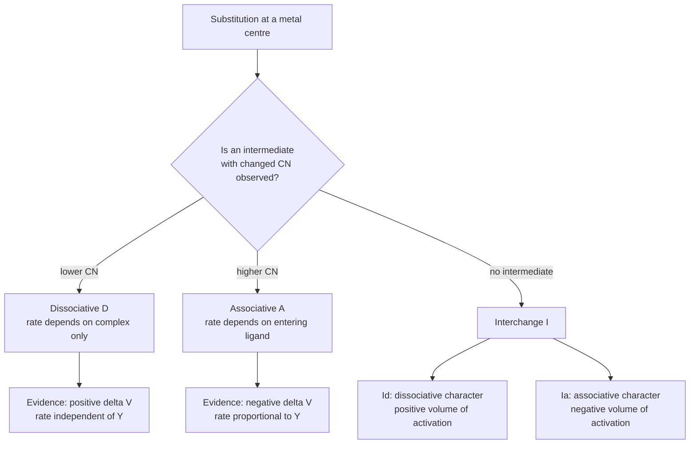
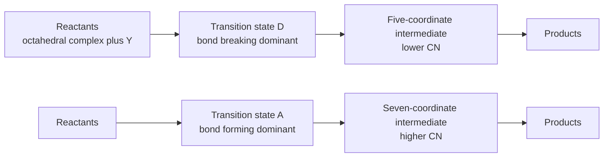
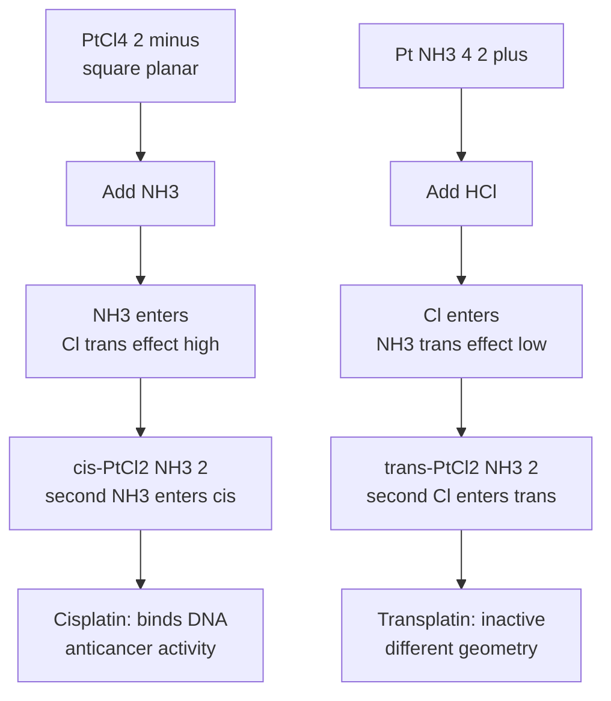
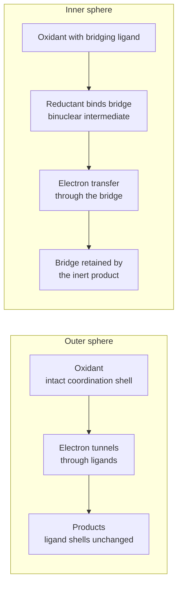
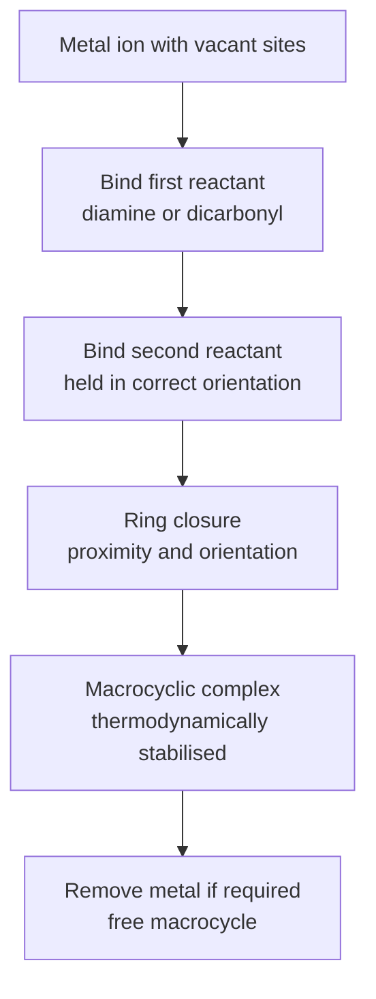

# Chapter 8 — Inorganic Reaction Mechanisms

> **Level:** Level 5 — Advanced Inorganic Chemistry
> **Estimated study time:** 8 hours (5.5 h reading + 2.5 h exercises)
> **Prerequisites:** [Coordination Compounds](03-coordination-compounds.md); [Organometallic Compounds](04-organometallic-compounds.md); level-4 chemical kinetics
> **Related chapters:** [Solid-State Chemistry](06-solid-state-chemistry-crystal-structures-and-defects.md), [Descriptive Inorganic Chemistry](10-descriptive-inorganic-chemistry.md), [Bioinorganic Chemistry](05-bioinorganic-chemistry.md)
> **Difficulty:** ★★★★★ (5/5)

---

## 1. Learning Objectives

After working through this chapter you will be able to:

- Classify a substitution reaction as dissociative, associative or interchange using the Langford–Gray nomenclature.
- Interpret a two-term rate law for square-planar substitution and extract the first- and second-order rate constants.
- Explain the trans effect in terms of $\sigma$-donation, $\pi$-acceptance and transition-state stabilisation, and use it to plan a synthesis.
- Describe the aquation, anation and base-hydrolysis pathways of octahedral complexes, including the $\text{S}_{\text{N}}1\text{CB}$ mechanism.
- Distinguish labile from inert complexes and relate the distinction to ligand-field activation energy and $d$-electron configuration.
- Describe outer-sphere electron transfer with Marcus theory, including the reorganisational energy and the Marcus cross-relation.
- Describe inner-sphere electron transfer using Taube's $\ce{Cr^2+/Co^3+}$ experiment and explain the role of the bridging ligand.
- Distinguish complementary from non-complementary electron-transfer reactions.
- Explain how kinetics, activation volumes, isotope labelling and stereochemistry distinguish competing mechanisms.
- Outline photochemical substitution, acid–base proton transfer, atom-transfer redox reactions, isomerisation and template reactions.

---

## 2. Introduction

A coordination compound can be thermodynamically stable and yet react in seconds, or thermodynamically unstable and yet persist for years. The difference is kinetic, and the study of inorganic reaction mechanisms is the study of how fast, by what pathway, and with what stereochemical consequence a metal complex changes its ligands, its oxidation state or its geometry.

The subject has an unusual advantage over organic mechanism: the metal is often coloured, paramagnetic or redox-active, so the reaction can be followed by UV–visible spectroscopy, NMR, EPR or electrochemistry. It also has an unusual difficulty: the coordination sphere can rearrange through several energetically similar pathways, and the rate law alone rarely distinguishes them. Mechanistic inorganic chemistry therefore relies on a combination of rate laws, activation parameters, isotopic labels, stereochemical probes and theoretical models.

The chapter is organised around the three elementary processes that dominate the field. **Substitution** replaces one ligand by another and is the basis of synthesis and of biological activity — the anticancer drug cisplatin works by substituting a chloride for a water molecule and then binding to DNA. **Electron transfer** changes the oxidation state and underlies catalysis, corrosion, respiration and photosynthesis. **Atom or group transfer**, isomerisation and photochemistry complete the repertoire. Throughout, the guiding question is the same: what evidence forces a particular mechanism, and what alternative does it exclude?

Two simplifications should be stated at the outset. First, the mechanisms are described as if the metal retains a well-defined coordination number throughout; in reality, transition states are continuous deformations, and the D/A/I labels are limiting descriptions rather than distinct species. Second, the treatment is qualitative where the electronic structure is complex, especially for second- and third-row metals; the aim is to give the practising chemist a defensible working model, not a complete potential-energy surface.

---

## 3. Fundamental Concepts

### 3.1 The mechanistic vocabulary

A **substitution** reaction replaces one ligand in the coordination sphere by another:

$$ \ce{[ML_nX] + Y -> [ML_nY] + X} $$

The rate law may depend on the concentration of the complex only, or on both the complex and the entering ligand. Historically, these were labelled $\text{S}_{\text{N}}1$ and $\text{S}_{\text{N}}2$ by analogy with organic chemistry. That analogy is misleading for coordination compounds, because the metal can change coordination number without forming a discrete carbocation-like intermediate, and because the entering ligand is often already associated with the complex as an ion pair.

Langford and Gray introduced a nomenclature based on the stoichiometry of the rate-determining step:

| Class | Rate-determining step | Rate law | Activation volume |
|---|---|---|---|
| Dissociative, D | Loss of X to give an intermediate of lower coordination number | $k[\text{complex}]$ | Positive, $+10$ to $+25\ \text{cm}^{3}\ \text{mol}^{-1}$ |
| Associative, A | Addition of Y to give an intermediate of higher coordination number | $k[\text{complex}][\ce{Y}]$ | Negative, $-10$ to $-25\ \text{cm}^{3}\ \text{mol}^{-1}$ |
| Interchange, I | Concerted exchange of X and Y in a single transition state | $k[\text{complex}][\ce{Y}]$ with saturation | Near zero |
| Interchange, $\text{I}_{\text{d}}$ | Interchange with a dissociative character | Saturating dependence on $[\ce{Y}]$ | Slightly positive |
| Interchange, $\text{I}_{\text{a}}$ | Interchange with an associative character | Saturating dependence on $[\ce{Y}]$ | Slightly negative |

The **activation volume** $\Delta V^\ddagger$ is the pressure derivative of the rate constant:

$$ \Delta V^\ddagger = -RT\left(\frac{\partial \ln k}{\partial P}\right)_{T} $$

A negative activation volume means the transition state is smaller than the reactants, which is direct evidence for association; a positive value indicates bond breaking.

### 3.2 Labile and inert complexes

A complex is **labile** if it exchanges ligands rapidly (half-life under about one minute at room temperature) and **inert** if it exchanges slowly. The terms are kinetic, not thermodynamic: a complex can be thermodynamically unstable but kinetically inert, and the reverse.

The dominant factor is the ligand-field activation energy (LFAE), the difference in crystal-field stabilisation between the ground state and the transition state. For an octahedral $d^{3}$ ion such as $\ce{Cr^3+}$, the $t_{2g}^3$ configuration is strongly stabilised, and both dissociative and associative pathways lose ligand-field stabilisation. For a $d^{8}$ ion such as $\ce{Ni^2+}$, the octahedral site is only weakly stabilised relative to a tetrahedral or five-coordinate transition state, so exchange is fast. For $d^{6}$ low-spin $\ce{Co^3+}$, the large $\Delta_{\text{o}}$ makes the octahedral site very stable and the complex inert.

| Ion | $d^n$ | Water-exchange rate constant at 298 K / $\text{s}^{-1}$ | Classification |
|---|---|---|---|
| $\ce{Na+}$ | $d^{0}$ | $\approx 10^{9}$ | Very labile |
| $\ce{Cu^2+}$ | $d^{9}$ | $\approx 10^{9}$ | Very labile (Jahn–Teller) |
| $\ce{Zn^2+}$ | $d^{10}$ | $\approx 10^{7}$ | Labile |
| $\ce{Ni^2+}$ | $d^{8}$ | $\approx 3\times10^{4}$ | Labile |
| $\ce{Fe^3+}$ | $d^{5}$ high spin | $\approx 10^{2}$ | Moderately labile |
| $\ce{Cr^3+}$ | $d^{3}$ | $\approx 2\times10^{-6}$ | Inert |
| $\ce{Co^3+}$ | $d^{6}$ low spin | $\approx 10^{-6}$ | Inert |
| $\ce{Pt^2+}$ (square planar) | $d^{8}$ | very slow for the first substitution | Inert |

These values are order-of-magnitude only and depend strongly on the ligand set.

### 3.3 Square-planar substitution

Square-planar complexes of $\ce{Pt^2+}$, $\ce{Pd^2+}$ and $\ce{Au^3+}$ ($d^{8}$) substitute by an associative pathway. The rate law is the sum of two terms:

$$ -\frac{\mathrm{d}[\text{complex}]}{\mathrm{d}t} = (k_1 + k_2[\ce{Y}])[\text{complex}] $$

The **first-order term** $k_1$ corresponds to a solvent-assisted pathway: the solvent binds reversibly to form a five-coordinate intermediate, which then loses X. The **second-order term** $k_2[\ce{Y}]$ corresponds to direct attack by the entering ligand. Both terms are associative; they differ only in whether the incoming nucleophile is solvent or solute.

Evidence for the associative mechanism:

- Rate increases with the nucleophilicity of Y, following a scale that correlates with the softness of the donor.
- Rate decreases with steric bulk of the ligands, because the five-coordinate transition state is crowded.
- Activation entropy and activation volume are strongly negative.
- The rate is nearly independent of the leaving group for good leaving groups, because bond breaking is not rate-determining.

**Nucleophilicity series** for square-planar Pt(II): $\ce{PR3} > \ce{SCN-} > \ce{I-} > \ce{CN-} > \ce{Br-} > \ce{Cl-} > \ce{NH3} > \ce{H2O}$. The series follows softness more than basicity; a soft, polarisable donor stabilises the five-coordinate transition state.

### 3.4 The trans effect

The **trans effect** is the labilisation of a ligand by the ligand trans to it. In $\ce{[PtCl3L]-}$, the rate of substitution of the chloride trans to L depends strongly on the identity of L. The empirical series is

$$ \ce{CN-} \approx \ce{CO} \approx \ce{C2H4} \approx \ce{PR3} > \ce{H-} > \ce{CH3-} > \ce{SC(NH2)2} > \ce{Cl-} > \ce{py} > \ce{NH3} > \ce{OH-} \approx \ce{H2O} $$

Two distinct contributions are distinguished:

- The **trans influence** is a thermodynamic effect: a strong $\sigma$-donor weakens and lengthens the metal–ligand bond trans to itself in the ground state.
- The **trans effect** proper is a kinetic effect: the same ligand stabilises the five-coordinate transition state and lowers the activation energy for substitution trans to itself.

The accepted explanation combines both. Strong $\pi$-acceptor ligands (CO, $\ce{CN-}$, alkenes, phosphines) remove electron density from the metal in the transition state, stabilising the five-coordinate geometry and lowering the barrier. Strong $\sigma$-donors (H$^-$, CH$_3^-$) weaken the trans bond in the ground state by competing for the same metal orbital, raising the energy of the starting material.

**Synthetic consequence.** The trans effect explains why cisplatin and transplatin are made by different routes:

$$
\ce{[PtCl4]^2- + 2NH3 -> cis-[PtCl2(NH3)2] + 2Cl-}
$$

$$
\ce{[Pt(NH3)4]^2+ + 2Cl- -> trans-[PtCl2(NH3)2] + 2NH3}
$$

In the first synthesis, chloride has a larger trans effect than ammonia, so the second ammonia enters cis to the first. In the second, ammonia has a smaller trans effect than chloride, so after the first chloride substitution the ligand trans to it is labilised and the second chloride enters trans to the first. The two routes give different isomers from the same stoichiometry, which is one of the classic illustrations of kinetic control in inorganic synthesis.

### 3.5 Octahedral substitution: aquation, anation and base hydrolysis

**Aquation** (hydrolysis) replaces a ligand by water:

$$
\ce{[Co(NH3)5Cl]^2+ + H2O -> [Co(NH3)5(H2O)]^3+ + Cl-}
$$

The reaction is first order in complex and essentially independent of the concentration of added anions; it is a dissociative or $\text{I}_{\text{d}}$ process. The rate is sensitive to the charge and bulk of the leaving group and to the pressure, with a positive activation volume.

**Anation** is the reverse process, in which an anion enters the coordination sphere; it is usually studied as the approach to equilibrium from the aqua complex. Anation rates depend on ion pairing: the observed rate constant often saturates as the anion concentration rises, because the anion must first form an outer-sphere complex.

The **Eigen–Wilkins** treatment describes this:

$$ k_{\text{obs}} = \frac{K_{\text{os}}k_{\text{i}}[\ce{Y}]}{1 + K_{\text{os}}[\ce{Y}]} $$

where $K_{\text{os}}$ is the outer-sphere association constant and $k_{\text{i}}$ the interchange rate constant. At low $[\ce{Y}]$ the reaction is second order; at high $[\ce{Y}]$ it saturates at $k_{\text{i}}$.

**Base hydrolysis** of amine complexes is faster in alkali and follows the rate law

$$ \text{rate} = k[\text{complex}][\ce{OH-}] $$

The accepted mechanism is $\text{S}_{\text{N}}1\text{CB}$ (conjugate base):

1. Hydroxide deprotonates an amine ligand to give an amido complex:
   $$ \ce{[Co(NH3)5Cl]^2+ + OH- <=> [Co(NH2)(NH3)4Cl]+ + H2O} $$
2. The amido complex undergoes rate-determining dissociation of chloride, assisted by the strong trans effect of the amide.
3. Water or hydroxide attacks the five-coordinate intermediate rapidly.

Evidence for this mechanism includes the second-order rate law, a positive activation entropy (because charge is dispersed in the transition state), a kinetic isotope effect when N–H is replaced by N–D, and the absence of base catalysis for complexes without amine protons.

### 3.6 Electron transfer: outer sphere

In **outer-sphere** electron transfer the two complexes remain intact; the electron tunnels through the ligand shells. The rate constant is described by **Marcus theory**:

$$ k = A\exp\left(-\frac{\Delta G^\ddagger}{RT}\right) \qquad \Delta G^\ddagger = \frac{\lambda}{4}\left(1 + \frac{\Delta G^\circ}{\lambda}\right)^2 $$

where $\lambda$ is the **reorganisational energy** — the energy required to distort the reactants and their solvent shells into the geometry of the products — and $\Delta G^\circ$ is the standard free energy of reaction.

Two limits are instructive:

- **Self-exchange** ($\Delta G^\circ = 0$): $\Delta G^\ddagger = \lambda/4$, so the rate is controlled entirely by reorganisational energy.
- **Highly exergonic** ($|\Delta G^\circ| \gg \lambda$): the barrier *increases* again as the reaction becomes more favourable. This is the **Marcus inverted region**, observed experimentally for excited-state electron transfer.

The **Marcus cross-relation** predicts the rate of a cross reaction from the two self-exchange rates and the equilibrium constant:

$$ k_{12} \approx (k_{11}k_{22}K_{12})^{1/2} $$

The relation works well for **complementary** reactions, in which the two redox partners have similar ligand environments and the electron transfer is genuinely outer-sphere.

### 3.7 Electron transfer: inner sphere

In **inner-sphere** electron transfer the two complexes share a bridging ligand during the electron transfer. Taube's 1953 experiment established the mechanism:

$$
\ce{[Co(NH3)5Cl]^2+ + [Cr(H2O)6]^2+ + 5H2O -> [Co(H2O)6]^2+ + [Cr(H2O)5Cl]^2+ + 5NH3}
$$

The key observation is that the chloride, isotopically labelled in the cobalt complex, appears in the chromium product rather than in free solution. The sequence is:

1. The chloride of the cobalt complex replaces a water molecule on chromium, forming a **bridged binuclear intermediate** $\ce{[Co(NH3)5(\mu-Cl)Cr(H2O)5]^4+}$.
2. An electron transfers from $\ce{Cr^2+}$ to $\ce{Co^3+}$ through the bridge.
3. The reduced cobalt centre, now labile $\ce{Co^2+}$, loses its ligands; the oxidised chromium centre, now inert $\ce{Cr^3+}$, retains the chloride.

The experiment succeeds because the oxidant is inert and the reductant is labile before the reaction, and the products have the opposite properties. This inversion of lability traps the bridging ligand on the chromium.

**Complementary and non-complementary reactions.** A reaction is **complementary** when the oxidant and reductant are the same element in different oxidation states, or more generally when their ligand environments are compatible; $\ce{Fe^2+/Fe^3+}$ is the standard example. It is **non-complementary** when the two centres are different elements or have very different ligand sets, as in $\ce{Co^3+/Cr^2+}$. Non-complementary reactions usually require an inner-sphere pathway, because an outer-sphere electron transfer would produce a thermodynamically unstable product pair with no low-energy pathway.

### 3.8 Photochemical mechanisms

Absorption of a photon promotes an electron to an excited state, which is both a stronger oxidant and a stronger reductant than the ground state. The excited state can then:

- Undergo **substitution** after ligand-field excitation. $\ce{[Cr(NH3)6]^3+}$ photoaquates to $\ce{[Cr(NH3)5(H2O)]^3+}$ with a quantum yield that depends on the exciting wavelength, because different excited states have different reactivity.
- Transfer an electron (**photoredox**). $\ce{[Ru(bpy)3]^2+}$ absorbs at about 450 nm, undergoes metal-to-ligand charge transfer, and its long-lived $^3$MLCT state ($\tau \approx 1\ \mu\text{s}$) is used as a photosensitiser in solar fuels research and in organic photoredox catalysis.
- Isomerise. The photochemical cis–trans isomerisation of $\ce{[PtCl2(NH3)2]}$ and the light-induced linkage isomerisation of nitrosyl complexes are exploited in molecular switches.
- Dissociate. Photolysis of $\ce{[Co(NH3)6]^3+}$ produces $\ce{Co^2+}$ and oxidised ligand, a ligand-to-metal charge-transfer (LMCT) process.

### 3.9 Acid–base and proton-transfer mechanisms

Metal aqua ions are Brønsted acids:

$$ \ce{[M(H2O)6]^3+ <=> [M(H2O)5(OH)]^2+ + H+} $$

The $\text{p}K_{\text{a}}$ falls as the charge-to-radius ratio rises:

| Aqua ion | $\text{p}K_{\text{a}}$ | Comment |
|---|---|---|
| $\ce{[Na(H2O)6]+}$ | ≈ 14 | Essentially neutral |
| $\ce{[Ni(H2O)6]^2+}$ | 9.9 | Weak acid |
| $\ce{[Al(H2O)6]^3+}$ | 5.0 | Acidic |
| $\ce{[Cr(H2O)6]^3+}$ | 3.8 | Acidic |
| $\ce{[Fe(H2O)6]^3+}$ | 2.2 | Strongly acidic |
| $\ce{[Fe(H2O)6]^2+}$ | 9.5 | Weak acid |

Proton transfer itself is extremely fast, often diffusion-controlled, and is described by the **Eigen–Weller** mechanism: formation of a encounter complex, proton transfer within it, and dissociation. In water, proton transport is anomalously fast because of the **Grotthuss** mechanism, in which protons hop along the hydrogen-bond network rather than diffusing as $\ce{H3O+}$.

### 3.10 Redox and atom transfer

Many inorganic reactions transfer an atom rather than an electron:

- **Oxygen-atom transfer** from permanganate, chromate, hydrogen peroxide or ozone to a substrate.
- **Hydride transfer** from formate, borohydride or NADH to a metal centre.
- **Halogen-atom transfer** in radical halogenation and in the reactions of metal halides.
- **Nitrogen-atom transfer** from azide or nitrous oxide.

These reactions often proceed by inner-sphere or concerted mechanisms and are central to catalysis, including the oxygen-evolving complex of photosystem II and the cytochrome P450 family.

### 3.11 Isomerisation

**Geometrical isomerisation** interconverts cis and trans forms. **Linkage isomerism** interconverts the donor atom of an ambidentate ligand such as $\ce{NO2-}$ (nitro versus nitrito) or $\ce{SCN-}$ (thiocyanato versus isothiocyanato). **Optical isomerisation** (racemisation) of tris-chelate complexes occurs by two limiting mechanisms:

- The **Bailar twist**, a concerted trigonal twist about the threefold axis.
- The **Ray–Dutt twist**, a rhombic distortion that opens two chelate rings.

Both proceed through a trigonal-prismatic or distorted intermediate and have activation energies of 60–100 kJ mol$^{-1}$ for first-row complexes.

### 3.12 Template reactions

A **template reaction** uses a metal ion to organise reactants into a geometry that favours a particular product. The classic example is the synthesis of macrocyclic Schiff bases from a dicarbonyl and a diamine in the presence of a metal ion: the metal coordinates both ends of each reactant, holds them at the correct distance, and the ring closes around it.

Templates work by three effects:

- **Proximity**: the effective concentration of the reacting groups is raised enormously.
- **Orientation**: the metal fixes the geometry so that the reactive ends point at each other.
- **Stabilisation**: the product is thermodynamically stabilised by chelation, so the equilibrium is pulled forward.

The synthesis of phthalocyanines and of the nickel dimethylglyoxime complex are industrial and analytical examples.

### 3.13 How evidence distinguishes mechanisms

No single experiment identifies a mechanism. The following evidence is cumulative:

| Evidence | What it distinguishes |
|---|---|
| Rate law order in entering ligand | Associative versus dissociative |
| Activation volume $\Delta V^\ddagger$ | Bond formation (negative) versus bond breaking (positive) |
| Activation entropy $\Delta S^\ddagger$ | Ordering in the transition state |
| Isotopic labelling ($^{18}\ce{O}$, $^{36}\ce{Cl}$) | Whether the leaving group or solvent is incorporated |
| Stereochemistry of product | Retention versus inversion versus racemisation |
| Kinetic isotope effect | Proton transfer in the rate-determining step |
| Trapping of intermediates | Discrete intermediate versus concerted pathway |
| Dependence on leaving-group ability | Whether bond breaking is rate-limiting |

---

## 4. Detailed Scientific Explanation

### 4.1 Why square-planar complexes are associative

A $d^{8}$ square-planar complex has 16 electrons in the valence shell and two vacant coordination sites above and below the plane. An entering ligand can approach along the $z$ axis, forming a five-coordinate 18-electron intermediate with little energetic penalty. The alternative, dissociation to a 14-electron three-coordinate intermediate, is strongly disfavoured. This is why the rate law contains a term first order in the entering ligand, and why the activation volume is negative.

The same electron count explains why $\ce{Ni(CN)4^2-}$ is substitution-inert despite being $d^{8}$: the cyanide ligands are strong-field and the complex is coordinatively saturated in the sense that the metal is already $\pi$-stabilised; attack by a fifth ligand would require disrupting strong metal–ligand $\pi$ bonds.

### 4.2 The trans effect: a molecular-orbital view

Consider a square-planar $\ce{Pt(II)}$ complex with ligands L trans to each other. The metal $d_{x^2-y^2}$ orbital points at the four ligands and is the antibonding partner in the $\sigma$ framework. A strong $\sigma$-donor trans to the leaving group raises the energy of the $d_{x^2-y^2}$ orbital and weakens the Pt–X bond. A strong $\pi$-acceptor removes electron density from the metal and stabilises the five-coordinate transition state, in which the metal has more electron density to donate.

The two effects are complementary. Cyanide and carbon monoxide are both strong $\sigma$-donors and strong $\pi$-acceptors, which is why they head the series. Chloride is a weak $\pi$-donor and a moderate $\sigma$-donor, so it is intermediate. Ammonia is a pure $\sigma$-donor with no $\pi$ acidity, so it is low in the series.

### 4.3 Ligand-field activation energy and lability

The rate of water exchange across the first-row series correlates with the ligand-field activation energy, not with ionic radius or charge alone. For a dissociative pathway, the transition state has one fewer ligand, so the crystal-field stabilisation changes by an amount that depends on the $d$ configuration:

| $d^n$ (octahedral) | LFSE of ground state / $Dq$ | LFSE of square-pyramidal transition state / $Dq$ | Lability |
|---|---|---|---|
| $d^{0}$, $d^{10}$ | 0 | 0 | Very labile |
| $d^{3}$ | $-12$ | $-10.0$ | Inert |
| $d^{5}$ high spin | 0 | 0 | Labile |
| $d^{6}$ low spin | $-24$ | $-20$ | Inert |
| $d^{8}$ | $-12$ | $-10.5$ | Labile |

The pattern explains why $\ce{Cr^3+}$ ($d^{3}$) and low-spin $\ce{Co^3+}$ ($d^{6}$) are inert while $\ce{Ni^2+}$ ($d^{8}$) and high-spin $\ce{Fe^3+}$ ($d^{5}$) are labile. The $d^{8}$ case is subtle: the octahedral LFSE is large, but the square-pyramidal transition state retains most of it, so the activation energy is small.

### 4.4 Marcus theory: the parabola argument

Marcus theory treats the reactant and product potential-energy surfaces as parabolas in a collective solvent coordinate. Electron transfer occurs at the nuclear configuration where the two parabolas cross. If the parabolas have equal curvature, the crossing point lies at

$$ \Delta G^\ddagger = \frac{(\lambda + \Delta G^\circ)^2}{4\lambda} $$

which is the equation quoted in Section 3.6. Three consequences follow:

1. The rate is maximised when $-\Delta G^\circ = \lambda$, not when the reaction is most exergonic.
2. For self-exchange, $\Delta G^\ddagger = \lambda/4$, so a large reorganisational energy means a slow reaction even when there is no thermodynamic driving force.
3. The rate depends on the solvent through the outer-sphere reorganisational energy, which is larger in polar solvents.

The reorganisational energy separates into an inner-sphere part (bond lengths and angles) and an outer-sphere part (solvent orientation). For small, rigid complexes the inner part is small; for complexes with large structural changes between oxidation states it can dominate.

### 4.5 Inner-sphere versus outer-sphere: the diagnostic experiment

Taube's experiment is a template for mechanistic reasoning. The logic is:

1. If the reaction were outer-sphere, the chloride would remain with cobalt and appear as free $\ce{Cl-}$.
2. The observation that chloride appears in the chromium product requires a bridged intermediate.
3. The bridging intermediate is only possible because $\ce{Cr^2+}$ is labile and $\ce{Co^3+}$ is inert before the reaction.
4. After electron transfer the lability is reversed, which traps the chloride on chromium.

A control experiment with $\ce{[Co(NH3)5(H2O)]^3+}$ instead of the chloride complex gives no incorporation of solvent oxygen into the chromium product, confirming that the bridging ligand must be a ligand that can bind both metals.

### 4.6 Base hydrolysis and the conjugate-base trap

The $\text{S}_{\text{N}}1\text{CB}$ mechanism is an example of a general principle: a pre-equilibrium that removes a proton can generate a much more reactive species. The amido ligand is a stronger $\sigma$-donor than ammonia, so it exerts a strong trans effect and accelerates the departure of the trans ligand. The rate law is second order overall, but the second-order dependence is on hydroxide, not on the entering nucleophile.

The diagnostic test is to compare a complex with N–H bonds to one with N–CH$_3$ bonds. The methylated complex cannot form an amido conjugate base, and its hydrolysis rate is independent of hydroxide concentration. The contrast establishes the mechanism.

### 4.7 Photochemistry and excited-state reactivity

An excited state has a different electron configuration, hence different bond lengths, different acidity and different redox potentials. The excited state of $\ce{[Ru(bpy)3]^2+}$ is both a stronger oxidant and a stronger reductant than the ground state: it can oxidise a sacrificial donor and reduce a proton, which is the basis of light-driven hydrogen production.

The quantum yield $\Phi$ is the number of product molecules formed per photon absorbed. Values below 1 indicate competing deactivation; values above 1 indicate a chain reaction. Measuring $\Phi$ as a function of wavelength maps the reactivity of different excited states, and is the photochemical analogue of measuring a rate law.

### 4.8 Isomerisation and the Bailar twist

For a tris-chelate complex $\ce{[M(AA)3]}$, racemisation requires a change from $\Delta$ to $\Lambda$ without breaking a metal–ligand bond. The Bailar twist rotates one triangular face of the octahedron by 60°, passing through a trigonal-prismatic transition state. The Ray–Dutt twist distorts the octahedron through a rhombic geometry. Both are concerted and both have been distinguished experimentally by their activation volumes and by the crystal structures of sterically hindered complexes.

---

## 5. Visual Diagrams

### 5.1 Classifying a substitution mechanism

**Figure 8.1 — Decision tree for classifying a substitution mechanism.** The tree begins with the experimental question that actually decides the assignment: is a discrete intermediate with a changed coordination number observable, or is the reaction concerted? In practice most reactions are interchange processes, and the D or A labels describe the *character* of the transition state rather than a real intermediate. The boxes at the bottom list the measurements that support each assignment; no single measurement is decisive on its own.

### 5.2 Energy profiles for dissociative and associative substitution

**Figure 8.2 — Limiting energy profiles for dissociative and associative substitution.** In the dissociative profile the rate-determining step is the climb to a five-coordinate transition state, and the entering ligand is not involved until after the barrier. In the associative profile the rate-determining step is the formation of a seven-coordinate transition state, so the rate depends on the concentration and nucleophilicity of the entering ligand. Real systems lie between the two, which is why the interchange nomenclature is preferred. The height difference between the two profiles for a given complex determines which pathway dominates.

### 5.3 The trans effect and the synthesis of cisplatin

**Figure 8.3 — Kinetic control of platinum geometry by the trans effect.** The same stoichiometry gives different isomers depending on which ligand is present first. In the upper route, chloride's high trans effect labilises the position trans to itself, so the incoming ammonia avoids that position and the product is cis. In the lower route, ammonia's low trans effect leaves the position trans to the first chloride labile, so the second chloride enters trans. The biological consequence is dramatic: only the cis isomer can form the intrastrand cross-link with DNA that blocks replication.

### 5.4 Outer-sphere and inner-sphere electron transfer

**Figure 8.4 — The two limiting electron-transfer mechanisms.** In the outer-sphere case the coordination shells remain intact throughout, and the rate is controlled by the reorganisational energy of the two shells and the solvent. In the inner-sphere case a ligand is shared, which requires one partner to be labile and the other to have a suitable bridging ligand. Taube's experiment distinguishes the two by following the fate of the bridging ligand. Real reactions can switch mechanism depending on the ligands, the solvent and the driving force.

### 5.5 A template synthesis

**Figure 8.5 — The logic of a template reaction.** The metal acts as a scaffold that converts an intermolecular reaction with unfavourable entropy into an intramolecular reaction with a large effective concentration. The product is stabilised by chelation, so the equilibrium shifts towards the ring. Template synthesis is used for macrocyclic ligands, cryptands and phthalocyanines; the same principle operates in biological systems when a metal ion preorganises a substrate for cyclisation.

---

## 6. Mathematical Formulas

### 6.1 Rate laws for substitution

$$ \text{D: } v = k[\text{complex}] \qquad \text{A: } v = k[\text{complex}][\ce{Y}] $$

$$ \text{Square planar: } k_{\text{obs}} = k_1 + k_2[\ce{Y}] $$

| Symbol | Meaning | SI unit |
|---|---|---|
| $v$ | rate of reaction | $\text{mol dm}^{-3}\ \text{s}^{-1}$ |
| $k$ | rate constant | $\text{s}^{-1}$ or $\text{dm}^{3}\ \text{mol}^{-1}\ \text{s}^{-1}$ |
| $k_{\text{obs}}$ | observed pseudo-first-order rate constant | $\text{s}^{-1}$ |
| $k_1$ | solvent-assisted first-order term | $\text{s}^{-1}$ |
| $k_2$ | ligand-dependent second-order term | $\text{dm}^{3}\ \text{mol}^{-1}\ \text{s}^{-1}$ |
| $[\ce{Y}]$ | concentration of entering ligand | $\text{mol dm}^{-3}$ |

The two-term rate law assumes that the solvent pathway and the direct pathway operate in parallel and that the complex concentration is much lower than that of Y.

### 6.2 Activation volume

$$ \Delta V^\ddagger = -RT\left(\frac{\partial \ln k}{\partial P}\right)_{T} $$

| Symbol | Meaning | SI unit |
|---|---|---|
| $\Delta V^\ddagger$ | volume of activation | $\text{m}^{3}\ \text{mol}^{-1}$ (usually quoted in $\text{cm}^{3}\ \text{mol}^{-1}$) |
| $R$ | gas constant, $8.314$ | $\text{J K}^{-1}\ \text{mol}^{-1}$ |
| $T$ | thermodynamic temperature | K |
| $P$ | pressure | Pa |

For two pressures $P_1$ and $P_2$ with rate constants $k_1$ and $k_2$:

$$ \Delta V^\ddagger = -\frac{RT\ln(k_2/k_1)}{P_2-P_1} $$

### 6.3 Eigen–Wilkins saturation

$$ k_{\text{obs}} = \frac{K_{\text{os}}k_{\text{i}}[\ce{Y}]}{1 + K_{\text{os}}[\ce{Y}]} $$

| Symbol | Meaning | SI unit |
|---|---|---|
| $K_{\text{os}}$ | outer-sphere association constant | $\text{dm}^{3}\ \text{mol}^{-1}$ |
| $k_{\text{i}}$ | interchange rate constant | $\text{s}^{-1}$ |

At low $[\ce{Y}]$, $k_{\text{obs}} \approx K_{\text{os}}k_{\text{i}}[\ce{Y}]$; at high $[\ce{Y}]$, $k_{\text{obs}} \to k_{\text{i}}$.

### 6.4 Marcus theory

$$ k = A\exp\left(-\frac{\Delta G^\ddagger}{RT}\right) \qquad \Delta G^\ddagger = \frac{\lambda}{4}\left(1+\frac{\Delta G^\circ}{\lambda}\right)^2 $$

$$ k_{12} \approx (k_{11}k_{22}K_{12})^{1/2} $$

| Symbol | Meaning | SI unit |
|---|---|---|
| $A$ | pre-exponential factor | $\text{s}^{-1}$ or $\text{dm}^{3}\ \text{mol}^{-1}\ \text{s}^{-1}$ |
| $\Delta G^\ddagger$ | activation Gibbs energy | $\text{J mol}^{-1}$ |
| $\lambda$ | reorganisational energy | $\text{J mol}^{-1}$ |
| $\Delta G^\circ$ | standard Gibbs energy of reaction | $\text{J mol}^{-1}$ |
| $k_{11}$, $k_{22}$ | self-exchange rate constants | $\text{dm}^{3}\ \text{mol}^{-1}\ \text{s}^{-1}$ |
| $K_{12}$ | equilibrium constant of the cross reaction | dimensionless |

The cross-relation neglects the work required to bring the two ions together and assumes that the reorganisational energies of the cross reaction are the average of the self-exchange values.

### 6.5 Half-life

$$ t_{1/2} = \frac{\ln 2}{k} $$

| Symbol | Meaning | SI unit |
|---|---|---|
| $t_{1/2}$ | half-life | s |
| $k$ | first-order rate constant | $\text{s}^{-1}$ |

For a second-order reaction with equal initial concentrations, $t_{1/2} = 1/(k[\ce{A}]_0)$.

### 6.6 Acid dissociation of an aqua ion

$$ K_{\text{a}} = \frac{[\ce{[M(H2O)5(OH)]^2+}][\ce{H+}]}{[\ce{[M(H2O)6]^3+}]} \qquad \text{p}K_{\text{a}} = -\log_{10}K_{\text{a}} $$

| Symbol | Meaning | SI unit |
|---|---|---|
| $K_{\text{a}}$ | acid dissociation constant | $\text{mol dm}^{-3}$ |
| $\text{p}K_{\text{a}}$ | negative logarithm of $K_{\text{a}}$ | dimensionless |

The trend in $\text{p}K_{\text{a}}$ follows the charge-to-radius ratio: higher charge and smaller radius stabilise the hydroxide product and lower the $\text{p}K_{\text{a}}$.

---

## 7. Chemical Equations

### 7.1 Aquation of a cobalt(III) complex

$$
\ce{[Co(NH3)5Cl]^2+ + H2O -> [Co(NH3)5(H2O)]^3+ + Cl-}
$$

The reaction is first order in complex and independent of added chloride, consistent with a dissociative or $\text{I}_{\text{d}}$ mechanism. The product is the aqua complex, which is itself acidic and can undergo further hydrolysis.

### 7.2 Anation and linkage isomerism

$$
\ce{[Co(NH3)5(H2O)]^3+ + NCS- -> [Co(NH3)5(NCS)]^2+ + H2O}
$$

The thiocyanate ligand can bind through nitrogen (thiocyanato) or sulfur (isothiocyanato); the product distribution depends on the metal and on the solvent, and the two isomers can be distinguished by their infrared spectra.

### 7.3 Base hydrolysis by the conjugate-base mechanism

$$
\ce{[Co(NH3)5Cl]^2+ + OH- <=> [Co(NH2)(NH3)4Cl]+ + H2O}
$$

$$
\ce{[Co(NH2)(NH3)4Cl]+ -> [Co(NH2)(NH3)4]^2+ + Cl-}
$$

$$
\ce{[Co(NH2)(NH3)4]^2+ + H2O -> [Co(NH3)5(OH)]^2+}
$$

The first step is a fast pre-equilibrium; the second is rate-determining; the third is fast. The amido intermediate is the species that actually undergoes substitution.

### 7.4 Inner-sphere electron transfer

$$
\ce{[Co(NH3)5Cl]^2+ + [Cr(H2O)6]^2+ + 5H2O -> [Co(H2O)6]^2+ + [Cr(H2O)5Cl]^2+ + 5NH3}
$$

The bridging chloride is transferred from cobalt to chromium. Charge is conserved ($+2 + 2 = +2 + 2$), and the reaction is driven by the large difference in reduction potentials between $\ce{Co^3+/Co^2+}$ and $\ce{Cr^3+/Cr^2+}$.

### 7.5 Outer-sphere self-exchange

$$
\ce{[Fe(CN)6]^4- + [Fe(CN)6]^3- <=> [Fe(CN)6]^3- + [Fe(CN)6]^4-}
$$

The two complexes differ only by one electron, so the reorganisational energy is small and the self-exchange rate is fast (about $10^{2}$–$10^{3}\ \text{dm}^{3}\ \text{mol}^{-1}\ \text{s}^{-1}$ for the ferrocyanide couple). The reaction is invisible to ordinary spectroscopy; it is studied by isotopic labelling or by NMR line broadening.

### 7.6 Hydrolysis of cisplatin

$$
\ce{cis-[PtCl2(NH3)2] + H2O -> cis-[PtCl(NH3)2(H2O)]+ + Cl-}
$$

$$
\ce{cis-[PtCl(NH3)2(H2O)]+ + DNA -> cis-[Pt(NH3)2(DNA)]^2+ + H2O + Cl-}
$$

The first reaction is the activation step: chloride is replaced by water because the intracellular chloride concentration is low. The aqua complex is the electrophile that binds to the N7 atom of guanine. The second equation is schematic; the actual adduct is a 1,2-intrastrand cross-link.

### 7.7 Template synthesis of a macrocycle

$$
\ce{Ni^2+ + 2 dmgH2 -> [Ni(dmgH)2] + 2H+}
$$

Dimethylglyoxime (dmgH$_2$) forms a square-planar complex with nickel(II) in which the ligand is deprotonated and hydrogen-bonded to its neighbour. The chelate effect and the metal template drive the otherwise unfavourable condensation.

---

## 8. Worked Examples

### Worked Example 8.1 — Extracting a two-term rate law

**Problem.** The substitution of chloride in $\ce{[Pt(dien)Cl]+}$ by iodide gives observed pseudo-first-order rate constants of $3.50\times10^{-4}\ \text{s}^{-1}$ at $[\ce{I-}] = 0.010\ \text{mol dm}^{-3}$ and $1.35\times10^{-3}\ \text{s}^{-1}$ at $[\ce{I-}] = 0.050\ \text{mol dm}^{-3}$. Assuming $k_{\text{obs}} = k_1 + k_2[\ce{I-}]$, calculate $k_1$ and $k_2$. What does the result imply about the mechanism?

**Strategy.** Write the equation at both concentrations and subtract to eliminate $k_1$.

**Solution.** From the two data points:

$$
k_2 = \frac{(1.35\times10^{-3} - 3.50\times10^{-4})\ \text{s}^{-1}}{(0.050 - 0.010)\ \text{mol dm}^{-3}} = \frac{1.00\times10^{-3}}{0.040} = 2.50\times10^{-2}\ \text{dm}^{3}\ \text{mol}^{-1}\ \text{s}^{-1}
$$

Then

$$
k_1 = 3.50\times10^{-4} - 2.50\times10^{-2} \times 0.010 = 3.50\times10^{-4} - 2.50\times10^{-4} = 1.00\times10^{-4}\ \text{s}^{-1}
$$

**Check.** Both terms are positive, and the second-order term dominates at the higher iodide concentration. The non-zero intercept $k_1$ is the solvent-assisted pathway; the slope $k_2$ is the direct attack by iodide. A pure dissociative mechanism would give $k_2 = 0$ and an intercept equal to the observed rate constant at every iodide concentration. The presence of both terms, together with a negative activation volume, is the signature of an associative mechanism with a solvent pathway.

### Worked Example 8.2 — The Marcus cross-relation

**Problem.** The self-exchange rate constants are $k_{11} = 1.0\times10^{-2}\ \text{dm}^{3}\ \text{mol}^{-1}\ \text{s}^{-1}$ for one couple and $k_{22} = 4.0\ \text{dm}^{3}\ \text{mol}^{-1}\ \text{s}^{-1}$ for another. The equilibrium constant for the cross reaction is $K_{12} = 2.5\times10^{4}$. Estimate $k_{12}$ and state the assumptions.

**Strategy.** Apply $k_{12} \approx (k_{11}k_{22}K_{12})^{1/2}$.

**Solution.**

$$
k_{12} = (1.0\times10^{-2} \times 4.0 \times 2.5\times10^{4})^{1/2} = (1.0\times10^{3})^{1/2} = 32\ \text{dm}^{3}\ \text{mol}^{-1}\ \text{s}^{-1}
$$

**Check.** The cross rate lies between the two self-exchange rates on a logarithmic scale, as it must, and reflects the favourable equilibrium constant. The estimate assumes that the reorganisational energy of the cross reaction is the arithmetic mean of the two self-exchange values, that electrostatic work terms cancel, and that the reaction is genuinely outer-sphere. A measured rate far below the prediction usually indicates that the reaction is inner-sphere or that the oxidant and reductant are not complementary.

### Worked Example 8.3 — Activation barrier from the reorganisational energy

**Problem.** An outer-sphere reaction has $\lambda = 150\ \text{kJ mol}^{-1}$ and $\Delta G^\circ = -30\ \text{kJ mol}^{-1}$ at 298 K. Calculate $\Delta G^\ddagger$ and estimate the rate constant, taking $A = 1.0\times10^{11}\ \text{dm}^{3}\ \text{mol}^{-1}\ \text{s}^{-1}$.

**Strategy.** Use the Marcus expression for $\Delta G^\ddagger$, then the Arrhenius-type rate equation.

**Solution.**

$$
\Delta G^\ddagger = \frac{150}{4}\left(1 + \frac{-30}{150}\right)^2 = 37.5 \times (0.80)^2 = 37.5 \times 0.64 = 24.0\ \text{kJ mol}^{-1}
$$

Then

$$
k = 1.0\times10^{11}\exp\left(-\frac{24\,000}{8.314 \times 298}\right) = 1.0\times10^{11}\exp(-9.69)
$$

$$
k = 1.0\times10^{11} \times 6.2\times10^{-5} = 6.2\times10^{6}\ \text{dm}^{3}\ \text{mol}^{-1}\ \text{s}^{-1}
$$

**Check.** A barrier of 24 kJ mol$^{-1}$ is small, and the rate is fast but not diffusion-limited, which is physically reasonable. If $\Delta G^\circ$ were made more negative, say $-150\ \text{kJ mol}^{-1}$, the barrier would rise to 37.5 kJ mol$^{-1}$ and the rate would fall — the inverted region. The maximum rate occurs at $\Delta G^\circ = -\lambda$.

### Worked Example 8.4 — Activation volume from pressure-dependent rates

**Problem.** The aquation of a complex has rate constants of $2.0\times10^{-4}\ \text{s}^{-1}$ at 1 bar and $6.0\times10^{-4}\ \text{s}^{-1}$ at 1500 bar at 298 K. Calculate $\Delta V^\ddagger$ and interpret the sign.

**Strategy.** Use the two-point form of the activation-volume equation, converting bar to pascal.

**Solution.** The pressure difference is $1500\ \text{bar} \approx 1.50\times10^{8}\ \text{Pa}$, and $\ln(6.0/2.0) = \ln 3 = 1.099$:

$$
\Delta V^\ddagger = -\frac{8.314 \times 298 \times 1.099}{1.50\times10^{8}} = -1.82\times10^{-5}\ \text{m}^{3}\ \text{mol}^{-1}
$$

$$
\Delta V^\ddagger = -18.2\ \text{cm}^{3}\ \text{mol}^{-1}
$$

**Check.** The negative sign means the transition state occupies less volume than the reactants, so the mechanism is associative. A value near zero would indicate interchange, and a positive value of similar magnitude would indicate a dissociative pathway. The magnitude is typical of the volume of one water molecule (about $18\ \text{cm}^{3}\ \text{mol}^{-1}$), which is exactly what is expected if a water molecule enters the coordination sphere in the transition state.

### Worked Example 8.5 — Base hydrolysis and the conjugate-base test

**Problem.** The observed rate constant for the hydrolysis of $\ce{[Co(NH3)5Cl]^2+}$ is $1.2\times10^{-5}\ \text{s}^{-1}$ at $[\ce{OH-}] = 0.010\ \text{mol dm}^{-3}$ and $1.2\times10^{-4}\ \text{s}^{-1}$ at $[\ce{OH-}] = 0.100\ \text{mol dm}^{-3}$ at 298 K. Calculate the second-order rate constant and the half-life at pH 10. Is the mechanism consistent with $\text{S}_{\text{N}}1\text{CB}$?

**Strategy.** Test whether $k_{\text{obs}}$ is proportional to $[\ce{OH-}]$, then compute the half-life from $t_{1/2} = \ln 2/k_{\text{obs}}$.

**Solution.** The ratio of rates is 10 for a ratio of hydroxide concentrations of 10, so the reaction is first order in hydroxide. The second-order rate constant is

$$
k = \frac{1.2\times10^{-4}}{0.100} = 1.2\times10^{-3}\ \text{dm}^{3}\ \text{mol}^{-1}\ \text{s}^{-1}
$$

At pH 10, $[\ce{OH-}] = 1.0\times10^{-4}\ \text{mol dm}^{-3}$, so

$$
k_{\text{obs}} = 1.2\times10^{-3} \times 1.0\times10^{-4} = 1.2\times10^{-7}\ \text{s}^{-1}
$$

$$
t_{1/2} = \frac{\ln 2}{1.2\times10^{-7}} = 5.8\times10^{6}\ \text{s} \approx 67\ \text{days}
$$

**Check.** The reaction is slow at pH 10 and fast in concentrated alkali, which is the expected behaviour. To confirm $\text{S}_{\text{N}}1\text{CB}$ rather than direct nucleophilic attack by hydroxide, one would measure the kinetic isotope effect on N–H/N–D substitution and show that a methylated analogue, which cannot form an amide, loses its hydroxide dependence.

---

## 9. Real-World Applications

**Anticancer drugs.** Cisplatin, carboplatin and oxaliplatin are platinum(II) square-planar complexes that bind DNA. Their activity depends on the kinetics of chloride aquation and on the trans effect that controls which isomer forms. Carboplatin is more stable because its bidentate carboxylate leaves more slowly, which reduces side effects.

**Industrial catalysis.** The hydroformylation of alkenes, the Wacker oxidation of ethylene and the Monsanto acetic acid process all depend on organometallic substitution and migratory insertion. Catalyst selectivity is often controlled by the same trans-effect and lability rules that govern stoichiometric complexes.

**Electron transfer in biology.** The respiratory chain and photosynthesis are chains of outer-sphere and inner-sphere electron transfers between iron–sulfur clusters, cytochromes and copper centres. Marcus theory explains why the chain is arranged in order of increasing reduction potential, and why the rates are fast enough to support metabolism.

**Chemical analysis.** The base hydrolysis of cobalt complexes, the formation of coloured thiocyanate complexes and the catalytic behaviour of permanganate are all used in quantitative analysis. Understanding the mechanism allows the analyst to choose conditions that give quantitative conversion.

**Materials and photochemistry.** Photoredox catalysis with $\ce{[Ru(bpy)3]^2+}$ and iridium complexes has become a standard tool in organic synthesis. Photochromic materials, molecular switches and light-driven molecular motors exploit photochemical isomerisation and linkage isomerism.

**Environmental chemistry.** The hydrolysis of metal ions controls the mobility of iron, aluminium and trace metals in soils and natural waters. The speciation of aluminium, which depends on pH and on the kinetics of aqua-ion hydrolysis, determines its toxicity to plants and fish.

---

## 10. Common Mistakes

| Mistake | Why it happens | Correct approach |
|---|---|---|
| Equating lability with thermodynamic instability | Both are described as "reactive" in everyday language | Lability is kinetic; check the rate, not the formation constant |
| Calling every second-order substitution "associative" | The organic $\text{S}_{\text{N}}2$ analogy | Use the Langford–Gray criteria and the activation volume |
| Assuming the trans effect is a ground-state bond-weakening only | The trans influence and the trans effect are often conflated | Separate the thermodynamic trans influence from the kinetic trans effect |
| Using the trans effect series as a universal order | The series is measured for Pt(II) | Re-measure or re-rank for other metals and oxidation states |
| Forgetting that the entering ligand must first form an ion pair | Rate laws are written for free concentrations | Use the Eigen–Wilkins treatment and include $K_{\text{os}}$ |
| Treating the Marcus cross-relation as exact | It is a approximation valid for complementary outer-sphere reactions | Compare with experiment; large deviations signal a different mechanism |
| Assuming inner-sphere electron transfer always occurs when a bridging ligand is present | A bridge must be able to bind both metals | Check lability and the availability of a lone pair on the bridge |
| Ignoring the solvent in activation volumes | Solvent electrostriction contributes to $\Delta V^\ddagger$ | Compare with a series of solvents or with a known reference reaction |
| Believing photochemical reactions follow the same rules as thermal ones | Excited states have different geometries and potentials | Use excited-state redox potentials and quantum yields |

---

## 11. Chapter Summary

- Substitution mechanisms are classified as dissociative, associative or interchange; the assignment rests on rate laws, activation volumes and the observation of intermediates.
- Square-planar $d^{8}$ complexes substitute associatively, with a two-term rate law and a strong dependence on the nucleophilicity of the entering ligand.
- The trans effect explains the kinetic control of platinum geometry and is the basis of the industrial synthesis of cisplatin.
- Octahedral complexes undergo aquation, anation and base hydrolysis; the conjugate-base mechanism explains second-order hydroxide dependence.
- Lability is controlled by the ligand-field activation energy, which is why $d^{3}$ and low-spin $d^{6}$ ions are inert and $d^{0}$, $d^{5}$ high-spin and $d^{10}$ ions are labile.
- Outer-sphere electron transfer is described by Marcus theory; the reorganisational energy and the driving force together determine the barrier.
- Inner-sphere electron transfer requires a bridging ligand; Taube's experiment with isotopically labelled chloride established the mechanism.
- Complementary reactions are well described by the Marcus cross-relation; non-complementary reactions usually proceed by an inner-sphere pathway.
- Photochemistry, acid–base reactions, atom transfer, isomerisation and template reactions extend the mechanistic vocabulary beyond substitution and electron transfer.

---

## 12. Exercises

### 12.1 Conceptual questions

1. Explain why a complex can be thermodynamically unstable but kinetically inert, giving one example.
2. Distinguish the trans influence from the trans effect and explain why both are needed to account for the observed series.

### 12.2 Basic problems

3. Classify each reaction as dissociative, associative or interchange: (a) a substitution whose rate is independent of the entering ligand; (b) a substitution with a negative activation volume; (c) a substitution that shows saturation kinetics with respect to the entering ligand.
4. Arrange the following ligands in order of increasing trans effect: $\ce{NH3}$, $\ce{CO}$, $\ce{Cl-}$, $\ce{H2O}$, $\ce{CN-}$.

### 12.3 Intermediate problems

5. Explain why $\ce{[Co(NH3)5Cl]^2+}$ is inert towards aquation while $\ce{[Ni(NH3)6]^2+}$ is labile, using ligand-field activation energies.
6. The rate of substitution of $\ce{[PtCl4]^2-}$ by ammonia is much faster than by water. Explain in terms of the associative mechanism.
7. Write the products of the reaction between $\ce{[Co(NH3)5Cl]^2+}$ and $\ce{[Cr(H2O)6]^2+}$ and explain why the chloride ends up on chromium.

### 12.4 Advanced problems

8. A reaction has $\lambda = 80\ \text{kJ mol}^{-1}$ and $\Delta G^\circ = -110\ \text{kJ mol}^{-1}$. Calculate $\Delta G^\ddagger$ and explain why the rate is lower than for a less exergonic reaction.
9. Explain how isotopic labelling with $^{18}\ce{O}$ distinguishes an associative from a dissociative aquation mechanism.
10. Propose a synthesis of cis- and trans-$\ce{[PtCl2(NH3)2]}$ from $\ce{[PtCl4]^2-}$ and justify the choice of route using the trans effect.

### 12.5 Calculation problems

11. A first-order aquation has $k = 2.5\times10^{-5}\ \text{s}^{-1}$. Calculate the half-life and the time required for 90 % reaction.
12. The rate constant for a reaction increases from $3.0\times10^{-4}\ \text{s}^{-1}$ at 1 bar to $9.0\times10^{-4}\ \text{s}^{-1}$ at 1200 bar at 298 K. Calculate $\Delta V^\ddagger$ and interpret the mechanism.

### 12.6 Answers

1. $\ce{[Co(NH3)6]^3+}$ is thermodynamically unstable in acid but exchanges ligands only over hours to days; the large ligand-field activation energy makes it inert.
2. The trans influence is a ground-state thermodynamic weakening of the bond trans to a strong donor; the trans effect is the kinetic labilisation of that position. Both contribute, with $\pi$-acceptor ligands dominating the kinetic effect.
3. (a) dissociative; (b) associative; (c) interchange.
4. $\ce{H2O} < \ce{NH3} < \ce{Cl-} < \ce{CO} \approx \ce{CN-}$.
5. $\ce{Co^3+}$ is low-spin $d^{6}$ with a large ligand-field activation energy; $\ce{Ni^2+}$ is $d^{8}$ with a small activation energy because the transition state retains most of the ligand-field stabilisation.
6. Ammonia is a stronger nucleophile and a better $\sigma$-donor than water; it stabilises the five-coordinate transition state more effectively, so the associative rate is higher.
7. $\ce{[Co(H2O)6]^2+}$ and $\ce{[Cr(H2O)5Cl]^2+}$; the chloride bridges the two metals during electron transfer and is retained by the inert $\ce{Cr^3+}$ product.
8. $\Delta G^\ddagger = 20(1 - 1.375)^2 = 20 \times 0.1406 = 2.8\ \text{kJ mol}^{-1}$; the reaction is in the inverted region, where increasing exergonicity raises the barrier because the product parabola crosses the reactant parabola on its steep side.
9. In an associative aquation, water enters the coordination sphere and is retained in the product; in a dissociative aquation, the leaving group departs first and solvent fills the vacancy. Labelling the solvent water with $^{18}\ce{O}$ shows whether the entering water is the solvent molecule or a coordinated one.
10. Cis: treat $\ce{[PtCl4]^2-}$ with two equivalents of ammonia; chloride's high trans effect labilises the position trans to itself, so the second ammonia enters cis. Trans: treat $\ce{[Pt(NH3)4]^2+}$ with two equivalents of chloride; ammonia's low trans effect allows the second chloride to enter trans to the first.
11. $t_{1/2} = 0.693/(2.5\times10^{-5}) = 2.8\times10^{4}\ \text{s} \approx 7.7\ \text{h}$; for 90 % reaction, $t = \ln(10)/k = 9.2\times10^{4}\ \text{s} \approx 26\ \text{h}$.
12. $\Delta V^\ddagger = -8.314 \times 298 \times \ln 3/(1.199\times10^{8}) = -2.3\times10^{-5}\ \text{m}^{3}\ \text{mol}^{-1} = -23\ \text{cm}^{3}\ \text{mol}^{-1}$; negative, so the mechanism is associative.

> Worked solutions for this level are maintained in the `solutions/` directory of the level.

---

## 13. Further Reading

- Atkins, P.; Overton, T.; Rourke, J.; Weller, M.; Armstrong, F. *Shriver and Atkins' Inorganic Chemistry*, 5th ed., Oxford University Press, 2010. Reaction mechanisms of coordination compounds.
- Miessler, G. L.; Fischer, P. J.; Tarr, D. A. *Inorganic Chemistry*, 5th ed., Pearson, 2014. Kinetics and mechanisms.
- Langford, C. H.; Gray, H. B. *Ligand Substitution Processes*, W. A. Benjamin, 1965. The origin of the D/A/I nomenclature.
- Basolo, F.; Pearson, R. G. *Mechanisms of Inorganic Reactions*, 2nd ed., Wiley, 1967. The classic systematic treatment.
- Taube, H. "Electron transfer between metal complexes: retrospective." *Science*, 1984, 226, 1028–1036.
- Marcus, R. A. "Electron transfer reactions in chemistry: theory and experiment." *Reviews of Modern Physics*, 1993, 65, 599–610.
- Jordan, R. B. *Reaction Mechanisms of Inorganic and Organometallic Systems*, 3rd ed., Oxford University Press, 2007. Modern treatment with worked problems.
- IUPAC. *Compendium of Chemical Terminology* (the "Gold Book"), 2nd ed. (corrected version). <https://goldbook.iupac.org/>
- [CURRICULUM.md](../CURRICULUM.md) — where this chapter sits in the full programme.
- [REFERENCES.md](../REFERENCES.md) — the repository's verified source list.

> Only sources that can be checked are cited here. No DOI, page number or edition is invented.
