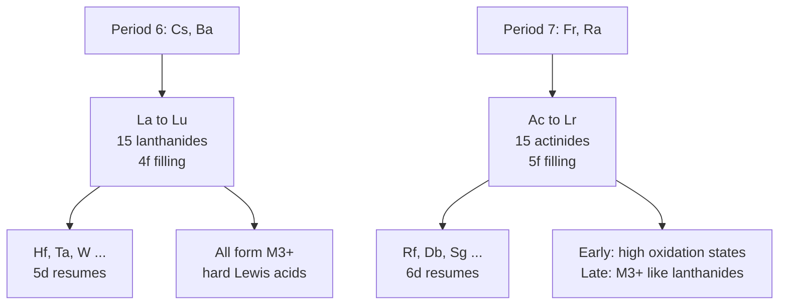
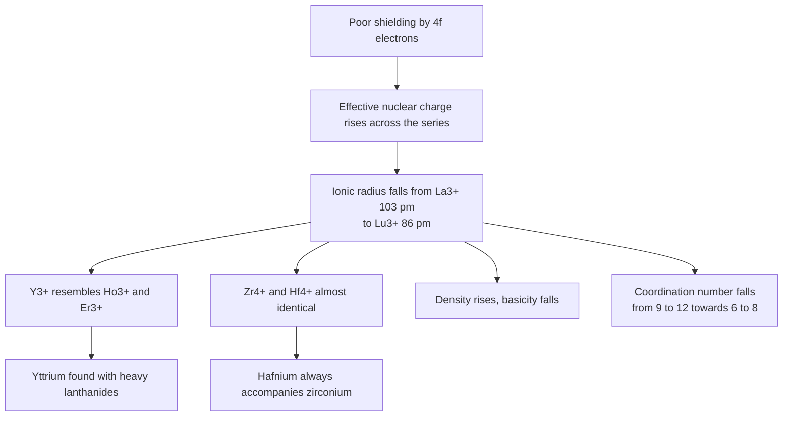
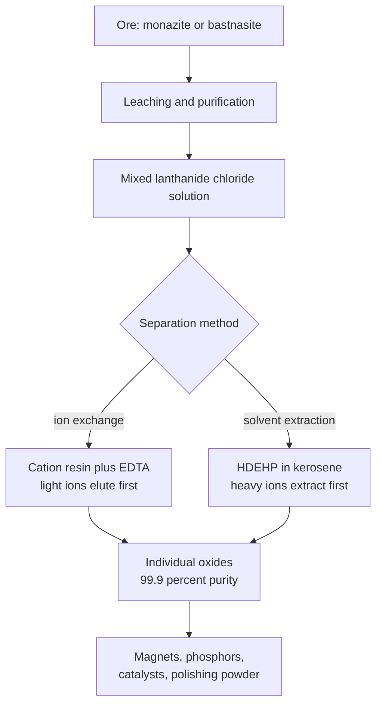
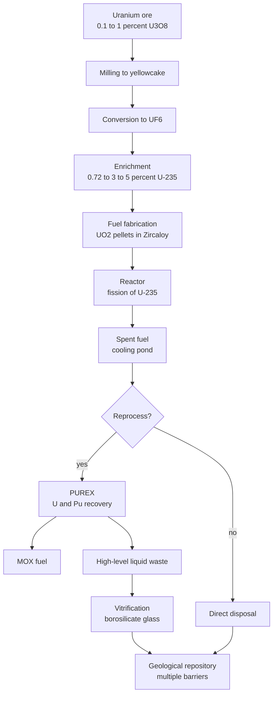
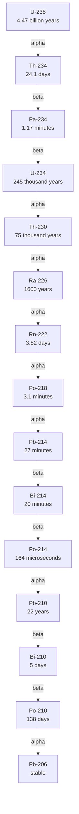

# Chapter 9 — Lanthanides and Actinides

> **Level:** Level 5 — Advanced Inorganic Chemistry
> **Estimated study time:** 7 hours (5 h reading + 2 h exercises)
> **Prerequisites:** [Transition Metals](02-transition-metals.md); [Magnetic and Electronic Properties](07-magnetic-and-electronic-properties.md); level-4 atomic structure
> **Related chapters:** [Coordination Compounds](03-coordination-compounds.md), [Solid-State Chemistry](06-solid-state-chemistry-crystal-structures-and-defects.md), [Descriptive Inorganic Chemistry](10-descriptive-inorganic-chemistry.md)
> **Difficulty:** ★★★★★ (5/5)

---

## 1. Learning Objectives

After working through this chapter you will be able to:

- Explain why the f-block is placed where it is in the periodic table and why the 15 lanthanides occupy one position in the main table.
- Write the ground-state electron configurations of the lanthanides and account for the anomalies at cerium, gadolinium and lutetium.
- Define the lanthanide contraction, calculate its magnitude, and explain its consequences for the chemistry of yttrium, zirconium and hafnium.
- Account for the dominance of the +3 oxidation state and for the exceptions at cerium, europium, samarium, ytterbium and terbium.
- Describe the industrial separation of lanthanides by ion exchange and solvent extraction, and explain why separation is difficult.
- Calculate the free-ion magnetic moment of a lanthanide ion from its term symbol and explain why lanthanide moments are larger than spin-only values.
- Explain why f–f transitions are sharp but weak, and describe the antenna effect in lanthanide luminescence.
- Give the principal uses of lanthanides as reagents, phosphors, magnets and contrast agents.
- Compare the electronic structure, oxidation-state range and chemistry of the actinides with those of the lanthanides.
- Describe the principal nuclear decay modes, write balanced decay equations, and calculate activity and half-life relationships.
- Outline the nuclear fuel cycle from mining to waste disposal, including enrichment, PUREX reprocessing and vitrification.
- Discuss the safety, security and environmental framing of actinide chemistry.

---

## 2. Introduction

The f-block is the part of the periodic table that most often gets printed at the bottom of the poster and least often understood. That is a mistake, because the lanthanides and actinides carry a disproportionate share of modern technology. Neodymium–iron–boron magnets drive electric motors and wind turbines; europium and terbium phosphors made white light-emitting diodes possible; erbium-doped fibres carry the internet; gadolinium complexes are injected in tens of millions of MRI scans each year; and the actinides underpin nuclear power, nuclear medicine and the management of the most hazardous waste that industry produces.

Chemically, the f-block is a laboratory for the limits of periodic trends. The lanthanides are the most similar family of elements in the table: they all form +3 ions, they all behave as hard Lewis acids, and they differ mainly in a gradual contraction of ionic radius. That similarity makes them difficult to separate and instructive to study, because the small differences that remain are exactly the ones that control extraction, complexation and luminescence.

The actinides add radioactivity and a much richer redox chemistry. The early actinides (thorium, protactinium, uranium, neptunium, plutonium) reach oxidation states up to +7 and behave in some respects like transition metals; the later actinides converge on the lanthanide pattern of +3. This transition from d-block-like to f-block-like behaviour is one of the clearest illustrations of the consequences of 5f orbital extension.

Because this chapter discusses nuclear materials, it also discusses safety: the chemistry of containment, the radiochemistry of waste forms and the institutional controls that prevent diversion of fissile material are part of the subject. The treatment is descriptive and deliberately omits operational detail for handling fissile material.

---

## 3. Fundamental Concepts

### 3.1 The f-block and its place in the table

The f-block consists of the **lanthanides** (lanthanum to lutetium, atomic numbers 57–71) and the **actinides** (actinium to lawrencium, 89–103), together with scandium and yttrium, which are the group-3 members that chemically resemble them.

The placement is a consequence of the order in which orbitals fill. After barium ($[\ce{Xe}]6s^2$), the next electrons enter the $4f$ subshell rather than the $5d$ subshell, because the $4f$ orbitals are lower in energy once the $6s$ shell is occupied. The $4f$ subshell holds 14 electrons, so 14 elements follow lanthanum before the $5d$ subshell resumes at hafnium. The result is a block of 15 elements — lanthanum plus the 14 $4f$ elements — that all have very similar chemistry because the added electrons are buried in the $4f$ subshell, shielded by the filled $5s$ and $5p$ shells.

The standard periodic table compresses this block into a single position between barium and hafnium, with a footnote listing the lanthanides separately. That compression is chemically defensible: all the lanthanides have the same valence configuration ($6s^2$ with variable $4f$ occupancy) and form the same +3 ion. It is also the reason the table has 18 columns rather than 32.

The **actinides** occupy the analogous position after radium, filling the $5f$ subshell. Because $5f$ orbitals extend further from the nucleus than $4f$ orbitals and are closer in energy to the $6d$ orbitals, the actinides show a much wider range of oxidation states, especially in the first half of the series.

### 3.2 Electronic configurations

The general valence configuration of a lanthanide is $4f^n5d^{0\text{–}1}6s^2$. The exceptions occur where a half-filled or filled $f$ subshell gives extra exchange stability:

| Element | $Z$ | Configuration | Comment |
|---|---|---|---|
| La | 57 | $[\ce{Xe}]5d^16s^2$ | No $4f$ electron |
| Ce | 58 | $[\ce{Xe}]4f^15d^16s^2$ | Anomalous |
| Pr | 59 | $[\ce{Xe}]4f^36s^2$ | |
| Nd | 60 | $[\ce{Xe}]4f^46s^2$ | |
| Pm | 61 | $[\ce{Xe}]4f^56s^2$ | Radioactive |
| Sm | 62 | $[\ce{Xe}]4f^66s^2$ | |
| Eu | 63 | $[\ce{Xe}]4f^76s^2$ | Half-filled $4f$ |
| Gd | 64 | $[\ce{Xe}]4f^75d^16s^2$ | Half-filled $4f$ |
| Tb | 65 | $[\ce{Xe}]4f^96s^2$ | |
| Dy | 66 | $[\ce{Xe}]4f^{10}6s^2$ | |
| Ho | 67 | $[\ce{Xe}]4f^{11}6s^2$ | |
| Er | 68 | $[\ce{Xe}]4f^{12}6s^2$ | |
| Tm | 69 | $[\ce{Xe}]4f^{13}6s^2$ | |
| Yb | 70 | $[\ce{Xe}]4f^{14}6s^2$ | Filled $4f$ |
| Lu | 71 | $[\ce{Xe}]4f^{14}5d^16s^2$ | Filled $4f$ |

The configurations are those of the gaseous atoms; in compounds the $6s$ electrons are always lost and the $5d$ electron is usually lost as well, so the chemistry is dominated by the $4f^n$ core.

### 3.3 The lanthanide contraction

The **lanthanide contraction** is the steady decrease in ionic and atomic radius across the series. It arises because the $4f$ electrons are poor shielders: the $4f$ radial distribution lies inside the $5s$ and $5p$ shells, so each additional proton in the nucleus pulls the outer electrons inwards without a compensating increase in screening.

The effect is large and cumulative. The six-coordinate ionic radius of $\ce{La^3+}$ is 103.2 pm and that of $\ce{Lu^3+}$ is 86.1 pm, a contraction of 17.1 pm, or 16.6 % across 14 elements. The average contraction is about 1.2 pm per element — small for a single step, but enough to control the entire separation industry.

Consequences:

- **Yttrium resembles the heavy lanthanides.** The ionic radius of $\ce{Y^3+}$ (90.0 pm) is close to that of $\ce{Ho^3+}$ (90.1 pm) and $\ce{Er^3+}$ (89.0 pm), so yttrium is found with the heavy lanthanides in minerals and is separated with them.
- **Zirconium and hafnium are almost identical in size.** $\ce{Zr^4+}$ (72 pm) and $\ce{Hf^4+}$ (71 pm) have nearly the same radius because the contraction cancels the expected increase from the fourth period to the fifth. Hafnium is therefore always found with zirconium and is difficult to separate.
- **Density and basicity trends.** Density increases across the series, and the decreasing ionic radius increases the polarising power of the ions, so the hydroxides become less basic from lanthanum to lutetium.
- **Coordination numbers fall.** Early lanthanides commonly reach coordination number 9–12, later ones 6–8, because the smaller ions cannot accommodate as many donors.

### 3.4 Oxidation states

The dominant oxidation state of the lanthanides is **+3**, because the $4f$ electrons are chemically core-like: removing three electrons (two $6s$ and one $4f$ or $5d$) leaves a stable $[\ce{Xe}]4f^n$ core, and removing a fourth costs far more energy than the lattice or solvation energy can recover.

The exceptions occur where a particularly stable $f$ configuration can be reached:

| Ion | Configuration | Reason | Stability |
|---|---|---|---|
| $\ce{Ce^4+}$ | $4f^0$ | Empty $4f$ shell | Strong oxidant in acid, stable as $\ce{CeO2}$ |
| $\ce{Tb^4+}$ | $4f^7$ | Half-filled shell | Stable as $\ce{TbO2}$ and in fluorides |
| $\ce{Eu^2+}$ | $4f^7$ | Half-filled shell | Stable in halides and sulfates |
| $\ce{Sm^2+}$ | $4f^6$ | Nearly half-filled | Strong reductant |
| $\ce{Yb^2+}$ | $4f^{14}$ | Filled shell | Stable in halides, strong reductant in water |

$\ce{Ce^4+}$ is the most important exception: the $\ce{Ce^4+/Ce^3+}$ couple has a reduction potential of $+1.61\ \text{V}$ in acid, which makes cerium(IV) a powerful one-electron oxidant used in analysis and in organic synthesis. In contrast, $\ce{Eu^2+}$ is a reductant ($\ce{Eu^3+/Eu^2+}$ about $-0.35\ \text{V}$), and aqueous $\ce{Eu^2+}$ is oxidised by water only slowly.

### 3.5 Coordination chemistry

Lanthanide ions are **hard Lewis acids** with a high charge and a large radius, so they bind preferentially to hard donors: oxygen in water, carboxylates, β-diketonates, phosphine oxides and nitrate; and fluoride among the halides. They have little affinity for soft donors such as sulfur and phosphorus(III).

Three features distinguish them from transition metals: **high and variable coordination numbers** (6–12, commonly 8 or 9, set by steric packing rather than electronic preference); **no crystal-field stabilisation**, because the buried $4f$ orbitals experience ligand fields of order $100\ \text{cm}^{-1}$ rather than $10\,000$–$30\,000\ \text{cm}^{-1}$; and **rapid ligand exchange** ($10^{6}$–$10^{9}\ \text{s}^{-1}$ for water), except where a rigid multidentate ligand such as DOTA or DTPA encapsulates the ion.

The coordination chemistry is dominated by chelating oxygen donors: acetylacetonate and its fluorinated derivatives, carboxylates, and macrocyclic polyaminocarboxylates. The stability constants increase with the charge density of the ion across the series, which is the basis of the ion-exchange separation.

### 3.6 Magnetism

Because the $4f$ electrons are shielded, spin–orbit coupling is strong and the free-ion moment is given by the full Landé formula:

$$ \mu_{\text{eff}} = g_J\sqrt{J(J+1)}\,\mu_{\text{B}} \qquad g_J = 1 + \frac{J(J+1)+S(S+1)-L(L+1)}{2J(J+1)} $$

The resulting moments are large:

| Ion | $4f^n$ | Ground term | $J$ | $\mu_{\text{eff}}/\mu_{\text{B}}$ |
|---|---|---|---|---|
| $\ce{La^3+}$ | $4f^0$ | $^1S_0$ | 0 | 0 |
| $\ce{Ce^3+}$ | $4f^1$ | $^2F_{5/2}$ | 5/2 | 2.54 |
| $\ce{Pr^3+}$ | $4f^2$ | $^3H_4$ | 4 | 3.58 |
| $\ce{Nd^3+}$ | $4f^3$ | $^4I_{9/2}$ | 9/2 | 3.62 |
| $\ce{Gd^3+}$ | $4f^7$ | $^8S_{7/2}$ | 7/2 | 7.94 |
| $\ce{Tb^3+}$ | $4f^8$ | $^7F_6$ | 6 | 9.72 |
| $\ce{Dy^3+}$ | $4f^9$ | $^6H_{15/2}$ | 15/2 | 10.65 |
| $\ce{Ho^3+}$ | $4f^{10}$ | $^5I_8$ | 8 | 10.61 |
| $\ce{Er^3+}$ | $4f^{11}$ | $^4I_{15/2}$ | 15/2 | 9.58 |
| $\ce{Tm^3+}$ | $4f^{12}$ | $^3H_6$ | 6 | 7.56 |
| $\ce{Yb^3+}$ | $4f^{13}$ | $^2F_{7/2}$ | 7/2 | 4.54 |

Gadolinium(III) is the special case: $L = 0$, so the moment is purely spin, $7.94\ \mu_{\text{B}}$, and the ion relaxes protons efficiently. This is why gadolinium chelates are the standard MRI contrast agents.

### 3.7 Spectroscopy and luminescence

The absorption and emission spectra of lanthanide ions consist of narrow lines, because the $4f$ orbitals are shielded from the ligand environment and the transitions are only weakly coupled to vibrations. The lines are, however, weak, because $f$–$f$ transitions are **Laporte forbidden** (they do not change parity) and spin-forbidden in many cases. Molar absorption coefficients are typically 1–10 $\text{dm}^{3}\ \text{mol}^{-1}\ \text{cm}^{-1}$, compared with $10^{4}$ for a fully allowed charge-transfer band.

The weakness is overcome by the **antenna effect**: an organic chromophore absorbs strongly, transfers energy to the lanthanide excited state, and the lanthanide emits. This is how europium and terbium phosphors achieve high brightness.

Characteristic emissions:

| Ion | Transition | Wavelength | Colour |
|---|---|---|---|
| $\ce{Eu^3+}$ | $^5D_0 \rightarrow {}^7F_2$ | ≈ 614 nm | Red |
| $\ce{Tb^3+}$ | $^5D_4 \rightarrow {}^7F_5$ | ≈ 545 nm | Green |
| $\ce{Sm^3+}$ | $^4G_{5/2} \rightarrow {}^6H_{9/2}$ | ≈ 600 nm | Orange-red |
| $\ce{Dy^3+}$ | $^4F_{9/2} \rightarrow {}^6H_{15/2}$ | ≈ 575 nm | Yellow |
| $\ce{Nd^3+}$ | $^4F_{3/2} \rightarrow {}^4I_{11/2}$ | 1064 nm | Near infrared |
| $\ce{Er^3+}$ | $^4I_{13/2} \rightarrow {}^4I_{15/2}$ | ≈ 1530 nm | Near infrared |

The narrowness of the lines makes lanthanide emitters attractive for displays and lasers: the colour is fixed by the ion, not by the host, so the same phosphor can be used in different matrices with only small shifts.

### 3.8 The actinides

The actinides fill the $5f$ subshell. The $5f$ orbitals are more extended than the $4f$ orbitals and lie closer in energy to the $6d$ orbitals, so they participate more in bonding and support a wider range of oxidation states.

| Element | $Z$ | Configuration | Characteristic oxidation states |
|---|---|---|---|
| Ac | 89 | $[\ce{Rn}]6d^17s^2$ | +3 |
| Th | 90 | $[\ce{Rn}]6d^27s^2$ | +4 |
| Pa | 91 | $[\ce{Rn}]5f^26d^17s^2$ | +5, +4 |
| U | 92 | $[\ce{Rn}]5f^36d^17s^2$ | +6, +5, +4, +3 |
| Np | 93 | $[\ce{Rn}]5f^46d^17s^2$ | +7, +6, +5, +4, +3 |
| Pu | 94 | $[\ce{Rn}]5f^67s^2$ | +7, +6, +5, +4, +3 |
| Am | 95 | $[\ce{Rn}]5f^77s^2$ | +6, +5, +4, +3 |
| Cm | 96 | $[\ce{Rn}]5f^76d^17s^2$ | +4, +3 |
| Bk–Lr | 97–103 | $5f^{8\text{–}14}7s^2$ | +3 dominant |

The pattern is clear: the **early actinides** reach the group oxidation state (thorium +4 like group 4, protactinium +5 like group 5, uranium +6 like group 6), whereas the **later actinides** resemble the lanthanides with a dominant +3 state. This is the **actinide contraction** and the associated "transition from d-block to f-block behaviour".

The most important actinide ions in solution are:

- $\ce{UO2^2+}$ (uranyl, U(VI)), linear and very stable, with two short U–O bonds (about 180 pm).
- $\ce{PuO2^2+}$ and $\ce{PuO2+}$, the plutonyl ions.
- $\ce{An^4+}$ and $\ce{An^3+}$ aqua ions, which hydrolyse strongly and form insoluble hydroxides.

The redox chemistry is rich: uranium(IV) is a reductant, uranium(VI) an oxidant; plutonium can coexist in four oxidation states (+3, +4, +5, +6) in the same acidic solution, which makes its separation chemistry notoriously complicated.

### 3.9 Lanthanides and actinides compared

| Property | Lanthanides | Actinides |
|---|---|---|
| Occupied subshell | $4f$ | $5f$ |
| Natural occurrence | All except promethium | Uranium and thorium; traces of Np and Pu |
| Dominant oxidation state | +3 | +3 late in the series; +4 to +7 early |
| Radial extent of $f$ orbitals | Buried, core-like | Greater; appreciable covalent bonding |
| Ligand-field splitting | Order $100\ \text{cm}^{-1}$ | Order $1000\ \text{cm}^{-1}$ |
| Ionic radius trend | $\ce{La^3+}$ 103 pm to $\ce{Lu^3+}$ 86 pm | $\ce{Th^4+}$ 94 pm to $\ce{Am^4+}$ 85 pm |
| Magnetism | Free-ion moments, large $\mu_{\text{eff}}$ | Complex, strong spin–orbit coupling |
| Separation chemistry | Ion exchange, HDEHP extraction | PUREX with tributyl phosphate |
| Radioactivity | Promethium and heavier only | Every isotope |

### 3.10 Radioactivity and nuclear decay

Every actinide is radioactive. The principal decay modes are:

| Mode | Change in $A$ | Change in $Z$ | Emission | Example |
|---|---|---|---|---|
| Alpha | $-4$ | $-2$ | $\ce{^4_2He}$ nucleus | $\ce{^{238}_{92}U -> ^{234}_{90}Th + ^{4}_{2}He}$ |
| Beta minus | 0 | $+1$ | electron and antineutrino | $\ce{^{137}_{55}Cs -> ^{137}_{56}Ba + e- + \bar{\nu}_e}$ |
| Beta plus | 0 | $-1$ | positron and neutrino | $\ce{^{18}_{9}F -> ^{18}_{8}O + e+ + \nu_e}$ |
| Electron capture | 0 | $-1$ | neutrino, characteristic X-rays | $\ce{^{57}_{27}Co + e- -> ^{57}_{26}Fe + \nu_e}$ |
| Gamma | 0 | 0 | photon | $\ce{^{99m}_{43}Tc -> ^{99}_{43}Tc + \gamma}$ |
| Spontaneous fission | large | large | two fragments and neutrons | $\ce{^{252}_{98}Cf -> fragments}$ |

Radioactive decay is first order, with

$$ N(t) = N_0 e^{-\lambda t} \qquad \lambda = \frac{\ln 2}{t_{1/2}} \qquad A = \lambda N $$

where $A$ is the activity in becquerel (one disintegration per second). The older unit, the curie, is $3.7\times10^{10}\ \text{Bq}$.

Natural decay chains begin with $\ce{^{238}U}$ ($t_{1/2} = 4.47\times10^{9}\ \text{y}$), $\ce{^{235}U}$ ($7.04\times10^{8}\ \text{y}$) and $\ce{^{232}Th}$ ($1.41\times10^{10}\ \text{y}$) and end at stable lead isotopes. Intermediate nuclides include radium, radon and polonium; the radon isotopes are gases and are the main contributor to natural background radiation in buildings.

### 3.11 The nuclear fuel cycle

The **front end** converts ore into fuel: mining and milling to yellowcake ($\ce{U3O8}$), conversion to volatile $\ce{UF6}$, enrichment from 0.720 % to 3–5 % $\ce{^{235}U}$ by gaseous diffusion or gas centrifugation, and fabrication of sintered $\ce{UO2}$ pellets in zirconium alloy cladding. The **back end** deals with spent fuel: 18–24 months of reactor operation, underwater cooling, optional reprocessing by PUREX to recover uranium and plutonium, and vitrification of the fission-product waste. A once-through cycle treats the spent fuel itself as the waste form; a closed cycle recycles uranium and plutonium as mixed-oxide (MOX) fuel.

### 3.12 Nuclear waste and containment chemistry

Spent fuel contains roughly 95 % uranium, 1 % plutonium, 4 % fission products and 0.1 % minor actinides. The hazard is dominated for the first few centuries by fission products — $\ce{^{137}Cs}$ ($t_{1/2} = 30.2\ \text{y}$) and $\ce{^{90}Sr}$ ($28.8\ \text{y}$) — and afterwards by long-lived actinides ($\ce{^{239}Pu}$, $2.41\times10^{4}\ \text{y}$; $\ce{^{237}Np}$, $2.14\times10^{6}\ \text{y}$; $\ce{^{99}Tc}$, $2.1\times10^{5}\ \text{y}$; $\ce{^{129}I}$, $1.57\times10^{7}\ \text{y}$).

**Vitrification** converts high-level liquid waste into borosilicate glass: the waste is mixed with $\ce{SiO2}$, $\ce{B2O3}$, $\ce{Na2O}$ and $\ce{Al2O3}$, melted at 1050–1200 °C and poured into stainless-steel canisters. Waste ions are bonded into the cross-linked silica network rather than adsorbed on a surface, giving leach rates of order $10^{-2}\ \text{g m}^{-2}\ \text{d}^{-1}$ at 90 °C. Alternative forms include **SYNROC**, a titanate ceramic assemblage of hollandite, zirconolite and perovskite, and monazite or zirconolite ceramics designed for actinides.

A geological repository relies on **multiple barriers**: the waste form, the canister, a bentonite clay buffer and the host rock at 300–1000 m depth, coupled in performance-assessment models that must predict behaviour over $10^{5}$–$10^{6}$ years.

### 3.13 Safety, security and the framework of practice

The framework of practice is part of the chemistry:

- **Radiation protection** uses the ALARA principle, time–distance–shielding and the dose limits recommended by the International Commission on Radiological Protection (20 mSv per year occupational, 1 mSv per year public).
- **Containment** uses gloveboxes, fume hoods, HEPA filtration and air monitoring; alpha emitters are hazardous mainly by inhalation, so internal dosimetry matters as much as external.
- **Criticality safety** keeps the effective multiplication factor $k_{\text{eff}}$ below 1 with a margin, by geometry, mass and moderation control.
- **Safeguards** include material accountancy, seals and surveillance under the Nuclear Non-Proliferation Treaty and IAEA safeguards; **dual-use awareness** recognises that enrichment and plutonium separation also produce weapons-usable material, so the chemistry is the same and only the institutional control differs.

This chapter deliberately omits operational parameters — critical masses, cascade design, dissolution conditions — that would be required to handle fissile material.

---

## 4. Detailed Scientific Explanation

### 4.1 Why f–f transitions are sharp and weak

The $4f$ orbitals have a radial maximum inside the filled $5s$ and $5p$ shells, so they are screened from the ligand environment. The ligand field is therefore a small perturbation (typically $100\ \text{cm}^{-1}$), and the energy levels remain close to those of the free ion. Because the levels are not broadened by strong vibronic coupling, the absorption and emission lines are narrow — linewidths of a few nanometres rather than the tens of nanometres typical of $d$–$d$ transitions.

The weakness has two causes. First, $f$–$f$ transitions are **Laporte forbidden** because they do not change parity; they gain intensity only through vibronic coupling or through mixing with opposite-parity states. Second, many are spin-forbidden. Molar absorptivities of 1–10 $\text{dm}^{3}\ \text{mol}^{-1}\ \text{cm}^{-1}$ are typical, which is why lanthanide solutions look pale and why direct excitation is inefficient.

The intensity can be increased by:

- **Hypersensitive transitions**, which are unusually sensitive to the ligand environment and can gain intensity by a factor of 10–100 when the symmetry is low.
- **Antenna chromophores**, which absorb strongly and transfer energy intramolecularly.
- **Charge-transfer bands**, which are fully allowed but usually lie in the ultraviolet and can lead to quenching.

### 4.2 The antenna effect and lanthanide luminescence

A lanthanide ion alone absorbs weakly, so a phosphor is designed as a molecular assembly: an organic ligand (the antenna) absorbs ultraviolet or blue light, undergoes intersystem crossing to a triplet state, and transfers energy to the lanthanide emissive level. The lanthanide then emits its characteristic narrow line.

The efficiency of the process is described by the overall quantum yield

$$ \Phi = \Phi_{\text{abs}} \times \Phi_{\text{ET}} \times \Phi_{\text{em}} $$

where $\Phi_{\text{abs}}$ is the fraction of light absorbed by the antenna, $\Phi_{\text{ET}}$ the efficiency of energy transfer, and $\Phi_{\text{em}}$ the intrinsic emission efficiency of the lanthanide. Good antennas have high absorption coefficients, triplet energies slightly above the lanthanide emissive level, and rigid structures that reduce non-radiative decay.

Practical phosphors include $\ce{Y2O3:Eu^3+}$ (red, used in fluorescent lamps and cathode-ray tubes), $\ce{CeMgAl11O19:Tb^3+}$ (green), and $\ce{Y3Al5O12:Ce^3+}$ (YAG:Ce, the yellow phosphor that converts blue LED light into white). The last example is the basis of most white LED lighting: a blue GaN LED excites a Ce$^{3+}$-doped garnet, which emits broadly in the yellow, and the mixture appears white. **Upconversion**, in which two or more low-energy photons combine to produce a higher-energy emission (typically in $\ce{NaYF4:Yb,Er}$ nanoparticles), is used in bioimaging and anti-counterfeiting.

### 4.3 Separating the lanthanides

The lanthanides are the most difficult separation problem in inorganic chemistry because their ionic radii differ by only about 1 pm between neighbours and their chemistry is otherwise nearly identical. Industrial separation uses two methods.

**Ion-exchange chromatography.** Mixed lanthanide ions are loaded onto a cation-exchange resin and eluted with citrate or EDTA at controlled pH. The lighter lanthanides form weaker chelates and elute first; the heavier ones are retained. Spedding and co-workers developed the method in the 1940s and reached purities above 99.9 %, but it is slow and batch-wise.

**Solvent extraction.** The modern method uses an organic extractant such as di(2-ethylhexyl)phosphoric acid (HDEHP) in kerosene. The extraction equilibrium is

$$ \ce{Ln^3+(aq) + 3(HA)2(org) <=> Ln(HA2)3(org) + 3H+(aq)} $$

The equilibrium constant increases across the series as the ionic radius decreases, so the heavier lanthanides are extracted more strongly. A battery of mixer-settlers with hundreds of stages is used to achieve the required purity; separation factors for adjacent elements are typically 2–5, which is small, so many stages are needed.

**Industrial sources.** The main ores are monazite, $(\ce{Ln,Th})\ce{PO4}$, and bastnäsite, $\ce{LnCO3F}$. Monazite contains thorium, which introduces a radioactive hazard and must be removed; bastnäsite is the principal source of light lanthanides. Xenotime, $\ce{YPO4}$, is the main source of heavy lanthanides and yttrium.

### 4.4 Lanthanides as reagents

Several lanthanide compounds have become standard reagents in organic synthesis:

- **Cerium(III) chloride** in the Luche reduction: $\ce{CeCl3}$ with sodium borohydride in methanol converts enones to allylic alcohols with high 1,2-selectivity. The cerium ion coordinates the carbonyl oxygen and suppresses 1,4-reduction.
- **Samarium(II) iodide** (Kagan's reagent): a deep blue solution in THF, with a reduction potential of about $-1.5\ \text{V}$, used for pinacol coupling, Barbier reactions, radical cyclisations and reductive cleavages. Its power comes from single-electron transfer to a wide range of functional groups.
- **Ceric ammonium nitrate** (CAN), a strong one-electron oxidant ($+1.61\ \text{V}$) used for alcohol and benzylic oxidation and for oxidative cleavage of ethers; **lanthanide triflates**, $\ce{Ln(OTf)3}$, water-tolerant Lewis acids for aldol, Mannich and Diels–Alder catalysis; and **cerium(IV) oxide**, the abrasive in glass polishing and the oxygen-storage component of three-way automotive catalysts.

### 4.5 Actinide electronic structure and the 5f series

The $5f$ orbitals differ from $4f$ in three ways that matter chemically: they extend further from the nucleus, so they overlap ligand orbitals more strongly and give actinide complexes more covalent character and larger ligand-field splittings; they lie closer in energy to the $6d$ orbitals, so both participate in bonding and the early actinides reach high oxidation states; and their spin–orbit coupling is stronger, which produces complex term structures and makes the magnetic behaviour harder to interpret.

The result is a series that begins with d-block-like behaviour (thorium is exclusively +4, uranium reaches +6) and ends with lanthanide-like behaviour (berkelium and beyond are predominantly +3). The crossover occurs around americium and curium.

### 4.6 Uranium and plutonium chemistry

**Uranium** is the heaviest naturally abundant element. In aqueous solution the uranyl ion $\ce{UO2^2+}$ dominates in the +6 state; it is linear, with strong covalent U–O bonds, and hydrolyses to polymeric species at moderate pH. Uranium(IV) is stable in acid but oxidises in air; uranium(III) is a strong reductant that decomposes water.

**Plutonium** is the most chemically complex element. In acidic solution it can exist simultaneously as $\ce{Pu^3+}$, $\ce{Pu^4+}$, $\ce{PuO2+}$ and $\ce{PuO2^2+}$, and these species disproportionate and comproportionate:

$$ \ce{Pu^4+ + PuO2+ <=> Pu^3+ + PuO2^2+} $$

This equilibrium is sensitive to acid concentration, temperature and complexing anions, which is why plutonium separation requires carefully controlled conditions. Plutonium metal has six allotropes and is notoriously difficult to machine.

### 4.7 The PUREX process

PUREX (Plutonium Uranium Reduction EXtraction) is the industrial-scale separation on which civil reprocessing depends:

1. **Dissolution.** Spent fuel is dissolved in 3–5 mol dm$^{-3}$ nitric acid, giving a solution of uranium(VI), plutonium(IV) and fission products.
2. **Extraction.** The solution is contacted with 30 % tributyl phosphate (TBP) in kerosene. Uranium(VI) and plutonium(IV) form neutral complexes:
   $$ \ce{UO2^2+(aq) + 2NO3-(aq) + 2TBP(org) <=> UO2(NO3)2(TBP)2(org)} $$
   $$ \ce{Pu^4+(aq) + 4NO3-(aq) + 2TBP(org) <=> Pu(NO3)4(TBP)2(org)} $$
   Fission products remain in the aqueous phase.
3. **Partitioning.** The loaded organic phase is contacted with a reducing aqueous solution (uranium(IV), hydroxylamine or ferrous sulfamate), which reduces plutonium to $\ce{Pu^3+}$. Plutonium is back-extracted into the aqueous phase, while uranium remains in the organic phase.
4. **Stripping and purification.** Dilute nitric acid strips uranium from the organic phase, and further cycles remove residual fission products to give separate uranium and plutonium streams.

PUREX achieves recovery of more than 99.9 % of uranium and plutonium, and it produces a high-level liquid waste concentrate that is calcined and vitrified.

### 4.8 Decay chains and radiation chemistry of containment

A decay chain reaches **secular equilibrium** when the activity of every daughter equals that of the parent, which occurs after about seven half-lives of the longest-lived intermediate. In the $\ce{^{238}U}$ chain the radium and radon isotopes are in secular equilibrium with uranium in undisturbed ore, which is why uranium-bearing rocks are also radon sources. The **radon** problem in buildings arises because $\ce{^{226}Ra}$ in soil and building materials decays to $\ce{^{222}Rn}$ ($t_{1/2} = 3.82\ \text{d}$), a noble gas that diffuses indoors; its short-lived daughters ($\ce{^{218}Po}$, $\ce{^{214}Pb}$, $\ce{^{214}Bi}$) deposit in the lung and deliver most of the dose. Water in contact with spent fuel undergoes **radiolysis**, producing $\ce{H2}$, $\ce{H2O2}$, $\ce{O2}$ and reactive radicals. The oxidants corrode cladding and oxidise $\ce{UO2}$ to the more soluble $\ce{UO2^2+}$, increasing radionuclide release. Repository chemistry therefore couples the radiation chemistry of water, the redox chemistry of the waste form and the sorption chemistry of the rock; bentonite buffer is chosen because it swells on hydration, seals fractures and retards cationic radionuclides by cation exchange.

---

## 5. Visual Diagrams

### 5.1 Placement of the f-block

**Figure 9.1 — Why the f-block sits where it does.** The $4f$ subshell fills after the $6s$ subshell and before the $5d$ subshell, so fifteen elements intervene between barium and hafnium. The consequence is a block of elements with nearly identical chemistry: the added electrons are buried inside the filled $5s$ and $5p$ shells and do not participate in bonding. The same pattern repeats in period 7 with the $5f$ subshell, but there the greater radial extension of the $5f$ orbitals allows the early actinides to behave more like transition metals.

### 5.2 The lanthanide contraction and its consequences

**Figure 9.2 — Consequences of the lanthanide contraction.** The contraction is only 17 pm over fourteen elements, but its consequences are large. The ionic radius of $\ce{Y^3+}$ falls between those of holmium and erbium, which is why yttrium is classified with the heavy lanthanides. The contraction also cancels the expected size increase from zirconium to hafnium, which is why these two elements are geochemically inseparable. The figure shows how a subtle electronic effect propagates into mineralogy, separation chemistry and materials design.

### 5.3 Separation of the lanthanides

**Figure 9.3 — Industrial separation of the lanthanides.** Both methods exploit the same underlying trend: the stability of lanthanide complexes increases across the series as the ionic radius decreases. Ion exchange separates the complexes in the aqueous phase; solvent extraction separates the neutral complexes in the organic phase. Because adjacent elements differ by only a factor of 2–5 in extraction constant, many stages are required, and the capital cost of a separation plant is dominated by the number of mixer-settlers rather than by the chemistry.

### 5.4 The nuclear fuel cycle

**Figure 9.4 — The nuclear fuel cycle from ore to repository.** The front end is a sequence of chemical conversions designed to produce a volatile uranium compound for enrichment and a dense ceramic for irradiation. The back end is a sequence of separations designed to recover fissile material and to concentrate the fission products into a durable waste form. The diagram makes clear that every step is a chemical process: the nuclear reactions occur only in the reactor, and the rest of the cycle is separation science.

### 5.5 The uranium-238 decay chain

**Figure 9.5 — The uranium-238 decay series.** Each alpha decay reduces the mass number by four and the atomic number by two; each beta decay leaves the mass number unchanged and raises the atomic number by one. The chain contains gases (radon), volatile elements (polonium at high temperature) and bone-seeking elements (radium, lead), which is why the environmental chemistry of uranium is also the environmental chemistry of its daughters. The half-lives span more than twenty orders of magnitude, from microseconds for $\ce{^{214}Po}$ to billions of years for $\ce{^{238}U}$.

---

## 6. Mathematical Formulas

### 6.1 Free-ion magnetic moment

$$ \mu_{\text{eff}} = g_J\sqrt{J(J+1)}\,\mu_{\text{B}} \qquad g_J = 1 + \frac{J(J+1)+S(S+1)-L(L+1)}{2J(J+1)} $$

| Symbol | Meaning | SI unit |
|---|---|---|
| $\mu_{\text{eff}}$ | effective magnetic moment | $\mu_{\text{B}}$ |
| $g_J$ | Landé $g$-factor | dimensionless |
| $J$ | total angular momentum quantum number | dimensionless |
| $S$ | total spin quantum number | dimensionless |
| $L$ | total orbital quantum number | dimensionless |
| $\mu_{\text{B}}$ | Bohr magneton, $9.274\times10^{-24}$ | $\text{J T}^{-1}$ |

For a lanthanide ion the spin–orbit coupling is strong, so $J$ is a good quantum number and the free-ion formula applies. For a first-row transition-metal ion the ligand field quenches the orbital contribution, and the spin-only formula is a better approximation.

### 6.2 Radioactive decay

$$ N(t) = N_0e^{-\lambda t} \qquad \lambda = \frac{\ln 2}{t_{1/2}} \qquad A = \lambda N $$

| Symbol | Meaning | SI unit |
|---|---|---|
| $N$ | number of radioactive nuclei | dimensionless |
| $N_0$ | initial number | dimensionless |
| $\lambda$ | decay constant | $\text{s}^{-1}$ |
| $t_{1/2}$ | half-life | s |
| $A$ | activity | Bq (disintegrations per second) |

### 6.3 Enrichment mass balance

$$ F = P + W \qquad x_{\text{f}}F = x_{\text{p}}P + x_{\text{w}}W $$

| Symbol | Meaning | SI unit |
|---|---|---|
| $F$ | feed mass | kg |
| $P$ | product mass | kg |
| $W$ | tails mass | kg |
| $x_{\text{f}}$ | feed assay (mass fraction) | dimensionless |
| $x_{\text{p}}$ | product assay | dimensionless |
| $x_{\text{w}}$ | tails assay | dimensionless |

Solving the two equations gives

$$ \frac{F}{P} = \frac{x_{\text{p}} - x_{\text{w}}}{x_{\text{f}} - x_{\text{w}}} $$

The equations assume perfect mixing and neglect the small change in total mass due to isotopic separation, which is negligible.

### 6.4 Energy from fission

$$ E = \frac{N_{\text{A}}}{M} \times E_{\text{fission}} $$

| Symbol | Meaning | SI unit |
|---|---|---|
| $E$ | energy per unit mass | $\text{J kg}^{-1}$ |
| $N_{\text{A}}$ | Avogadro constant | $\text{mol}^{-1}$ |
| $M$ | molar mass of fissile nuclide | $\text{kg mol}^{-1}$ |
| $E_{\text{fission}}$ | energy per fission event | J |

For $\ce{^{235}U}$ with $E_{\text{fission}} = 200\ \text{MeV} = 3.204\times10^{-11}\ \text{J}$, this gives about $8.2\times10^{13}\ \text{J kg}^{-1}$. The energy is the mass defect multiplied by $c^2$: $1\ \text{u}$ corresponds to $931.494\ \text{MeV}/c^2$.

### 6.5 Shielding attenuation

$$ I = I_0e^{-\mu x} \qquad \mu = \mu_{\text{m}}\rho $$

| Symbol | Meaning | SI unit |
|---|---|---|
| $I$ | transmitted intensity | $\text{W m}^{-2}$ or counts per second |
| $I_0$ | incident intensity | same as $I$ |
| $\mu$ | linear attenuation coefficient | $\text{m}^{-1}$ |
| $\mu_{\text{m}}$ | mass attenuation coefficient | $\text{m}^{2}\ \text{kg}^{-1}$ |
| $x$ | shield thickness | m |

---

## 7. Chemical Equations

### 7.1 Cerium(IV) as an oxidant

$$
\ce{Ce^4+(aq) + Fe^2+(aq) -> Ce^3+(aq) + Fe^3+(aq)}
$$

The reaction is rapid and quantitative, and it is the basis of the cerimetric titration of iron. The standard potential of the $\ce{Ce^4+/Ce^3+}$ couple is $+1.61\ \text{V}$ in 1 mol dm$^{-3}$ sulfuric acid, which is high enough to oxidise iron(II), oxalate and many organic substrates.

### 7.2 Cerium(IV) oxide formation

The industrial preparation is the calcination of cerium(III) oxalate in air:

$$
\ce{2Ce2(C2O4)3(s) + 4O2(g) -> 4CeO2(s) + 12CO2(g)}
$$

Cerium(IV) oxide is used as a polishing abrasive, as an oxygen-storage material in catalytic converters and as a support for noble-metal catalysts.

### 7.3 Samarium(II) iodide as a reductant

$$
\ce{Sm(s) + I2(g) -> SmI2(s)}
$$

In tetrahydrofuran, $\ce{SmI2}$ forms a deep blue solution that transfers single electrons to substrates. A representative pinacol coupling is

$$
\ce{2RCHO ->[SmI2][THF] RCH(OH)-CH(OH)R}
$$

### 7.4 Conversion of uranium ore to uranium hexafluoride

$$
\ce{UO2(s) + 4HF(g) -> UF4(s) + 2H2O(g)}
$$

$$
\ce{UF4(s) + F2(g) -> UF6(g)}
$$

Uranium hexafluoride is a volatile solid (sublimes at 56 °C) and is the compound used in enrichment. It reacts vigorously with water, so all handling is done in dry, sealed systems.

### 7.5 Uranyl extraction in PUREX

$$
\ce{UO2^2+(aq) + 2NO3-(aq) + 2TBP(org) <=> UO2(NO3)2(TBP)2(org)}
$$

The extraction is an equilibrium that is driven to the right by high nitrate concentration and is reversed by dilute acid. The same principle applies to plutonium(IV), which is why the two actinides are co-extracted and then separated by reduction of plutonium to the inextractable +3 state.

### 7.6 Reduction of plutonium for partitioning

$$
\ce{2Pu^4+(aq) + U^4+(aq) + 2H2O(l) -> 2Pu^3+(aq) + UO2^2+(aq) + 4H+(aq)}
$$

Uranium(IV) is used as a reductant because it does not introduce a new metal into the process; it is oxidised to uranyl, which remains in the organic phase and is recovered with the uranium product.

### 7.7 Nuclear fission

$$
\ce{^{235}_{92}U + ^{1}_{0}n -> ^{141}_{56}Ba + ^{92}_{36}Kr + 3^{1}_{0}n}
$$

The equation balances in mass number ($235 + 1 = 141 + 92 + 3$) and in charge ($92 = 56 + 36$). The products shown are one of many possible fission channels; the yield curve is bimodal, with peaks near mass 95 and 140.

### 7.8 Decay equations

$$
\ce{^{238}_{92}U -> ^{234}_{90}Th + ^{4}_{2}He}
$$

$$
\ce{^{137}_{55}Cs -> ^{137}_{56}Ba + e- + \bar{\nu}_e}
$$

The alpha particle from $\ce{^{238}U}$ carries about 4.2 MeV of kinetic energy, dissipated as heat and ionisation, which is why spent fuel remains thermally hot for years. The barium-137 daughter of caesium decay is often produced in an excited state and emits a 662 keV gamma ray, the signature line used in gamma spectroscopy to identify fission products.

### 7.9 Vitrification

The glass network is a random arrangement of corner-sharing $\ce{SiO4}$ tetrahedra and $\ce{BO3}$ or $\ce{BO4}$ units, with sodium ions occupying interstitial sites. Waste cations are incorporated as network modifiers or charge-balancing species; the durability of the glass depends on the degree of cross-linking and on the pH and temperature of the contacting water.

---

## 8. Worked Examples

### Worked Example 8.1 — Free-ion magnetic moments

**Problem.** Calculate the free-ion magnetic moment of (a) $\ce{Gd^3+}$ ($^8S_{7/2}$) and (b) $\ce{Dy^3+}$ ($^6H_{15/2}$), and compare with the spin-only values.

**Strategy.** Extract $S$, $L$ and $J$ from the term symbol, compute $g_J$, then apply $\mu = g_J\sqrt{J(J+1)}$.

**Solution.** (a) For $^8S_{7/2}$: $2S+1 = 8$, so $S = 7/2$; $L = 0$; $J = 7/2$. Then

$$
g_J = 1 + \frac{\frac{7}{2}\cdot\frac{9}{2} + \frac{7}{2}\cdot\frac{9}{2} - 0}{2\cdot\frac{7}{2}\cdot\frac{9}{2}} = 1 + \frac{31.5}{31.5} = 2
$$

$$
\mu = 2\sqrt{\frac{7}{2}\cdot\frac{9}{2}} = 2\sqrt{15.75} = 7.94\ \mu_{\text{B}}
$$

(b) For $^6H_{15/2}$: $S = 5/2$, $L = 5$, $J = 15/2$. Then

$$
g_J = 1 + \frac{\frac{15}{2}\cdot\frac{17}{2} + \frac{5}{2}\cdot\frac{7}{2} - 5\cdot6}{2\cdot\frac{15}{2}\cdot\frac{17}{2}} = 1 + \frac{63.75 + 8.75 - 30}{127.5} = 1 + \frac{42.5}{127.5} = 1.333
$$

$$
\mu = 1.333\sqrt{\frac{15}{2}\cdot\frac{17}{2}} = 1.333\sqrt{63.75} = 1.333 \times 7.984 = 10.65\ \mu_{\text{B}}
$$

**Check.** The gadolinium value is exactly the spin-only value, as it must be because $L = 0$. For dysprosium the spin-only value for five unpaired electrons would be $5.92\ \mu_{\text{B}}$, so the orbital contribution nearly doubles the moment. This is one reason lanthanide ions dominate the search for single-molecule magnets.

### Worked Example 8.2 — Magnitude of the lanthanide contraction

**Problem.** The six-coordinate ionic radii of $\ce{La^3+}$ and $\ce{Lu^3+}$ are 103.2 pm and 86.1 pm. Calculate the total contraction, the percentage contraction and the average contraction per element. Comment on the consequence for the separation of adjacent lanthanides.

**Strategy.** Subtract, divide by the initial value for the percentage, and divide by 14 for the per-element average.

**Solution.** The total contraction is

$$
\Delta r = 103.2 - 86.1 = 17.1\ \text{pm}
$$

The percentage contraction is

$$
\frac{17.1}{103.2} \times 100 = 16.6\ \%
$$

The average per element is

$$
\frac{17.1}{14} = 1.22\ \text{pm per element}
$$

**Check.** A 1.2 pm difference between adjacent ions is smaller than the difference between two coordination geometries of the same ion, which is why the lanthanides cannot be separated by simple precipitation or crystallisation. The separation must exploit the small difference in complex stability, multiplied over hundreds of equilibrium stages.

### Worked Example 8.3 — Specific activity of uranium-238

**Problem.** Calculate the specific activity of $\ce{^{238}U}$ in becquerel per gram, given $t_{1/2} = 4.468\times10^{9}\ \text{y}$ and $M = 238.05\ \text{g mol}^{-1}$.

**Strategy.** Convert the half-life to seconds, compute $\lambda$, compute the number of atoms per gram, then multiply.

**Solution.** The half-life in seconds is

$$
t_{1/2} = 4.468\times10^{9} \times 3.15576\times10^{7} = 1.410\times10^{17}\ \text{s}
$$

$$
\lambda = \frac{\ln 2}{t_{1/2}} = \frac{0.6931}{1.410\times10^{17}} = 4.916\times10^{-18}\ \text{s}^{-1}
$$

The number of atoms per gram is

$$
N = \frac{N_{\text{A}}}{M} = \frac{6.022\times10^{23}}{238.05} = 2.530\times10^{21}\ \text{g}^{-1}
$$

Therefore

$$
A = \lambda N = 4.916\times10^{-18} \times 2.530\times10^{21} = 1.24\times10^{4}\ \text{Bq g}^{-1}
$$

**Check.** The value, about 12.4 kBq per gram of pure $\ce{^{238}U}$, is close to the tabulated 12.4 kBq g$^{-1}$. Natural uranium has a slightly higher specific activity because $\ce{^{234}U}$ and $\ce{^{235}U}$ contribute; the daughter $\ce{^{234}Th}$ grows in and reaches secular equilibrium within months.

### Worked Example 8.4 — Enrichment mass balance

**Problem.** Natural uranium contains 0.720 % $\ce{^{235}U}$. A plant produces 1.00 kg of 3.50 % enriched uranium and discharges tails containing 0.250 % $\ce{^{235}U}$. Calculate the mass of natural uranium feed required and the mass of tails produced.

**Strategy.** Apply the two mass-balance equations and solve for $F$ and $W$.

**Solution.** The feed-to-product ratio is

$$
\frac{F}{P} = \frac{x_{\text{p}} - x_{\text{w}}}{x_{\text{f}} - x_{\text{w}}} = \frac{0.0350 - 0.00250}{0.00720 - 0.00250} = \frac{0.0325}{0.00470} = 6.915
$$

For $P = 1.00\ \text{kg}$:

$$
F = 6.915\ \text{kg} \qquad W = F - P = 5.915\ \text{kg}
$$

**Check.** About 6.9 kg of natural uranium is needed for each kilogram of 3.5 % fuel, and about 5.9 kg of depleted uranium is produced. The mass balance is consistent: the $\ce{^{235}U}$ in the feed ($6.915 \times 0.00720 = 0.0498\ \text{kg}$) equals the $\ce{^{235}U}$ in the product ($0.0350\ \text{kg}$) plus the $\ce{^{235}U}$ in the tails ($5.915 \times 0.00250 = 0.0148\ \text{kg}$).

### Worked Example 8.5 — Energy released by fission

**Problem.** Calculate the energy released by the complete fission of 1.00 kg of $\ce{^{235}U}$, taking 200 MeV per fission event. Express the answer in joules and in tonnes of coal equivalent (24 MJ kg$^{-1}$).

**Strategy.** Convert MeV to joules, compute the number of atoms in 1 kg, multiply, and divide by the calorific value of coal.

**Solution.** The energy per fission is

$$
E = 200\ \text{MeV} \times 1.602\times10^{-13}\ \text{J MeV}^{-1} = 3.204\times10^{-11}\ \text{J}
$$

The number of atoms in 1.00 kg is

$$
N = \frac{1000\ \text{g}}{235\ \text{g mol}^{-1}} \times 6.022\times10^{23} = 2.563\times10^{24}
$$

Therefore

$$
E_{\text{total}} = 2.563\times10^{24} \times 3.204\times10^{-11} = 8.21\times10^{13}\ \text{J}
$$

The coal equivalent is

$$
m_{\text{coal}} = \frac{8.21\times10^{13}}{2.4\times10^{7}} = 3.4\times10^{6}\ \text{kg} \approx 3400\ \text{tonnes}
$$

**Check.** The result, about 82 TJ per kilogram, is the standard figure for $\ce{^{235}U}$ fission and explains why nuclear fuel has an energy density roughly a million times that of coal. The calculation assumes complete fission of the fuel, which does not occur in a reactor; typical burn-up is a few per cent of the fissile content.

### Worked Example 8.6 — Radioactive decay of caesium-137

**Problem.** A waste package contains $\ce{^{137}Cs}$ with $t_{1/2} = 30.2\ \text{y}$. What fraction remains after 100 years? How long does it take for the activity to fall to 1 % of its initial value?

**Strategy.** Use $N/N_0 = (1/2)^{t/t_{1/2}}$, then solve for $t$ when the ratio is 0.01.

**Solution.** For 100 years:

$$
\frac{N}{N_0} = \left(\frac{1}{2}\right)^{100/30.2} = \left(\frac{1}{2}\right)^{3.31} = 0.101
$$

For 1 % remaining:

$$
0.01 = \left(\frac{1}{2}\right)^{t/30.2} \qquad \Longrightarrow \qquad t = 30.2 \times \frac{\ln 100}{\ln 2} = 30.2 \times 6.64 = 201\ \text{y}
$$

**Check.** About 10 % remains after 100 years and 1 % after 200 years, which is why $\ce{^{137}Cs}$ dominates the heat and radiation of spent fuel for the first few centuries. The calculation uses the simplification that no new $\ce{^{137}Cs}$ is produced; in reality it is a fission product with no long-lived parent, so the simple decay law applies.

---

## 9. Real-World Applications

**Magnets, lighting and medical imaging.** Nd$_2$Fe$_{14}$B magnets are the strongest commercial permanent magnets, with energy products up to about 400 kJ m$^{-3}$; they drive electric-vehicle traction motors, wind-turbine generators, hard-disk drives and headphones, and dysprosium and terbium are added to raise coercivity at high temperature. Europium and terbium phosphors provide the red and green components of fluorescent lamps, cathode-ray tubes and white LEDs; Ce:YAG converts blue LED light into yellow, giving white light when combined with the residual blue. Lanthanide-doped glasses and crystals are used in lasers (Nd:YAG at 1064 nm), optical amplifiers (erbium at 1.55 µm) and upconversion imaging. Gadolinium chelates shorten the $T_1$ relaxation time of water protons and serve as MRI contrast agents; lutetium-177 peptides, yttrium-90 microspheres and samarium-153 are used in targeted radiotherapy.

**Catalysis, nuclear technology and monitoring.** Cerium(IV) oxide is the oxygen-storage component of three-way automotive catalysts and the abrasive in glass polishing; lanthanum is used in fluid catalytic cracking and in nickel–metal-hydride batteries. Uranium fuel supplies about 10 % of global electricity, plutonium recovered by reprocessing is recycled as MOX fuel, and thorium is a proposed fertile fuel because $\ce{^{232}Th}$ captures a neutron to form fissile $\ce{^{233}U}$. Technetium-99m from a $\ce{^{99}Mo}$ generator remains the most widely used medical radioisotope, and gamma and alpha spectrometry of long-lived nuclides supports safeguards and environmental monitoring.

---

## 10. Common Mistakes

| Mistake | Why it happens | Correct approach |
|---|---|---|
| Assuming all lanthanides are identical | The family is described as chemically similar | Small but systematic trends in radius, basicity and complex stability drive separations |
| Drawing the f-block as a separate table with no connection to group 3 | Posters place it at the bottom for layout reasons | Show the connection: La–Lu follow Ba and precede Hf; Sc and Y are group-3 homologues |
| Treating $\ce{Ce^4+}$ and $\ce{Eu^2+}$ as typical | They are the textbook exceptions | Recognise that +3 dominates and that the exceptions reflect stable $4f^0$, $4f^7$ or $4f^{14}$ configurations |
| Using the spin-only formula for lanthanides | It is the default for first-row complexes | Use the full free-ion formula with $J$ and $g_J$ |
| Expecting strong ligand-field effects | The $4f$ orbitals are buried | Treat the ligand field as a small perturbation; coordination number is set by sterics |
| Confusing the lanthanide and actinide contractions | Both are called "the contraction" | Specify which series and which oxidation state |
| Assuming all actinides are synthetic | Uranium and thorium are natural | Thorium and uranium are primordial; neptunium and plutonium occur in trace amounts |
| Treating spent fuel as pure waste | It contains recoverable uranium and plutonium | Distinguish open and closed fuel cycles and state the policy assumption |
| Believing vitrification destroys radioactivity | Vitrification is a containment strategy | It immobilises radionuclides; the activity decays according to the half-lives |
| Ignoring the difference between activity and dose | Both are measured in "radiation units" | Activity is Bq; absorbed dose is Gy; equivalent dose is Sv |
| Discussing fissile material handling without a safety framework | The chemistry is interesting in isolation | Frame all work within ALARA, containment, criticality safety and safeguards |

---

## 11. Chapter Summary

- The lanthanides fill the $4f$ subshell after barium and before hafnium; the actinides fill the $5f$ subshell after radium.
- The lanthanide contraction is a 17 pm decrease in ionic radius from $\ce{La^3+}$ to $\ce{Lu^3+}$, caused by poor shielding by $4f$ electrons.
- +3 is the dominant oxidation state; cerium(IV), terbium(IV), europium(II), samarium(II) and ytterbium(II) are the important exceptions.
- Lanthanide ions are hard Lewis acids with high coordination numbers, weak ligand fields and rapid ligand exchange.
- Free-ion magnetic moments follow the Landé formula and are much larger than spin-only values; gadolinium is the special case with $L = 0$.
- f–f transitions are sharp but weak; the antenna effect and hypersensitive transitions overcome the weakness in phosphors.
- Separation relies on ion exchange or solvent extraction, exploiting the small increase in complex stability across the series.
- Lanthanides are important reagents (CeCl$_3$, SmI$_2$, CAN), phosphors, magnets and MRI contrast agents.
- The actinides show a wider range of oxidation states, with early members reaching +6 and +7 and later members converging on +3.
- Radioactive decay follows first-order kinetics; activity is $\lambda N$, and half-lives span many orders of magnitude.
- The nuclear fuel cycle is a sequence of chemical separations: conversion, enrichment, fuel fabrication, reprocessing and vitrification.
- Safety, security and safeguards are integral to actinide chemistry, not external to it.

---

## 12. Exercises

### 12.1 Conceptual questions

1. Explain why the lanthanides are placed in a single position in the main periodic table, and why that compression is chemically justified.
2. Why is the +3 oxidation state dominant for the lanthanides, and why is cerium(IV) nevertheless accessible?

### 12.2 Basic problems

3. Write the ground-state electron configurations of $\ce{Ce}$, $\ce{Eu}$, $\ce{Gd}$ and $\ce{Lu}$.
4. Predict which of the following ions are paramagnetic and give the number of unpaired electrons: $\ce{La^3+}$, $\ce{Gd^3+}$, $\ce{Lu^3+}$, $\ce{Eu^2+}$.

### 12.3 Intermediate problems

5. Explain why $\ce{Zr^4+}$ and $\ce{Hf^4+}$ have almost the same ionic radius, and what practical consequence this has.
6. Why are lanthanide complexes labile despite the high charge of the ions?
7. Explain the antenna effect and why it is necessary for efficient lanthanide luminescence.

### 12.4 Advanced problems

8. Compare the chemistry of uranium(VI) and plutonium(IV) in the PUREX process, and explain how their separation is achieved.
9. Explain why the early actinides show higher oxidation states than the later ones, and why the later ones resemble the lanthanides.
10. Discuss the relative hazards of $\ce{^{137}Cs}$ and $\ce{^{239}Pu}$ in spent fuel over the first 1000 years.

### 12.5 Calculation problems

11. Calculate the free-ion magnetic moment of $\ce{Er^3+}$ ($^4I_{15/2}$) and compare it with the spin-only value for three unpaired electrons.
12. A sample of $\ce{^{90}Sr}$ ($t_{1/2} = 28.8\ \text{y}$) has an initial activity of $1.00\times10^{6}\ \text{Bq}$. Calculate its activity after 50 years and the number of atoms present initially.

### 12.6 Answers

1. The $4f$ subshell fills between barium and hafnium, so fifteen elements share the same valence configuration and the same +3 chemistry; the added electrons are buried and do not change the chemistry enough to justify separate columns.
2. Removing three electrons leaves a stable $[\ce{Xe}]4f^n$ core, and removing a fourth costs more than lattice or solvation energy can recover; cerium(IV) is accessible because it gives the empty $4f^0$ configuration and because $\ce{CeO2}$ has a very high lattice energy.
3. Ce: $[\ce{Xe}]4f^15d^16s^2$; Eu: $[\ce{Xe}]4f^76s^2$; Gd: $[\ce{Xe}]4f^75d^16s^2$; Lu: $[\ce{Xe}]4f^{14}5d^16s^2$.
4. $\ce{La^3+}$ ($4f^0$) and $\ce{Lu^3+}$ ($4f^{14}$) are diamagnetic; $\ce{Gd^3+}$ has seven unpaired electrons; $\ce{Eu^2+}$ has seven unpaired electrons.
5. The lanthanide contraction between lanthanum and hafnium offsets the normal increase from the fourth to the fifth period; the consequence is that hafnium always accompanies zirconium in ores and is separated only with difficulty.
6. The $4f$ orbitals are shielded, so the ligand-field activation energy for substitution is small; water exchange is fast and the coordination number can change without a large electronic penalty.
7. A lanthanide ion absorbs weakly because f–f transitions are Laporte forbidden; an attached organic chromophore absorbs strongly and transfers energy to the ion, which then emits its characteristic narrow line.
8. Uranium(VI) is the uranyl ion and is extracted as a neutral nitrate–TBP complex; plutonium(IV) is also extracted, so the two are co-extracted. Separation is achieved by reducing plutonium to $\ce{Pu^3+}$, which is not extracted, and back-extracting it into aqueous acid.
9. The $5f$ orbitals are more extended and closer in energy to the $6d$ orbitals in the early actinides, so they participate in bonding and allow high oxidation states; in the later actinides the $5f$ orbitals contract and become core-like, so +3 dominates as in the lanthanides.
10. $\ce{^{137}Cs}$ dominates the first few centuries because of its 30-year half-life and high fission yield; $\ce{^{239}Pu}$ dominates on longer timescales because of its 24,000-year half-life, though its alpha emission is less penetrating and its hazard is mainly by inhalation.
11. For $^4I_{15/2}$: $S = 3/2$, $L = 6$, $J = 15/2$, $g_J = 1 + (63.75 + 3.75 - 42)/127.5 = 1.20$; $\mu = 1.20\sqrt{63.75} = 9.58\ \mu_{\text{B}}$. The spin-only value for three unpaired electrons is $3.87\ \mu_{\text{B}}$, so the orbital contribution is large.
12. $A = 1.00\times10^{6} \times (1/2)^{50/28.8} = 1.00\times10^{6} \times 0.300 = 3.0\times10^{5}\ \text{Bq}$. The initial number of atoms is $N_0 = A_0/\lambda$ with $\lambda = 0.693/(28.8 \times 3.156\times10^{7}) = 7.62\times10^{-10}\ \text{s}^{-1}$, giving $N_0 = 1.31\times10^{15}$ atoms, or about 0.2 µg of $\ce{^{90}Sr}$.

> Worked solutions for this level are maintained in the `solutions/` directory of the level.

---

## 13. Further Reading

- Greenwood, N. N.; Earnshaw, A. *Chemistry of the Elements*, 2nd ed., Butterworth-Heinemann, 1997. The standard descriptive account of the lanthanides and actinides.
- Cotton, S. *Lanthanide and Actinide Chemistry*, Wiley, 2006. A modern textbook treatment of both series.
- Atkins, P.; Overton, T.; Rourke, J.; Weller, M.; Armstrong, F. *Shriver and Atkins' Inorganic Chemistry*, 5th ed., Oxford University Press, 2010.
- Kaltsoyannis, N.; Scott, P. *The f Elements*, Oxford University Press, 1999. Concise introductory text.
- Choppin, G.; Liljenzin, J.-O.; Rydberg, J.; Ekberg, C. *Radiochemistry and Nuclear Chemistry*, 4th ed., Butterworth-Heinemann, 2013. The standard radiochemistry reference.
- International Atomic Energy Agency. *The Nuclear Fuel Cycle*. <https://www.iaea.org/>
- International Commission on Radiological Protection. *Recommendations of the ICRP*, Publication 103, 2007.
- IUPAC. *Compendium of Chemical Terminology* (the "Gold Book"), 2nd ed. (corrected version). <https://goldbook.iupac.org/>
- NIST. *CODATA Internationally Recommended Values of the Fundamental Physical Constants*. <https://physics.nist.gov/cuu/Constants/>
- [CURRICULUM.md](../CURRICULUM.md) — where this chapter sits in the full programme.
- [REFERENCES.md](../REFERENCES.md) — the repository's verified source list.

> Only sources that can be checked are cited here. No DOI, page number or edition is invented.
