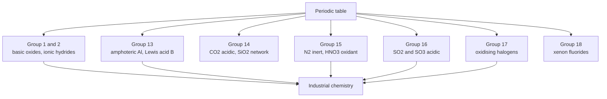
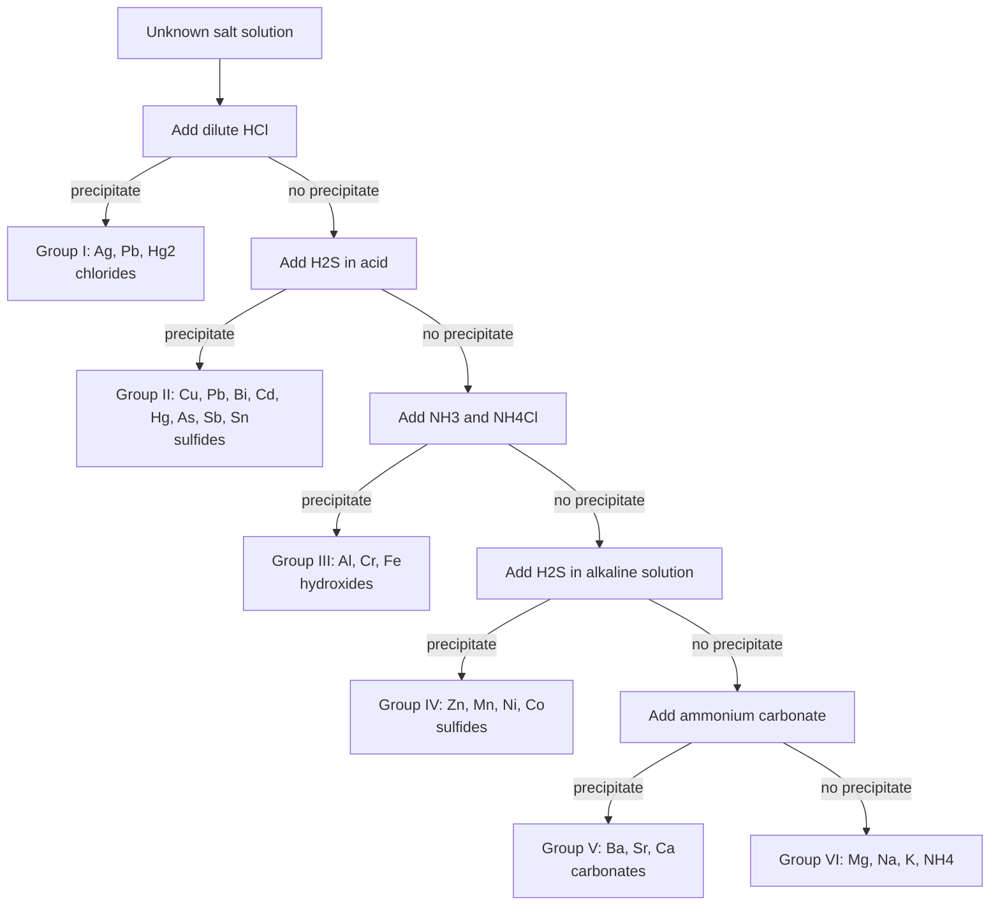
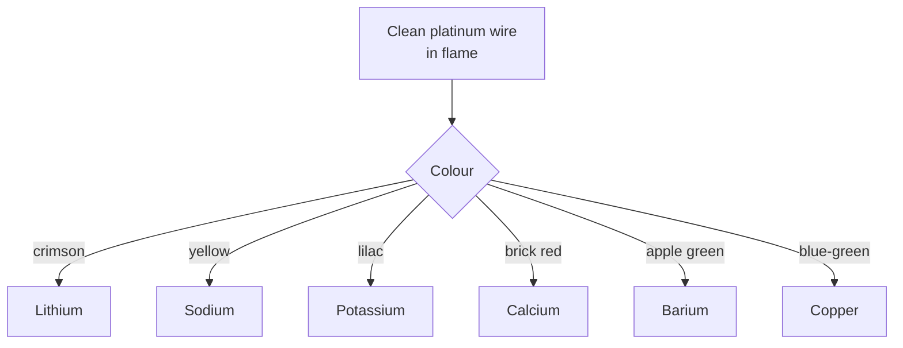
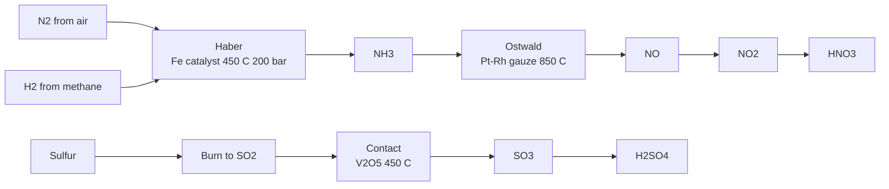
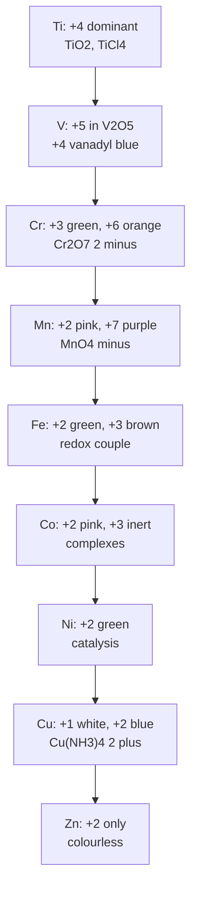

# Chapter 10 — Descriptive Inorganic Chemistry

> **Level:** Level 5 — Advanced Inorganic Chemistry
> **Estimated study time:** 9 hours (6 h reference reading + 3 h exercises)
> **Prerequisites:** [Periodic Chemistry and the Main-Group Elements](01-periodic-chemistry-and-main-group-elements.md); [Transition Metals](02-transition-metals.md); [Coordination Compounds](03-coordination-compounds.md)
> **Related chapters:** [Solid-State Chemistry](06-solid-state-chemistry-crystal-structures-and-defects.md), [Lanthanides and Actinides](09-lanthanides-and-actinides.md), [Inorganic Reaction Mechanisms](08-inorganic-reaction-mechanisms.md)
> **Difficulty:** ★★★☆☆ (3/5)

---

## 1. Learning Objectives

After working through this chapter you will be able to:

- Retrieve the preparation, characteristic reactions, oxidation states and principal compounds of each main group and of the 3d series.
- Predict the products of the standard reactions of an element with water, oxygen, acids and halogens.
- Explain the diagonal relationships, the inert-pair effect and the first-row anomaly.
- Classify hydrides, oxides and halides and predict their behaviour with water and acids.
- Use flame tests, solubility rules and group-separation schemes to identify an unknown inorganic salt.
- Interpret a sequence of qualitative observations and assign a formula with confirmatory tests.
- Reproduce the industrial routes to ammonia, nitric acid, sulfuric acid, sodium carbonate, aluminium and iron.
- Select the right reagent for a separation or a qualitative test, and explain the chemistry behind it.

---

## 2. Introduction

This chapter is a reference, not an argument. Chapters 1–9 supplied the principles — periodic trends, bonding, coordination geometry, lattice energy, redox potentials, mechanisms. This chapter applies them to the elements themselves, group by group and then element by element through the 3d series, in the form a practising chemist actually needs: how to make the substance, what it does, what it looks like, and what it is used for.

The organising conviction is that descriptive chemistry is not a list to be memorised. Almost every fact in this chapter can be regenerated from four questions:

1. **Where is the element in the periodic table?** Position fixes electronegativity, size, accessible oxidation states and the type of bonding.
2. **What is the stable oxidation state, and why?** The inert-pair effect, the $d$-electron count and the availability of empty or half-filled shells determine whether the element prefers +2, +3, +4, +6 or a mixture.
3. **What does the oxide or hydride do with water?** Acid–base character follows from the polarity and polarising power of the element.
4. **What is the solubility of the resulting salt?** Lattice energy versus hydration energy decides whether a precipitate forms, and that decides the separation.

The chapter is therefore arranged to be *looked up*. Each group section follows the same order: occurrence and preparation, characteristic reactions, important compounds, oxidation states, uses and safety. Section 8 contains three fully worked identifications, because the ability to reason from observations to a formula is the practical test of descriptive chemistry. Section 10 collects the errors that most often cost marks in examinations and samples in the laboratory.

Two warnings. First, colours and solubilities are approximate: the eye and the balance are not spectrophotometers, and "pale green" covers a range. Second, many classical qualitative schemes use reagents — hydrogen sulfide, mercuric chloride, lead salts, chromates — that are now restricted or prohibited in teaching laboratories. The chemistry is presented because it is the intellectual scaffold, but the practical advice is to use the modern alternatives (thioacetamide, spot tests, instrumental confirmation) and to follow local safety rules.

---

## 3. Fundamental Concepts

### 3.1 The periodic trends that do the work

Descriptive chemistry is largely the working-out of four trends:

| Trend | Direction | Consequence |
|---|---|---|
| Atomic radius | Increases down a group, decreases across a period | Down a group: lower ionisation energy, more metallic character, larger coordination numbers |
| Ionisation energy | Decreases down, increases across | Metals lose electrons easily; non-metals gain or share |
| Electronegativity | Increases across, decreases down | Bond polarity and oxide acidity follow the same direction |
| Electron affinity | Irregular, generally increases across | Halogens are the strongest electron acceptors; noble gases none |

The **metallic character** increases down every group. Carbon is a non-metal, silicon and germanium are semiconductors, tin and lead are metals. Nitrogen and phosphorus are non-metals, arsenic and antimony are metalloids, bismuth is a metal. Oxygen and sulfur are non-metals, selenium and tellurium are metalloids, polonium is a metal.

### 3.2 Oxidation states and the inert-pair effect

The **inert-pair effect** is the tendency of the heavier $p$-block elements to prefer an oxidation state two lower than the group maximum: Tl(I) rather than Tl(III), Pb(II) rather than Pb(IV), Bi(III) rather than Bi(V). The effect is not a relativistic curiosity but a consequence of the decreasing bond energy of the heavier elements: the two $s$ electrons become less available for bonding, and the energy required to promote them is no longer repaid by the bonds formed.

The effect is reinforced by the increasing stability of the lower oxide down a group: $\ce{CO2}$ is a gas, $\ce{SiO2}$ a network solid, $\ce{SnO2}$ an amphoteric oxide, $\ce{PbO2}$ a strong oxidant. Lead(IV) oxide will oxidise hydrochloric acid to chlorine, which is a direct measure of how reluctant lead is to remain +4.

### 3.3 Diagonal relationships

Several pairs of elements in diagonally adjacent positions have similar chemistry because the increase in size down a group is partly cancelled by the increase in charge across a period:

| Pair | Similarity |
|---|---|
| Li / Mg | Both form nitrides on heating in air, both have sparingly soluble carbonates and fluorides, both form organometallic reagents |
| Be / Al | Both are amphoteric, both form covalent chlorides that fume in air, both passivate in nitric acid |
| B / Si | Both form acidic oxides and volatile hydrides, both are semiconductors in the elemental form |

The relationships are approximate and should not be over-extended; they are useful mnemonics for a handful of otherwise surprising facts.

### 3.4 Hydrides

Hydrides are classified by the bonding within them:

| Type | Description | Examples | Reaction with water |
|---|---|---|---|
| Ionic (saline) | Hydride ion $\ce{H-}$ | $\ce{NaH}$, $\ce{CaH2}$, $\ce{LiAlH4}$ | Hydrolysis to $\ce{H2}$ and hydroxide |
| Covalent (molecular) | Shared electron pairs | $\ce{HCl}$, $\ce{NH3}$, $\ce{CH4}$, $\ce{H2O}$ | Ionisation or no reaction |
| Metallic (interstitial) | Hydrogen in metal lattice | $\ce{PdH_x}$, $\ce{TiH2}$, $\ce{LaNi5H6}$ | No reaction; hydrogen storage |
| Polymeric | Extended covalent network | $\ce{(BeH2)_n}$, $\ce{(AlH3)_n}$ | Slow hydrolysis |

Ionic hydrides are powerful bases and reductants: $\ce{NaH}$ deprotonates alcohols and terminal alkynes, and $\ce{LiAlH4}$ reduces carbonyl compounds. The hydride ion is a strong base because it is the conjugate base of dihydrogen.

### 3.5 Oxides

Oxides are classified by their acid–base behaviour:

| Class | Reaction with water | Reaction with acid | Reaction with base | Examples |
|---|---|---|---|---|
| Basic | Gives hydroxide | Neutralises | No reaction | $\ce{Na2O}$, $\ce{CaO}$, $\ce{FeO}$ |
| Acidic | Gives acid | No reaction | Neutralises | $\ce{SO3}$, $\ce{CO2}$, $\ce{P4O10}$ |
| Amphoteric | Slight | Neutralises | Neutralises | $\ce{Al2O3}$, $\ce{ZnO}$, $\ce{PbO}$, $\ce{Cr2O3}$ |
| Neutral | No reaction | No reaction | No reaction | $\ce{CO}$, $\ce{NO}$, $\ce{N2O}$ |

The classification follows the polarising power of the cation: small, highly charged cations give acidic oxides (covalent, hydrolysing to oxoacids); large, low-charge cations give basic oxides (ionic, hydrolysing to hydroxides). Amphoterism occurs at the boundary, and it is the basis of several important separations.

### 3.6 Halides and solubility

Halides range from ionic to covalent. The trend across a period and down a group follows the electronegativity difference and the polarising power of the cation. Key behaviours:

- **Hydrolysis.** Covalent halides of non-metals hydrolyse to oxoacids and hydrogen halide: $\ce{SiCl4 + 2H2O -> SiO2 + 4HCl}$. Ionic halides simply dissolve.
- **Lewis acidity.** Electron-deficient halides such as $\ce{BF3}$, $\ce{AlCl3}$ and $\ce{TiCl4}$ are strong Lewis acids and are used as catalysts.
- **Bridging.** $\ce{AlCl3}$ and $\ce{BeCl2}$ form bridged dimers or polymers in the solid state and in non-polar solvents.

The **solubility rules** that follow from lattice and hydration energies are summarised in Section 4.10 and applied in Section 4.11.

### 3.7 The logic of qualitative analysis

Classical qualitative analysis separates cations into groups by precipitating them with a reagent that reacts with a whole class:

| Group | Reagent | Cations precipitated | Precipitate form |
|---|---|---|---|
| I | Dilute $\ce{HCl}$ | $\ce{Ag+}$, $\ce{Pb^2+}$, $\ce{Hg2^2+}$ | Chlorides |
| II | $\ce{H2S}$ in acid | $\ce{Pb^2+}$, $\ce{Bi^3+}$, $\ce{Cu^2+}$, $\ce{Cd^2+}$, $\ce{Hg^2+}$, $\ce{As^3+}$, $\ce{Sb^3+}$, $\ce{Sn^2+}$ | Sulfides |
| III | $\ce{NH3}$/$\ce{NH4Cl}$ | $\ce{Al^3+}$, $\ce{Cr^3+}$, $\ce{Fe^3+}$ | Hydroxides |
| IV | $\ce{H2S}$ in alkaline solution | $\ce{Zn^2+}$, $\ce{Mn^2+}$, $\ce{Ni^2+}$, $\ce{Co^2+}$ | Sulfides |
| V | $\ce{(NH4)2CO3}$ | $\ce{Ba^2+}$, $\ce{Sr^2+}$, $\ce{Ca^2+}$ | Carbonates |
| VI | None (filtrate) | $\ce{Mg^2+}$, $\ce{Na+}$, $\ce{K+}$, $\ce{NH4+}$ | Soluble |

Each group is then separated by exploiting differences in solubility: $\ce{PbCl2}$ dissolves in hot water, $\ce{AgCl}$ dissolves in ammonia, $\ce{BaSO4}$ is insoluble while $\ce{CaSO4}$ is sparingly soluble, and amphoteric hydroxides dissolve in excess alkali.

---

## 4. Detailed Scientific Explanation

### 4.1 Hydrogen

Hydrogen is the most abundant element in the universe; on Earth it occurs almost entirely combined, chiefly as water and in hydrocarbons. It has three isotopes: protium ($^1\ce{H}$), deuterium ($^2\ce{H}$ or D) and tritium ($^3\ce{H}$, radioactive, $t_{1/2} = 12.3\ \text{y}$).

**Preparation.** Industrially by steam reforming of methane and by the water-gas shift reaction; in the laboratory by the action of dilute acid on zinc, or by electrolysis of water.

**Characteristic reactions.** Hydrogen burns in oxygen to water; it reduces metal oxides at high temperature; it adds across unsaturated bonds in the presence of a catalyst; and it forms hydrides with most elements.

**Important compounds.** Water, ammonia, hydrogen peroxide, hydrogen halides, and the whole of organic chemistry.

**Uses and safety.** Ammonia synthesis, methanol synthesis, hydrotreating and hydrocracking in refining, and fuel cells. Hydrogen is colourless and odourless, forms explosive mixtures with air between 4 % and 75 % by volume, and burns with an almost invisible flame.

### 4.2 Group 1: the alkali metals

**Occurrence and preparation.** Always found as +1 ions in minerals (halite, sylvite, carnallite, spodumene). Sodium is made by electrolysis of molten sodium chloride in a Downs cell; lithium by electrolysis of a molten $\ce{LiCl}$–$\ce{KCl}$ mixture; potassium by the reaction of sodium vapour with molten potassium chloride.

**Characteristic reactions.** All react vigorously with water to give the hydroxide and hydrogen; the reactivity increases down the group. They tarnish in air, forming oxides, peroxides or superoxides; they react directly with halogens, and with hydrogen to give saline hydrides.

**Important compounds.**

| Compound | Preparation | Use |
|---|---|---|
| $\ce{NaCl}$ | Mining, solar evaporation | Chlor-alkali feedstock, food, de-icing |
| $\ce{NaOH}$ | Chlor-alkali electrolysis | Pulp, soap, alumina, neutralisation |
| $\ce{Na2CO3}$ | Solvay process | Glass, detergents, water softening |
| $\ce{NaHCO3}$ | Carbonation of Solvay liquor | Baking powder, antacid, fire extinguishers |
| $\ce{Na2O2}$ | Oxidation of sodium | Bleach, oxygen source |
| $\ce{KO2}$ | Direct combination | Oxygen source in breathing apparatus |
| $\ce{Li2CO3}$ | From spodumene | Lithium-ion battery electrolyte precursor |

### 4.3 Group 2: the alkaline earth metals

**Occurrence and preparation.** Found as carbonates, sulfates and silicates (limestone, dolomite, barytes, celestite). Magnesium is produced by the Pidgeon process (silicothermic reduction of calcined dolomite) or by electrolysis of molten $\ce{MgCl2}$; calcium by electrolysis of molten $\ce{CaCl2}$.

**Characteristic reactions.** React with water to give the hydroxide and hydrogen (Be does not react, Mg reacts slowly, Ca and the heavier metals react readily); burn in oxygen to give basic oxides; react with halogens and with hydrogen on heating.

**Important compounds.** $\ce{MgO}$ (refractory), $\ce{Mg(OH)2}$ (antacid, flame retardant), $\ce{CaO}$ and $\ce{Ca(OH)2}$ (lime and slaked lime), $\ce{CaCO3}$ (limestone, chalk, marble), $\ce{CaSO4}$ (gypsum, plaster of Paris), $\ce{BaSO4}$ (radiocontrast agent, drilling mud), $\ce{BaTiO3}$ (ferroelectric ceramic).

**Trends.** Hydroxide solubility increases down the group; sulfate solubility decreases. This is why $\ce{BaSO4}$ is insoluble and used as a safe barium source, while $\ce{MgSO4}$ is freely soluble (Epsom salts).

### 4.4 Group 13: the boron group

**Boron.** Obtained as boric acid from borax; the element is a hard, black semi-metal used in boron fibres and as a neutron absorber. Boric acid $\ce{H3BO3}$ is a weak Lewis acid that accepts hydroxide rather than donating a proton. Borax, $\ce{Na2B4O7.10H2O}$, is a flux and a buffer. The boranes, beginning with diborane $\ce{B2H6}$, contain three-centre two-electron bonds and are spontaneously flammable in air.

**Aluminium.** The most abundant metal in the crust, obtained from bauxite by the Bayer process (digestion with hot sodium hydroxide to give $\ce{Al(OH)3}$, calcination to $\ce{Al2O3}$) followed by the Hall–Héroult electrolysis in molten cryolite at about 950 °C. Aluminium is amphoteric: it dissolves in both acids and alkalis. Its oxide is amphoteric too, which is why anodised aluminium is corrosion-resistant.

**Gallium, indium, thallium.** Gallium is used in GaAs and GaN semiconductors and in low-melting alloys; indium in indium tin oxide transparent electrodes; thallium is highly toxic and now largely restricted. The inert-pair effect is pronounced: Tl(I) is more stable than Tl(III).

### 4.5 Group 14: the carbon group

**Carbon.** Exists as diamond, graphite, fullerenes, graphene and amorphous forms. The chemistry of carbon is organic chemistry; the inorganic aspects are the oxides ($\ce{CO}$, $\ce{CO2}$), the carbonates, the carbides and the cyanides. Carbon monoxide is a strong field ligand and a poison that binds haemoglobin irreversibly. Carbon dioxide is the anhydride of carbonic acid and the feedstock of photosynthesis.

**Silicon.** The second most abundant element in the crust, found as silica and silicates. Silicon is purified by the Siemens process (conversion to trichlorosilane, distillation, decomposition on a hot filament) to semiconductor grade. Silicates are classified by the degree of polymerisation of the $\ce{SiO4}$ tetrahedra: orthosilicates, pyrosilicates, chain, sheet and framework silicates. Silicones are organosilicon polymers with Si–O backbones.

**Germanium, tin, lead.** Germanium is a semiconductor and an infrared optical material. Tin has two allotropes, grey ($\alpha$) and white ($\beta$); the transition at 13 °C causes "tin pest". Tin(II) fluoride is used in toothpaste. Lead is dense, soft and toxic; its principal compounds are $\ce{PbO}$, $\ce{PbO2}$, $\ce{Pb3O4}$ and $\ce{PbS}$, and its largest use is the lead–acid battery. The inert-pair effect stabilises Pb(II).

### 4.6 Group 15: the pnictogens

**Nitrogen.** Obtained by fractional distillation of liquid air. It is inert at room temperature because of the strong N≡N bond, but it is fixed industrially by the Haber process and biologically by nitrogenase.

**Ammonia and nitric acid.** Ammonia is synthesised from nitrogen and hydrogen over an iron catalyst promoted with potassium oxide and alumina at 400–500 °C and 150–300 bar. Nitric acid is made by the Ostwald process: catalytic oxidation of ammonia over platinum–rhodium gauze at about 850 °C, oxidation of nitric oxide to nitrogen dioxide, and absorption in water.

**Phosphorus.** White phosphorus ($\ce{P4}$) is a waxy, spontaneously flammable solid; red phosphorus is a polymeric solid used in matches; black phosphorus is a layered semiconductor. The principal compounds are $\ce{P4O10}$, $\ce{PCl3}$, $\ce{PCl5}$ and phosphoric acid, made by the wet process from phosphate rock and sulfuric acid.

**Arsenic, antimony, bismuth.** Arsenic compounds are toxic and carcinogenic; gallium arsenide is an important semiconductor. Antimony is used in flame retardants and alloys. Bismuth compounds are comparatively non-toxic and are used in stomach medicines and as replacements for lead in solders.

### 4.7 Group 16: the chalcogens

**Oxygen.** Obtained by fractional distillation of liquid air. Ozone is made by electrical discharge in oxygen and is a powerful oxidant used in water treatment. Hydrogen peroxide is manufactured by the anthraquinone process and is used as a bleach and disinfectant.

**Sulfur.** Found native and as sulfides and sulfates; obtained from natural gas by the Claus process. It burns to $\ce{SO2}$; catalytic oxidation to $\ce{SO3}$ over vanadium(V) oxide, followed by absorption in concentrated sulfuric acid, gives the world's most-produced industrial chemical. Sulfuric acid is a strong dehydrating agent and a catalyst.

**Selenium and tellurium.** Selenium is used in photocells and in glass decolorisation; tellurium in alloys and cadmium telluride solar cells. Both are toxic in excess but selenium is an essential trace element.

### 4.8 Group 17: the halogens

**Occurrence and preparation.** Fluorine is obtained by electrolysis of a molten $\ce{KF}$–$\ce{HF}$ mixture; chlorine by chlor-alkali electrolysis or by oxidation of chloride; bromine by displacement from seawater with chlorine; iodine from caliche deposits or from seaweed ash.

**Characteristic reactions.** Halogens oxidise metals and non-metals to halides; the oxidising power decreases down the group ($\ce{F2 > Cl2 > Br2 > I2}$). Chlorine disproportionates in cold dilute alkali to chloride and hypochlorite, and in hot concentrated alkali to chloride and chlorate.

**Hydrogen halides and oxoacids.** $\ce{HF}$ is a weak acid because of strong hydrogen bonding; the others are strong acids. The oxoacids of chlorine increase in acid strength and oxidising power with the number of oxygen atoms: $\ce{HClO < HClO2 < HClO3 < HClO4}$.

**Interhalogens and polyhalides.** $\ce{ClF}$, $\ce{ClF3}$, $\ce{BrF5}$ and $\ce{ICl}$ are used as fluorinating and oxidising agents; $\ce{ClF3}$ is a powerful fluorinator. Polyhalides such as $\ce{I3-}$ are stable when the central halide is large and polarisable.

**Uses and safety.** Fluorine and its compounds in refrigerants, polymers (PTFE) and uranium processing; chlorine in water treatment, PVC and bleach; bromine in flame retardants and pharmaceuticals; iodine as an antiseptic and in iodised salt. Chlorine, bromine and fluorine are acutely toxic, and their handling requires scrubbing and monitoring.

### 4.9 Group 18: the noble gases

**Occurrence and preparation.** Helium from natural gas; neon, argon, krypton and xenon by fractional distillation of liquid air.

**Chemistry.** The first ionisation energies decrease down the group, and xenon forms the richest chemistry: $\ce{XeF2}$, $\ce{XeF4}$, $\ce{XeF6}$, $\ce{XeO3}$, $\ce{XeOF4}$ and the perxenate ion $\ce{XeO6^4-}$. Krypton forms $\ce{KrF2}$; radon is radioactive and forms a few fluorides. Helium and neon form no stable compounds.

**Uses.** Helium for cryogenics, leak detection, breathing mixtures and balloons; neon in discharge lamps; argon as a shielding gas for welding and as a glovebox atmosphere; krypton in high-performance lighting and lasers; xenon in flash lamps, ion thrusters, anaesthesia and hyperpolarised MRI.

### 4.10 Solubility rules and their chemical basis

| Rule | Consequence | Exception worth knowing |
|---|---|---|
| All nitrates and acetates are soluble | Useful for preparing solutions | Some basic nitrates hydrolyse |
| All chlorides are soluble except $\ce{AgCl}$, $\ce{PbCl2}$, $\ce{Hg2Cl2}$ | Group I separation | $\ce{PbCl2}$ dissolves in hot water |
| All sulfates are soluble except $\ce{BaSO4}$, $\ce{SrSO4}$, $\ce{PbSO4}$ | Group V separation | $\ce{CaSO4}$ is sparingly soluble |
| All carbonates are insoluble except those of Group 1 and ammonium | Group V precipitation | $\ce{(NH4)2CO3}$ is soluble |
| All hydroxides are insoluble except those of Group 1 and $\ce{Ba(OH)2}$ | Group III separation | Amphoteric hydroxides dissolve in excess alkali |
| All sulfides are insoluble except Group 1, Group 2 and ammonium | Group II and IV separation | Solubility depends strongly on pH |

The rules are thermodynamic statements about the balance between lattice energy and hydration energy. A salt is soluble when the hydration energy of its ions exceeds the lattice energy by enough to pay for the entropy cost of breaking the lattice.

### 4.11 Applying solubility to real separations

- **Separation of $\ce{Fe^3+}$ from $\ce{Al^3+}$.** Both precipitate as hydroxides at moderate pH, but $\ce{Al(OH)3}$ is amphoteric and redissolves in excess sodium hydroxide, whereas $\ce{Fe(OH)3}$ does not.
- **Separation of $\ce{Ba^2+}$ from $\ce{Ca^2+}$.** Addition of sulfate precipitates $\ce{BaSO4}$, while $\ce{CaSO4}$ remains partly in solution; the separation is sharper if the solution is dilute and slightly acidic.
- **Separation of $\ce{Ag+}$ from $\ce{Pb^2+}$.** Both give white chlorides, but $\ce{PbCl2}$ dissolves in hot water and reprecipitates on cooling, while $\ce{AgCl}$ dissolves in ammonia.
- **Separation of $\ce{Cu^2+}$ from $\ce{Zn^2+}$.** Both sulfides precipitate in alkaline solution, but $\ce{CuS}$ is insoluble in dilute acid while $\ce{ZnS}$ dissolves, so pH control separates them.
- **Removal of sulfate from water.** Addition of barium chloride precipitates $\ce{BaSO4}$, a reaction used in the gravimetric determination of sulfate.

### 4.12 The 3d series: an element-by-element survey

**Titanium.** Occurrence: ilmenite $\ce{FeTiO3}$ and rutile $\ce{TiO2}$. Extraction: the Kroll process — chlorination of rutile with carbon to $\ce{TiCl4}$, purification by distillation, reduction with magnesium under argon. Chemistry: Ti(IV) dominates; $\ce{TiO2}$ is amphoteric and photochemically active; $\ce{TiCl4}$ fumes in air and is a Lewis acid. Uses: aerospace alloys, white pigment, photocatalysis, implants.

**Vanadium.** Occurrence: vanadium-bearing magnetite and vanadium slag. Chemistry: oxidation states +2 (violet), +3 (green), +4 (blue, vanadyl $\ce{VO^2+}$), +5 (yellow, vanadate). $\ce{V2O5}$ is the catalyst for sulfuric acid manufacture and for the oxidation of organic substrates. Uses: steel alloys, redox flow batteries, catalysts.

**Chromium.** Occurrence: chromite $\ce{FeCr2O4}$. Chemistry: Cr(III) (green or violet, inert) and Cr(VI) (yellow chromate, orange dichromate, red $\ce{CrO3}$). Chromium(VI) is a carcinogen and a strong oxidant; $\ce{Cr2O7^2-}$ in acid oxidises alcohols, iron(II) and iodide. Uses: stainless steel, chrome plating, pigments, leather tanning, refractories.

**Manganese.** Occurrence: pyrolusite $\ce{MnO2}$. Chemistry: Mn(II) (pale pink), Mn(IV) ($\ce{MnO2}$, black), Mn(VI) (manganate, green), Mn(VII) (permanganate, purple). $\ce{KMnO4}$ is prepared by alkaline oxidation of $\ce{MnO2}$ followed by electrolytic oxidation. Uses: steelmaking (ferromanganese), batteries, water treatment, oxidant.

**Iron.** Occurrence: hematite $\ce{Fe2O3}$, magnetite $\ce{Fe3O4}$, siderite $\ce{FeCO3}$, pyrite $\ce{FeS2}$. Extraction in the blast furnace: iron ore, coke and limestone are charged; coke burns to CO, which reduces the ore; limestone removes silica as slag. Chemistry: Fe(II) (pale green) and Fe(III) (yellow-brown); $\ce{Fe(OH)3}$ is red-brown, $\ce{FeS}$ black. Uses: steel, magnets, catalysts, pigments.

**Cobalt.** Occurrence: cobaltite and laterite ores, usually with nickel and copper. Chemistry: Co(II) (pink, high spin) and Co(III) (low spin, inert, often complexed). Uses: lithium-ion cathodes, superalloys, magnets (SmCo), pigments (cobalt blue), catalysts (Fischer–Tropsch), vitamin B$_{12}$.

**Nickel.** Occurrence: pentlandite, laterites. Extraction: Mond process — nickel reacts with carbon monoxide at about 50 °C to form $\ce{Ni(CO)4}$, which decomposes at about 230 °C to pure nickel. Chemistry: Ni(II) dominates; $\ce{Ni(OH)2}$ is green, $\ce{[Ni(NH3)6]^2+}$ is blue-violet. Uses: stainless steel, plating, batteries, hydrogenation catalyst (Raney nickel), coinage.

**Copper.** Occurrence: chalcopyrite $\ce{CuFeS2}$, malachite, cuprite. Extraction: concentration, roasting, smelting to matte, converting, and electrolytic refining. Chemistry: Cu(I) (white, insoluble salts) and Cu(II) (blue, soluble salts); $\ce{[Cu(NH3)4]^2+}$ is deep blue; $\ce{CuSO4.5H2O}$ is blue. Uses: electrical wiring, plumbing, alloys (brass, bronze), catalysts, fungicides.

**Zinc.** Occurrence: sphalerite $\ce{ZnS}$. Extraction: roasting to $\ce{ZnO}$, reduction with carbon, or electrolysis of purified sulfate solution. Chemistry: Zn(II) only; $\ce{ZnO}$ is white and amphoteric; $\ce{ZnCl2}$ is deliquescent and a Lewis acid. Uses: galvanising, brass, batteries, pigments, sunscreen, dietary supplement.

### 4.13 A reference table of colours and industrial compounds

| Species | Colour | Metal oxidation state | Note |
|---|---|---|---|
| $\ce{Cu^2+(aq)}$ | Blue | +2 | $\ce{[Cu(H2O)6]^2+}$ |
| $\ce{[Cu(NH3)4]^2+}$ | Deep blue | +2 | Analytical test for copper |
| $\ce{CuO}$ | Black | +2 | Basic oxide |
| $\ce{Cu2O}$ | Red | +1 | Semiconducting oxide |
| $\ce{Fe^2+(aq)}$ | Pale green | +2 | Easily oxidised in air |
| $\ce{Fe^3+(aq)}$ | Yellow-brown | +3 | Hydrolyses to colloids |
| $\ce{Fe(OH)3}$ | Red-brown | +3 | Group III precipitate |
| $\ce{CrO4^2-}$ | Yellow | +6 | Alkaline solution |
| $\ce{Cr2O7^2-}$ | Orange | +6 | Acidic solution |
| $\ce{MnO4-}$ | Purple | +7 | Strong oxidant |
| $\ce{Mn^2+(aq)}$ | Pale pink | +2 | Nearly colourless when dilute |
| $\ce{Ni^2+(aq)}$ | Green | +2 | $\ce{[Ni(H2O)6]^2+}$ |
| $\ce{Co^2+(aq)}$ | Pink | +2 | $\ce{[Co(H2O)6]^2+}$ |
| $\ce{VO^2+(aq)}$ | Blue | +4 | Vanadyl ion |
| $\ce{VO2+(aq)}$ | Yellow | +5 | Vanadium(V) |
| $\ce{TiO2}$ | White | +4 | Pigment |
| $\ce{AgCl}$ | White | +1 | Soluble in ammonia |
| $\ce{AgBr}$ | Cream | +1 | Photographic emulsion |
| $\ce{AgI}$ | Yellow | +1 | Insoluble in ammonia |
| $\ce{PbI2}$ | Yellow | +2 | Precipitation test |
| $\ce{BaSO4}$ | White | +2 | Gravimetric sulfate |
| $\ce{NO2}$ | Brown | +4 | Air pollutant |
| $\ce{I2}$ vapour | Purple | 0 | Sublimation test |

| Industrial compound | Formula | Principal use |
|---|---|---|
| Sulfuric acid | $\ce{H2SO4}$ | Fertiliser, batteries, refining |
| Ammonia | $\ce{NH3}$ | Fertiliser, nitric acid, refrigeration |
| Sodium hydroxide | $\ce{NaOH}$ | Pulp, alumina, soap |
| Sodium carbonate | $\ce{Na2CO3}$ | Glass, detergents |
| Aluminium oxide | $\ce{Al2O3}$ | Aluminium production, abrasives |
| Calcium oxide | $\ce{CaO}$ | Cement, steelmaking, lime mortar |
| Titanium dioxide | $\ce{TiO2}$ | White pigment, photocatalyst |
| Hydrogen peroxide | $\ce{H2O2}$ | Bleach, disinfectant |

---

## 5. Visual Diagrams

### 5.1 A map of the main-group chemistry

**Figure 10.1 — The main-group families and the character of their chemistry.** The map is organised by the acid–base and redox character of the group rather than by position alone. Groups 1 and 2 give basic oxides and ionic hydrides; group 13 contains the amphoteric boundary at aluminium; group 14 spans the acidic dioxide and the network solid; groups 15–17 supply the strong acids, the oxidants and the industrial feedstocks. The arrows converge on industrial chemistry because the large-scale processes — ammonia, sulfuric acid, chlor-alkali, aluminium — draw on several groups at once.

### 5.2 The qualitative analysis scheme

**Figure 10.2 — Group separation scheme for cations.** Each step removes an entire class of ions, so the later tests operate on a simpler mixture. The order is dictated by solubility: the least soluble chlorides come out first, then the acid-insoluble sulfides, then the hydroxides that precipitate at the ammonia buffer pH, then the sulfides that require alkaline conditions, and finally the carbonates. Within each group, further tests separate the individual ions. The scheme is a decision tree in the literal sense, and every branch is a solubility rule.

### 5.3 Flame tests

**Figure 10.3 — Flame-test decision tree.** The colour arises when thermal excitation promotes electrons into higher atomic levels and the return transition emits visible light. Sodium dominates any mixture because its yellow emission is intense and its ionisation energy is low, so a cobalt-blue glass is used to filter the yellow when testing for potassium. The test is sensitive to a few parts per million but is not specific: barium and boron can both give green, and the observer's colour discrimination is the limiting factor.

### 5.4 Three industrial routes

**Figure 10.4 — The three industrial processes that underpin the fertiliser and chemical industry.** All three are catalytic oxidations operated at elevated temperature and pressure, and all three are constrained by the same thermodynamic principle: the equilibrium is favoured by high pressure when the number of gas molecules decreases, and by moderate temperature when the reaction is exothermic. The catalyst is needed to reach equilibrium at a practical rate, not to change the position of the equilibrium.

### 5.5 Oxidation states across the 3d series

**Figure 10.5 — The accessible oxidation states of the first-row transition metals.** The maximum oxidation state rises to +7 at manganese and then falls, which reflects the increasing effective nuclear charge and the decreasing availability of the $3d$ electrons for bonding. From iron onwards the +2 and +3 states dominate, and zinc has only +2 because the $3d$ shell is full. The colours in the boxes are those of the characteristic aqua or oxo ions, and they are the basis of the qualitative tests in Section 4.13.

---

## 6. Mathematical Formulas

### 6.1 Amount, mass and gas volume

$$ n = \frac{m}{M} \qquad V_{\text{m}} = \frac{RT}{p} $$

| Symbol | Meaning | SI unit |
|---|---|---|
| $n$ | amount of substance | mol |
| $m$ | mass | kg |
| $M$ | molar mass | $\text{kg mol}^{-1}$ |
| $V_{\text{m}}$ | molar volume | $\text{m}^{3}\ \text{mol}^{-1}$ |
| $R$ | gas constant, $8.314$ | $\text{J K}^{-1}\ \text{mol}^{-1}$ |
| $T$ | thermodynamic temperature | K |
| $p$ | pressure | Pa |

At 273.15 K and 100 kPa, $V_{\text{m}} = 22.71\ \text{dm}^{3}\ \text{mol}^{-1}$; at 273.15 K and 101.325 kPa, $V_{\text{m}} = 22.41\ \text{dm}^{3}\ \text{mol}^{-1}$.

### 6.2 Percentage yield

$$ \text{yield} = \frac{n_{\text{actual}}}{n_{\text{theoretical}}} \times 100\ \% $$

| Symbol | Meaning | SI unit |
|---|---|---|
| $n_{\text{actual}}$ | amount of product obtained | mol |
| $n_{\text{theoretical}}$ | amount predicted by stoichiometry | mol |

The theoretical yield assumes complete conversion and a pure product; the actual yield is always lower because of side reactions, losses in work-up and incomplete reaction.

### 6.3 Empirical formula from mass percentages

$$ n_i = \frac{w_i}{A_i} \qquad \text{ratio} = \frac{n_i}{n_{\text{smallest}}} $$

| Symbol | Meaning | SI unit |
|---|---|---|
| $w_i$ | mass percentage of element $i$ | % |
| $A_i$ | relative atomic mass | dimensionless |
| $n_i$ | relative amount | mol |

Dividing by the smallest value gives the simplest whole-number ratio, which is the empirical formula.

### 6.4 Back-titration

$$ n_{\text{analyte}} = n_{\text{reagent,total}} - n_{\text{reagent,excess}} $$

| Symbol | Meaning | SI unit |
|---|---|---|
| $n_{\text{analyte}}$ | amount of substance being determined | mol |
| $n_{\text{reagent,total}}$ | amount of reagent added in excess | mol |
| $n_{\text{reagent,excess}}$ | amount found by titration of the excess | mol |

Back-titration is used when the direct reaction is slow, when the endpoint is difficult to see, or when the analyte is insoluble.

### 6.5 Solubility product

$$ K_{\text{sp}} = [\ce{M^{m+}}]^m[\ce{X^{n-}}]^n $$

| Symbol | Meaning | SI unit |
|---|---|---|
| $K_{\text{sp}}$ | solubility product | concentration units raised to the stoichiometric powers |
| $[\ce{M^{m+}}]$ | molar concentration of cation | $\text{mol dm}^{-3}$ |

A precipitate forms when the ionic product exceeds $K_{\text{sp}}$. The expression assumes ideal dilute solutions and a fixed temperature.

---

## 7. Chemical Equations

### 7.1 The Haber process

$$
\ce{N2(g) + 3H2(g) <=> 2NH3(g)} \qquad \Delta H^\circ = -92\ \text{kJ mol}^{-1}
$$

Conditions: iron catalyst promoted with $\ce{K2O}$ and $\ce{Al2O3}$, 400–500 °C, 150–300 bar. The reaction is exothermic and reduces the number of gas molecules, so high pressure and moderate temperature favour the equilibrium; the catalyst is needed for an acceptable rate.

### 7.2 The Ostwald process

$$
\ce{4NH3(g) + 5O2(g) -> 4NO(g) + 6H2O(g)} \qquad \Delta H^\circ = -905\ \text{kJ mol}^{-1}
$$

$$
\ce{2NO(g) + O2(g) -> 2NO2(g)}
$$

$$
\ce{4NO2(g) + O2(g) + 2H2O(l) -> 4HNO3(aq)}
$$

The first step uses a platinum–rhodium gauze at about 850 °C and is the rate-determining catalytic step; the second and third steps are fast and exothermic.

### 7.3 The Contact process

$$
\ce{S(s) + O2(g) -> SO2(g)}
$$

$$
\ce{2SO2(g) + O2(g) <=> 2SO3(g)} \qquad \Delta H^\circ = -198\ \text{kJ mol}^{-1}
$$

$$
\ce{SO3(g) + H2O(l) -> H2SO4(l)}
$$

Conditions: vanadium(V) oxide catalyst, 420–450 °C, 1–2 bar. The reaction is exothermic and reduces the number of gas molecules, so high pressure favours it, but the industrial compromise uses moderate pressure to reduce capital cost. Sulfur trioxide is absorbed in concentrated sulfuric acid rather than in water to avoid a corrosive mist.

### 7.4 The Solvay process

$$
\ce{NaCl(aq) + NH3(aq) + CO2(g) + H2O(l) -> NaHCO3(s) + NH4Cl(aq)}
$$

$$
\ce{2NaHCO3(s) -> Na2CO3(s) + CO2(g) + H2O(g)}
$$

The first step exploits the low solubility of sodium hydrogencarbonate in the ammoniated brine; the carbon dioxide is recovered from the calcination and recycled, and the ammonia is recovered from the ammonium chloride by treatment with lime.

### 7.5 The Hall–Héroult process

$$
\ce{2Al2O3(l) + 3C(s) -> 4Al(l) + 3CO2(g)}
$$

The alumina is dissolved in molten cryolite ($\ce{Na3AlF6}$) at about 950 °C, and the reaction is driven by electrolysis at 4–5 V and 100–300 kA. The carbon anodes are consumed and must be replaced regularly.

### 7.6 The blast furnace

$$
\ce{C(s) + O2(g) -> CO2(g)}
$$

$$
\ce{CO2(g) + C(s) -> 2CO(g)}
$$

$$
\ce{Fe2O3(s) + 3CO(g) -> 2Fe(l) + 3CO2(g)}
$$

$$
\ce{CaCO3(s) -> CaO(s) + CO2(g)}
$$

$$
\ce{CaO(s) + SiO2(s) -> CaSiO3(l)}
$$

Iron ore, coke and limestone are charged at the top; hot air is blown in at the bottom. The product is pig iron, which is refined to steel in a basic oxygen furnace.

### 7.7 Chlor-alkali electrolysis

$$
\ce{2NaCl(aq) + 2H2O(l) -> 2NaOH(aq) + Cl2(g) + H2(g)}
$$

The membrane cell separates the anode and cathode compartments, preventing chlorine from reacting with hydroxide. The products are sodium hydroxide, chlorine and hydrogen, all of which are sold or used on site.

### 7.8 Preparation of potassium permanganate

$$
\ce{2MnO2(s) + 4KOH(aq) + O2(g) -> 2K2MnO4(aq) + 2H2O(l)}
$$

$$
\ce{2K2MnO4(aq) + Cl2(g) -> 2KMnO4(aq) + 2KCl(aq)}
$$

The first step is an oxidative fusion; the second oxidises manganate(VI) to permanganate(VII) with chlorine. The deep purple product is crystallised and dried.

### 7.9 The thermite reaction

$$
\ce{2Al(s) + Fe2O3(s) -> Al2O3(s) + 2Fe(l)} \qquad \Delta H^\circ = -852\ \text{kJ mol}^{-1}
$$

The reaction is sufficiently exothermic to melt the iron, which is why it is used for welding railway track and for incendiary applications. It is a displacement reaction driven by the greater affinity of aluminium for oxygen.

### 7.10 Dissolution of limestone

$$
\ce{CaCO3(s) + 2HCl(aq) -> CaCl2(aq) + CO2(g) + H2O(l)}
$$

$$
\ce{CaCO3(s) + H2O(l) + CO2(g) -> Ca(HCO3)2(aq)}
$$

The first reaction is the standard test for carbonate; the second is the chemistry of hard water, karst landscapes and the dissolution of carbonate scale.

---

## 8. Worked Examples

### Worked Example 8.1 — Identification A: a white solid giving a brick-red flame

**Problem.** A white crystalline solid is soluble in water. A flame test gives a brick-red colour. The solid dissolves in dilute hydrochloric acid with vigorous effervescence, and the gas turns limewater milky. The solution gives a white precipitate with ammonium oxalate that dissolves in dilute hydrochloric acid. Identify the solid and write the equations.

**Strategy.** Use the flame colour to narrow the cation, the effervescence to identify the anion, and the confirmatory test to distinguish the Group 2 carbonates.

**Solution.** The brick-red flame indicates calcium. The effervescence with acid and the milky limewater identify a carbonate:

$$
\ce{CaCO3(s) + 2HCl(aq) -> CaCl2(aq) + CO2(g) + H2O(l)}
$$

$$
\ce{CO2(g) + Ca(OH)2(aq) -> CaCO3(s) + H2O(l)}
$$

The white precipitate with ammonium oxalate is calcium oxalate:

$$
\ce{CaCl2(aq) + (NH4)2C2O4(aq) -> CaC2O4(s) + 2NH4Cl(aq)}
$$

The solid is calcium carbonate, $\ce{CaCO3}$.

**Check.** Barium gives an apple-green flame and strontium a crimson flame, so the flame colour distinguishes the three Group 2 carbonates; the oxalate test confirms calcium specifically, because strontium and barium oxalates are also insoluble but the flame colour excludes them. The acid solubility of the oxalate distinguishes it from sulfate, which would not dissolve.

### Worked Example 8.2 — Identification B: a blue-green solution giving a deep blue colour with ammonia

**Problem.** A blue crystalline solid dissolves in water to give a blue-green solution. Adding sodium hydroxide gives a pale blue precipitate that darkens on warming. Adding excess ammonia gives a deep blue solution. Adding potassium iodide gives a white precipitate and a brown solution. A flame test gives a blue-green colour. Identify the cation and the likely anion, and write the equations.

**Strategy.** The deep blue ammonia complex is diagnostic of copper(II); the iodide reaction confirms it by producing copper(I) iodide and iodine.

**Solution.** The hydroxide precipitate is copper(II) hydroxide:

$$
\ce{CuSO4(aq) + 2NaOH(aq) -> Cu(OH)2(s) + Na2SO4(aq)}
$$

In excess ammonia the precipitate dissolves to the tetraammine complex:

$$
\ce{Cu(OH)2(s) + 4NH3(aq) -> [Cu(NH3)4]^2+(aq) + 2OH-(aq)}
$$

Iodide reduces copper(II) to copper(I):

$$
\ce{2Cu^2+(aq) + 4I-(aq) -> 2CuI(s) + I2(aq)}
$$

The brown colour is iodine, which gives a blue-black colour with starch. The cation is $\ce{Cu^2+}$; the anion is not identified by these tests, but the blue crystals and the formation of a blue solution are consistent with copper(II) sulfate pentahydrate, $\ce{CuSO4.5H2O}$.

**Check.** Iron(III) also gives a coloured hydroxide but it is red-brown and does not dissolve in ammonia; nickel(II) gives a green solution and a blue-violet ammonia complex, not deep blue. The iodide reaction is specific to copper(II) among the common cations.

### Worked Example 8.3 — Identification C: a pale green solid giving a white precipitate with barium chloride

**Problem.** A pale green crystalline solid dissolves in water to give a pale green solution. Adding sodium hydroxide gives a pale green precipitate that turns brown on standing in air. Adding barium chloride in dilute hydrochloric acid gives a white precipitate that does not dissolve. Adding potassium thiocyanate to the oxidised solution gives a blood-red colour. Identify the compound and write the equations.

**Strategy.** The pale green colour suggests iron(II); the hydroxide behaviour confirms it; the barium sulfate test identifies the anion; the thiocyanate test confirms iron(III) after oxidation.

**Solution.** Iron(II) hydroxide precipitates and is oxidised by air:

$$
\ce{FeSO4(aq) + 2NaOH(aq) -> Fe(OH)2(s) + Na2SO4(aq)}
$$

$$
\ce{4Fe(OH)2(s) + O2(g) + 2H2O(l) -> 4Fe(OH)3(s)}
$$

The white precipitate with barium chloride is barium sulfate:

$$
\ce{BaCl2(aq) + FeSO4(aq) -> BaSO4(s) + FeCl2(aq)}
$$

Thiocyanate gives the blood-red iron(III) complex:

$$
\ce{Fe^3+(aq) + SCN-(aq) -> [Fe(SCN)]^2+(aq)}
$$

The compound is iron(II) sulfate, $\ce{FeSO4.7H2O}$ (green vitriol).

**Check.** Copper(II) sulfate is blue, not pale green; nickel(II) sulfate is green but its hydroxide does not turn brown in air. The sulfate test confirms the anion, and the thiocyanate colour confirms that the cation is iron and that it has been oxidised to +3.

### Worked Example 8.4 — Empirical formula from analysis

**Problem.** An oxide of titanium contains 59.9 % titanium and 40.1 % oxygen by mass. Determine its empirical formula and identify the oxide.

**Strategy.** Convert mass percentages to relative amounts, divide by the smaller value, and round to the nearest whole numbers.

**Solution.** Using $A(\ce{Ti}) = 47.87$ and $A(\ce{O}) = 16.00$:

$$
n(\ce{Ti}) = \frac{59.9}{47.87} = 1.251 \qquad n(\ce{O}) = \frac{40.1}{16.00} = 2.506
$$

Dividing by 1.251:

$$
\frac{n(\ce{O})}{n(\ce{Ti})} = \frac{2.506}{1.251} = 2.00
$$

The empirical formula is $\ce{TiO2}$, titanium(IV) oxide (rutile).

**Check.** The calculation gives an exact 1:2 ratio, which is consistent with a single well-defined oxide. A non-integer ratio close to 1.5 would suggest $\ce{Ti2O3}$; a ratio near 1.33 would suggest $\ce{Ti3O4}$. The result matches the known composition of rutile (59.94 % Ti, 40.06 % O).

### Worked Example 8.5 — Stoichiometry of the Haber process

**Problem.** A plant produces $1.00\times10^{3}\ \text{kg}$ of ammonia per hour. Assuming 100 % conversion and stoichiometric feed, calculate the mass of nitrogen and hydrogen required per hour and the volume of nitrogen at 273 K and 100 kPa.

**Strategy.** Convert the product mass to amount, use the 1:3:2 stoichiometry, then convert back to masses and to a gas volume.

**Solution.** The amount of ammonia is

$$
n(\ce{NH3}) = \frac{1.00\times10^{6}\ \text{g}}{17.03\ \text{g mol}^{-1}} = 5.87\times10^{4}\ \text{mol}
$$

From $\ce{N2 + 3H2 -> 2NH3}$:

$$
n(\ce{N2}) = \frac{5.87\times10^{4}}{2} = 2.94\times10^{4}\ \text{mol}
$$

$$
n(\ce{H2}) = \frac{3}{2} \times 5.87\times10^{4} = 8.81\times10^{4}\ \text{mol}
$$

The masses are

$$
m(\ce{N2}) = 2.94\times10^{4} \times 28.02 = 8.23\times10^{5}\ \text{g} = 823\ \text{kg}
$$

$$
m(\ce{H2}) = 8.81\times10^{4} \times 2.016 = 1.78\times10^{5}\ \text{g} = 178\ \text{kg}
$$

The volume of nitrogen is

$$
V = \frac{nRT}{p} = \frac{2.94\times10^{4} \times 8.314 \times 273}{1.00\times10^{5}} = 667\ \text{m}^{3}
$$

**Check.** The mass balance is exact: $823 + 178 = 1001\ \text{kg}$, matching the product within rounding. The volume corresponds to about $2.94\times10^{4} \times 22.7\ \text{dm}^{3} = 667\ \text{m}^{3}$, consistent with the molar volume at 100 kPa.

### Worked Example 8.6 — Back-titration of limestone

**Problem.** A $0.5000\ \text{g}$ sample of limestone is dissolved in $50.00\ \text{cm}^{3}$ of $0.2000\ \text{mol dm}^{-3}$ hydrochloric acid. The excess acid requires $12.50\ \text{cm}^{3}$ of $0.1000\ \text{mol dm}^{-3}$ sodium hydroxide for neutralisation. Calculate the mass percentage of calcium carbonate in the sample.

**Strategy.** Calculate the total acid, subtract the excess found by titration, convert the difference to calcium carbonate with the 1:2 stoichiometry, then express as a percentage.

**Solution.** The total amount of acid is

$$
n(\ce{HCl})_{\text{total}} = 0.05000 \times 0.2000 = 1.000\times10^{-2}\ \text{mol}
$$

The excess is

$$
n(\ce{HCl})_{\text{excess}} = 0.01250 \times 0.1000 = 1.250\times10^{-3}\ \text{mol}
$$

The acid consumed by the carbonate is

$$
n(\ce{HCl})_{\text{reacted}} = 1.000\times10^{-2} - 1.250\times10^{-3} = 8.75\times10^{-3}\ \text{mol}
$$

Since $\ce{CaCO3 + 2HCl -> CaCl2 + CO2 + H2O}$:

$$
n(\ce{CaCO3}) = \frac{8.75\times10^{-3}}{2} = 4.375\times10^{-3}\ \text{mol}
$$

$$
m(\ce{CaCO3}) = 4.375\times10^{-3} \times 100.09 = 0.4379\ \text{g}
$$

$$
\text{purity} = \frac{0.4379}{0.5000} \times 100 = 87.6\ \%
$$

**Check.** The result is plausible for a limestone sample, and the arithmetic is consistent: the amount of acid consumed is about 1.75 times the amount of carbonate, as the 2:1 stoichiometry requires. A purity above 100 % would indicate that the sample contained another base, such as magnesium carbonate, or that the acid concentration was misstated.

---

## 9. Real-World Applications

**Fertilisers and food.** Ammonia, nitric acid, sulfuric acid and phosphoric acid are the four pillars of the fertiliser industry. The Haber–Bosch process is estimated to support roughly half of the world's food supply by fixing nitrogen that would otherwise be unavailable to crops.

**Metals and construction.** Iron and steel, aluminium, copper and zinc underpin construction, transport and electrical infrastructure. Cement, glass and ceramics are silicate chemistry. The choice of material is usually a compromise between mechanical properties, corrosion resistance, cost and recyclability.

**Energy and batteries.** Lithium carbonate and lithium hydroxide for lithium-ion cathodes; cobalt and nickel for high-energy cathodes; lead for lead–acid batteries; zinc for galvanising and zinc–air cells; vanadium for redox flow batteries. The chemistry of these materials is the chemistry of this chapter.

**Water treatment and environmental protection.** Chlorine and ozone for disinfection; aluminium sulfate and iron(III) chloride as coagulants; lime for pH correction and phosphate removal; activated carbon for adsorption. The same solubility rules that separate cations in the laboratory govern the removal of heavy metals as hydroxides and sulfides in treatment plants.

**Pharmaceuticals and fine chemicals.** Inorganic reagents — $\ce{KMnO4}$, $\ce{CrO3}$, $\ce{H2O2}$, $\ce{NaBH4}$, $\ce{LiAlH4}$, $\ce{TiCl4}$, $\ce{AlCl3}$ — are the workhorses of synthesis. The choice of oxidant or reductant is often a compromise between selectivity, cost and environmental impact.

**Everyday products.** Table salt, baking soda, bleach, toothpaste (tin(II) fluoride or sodium fluoride), sunscreen (zinc oxide and titanium dioxide), paints (titanium dioxide), matches (red phosphorus and potassium chlorate) and fertilisers.

---

## 10. Common Mistakes

| Mistake | Why it happens | Correct approach |
|---|---|---|
| Writing "dilute sulfuric acid" for a sulfate test | The reagent must contain sulfate | Use barium chloride in dilute hydrochloric acid; the acid prevents carbonate precipitation |
| Assuming all white precipitates are the same | Many salts are white | Use confirmatory tests: solubility in ammonia, hot water, acid, and flame colour |
| Forgetting that aluminium hydroxide is amphoteric | It is taught as an insoluble hydroxide | Add excess alkali; the precipitate redissolves, unlike iron(III) hydroxide |
| Reporting a flame colour without a control | Sodium contamination is ubiquitous | Clean the wire in concentrated acid and use a cobalt-blue filter for potassium |
| Confusing the inert-pair effect with a general trend | It applies mainly to heavy $p$-block elements | Check the group: Tl(I), Pb(II) and Bi(III) are stabilised, but Al(III) and Si(IV) are not |
| Assuming chlorine is a simple oxidant in alkali | Chlorine disproportionates | Specify cold dilute (hypochlorite) or hot concentrated (chlorate) conditions |
| Writing $\ce{SO3 + H2O -> H2SO4}$ as the industrial route | It is the laboratory reaction | Industrially $\ce{SO3}$ is absorbed in concentrated acid to avoid mist formation |
| Using "molecular" formulas for ionic solids | Formulas such as $\ce{NaCl}$ are empirical | State the formula unit and the lattice, not a molecule |
| Treating all transition-metal solutions as coloured | Some $d^{0}$ and $d^{10}$ ions are colourless | $\ce{Ti^4+}$, $\ce{Zn^2+}$, $\ce{Sc^3+}$ and $\ce{Cu+}$ are colourless |
| Ignoring safety data for classical reagents | The schemes are historical | Use thioacetamide or instrumental methods; treat chromates, mercury and lead as hazardous |

---

## 11. Chapter Summary

- Descriptive chemistry is generated from position, oxidation state, oxide acid–base character and solubility.
- The inert-pair effect stabilises Tl(I), Pb(II) and Bi(III); the diagonal relationships link Li/Mg, Be/Al and B/Si.
- Hydrides are ionic, covalent, metallic or polymeric; ionic hydrides are strong bases and reductants.
- Oxides are basic, acidic, amphoteric or neutral, following the polarising power of the cation.
- Group 1 and 2 metals are strong reductants; their hydroxides and sulfates show opposite solubility trends down the group.
- Group 13 is dominated by amphoteric aluminium and Lewis-acidic boron compounds.
- Group 14 spans acidic $\ce{CO2}$, network $\ce{SiO2}$ and the metallic heavies with a pronounced inert-pair effect.
- Group 15 supplies ammonia, nitric acid and phosphoric acid; group 16 supplies sulfuric acid; group 17 supplies the halogens and their oxoacids; group 18 supplies xenon fluorides.
- The 3d series runs from TiO$_2$ through the redox-active Cr, Mn and Fe couples to the colourless, $d^{10}$ zinc(II) ion.
- Qualitative analysis is a decision tree built on solubility rules, flame tests and confirmatory reactions.
- Three complete identifications — calcium carbonate, copper(II) sulfate and iron(II) sulfate — illustrate the reasoning from observation to formula.
- Industrial chemistry is the large-scale application of these reactions under thermodynamic and kinetic control.

---

## 12. Exercises

### 12.1 Conceptual questions

1. Explain why the inert-pair effect is stronger for lead than for carbon.
2. Why is $\ce{HF}$ a weak acid while $\ce{HCl}$, $\ce{HBr}$ and $\ce{HI}$ are strong acids?

### 12.2 Basic problems

3. Write balanced equations for the reaction of sodium, magnesium and aluminium with water or steam, and comment on the trend.
4. Name the principal oxide and the principal oxoacid of sulfur in the +4 and +6 oxidation states.

### 12.3 Intermediate problems

5. A solution contains $\ce{Fe^3+}$ and $\ce{Al^3+}$. Describe a separation using sodium hydroxide and explain the chemistry.
6. Explain why barium sulfate is used as a radiocontrast agent while barium chloride is toxic.
7. Give the products of the reaction of chlorine with cold dilute sodium hydroxide and with hot concentrated sodium hydroxide, and explain the difference.

### 12.4 Advanced problems

8. A white solid gives a lilac flame and a white precipitate with barium chloride in dilute hydrochloric acid, but it does not effervesce with acid. Identify the compound and write the equation.
9. Explain why $\ce{PbO2}$ is a stronger oxidant than $\ce{SnO2}$, using the inert-pair effect.
10. Describe how you would distinguish $\ce{Na2CO3}$, $\ce{Na2SO3}$ and $\ce{Na2SO4}$ using simple tests.

### 12.5 Calculation problems

11. Calculate the mass of sulfuric acid produced from $1.00\ \text{tonne}$ of sulfur, assuming 98 % yield and complete conversion.
12. A $0.2500\ \text{g}$ sample of an impure carbonate requires $22.40\ \text{cm}^{3}$ of $0.1000\ \text{mol dm}^{-3}$ hydrochloric acid for neutralisation. Calculate the mass percentage of carbonate, expressed as $\ce{CaCO3}$.

### 12.6 Answers

1. The $6s$ electrons of lead are much lower in energy and less available for bonding than the $2s$ electrons of carbon, and the Pb–O bond is weak, so Pb(II) is favoured; carbon has no low-lying inert pair and is always +4 in its stable oxides.
2. Fluorine is small and highly electronegative, so $\ce{HF}$ forms strong hydrogen bonds that resist ionisation; the larger halides have weaker H–X bonds and no comparable hydrogen bonding, so they ionise completely.
3. $\ce{2Na(s) + 2H2O(l) -> 2NaOH(aq) + H2(g)}$; $\ce{Mg(s) + H2O(g) -> MgO(s) + H2(g)}$ (steam); $\ce{2Al(s) + 3H2O(g) -> Al2O3(s) + 3H2(g)}$ (passivation). Reactivity decreases as the oxide becomes more protective.
4. Sulfur(IV): $\ce{SO2}$ and $\ce{H2SO3}$; sulfur(VI): $\ce{SO3}$ and $\ce{H2SO4}$.
5. Add excess sodium hydroxide: $\ce{Fe(OH)3}$ precipitates and remains insoluble, while $\ce{Al(OH)3}$ redissolves as $\ce{[Al(OH)4]-}$; filter off the iron hydroxide and reprecipitate aluminium by adding acid.
6. $\ce{BaSO4}$ is virtually insoluble, so barium is not absorbed; $\ce{BaCl2}$ is soluble and releases toxic $\ce{Ba^2+}$ ions that interfere with muscle and nerve function.
7. Cold dilute: $\ce{Cl2 + 2NaOH -> NaCl + NaClO + H2O}$ (hypochlorite). Hot concentrated: $\ce{3Cl2 + 6NaOH -> 5NaCl + NaClO3 + 3H2O}$ (chlorate). The disproportionation product depends on temperature because the chlorate is favoured at high temperature.
8. The lilac flame indicates potassium; the white precipitate in acid is barium sulfate, so the anion is sulfate and the absence of effervescence excludes carbonate. The compound is potassium sulfate: $\ce{K2SO4(aq) + BaCl2(aq) -> BaSO4(s) + 2KCl(aq)}$.
9. The inert-pair effect stabilises Pb(II), so the Pb(IV)/Pb(II) couple has a strong driving force to accept electrons; Sn(IV) is the normal state and is much harder to reduce.
10. Add acid: $\ce{Na2CO3}$ effervesces, $\ce{Na2SO3}$ gives sulfur dioxide with a choking smell, $\ce{Na2SO4}$ does not react. Confirm sulfite with acidified permanganate decolorisation and sulfate with barium chloride.
11. $1.00\ \text{tonne}$ of sulfur is $1.00\times10^{6}\ \text{g}$, or $3.12\times10^{4}\ \text{mol}$; this gives $3.12\times10^{4}\ \text{mol}$ of $\ce{H2SO4}$, or $3.06\times10^{6}\ \text{g}$ at 100 %; at 98 % yield, $3.00\times10^{6}\ \text{g} = 3.00\ \text{tonnes}$.
12. $n(\ce{HCl}) = 0.02240 \times 0.1000 = 2.240\times10^{-3}\ \text{mol}$; $n(\ce{CaCO3}) = 1.120\times10^{-3}\ \text{mol}$; $m = 0.1121\ \text{g}$; purity $= 44.8\ \%$.

> Worked solutions for this level are maintained in the `solutions/` directory of the level.

---

## 13. Further Reading

- Greenwood, N. N.; Earnshaw, A. *Chemistry of the Elements*, 2nd ed., Butterworth-Heinemann, 1997. The definitive descriptive reference.
- Cotton, F. A.; Wilkinson, G.; Murillo, C. A.; Bochmann, M. *Advanced Inorganic Chemistry*, 6th ed., Wiley, 1999. Comprehensive treatment of the elements and their compounds.
- Housecroft, C. E.; Sharpe, A. G. *Inorganic Chemistry*, 5th ed., Pearson, 2018. Modern textbook with strong descriptive coverage.
- Holleman, A. F.; Wiberg, E. *Inorganic Chemistry*, Academic Press, 2001. Encyclopaedic survey with industrial detail.
- Svehla, G. *Vogel's Qualitative Inorganic Analysis*, 7th ed., Pearson, 1996. The classical group-separation schemes.
- Shriver and Atkins' *Inorganic Chemistry*, 5th ed., Oxford University Press, 2010. The main group and the 3d series.
- IUPAC. *Compendium of Chemical Terminology* (the "Gold Book"), 2nd ed. (corrected version). <https://goldbook.iupac.org/>
- [CURRICULUM.md](../CURRICULUM.md) — where this chapter sits in the full programme.
- [REFERENCES.md](../REFERENCES.md) — the repository's verified source list.

> Only sources that can be checked are cited here. No DOI, page number or edition is invented.
