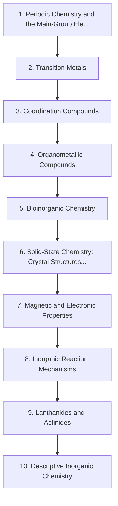

# Level 5 — Inorganic Chemistry

> **Audience:** Undergraduate inorganic chemistry  
> **Chapters:** 10  
> **Estimated study time:** ≈ 80 h  
> **Difficulty:** ★★★☆☆ – ★★★★★

The chemistry of everything that is not primarily carbon: main-group trends, transition-metal coordination and organometallic chemistry, bioinorganic systems, solid-state structures, magnetism and f-block elements.

Inorganic chemistry covers the other ~100 elements. The organising ideas are periodic trends, coordination geometry and electronic structure; once those are secure, descriptive chemistry becomes predictable rather than encyclopaedic.

---

## Chapters

| # | Chapter | Difficulty | Hours | Prerequisites |
|---|---|---|---|---|
| 1 | [Periodic Chemistry and the Main-Group Elements](01-periodic-chemistry-and-main-group-elements.md) | ★★★☆☆ | 8 | Level 1 Ch. 4; Level 2 Ch. 5 |
| 2 | [Transition Metals](02-transition-metals.md) | ★★★★☆ | 8 | Ch. 1; Level 3 Ch. 9 |
| 3 | [Coordination Compounds](03-coordination-compounds.md) | ★★★★☆ | 8 | Level 3 Ch. 9 |
| 4 | [Organometallic Compounds](04-organometallic-compounds.md) | ★★★★★ | 9 | Ch. 2–3; Level 4 Ch. 12 |
| 5 | [Bioinorganic Chemistry](05-bioinorganic-chemistry.md) | ★★★★★ | 7 | Ch. 2–3; Level 8 Ch. 3 |
| 6 | [Solid-State Chemistry: Crystal Structures and Defects](06-solid-state-chemistry-crystal-structures-and-defects.md) | ★★★★★ | 9 | Ch. 1; Level 3 Ch. 4 |
| 7 | [Magnetic and Electronic Properties](07-magnetic-and-electronic-properties.md) | ★★★★★ | 7 | Ch. 2, 6 |
| 8 | [Inorganic Reaction Mechanisms](08-inorganic-reaction-mechanisms.md) | ★★★★★ | 8 | Ch. 3–4 |
| 9 | [Lanthanides and Actinides](09-lanthanides-and-actinides.md) | ★★★★★ | 7 | Ch. 2, 7 |
| 10 | [Descriptive Inorganic Chemistry](10-descriptive-inorganic-chemistry.md) | ★★★☆☆ | 9 | Ch. 1–9 |

---

## Knowledge map

The chain is the *recommended* order. Chapters that share prerequisites can be
read out of order; the table above tells you what each one actually needs.

---

## Study routine for this level

1. Read the chapter once without taking notes, to see the shape of the argument.
2. Re-read with the chapter's learning objectives in front of you and answer them in writing.
3. Reproduce every Mermaid diagram from memory, then check it.
4. Do the exercises **before** opening the solutions file.
5. Record every mistake in a log; re-test yourself on those specific items a week later.

---

## Practice

- Exercise set: [`exercises/level-5-exercises.md`](exercises/level-5-exercises.md)
- Worked solutions: [`solutions/level-5-solutions.md`](solutions/level-5-solutions.md)

---

## Navigation

- Level index: [CURRICULUM.md](../CURRICULUM.md)
- Study methods: [00-learning-guide](../00-learning-guide/learning-path.md)
- Terminology: [GLOSSARY.md](../GLOSSARY.md)
- Sources: [REFERENCES.md](../REFERENCES.md)
