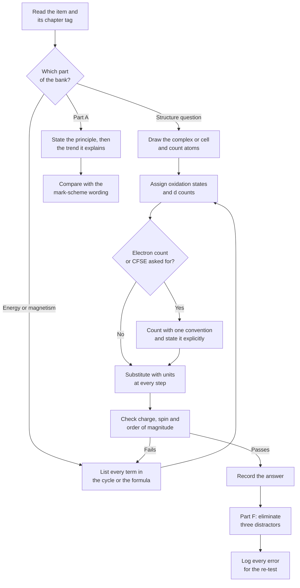

# Level 5 — Exercise Bank: Inorganic Chemistry

> **Level:** Advanced (Level 5 — Inorganic Chemistry)
> **Estimated time:** 240 minutes
> **Items:** 58
> **Covers:** [Ch. 1](../01-periodic-chemistry-and-main-group-elements.md), [Ch. 2](../02-transition-metals.md), [Ch. 3](../03-coordination-compounds.md), [Ch. 4](../04-organometallic-compounds.md), [Ch. 5](../05-bioinorganic-chemistry.md), [Ch. 6](../06-solid-state-chemistry-crystal-structures-and-defects.md), [Ch. 7](../07-magnetic-and-electronic-properties.md), [Ch. 8](../08-inorganic-reaction-mechanisms.md), [Ch. 9](../09-lanthanides-and-actinides.md), [Ch. 10](../10-descriptive-inorganic-chemistry.md)
> **Solutions:** [`../solutions/level-5-solutions.md`](../solutions/level-5-solutions.md)

Every item states the chapter that supplies the method. Numerical answers must be
carried to three significant figures unless the data justify fewer. Electron counts,
oxidation states and CFSE values must be shown in full: a bare number earns no
credit in Part D.

**Figure 1 — Working order for this bank.** The loop on the right is the one that
costs marks: a failed check sends you back to the list of terms, not to the
arithmetic.

---

## Data sheet

| Constant or quantity | Value |
|---|---|
| Avogadro constant, $N_{\text{A}}$ | $6.022\times10^{23}\ \text{mol}^{-1}$ |
| Gas constant, $R$ | $8.314\ \text{J mol}^{-1}\ \text{K}^{-1}$ |
| Faraday constant, $F$ | $96\,485\ \text{C mol}^{-1}$ |
| Bohr magneton, $\mu_{\text{B}}$ | $9.274\times10^{-24}\ \text{A m}^{2}$ |
| Speed of light, $c$ | $2.998\times10^{8}\ \text{m s}^{-1}$ |
| $\ce{Cu}$ $K\alpha$ wavelength | $154.06\ \text{pm}$ |
| $\pi$-electron count of a cyclic system | $4n+2$ aromatic, $4n$ antiaromatic |

| Ion | Six-coordinate ionic radius / pm |
|---|---|
| $\ce{Na+}$ | 102 |
| $\ce{K+}$ | 138 |
| $\ce{Cs+}$ | 167 |
| $\ce{Mg^2+}$ | 72 |
| $\ce{Ca^2+}$ | 100 |
| $\ce{Cl-}$ | 181 |
| $\ce{Br-}$ | 196 |
| $\ce{I-}$ | 220 |
| $\ce{O^2-}$ | 140 |

Standard reduction potentials at 298 K: $\ce{Cu^2+/Cu+}$ $+0.15\ \text{V}$;
$\ce{Cu+/Cu}$ $+0.52\ \text{V}$; $\ce{MnO4-/MnO2}$ $+1.68\ \text{V}$;
$\ce{MnO2/Mn^2+}$ $+1.23\ \text{V}$.

Relative reactivities and ligand-field data are quoted in the individual items where
they are needed.

---

## Part A — Conceptual questions

1. **[Ch. 1]** Sodium and potassium have the same Slater effective nuclear charge on
   their valence $s$ electron (2.20), yet their first ionisation energies are 496 and
   419 kJ mol⁻¹. Explain both the constancy of $Z_{\text{eff}}$ and the fall in
   ionisation energy.

2. **[Ch. 1]** State the inert-pair effect and use it to explain why thallium(I) is
   more stable than thallium(III), whereas aluminium occurs almost exclusively as
   aluminium(III).

3. **[Ch. 2]** Explain why transition metals show variable oxidation states. Explain
   why the maximum oxidation state rises to $+7$ at manganese and then falls.

4. **[Ch. 3]** Distinguish $\Delta_o$ from the spin-pairing energy $P$, and hence
   explain the difference between a high-spin and a low-spin octahedral complex of the
   same $d^n$ configuration.

5. **[Ch. 3]** Explain the chelate effect in thermodynamic terms, using the
   comparison between $\ce{[Ni(en)3]^2+}$ and $\ce{[Ni(NH3)6]^2+}$. State which
   thermodynamic function carries most of the effect.

6. **[Ch. 4]** State the 18-electron rule and its counting conventions. Explain why
   $\ce{[PtCl4]^2-}$ is stable with 16 electrons while $\ce{[Ni(C5H5)2]}$ is unstable
   with 20.

7. **[Ch. 6]** Set out the radius-ratio rules for ionic structures, and give two
   classes of compound in which the rules fail. Explain the origin of the failure in
   each case.

8. **[Ch. 8]** Distinguish the trans influence from the trans effect. Explain how the
   distinction makes the two syntheses of $\ce{[PtCl2(NH3)2]}$ give different
   isomers.

9. **[Ch. 9]** Explain the lanthanide contraction and give three chemical or
   structural consequences that follow from it.

10. **[Ch. 10]** Explain the chemical logic of the Group I–V qualitative analysis
    scheme. In particular, explain why $\ce{H2S}$ precipitates Group II cations but
    not Group IV cations from the same solution.

---

## Part B — Basic problems

11. **[Ch. 1]** Arrange Na, Mg, Al, Si, P, S, Cl and Ar in order of increasing first
    ionisation energy, and identify the two places where the order departs from a
    smooth increase across the period.

12. **[Ch. 2]** Give the valence electron configuration and the number of $d$
    electrons for $\ce{Fe^3+}$, $\ce{Cr^3+}$, $\ce{Cu+}$, $\ce{Mn^2+}$ and $\ce{Co^2+}$.

13. **[Ch. 2]** Assign the oxidation state of the metal in
    $\ce{[Fe(CN)6]^4-}$, $\ce{MnO4^-}$, $\ce{Cr2O7^2-}$, $\ce{[Cu(NH3)4]^2+}$,
    $\ce{Fe(CO)5}$ and $\ce{[Ni(CO)4]}$.

14. **[Ch. 3]** Give the IUPAC name of each compound.
    - (a) $\ce{[Co(NH3)4Cl2]Cl}$
    - (b) $\ce{K3[Fe(CN)6]}$
    - (c) *cis*-$\ce{[Pt(NH3)2Cl2]}$
    - (d) $\ce{[Cr(H2O)6]Cl3}$

15. **[Ch. 3]** Write the formula of each compound.
    - (a) tetraamminecopper(II) sulfate
    - (b) potassium hexachloridoplatinate(IV)
    - (c) tris(ethane-1,2-diamine)cobalt(III) chloride
    - (d) sodium tetrahydroxidozincate(II)

16. **[Ch. 3]** State the number of stereoisomers of each complex and name the type
    of isomerism involved.
    - (a) $\ce{[Co(NH3)4Cl2]+}$
    - (b) $\ce{[Co(en)2Cl2]+}$
    - (c) $\ce{[Co(NH3)3Cl3]}$
    - (d) $\ce{[Pt(NH3)2Cl2]}$

17. **[Ch. 4]** Calculate the valence electron count of
    $\ce{[Ni(CO)4]}$, $\ce{[Fe(CO)5]}$, $\ce{[Cr(CO)6]}$, ferrocene and
    $\ce{[Co(CO)4]-}$, stating the convention used.

18. **[Ch. 4]** Arrange $\ce{CO}$, $\ce{[Cr(CO)6]}$, $\ce{[V(CO)6]-}$ and
    $\ce{[Mn(CO)6]+}$ in order of increasing $\tilde{\nu}(\ce{CO})$, and state the
    electronic reason for the order.

19. **[Ch. 6]** Give the number of formula units per unit cell, $Z$, for the rock
    salt, caesium chloride, zinc blende, fluorite and perovskite structure types.

20. **[Ch. 6]** Use the radius-ratio rules and the data sheet to predict the
    coordination number and structure type of NaCl, KBr, CsI and MgO.

21. **[Ch. 7]** Calculate the spin-only magnetic moment, in Bohr magnetons, of
    high-spin $\ce{Mn^2+}$, $\ce{Fe^3+}$, $\ce{Co^2+}$, $\ce{Ni^2+}$, $\ce{Cu^2+}$ and
    $\ce{Zn^2+}$.

22. **[Ch. 9]** Give the $4f^n$ configuration of $\ce{Ce^4+}$, $\ce{Eu^2+}$,
    $\ce{Tb^4+}$ and $\ce{Yb^2+}$, and state in each case why that oxidation state is
    accessible.

---

## Part C — Intermediate problems

23. **[Ch. 1]** Use Slater's rules to calculate $Z_{\text{eff}}$ for a $3p$ electron
    of the chlorine atom and of the chloride ion. Account for the difference and state
    which species holds its valence electrons more tightly.

24. **[Ch. 2]** Using $E^\circ(\ce{Cu^2+/Cu+}) = +0.15\ \text{V}$ and
    $E^\circ(\ce{Cu+/Cu}) = +0.52\ \text{V}$, show that copper(I) disproportionates in
    aqueous solution. Calculate $E^\circ_{\text{cell}}$, $\Delta G^\circ$ and the
    equilibrium constant.

25. **[Ch. 3]** $\ce{[Fe(H2O)6]^2+}$ is high spin and $\ce{[Fe(CN)6]^4-}$ is low spin.
    For each complex give the $t_{2g}$/$e_g$ occupancy, the number of unpaired
    electrons, the spin-only moment and the CFSE as a multiple of $\Delta_o$. Hence
    calculate the difference in CFSE between the two.

26. **[Ch. 3]** $\ce{[Co(en)2Cl2]+}$ exists as three stereoisomers. Identify them,
    state which are optically active, and explain why the *trans* isomer is achiral.

27. **[Ch. 4]** Calculate the valence electron count of $\ce{[Mn(CO)5]-}$,
    $\ce{[Fe(CO)4]^2-}$, $\ce{[Co(C5H5)2]+}$ and $\ce{[Ni(C5H5)2]}$. Identify which
    complex violates the 18-electron rule and explain what that implies for its
    stability.

28. **[Ch. 4]** The isoelectronic series $\ce{[Ti(CO)6]^2-}$, $\ce{[V(CO)6]-}$,
    $\ce{Cr(CO)6}$ and $\ce{[Mn(CO)6]+}$ has $\tilde{\nu}(\ce{CO})$ values of 1748,
    1860, 2000 and $2090\ \text{cm}^{-1}$. Explain the trend in terms of σ donation,
    π back-donation and the charge on the metal.

29. **[Ch. 5]** Explain why carbon monoxide is toxic, in terms of its binding to
    haemoglobin. Explain the role of the distal histidine in discriminating between
    $\ce{O2}$ and $\ce{CO}$, and why the discrimination is incomplete.

30. **[Ch. 5]** A person has a haemoglobin concentration of $150\ \text{g dm}^{-3}$ of
    blood, and fully saturated haemoglobin binds $1.34\ \text{cm}^{3}$ of $\ce{O2}$ per
    gram at SATP. Calculate the volume of oxygen carried per cubic decimetre of blood
    at full saturation, and express it as an amount in millimoles.

31. **[Ch. 6]** Copper crystallises in a face-centred cubic lattice with
    $a = 361.5\ \text{pm}$. Calculate its density and compare the result with the
    experimental value of $8.96\ \text{g cm}^{-3}$.

32. **[Ch. 6]** For the same copper lattice, calculate the $d$-spacing of the (111)
    planes and the Bragg angle $2\theta$ for the (111) reflection using
    $\ce{Cu}$ $K\alpha$ radiation.

33. **[Ch. 7]** An octahedral complex has a measured magnetic moment of
    $4.90\ \mu_{\text{B}}$. Deduce the number of unpaired electrons and give two
    possible $d^n$ configurations consistent with the value. Explain why a measured
    moment can differ from the spin-only value.

34. **[Ch. 7]** For a paramagnetic salt, $\chi_{\text{m}} = 2.50\times10^{-2}\ \text{cm}^{3}\ \text{mol}^{-1}$ at 200 K and $\chi_{\text{m}} = 1.00\times10^{-2}\ \text{cm}^{3}\ \text{mol}^{-1}$ at 300 K. Assuming Curie–Weiss behaviour,
    calculate $C$, $\theta$ and $\mu_{\text{eff}}$, and state the sign of the dominant
    exchange interaction.

35. **[Ch. 8]** Classify $\ce{[Co(NH3)6]^3+}$, $\ce{[Cr(H2O)6]^3+}$,
    $\ce{[Ni(H2O)6]^2+}$ and $\ce{[Cu(NH3)4]^2+}$ as labile or inert, and justify each
    assignment from the $d$-electron configuration.

36. **[Ch. 9]** Calculate the free-ion magnetic moment of $\ce{Gd^3+}$ from its ground
    term, and show that it coincides with the spin-only value.

---

## Part D — Advanced problems

37. **[Ch. 1]** Construct a Born–Haber cycle for sodium chloride and calculate the
    lattice enthalpy from $\Delta H^{\circ}_{\text{f}} = -411$,
    $\Delta H_{\text{sub}}(\ce{Na}) = +107$, $I_1(\ce{Na}) = +496$,
    $\tfrac12 D(\ce{Cl2}) = +122$ and $\Delta_{\text{ea}}H^{\circ}(\ce{Cl}) = -349$,
    all in kJ mol⁻¹.

38. **[Ch. 2]** For manganese in acid solution,
    $E^\circ(\ce{MnO4-/MnO2}) = +1.68\ \text{V}$ and
    $E^\circ(\ce{MnO2/Mn^2+}) = +1.23\ \text{V}$. Decide whether $\ce{MnO2}$ is
    thermodynamically stable with respect to disproportionation, and calculate
    $E^\circ(\ce{MnO4-/Mn^2+})$.

39. **[Ch. 3]** For $\ce{[Cu(H2O)6]^2+}$ and $\ce{[Cr(H2O)6]^3+}$, give the $d$
    configuration, the CFSE as a multiple of $\Delta_o$, the number of unpaired
    electrons and the spin-only moment. Explain which complex is expected to show a
    strong Jahn–Teller distortion, and why.

40. **[Ch. 4]** Hydroformylation with $\ce{HCo(CO)4}$ proceeds by carbon monoxide
    dissociation, alkene coordination, migratory insertion, carbon monoxide insertion,
    oxidative addition of $\ce{H2}$ and reductive elimination. Give the electron count
    and the cobalt oxidation state at every stage, and explain why carbon monoxide
    must dissociate before the alkene binds.

41. **[Ch. 5]** Haemoglobin has $p_{50} = 26\ \text{mmHg}$ and a Hill coefficient of
    2.8. Calculate the fractional saturation at $p\ce{O2} = 40\ \text{mmHg}$ (tissue)
    and at $p\ce{O2} = 100\ \text{mmHg}$ (lung), and comment on the physiological
    significance of the difference.

42. **[Ch. 6]** A cubic powder pattern recorded with $\ce{Cu}$ $K\alpha$ radiation
    shows the first three reflections at $2\theta = 43.31^\circ$, $50.46^\circ$ and
    $74.12^\circ$. Index the reflections, calculate the cell edge, and state which
    cubic lattice type is consistent with the observed sequence.

43. **[Ch. 7]** Magnetite, $\ce{Fe3O4}$, has the inverse spinel structure with a net
    moment of $4.0\ \mu_{\text{B}}$ per formula unit, $M = 231.5\ \text{g mol}^{-1}$
    and $\rho = 5.17\ \text{g cm}^{-3}$. Calculate the saturation magnetisation in
    $\text{A m}^{-1}$ and explain why the net moment is 4 rather than 14 Bohr magnetons.

44. **[Ch. 8]** For an outer-sphere electron transfer with reorganisation energy
    $\lambda = 80\ \text{kJ mol}^{-1}$, calculate $\Delta G^\ddagger$ for
    $\Delta G^\circ = 0$, $-40$ and $-160\ \text{kJ mol}^{-1}$. Identify the Marcus
    inverted region and explain its physical origin.

45. **[Ch. 9]** Calculate the specific activity of $\ce{^{238}U}$ in
    $\text{Bq g}^{-1}$, given $t_{1/2} = 4.468\times10^{9}$ years. Hence calculate the
    mass of uranium-238 that would give an activity of $1.00\ \text{GBq}$.

46. **[Ch. 10]** A white solid Y gives no flame colour and effervesces with dilute
    hydrochloric acid. The resulting solution gives a white precipitate with aqueous
    ammonia, which dissolves in excess ammonia. With sodium hydroxide it gives a white
    precipitate that dissolves in excess to give a clear solution, and adding solid
    ammonium chloride to that solution reprecipitates the white solid. Identify Y,
    write the equations for each observation, and explain the final test.

---

## Part E — Mechanism and diagram problems

47. **[Ch. 8]** Write the complete $S_N1$CB mechanism for the base hydrolysis of
    $\ce{[Co(NH3)5Cl]^2+}$. Show each electron movement, name every intermediate, and
    state the rate law that the mechanism predicts.

48. **[Ch. 8]** Write the complete inner-sphere mechanism for the reaction between
    $\ce{[Co(NH3)5Cl]^2+}$ and $\ce{[Cr(H2O)6]^2+}$. Identify the bridging ligand, the
    electron transfer step and the reason the bridging ligand ends up on chromium.
    State the observation that established the mechanism.

49. **[Ch. 3]** Describe, step by step with electron movements, the synthesis of
    *cis*-$\ce{[PtCl2(NH3)2]}$ from $\ce{[PtCl4]^2-}$ and ammonia, and the synthesis of
    the *trans* isomer from $\ce{[Pt(NH3)4]^2+}$ and chloride. Explain how the trans
    effect controls the stereochemistry in each case.

50. **[Ch. 5]** Write the complete catalytic cycle of carbonic anhydrase, showing the
    resting state of the zinc centre, the nucleophile, the substrate attack, the
    product release and the regeneration step. State the role of zinc in each stage.

51. **[Ch. 6]** Draw an energy-level (Born–Haber) diagram for the formation of
    $\ce{MgO(s)}$ from its elements, labelling every term, and calculate the lattice
    enthalpy from $\Delta H^{\circ}_{\text{f}} = -602$,
    $\Delta H_{\text{sub}}(\ce{Mg}) = +148$, $I_1 = +738$, $I_2 = +1451$,
    $\tfrac12 D(\ce{O2}) = +249$, $\Delta_{\text{ea}}H^{\circ}(\ce{O}) = -141$ and
    $\Delta_{\text{ea}}H^{\circ}(\ce{O-}) = +798$, all in kJ mol⁻¹.

52. **[Ch. 10]** Devise a flow diagram for separating and identifying $\ce{Ag+}$,
    $\ce{Ba^2+}$ and $\ce{Cu^2+}$ in a single solution. Give the reagent at each stage,
    the observation, and the balanced ionic equation for each precipitation.

---

## Part F — Multiple-choice self-check

53. **[Ch. 2]** The ion with a $d^5$ configuration is:
    - A. $\ce{Fe^2+}$
    - B. $\ce{Mn^2+}$
    - C. $\ce{Cr^3+}$
    - D. $\ce{Cu^2+}$

54. **[Ch. 3]** The CFSE of a high-spin $d^5$ octahedral complex is:
    - A. $-0.4\Delta_o$
    - B. $-2.0\Delta_o$
    - C. $0$
    - D. $-1.2\Delta_o$

55. **[Ch. 4]** The complex that obeys the 18-electron rule is:
    - A. $\ce{[Ni(C5H5)2]}$
    - B. $\ce{[PtCl4]^2-}$
    - C. $\ce{[Fe(CO)5]}$
    - D. $\ce{[TiCl4]}$

56. **[Ch. 6]** The number of formula units in the rock-salt unit cell is:
    - A. 1
    - B. 2
    - C. 4
    - D. 8

57. **[Ch. 7]** The spin-only magnetic moment of high-spin $\ce{Fe^3+}$ is:
    - A. $1.73\ \mu_{\text{B}}$
    - B. $2.83\ \mu_{\text{B}}$
    - C. $3.87\ \mu_{\text{B}}$
    - D. $5.92\ \mu_{\text{B}}$

58. **[Ch. 8]** The base hydrolysis of $\ce{[Co(NH3)5Cl]^2+}$ is second order overall
    because:
    - A. the mechanism is associative
    - B. the conjugate base forms before the rate-determining step
    - C. chloride is a good leaving group
    - D. water is the nucleophile

---

## Marks

| Part | Type | Items | Marks per item | Total |
|---|---|---|---|---|
| A | Conceptual | 10 | 2 | 20 |
| B | Basic problems | 12 | 3 | 36 |
| C | Intermediate problems | 14 | 5 | 70 |
| D | Advanced problems | 10 | 8 | 80 |
| E | Mechanism and diagram problems | 6 | 10 | 60 |
| F | Multiple-choice | 6 | 2 | 12 |
| **Total** | | **58** | | **278** |

**Total marks: 278**

**Solutions:** [`../solutions/level-5-solutions.md`](../solutions/level-5-solutions.md)
