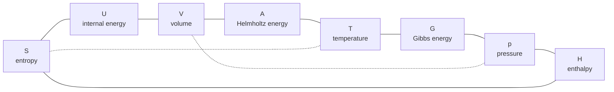
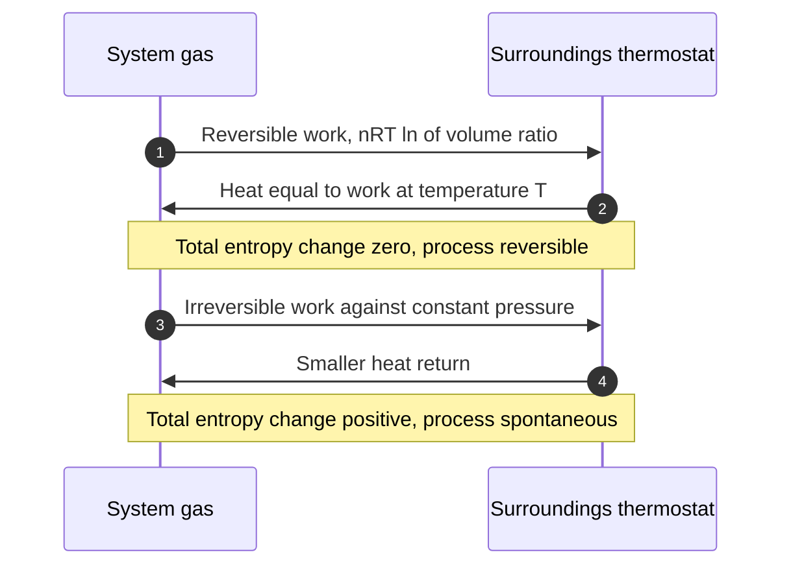
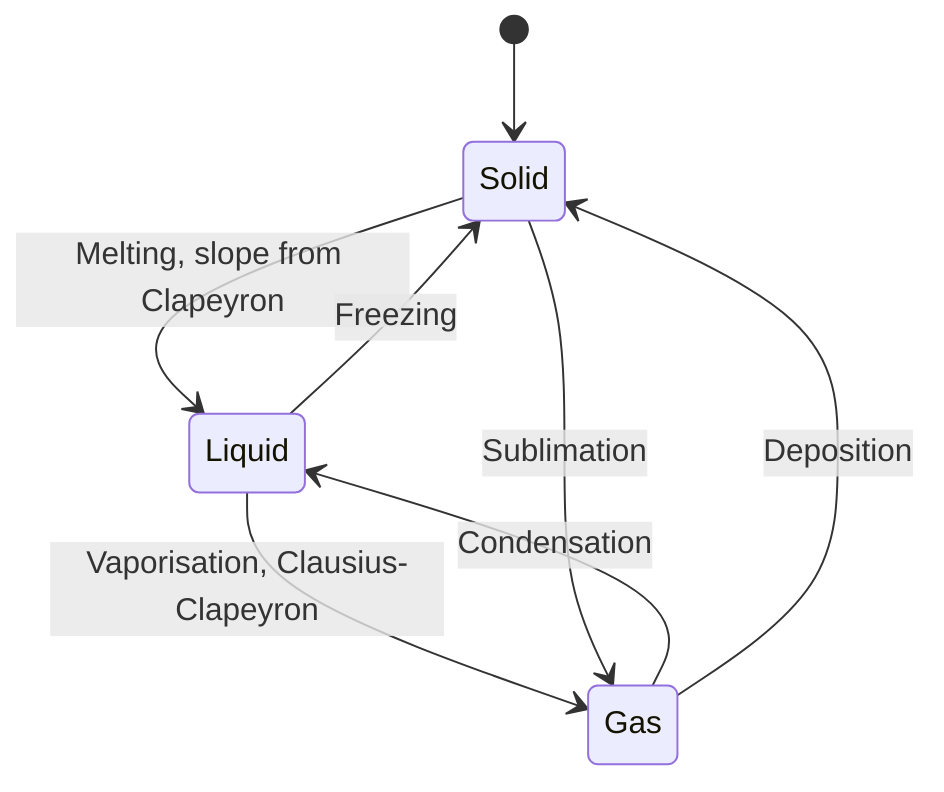
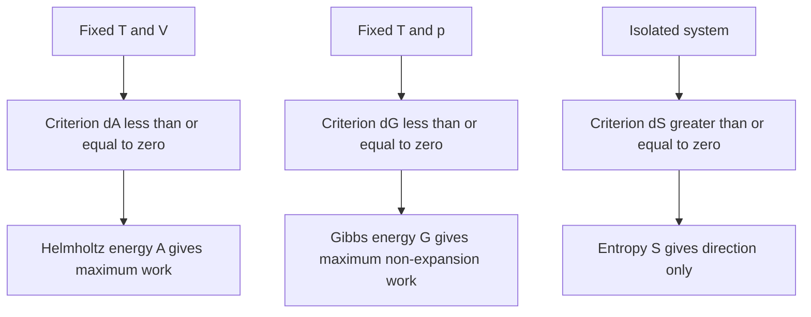

# Chapter 1 — Classical Thermodynamics

> **Level:** Advanced (Level 6 — Physical Chemistry)
> **Estimated study time:** 11 hours (8 h reading + 3 h exercises)
> **Prerequisites:** [Chemical Thermodynamics: Entropy and Gibbs Energy](../04-advanced-chemistry/04-chemical-thermodynamics.md); multivariable calculus (partial derivatives, exact differentials, line integrals)
> **Difficulty:** ★★★★★ (5/5)
> **Related chapters:** [Statistical Thermodynamics and Statistical Mechanics](02-statistical-thermodynamics-and-statistical-mechanics.md), [Chemical Kinetics and Reaction Dynamics](05-chemical-kinetics-and-reaction-dynamics.md), [Electrochemical Thermodynamics](08-electrochemical-thermodynamics.md)

---

## 1. Learning Objectives

After working through this chapter you will be able to:

- State the four laws precisely, and identify the physical content each one adds.
- Test a differential for exactness with the Euler reciprocity condition and explain
  why exactness is the mathematical signature of a state function.
- Derive $\mathrm{d}U = T\,\mathrm{d}S - p\,\mathrm{d}V$ and generate every other
  potential from it by Legendre transformation.
- Compute $q$, $w$, $\Delta U$, $\Delta H$ and $\Delta S$ for reversible and
  irreversible isothermal and adiabatic processes in an ideal gas.
- Derive $C_p - C_V = nR$ for an ideal gas and state the assumptions required.
- Apply Kirchhoff's law to transport a reaction enthalpy between temperatures.
- Reproduce the four Maxwell relations from the thermodynamic square without
  memorising them separately.
- Define chemical potential, derive the Gibbs–Duhem equation and use it to explain
  why solute and solvent chemical potentials cannot vary independently.
- Derive the Clapeyron and Clausius–Clapeyron equations and integrate the latter.
- Derive the colligative laws from the chemical potential of the solvent.

---

## 2. Introduction

Thermodynamics began as the science of engines and became the grammar of chemistry.
Its four laws fit on an index card, yet from them follow the direction of every
spontaneous change, the maximum work a fuel can deliver, the temperature at which a
solid melts, the vapour pressure above a solution and the equilibrium constant of any
reaction.

The subject is unusual in being *deductive*. Nothing in the second law tells you the
heat capacity of iron; instead, if you measure the heat capacity the entropy is fixed, if
you measure the entropy the vapour pressure follows, and if you measure the vapour
pressure at two temperatures the enthalpy of vaporisation is determined. Each measurable
quantity constrains the others, and the constraints are exact identities.

That structure has two prices. The identities hold only at equilibrium and say nothing
about rates: diamond is unstable with respect to graphite by about
$2.9\ \text{kJ mol}^{-1}$ at room temperature, yet the conversion is immeasurably slow.
Rates are the business of [Chapter 5](05-chemical-kinetics-and-reaction-dynamics.md).
Second, classical thermodynamics never mentions molecules; it accepts heat capacities
as measured inputs. Why $C_V$ of a diatomic gas is $\tfrac{5}{2}R$ at ordinary
temperature is the subject of
[Chapter 2](02-statistical-thermodynamics-and-statistical-mechanics.md).

This chapter states the laws with the qualifiers that make them true, derives the
network of relations that makes them useful, and applies the network to phase and
solution behaviour. Where a result depends on an assumption, the assumption is stated
at the point of use.

---

## 3. Fundamental Concepts

### 3.1 System, surroundings and boundary

The **system** is the part of the universe under study, the **surroundings** everything
else, and the **boundary** separates them. The boundary's properties decide which
quantities may cross and therefore which variables are free.

| Boundary type | Permits | Consequence |
|---|---|---|
| Diathermic | Heat | Thermal equilibrium attainable; $T$ equalises |
| Adiabatic | No heat | $q = 0$ by construction |
| Rigid | No expansion work | $\mathrm{d}V = 0$, $w_{pV} = 0$ |
| Movable | Expansion work | $p$ equalises if motion is free |
| Permeable | Matter | Composition changes; $n_i$ variable |
| Semi-permeable | One component only | Basis of osmotic pressure |

A **closed** system exchanges energy but not matter, an **open** system exchanges both
and an **isolated** system exchanges neither. The isolated system is an idealisation but
the cleanest setting for the second law. The **state** is fixed by a set of variables
sufficient to determine every other property; for a fixed amount of a pure substance two
intensive variables suffice, for example $(T, p)$.

### 3.2 The four laws

**Zeroth law.** If A is in thermal equilibrium with B and B with C, then A is in
thermal equilibrium with C. The content is not transitivity as such but the existence of
a state function, **temperature**, taking the same value in all three systems; without
it there is no thermometer.

**First law.** For a closed system at rest in a uniform external field,

$$
\Delta U = q + w ,
$$

with $q$ the heat supplied *to* the system and $w$ the work done *on* it; in
differential form $\mathrm{d}U = \delta q + \delta w$. The law is energy conservation
with a sign convention. It forbids perpetual motion of the first kind but places no
restriction on direction: a stone rolling uphill conserves energy.

**Second law.** Three equivalent statements are in use. *Clausius*: no process is
possible whose sole result is the transfer of heat from a colder to a hotter body.
*Kelvin–Planck*: no process is possible whose sole result is the absorption of heat
from a single reservoir and its complete conversion into work. *Entropy*: for any
process in an isolated system $\Delta S \ge 0$, with equality only for a reversible
process. Equivalence is proved by showing that a violation of any one implies a
violation of the others.

**Third law.** The entropy change of any isothermal process in a pure condensed phase
tends to zero as $T \to 0$ (Nernst heat theorem); equivalently, the entropy of a
perfect crystal at $T = 0$ is zero (Planck). The Nernst form is experimentally
motivated and admits glassy exceptions; the Planck form is a definition that makes
absolute entropies possible. Section 4.5 develops the distinction.

### 3.3 State functions and exact differentials

A **state function** depends only on the current state, not on the path by which that
state was reached. $U$, $H$, $S$, $A$, $G$, $T$, $p$ and $V$ are state functions; $q$
and $w$ are not. The mathematical signature is **exactness**. If

$$
\mathrm{d}z = M(x, y)\,\mathrm{d}x + N(x, y)\,\mathrm{d}y ,
$$

then $\mathrm{d}z$ is exact if and only if

$$
\left(\frac{\partial M}{\partial y}\right)_{x}
= \left(\frac{\partial N}{\partial x}\right)_{y} ,
$$

the Euler reciprocity condition, which holds because mixed second partial derivatives
commute. Three consequences follow: $\int_A^B \mathrm{d}z = z(B) - z(A)$ depends only
on the endpoints; $\oint \mathrm{d}z = 0$; and for an inexact differential, written
$\delta q$, no function $q$ exists, so "the heat of the system" is meaningless — only
heat *transferred* has a value.

The test is also a tool. Applied to $\mathrm{d}U = T\,\mathrm{d}S - p\,\mathrm{d}V$ it
gives $(\partial T/\partial V)_S = -(\partial p/\partial S)_V$, one of the four
Maxwell relations.

### 3.4 The fundamental thermodynamic relation

For a reversible change of a closed system, $\delta q_\text{rev} = T\,\mathrm{d}S$ and
$\delta w_\text{rev} = -p\,\mathrm{d}V$, so

$$
\mathrm{d}U = T\,\mathrm{d}S - p\,\mathrm{d}V .
$$

Although derived for a reversible path, this is an identity between state functions
and therefore holds for any infinitesimal change between equilibrium states. It shows
that the natural variables of $U$ are $S$ and $V$: if $U(S,V)$ is known, every other
property follows by differentiation, $T = (\partial U/\partial S)_V$ and
$p = -(\partial U/\partial V)_S$. A function carrying the complete thermodynamic
information is a **fundamental equation**. For an open system,

$$
\mathrm{d}U = T\,\mathrm{d}S - p\,\mathrm{d}V + \sum_i \mu_i\,\mathrm{d}n_i .
$$

---

## 4. Detailed Scientific Explanation

### 4.1 Isothermal and adiabatic expansions of an ideal gas

An **ideal gas** obeys $pV = nRT$, has $U = U(T)$ and has $C_V$ independent of volume.
The second and third statements are linked: the thermodynamic equation of state
$(\partial U/\partial V)_T = T(\partial p/\partial T)_V - p$ vanishes identically for
$p = nRT/V$.

**Isothermal reversible expansion.** $T$ constant, so $\Delta U = 0$ and $q = -w$:

$$
w_\text{rev} = -\int_{V_i}^{V_f}\frac{nRT}{V}\,\mathrm{d}V
= -nRT\ln\frac{V_f}{V_i}, \qquad
q_\text{rev} = +nRT\ln\frac{V_f}{V_i}.
$$

**Isothermal irreversible expansion** against a constant external pressure:

$$
w_\text{irr} = -p_\text{ext}(V_f - V_i).
$$

The subscript matters: work is done against the *external* pressure, which equals the
system pressure only when the path is reversible.

For expansion into a vacuum $p_\text{ext} = 0$ and $w = 0$. The state change is the
same, so $\Delta U$ and $\Delta S$ are identical, but $q_\text{irr} < q_\text{rev}$;
the entropy increase of the surroundings is therefore smaller and
$\Delta S_\text{univ} > 0$. Worked Example 8.1 computes the numbers.

**Adiabatic reversible expansion.** $q = 0$, so $\mathrm{d}U = \delta w$ and
$nC_V\,\mathrm{d}T = -p\,\mathrm{d}V$. Eliminating $p$,

$$
\frac{\mathrm{d}T}{T} = -\frac{R}{C_V}\frac{\mathrm{d}V}{V}
= -(\gamma - 1)\frac{\mathrm{d}V}{V},
$$

using $C_p - C_V = nR$ so that $R/C_V = \gamma - 1$. Integration gives Poisson's
equations:

$$
T V^{\gamma-1} = \text{constant}, \qquad
p V^{\gamma} = \text{constant}, \qquad
T^{\gamma} p^{1-\gamma} = \text{constant}.
$$

These hold for a reversible adiabatic change of an ideal gas with constant heat
capacity. They fail for real gases, for temperature-dependent $C_V$, and above all for
*irreversible* adiabatic processes, where the relation between $T$ and $V$ is set by
the work actually done. An adiabatic free expansion into a vacuum has $q = w = 0$,
hence $\Delta T = 0$, and no Poisson equation applies.

### 4.2 Enthalpy and heat capacities

Most chemistry happens at constant pressure, where the heat exchanged is not
$\Delta U$. Define $H \equiv U + pV$. For a change at constant $p_\text{ext} = p$,

$$
\Delta H = \Delta U + p\Delta V = (q_p + w) + p\Delta V = q_p ,
$$

so the **enthalpy** change equals the heat at constant pressure, exactly when the only
work is $pV$ work. The heat capacities follow:

$$
C_V = \left(\frac{\partial U}{\partial T}\right)_{V}, \qquad
C_p = \left(\frac{\partial H}{\partial T}\right)_{p}.
$$

**Derivation 4.1 — $C_p - C_V = nR$ for an ideal gas.** Differentiate $H = U + pV$
with respect to $T$ at constant $p$:

$$
\left(\frac{\partial H}{\partial T}\right)_{p}
= \left(\frac{\partial U}{\partial T}\right)_{p}
+ p\left(\frac{\partial V}{\partial T}\right)_{p}.
$$

The first term on the right is at constant $p$, not constant $V$. Writing $U = U(T,V)$
and using the chain rule,

$$
\left(\frac{\partial U}{\partial T}\right)_{p}
= \left(\frac{\partial U}{\partial T}\right)_{V}
+ \left(\frac{\partial U}{\partial V}\right)_{T}
\left(\frac{\partial V}{\partial T}\right)_{p},
$$

and $(\partial U/\partial V)_T = 0$ for an ideal gas, so

$$
C_p = C_V + p\left(\frac{\partial V}{\partial T}\right)_{p}
= C_V + p\,\frac{nR}{p} = C_V + nR . \qquad \square
$$

Three assumptions are embedded: the gas is ideal, the amount is fixed and only $pV$
work is possible. For a general system

$$
C_p - C_V = \left[p + \left(\frac{\partial U}{\partial V}\right)_{T}\right]
\left(\frac{\partial V}{\partial T}\right)_{p}
= T\left(\frac{\partial p}{\partial T}\right)_{V}
\left(\frac{\partial V}{\partial T}\right)_{p},
$$

which reduces to $nR$ only for an ideal gas. For liquid water at 298 K the difference is
about $0.002\ \text{J K}^{-1}\text{mol}^{-1}$, four orders of magnitude below $R$, because
the liquid is nearly incompressible. The ratio $\gamma = C_p/C_V$ is measured through the
speed of sound, $c = \sqrt{\gamma RT/M}$.

### 4.3 Thermochemistry and Kirchhoff's law

**Hess's law.** Because $H$ is a state function, the enthalpy change of a reaction is
the sum of the enthalpy changes of any sequence of steps joining the same initial and
final states. This is exactness applied to $H$, and it is why formation enthalpies can
be tabulated once and combined indefinitely.

**Standard states.** The standard enthalpy of formation $\Delta_f H^\circ$ refers to the
formation of one mole of a substance from its elements in their standard states at the
stated temperature and $p^\circ = 1$ bar — graphite for carbon, white phosphorus for
phosphorus, liquid bromine. Values for elements in their standard states are zero by
definition, not by measurement.

**Kirchhoff's law.** Differentiate $\Delta_r H^\circ$ with respect to temperature:

$$
\frac{\mathrm{d}(\Delta_r H^\circ)}{\mathrm{d}T}
= \sum_\text{products}\nu_i C_{p,i}^\circ
- \sum_\text{reactants}\nu_i C_{p,i}^\circ
\equiv \Delta_r C_p^\circ ,
$$

so that

$$
\Delta_r H^\circ(T_2) = \Delta_r H^\circ(T_1)
+ \int_{T_1}^{T_2}\Delta_r C_p^\circ\,\mathrm{d}T .
$$

If $\Delta_r C_p^\circ$ is constant the integral is
$\Delta_r C_p^\circ(T_2 - T_1)$; if $C_{p,\text{m}} = a + bT + cT^2$ the integration
is term by term. The correction is not cosmetic: a reaction with
$\Delta_r C_p^\circ = 100\ \text{J K}^{-1}\text{mol}^{-1}$ over 500 K shifts
$\Delta_r H^\circ$ by $50\ \text{kJ mol}^{-1}$, comparable to a bond energy. At a phase
transition $C_p$ is effectively infinite and the latent heat must be inserted
separately:

$$
H(T) = H(0) + \int_0^T C_p\,\mathrm{d}T
+ \sum_\text{transitions}\Delta H_\text{trs} .
$$

### 4.4 Entropy and the Clausius inequality

For a Carnot cycle $q_h/T_h = q_c/T_c$, so $\sum q_\text{rev}/T = 0$ around the cycle.
Splitting any reversible cycle into infinitesimal steps gives
$\oint \delta q_\text{rev}/T = 0$, so $\delta q_\text{rev}/T$ is the exact differential
of a state function:

$$
\mathrm{d}S \equiv \frac{\delta q_\text{rev}}{T}, \qquad
\Delta S = \int_i^f \frac{\delta q_\text{rev}}{T} .
$$

**Derivation 4.2 — the Clausius inequality.** Let a system traverse an arbitrary path
from $i$ to $f$ while exchanging heat with a reservoir at $T_\text{res}$, and return
reversibly to $i$ in contact with the same reservoir. Kelvin's statement forbids net
work from a single reservoir, so for the composite cycle
$\oint \delta q/T_\text{res} \le 0$. Splitting,

$$
\int_i^f \frac{\delta q}{T_\text{res}}
+ \int_f^i \frac{\delta q_\text{rev}}{T_\text{res}} \le 0 .
$$

The second integral is $-\Delta S$ because the return path is reversible and
$T = T_\text{res}$ there. Hence $\int_i^f \delta q/T_\text{res} \le \Delta S$, or
$\mathrm{d}S \ge \delta q/T_\text{res}$. $\square$

For an isolated system $\delta q = 0$ and $\mathrm{d}S \ge 0$. For system plus
surroundings, treated as isolated,

$$
\Delta S_\text{univ} = \Delta S_\text{sys} + \Delta S_\text{surr} \ge 0 ,
$$

with equality only for a reversible process. Every other criterion —
$\Delta G < 0$ at constant $T, p$, $\Delta A < 0$ at constant $T, V$ — is a
specialisation of this one. Two cautions: $\Delta S_\text{sys}$ can be evaluated along
any reversible path joining the same endpoints, however violent the actual process;
and $\Delta S_\text{surr} = -q_\text{sys}/T_\text{surr}$ only when the surroundings
stay at a uniform temperature.

### 4.5 The third law and absolute entropies

Since $\mathrm{d}S = C_p\,\mathrm{d}T/T$ at constant pressure,

$$
S^\circ(T) = S^\circ(0) + \int_0^T \frac{C_p^\circ}{T}\,\mathrm{d}T
+ \sum_\text{transitions}\frac{\Delta H_\text{trs}}{T_\text{trs}} .
$$

The third law supplies $S(0) = 0$ for a perfect crystal, so the **standard molar
entropy** is absolute. This is why tabulated entropies of elements are not zero, and
why $\Delta_r S^\circ = \sum\nu_i S^\circ_{\text{m},i}$ needs no convention for
elements. The **Nernst heat theorem** — $\Delta S \to 0$ as $T \to 0$ between
condensed phases in internal equilibrium — is the experimentally supported version,
and it requires $C_p \to 0$ so that the integral converges; a finite $C_p(0)$ would
make it diverge logarithmically.

### 4.6 Helmholtz and Gibbs energies, Maxwell relations and the square

The natural variables of $U$ are inconvenient, so Legendre transformation replaces one
variable by its conjugate without losing information.

**Derivation 4.3 — the four potentials.** Define $H = U + pV$, $A = U - TS$ and
$G = H - TS$. Differentiating and substituting
$\mathrm{d}U = T\,\mathrm{d}S - p\,\mathrm{d}V$:

$$
\begin{aligned}
\mathrm{d}H &= T\,\mathrm{d}S + V\,\mathrm{d}p, \\
\mathrm{d}A &= -S\,\mathrm{d}T - p\,\mathrm{d}V, \\
\mathrm{d}G &= -S\,\mathrm{d}T + V\,\mathrm{d}p .
\end{aligned}
$$

Each is exact, so each yields a Maxwell relation by the Euler test. From
$\mathrm{d}G$: $(\partial S/\partial p)_T = -(\partial V/\partial T)_p$. From
$\mathrm{d}A$: $(\partial S/\partial V)_T = (\partial p/\partial T)_V$. From
$\mathrm{d}H$: $(\partial T/\partial p)_S = (\partial V/\partial S)_p$. From
$\mathrm{d}U$: $(\partial T/\partial V)_S = -(\partial p/\partial S)_V$. $\square$

The four relations are one fact applied four times. The first converts the pressure
dependence of entropy into a measurable expansion coefficient; the second underlies the
thermodynamic equation of state
$(\partial U/\partial V)_T = T(\partial p/\partial T)_V - p$, which measures the deviation
of a real gas from ideality.

**The thermodynamic square** places $S$, $V$, $T$ and $p$ at the corners and the
potentials on the edges: $U$ between $S$ and $V$, $H$ between $S$ and $p$, $A$ between
$T$ and $V$, $G$ between $T$ and $p$. The natural variables of a potential are its two
adjacent corners; conjugates sit at opposite corners. Figure 1.1 shows the layout and
Section 5 explains how to read a derivative from it.

### 4.7 Chemical potential and the Gibbs–Duhem equation

For an open system,

$$
\mathrm{d}G = -S\,\mathrm{d}T + V\,\mathrm{d}p + \sum_i \mu_i\,\mathrm{d}n_i, \qquad
\mu_i \equiv \left(\frac{\partial G}{\partial n_i}\right)_{T,p,n_{j\ne i}} .
$$

The **chemical potential** is the change in Gibbs energy when one mole of $i$ is added
to a system so large that the composition is unchanged. It is the driving force for
matter, exactly as $T$ drives heat and electric potential drives charge: matter flows
from high to low $\mu$.

Because $G$ is extensive, Euler's theorem gives $G = \sum_i \mu_i n_i$. Differentiating
and comparing with the expression above yields the **Gibbs–Duhem equation**:

$$
S\,\mathrm{d}T - V\,\mathrm{d}p + \sum_i n_i\,\mathrm{d}\mu_i = 0 ,
\qquad\text{so at constant } T, p: \quad \sum_i n_i\,\mathrm{d}\mu_i = 0 .
$$

For a binary mixture $n_A\,\mathrm{d}\mu_A + n_B\,\mathrm{d}\mu_B = 0$: the chemical
potentials cannot vary independently. This one constraint is why colligative properties
depend on the number of solute particles rather than their identity, and why Raoult's
and Henry's laws are thermodynamically linked rather than independent empirical rules.

### 4.8 Phase equilibria: Clapeyron, Clausius–Clapeyron and the phase rule

At equilibrium $\mu^\alpha = \mu^\beta$, and along the coexistence curve
$\mathrm{d}\mu^\alpha = \mathrm{d}\mu^\beta$.

**Derivation 4.4 — the Clapeyron equation.** With
$\mathrm{d}\mu = -S_\text{m}\,\mathrm{d}T + V_\text{m}\,\mathrm{d}p$ in each phase,

$$
-S_\text{m}^\alpha\,\mathrm{d}T + V_\text{m}^\alpha\,\mathrm{d}p
= -S_\text{m}^\beta\,\mathrm{d}T + V_\text{m}^\beta\,\mathrm{d}p
\quad\Longrightarrow\quad
\frac{\mathrm{d}p}{\mathrm{d}T}
= \frac{\Delta_\text{trs}S}{\Delta_\text{trs}V}
= \frac{\Delta_\text{trs}H}{T\,\Delta_\text{trs}V} .
$$

$\square$

**Clausius–Clapeyron.** For vapour–condensed equilibrium
$V_\text{m}^\text{gas} \gg V_\text{m}^\text{condensed}$, and with an ideal vapour
$V_\text{m}^\text{gas} = RT/p$:

$$
\frac{\mathrm{d}\ln p}{\mathrm{d}T} = \frac{\Delta_\text{vap}H}{RT^2},
\qquad
\ln\frac{p_2}{p_1} = -\frac{\Delta_\text{vap}H}{R}
\left(\frac{1}{T_2} - \frac{1}{T_1}\right).
$$

Two approximations are made: ideal vapour and negligible condensed volume. Both fail
near the critical point, and the integrated form fails where $\Delta_\text{vap}H$ varies
appreciably — for water between 273 K and 373 K it falls from 45.1 to
$40.7\ \text{kJ mol}^{-1}$, an 11 % change. The differential form remains accurate.

**Phase rule.** For $C$ components and $P$ phases,

$$
F = C - P + 2 ,
$$

obtained by counting $P(C-1) + 2$ intensive variables and subtracting $C(P-1)$
equality-of-chemical-potential constraints. For one component, $P = 1$ gives $F = 2$
(a region), $P = 2$ gives $F = 1$ (a curve) and $P = 3$ gives $F = 0$ (the triple
point). When one intensive variable is fixed externally, as in a study at 1 bar, the
reduced form $F = C - P + 1$ applies.

### 4.9 Solutions, activities and colligative properties

**Raoult's law** states that the partial vapour pressure of a component of an ideal
solution is proportional to its mole fraction, $p_A = x_A p_A^*$, where $p_A^*$ is the
vapour pressure of pure $A$. An **ideal solution** obeys this over the whole range,
which requires similar molecular sizes and similar intermolecular forces, so that
$\Delta_\text{mix}H = 0$ and $\Delta_\text{mix}S = -R\sum n_i\ln x_i$.

**Henry's law** describes the dilute solute, $p_B = K_H x_B$, with $K_H$ an empirical
constant that is *not* $p_B^*$. Raoult's law is the solvent's law and Henry's law the
solute's; each holds in its own limit, and the Gibbs–Duhem equation links them.

Real solutions replace mole fraction by **activity**:

$$
\mu_i = \mu_i^\circ + RT\ln a_i, \qquad a_i = \gamma_i x_i ,
$$

with $\gamma_i$ the **activity coefficient**, normalised to $\gamma_i \to 1$ as
$x_i \to 1$ (Raoult standard state) or as $x_i \to 0$ (Henry standard state, used for
solutes). Activities are the effective concentrations, and every ideal formula survives
with $x$ replaced by $a$. For electrolytes, single-ion activities are unmeasurable and
the mean ionic activity coefficient $\gamma_\pm$ is used instead.

**Derivation 4.5 — freezing-point depression.** At the freezing point, pure solid
solvent is in equilibrium with the solvent in the mixture:

$$
\mu_A^*(s) = \mu_A^*(l) + RT\ln x_A
\quad\Longrightarrow\quad
\ln x_A = -\frac{\Delta_\text{fus}G}{RT},
$$

where $\Delta_\text{fus}G = \mu_A^*(l) - \mu_A^*(s)$. Differentiating with respect to
$T$ and using $\mathrm{d}(\Delta G/T)/\mathrm{d}T = -\Delta H/T^2$,

$$
\frac{\mathrm{d}\ln x_A}{\mathrm{d}T} = \frac{\Delta_\text{fus}H}{RT^2}.
$$

Integrating from $T^*$, where $x_A = 1$,

$$
\ln x_A = -\frac{\Delta_\text{fus}H}{R}\left(\frac{1}{T} - \frac{1}{T^*}\right)
\approx -\frac{\Delta_\text{fus}H}{R}\frac{\Delta T}{T^{*2}} .
$$

For a dilute solution $\ln x_A \approx -x_B \approx -n_B/n_A$ and
$n_B/n_A = M_A b/1000$, with $b$ the molality in mol kg⁻¹ and $M_A$ in g mol⁻¹. Hence

$$
\Delta T = K_f b, \qquad K_f = \frac{R T^{*2} M_A}{1000\,\Delta_\text{fus}H},
$$

which for water gives $K_f = 1.86\ \text{K kg mol}^{-1}$. $\square$

The same construction with $\Delta_\text{vap}H$ gives boiling-point elevation. For
osmosis, pressure on the solution side raises the solvent chemical potential by
$V_{\text{m},A}\Pi$, so $RT\ln x_A + V_{\text{m},A}\Pi = 0$ and

$$
\Pi = -\frac{RT\ln x_A}{V_{\text{m},A}} \approx \frac{n_B RT}{V} = [B]RT ,
$$

the van 't Hoff equation. All four colligative properties share one origin — the
lowering of the solvent chemical potential — and all four fail for concentrated or
dissociating solutes, where activities replace mole fractions and the van 't Hoff
factor $i$ appears.

### 4.10 The lever rule

In a two-phase region the compositions of the coexisting phases are fixed by the phase
boundaries but the amounts are not. Conservation of matter for overall composition $z$
between $x_\text{L}$ and $x_\text{S}$ gives

$$
n_\text{L}x_\text{L} + n_\text{S}x_\text{S} = (n_\text{L} + n_\text{S})z
\quad\Longrightarrow\quad
\frac{n_\text{L}}{n_\text{S}} = \frac{x_\text{S} - z}{z - x_\text{L}} .
$$

The amount of each phase is proportional to the length of the opposite arm of the tie
line, with the overall composition as the fulcrum. An overall composition near a
boundary means that phase predominates; at the eutectic composition the arms are equal
and the phases form in equal amounts.

---

## 5. Visual Diagrams

**Figure 1.1 — The thermodynamic square.** Each edge carries a potential whose natural
variables sit at its ends: $U(S,V)$, $H(S,p)$, $A(T,V)$, $G(T,p)$; the dashed diagonals
join conjugate pairs $(S,T)$ and $(V,p)$. Reading an edge from the potential to the
variable of differentiation gives $\mathrm{d}G = -S\,\mathrm{d}T + V\,\mathrm{d}p$ and,
by the same route, all four Maxwell relations.

**Figure 1.2 — Energy bookkeeping in reversible and irreversible isothermal
expansion.** The reversible path extracts maximal work and returns an equal quantity of
heat, producing no entropy; the irreversible path extracts less work, returns less heat
and generates the difference as entropy in the surroundings. The state functions are
identical for both paths.

**Figure 1.3 — Phase transitions of a pure substance as a state machine.** Each arrow
is a coexistence curve in the $p$–$T$ plane whose slope is fixed by the Clapeyron
equation. A transition and its reverse share one curve and one latent heat; the triple
point is the state where three arrows meet and $F = 0$.

**Figure 1.4 — Choosing the spontaneity criterion.** The controlled variables select
the potential whose decrease measures the available work. Using $\Delta G < 0$ for a
constant-volume bomb calorimeter is the commonest category error in the subject.

---

## 6. Mathematical Formulas

$$
\mathrm{d}U = T\,\mathrm{d}S - p\,\mathrm{d}V, \qquad
\mathrm{d}G = -S\,\mathrm{d}T + V\,\mathrm{d}p, \qquad
C_p - C_V = nR, \qquad
\frac{\mathrm{d}\ln p}{\mathrm{d}T} = \frac{\Delta_\text{vap}H}{RT^2}.
$$

| Symbol | Meaning | SI unit |
|---|---|---|
| $U$, $H$, $A$, $G$ | internal energy, enthalpy, Helmholtz energy, Gibbs energy | J |
| $S$ | entropy | J K⁻¹ |
| $T$ | thermodynamic temperature | K |
| $p$, $V$ | pressure, volume | Pa, m³ |
| $C_p$, $C_V$ | heat capacities at constant $p$ and $V$ | J K⁻¹ |
| $\mu_i$ | chemical potential of $i$ | J mol⁻¹ |
| $a_i$, $\gamma_i$ | activity, activity coefficient | dimensionless |
| $K_f$ | cryoscopic constant | K kg mol⁻¹ |
| $\Pi$ | osmotic pressure | Pa |
| $F$, $C$, $P$ | degrees of freedom, components, phases | dimensionless |

Assumptions: closed system at equilibrium with only $pV$ work for the fundamental
relation; $pV = nRT$ and $U = U(T)$ for the ideal-gas results; ideal vapour and
$V_\text{m}^\text{gas} \gg V_\text{m}^\text{condensed}$ for Clausius–Clapeyron; ideal
dilute solution and non-dissociating solute for the colligative laws.

---

## 7. Chemical Equations

Hess's law in practice: the combustion enthalpy of methane follows either from
calorimetry or from formation enthalpies, $\Delta_\mathrm{r}H^\circ = \sum \nu_i \Delta_\mathrm{f}H^\circ_i$,
and Kirchhoff's law then transports it to another temperature.

$$
\ce{CH4(g) + 2O2(g) -> CO2(g) + 2H2O(l)} \qquad
\Delta_\mathrm{r}H^\circ_{298} = -890.3\ \text{kJ mol}^{-1}
$$

Reversible phase transitions carry latent heats and define the coexistence curves,
and dissolution of a non-volatile solute is the chemical origin of every colligative
property:

$$
\ce{H2O(s) <=> H2O(l)} \quad \Delta_\mathrm{fus}H = +6.01\ \text{kJ mol}^{-1},
\qquad
\ce{H2O(l) <=> H2O(g)} \quad \Delta_\mathrm{vap}H = +40.7\ \text{kJ mol}^{-1}
$$

## 8. Worked Examples

### Worked Example 8.1 — Reversible versus irreversible isothermal expansion

**Problem.** One mole of ideal gas at 300 K expands from 10.0 L to 20.0 L (a)
reversibly and isothermally, (b) irreversibly against a constant external pressure
equal to the final pressure. Find $q$, $w$, $\Delta U$, $\Delta S_\text{sys}$,
$\Delta S_\text{surr}$ and $\Delta S_\text{univ}$.

**Strategy.** $\Delta U = 0$ for both paths because $T$ is constant. Compute $w$ from
the path, take $q = -w$, and use $\Delta S_\text{sys} = nR\ln(V_f/V_i)$, identical for
both because entropy is a state function.

**Solution.** (a) $w = -nRT\ln(V_f/V_i) = -(1)(8.314)(300)\ln 2 = -1.729\ \text{kJ}$,
$q = +1.729\ \text{kJ}$, $\Delta S_\text{sys} = q_\text{rev}/T = +5.76\ \text{J K}^{-1}$,
$\Delta S_\text{surr} = -5.76\ \text{J K}^{-1}$, $\Delta S_\text{univ} = 0$.

(b) $p_f = nRT/V_f = (1)(8.314)(300)/(0.0200) = 1.247\times10^{5}\ \text{Pa}$, so
$w = -p_\text{ext}\Delta V = -(1.247\times10^{5})(0.0100) = -1.247\ \text{kJ}$ and
$q = +1.247\ \text{kJ}$. Then $\Delta S_\text{sys} = +5.76\ \text{J K}^{-1}$,
$\Delta S_\text{surr} = -1247/300 = -4.16\ \text{J K}^{-1}$ and
$\Delta S_\text{univ} = +1.60\ \text{J K}^{-1}$.

**Check.** Irreversible work is 72 % of reversible work, as it must be when the external
pressure starts at the final pressure and remains below the system pressure throughout.
$\Delta S_\text{univ}$ is positive for the irreversible path and zero for the reversible
one; the entropy of the system alone reveals nothing about which path was taken.

### Worked Example 8.2 — Kirchhoff's law for a combustion enthalpy

**Problem.** For methane combustion $\Delta_\mathrm{r}H^\circ_{298} =
-890.3\ \text{kJ mol}^{-1}$. With $C_{p,\text{m}}/\text{J K}^{-1}\text{mol}^{-1}$:
$\ce{CH4}$ 35.3, $\ce{O2}$ 29.4, $\ce{CO2}$ 37.1, $\ce{H2O(l)}$ 75.3, estimate
$\Delta_\mathrm{r}H^\circ$ at 500 K.

**Strategy.** Compute $\Delta_\mathrm{r}C_p^\circ$ from the stoichiometry and integrate
over 202 K assuming it constant.

**Solution.**
$\Delta_\mathrm{r}C_p^\circ = 37.1 + 2(75.3) - 35.3 - 2(29.4) = 187.7 - 94.1 =
+93.6\ \text{J K}^{-1}\text{mol}^{-1}$. Then
$\Delta_\mathrm{r}H^\circ(500) = -890.3 + (0.0936)(202) = -871.4\ \text{kJ mol}^{-1}$.

**Check.** The reaction becomes less exothermic as $T$ rises, because the products have the
larger heat capacity. A shift of 19 kJ over 202 K is 2 % of the enthalpy and of the right
order for a reaction in which the mole number of gas falls from three to one.

### Worked Example 8.3 — Vapour pressure from Clausius–Clapeyron

**Problem.** Water has $\Delta_\text{vap}H = 40.7\ \text{kJ mol}^{-1}$ at its normal
boiling point. Estimate its vapour pressure at 350 K.

**Strategy.** Integrate between $(373.15\ \text{K}, 1.000\ \text{bar})$ and
$(350\ \text{K}, p_2)$.

**Solution.**
$\ln(p_2/p_1) = -(40700/8.314)(1/350 - 1/373.15) = -4895(1.7726\times10^{-4}) =
-0.8678$, so $p_2 = 1.000\,e^{-0.8678} = 0.420$ bar.

**Check.** The measured value at 350 K is 0.418 bar, within 0.5 %. The agreement is
partly fortuitous: $\Delta_\text{vap}H$ falls with temperature, and using the 373 K
value over 23 K happens to compensate the ideal-vapour approximation. Extrapolating to
500 K would fail badly, because both approximations break down near the critical point.

### Worked Example 8.4 — Freezing-point depression and osmotic pressure

**Problem.** A solution contains 0.100 mol of glucose in 1.000 kg of water. Find (a)
the freezing-point depression and (b) the osmotic pressure at 298 K, taking the
solution density as $1.00\ \text{g cm}^{-3}$.

**Strategy.** Use $\Delta T = K_f b$ with $K_f = 1.86\ \text{K kg mol}^{-1}$, then
$\Pi = [B]RT$ with the concentration from the density.

**Solution.** (a) $b = 0.100\ \text{mol kg}^{-1}$, so $\Delta T = 0.186$ K and the
solution freezes at $-0.186\ ^\circ\text{C}$. (b) Total mass $1.018$ kg, volume
$1.018\times10^{-3}\ \text{m}^{3}$, so $[B] = 98.2\ \text{mol m}^{-3}$ and
$\Pi = (98.2)(8.314)(298) = 2.43\times10^{5}\ \text{Pa} = 2.43$ bar.

**Check.** A 0.1 mol kg⁻¹ solution depresses the freezing point by about 0.19 K and
exerts 2.4 bar of osmotic pressure — enough to burst a cell, far too small to read on a
mercury manometer. Doubling the concentration doubles both.

---

## 9. Real-World Applications

**Cryoscopy and osmometry.** Colligative methods determine molar masses in polymer and
pharmaceutical chemistry because they are blind to the identity of the solute; osmometry
is the only practical route for macromolecules.

## 10. Common Mistakes

| Mistake | Why it happens | Correct approach |
|---|---|---|
| Using $p$ instead of $p_\text{ext}$ in $w = -p\Delta V$ | The system pressure is the familiar quantity | Work is done against the *external* pressure; the two coincide only for a reversible path |
| Treating $\Delta S_\text{sys} < 0$ as proof of non-spontaneity | The second law is remembered as "entropy increases" | Spontaneity requires $\Delta S_\text{univ} \ge 0$; the surroundings may gain more than the system loses |
| Computing $\Delta S$ along the actual irreversible path | $\delta q/T$ looks like the definition | Use $\delta q_\text{rev}/T$ and any reversible path between the same states |
| Applying $TV^{\gamma-1} = \text{const}$ to any adiabatic change | The equation is memorised as "the adiabatic law" | It holds only for *reversible* adiabatic processes; otherwise use $\Delta U = w$ |
| Setting $\Delta_f H^\circ = 0$ for an element in any form | The convention is remembered without its condition | Zero only for the element in its standard state at $p^\circ = 1$ bar and the stated $T$ |
| Adding $nR$ to $C_V$ for a liquid or solid | The ideal-gas result is over-generalised | For condensed phases $C_p - C_V = TV\alpha^2/\kappa_T$, which is negligible |
| Using $x$ in $\mu = \mu^\circ + RT\ln x$ for real solutions | Ideal formulas are used everywhere | Replace $x$ by $a = \gamma x$; the difference is largest for electrolytes |
| Applying $F = C - P + 2$ with pressure fixed | The full rule is applied to a condensed system | Use $F = C - P + 1$ when one intensive variable is externally fixed |

---

## 11. Chapter Summary

- The four laws define temperature, restrict energy bookkeeping, select the direction of
  spontaneous change and fix the zero of entropy.
- State functions have exact differentials; the Euler test converts this into the Maxwell
  relations, and $\mathrm{d}U = T\,\mathrm{d}S - p\,\mathrm{d}V$ is the fundamental relation.
- Heat and work are path functions; reversible paths maximise work and minimise heat, and
  $C_p - C_V = nR$ for an ideal gas follows from $H = U + pV$.
- Kirchhoff's law transports reaction enthalpies in temperature through $\Delta_r C_p^\circ$.
- Chemical potential drives matter transfer, the Gibbs–Duhem equation locks the potentials
  of a mixture together, and equal chemical potentials at coexistence give Clapeyron,
  Clausius–Clapeyron and $F = C - P + 2$.
- Colligative properties are one phenomenon — depression of the solvent chemical potential —
  in four experimental guises.

## 12. Exercises

### 12.1 Conceptual questions

1. Why must the zeroth law be stated separately from the first?
2. Distinguish exact from inexact differentials, and explain why no function $q(x,y)$
   exists for heat.
3. Explain physically why $C_p > C_V$, not merely algebraically.

### 12.2 Basic problems

4. Classify as state or path functions: $q$, $w$, $U$, $H$, $S$, $T$, $pV$.
5. Write the total differential of $H(T,p)$ and identify both partial derivatives.
6. One mole of gas expands isothermally and reversibly from 2.0 L to 8.0 L at 320 K.
   Compute $w$.

### 12.3 Intermediate problems

7. Starting from a Maxwell relation, show that $(\partial U/\partial V)_T = 0$ for an
   ideal gas.
8. One mole of ideal gas expands adiabatically and irreversibly against a constant
   1.00 bar from 5.00 L at 400 K to 10.0 L. Find $T_f$ and $w$.
9. Estimate the melting point of ice at 100 bar given
   $\Delta_\text{fus}H = 6.01\ \text{kJ mol}^{-1}$,
   $\Delta_\text{fus}V = -1.63\ \text{cm}^{3}\text{mol}^{-1}$ and $T^* = 273.15$ K.

### 12.4 Advanced problems

10. Derive $\Pi = [B]RT$ from osmotic equilibrium and estimate the error for
    0.10 mol dm⁻³ sucrose.
11. An ideal solution has $p_A^* = 0.40$ bar and $p_B^* = 0.90$ bar at 350 K. Compute the
    total pressure and the vapour mole fraction of A at $x_A = 0.30$.
12. In a binary eutectic system the overall composition is 45 mol % B, with liquidus
    compositions 25 mol % B and 70 mol % B. Compute the phase fractions.

### 12.5 Calculation problems

13. Compute $\Delta S$ when 2.00 mol of liquid water at 273 K is heated to 373 K and
    vaporised at 1 bar. Use $C_{p,\text{m}} = 75.3\ \text{J K}^{-1}\text{mol}^{-1}$
    and $\Delta_\text{vap}H = 40.7\ \text{kJ mol}^{-1}$.

### Answers

1. The zeroth law asserts that temperature is a state function; the first law says
   nothing about thermal equilibrium and cannot define a thermometer.
2. Exact means path-independent and satisfies the Euler test; heat has no potential function.
3. At constant $p$ some heat becomes $pV$ work of expansion, so more heat is needed per
   kelvin than at constant $V$.
4. State: $U$, $H$, $S$, $T$, $pV$. Path: $q$, $w$.
5. $\mathrm{d}H = C_p\,\mathrm{d}T + [V - T(\partial V/\partial T)_p]\,\mathrm{d}p$.
6. $w = -nRT\ln 4 = -(1)(8.314)(320)(1.386) = -3.69\ \text{kJ}$.
7. $(\partial S/\partial V)_T = (\partial p/\partial T)_V = nR/V$, so
   $(\partial U/\partial V)_T = T(nR/V) - p = 0$.
8. $w = -500$ J and $\Delta T = -500/12.47 = -40.1$ K, so $T_f = 359.9$ K.
9. $\mathrm{d}p/\mathrm{d}T = 6010/(273.15 \times -1.63\times10^{-6}) =
   -1.35\times10^{7}\ \text{Pa K}^{-1}$; $\Delta T = 99\times10^{5}/(-1.35\times10^{7})
   = -0.73$ K, giving 272.4 K.
10. $\mu_A^*(p) = \mu_A^*(p) + RT\ln x_A + V_{\text{m},A}\Pi$; with $\ln x_A \approx -x_B$
    and $x_B/V_{\text{m},A} \approx [B]$ the result follows, erring by about 1 % at
    0.10 mol dm⁻³.
11. $p = 0.30(0.40) + 0.70(0.90) = 0.75$ bar and $y_A = 0.12/0.75 = 0.16$.
12. $n_\text{L}/n_\text{S} = 25/20 = 1.25$, so the liquid fraction is $1.25/2.25 = 0.56$.
13. $\Delta S = 2(75.3)\ln(373/273) + 2(40700)/373 = 265\ \text{J K}^{-1}$.
---

## 13. Further Reading

- Atkins, P. W., de Paula, J. and Keeler, J. *Atkins' Physical Chemistry*, 12th ed.,
  Oxford University Press, 2022. Chapters 2–5.
- McQuarrie, D. A. and Simon, J. D. *Physical Chemistry: A Molecular Approach*,
  University Science Books, 1997. Chapters 6–13 and 22.
- Levine, I. N. *Physical Chemistry*, 6th ed., McGraw-Hill, 2009. Chapters 4–13.
- IUPAC. *Quantities, Units and Symbols in Physical Chemistry* (Green Book), 3rd ed.,
  RSC Publishing, 2007. <https://iupac.org/what-we-do/books/greenbook/>

See [CURRICULUM.md](../CURRICULUM.md) and [REFERENCES.md](../REFERENCES.md).
