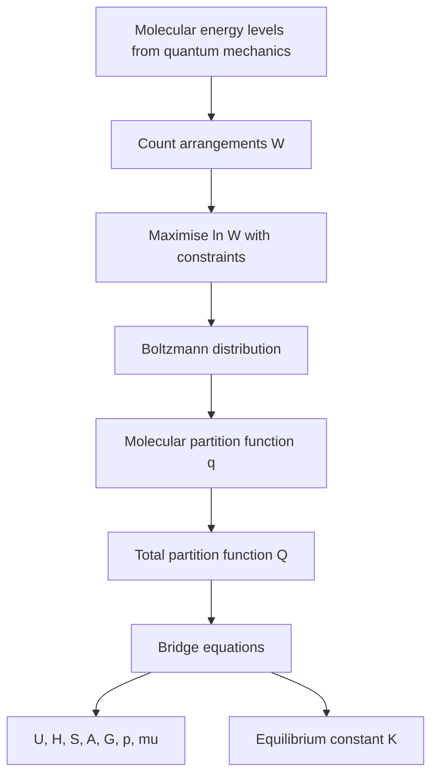
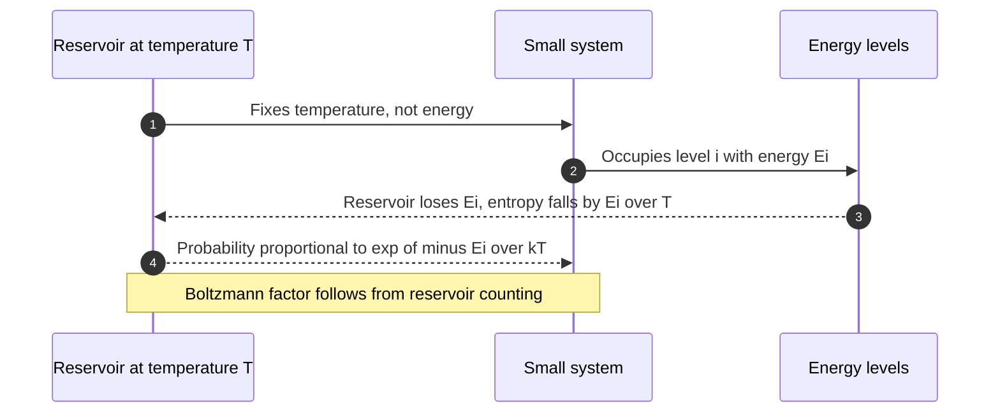
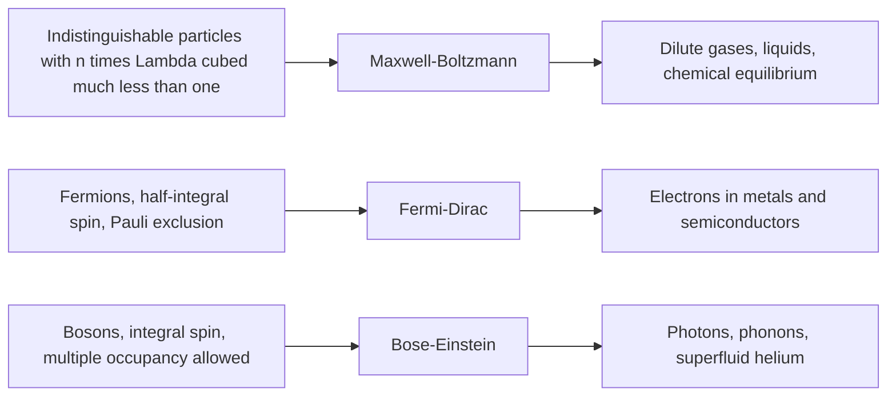

# Chapter 2 — Statistical Thermodynamics and Statistical Mechanics

> **Level:** Advanced (Level 6 — Physical Chemistry)
> **Estimated study time:** 11 hours (8 h reading + 3 h exercises)
> **Prerequisites:** [Classical Thermodynamics](01-classical-thermodynamics.md); [The Mole Concept](../03-intermediate-chemistry/01-the-mole-concept.md); elementary probability
> **Difficulty:** ★★★★★ (5/5)
> **Related chapters:** [Quantum Chemistry](03-quantum-chemistry.md), [Molecular Spectroscopy](04-molecular-spectroscopy.md), [Chemical Kinetics and Reaction Dynamics](05-chemical-kinetics-and-reaction-dynamics.md)

---

## 1. Learning Objectives

After working through this chapter you will be able to:

- Distinguish microstate from macrostate, and compute the number of microstates of a
  simple model system.
- Derive the Boltzmann distribution by maximising $W$ subject to the constraints of
  fixed particle number and fixed total energy.
- Write the molecular partition function and factor it into translational, rotational,
  vibrational and electronic contributions.
- Evaluate each contribution from spectroscopic or molecular data, and state its
  classical limit.
- Use the equipartition theorem and explain why vibrational modes are frozen out at
  room temperature.
- Derive and apply the bridge equations linking $q$ to $U$, $H$, $S$, $A$, $G$, $p$,
  $\mu$ and $K$.
- Distinguish the canonical ensemble from the microcanonical ensemble and derive the
  Boltzmann factor from the reservoir argument.
- State the domains of Maxwell–Boltzmann, Fermi–Dirac and Bose–Einstein statistics and
  identify which systems require each.
- Interpret the third law statistically, and compute residual entropy from ground-state
  degeneracy.
- Estimate the thermal de Broglie wavelength and decide when a gas is classical.

---

## 2. Introduction

Classical thermodynamics is silent about molecules. It accepts the heat capacity of
nitrogen as a measured number and deduces everything else; it cannot say why that number
is $\tfrac{5}{2}R$ rather than $\tfrac{3}{2}R$, nor why it rises towards
$\tfrac{7}{2}R$ at 2000 K. Statistical thermodynamics closes the gap. It starts from the
energy levels of a single molecule — themselves the output of quantum mechanics — and
computes the thermodynamic functions by counting the ways those levels can be occupied.

The bridge is a single idea: entropy counts microstates. Boltzmann's relation
$S = k_\mathrm{B}\ln W$ converts a combinatorial quantity, the number of distinct
arrangements consistent with an observed macrostate, into the quantity whose
maximisation defines equilibrium. Everything else follows. Maximising $\ln W$ under the
constraints of fixed particle number and fixed energy gives the Boltzmann distribution;
summing that distribution gives the partition function; differentiating the partition
function gives every thermodynamic property.

The approach is quantitative and predictive. Given the bond length, vibrational
frequency and ground-state degeneracy of a molecule, the standard entropy follows to
better than 1 % for small rigid molecules, and equilibrium constants follow from
molecular data alone — the same calculation that turned the third law from an empirical
rule into a theorem of statistical mechanics.

The chapter is also where the three quantum statistics enter. Maxwell–Boltzmann
statistics, the workhorse of chemistry, is an approximation valid for dilute gases;
electrons in metals obey Fermi–Dirac statistics and photons obey Bose–Einstein
statistics, both derived from the same counting argument with different constraints on
occupation numbers (Section 4.11).

---

## 3. Fundamental Concepts

### 3.1 Microstates, macrostates and the meaning of $W$

A **microstate** is a complete specification of the state of every particle in the
system. A **macrostate** is a specification of the observable properties — total energy,
volume, particle number, pressure. Many microstates correspond to one macrostate, and
the number of them is written $W$.

For $N$ distinguishable particles distributed over levels with occupation numbers
$n_0, n_1, n_2, \dots$, the number of arrangements is

$$
W = \frac{N!}{n_0!\,n_1!\,n_2!\cdots}.
$$

This is the multinomial coefficient: choose which particles occupy level 0, then which
of those remaining occupy level 1, and so on. For indistinguishable particles the
counting changes; for a dilute gas the correction is the factor $1/N!$, which removes
the overcounting of permutations and is responsible for the $-\ln N$ in the entropy.

**Boltzmann's definition** of entropy is

$$
S = k_\mathrm{B}\ln W ,
$$

with $k_\mathrm{B} = 1.380\,649\times10^{-23}\ \text{J K}^{-1}$. It is the only
definition that (i) is additive for independent systems, since $W$ multiplies and
$\ln$ adds, (ii) reduces to the classical thermodynamic entropy for a gas, and (iii)
gives $S = 0$ for a unique ground state. Section 4.1 shows that it is consistent with
$\delta q_\text{rev}/T$.

### 3.2 The most probable distribution

Consider $N$ independent, distinguishable particles sharing a fixed total energy $E$,
with levels of energy $\varepsilon_i$ and degeneracy $g_i$. The constraints are

$$
\sum_i n_i = N, \qquad \sum_i n_i \varepsilon_i = E .
$$

The equilibrium distribution is the one with the largest $W$, because fluctuations away
from it are vanishingly improbable for macroscopic $N$. Maximising $\ln W$ subject to
the two constraints, with Lagrange multipliers $\alpha$ and $\beta$, gives

$$
n_i = \frac{N}{q}g_i e^{-\beta\varepsilon_i},
\qquad q = \sum_i g_i e^{-\beta\varepsilon_i},
$$

with $\beta = 1/(k_\mathrm{B}T)$ established in Section 4.2. The normalisation constant
$q$ is the (molecular) **partition function**: the sum over states of the Boltzmann
factor.

The physical content is a competition. The factor $e^{-\beta\varepsilon_i}$ disfavours
high energies; the degeneracy $g_i$ favours levels with many states. At high temperature
$\beta \to 0$ and all levels are populated in proportion to $g_i$; at low temperature
the ground state dominates.

### 3.3 The partition function

For a system of $N$ independent molecules the total partition function is

$$
Q = \frac{q^N}{N!} \quad\text{(indistinguishable, gas)},
\qquad
Q = q^N \quad\text{(distinguishable, localised)}.
$$

The factor $1/N!$ is the Gibbs correction; without it the entropy of a gas would not be
extensive and would violate the third law. For independent molecules $q$ factors into
contributions from separable degrees of freedom:

$$
q = q_\text{trans}\,q_\text{rot}\,q_\text{vib}\,q_\text{elec},
$$

because the energy is a sum of independent terms and the exponential of a sum is a
product of exponentials. This separability is an approximation: rotation–vibration
coupling (centrifugal distortion) and vibronic coupling break it, and the
Born–Oppenheimer separation underlies the electronic/vibrational split.

| Contribution | Formula | Typical magnitude for N₂ at 298 K |
|---|---|---|
| Translational | $V/\Lambda^3$ | $3.6\times10^{30}$ |
| Rotational | $T/(\sigma\theta_\text{rot})$ | $52$ |
| Vibrational | $1/(1-e^{-\theta_\text{vib}/T})$ | $1.0000$ |
| Electronic | $g_0$ | $1$ |

The enormous translational factor is not a problem: it is divided by $N!$, and
$\ln(q/N)$ is moderate.

### 3.4 The thermal de Broglie wavelength and the classical limit

$$
\Lambda = \frac{h}{\sqrt{2\pi m k_\mathrm{B}T}} .
$$

$\Lambda$ is the quantum length scale of a molecule of mass $m$ at temperature $T$. The
classical limit requires the wavepackets of neighbouring molecules to overlap weakly,
that is

$$
n\Lambda^3 \ll 1 ,
$$

where $n = N/V$ is the number density. The quantity $n\Lambda^3$ is the **degeneracy
parameter**; when it approaches unity the gas is quantum-degenerate and
Maxwell–Boltzmann statistics fails. For nitrogen at 298 K and 1 bar,
$\Lambda = 1.91\times10^{-11}\ \text{m}$ and $n\Lambda^3 = 1.7\times10^{-7}$: the gas is
overwhelmingly classical. For helium at 1 K and 1 bar, $n\Lambda^3 \approx 2\times10^{-3}$
and still classical; for liquid helium the density is $10^3$ times larger and
condensation into a single quantum state appears.

### 3.5 Ensembles

An **ensemble** is a large collection of replicas of the system, each in a possible
microstate, with the average over the ensemble equal to the time average of one system.
Three ensembles cover most chemistry.

- **Microcanonical** ($N, V, E$ fixed): isolated system; all accessible microstates
  equally probable; entropy $S = k_\mathrm{B}\ln W$.
- **Canonical** ($N, V, T$ fixed): closed system in a heat bath; probability of a
  microstate $\propto e^{-E_i/k_\mathrm{B}T}$; Helmholtz energy
  $A = -k_\mathrm{B}T\ln Q$.
- **Grand canonical** ($\mu, V, T$ fixed): open system; used for adsorption and for
  quantum gases.

The ensembles are equivalent in the thermodynamic limit, because relative fluctuations
vanish as $N^{-1/2}$, so any ensemble may be used for bulk properties; the canonical one
is convenient because $T$ is the controlled variable.

---

## 4. Detailed Scientific Explanation

### 4.1 From counting to temperature: the two-level system

Take $N$ distinguishable two-level systems with energies $0$ and $\varepsilon$, of which
$n$ are excited. Then $U = n\varepsilon$ and

$$
W = \frac{N!}{n!\,(N-n)!},
\qquad
\ln W \approx N\ln N - n\ln n - (N-n)\ln(N-n)
$$

using Stirling's approximation $\ln x! \approx x\ln x - x$. The thermodynamic definition
of temperature, $1/T = (\partial S/\partial U)_V$, becomes

$$
\frac{1}{T} = \frac{1}{\varepsilon}\frac{\mathrm{d}S}{\mathrm{d}n}
= \frac{k_\mathrm{B}}{\varepsilon}\ln\frac{N-n}{n},
$$

so that

$$
\frac{n}{N-n} = e^{-\varepsilon/k_\mathrm{B}T}
\quad\Longrightarrow\quad
\frac{n}{N} = \frac{e^{-\varepsilon/k_\mathrm{B}T}}{1 + e^{-\varepsilon/k_\mathrm{B}T}} .
$$

This is the Boltzmann distribution for two levels, obtained without any assumption about
a heat bath. It also fixes the constant: the multiplier $\beta$ in Section 4.2 is
$1/k_\mathrm{B}T$, and the identification is not a convention but a consequence of
matching $1/T = \partial S/\partial U$. As $T \to 0$, $n \to 0$ and the system occupies
its ground state; as $T \to \infty$, $n/N \to \tfrac{1}{2}$ and the two levels are
equally populated.

### 4.2 Derivation of the Boltzmann distribution

**Derivation 4.1 — maximising $W$ with constraints.** For $N$ particles over levels $i$
with degeneracy $g_i$, the number of arrangements is

$$
W = N!\prod_i \frac{g_i^{n_i}}{n_i!},
\qquad
\ln W = N\ln N - N + \sum_i n_i\ln g_i - \sum_i\left(n_i\ln n_i - n_i\right).
$$

We maximise $\ln W$ subject to $\sum n_i = N$ and $\sum n_i\varepsilon_i = E$, using
undetermined multipliers $\alpha$ and $\beta$:

$$
\frac{\partial}{\partial n_i}\left[\ln W + \alpha\left(N - \sum_j n_j\right)
+ \beta\left(E - \sum_j n_j\varepsilon_j\right)\right] = 0 .
$$

With $\mathrm{d}(\ln W)/\mathrm{d}n_i = \ln g_i - \ln n_i$,

$$
\ln g_i - \ln n_i - \alpha - \beta\varepsilon_i = 0
\quad\Longrightarrow\quad
n_i = g_i e^{-\alpha}e^{-\beta\varepsilon_i} .
$$

Normalising, $\sum_i n_i = N$ gives $e^{-\alpha} = N/q$ with
$q = \sum_i g_i e^{-\beta\varepsilon_i}$, so $n_i/N = g_i e^{-\beta\varepsilon_i}/q$.
Section 4.1 identifies $\beta = 1/k_\mathrm{B}T$; the distribution is therefore

$$
p_i = \frac{g_i e^{-\varepsilon_i/k_\mathrm{B}T}}{q} .
$$

$\square$

### 4.3 The canonical ensemble and the origin of the Boltzmann factor

Consider a small system of energy $E_i$ in contact with a large reservoir of total
energy $E_\text{tot}$. The combined system is isolated, so all its microstates are
equally probable; the probability of the small system being in microstate $i$ is
proportional to the number of reservoir states compatible with the remaining energy:

$$
p_i \propto \Omega_\text{res}(E_\text{tot} - E_i)
= \exp\!\left[\frac{S_\text{res}(E_\text{tot} - E_i)}{k_\mathrm{B}}\right].
$$

Expanding the reservoir entropy about $E_\text{tot}$,

$$
S_\text{res}(E_\text{tot} - E_i) \approx S_\text{res}(E_\text{tot})
- E_i\left(\frac{\partial S_\text{res}}{\partial E}\right)_{V}
= S_\text{res}(E_\text{tot}) - \frac{E_i}{T},
$$

so $p_i \propto e^{-E_i/k_\mathrm{B}T}$. The exponential is therefore not postulated but
inherited from the reservoir's density of states, and it holds for any system whose
interaction with the bath is weak. The canonical partition function
$Q = \sum_i e^{-E_i/k_\mathrm{B}T}$ normalises the distribution and, as Section 4.9
shows, is the generating function for every thermodynamic property.

### 4.4 The translational partition function

**Derivation 4.2 — $q_\text{trans} = V/\Lambda^3$.** A particle of mass $m$ in a cubic
box of side $L$ has levels

$$
\varepsilon_{n_x n_y n_z} = \frac{h^2}{8mL^2}\left(n_x^2 + n_y^2 + n_z^2\right),
\qquad n_i = 1, 2, 3, \dots
$$

The spacings are of order $h^2/(8mL^2) \sim 10^{-33}$ J for a macroscopic box, utterly
negligible against $k_\mathrm{B}T \sim 10^{-21}$ J, so the sum may be replaced by an
integral:

$$
q_\text{trans} = \sum_{n_x}\sum_{n_y}\sum_{n_z}
e^{-\beta h^2(n_x^2+n_y^2+n_z^2)/8mL^2}
= \left[\int_0^\infty e^{-\alpha n^2}\mathrm{d}n\right]^3
$$

with $\alpha = \beta h^2/(8mL^2)$. Using
$\int_0^\infty e^{-\alpha n^2}\mathrm{d}n = \tfrac{1}{2}\sqrt{\pi/\alpha}$,

$$
q_\text{trans} = \left(\frac{\pi}{4\alpha}\right)^{3/2}
= \left(\frac{2\pi m k_\mathrm{B}T}{h^2}\right)^{3/2}V
= \frac{V}{\Lambda^3} . \qquad \square
$$

The replacement of the sum by an integral is valid when many levels are thermally
accessible, that is when $\Lambda \ll V^{1/3}$, or equivalently $n\Lambda^3 \ll 1$.
Inserting $q_\text{trans}$ into the bridge equations gives the **Sackur–Tetrode
equation**:

$$
S_\text{m} = R\left[\ln\!\left(\frac{V_\text{m}}{\Lambda^3 N_\mathrm{A}}\right)
+ \frac{5}{2}\right],
$$

which reproduces measured entropies of monatomic gases to within 0.1 % and was the first
quantitative success of statistical mechanics.

### 4.5 The rotational partition function

A linear rotor has levels $\varepsilon_J = hcBJ(J+1)$ with degeneracy $2J+1$. Define the
**rotational temperature**
$\theta_\text{rot} = hcB/k_\mathrm{B} = h^2/(8\pi^2Ik_\mathrm{B})$. Then

$$
q_\text{rot} = \sum_{J=0}^{\infty}(2J+1)e^{-\theta_\text{rot}J(J+1)/T}
\approx \int_0^\infty (2J+1)e^{-\theta_\text{rot}J(J+1)/T}\,\mathrm{d}J
= \frac{T}{\theta_\text{rot}} .
$$

The sum includes only rotational states allowed by nuclear spin statistics: for a
homonuclear diatomic the symmetry number $\sigma = 2$ removes half the levels, and

$$
q_\text{rot} = \frac{T}{\sigma\theta_\text{rot}}
= \frac{8\pi^2Ik_\mathrm{B}T}{\sigma h^2} .
$$

For a nonlinear rotor with three rotational constants,
$q_\text{rot} = \frac{\sqrt{\pi}}{\sigma}\left(\frac{T^3}{\theta_A\theta_B\theta_C}\right)^{1/2}$.
The classical limit requires $T \gg \theta_\text{rot}$; for HCl,
$\theta_\text{rot} = 15.2$ K, so the integral is excellent at room temperature, whereas
for H₂ ($\theta_\text{rot} = 87.6$ K) it is marginal and for hydrides at 50 K it fails.
The symmetry number is a purely quantum bookkeeping device — it counts the number of
indistinguishable orientations — but it has measurable consequences, as Worked Example
8.3 shows.

### 4.6 The vibrational partition function

A harmonic oscillator of wavenumber $\tilde\nu$ has levels
$\varepsilon_v = (v + \tfrac{1}{2})hc\tilde\nu$ and non-degenerate states. Writing
$\theta_\text{vib} = hc\tilde\nu/k_\mathrm{B}$,

$$
q_\text{vib} = \sum_{v=0}^{\infty}e^{-(v+1/2)\theta_\text{vib}/T}
= \frac{e^{-\theta_\text{vib}/2T}}{1 - e^{-\theta_\text{vib}/T}} .
$$

The zero-point factor $e^{-\theta/2T}$ affects $U$ and $A$ but cancels from differences
such as $K$, where it contributes the zero-point energy difference $\Delta E_0$. The
thermal contribution to the internal energy is

$$
U_\text{vib} - U_\text{vib}(0) = \frac{Nhc\tilde\nu}{e^{\theta_\text{vib}/T} - 1},
\qquad
C_{V,\text{vib}} = Nk_\mathrm{B}\left(\frac{\theta_\text{vib}}{T}\right)^2
\frac{e^{\theta_\text{vib}/T}}{\left(e^{\theta_\text{vib}/T} - 1\right)^2},
$$

the Einstein heat-capacity function. At $T \gg \theta_\text{vib}$ it tends to $Nk_\mathrm{B}$
(equipartition, two quadratic degrees of freedom); at $T \ll \theta_\text{vib}$ it is
exponentially small. For N₂, $\theta_\text{vib} = 3393$ K, so at 298 K the vibrational
contribution to $C_V$ is 0.002 % — the mode is **frozen out**. For I₂,
$\theta_\text{vib} = 308$ K, and the contribution is already 12 % at room temperature.
This is why $C_V$ of a diatomic gas is $\tfrac{5}{2}R$ near 300 K and rises towards
$\tfrac{7}{2}R$ at high temperature.

### 4.7 The electronic partition function

$$
q_\text{elec} = \sum_i g_i e^{-\varepsilon_i/k_\mathrm{B}T},
$$

with energies measured from the ground state. Because electronic excitation energies
typically exceed $1\ \text{eV} \approx 100\ \text{kJ mol}^{-1}$, the first excited term
lies far above $k_\mathrm{B}T$ at ordinary temperature and $q_\text{elec} \approx g_0$,
the ground-state degeneracy. Alkali metals are the classic exception: the spin–orbit
split ground term gives $g_0 = 2$ ($^2S_{1/2}$) and a low-lying $^2P$ term, so the
electronic partition function is temperature-dependent and contributes to $C_V$ of the
vapour. Transition-metal complexes and open-shell radicals likewise require the full sum,
and at high temperature electronic excitation eventually limits the validity of the
rigid-rotor harmonic-oscillator model.

### 4.8 The equipartition theorem

**Equipartition.** Each independent quadratic term in the classical Hamiltonian
contributes $\tfrac{1}{2}k_\mathrm{B}T$ to the mean energy per molecule, and hence
$\tfrac{1}{2}R$ to $C_{V,\text{m}}$.

| Degree of freedom | Quadratic terms | Contribution to $C_{V,\text{m}}$ |
|---|---|---|
| Translation | 3 | $\tfrac{3}{2}R$ |
| Rotation, linear | 2 | $R$ |
| Rotation, nonlinear | 3 | $\tfrac{3}{2}R$ |
| Vibration (kinetic + potential) | 2 | $R$ when $T \gg \theta_\text{vib}$ |

Equipartition is a classical result and therefore a high-temperature limit; it applies to
a degree of freedom only when the level spacing is much smaller than $k_\mathrm{B}T$.
The measured heat capacity of H₂ shows the hierarchy: $\tfrac{3}{2}R$ below 50 K,
$\tfrac{5}{2}R$ from 100 K to about 1000 K, and $\tfrac{7}{2}R$ above 3000 K.

### 4.9 The bridge equations

**Derivation 4.3 — thermodynamic functions from $Q$.** For the canonical ensemble,

$$
A = -k_\mathrm{B}T\ln Q, \qquad
S = -\left(\frac{\partial A}{\partial T}\right)_{V}, \qquad
p = -\left(\frac{\partial A}{\partial V}\right)_{T}.
$$

Since $A = U - TS$, the internal energy follows as

$$
U = A + TS = A - T\left(\frac{\partial A}{\partial T}\right)_{V}
= k_\mathrm{B}T^2\left(\frac{\partial \ln Q}{\partial T}\right)_{V}
= -\left(\frac{\partial \ln Q}{\partial \beta}\right)_{V} .
$$

For $N$ independent molecules, $\ln Q = N\ln q - \ln N!$, so

$$
U = Nk_\mathrm{B}T^2\left(\frac{\partial \ln q}{\partial T}\right)_{V},
\qquad
p = Nk_\mathrm{B}T\left(\frac{\partial \ln q}{\partial V}\right)_{T},
$$

and the entropy is

$$
S = \frac{U - A}{T} = k_\mathrm{B}\ln Q + \frac{U}{T}
= Nk_\mathrm{B}\ln\!\left(\frac{q}{N}\right) + \frac{U}{T} + Nk_\mathrm{B} .
$$

The enthalpy and Gibbs energy follow from $H = U + pV$ and $G = A + pV$, and the
chemical potential from

$$
\mu = \left(\frac{\partial A}{\partial N}\right)_{T,V}
= -k_\mathrm{B}T\left(\frac{\partial \ln Q}{\partial N}\right)_{T,V}
= -k_\mathrm{B}T\ln\!\left(\frac{q}{N}\right),
$$

the last form holding for a dilute gas. $\square$

These relations are the working tools of the subject: give them a partition function and
they return every thermodynamic property, with molecular structure as the only input.

### 4.10 Equilibrium constants from molecular data

At equilibrium the chemical potentials satisfy $\sum_i \nu_i\mu_i = 0$. With
$\mu_i = -k_\mathrm{B}T\ln(q_i^\circ/N_\mathrm{A})$ plus the zero-point energy, and
noting that the standard state fixes the volume at $V_\text{m}^\circ = RT/p^\circ$,

$$
K = \prod_i\left(\frac{q_i^\circ}{N_\mathrm{A}}\right)^{\nu_i}
e^{-\Delta E_0/k_\mathrm{B}T},
$$

where $\nu_i$ is positive for products and negative for reactants and $\Delta E_0$ is the
difference of zero-point energies between products and reactants. For reactions with
$\Delta\nu = 0$ the $N_\mathrm{A}$ factors cancel, and the translational contribution
reduces to a ratio of masses raised to the power $\tfrac{3}{2}$:

$$
K_\text{trans} = \prod_i\left(\frac{m_i}{m^\circ}\right)^{3\nu_i/2} .
$$

Equation 4.10 is a genuine prediction: spectroscopic bond lengths and vibrational
wavenumbers, with no calorimetric input, give equilibrium constants.

### 4.11 Maxwell–Boltzmann, Fermi–Dirac and Bose–Einstein statistics

The three distributions differ in what they allow about occupation numbers.

$$
n_i^\text{MB} = e^{-(\varepsilon_i-\mu)/k_\mathrm{B}T}, \qquad
n_i^\text{FD} = \frac{1}{e^{(\varepsilon_i-\mu)/k_\mathrm{B}T} + 1}, \qquad
n_i^\text{BE} = \frac{1}{e^{(\varepsilon_i-\mu)/k_\mathrm{B}T} - 1} .
$$

**Fermi–Dirac** applies to indistinguishable fermions — particles of half-integral spin,
including electrons — for which the Pauli principle forbids double occupancy, so
$n_i \le 1$. It governs electrons in metals, white dwarfs and semiconductors.
**Bose–Einstein** applies to indistinguishable bosons of integral spin — photons,
phonons, $^4$He atoms — for which multiple occupancy is allowed; it produces
Bose–Einstein condensation below a critical temperature. **Maxwell–Boltzmann** is the
high-temperature, low-density limit in which $n_i \ll 1$ and both quantum distributions
reduce to the exponential.

The reduction is quantitative: when $e^{(\varepsilon-\mu)/k_\mathrm{B}T} \gg 1$ the $\pm1$
in the denominator is negligible and both quantum forms collapse to the classical one,
with the condition $n\Lambda^3 \ll 1$ as before.

### 4.12 The third law from counting

At $T = 0$ the Boltzmann factor suppresses every state above the ground state, so
$W = g_0$, the degeneracy of the ground state, and

$$
S(0) = k_\mathrm{B}\ln g_0 .
$$

For a perfect crystal with a non-degenerate ground state, $g_0 = 1$ and $S(0) = 0$: the
third law is a theorem, not an independent postulate. When the ground state is
degenerate, or when the crystal is frozen into a disordered arrangement, $g_0 > 1$ and a
**residual entropy** survives. Carbon monoxide has $g_0 = 2$ per molecule from its two
orientations, so $S_0 = k_\mathrm{B}\ln 2^{N} = R\ln 2 =
5.76\ \text{J K}^{-1}\text{mol}^{-1}$; ice has $R\ln(3/2)$ per mole of water from proton
disorder. The statistical picture also explains why the third law cannot be derived
classically: a classical system has a continuum of states and no unique ground state.

---

## 5. Visual Diagrams

**Figure 2.1 — The logical chain of statistical thermodynamics.** Quantum mechanics
supplies the levels, counting supplies $W$, maximisation supplies the distribution, and
the normalising sum is the partition function. Every arrow is exact for independent
molecules; the approximations enter only through separability and through replacing sums
by integrals.

**Figure 2.2 — Where the Boltzmann factor comes from.** The reservoir is so large that
its entropy changes linearly with the energy it lends, and the slope is $1/T$. The
exponential therefore measures the ratio of available reservoir states, not any property
of the system, which is why the same factor serves a gas, a spin lattice or a protein.

**Figure 2.3 — Choosing the statistics.** The controlling question is the occupation
number per quantum state, not the phase of matter. When it is far below one, all three
distributions coincide; chemistry is almost always in that regime, the metallic electron
gas being the standard exception.

---

## 6. Mathematical Formulas

$$
q_\text{trans} = \frac{V}{\Lambda^3}, \quad
\Lambda = \frac{h}{\sqrt{2\pi m k_\mathrm{B}T}}, \quad
q_\text{rot} = \frac{T}{\sigma\theta_\text{rot}}, \quad
q_\text{vib} = \frac{1}{1 - e^{-\theta_\text{vib}/T}}
$$

$$
U = k_\mathrm{B}T^2\left(\frac{\partial\ln Q}{\partial T}\right)_{V}, \quad
S = k_\mathrm{B}\ln Q + \frac{U}{T}, \quad
A = -k_\mathrm{B}T\ln Q, \quad
p = k_\mathrm{B}T\left(\frac{\partial\ln Q}{\partial V}\right)_{T}
$$

| Symbol | Meaning | SI unit |
|---|---|---|
| $W$ | number of microstates of a macrostate | dimensionless |
| $k_\mathrm{B}$ | Boltzmann constant | J K⁻¹ |
| $q$, $Q$ | molecular and total partition functions | dimensionless |
| $\beta$ | $1/k_\mathrm{B}T$ | J⁻¹ |
| $\Lambda$ | thermal de Broglie wavelength | m |
| $\theta_\text{rot}$, $\theta_\text{vib}$ | characteristic rotational and vibrational temperatures | K |
| $\sigma$ | symmetry number | dimensionless |
| $g_i$ | degeneracy of level $i$ | dimensionless |
| $\varepsilon_i$ | energy of level $i$ | J |
| $n_i$ | occupation number of level $i$ | dimensionless |
| $N_\mathrm{A}$ | Avogadro constant | mol⁻¹ |

Assumptions: independent, weakly interacting molecules; separable
translation–rotation–vibration–electronic contributions; $T \gg \theta_\text{rot}$ for the
classical rotational integral; $n\Lambda^3 \ll 1$ for Maxwell–Boltzmann statistics.

---

## 7. Chemical Equations

The isotope-exchange reaction used in Worked Example 8.4 is the cleanest test of
statistical prediction, because the electronic potential is identical on both sides and
the equilibrium constant is dominated by symmetry and zero-point energy:

$$
\ce{H2(g) + D2(g) <=> 2HD(g)}
$$

The vibrational wavenumbers that fix $\Delta E_0$ are the observables:

$$
\tilde\nu(\ce{H2}) = 4401\ \text{cm}^{-1}, \qquad
\tilde\nu(\ce{HD}) = 3817\ \text{cm}^{-1}, \qquad
\tilde\nu(\ce{D2}) = 3116\ \text{cm}^{-1} .
$$

$$
\ce{CO(s)} \ \text{with} \ S_0 = R\ln 2 = 5.76\ \text{J K}^{-1}\text{mol}^{-1} .
$$

---

## 8. Worked Examples

### Worked Example 8.1 — Translational partition function of nitrogen

**Problem.** Compute $\Lambda$, $q_\text{trans}$ in 1.000 m³ and in the standard molar
volume at 298.15 K and 1 bar, and the degeneracy parameter $n\Lambda^3$.

**Strategy.** Evaluate $\Lambda = h/\sqrt{2\pi m k_\mathrm{B}T}$ with
$m = 28.014\ \text{u}$, then $q = V/\Lambda^3$ and $n = N_\mathrm{A}/V_\text{m}$.

**Solution.** $m = 28.014(1.66054\times10^{-27}) = 4.652\times10^{-26}$ kg.
$2\pi m k_\mathrm{B}T = 2\pi(4.652\times10^{-26})(1.3807\times10^{-23})(298.15) =
1.203\times10^{-45}\ \text{kg}^2\text{m}^2\text{s}^{-2}$.
Dividing by $h^2 = 4.390\times10^{-67}$ gives $2.740\times10^{21}\ \text{m}^{-2}$, so
$\Lambda = (2.740\times10^{21})^{-1/2} = 1.911\times10^{-11}$ m and
$q/V = (2.740\times10^{21})^{3/2} = 1.435\times10^{32}\ \text{m}^{-3}$.

In 1.000 m³, $q = 1.435\times10^{32}$. In
$V_\text{m} = RT/p = (8.314)(298.15)/10^{5} = 0.02479\ \text{m}^{3}$,
$q = 3.556\times10^{30}$. Then $q/N_\mathrm{A} = 5.905\times10^{6}$ and
$n = N_\mathrm{A}/V_\text{m} = 2.429\times10^{25}\ \text{m}^{-3}$, so
$n\Lambda^3 = (2.429\times10^{25})(6.975\times10^{-33}) = 1.69\times10^{-7}$.

**Check.** $\Lambda = 19$ pm is a fraction of a bond length, as it must be for a molecule
at room temperature, and $n\Lambda^3 \ll 1$ confirms that the gas is classical. Note that
$q$ itself is astronomically large while $q/N$ is only $6\times10^{6}$: the physically
meaningful quantity is the partition function per molecule available to each molecule,
and the $1/N!$ in $Q$ is what removes the absurdity.

### Worked Example 8.2 — Rotational partition function and level populations of HCl

**Problem.** For HCl, $B = 10.59\ \text{cm}^{-1}$ and $\sigma = 1$. Compute
$\theta_\text{rot}$, $q_\text{rot}$ at 298.15 K, and the ratio of populations in $J = 1$
and $J = 0$.

**Strategy.** $\theta_\text{rot} = hcB/k_\mathrm{B}$, then $q_\text{rot} = T/(\sigma\theta)$;
populations follow $p_J \propto (2J+1)e^{-\theta J(J+1)/T}$.

**Solution.** $\theta_\text{rot} = (6.626\times10^{-34})(2.998\times10^{8})(1059)/
(1.381\times10^{-23}) = 15.24$ K.
$q_\text{rot} = 298.15/15.24 = 19.6$.
For $J = 0$, $p_0 \propto 1$; for $J = 1$, $p_1 \propto 3e^{-2(15.24)/298.15} =
3e^{-0.1022} = 2.71$. The ratio is 2.71, so 13.8 % of molecules occupy $J = 1$ and
$1/19.6 = 5.1$ % occupy $J = 0$.

**Check.** The most populous level is not the ground state but $J \approx 2$–3, a direct
consequence of the $2J+1$ degeneracy competing with the exponential. The classical
integral is justified because $T/\theta_\text{rot} = 19.6 \gg 1$; for H₂ at the same
temperature the ratio is only 3.4 and the integral overestimates $q$ by about 4 %.

### Worked Example 8.3 — Equilibrium constant for an isotope-exchange reaction

**Problem.** Estimate $K$ at 298.15 K for $\ce{H2 + D2 <=> 2HD}$ from molecular data,
neglecting centrifugal distortion and electronic differences.

**Strategy.** Use equation 4.10 with $\Delta\nu = 0$, so the $N_\mathrm{A}$ factors
cancel. Compute the translational mass ratio, the rotational ratio using
$\sigma(\ce{H2}) = \sigma(\ce{D2}) = 2$ and $\sigma(\ce{HD}) = 1$, and the zero-point
factor.

**Solution.** Masses: $m(\ce{H2}) = 2.016\ \text{u}$, $m(\ce{D2}) = 4.028\ \text{u}$,
$m(\ce{HD}) = 3.022\ \text{u}$. Translational:
$(3.022^2/(2.016 \times 4.028))^{3/2} = (1.1246)^{3/2} = 1.192$.
Rotational temperatures: $\theta(\ce{H2}) = 87.6$ K, $\theta(\ce{D2}) = 43.8$ K,
$\theta(\ce{HD}) = 65.7$ K. Then
$q_\text{rot}(\ce{H2}) = T/175.2$, $q_\text{rot}(\ce{D2}) = T/87.6$,
$q_\text{rot}(\ce{HD}) = T/65.7$, so the ratio is
$(175.2 \times 87.6)/65.7^2 = 15347/4316 = 3.556$.

Zero-point energies, $\tfrac{1}{2}hc\tilde\nu$: 2201, 1909 and 1558 cm⁻¹ for H₂, HD and
D₂. Thus $\Delta E_0 = 2(1909) - 2201 - 1558 = +59\ \text{cm}^{-1} =
+0.706\ \text{kJ mol}^{-1}$, giving $e^{-706/(8.314 \times 298.15)} = e^{-0.285} = 0.752$.

Therefore $K = 1.192 \times 3.556 \times 0.752 = 3.19$.

**Check.** The experimental value at 298 K is 3.2, so the calculation is essentially
exact given the approximations. Almost all of the deviation from the naive statistical
value of 4 comes from the factor $\sigma = 2$ for the homonuclear species: symmetry
alone contributes a factor of 4 to $K$. The zero-point term then reduces it by 25 %.

### Worked Example 8.4 — Sackur–Tetrode entropy of argon

**Problem.** Compute $S^\circ_\text{m}$ of argon at 298.15 K and 1 bar and compare it
with the tabulated value of $154.8\ \text{J K}^{-1}\text{mol}^{-1}$.

**Strategy.** Use $S_\text{m} = R[\ln(V_\text{m}/\Lambda^3N_\mathrm{A}) + 5/2]$ with
$m = 39.948\ \text{u}$ and $V_\text{m} = 0.02479\ \text{m}^{3}$.

**Solution.** $m = 39.948(1.66054\times10^{-27}) = 6.633\times10^{-26}$ kg.
$2\pi m k_\mathrm{B}T = 1.716\times10^{-45}$, so
$2\pi mk_\mathrm{B}T/h^2 = 3.908\times10^{21}\ \text{m}^{-2}$ and
$\Lambda = 1.600\times10^{-11}$ m, $\Lambda^3 = 4.096\times10^{-33}\ \text{m}^{3}$.
Then $V_\text{m}/(\Lambda^3N_\mathrm{A}) =
0.02479/(4.096\times10^{-33} \times 6.022\times10^{23}) = 1.005\times10^{7}$, and
$\ln(1.005\times10^{7}) = 16.12$.

$S_\text{m} = 8.314(16.12 + 2.5) = 8.314(18.62) = 154.8\ \text{J K}^{-1}\text{mol}^{-1}$.

**Check.** The agreement with the calorimetric value is exact to four figures, which is
the strongest single confirmation of the translational partition function. Argon is
monatomic with a non-degenerate ground state, so there is no rotational, vibrational or
electronic contribution to spoil the comparison. For a polyatomic gas the same
calculation needs spectroscopic constants, and the residual discrepancy then measures
the anharmonicity that the harmonic model ignores.

---

## 9. Real-World Applications

**Equilibrium constants without experiments.** Statistical thermodynamics computes $K$
from spectroscopic constants, which is how models are built for combustion and
atmospheric chemistry when the species are too short-lived to study directly.

**Heat capacities, propulsion and condensed matter.** Knowing which degrees of freedom
are active fixes $C_V$, hence $\gamma$ and the exhaust velocity of a nozzle;
Fermi–Dirac statistics explains the electronic heat capacity of metals and Bose–Einstein
statistics underlies black-body radiation and superconductivity.

---

## 10. Common Mistakes

| Mistake | Why it happens | Correct approach |
|---|---|---|
| Using $Q = q^N$ for a gas | The localised formula is written first in most textbooks | Gases need $Q = q^N/N!$; omitting it makes $S$ non-extensive |
| Using $q = \sum e^{-\varepsilon_i/kT}$ without degeneracies | Level and state are conflated | Sum over *states*, or weight each level by $g_i$ |
| Forgetting $\sigma$ for homonuclear diatomics | The symmetry number looks like bookkeeping | $\sigma = 2$ for H₂, N₂, O₂; it changes $S$ by $R\ln 2$ |
| Applying equipartition to a vibration at 300 K | The theorem is quoted without its limit | Equipartition needs $T \gg \theta_\text{vib}$; use the Einstein function otherwise |
| Treating $\beta$ as an empirical constant | It appears before $T$ is introduced | $\beta = 1/k_\mathrm{B}T$ follows from $1/T = \partial S/\partial U$ |
| Replacing the rotational sum by an integral for H₂ at 50 K | The classical formula is used everywhere | Check $T \gg \theta_\text{rot}$; otherwise sum the series |
| Using Maxwell–Boltzmann for metallic electrons | Success with gases is over-generalised | Electrons obey Fermi–Dirac; only states near $\varepsilon_F$ are active |
| Quoting $S = 0$ at $0$ K for a glass | Planck's statement is applied universally | Residual entropy survives when the ground state is degenerate or the solid is disordered |

---

## 11. Chapter Summary

- Entropy counts microstates, $S = k_\mathrm{B}\ln W$, consistent with $\delta q_\text{rev}/T$.
- Maximising $\ln W$ at fixed $N$ and $E$ gives the Boltzmann distribution
  $p_i = g_ie^{-\varepsilon_i/kT}/q$.
- The partition function factorises into translational, rotational, vibrational and
  electronic parts, each with a stated classical limit;
  $q_\text{trans} = V/\Lambda^3$ yields the Sackur–Tetrode entropy.
- Equipartition assigns $\tfrac{1}{2}k_\mathrm{B}T$ per quadratic degree of freedom and
  fails when the level spacing exceeds $k_\mathrm{B}T$.
- The bridge equations convert $Q$ into $U$, $H$, $S$, $A$, $G$, $p$ and $\mu$, and
  molecular data into equilibrium constants.
- Maxwell–Boltzmann, Fermi–Dirac and Bose–Einstein statistics differ by occupation
  constraints; chemistry usually needs only the first.
- The third law follows from $W \to g_0$ at $T \to 0$; residual entropy measures $g_0 > 1$.

---

## 12. Exercises

### 12.1 Conceptual questions

1. Why does $W$ multiply when two independent systems are combined, and why must $S$ then
   be logarithmic?
2. Explain why the most probable distribution is effectively the only distribution for
   $10^{23}$ particles.
3. Why is the symmetry number needed at all if the molecules are identical?

### 12.2 Basic problems

4. Compute $W$ for distributing four distinguishable particles over two levels with
   $n_0 = n_1 = 2$.
5. Evaluate $q_\text{vib}$ for a mode with $\theta_\text{vib} = 1000$ K at 300 K.
6. Give the high-temperature limit of $q_\text{rot}$ for a nonlinear molecule.

### 12.3 Intermediate problems

7. Show that the two-level system of Section 4.1 has a heat capacity that peaks near
   $k_\mathrm{B}T = 0.42\varepsilon$.
8. Compute $q_\text{rot}$ for N₂ ($B = 1.998\ \text{cm}^{-1}$, $\sigma = 2$) at 298 K,
   and estimate the first three terms of the exact sum for comparison.

### 12.4 Advanced problems

9. Derive the Sackur–Tetrode equation from $q_\text{trans}$ and the bridge equations.
10. Show that the equilibrium constant for $\ce{A <=> B}$ with equal masses and no
    zero-point difference is the ratio of internal partition functions.
11. Estimate the degeneracy parameter $n\Lambda^3$ for helium at 4.2 K and 1 bar, and
    comment on whether Bose–Einstein statistics is required.

### 12.5 Calculation problems

12. Compute $S^\circ_\text{m}$ of Ne at 298.15 K and 1 bar from the Sackur–Tetrode
    equation ($m = 20.180\ \text{u}$) and compare with
    $146.3\ \text{J K}^{-1}\text{mol}^{-1}$.

### Answers

1. Independent arrangements combine multiplicatively; only a logarithm turns a product
   into a sum, which additivity of entropy requires.
2. The width of the distribution is of order $N^{-1/2}$, so fluctuations are of order
   $10^{-11.5}$ of the mean.
3. The symmetry number corrects for overcounting physically identical orientations, which
   the classical integral over all angles includes twice.
4. $W = 4!/(2!\,2!) = 6$.
5. $q = 1/(1 - e^{-3.333}) = 1/0.9643 = 1.037$.
6. $q_\text{rot} = \sqrt{\pi}(T^3/\theta_A\theta_B\theta_C)^{1/2}/\sigma$.
7. $U = N\varepsilon/(1+e^{\varepsilon/k_\mathrm{B}T})$ gives a Schottky peak where
   $k_\mathrm{B}T \approx 0.42\varepsilon$.
8. $q_\text{rot} = 298/(2 \times 2.876) = 51.8$; the first three terms give
   $1 + 3e^{-0.0193} + 5e^{-0.0579} = 8.66$, so many terms contribute and the integral is
   appropriate.
9. $\ln q = \ln V - 3\ln\Lambda$; differentiating gives $U = \tfrac{3}{2}Nk_\mathrm{B}T$
   and $S = Nk_\mathrm{B}[\ln(V/N\Lambda^3) + \tfrac{5}{2}]$.
10. $K = q_B/q_A$ when masses and zero-point energies are equal.
11. $\Lambda = 1.38\times10^{-10}$ m and $n = p/k_\mathrm{B}T = 1.7\times10^{27}\ \text{m}^{-3}$,
    so $n\Lambda^3 \approx 4.5\times10^{-3}$: classical.
12. $\Lambda = 2.25\times10^{-11}$ m, $V_\text{m}/(\Lambda^3N_\mathrm{A}) = 3.61\times10^{6}$,
    $\ln = 15.10$, $S = 8.314(17.60) = 146.3\ \text{J K}^{-1}\text{mol}^{-1}$.

---

## 13. Further Reading

- Atkins, P. W., de Paula, J. and Keeler, J. *Atkins' Physical Chemistry*, 12th ed.,
  Oxford University Press, 2022. Chapters 13–15.
- McQuarrie, D. A. and Simon, J. D. *Physical Chemistry: A Molecular Approach*,
  University Science Books, 1997. Chapters 17–20.
- Levine, I. N. *Physical Chemistry*, 6th ed., McGraw-Hill, 2009. Chapters 20–23.
- Cramer, C. J. *Essentials of Computational Chemistry: Theories and Models*, 2nd ed.,
  Wiley, 2004. Chapter 10.
- IUPAC. *Quantities, Units and Symbols in Physical Chemistry* (Green Book), 3rd ed.,
  RSC Publishing, 2007. <https://iupac.org/what-we-do/books/greenbook/>

See [CURRICULUM.md](../CURRICULUM.md) and [REFERENCES.md](../REFERENCES.md).
