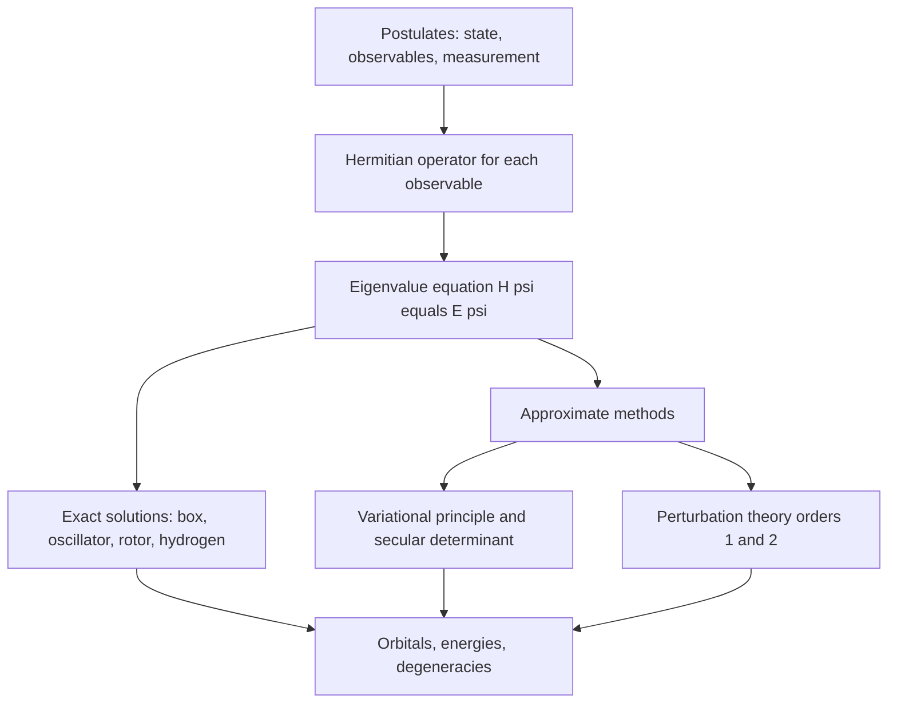
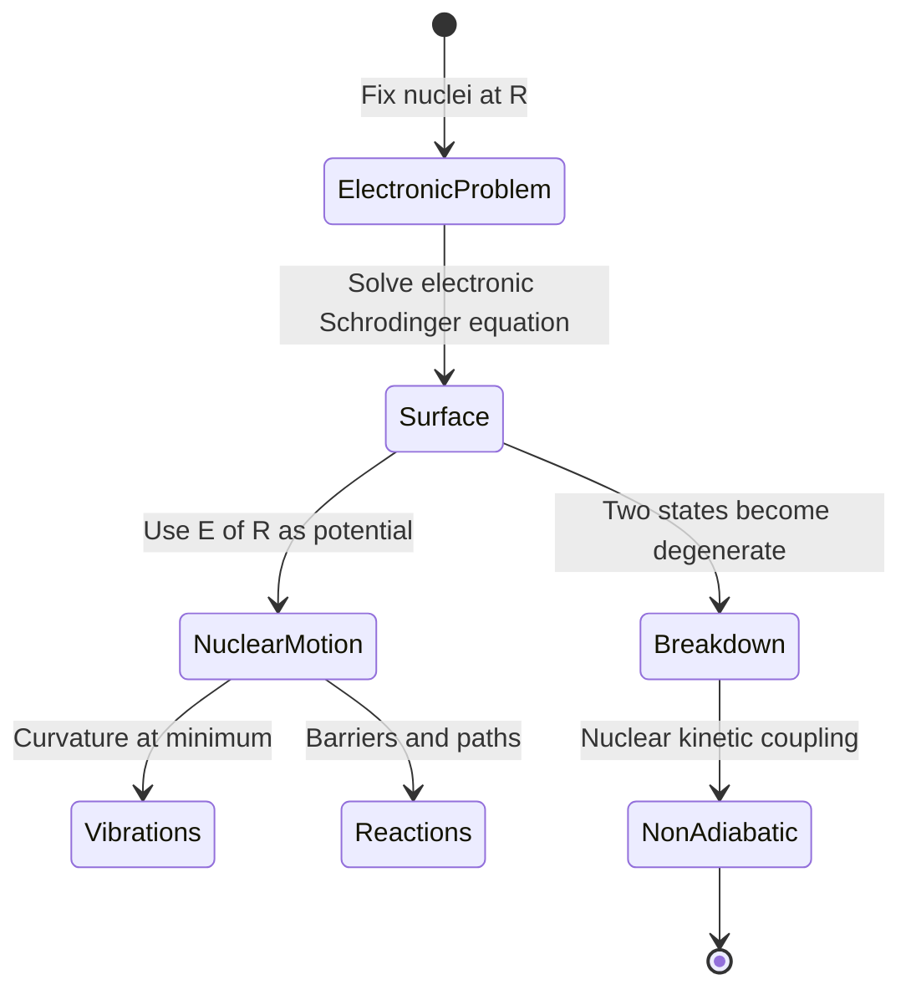
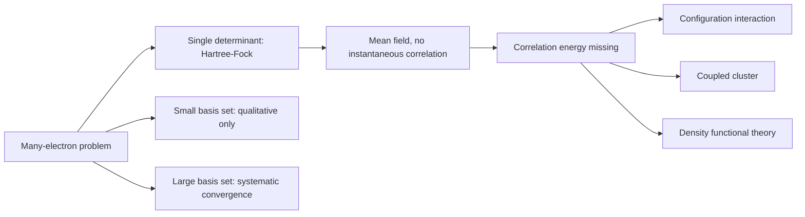

# Chapter 3 — Quantum Chemistry

> **Level:** Advanced (Level 6 — Physical Chemistry)
> **Estimated study time:** 12 hours (9 h reading + 3 h exercises)
> **Prerequisites:** [Quantum Mechanics Foundations](../04-advanced-chemistry/01-quantum-mechanics-foundations.md); [Atomic Orbitals and Quantum Numbers](../04-advanced-chemistry/02-atomic-orbitals-and-quantum-numbers.md); linear algebra (matrices, eigenvalues, determinants)
> **Difficulty:** ★★★★★ (5/5)
> **Related chapters:** [Molecular Spectroscopy](04-molecular-spectroscopy.md), [Statistical Thermodynamics and Statistical Mechanics](02-statistical-thermodynamics-and-statistical-mechanics.md), [Computational Physical Chemistry](09-computational-physical-chemistry.md)

---

## 1. Learning Objectives

After working through this chapter you will be able to:

- State the postulates of quantum mechanics formally and identify which are physical
  assumptions and which are mathematical definitions.
- Recognise Hermitian operators, prove that their eigenvalues are real, and construct
  the operator for a given observable.
- Evaluate commutators and apply the general uncertainty relation
  $\sigma_A\sigma_B \ge \tfrac{1}{2}|\langle[\hat A,\hat B]\rangle|$.
- Separate the time-dependent Schrödinger equation for a time-independent Hamiltonian
  and interpret stationary states.
- Solve the particle in a box, harmonic oscillator, rigid rotor and hydrogen atom,
  giving energies, degeneracies and the physical content of each quantum number.
- Derive the angular momentum commutation relations and their eigenvalue spectrum.
- Explain spin, the Pauli principle and the antisymmetry of the electronic wavefunction.
- Apply the variational principle and the linear variational method to obtain secular
  determinants.
- Apply non-degenerate perturbation theory to first and second order, and use it for the
  helium ground state.
- Explain the Born–Oppenheimer approximation and the structure of the hydrogen molecule
  ion.
- Describe LCAO molecular orbitals, basis sets, Slater determinants, Hartree–Fock theory
  and electron correlation.
- Assign atomic term symbols and apply atomic selection rules.

---

## 2. Introduction

Quantum chemistry is the application of quantum mechanics to electrons in molecules.
Its working equation is the Schrödinger equation, and its central difficulty is that
the equation can be solved exactly for one electron and no more. Everything else —
every bond, every spectrum, every rate — rests on approximations whose quality must be
judged rather than assumed.

The chapter is organised around three questions. What are the exact results? The box,
the harmonic oscillator, the rigid rotor and the hydrogen atom, each solved in full and
each the model behind a family of phenomena. How do we approximate the rest? Through the
variational principle, which turns an intractable differential equation into a matrix
eigenvalue problem, and through perturbation theory, which corrects a solvable problem
order by order. What is the structure of a many-electron wavefunction? An antisymmetrised
product of one-electron functions whose optimal form defines Hartree–Fock theory.

The chapter is also where chemistry's most successful simplification enters: the
Born–Oppenheimer approximation, which freezes the nuclei so that electrons move in a
fixed framework. Without it there is no potential energy surface, and without a surface
no molecular structure, no transition state and no reaction dynamics. The mathematics is
linear algebra and differential equations, used rather than taught.

---

## 3. Fundamental Concepts

### 3.1 The postulates

**Postulate 1 — the state.** The state of a system is described by a wavefunction
$\Psi(\mathbf r, t)$, square-integrable and normalised:

$$
\int |\Psi|^2\,\mathrm{d}\tau = 1 .
$$

$|\Psi|^2$ is the probability density for finding the particle at $\mathbf r$; the
wavefunction itself is complex and has no direct physical meaning.

**Postulate 2 — observables.** Every physical observable corresponds to a Hermitian
operator $\hat A$ built from the classical expression by the replacements
$\hat x = x$ and $\hat p_x = -i\hbar\,\partial/\partial x$. The only possible results
of a measurement are the eigenvalues $a_n$ of $\hat A$.

**Postulate 3 — measurement.** The expectation value for a system in state $\Psi$ is

$$
\langle A\rangle = \int \Psi^*\hat A\Psi\,\mathrm{d}\tau ,
$$

and after a measurement yielding $a_n$ the state collapses to the corresponding
eigenfunction.

**Postulate 4 — time evolution.**

$$
i\hbar\frac{\partial\Psi}{\partial t} = \hat H\Psi .
$$

**Postulate 5 — identical particles.** The wavefunction of identical fermions is
antisymmetric and that of identical bosons symmetric under exchange of any pair. For
electrons this is the Pauli principle in its general form.

The first four postulates cannot be derived; they are the axioms against which experiment
is judged. The fifth is a separate axiom about the structure of many-particle Hilbert
space, and it has no classical analogue at all.

### 3.2 Operators and Hermitian operators

An operator is **Hermitian** if, for all admissible functions,

$$
\int \phi^*(\hat A\psi)\,\mathrm{d}\tau = \int (\hat A\phi)^*\psi\,\mathrm{d}\tau .
$$

Hermiticity delivers three results. Eigenvalues are real, because $\langle A\rangle$ must
be a real number. Eigenfunctions belonging to different eigenvalues are orthogonal, which
makes the expansion of an arbitrary state a Fourier-like decomposition. And the
eigenfunctions are complete, so

$$
\Psi = \sum_n c_n\psi_n, \qquad c_n = \int \psi_n^*\Psi\,\mathrm{d}\tau,
\qquad \sum_n |c_n|^2 = 1,
$$

with $|c_n|^2$ the probability of obtaining $a_n$ in a measurement.

| Observable | Operator | Form in one dimension |
|---|---|---|
| Position | $\hat x$ | $x$ |
| Momentum | $\hat p_x$ | $-i\hbar\,\mathrm{d}/\mathrm{d}x$ |
| Kinetic energy | $\hat T$ | $-\dfrac{\hbar^2}{2m}\dfrac{\mathrm{d}^2}{\mathrm{d}x^2}$ |
| Potential energy | $\hat V$ | $V(x)$ |
| Total energy | $\hat H$ | $\hat T + \hat V$ |
| Angular momentum | $\hat L_z$ | $-i\hbar\,\partial/\partial\phi$ |

### 3.3 Commutators and the uncertainty principle

The **commutator** is $[\hat A,\hat B] = \hat A\hat B - \hat B\hat A$. If it vanishes, the
operators share a complete set of eigenfunctions and the two observables can be known
simultaneously. The general uncertainty relation is

$$
\sigma_A\sigma_B \ge \tfrac{1}{2}\left|\langle[\hat A,\hat B]\rangle\right| .
$$

For position and momentum, $[\hat x,\hat p_x] = i\hbar$, so

$$
\sigma_x\sigma_p \ge \frac{\hbar}{2} .
$$

This is not a statement about clumsy instruments. It is a statement about the structure
of the state: a state sharply localised in $x$ is a broad superposition of momentum
eigenfunctions, and no preparation can evade the inequality. The same algebra gives
$[\hat L_x,\hat L_y] = i\hbar\hat L_z$, which is why a state can be an eigenfunction of
$\hat L^2$ and one component of $\hat L$ but not of two components simultaneously.

### 3.4 The time-dependent equation and stationary states

When $\hat H$ is time-independent, separation of variables
$\Psi(\mathbf r,t) = \psi(\mathbf r)f(t)$ gives $f = e^{-iEt/\hbar}$ and
$\hat H\psi = E\psi$. The **stationary state** therefore has
$|\Psi|^2 = |\psi|^2$, independent of time: all equilibrium physics lies in the
time-independent eigenvalue problem.

$$
i\hbar\frac{1}{f}\frac{\mathrm{d}f}{\mathrm{d}t} = \frac{1}{\psi}\hat H\psi = E,
$$

so $f(t) = e^{-iEt/\hbar}$ and $\hat H\psi = E\psi$. The **stationary state**
$\Psi = \psi e^{-iEt/\hbar}$ has a time-independent probability density
$|\Psi|^2 = |\psi|^2$: nothing observable changes with time. All the physics of atoms and
molecules at equilibrium is contained in the time-independent eigenvalue problem, and
the time-dependent factor matters only when the Hamiltonian itself varies — as it does
when radiation is applied, which is the subject of
[Chapter 4](04-molecular-spectroscopy.md).

---

## 4. Detailed Scientific Explanation

### 4.1 The particle in a box

**Derivation 4.1 — box energies and wavefunctions.** For $V = 0$ inside
$0 < x < L$ and $V = \infty$ outside, the time-independent equation is

$$
-\frac{\hbar^2}{2m}\frac{\mathrm{d}^2\psi}{\mathrm{d}x^2} = E\psi,
\qquad
\psi = A\sin kx + B\cos kx, \quad k = \frac{\sqrt{2mE}}{\hbar} .
$$

The infinite walls require $\psi(0) = 0$, so $B = 0$, and $\psi(L) = 0$, so
$kL = n\pi$ with $n = 1, 2, 3, \dots$ (the value $n = 0$ gives the trivial solution).
Normalising,

$$
\psi_n(x) = \sqrt{\frac{2}{L}}\sin\frac{n\pi x}{L},
\qquad
E_n = \frac{n^2h^2}{8mL^2} .
$$

$\square$

Three features carry over to every bound-state problem. The energy is **quantised**, the
**zero-point energy** $E_1 > 0$ reflects the uncertainty relation, and the $n-1$ nodes of
higher states mean more curvature and more kinetic energy.

$$
E_{n_xn_yn_z} = \frac{h^2}{8m}\left(\frac{n_x^2}{L_x^2}
+ \frac{n_y^2}{L_y^2} + \frac{n_z^2}{L_z^2}\right),
$$

with degeneracies whenever distinct triples give the same sum — for a cubic box,
$(1,2,2)$ and $(2,1,2)$ are degenerate.

The box is the model behind the free-electron picture of conjugated dyes, the band
structure of a metal, and the discussion of quantum dots. It fails quantitatively because
the potential at the end of a conjugated chain is finite, but the scaling
$E \propto L^{-2}$ is correct and is why longer chains absorb at longer wavelength.

### 4.2 The harmonic oscillator

For $V = \tfrac{1}{2}kx^2$ with $\omega = \sqrt{k/\mu}$, the equation

$$
-\frac{\hbar^2}{2\mu}\frac{\mathrm{d}^2\psi}{\mathrm{d}x^2}
+ \tfrac{1}{2}k x^2\psi = E\psi
$$

has acceptable solutions only for

$$
E_v = \left(v + \tfrac{1}{2}\right)\hbar\omega, \qquad v = 0, 1, 2, \dots
$$

with wavefunctions $\psi_v = N_v H_v(y)e^{-y^2/2}$, $y = x\sqrt{\mu\omega/\hbar}$, where
$H_v$ are Hermite polynomials. The levels are equally spaced by $\hbar\omega$, each
non-degenerate, and the **zero-point energy** is $\tfrac{1}{2}\hbar\omega$. The
correspondence principle is visible in the probability densities: the ground state is
Gaussian and peaked at the centre, whereas high-$v$ states oscillate with maxima near the
classical turning points.

The model describes bond vibrations. Its two failures are systematic: real bonds
**dissociate**, so the potential flattens and the level spacing decreases, and they are
**anharmonic**, with the Morse potential $V = D_e(1-e^{-a(r-r_e)})^2$ a better
approximation. The harmonic result nevertheless organises the spectroscopy, and its
partition function is the one used in
[Chapter 2](02-statistical-thermodynamics-and-statistical-mechanics.md).

### 4.3 The rigid rotor

For two masses at fixed separation $r$, the rotational kinetic energy operator gives

$$
E_J = \frac{\hbar^2}{2I}J(J+1) = hcBJ(J+1), \qquad
B = \frac{h}{8\pi^2cI}, \qquad J = 0, 1, 2, \dots
$$

with $I = \mu r^2$ and degeneracy $2J+1$ from the $2J+1$ values of $M_J$. The
wavefunctions are the spherical harmonics $Y_{JM}$, which are simultaneously
eigenfunctions of $\hat L^2$ and $\hat L_z$.

The rigid rotor is the basis of microwave spectroscopy: the transition $J \to J+1$ occurs
at $2B(J+1)$, so a series of equally spaced lines at $2B, 4B, 6B, \dots$ yields $B$ and
hence the bond length. The model fails at high $J$ through centrifugal distortion, which
adds a term $-DJ^2(J+1)^2$, and for non-rigid or floppy molecules where rotation couples
to vibration.

### 4.4 The hydrogen atom

The Hamiltonian for an electron of reduced mass $\mu$ about a proton is

$$
\hat H = -\frac{\hbar^2}{2\mu}\nabla^2 - \frac{e^2}{4\pi\varepsilon_0 r} .
$$

Separation in spherical polar coordinates, $\psi = R(r)Y_{lm}(\theta,\phi)$, gives

$$
E_n = -\frac{\mu e^4}{8\varepsilon_0^2h^2}\frac{1}{n^2}
= -\frac{R_\mathrm{H}}{n^2}
= -\frac{13.6\ \text{eV}}{n^2},
\qquad n = 1, 2, 3, \dots
$$

with quantum numbers $n$ (principal), $l = 0, \dots, n-1$ (orbital angular momentum) and
$m_l = -l, \dots, +l$. The degeneracy of level $n$, excluding spin, is

$$
\sum_{l=0}^{n-1}(2l+1) = n^2 ,
$$

and including the two spin states it is $2n^2$. The energy depends on $n$ alone because
the Coulomb potential has an accidental symmetry larger than the obvious rotational one;
the consequence is that $2s$ and $2p$ are degenerate in hydrogen but split in every
many-electron atom.

The radial functions behave as $R_{nl} \propto r^l$ near the nucleus, decay exponentially
at large $r$, and have $n-l-1$ radial nodes; the angular functions are the spherical
harmonics, whose nodal patterns are the familiar $s$, $p$ and $d$ shapes. The model is
exact apart from relativistic and spin–orbit corrections, and is the zero-order problem
for every many-electron atom.

### 4.5 Angular momentum and its commutation relations

**Derivation 4.3 — the angular momentum algebra.** With
$\hat{\mathbf L} = \hat{\mathbf r}\times\hat{\mathbf p}$, direct evaluation gives

$$
[\hat L_x,\hat L_y] = i\hbar\hat L_z, \qquad
[\hat L_y,\hat L_z] = i\hbar\hat L_x, \qquad
[\hat L_z,\hat L_x] = i\hbar\hat L_y,
$$

and $[\hat L^2,\hat L_z] = 0$. Because $\hat L^2$ and $\hat L_z$ commute, they share
eigenfunctions, which are the spherical harmonics:

$$
\hat L^2Y_{lm} = l(l+1)\hbar^2Y_{lm}, \qquad
\hat L_zY_{lm} = m\hbar Y_{lm},
$$

with $l = 0, 1, 2, \dots$ and $m = -l, \dots, +l$; the restriction follows from the
requirement that $Y$ be single-valued under $\phi \to \phi + 2\pi$. $\square$

The non-commutation of the components is the algebraic statement that angular momentum
has no simultaneous eigenstate for two axes; geometrically, the vector lies on a cone of
fixed $|L|$ and fixed $L_z$, with $L_x$ and $L_y$ indeterminate. The ladder operators
$\hat L_\pm = \hat L_x \pm i\hat L_y$ raise and lower $m$ and are the standard tool for
constructing the coupled states of many-electron atoms.

### 4.6 Spin, antisymmetry and the Pauli principle

Electrons possess an intrinsic angular momentum with quantum number $s = \tfrac{1}{2}$,
so $m_s = \pm\tfrac{1}{2}$ and $\hat s^2$ has eigenvalue $s(s+1)\hbar^2 =
\tfrac{3}{4}\hbar^2$. Spin has no classical analogue; it enters the non-relativistic
theory as an additional postulate and emerges naturally from the Dirac equation.

Because electrons are identical fermions, the total wavefunction must be **antisymmetric**
under exchange of any two:

$$
\Psi(\dots, \mathbf x_i, \dots, \mathbf x_j, \dots)
= -\Psi(\dots, \mathbf x_j, \dots, \mathbf x_i, \dots),
$$

where $\mathbf x$ collects space and spin coordinates. The immediate consequence is the
**Pauli exclusion principle**: two electrons cannot occupy the same spin-orbital, since
setting $i = j$ would require $\Psi = -\Psi$. The general $N$-electron antisymmetric
function is a **Slater determinant** (Section 4.11).

Spin also fixes the multiplet structure. Two electrons couple to total spin $S = 0$
(singlet) or $S = 1$ (triplet), and the spatial part of the wavefunction must then be
symmetric or antisymmetric respectively. Exchange energy — the Coulomb interaction
weighted by the symmetric versus antisymmetric spatial distribution — splits the two,
which is the physical origin of Hund's first rule and of the singlet–triplet gap in
organic photochemistry.

### 4.7 The variational principle and the linear variational method

**The variational principle.** For any normalised trial function $\Phi$,

$$
E_\text{trial} = \frac{\langle\Phi|\hat H|\Phi\rangle}{\langle\Phi|\Phi\rangle}
\ge E_0 ,
$$

with equality only if $\Phi$ is the exact ground-state wavefunction. The proof expands
$\Phi = \sum c_n\psi_n$ in the exact eigenfunctions: the expectation value is
$\sum |c_n|^2E_n \ge E_0\sum|c_n|^2 = E_0$. The principle converts an impossible
differential equation into a minimisation, and every practical electronic-structure
method is built on it.

**The linear variational method.** Expand the trial function in a fixed basis,

$$
\Phi = \sum_{i=1}^{M}c_i\phi_i .
$$

Minimising $E$ with respect to the coefficients gives the **secular equations**

$$
\sum_j\left(H_{ij} - ES_{ij}\right)c_j = 0, \qquad
H_{ij} = \langle\phi_i|\hat H|\phi_j\rangle, \quad
S_{ij} = \langle\phi_i|\phi_j\rangle ,
$$

with non-trivial solutions only when the **secular determinant** vanishes:

$$
\det\left(H_{ij} - ES_{ij}\right) = 0 .
$$

For $M$ basis functions this is an $M$-th order polynomial with $M$ roots; the lowest is
an upper bound to $E_0$ and the others approximate excited states. The matrix formulation
is why quantum chemistry is a branch of linear algebra, and why basis-set size is the
central computational cost.

### 4.8 Perturbation theory and the helium atom

Write $\hat H = \hat H^{(0)} + \lambda\hat H'$ with $\hat H^{(0)}$ exactly solvable.
For a non-degenerate state, expanding in powers of $\lambda$ gives

$$
E_n = E_n^{(0)} + E_n^{(1)} + E_n^{(2)} + \cdots, \qquad
E_n^{(1)} = \langle n|\hat H'|n\rangle,
$$

$$
E_n^{(2)} = \sum_{m\ne n}\frac{\left|\langle m|\hat H'|n\rangle\right|^2}
{E_n^{(0)} - E_m^{(0)}} ,
\qquad
\psi_n \approx \psi_n^{(0)} + \sum_{m\ne n}
\frac{\langle m|\hat H'|n\rangle}{E_n^{(0)} - E_m^{(0)}}\psi_m^{(0)} .
$$

The first-order correction is the average of the perturbation over the unperturbed state;
the second order is always negative for the ground state and diverges if the unperturbed
problem is degenerate, which requires degenerate perturbation theory.

**The helium atom** is the test case. Its Hamiltonian is

$$
\hat H = -\frac{\hbar^2}{2m}\nabla_1^2 - \frac{\hbar^2}{2m}\nabla_2^2
- \frac{2e^2}{4\pi\varepsilon_0 r_1} - \frac{2e^2}{4\pi\varepsilon_0 r_2}
+ \frac{e^2}{4\pi\varepsilon_0 r_{12}} ,
$$

and the last term — electron–electron repulsion — prevents exact solution. Taking the
hydrogen-like ion as $\hat H^{(0)}$ gives $E^{(0)} = -Z^2$ Hartree $= -4$ Hartree for
$Z = 2$, and first-order perturbation theory gives

$$
E^{(1)} = \left\langle\frac{1}{r_{12}}\right\rangle = \frac{5}{8}Z\ \text{Hartree}
= 1.25\ \text{Hartree},
$$

so $E \approx -2.75$ Hartree $= -74.8$ eV against the experimental $-79.0$ eV. The 5 %
error is the price of neglecting correlation; second-order perturbation theory recovers
about half of it, and the variational method with an explicitly correlated trial function
does far better.

### 4.9 The Born–Oppenheimer approximation and the hydrogen molecule ion

Nuclei are at least 1836 times heavier than an electron, so they move far more slowly.
**Born–Oppenheimer** freezes the nuclei at positions $\mathbf R$, solves the electronic
problem

$$
\hat H_\text{el}(\mathbf R)\psi_\text{el} = E_\text{el}(\mathbf R)\psi_\text{el},
$$

and then uses $E_\text{el}(\mathbf R)$ as the potential for nuclear motion. The
approximation defines the **potential energy surface**, and therefore molecular
structure, vibrational spectra and reaction barriers. It fails when two electronic states
become degenerate — at a conical intersection — because then the nuclear kinetic energy
operator couples them strongly; that failure is the mechanism of most photochemical
reactions.

The **hydrogen molecule ion** $\ce{H2+}$ is the simplest molecule and the one case solved
exactly in prolate spheroidal coordinates. In the LCAO approximation,

$$
\psi_\pm = \frac{1}{\sqrt{2(1 \pm S)}}\left(\phi_{1s_A} \pm \phi_{1s_B}\right),
\qquad
E_\pm = \frac{H_{AA} \pm H_{AB}}{1 \pm S},
$$

where $S = \langle\phi_A|\phi_B\rangle$ is the overlap integral. The symmetric combination
has no node between the nuclei and lower energy; the antisymmetric combination has a
nodal plane and is antibonding. At the equilibrium separation of $2.00a_0$ the exact
dissociation energy is $2.79$ eV, and the simple LCAO with a fixed 1s exponent recovers
about half of it — a good return for one parameter.

### 4.10 LCAO molecular orbitals and basis sets

The LCAO idea is that molecular orbitals are linear combinations of atomic orbitals,
with coefficients determined variationally. For two basis functions the secular
determinant is

$$
\begin{vmatrix} H_{AA} - E & H_{AB} - ES \\ H_{AB} - ES & H_{BB} - E \end{vmatrix} = 0,
$$

which for a homonuclear diatomic ($H_{AA} = H_{BB} = \alpha$) gives the roots above. The
same construction with $p$ orbitals produces $\sigma$ and $\pi$ symmetry, and with
$d$ orbitals the $\delta$ combinations of transition-metal chemistry.

A **basis set** is the collection of functions used. The nomenclature records its size and
flexibility:

| Basis set | Composition | Typical use |
|---|---|---|
| STO-3G | One Slater-type orbital per atomic orbital, fitted by three Gaussians | Qualitative, very small systems |
| 6-31G | Split valence: core and two valence functions | Small organic molecules |
| 6-31G(d) | 6-31G plus $d$ polarisation functions on heavy atoms | Geometries and dipole moments |

Gaussian functions are used rather than Slater functions because the product of two
Gaussians on different centres is a Gaussian on a third centre, which makes the
two-electron integrals analytic. The price is that a single Gaussian has the wrong cusp
at the nucleus, so several Gaussians are contracted to mimic one Slater function. Basis
set incompleteness is a systematic error that can be examined by extrapolation; an
inadequate basis is the commonest cause of a meaningless computational result.

### 4.11 Slater determinants, Hartree–Fock theory and electron correlation

An antisymmetric $N$-electron function built from spin-orbitals $\chi_i$ is

$$
\Psi = \frac{1}{\sqrt{N!}}
\begin{vmatrix}
\chi_1(\mathbf x_1) & \chi_2(\mathbf x_1) & \cdots & \chi_N(\mathbf x_1)\\
\chi_1(\mathbf x_2) & \chi_2(\mathbf x_2) & \cdots & \chi_N(\mathbf x_2)\\
\vdots & \vdots & \ddots & \vdots\\
\chi_1(\mathbf x_N) & \chi_2(\mathbf x_N) & \cdots & \chi_N(\mathbf x_N)
\end{vmatrix}.
$$

Interchanging two rows changes the sign, and two identical columns give zero: antisymmetry
and the Pauli principle are automatic. **Hartree–Fock theory** optimises the spin-orbitals
by minimising the energy of a single determinant, which yields the Fock equations
$\hat F\chi_i = \varepsilon_i\chi_i$ solved self-consistently. Each electron feels the
average field of the others, not their instantaneous positions.

The energy left out is the **correlation energy**, $E_\text{corr} = E_\text{exact} -
E_\text{HF}$, typically about 1 % of the total electronic energy. Since total energies are
of order $10^3$ Hartree while bond energies are of order $0.1$ Hartree, that 1 % is several
times a bond energy: correlation is not a refinement but a requirement for quantitative
thermochemistry.

$$
E_\text{corr} = E_\text{exact} - E_\text{HF},
$$

typically about 1 % of the total electronic energy — but total energies are of order
$10^3$ Hartree while bond energies are of order $0.1$ Hartree, so 1 % of the total is
several times a bond energy. Correlation is not a refinement; it is essential for
quantitative thermochemistry. Post-Hartree–Fock methods (configuration interaction,
coupled cluster, Møller–Plesset perturbation theory) and density functional theory
address it in different ways.

### 4.12 Term symbols and selection rules

An atomic **term symbol** $^{2S+1}L_J$ records the total spin $S$, total orbital angular
momentum $L$ (written S, P, D, F for $L = 0, 1, 2, 3$) and total angular momentum
$J = |L - S|, \dots, L + S$. For the carbon ground configuration $2p^2$, the allowed terms
are $^1S$, $^3P$ and $^1D$; **Hund's rules** order them, giving $^3P_0$ as the ground
state: maximum $S$ first, then maximum $L$, then minimum $J$ for a less than half-filled
shell. The rules are consequences of exchange energy and spin–orbit coupling, not separate
axioms, and they fail for heavy atoms where spin–orbit coupling is comparable to the
electrostatic splittings.

**Selection rules** follow from the transition moment integral
$\langle f|\hat{\boldsymbol\mu}|i\rangle$ and the properties of spherical harmonics:
$\Delta S = 0$, $\Delta L = 0, \pm1$, $\Delta J = 0, \pm1$ with $J = 0 \nrightarrow J = 0$,
$\Delta M_J = 0, \pm1$, and a change of parity. The spin rule holds only in the absence of
spin–orbit coupling, which is why phosphorescence is slow but observable.

$$
\Delta S = 0, \qquad \Delta L = 0, \pm1, \qquad
\Delta J = 0, \pm1 \ (J = 0 \nrightarrow J = 0), \qquad
\Delta M_J = 0, \pm1,
$$

together with a requirement that the parity of the two states differ. The spin rule is
rigorous only in the absence of spin–orbit coupling; heavy atoms relax it, which is why
phosphorescence is slow but observable. These rules are developed for molecules in
[Chapter 4](04-molecular-spectroscopy.md).

---

## 5. Visual Diagrams

**Figure 3.1 — The structure of the quantum-chemical argument.** Exact solutions supply
both the language (quantum numbers, nodes, degeneracies) and the zero-order problem for
the approximate methods. Variational methods are robust but expensive; perturbation
theory is cheap but needs a well-behaved zero-order problem.

**Figure 3.2 — The Born–Oppenheimer workflow as a state machine.** The separation holds
while electronic states are well separated. At a conical intersection the surfaces touch
and the nuclear kinetic energy operator mixes them, so the sequence breaks and the system
must be propagated on coupled surfaces.

**Figure 3.3 — Where the errors come from.** Two independent approximations — the
one-determinant form of the wavefunction and the finite basis — control the accuracy of a
calculation. Basis-set error is systematic and extrapolable; correlation error requires a
different method rather than a larger computer.

---

## 6. Mathematical Formulas

$$
\hat H\psi = E\psi, \qquad
[\hat x,\hat p_x] = i\hbar, \qquad
\sigma_A\sigma_B \ge \tfrac{1}{2}\left|\langle[\hat A,\hat B]\rangle\right|
$$

$$
E_n = \frac{n^2h^2}{8mL^2}, \qquad
E_v = \left(v + \tfrac{1}{2}\right)\hbar\omega, \qquad
E_J = hcBJ(J+1), \qquad
E_n = -\frac{13.6\ \text{eV}}{n^2}
$$

| Symbol | Meaning | SI unit |
|---|---|---|
| $\Psi$, $\psi$ | wavefunction, stationary wavefunction | m⁻³ᐟ² |
| $\hat H$ | Hamiltonian operator | J |
| $\hbar$ | reduced Planck constant | J s |
| $E$ | energy eigenvalue | J |
| $L$, $m$ | box length, particle mass | m, kg |
| $\omega$ | oscillator angular frequency | rad s⁻¹ |
| $B$ | rotational constant | m⁻¹ (usually cm⁻¹) |
| $I$ | moment of inertia | kg m² |

Assumptions: non-relativistic, time-independent Hamiltonian; fixed nuclei
(Born–Oppenheimer); infinite walls for the box; harmonic potential for the oscillator;
rigid bond for the rotor; isolated atom for hydrogen. Perturbation results require
non-degeneracy and a convergent series.

---

## 7. Chemical Equations

The hydrogen molecule ion is the simplest case in which the electronic equation can be
solved, and its formation and photodissociation are written:

$$
\ce{H + H+ -> H2+} \qquad D_e = 2.79\ \text{eV}
$$

$$
\ce{H2+ -> H + H+} \qquad \text{photodissociation at } \lambda < 443\ \text{nm}
$$

The helium atom illustrates the expansion, since electron–electron repulsion is the
perturbation on the hydrogen-like problem, and the ionisation energies show the
consequence:

$$
\ce{He -> He+ + e-} \qquad I_1 = 24.59\ \text{eV},
\qquad
\ce{He+ -> He^2+ + e-} \qquad I_2 = 54.42\ \text{eV}
$$

The large ratio $I_2/I_1$ is the signature of electron–electron repulsion: the second
electron leaves a bare nucleus and is bound far more tightly than the first, which moves
in the field of a nucleus screened by the remaining electron.

---

## 8. Worked Examples

### Worked Example 8.1 — An electron in a one-nanometre box

**Problem.** An electron is confined to a one-dimensional box of length 1.00 nm. Compute
$E_1$, $E_2$ and the wavelength of the photon that drives the $n = 1 \to 2$ transition.

**Strategy.** Use $E_n = n^2h^2/(8mL^2)$, then $\Delta E = hc/\lambda$.

**Solution.** $E_1 = (6.626\times10^{-34})^2/[8(9.109\times10^{-31})(1.00\times10^{-9})^2]
= 4.390\times10^{-67}/7.287\times10^{-48} = 6.02\times10^{-20}$ J $= 0.376$ eV.
$E_2 = 4E_1 = 2.41\times10^{-19}$ J $= 1.50$ eV.
$\Delta E = 1.81\times10^{-19}$ J, so
$\lambda = hc/\Delta E = (6.626\times10^{-34})(2.998\times10^{8})/(1.81\times10^{-19})
= 1.10\times10^{-6}$ m $= 1100$ nm.

**Check.** The transition lies in the near infrared, which is the right region for a
confined electron over a nanometre: the box model predicts absorption wavelengths of this
order for conjugated dyes and quantum dots of similar size. Doubling the box length
quarters the energy and doubles the wavelength, the $L^{-2}$ scaling that makes larger
dots emit redder light.

### Worked Example 8.2 — LCAO energies for the hydrogen molecule ion

**Problem.** With $H_{AA} = -13.6$ eV, $H_{AB} = -10.0$ eV and $S = 0.59$ at
$R = 2.00a_0$, compute the energies of the bonding and antibonding combinations.

**Strategy.** Solve the $2\times2$ secular determinant for a homonuclear case and use
$E_\pm = (\alpha \pm \beta)/(1 \pm S)$.

**Solution.** The determinant
$(H_{AA} - E)^2 - (H_{AB} - ES)^2 = 0$ factors into
$E_\pm = (H_{AA} \pm H_{AB})/(1 \pm S)$. Then

$$
E_+ = \frac{-13.6 - 10.0}{1.59} = -14.84\ \text{eV},
\qquad
E_- = \frac{-13.6 + 10.0}{0.41} = -8.78\ \text{eV}.
$$

**Check.** The bonding orbital lies 1.24 eV below the isolated 1s orbital and the
antibonding orbital 4.8 eV above it; the asymmetry about $\alpha$ is required, because the
antibonding combination is destabilised more than the bonding one is stabilised. Note the
condition $\beta < S\alpha$ must hold for the roots to straddle $H_{AA}$, which is a useful
check on tabulated matrix elements. The exact dissociation energy of $\ce{H2+}$ at this
separation is about 2.4 eV, so the simple LCAO result is roughly half the true binding,
the usual accuracy of a minimal basis.

### Worked Example 8.3 — First-order perturbation theory for helium

**Problem.** Estimate the ground-state energy of helium by first-order perturbation theory
and compare with the experimental value of $-79.0$ eV.

**Strategy.** Use hydrogen-like 1s orbitals with $Z = 2$ as the zero-order functions and
evaluate $\langle 1/r_{12}\rangle = 5Z/8$ Hartree.

**Solution.** $E^{(0)} = -Z^2$ Hartree $= -4$ Hartree. The first-order correction is
$E^{(1)} = 5Z/8 = 1.25$ Hartree. Hence

$$
E \approx -2.75\ \text{Hartree} = -2.75(27.211\ \text{eV}) = -74.8\ \text{eV}.
$$

**Check.** The calculated energy is 4.2 eV above experiment, an error of 5.3 %. The sign
is right — repulsion raises the energy — and the magnitude is the expected size of the
neglected correlation energy. A variational calculation with an effective nuclear charge
$Z_\text{eff} = 27/16$ lowers the energy to $-77.5$ eV, and explicitly correlated methods
reach $-79.0$ eV. The exercise shows both the power and the limits of first-order theory.

### Worked Example 8.4 — Term symbols of the carbon ground state

**Problem.** Give the term symbols arising from the $2p^2$ configuration of carbon and
identify the ground state.

**Strategy.** Couple two $l = 1$ electrons: $L = 2, 1, 0$; antisymmetry allows
$S = 0$ with $L = 2, 0$ and $S = 1$ with $L = 1$. Apply Hund's rules.

**Solution.** The terms are $^1D$, $^3P$ and $^1S$. Hund's first rule maximises $S$, so
$^3P$ lies lowest; the second maximises $L$ within that multiplicity, which is already
fixed; the third gives minimum $J = |L - S| = 0$ for a less than half-filled shell, so the
ground state is $^3P_0$.

**Check.** The $^1D$ term lies 1.26 eV above the ground state and $^1S$ about 2.7 eV,
splittings of the order of exchange energies, as expected. The rule that a less than
half-filled shell takes minimum $J$ reverses for more than half-filled shells, which is
why oxygen ($2p^4$) has $^3P_2$ as its ground state rather than $^3P_0$.

---

## 9. Real-World Applications

**Computational drug design.** Molecular orbitals, partial charges and interaction
energies from density functional theory guide candidate selection before synthesis.

**Spectroscopy and atmospheric chemistry.** Term symbols and selection rules assign the
lines observed in stellar and atmospheric spectra, and computed potential energy surfaces
interpret the photochemistry of ozone and of halocarbons.

**Materials and lasers.** Band structure is the periodic-extension of molecular orbital
theory; quantum dots exploit the particle-in-a-box scaling, and the design of organic
light-emitting diodes rests on singlet–triplet energetics.

---

## 10. Common Mistakes

| Mistake | Why it happens | Correct approach |
|---|---|---|
| Treating $|\psi|^2$ as a probability rather than a density | The distinction disappears in one dimension | Integrate over a volume; the density has units of m⁻³ |
| Assuming $\hat L_x$, $\hat L_y$ and $\hat L_z$ can be simultaneously sharp | Components look independent | They do not commute; only $\hat L^2$ and one component share eigenfunctions |
| Using $E_n = n^2h^2/(8mL^2)$ with $m$ as the molecular mass | The formula is memorised without its model | $m$ is the mass of the *confined particle*, usually an electron |
| Forgetting the zero-point energy of the oscillator | Classical intuition expects $E = 0$ at rest | The lowest level is $\tfrac{1}{2}\hbar\omega$; it never vanishes |
| Applying first-order perturbation theory to a degenerate level | The formula looks general | Degenerate states require degenerate perturbation theory; the denominator vanishes |
| Treating Hartree–Fock as exact | It gives 99 % of the total energy | Correlation energy is the remaining 1 %, which is chemically decisive |
| Quoting a computed energy without the basis set | The method name is reported and the basis omitted | Energy depends strongly on basis; always state method and basis together |

---

## 11. Chapter Summary

- The five postulates define the state, the observables, measurement, time evolution and
  the symmetry of identical-particle wavefunctions.
- Hermitian operators have real eigenvalues and orthogonal, complete eigenfunctions, and
  non-commuting observables obey $\sigma_A\sigma_B \ge \tfrac{1}{2}|\langle[\hat A,\hat B]\rangle|$.
- Stationary states satisfy $\hat H\psi = E\psi$ with time-independent probability density.
- Box, oscillator, rotor and hydrogen atom give $n^2h^2/8mL^2$,
  $(v+\tfrac{1}{2})\hbar\omega$, $hcBJ(J+1)$ and $-13.6\ \text{eV}/n^2$.
- Antisymmetry of the electronic wavefunction is the Pauli principle, built in by a Slater
  determinant.
- The variational principle bounds the ground-state energy from above and reduces the
  problem to a secular determinant; perturbation theory gives $-74.8$ eV for helium.
- Born–Oppenheimer defines the potential energy surface and fails at conical intersections;
  Hartree–Fock omits the correlation energy, which is chemically decisive.
- Term symbols and selection rules classify atomic states and their spectra.

---

## 12. Exercises

### 12.1 Conceptual questions

1. Why must an observable's operator be Hermitian? Give two consequences.
2. Explain why a stationary state has a time-independent probability density.
3. Why does the hydrogen atom have $n^2$-fold degeneracy while a many-electron atom does
   not?

### 12.2 Basic problems

4. Compute the zero-point energy of a harmonic oscillator with
   $\tilde\nu = 1000\ \text{cm}^{-1}$.
5. Give the degeneracy of the $J = 3$ rotational level and of the $n = 3$ hydrogen level
   including spin.
6. Evaluate $[\hat x^2, \hat p_x]$.

### 12.3 Intermediate problems

7. Show that $\psi = A e^{-\alpha x^2}$ is an eigenfunction of the harmonic oscillator
   Hamiltonian only for one particular $\alpha$, and find it.
8. Normalise the LCAO combination $\psi_+ = N(\phi_A + \phi_B)$ with overlap $S = 0.30$.
9. For a cubic box of side $L$, list the degeneracy of the level with
   $n_x^2 + n_y^2 + n_z^2 = 6$.

### 12.4 Advanced problems

10. Derive $E^{(1)} = 5Z/8$ Hartree for helium and explain why the result overestimates the
    true energy.
11. Use the variational principle with the trial function $\psi = c_1\phi_1 + c_2\phi_2$ to
    show that the two roots bracket the two lowest exact energies.
12. Construct the Slater determinant for the lithium ground state and identify its
    spatial and spin parts.

### 12.5 Calculation problems

13. Compute the wavelength of the $J = 0 \to 1$ transition of CO
    ($B = 1.931\ \text{cm}^{-1}$) and the corresponding photon energy in
    $\text{J mol}^{-1}$.

### Answers

1. Real eigenvalues are needed for measurement results, and orthogonality of
   eigenfunctions is needed for the expansion of arbitrary states.
2. The phase $e^{-iEt/\hbar}$ has modulus one, so $|\Psi|^2 = |\psi|^2$.
3. The $1/r$ potential has an accidental symmetry; in many-electron atoms screening and
   electron–electron repulsion remove it.
4. $E_0 = \tfrac{1}{2}hc\tilde\nu = 9.93\times10^{-21}$ J $= 0.062$ eV.
5. $2J+1 = 7$; $2n^2 = 18$.
6. $[\hat x^2,\hat p_x] = 2i\hbar\hat x$.
7. Substitution gives $\alpha = m\omega/(2\hbar)$ and $E = \tfrac{1}{2}\hbar\omega$.
8. $N = [2(1+S)]^{-1/2} = [2(1.30)]^{-1/2} = 0.620$.
9. $(1,1,2)$, $(1,2,1)$, $(2,1,1)$: threefold degenerate.
10. The integral is evaluated with hydrogen-like 1s functions; it ignores the way the
    electrons avoid one another, so the energy is too high.
11. The determinant gives a quadratic whose roots bound the two lowest energies from above.
12. A $3\times3$ determinant over $1s$ and $2s$ spin-orbitals, with a doublet spin part.
13. $\Delta E = 2hcB = 7.67\times10^{-23}$ J, so $\lambda = 2.59$ mm and
    $E = 46.2\ \text{J mol}^{-1}$.

---

## 13. Further Reading

- Atkins, P. W., de Paula, J. and Keeler, J. *Atkins' Physical Chemistry*, 12th ed.,
  Oxford University Press, 2022. Chapters 7–9.
- Levine, I. N. *Quantum Chemistry*, 7th ed., Pearson, 2014. Chapters 1–11.
- McQuarrie, D. A. and Simon, J. D. *Physical Chemistry: A Molecular Approach*,
  University Science Books, 1997. Chapters 3–5 and 9.
- Cramer, C. J. *Essentials of Computational Chemistry: Theories and Models*, 2nd ed.,
  Wiley, 2004. Chapters 2–6.

See [CURRICULUM.md](../CURRICULUM.md) and [REFERENCES.md](../REFERENCES.md).
