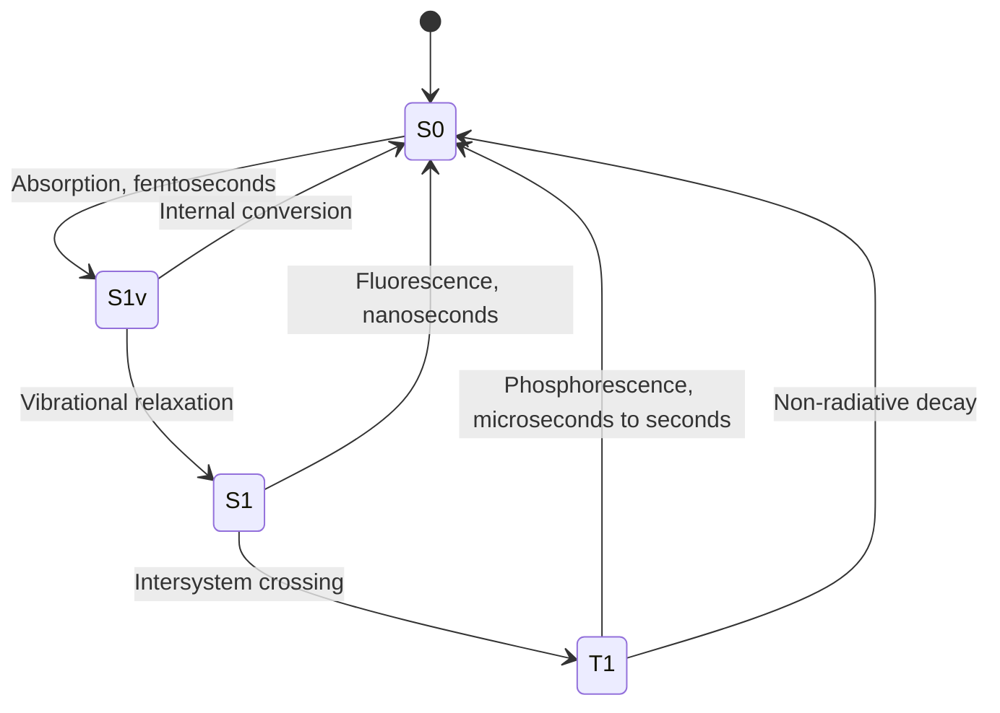
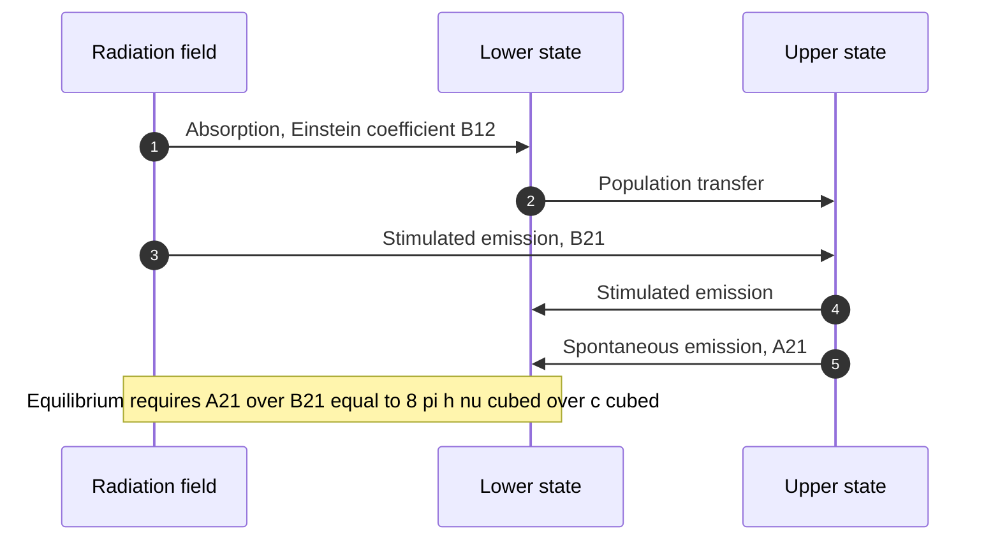
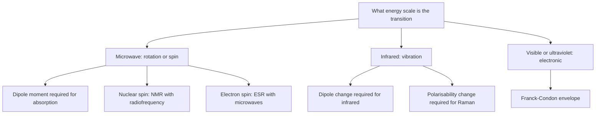
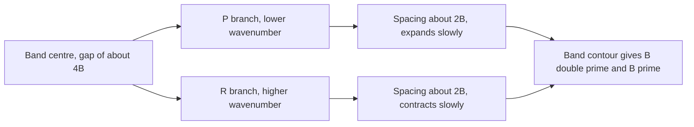

# Chapter 4 — Molecular Spectroscopy

> **Level:** Advanced (Level 6 — Physical Chemistry)
> **Estimated study time:** 10 hours (7 h reading + 3 h exercises)
> **Prerequisites:** [Quantum Chemistry](03-quantum-chemistry.md); [Atomic Orbitals and Quantum Numbers](../04-advanced-chemistry/02-atomic-orbitals-and-quantum-numbers.md)
> **Difficulty:** ★★★★★ (5/5)
> **Related chapters:** [Quantum Chemistry](03-quantum-chemistry.md), [Photochemistry](07-photochemistry.md), [Chemical Kinetics and Reaction Dynamics](05-chemical-kinetics-and-reaction-dynamics.md)

---

## 1. Learning Objectives

After working through this chapter you will be able to:

- Describe the interaction of electromagnetic radiation with matter in terms of the
  transition dipole moment, and derive the selection rules that follow from it.
- Relate the Einstein coefficients to one another and recover the Planck distribution.
- Derive the Beer–Lambert law from a differential absorption model and state its limits.
- Assign rotational spectra of rigid rotors, extract $B$ and hence the bond length.
- Interpret vibrational spectra of harmonic and anharmonic oscillators, including
  zero-point energy, overtones, hot bands and dissociation.
- Analyse rovibrational band structure into P, Q and R branches and explain the spacing.
- Explain Raman scattering, its selection rules and the mutual exclusion rule.
- Interpret electronic spectra with the Franck–Condon principle, vibrational progressions
  and dissociation continua.
- Distinguish fluorescence from phosphorescence using a Jablonski diagram and rate
  constants.
- Explain the physical basis of NMR (spin, Larmor frequency, chemical shift, coupling)
  and of ESR.
- Identify the mechanisms of line broadening and estimate their magnitudes.

---

## 2. Introduction

Spectroscopy is how chemists know the shape of molecules. A bond length comes from the
spacing of microwave lines, a force constant from an infrared wavenumber, an electronic
structure from the colour of a compound, and a connectivity from the splitting pattern of
a proton NMR signal. Each number is an energy difference, and each energy difference is a
solution of the Schrödinger equation for a particular degree of freedom.

The unifying idea is the **transition dipole moment**. Radiation interacts with a molecule
only if the oscillating electric field can drive a charge displacement between the initial
and final states. That single integral — the dipole moment operator sandwiched between two
wavefunctions — generates every selection rule in the subject. Where the integral vanishes
by symmetry, the transition is forbidden; where it is large, the transition is intense.
The intensity of an absorption is therefore a statement about wavefunctions, not merely
about concentration.

The chapter proceeds by degree of freedom, from the lowest energies to the highest:
rotation (microwave), vibration (infrared), vibration–rotation (gas-phase infrared bands),
electronic excitation (visible and ultraviolet), and nuclear and electron spin (radio and
microwave). For each, the model Hamiltonian, the energy levels, the selection rule and the
information extracted are set out. The treatment is quantitative throughout: wavenumbers in
$\text{cm}^{-1}$, intensities in molar absorption coefficients, and linewidths in Hz.

Two limits recur. The **harmonic oscillator** and the **rigid rotor** are exactly solvable
and give the organising pattern; real molecules are anharmonic and non-rigid, and the
deviations carry chemical information. The chapter states where each model applies and
what its breakdown signifies — dissociation, centrifugal distortion, or a change of
electronic state.

---

## 3. Fundamental Concepts

### 3.1 The electromagnetic spectrum and the energy scale

Spectroscopy probes transitions whose energy matches a photon, $\Delta E = h\nu = hc\tilde\nu$.
The relevant scale is set by $1\ \text{eV} = 8065\ \text{cm}^{-1} =
96.5\ \text{kJ mol}^{-1}$:

| Region | Wavenumber / cm⁻¹ | Energy / kJ mol⁻¹ | Molecular process |
|---|---|---|---|
| Microwave | 0.1–100 | 0.001–1 | Rotation, spin states |
| Infrared | 100–10 000 | 1–120 | Vibration |
| Visible | 14 000–25 000 | 170–300 | Valence electronic |
| Ultraviolet | 25 000–70 000 | 300–840 | Valence and some core electronic |
| X-ray | $>10^{6}$ | $>10^{4}$ | Core electronic, ionisation |

The ordering is also the ordering of energy level spacings, which is why the spectroscopies
are cleanly separated and why a molecule can rotate, vibrate and excite electronically
without the processes interfering strongly.

### 3.2 The transition dipole moment

For a molecule in state $i$ irradiated at frequency $\nu$, the probability of transition to
state $f$ is proportional to

$$
\boldsymbol\mu_{fi} = \langle f|\hat{\boldsymbol\mu}|i\rangle
= \int \psi_f^*\,\hat{\boldsymbol\mu}\,\psi_i\,\mathrm{d}\tau ,
$$

where $\hat{\boldsymbol\mu} = \sum_j q_j\mathbf r_j$ is the electric dipole operator. The
**selection rule** for an electric dipole transition is simply
$\boldsymbol\mu_{fi} \neq 0$. The transition rate in a radiation field of energy density
$\rho(\nu)$ is

$$
W_{i\to f} = \frac{2\pi}{\hbar}\left|\boldsymbol\mu_{fi}\right|^2\rho(\nu)
$$

in the limit of a broad continuum (Fermi's golden rule), and the integrated absorption
intensity is proportional to $|\boldsymbol\mu_{fi}|^2$.

Three consequences follow immediately. First, a transition is forbidden if the integral
vanishes by symmetry, however strong the radiation. Second, the intensity measures the
overlap of the two states weighted by the dipole operator, which is why
charge-transfer transitions are intense and $d$–$d$ transitions in centrosymmetric
complexes are weak. Third, the operator is a vector, so the polarisation of the radiation
matters: a molecule oriented in a field absorbs only the component of $\boldsymbol\mu_{fi}$
along the field.

### 3.3 Einstein coefficients and the Planck distribution

Three processes connect two levels: **stimulated absorption** (rate $B_{12}\rho(\nu)$),
**stimulated emission** ($B_{21}\rho(\nu)$) and **spontaneous emission** ($A_{21}$). At
equilibrium the populations obey Boltzmann, and the net rate must vanish:

$$
N_1B_{12}\rho = N_2\left[B_{21}\rho + A_{21}\right].
$$

Solving for $\rho$ and requiring agreement with Planck's law,

$$
\rho(\nu) = \frac{8\pi h\nu^3}{c^3}\frac{1}{e^{h\nu/k_\mathrm{B}T} - 1},
$$

gives the relations

$$
B_{12} = B_{21} \quad (\text{for equal degeneracies}),
\qquad
\frac{A_{21}}{B_{21}} = \frac{8\pi h\nu^3}{c^3}.
$$

The cubic frequency dependence is the reason ultraviolet transitions are fast
($A \sim 10^{8}\ \text{s}^{-1}$) and nuclear spin transitions are slow
($A \sim 10^{-15}\ \text{s}^{-1}$ in the radiofrequency region): spontaneous emission is
negligible for NMR, so a signal requires stimulated processes and phase-coherent detection.

### 3.4 The Beer–Lambert law

Consider a slab of thickness $\mathrm{d}x$ containing $c$ moles per unit volume, each
molecule presenting an absorption cross-section $\sigma$. The fractional intensity loss is

$$
\frac{\mathrm{d}I}{I} = -\sigma c N_\mathrm{A}\,\mathrm{d}x ,
$$

which integrates to $I = I_0e^{-\kappa c l}$ with $\kappa = \sigma N_\mathrm{A}$. In
decadic form,

$$
A = \log_{10}\frac{I_0}{I} = \varepsilon c l ,
\qquad \varepsilon = \frac{\kappa}{\ln 10},
$$

where $A$ is the absorbance, $\varepsilon$ the molar absorption coefficient in
$\text{dm}^{3}\text{mol}^{-1}\text{cm}^{-1}$, $c$ in $\text{mol dm}^{-3}$ and $l$ in cm.

The derivation assumes that each molecule absorbs independently, that the absorber is
homogeneously distributed, that the radiation is monochromatic and that no saturation
occurs. Deviations appear at high concentration (solute–solute interaction changes
$\varepsilon$), with polychromatic radiation, and whenever the analyte associates,
dissociates or adsorbs at the cell walls. It is a *linear* law and therefore the basis of
quantitative ultraviolet–visible analysis, but it is a law about absorbance, not about
chemistry.

### 3.5 Spectral linewidths

No transition is infinitely sharp. The **natural width** follows from the energy–time
uncertainty relation $\Delta E\Delta t \ge \hbar/2$: a state of lifetime $\tau$ has a
width $\Delta\nu \approx 1/(2\pi\tau)$. **Doppler broadening** arises because molecules
moving towards or away from the source see shifted frequencies,
$\Delta\nu/\nu \approx v/c$, giving a Gaussian profile of width
$\Delta\nu_\text{D} \approx 7.16\times10^{-7}\nu\sqrt{T/M}$. **Pressure broadening**
results from collisions that interrupt the phase of the oscillating dipole and gives a
Lorentzian profile whose width grows linearly with pressure. **Inhomogeneous broadening**
in solids and glasses reflects a distribution of local environments.

The linewidth matters chemically. A lifetime of 10 ns gives a natural width of about
16 MHz, comparable to the spacing of hyperfine structure in ESR; a gas at 1 bar has
pressure-broadened widths of order gigahertz, which is why high-resolution spectroscopy is
done in molecular beams or at low pressure.

---

## 4. Detailed Scientific Explanation

### 4.1 Rotational spectroscopy

For a rigid linear rotor the levels are $E_J = hcBJ(J+1)$ with
$B = h/(8\pi^2cI)$ and degeneracy $2J+1$. The permanent dipole moment must be non-zero for
microwave absorption, and the transition moment integral

$$
\langle J'|\hat\mu|J\rangle \ne 0 \quad\Longrightarrow\quad \Delta J = \pm1
$$

selects adjacent levels. The transition $J \to J+1$ therefore occurs at

$$
\tilde\nu = 2B(J+1), \qquad J = 0, 1, 2, \dots
$$

so the spectrum is a series of lines equally spaced by $2B$, with the first at $2B$. Two
numbers follow from one spectrum: $B$ gives the moment of inertia and hence the bond
length, and the intensities give the temperature, because the population of level $J$ is
proportional to $(2J+1)e^{-hcBJ(J+1)/k_\mathrm{B}T}$ and peaks at
$J_\text{max} \approx \sqrt{k_\mathrm{B}T/2hcB} - \tfrac{1}{2}$.

Real spectra deviate in three informative ways. **Centrifugal distortion** adds
$-DJ^2(J+1)^2$ and compresses the high-$J$ spacing. **Nuclear spin statistics** modulates
intensities: for H₂ the $3:1$ alternation of ortho and para species is direct evidence for
the Pauli principle. **Internal rotation** and inversion produce splittings that measure
torsional barriers. The method applies to gases with permanent dipole moments; symmetric
tops give more complex patterns, and spherical tops give none.

### 4.2 Vibrational spectroscopy

A diatomic vibrates at

$$
\tilde\nu = \frac{1}{2\pi c}\sqrt{\frac{k}{\mu}} ,
$$

so the wavenumber measures the force constant. The harmonic selection rule is
$\Delta v = \pm1$, and because the levels are equally spaced, the fundamental $0 \to 1$
coincides with the hot band $1 \to 2$ and with the first overtone $0 \to 2$ would-be
position at $2\tilde\nu$ — except that anharmonicity separates them.

The **Morse potential** $V = D_e(1-e^{-a(r-r_e)})^2$ gives

$$
E_v = \left(v + \tfrac{1}{2}\right)hc\tilde\nu
- \left(v + \tfrac{1}{2}\right)^2 hc\tilde\nu x_e ,
$$

with $x_e$ the anharmonicity constant. The levels converge as $v$ rises and terminate at
the dissociation limit, so the spacing between successive levels gives the bond energy:

$$
D_0 = D_e - \tfrac{1}{2}hc\tilde\nu .
$$

The consequences for a spectrum are systematic. The fundamental appears slightly below
$\tilde\nu$; the **overtone** $0 \to 2$ appears near $2\tilde\nu$ but shifted; and the
**hot bands** $1 \to 2$, $2 \to 3$ appear at lower wavenumber and grow in intensity as
$T$ rises, which is how vibrational temperatures are measured. At high resolution the
individual $v$ levels are further split by rotation, producing the rovibrational structure
of Section 4.3.

Only modes that change the dipole moment absorb in the infrared. Symmetric stretching of
CO₂ is infrared inactive because the dipole remains zero, but it is Raman active; bending
is infrared active. This complementarity is the basis of the mutual exclusion rule for
centrosymmetric molecules.

### 4.3 Rovibrational spectra and the P, Q, R branches

A vibrational transition in the gas phase is accompanied by a change in rotational state.
Combining the two energies,

$$
\tilde\nu = \tilde\nu_0 + B'J'(J'+1) - B''J''(J''+1).
$$

With $\Delta J = +1$ the **R branch** appears at
$\tilde\nu_0 + 2B(J''+1)$ for $J'' = 0, 1, 2, \dots$; with $\Delta J = -1$ the **P
branch** appears at $\tilde\nu_0 - 2BJ''$ for $J'' = 1, 2, \dots$; and $\Delta J = 0$ gives
the **Q branch**, allowed only when the transition has a component of angular momentum
about the top axis (perpendicular bands) or when a degenerate mode is excited.

The pattern is therefore two combs of lines separated by about $2B$ with a gap of about
$4B$ at the band centre, and the gap is where the Q branch would sit. Because $B'$ is
slightly smaller than $B''$ (the bond lengthens in the upper state), the R-branch spacing
contracts and the P-branch spacing expands; the difference measures the change in bond
length on excitation. This is how vibrational band contours are assigned and how the
geometry of an excited vibrational state is obtained.

### 4.4 Raman scattering

In Raman spectroscopy the sample is irradiated at $\tilde\nu_0$ and the scattered light is
analysed. Most is unshifted (**Rayleigh** scattering), but a small fraction is shifted to
$\tilde\nu_0 \pm \Delta\tilde\nu$, where $\Delta\tilde\nu$ is a molecular transition
energy. The lower-frequency **Stokes** lines correspond to excitation of the molecule; the
higher-frequency **anti-Stokes** lines to de-excitation of an already excited molecule, and
their intensity relative to Stokes lines measures the Boltzmann population of the excited
state.

The selection rule is that the **polarisability** must change during the vibration,
$\left(\partial\alpha/\partial Q\right)_0 \ne 0$, rather than the dipole moment. For
rotational Raman scattering the rule is $\Delta J = 0, \pm2$, so the lines are spaced by
$4B$ and the $J = 0 \to 0$ line (Rayleigh) is accompanied by a series at $6B, 10B, \dots$.

Raman and infrared are complementary. In a centrosymmetric molecule the rule of mutual
exclusion applies: a mode is infrared active or Raman active, never both. For CO₂ the
symmetric stretch is Raman active and infrared inactive, the antisymmetric stretch and
bend are infrared active; comparing the two spectra therefore establishes the geometry.
Resonance Raman, in which the laser is tuned near an electronic transition, enhances the
modes coupled to that chromophore and is sensitive enough for single-molecule work.

### 4.5 Electronic spectroscopy and the Franck–Condon principle

An electronic transition involves a change of orbital occupation. The energy is typically
$1$–$6$ eV, the selection rules are $\Delta S = 0$ (spin allowed), $\Delta\Lambda = 0, \pm1$
for diatomic molecules, and — for centrosymmetric systems — a change of parity
(Laporte rule), which is why $d$–$d$ bands are weak.

Because electrons move far faster than nuclei, the transition is **vertical**: the
internuclear distance does not change during the electronic jump. The intensity of a
transition between vibrational levels $v''$ and $v'$ is proportional to the
**Franck–Condon factor**

$$
\left|\langle v'|v''\rangle\right|^2 ,
$$

the square of the overlap of the two vibrational wavefunctions. If the excited state has a
similar equilibrium geometry, the $0 \to 0$ band dominates and the spectrum is a single
sharp line. If the excited state is displaced, the overlap is largest for $v' > 0$ and the
spectrum shows a **vibrational progression** — a series of bands spaced by the excited-state
vibrational wavenumber, with intensities following a Poisson-like envelope. If the excited
state is dissociative, the upper state has a continuum and the spectrum shows a broad
**dissociation continuum** with superimposed diffuse structure.

The same reasoning explains the colours of transition-metal complexes (ligand-field
splittings of $1$–$3$ eV), the bands of conjugated dyes (progressions in a skeletal
stretch), and the photochemistry of halogen molecules, where absorption into a repulsive
state leads directly to bond fission.

### 4.6 Fluorescence, phosphorescence and the Jablonski diagram

After absorption into an excited singlet state $S_1$, a molecule has several routes back
to the ground state. **Vibrational relaxation** and **internal conversion** are
non-radiative and fast ($10^{11}$–$10^{13}\ \text{s}^{-1}$). **Fluorescence** is radiative
decay $S_1 \to S_0$ with a rate of order $10^{8}\ \text{s}^{-1}$, so a typical lifetime is
a few nanoseconds and the emission is at lower frequency than absorption (Stokes shift).
**Intersystem crossing** to the triplet $T_1$ competes; from there **phosphorescence**
$T_1 \to S_0$ is spin-forbidden and therefore slow, with lifetimes from microseconds to
seconds, and it is quenched by oxygen and by collisions.

The **quantum yield** of fluorescence is

$$
\phi_\text{F} = \frac{k_\text{F}}{k_\text{F} + k_\text{IC} + k_\text{ISC} + k_\text{q}[Q]},
$$

so anything that opens a non-radiative channel reduces the emission. This is the basis of
fluorescence quenching sensors, of fluorescent dyes in microscopy, and of the
oxygen-sensitive probes used in biology. **Kasha's rule** — emission occurs from the
lowest excited state of a given multiplicity — follows because internal conversion between
excited states is faster than emission.

### 4.7 Nuclear magnetic resonance

A nucleus of spin $I$ has $2I+1$ orientations in a magnetic field, with energies
$E_m = -\gamma\hbar B_0 m$. The energy gap is $\Delta E = \gamma\hbar B_0$, giving a
**Larmor frequency**

$$
\nu_\text{L} = \frac{\gamma B_0}{2\pi} ,
$$

which for a proton ($\gamma = 2.675\times10^{8}\ \text{rad s}^{-1}\text{T}^{-1}$) is
42.58 MHz at 1.00 T, so a 9.4 T spectrometer operates at 400 MHz.

The chemical environment modifies the local field through the electron distribution:
$\mathbf B_\text{local} = (1-\sigma)\mathbf B_0$, where $\sigma$ is the **shielding**
constant of order $10^{-5}$. The **chemical shift** is expressed relative to a standard,

$$
\delta = \frac{\nu_\text{sample} - \nu_\text{ref}}{\nu_\text{ref}}\times10^{6}\ \text{ppm},
$$

which makes it independent of the spectrometer field. Neighbouring magnetic nuclei split
each signal into $2nI+1$ lines by **spin–spin coupling** with a field-independent
constant $J$ in Hz; the splitting pattern therefore reports connectivity, and the chemical
shift reports environment.

The physical picture is precession of the nuclear magnetisation about $B_0$ at the Larmor
frequency, tipped by a radiofrequency pulse and detected as a decaying free induction
decay, which is Fourier transformed into the spectrum. Relaxation back to equilibrium is
described by $T_1$ (spin–lattice) and $T_2$ (spin–spin); $T_2$ sets the natural linewidth,
$\Delta\nu = 1/(\pi T_2)$.

### 4.8 Electron spin resonance

An unpaired electron has $g \approx 2.0023$ and a magnetic moment of one Bohr magneton, so
its resonance condition is

$$
h\nu = g\mu_\text{B}B_0 ,
$$

which for $g = 2$ and $X$-band radiation ($\nu \approx 9.5$ GHz) requires
$B_0 \approx 0.34$ T. ESR therefore operates in the microwave region with fields an order
of magnitude smaller than NMR. The $g$ value shifts with spin–orbit coupling and reports
the electronic environment; **hyperfine coupling** to nearby magnetic nuclei splits the
signal into $2nI+1$ components and locates the unpaired electron, which is how radical
structures are established. Transition-metal ions with unpaired $d$ electrons give
anisotropic $g$ tensors that diagnose geometry and oxidation state.

### 4.9 Line widths and relaxation in practice

The widths introduced in Section 3.5 divide into **homogeneous** broadening, which affects
every molecule identically (natural and pressure broadening, Lorentzian), and
**inhomogeneous** broadening, which reflects a distribution of environments (Doppler, site
heterogeneity in solids, Gaussian). The distinction matters because the two add
differently and because only homogeneous broadening can be reduced by cooling or by
lowering pressure.

In NMR the natural width is set by $T_2$, which is shortened by slower motion in viscous
media and in solids, giving broad lines; magic-angle spinning and dipolar decoupling
recover resolution in the solid state. In electronic spectroscopy the width of a band
reflects both the excited-state lifetime and the spread of vibrational overlap, which is
why solution spectra of dyes are broad even when the gas-phase spectrum is sharp.

---

## 5. Visual Diagrams

**Figure 4.1 — The Jablonski diagram as a state machine.** Absorption is vertical and
fast; vibrational relaxation and internal conversion are non-radiative and faster than
emission; intersystem crossing populates the triplet and makes phosphorescence possible.
The lifetime of each state sets both the competition between routes and the natural
linewidth, so the diagram is simultaneously a kinetic scheme and a spectroscopic map.

**Figure 4.2 — The three radiative processes between two levels.** Detailed balance
between absorption, stimulated emission and spontaneous emission is what forces the
Einstein relations and, through them, the Planck distribution. The same balance explains
why a population inversion is needed for laser action: without it, stimulated absorption
outweighs stimulated emission.

**Figure 4.3 — Choosing the spectroscopy.** The energy scale of the degree of freedom
determines the radiation, and the symmetry of the mode determines whether it is infrared
or Raman active. Reading the decision tree backwards — from an observed band to the
degree of freedom — is the practical skill of spectral assignment.

**Figure 4.4 — Structure of a rovibrational band.** The gap at the centre is where the
Q branch would appear; its absence is itself diagnostic of a parallel band. The slight
asymmetry in the two combs measures the change in rotational constant, and therefore the
change in bond length, on vibrational excitation.

---

## 6. Mathematical Formulas

$$
\tilde\nu = 2B(J+1), \qquad
\tilde\nu = \frac{1}{2\pi c}\sqrt{\frac{k}{\mu}}, \qquad
E_v = \left(v+\tfrac{1}{2}\right)hc\tilde\nu
- \left(v+\tfrac{1}{2}\right)^2hc\tilde\nu x_e
$$

$$
A = \varepsilon c l, \qquad
\frac{A_{21}}{B_{21}} = \frac{8\pi h\nu^3}{c^3}, \qquad
h\nu = g\mu_\text{B}B_0, \qquad
\nu_\text{L} = \frac{\gamma B_0}{2\pi}
$$

| Symbol | Meaning | SI unit |
|---|---|---|
| $\tilde\nu$ | wavenumber | m⁻¹ (usually cm⁻¹) |
| $B$ | rotational constant | m⁻¹ (usually cm⁻¹) |
| $I$ | moment of inertia | kg m² |
| $\mu$ | reduced mass | kg |
| $k$ | force constant | N m⁻¹ |
| $x_e$ | anharmonicity constant | dimensionless |
| $\boldsymbol\mu_{fi}$ | transition dipole moment | C m |
| $A$, $\varepsilon$ | absorbance, molar absorption coefficient | dimensionless, dm³ mol⁻¹ cm⁻¹ |
| $\phi_\text{F}$ | fluorescence quantum yield | dimensionless |
| $g$ | electron $g$ factor | dimensionless |
| $\mu_\text{B}$ | Bohr magneton | J T⁻¹ |
| $\gamma$ | magnetogyric ratio | rad s⁻¹ T⁻¹ |
| $\delta$ | chemical shift | ppm |
| $J$ | spin–spin coupling constant | Hz |

Assumptions: rigid rotor for $2B(J+1)$; harmonic oscillator for the equally spaced
vibrational levels; Morse oscillator for the anharmonic correction; dilute solution,
monochromatic radiation and independent absorbers for Beer–Lambert; weak coupling and fast
tumbling for the NMR first-order rules.

---

## 7. Chemical Equations

Vibrational excitation is written as a photon absorption, and the isotope effect follows
from the reduced mass:

$$
\ce{HCl(v=0) + h\nu -> HCl(v=1)}
\qquad
\ce{H^{35}Cl}:\ \tilde\nu = 2991\ \text{cm}^{-1}
$$

$$
\ce{C-H + h\nu -> C-H^{*}} \quad\text{versus}\quad
\ce{C-D + h\nu -> C-D^{*}}
$$

The primary kinetic isotope effect that follows from the zero-point difference is
developed in Worked Example 8.4 and used again in
[Chapter 5](05-chemical-kinetics-and-reaction-dynamics.md):

$$
\frac{k_\ce{H}}{k_\ce{D}} \approx \exp\!\left[
-\frac{hc\left(\tilde\nu_\ce{H} - \tilde\nu_\ce{D}\right)}{2k_\mathrm{B}T}\right]
$$

Electronic excitation and emission are written with the spin multiplicity explicit:

$$
\ce{M(S0) + h\nu -> M(S1)} \qquad
\ce{M(S1) -> M(S0) + h\nu'} \quad \text{fluorescence}
$$

$$
\ce{M(S1) -> M(T1)} \qquad
\ce{M(T1) -> M(S0) + h\nu''} \quad \text{phosphorescence}
$$

---

## 8. Worked Examples

### Worked Example 8.1 — Rotational constant and bond length of carbon monoxide

**Problem.** The $J = 0 \to 1$ line of $\ce{^{12}C^{16}O}$ lies at $3.8626\ \text{cm}^{-1}$.
Compute $B$, $I$ and the bond length.

**Strategy.** $B = \tilde\nu/2$ for the first line, $I = h/(8\pi^2cB)$, and
$r = \sqrt{I/\mu}$ with $\mu = m_\ce{C}m_\ce{O}/(m_\ce{C}+m_\ce{O})$.

**Solution.** $B = 1.9313\ \text{cm}^{-1} = 193.13\ \text{m}^{-1}$.
$I = 6.626\times10^{-34}/[8\pi^2(2.998\times10^{8})(193.13)] =
1.449\times10^{-46}\ \text{kg m}^{2}$.
$\mu = (12.000)(15.995)/(27.995)\ \text{u} = 6.856\ \text{u} =
1.138\times10^{-26}$ kg.
$r = \sqrt{1.449\times10^{-46}/1.138\times10^{-26}} = \sqrt{1.273\times10^{-20}} =
1.128\times10^{-10}$ m.

**Check.** The result, 112.8 pm, is the accepted CO bond length. The arithmetic is
sensitive to the isotopic masses: using the average atomic masses instead of the
isotopically pure values shifts $r$ by about 0.02 pm, which is why microwave spectroscopy
quotes the isotopologue explicitly. The same measurement on $^{13}$C$^{16}$O gives a
slightly different $B$ and hence an independent determination of both bond length and
isotopic mass.

### Worked Example 8.2 — Vibrational wavenumber of hydrogen chloride

**Problem.** The force constant of the H–Cl bond is $516\ \text{N m}^{-1}$. Compute the
vibrational wavenumber of $\ce{H^{35}Cl}$ and of $\ce{D^{35}Cl}$.

**Strategy.** $\tilde\nu = (1/2\pi c)\sqrt{k/\mu}$ with
$\mu = m_\ce{H}m_\ce{Cl}/(m_\ce{H}+m_\ce{Cl})$.

**Solution.** $\mu_\ce{HCl} = (1.0079)(34.969)/(35.977)\ \text{u} = 0.9796\ \text{u} =
1.627\times10^{-27}$ kg. Then

$$
\tilde\nu = \frac{1}{2\pi(2.998\times10^{8})}
\sqrt{\frac{516}{1.627\times10^{-27}}}
= \frac{5.632\times10^{14}}{1.883\times10^{9}} = 2.991\times10^{5}\ \text{m}^{-1}
= 2991\ \text{cm}^{-1}.
$$

For DCl the reduced mass is doubled to $1.788\ \text{u}$, so
$\tilde\nu = 2991/\sqrt{2} = 2115\ \text{cm}^{-1}$.

**Check.** The observed HCl fundamental is $2991\ \text{cm}^{-1}$ and the DCl fundamental
is $2145\ \text{cm}^{-1}$; the small discrepancy for DCl reflects the real anharmonicity
and the slight change of force constant on isotopic substitution. The $\sqrt{2}$ scaling is
the signature of a mass effect with an unchanged potential, and it is the basis of isotopic
labelling in vibrational assignment.

### Worked Example 8.3 — Positions of the P and R branch lines

**Problem.** For HCl, $\tilde\nu_0 = 2886\ \text{cm}^{-1}$ and $B = 10.44\ \text{cm}^{-1}$.
Predict the wavenumbers of $R(0)$, $R(1)$ and $P(1)$, and the separation of the band
centre from the first line of each branch.

**Strategy.** Use $\tilde\nu_R = \tilde\nu_0 + 2B(J''+1)$ and
$\tilde\nu_P = \tilde\nu_0 - 2BJ''$, neglecting centrifugal distortion and the difference
between $B'$ and $B''$.

**Solution.** $R(0)$: $2886 + 2(10.44)(1) = 2906.9\ \text{cm}^{-1}$.
$R(1)$: $2886 + 2(10.44)(2) = 2927.8\ \text{cm}^{-1}$.
$P(1)$: $2886 - 2(10.44)(1) = 2865.1\ \text{cm}^{-1}$.

**Check.** The R-branch lines are spaced by $2B = 20.9\ \text{cm}^{-1}$ and the P-branch
lines by the same amount; the gap between $R(0)$ and $P(1)$ is $41.8\ \text{cm}^{-1} =
4B$, the signature of a parallel band without a Q branch. The observed spectrum of HCl
shows exactly this pattern, with the lines slightly closer together at high $J$ because
$B' < B''$.

### Worked Example 8.4 — An equilibrium isotope effect

**Problem.** A C–H stretching vibration lies at $3000\ \text{cm}^{-1}$ and the
corresponding C–D vibration at $3000/\sqrt{2} = 2121\ \text{cm}^{-1}$. Estimate the ratio
of rate constants at 298 K for a reaction whose rate-determining step breaks that bond,
assuming the transition state has lost the zero-point energy of the bond.

**Strategy.** Both reactants start in $v = 0$ and the transition state has no zero-point
energy for the breaking bond, so the difference in activation energy is the difference of
zero-point energies, $\tfrac{1}{2}hc\Delta\tilde\nu$.

**Solution.** $\Delta\tilde\nu = 879\ \text{cm}^{-1}$, so
$\Delta\mathrm{ZPE} = \tfrac{1}{2}(1.986\times10^{-23}\ \text{J cm})(879\ \text{cm}^{-1})
= 8.73\times10^{-21}$ J per molecule, that is $5.26\ \text{kJ mol}^{-1}$. Then

$$
\frac{k_\ce{H}}{k_\ce{D}} = \exp\!\left(\frac{5260}{8.314 \times 298.15}\right)
= \exp(2.12) = 8.4 .
$$

**Check.** Observed primary isotope effects for C–H cleavage at 298 K are 5–8, so the
estimate sits at the top of the range; tunnelling of the lighter isotope raises the ratio
further at low temperature. The whole effect comes from the $\sqrt{2}$ mass scaling of the
wavenumber, not from any difference in bonding.

### Worked Example 8.5 — Concentration from an absorbance

**Problem.** A solution of a dye has absorbance $0.650$ in a $1.00\ \text{cm}$ cell at
$\lambda_\text{max}$, where $\varepsilon = 1.50\times10^{4}\
\text{dm}^{3}\text{mol}^{-1}\text{cm}^{-1}$. Compute the concentration, and the absorbance
of a tenfold dilution.

**Strategy.** $A = \varepsilon c l$ with consistent units.

**Solution.** $c = A/(\varepsilon l) = 0.650/[(1.50\times10^{4})(1.00)] =
4.33\times10^{-5}\ \text{mol dm}^{-3}$. After tenfold dilution,
$c = 4.33\times10^{-6}\ \text{mol dm}^{-3}$ and $A = 0.0650$.

**Check.** An absorbance of 0.65 corresponds to 22 % transmission
($10^{-0.65} = 0.224$), a comfortable photometric range; the linear dilution confirms that
the solution obeys Beer–Lambert. In practice the useful range is $0.1 < A < 1.5$, because
below 0.1 the relative error in $A$ becomes large and above 1.5 stray light and detector
non-linearity dominate.

---

## 9. Real-World Applications

**Structure determination.** Rotational spectroscopy fixes bond lengths to 0.001 pm for
small molecules, and the same data identify conformers in the interstellar medium and in
molecular beams.

**Pharmaceutical and clinical analysis.** Ultraviolet–visible absorbance is the basis of
countless assays; fluorescence detection reaches single-molecule sensitivity, and
phosphorescence is used in oxygen sensors and in time-resolved imaging.

**Magnetic resonance imaging and materials.** NMR is the routine tool for organic
structure and, in its imaging mode, for medical diagnosis; ESR and solid-state NMR
characterise battery materials, catalysts and radical intermediates.

---

## 10. Common Mistakes

| Mistake | Why it happens | Correct approach |
|---|---|---|
| Reporting a band position without the phase | Solution and gas-phase spectra differ | State the phase; rotational structure vanishes in solution |
| Using $2B(J+1)$ with $J$ starting at 1 | The first microwave line is confused with the first level | The $J = 0 \to 1$ line is at $2B$; the series starts at $J = 0$ |
| Treating an infrared-inactive mode as forbidden altogether | Infrared and Raman activity are conflated | A mode may be Raman active while infrared inactive; use the mutual exclusion rule |
| Assigning the strongest electronic band to the $0 \to 0$ transition | The Franck–Condon envelope is ignored | The maximum follows the overlap of vibrational wavefunctions, not the energy gap |
| Quoting $\varepsilon$ without units or wavelength | Absorbance looks dimensionless | $\varepsilon$ has units $\text{dm}^{3}\text{mol}^{-1}\text{cm}^{-1}$ at a stated wavelength |
| Using the full zero-point difference as an activation-energy change | The Eyring expression invites it | Only the difference between reactant and transition state enters |
| Assuming NMR splitting depends on field | Chemical shift does, coupling does not | $J$ is field-independent in Hz; $\delta$ is field-independent in ppm |
| Ignoring linewidth when quoting a resolution | The value is taken from a peak maximum | The precision of a peak position is limited by its width and signal-to-noise |

---

## 11. Chapter Summary

- Transitions are allowed when the transition dipole moment integral is non-zero, and the
  intensity scales with its square.
- The Einstein relations, $B_{12} = B_{21}$ and $A_{21}/B_{21} = 8\pi h\nu^3/c^3$, follow
  from detailed balance and reproduce the Planck distribution.
- Beer–Lambert, $A = \varepsilon c l$, follows from a differential absorption model and
  fails at high concentration, with polychromatic light, or when the analyte associates.
- Rotational lines are spaced by $2B$; $B$ gives $I$ and hence the bond length.
- Vibrational wavenumbers give force constants; anharmonicity produces overtones, hot bands
  and dissociation, and the Morse oscillator quantifies all three.
- Rovibrational bands split into P and R combs separated by about $2B$ with a $4B$ gap at
  the centre; a Q branch requires a perpendicular transition.
- Raman activity requires a change of polarisability, and the mutual exclusion rule
  identifies centrosymmetric molecules.
- Electronic spectra are governed by Franck–Condon factors, which produce progressions or
  continua depending on the excited-state geometry.
- Fluorescence is spin-allowed and fast; phosphorescence is spin-forbidden and slow; both
  compete with non-radiative channels.
- NMR reports chemical environment through $\delta$ and connectivity through $J$; ESR
  reports the $g$ value and hyperfine coupling.
- Linewidths arise from lifetime, Doppler and collisional broadening, homogeneous or
  inhomogeneous in character.

---

## 12. Exercises

### 12.1 Conceptual questions

1. Why is the transition dipole moment, rather than the energy gap alone, the quantity that
   determines whether a transition is observed?
2. Explain why spontaneous emission is negligible in NMR but dominant in the ultraviolet.
3. Why does the Franck–Condon principle make electronic spectra broad in solution?

### 12.2 Basic problems

4. Convert $500\ \text{nm}$ to wavenumber and to $\text{kJ mol}^{-1}$.
5. Compute the spacing of the microwave lines of HCl given $B = 10.44\ \text{cm}^{-1}$.
6. State whether the symmetric stretch of CO₂ is infrared or Raman active, and why.

### 12.3 Intermediate problems

7. The first rotational line of $^{79}\text{Br}^{19}\text{F}$ is at
   $0.714\ \text{cm}^{-1}$. Compute $B$, $I$ and $r$.
8. A vibrational fundamental appears at $2143\ \text{cm}^{-1}$ for CO and the first overtone
   at $4260\ \text{cm}^{-1}$. Estimate $\tilde\nu$ and $x_e$.
9. Predict the number of lines in the $^{1}$H NMR spectrum of ethanol at low resolution and
   the splitting pattern of each.

### 12.4 Advanced problems

10. Derive the Einstein relation $A_{21}/B_{21} = 8\pi h\nu^3/c^3$ from detailed balance.
11. Explain why the anti-Stokes lines of a Raman spectrum are weaker than the Stokes lines,
    and how their ratio measures temperature.
12. A molecule has a fluorescence lifetime of $4.0\ \text{ns}$ and a quantum yield of 0.35.
    Estimate the rate constant for non-radiative decay.

### 12.5 Calculation problems

13. Compute the Larmor frequency of $^{13}$C ($\gamma = 6.728\times10^{7}\
    \text{rad s}^{-1}\text{T}^{-1}$) at $9.40$ T.

### Answers

1. The energy gap fixes the photon frequency, but the transition probability is set by the
   dipole matrix element; symmetry may forbid an otherwise resonant transition.
2. $A_{21} \propto \nu^3$; at radiofrequencies the cubic factor is about $10^{15}$ times
   smaller than in the ultraviolet.
3. Each electronic transition carries a vibrational progression, and in solution the
   solvent shifts and broadens the individual bands until they merge.
4. $\tilde\nu = 2.00\times10^{4}\ \text{cm}^{-1}$; $E = 239\ \text{kJ mol}^{-1}$.
5. $2B = 20.88\ \text{cm}^{-1}$.
6. The symmetric stretch is Raman active and infrared inactive, because the dipole moment
   remains zero while the polarisability changes.
7. $B = 0.357\ \text{cm}^{-1}$, $I = 7.84\times10^{-46}\ \text{kg m}^{2}$,
   $\mu = 2.54\times10^{-26}$ kg, $r = 175.6\ \text{pm}$.
8. Solving $\tilde\nu(1-2x_e) = 2143$ and $2\tilde\nu(1-3x_e) = 4260$ gives
   $\tilde\nu x_e = 13\ \text{cm}^{-1}$, so $\tilde\nu = 2169\ \text{cm}^{-1}$ and
   $x_e = 0.0060$.
9. Three signals: CH₃ triplet, CH₂ quartet, OH singlet, with the OH exchange broadening it.
10. Equate absorption and stimulated plus spontaneous emission at equilibrium and insert the
    Planck distribution to identify the coefficient ratio.
11. Anti-Stokes scattering starts from $v = 1$, whose population is $e^{-h\nu/kT}$; the
    intensity ratio therefore measures the vibrational temperature.
12. $k_\text{F} = \phi/\tau = 0.35/4.0\times10^{-9} = 8.8\times10^{7}\ \text{s}^{-1}$;
    $k_\text{nr} = k_\text{F}(1-\phi)/\phi = 1.6\times10^{8}\ \text{s}^{-1}$.
13. $\nu_\text{L} = \gamma B_0/2\pi = (6.728\times10^{7})(9.40)/6.283 =
    1.007\times10^{8}\ \text{Hz} = 100.7$ MHz.

---

## 13. Further Reading

- Atkins, P. W., de Paula, J. and Keeler, J. *Atkins' Physical Chemistry*, 12th ed.,
  Oxford University Press, 2022. Chapters 11–12.
- McQuarrie, D. A. and Simon, J. D. *Physical Chemistry: A Molecular Approach*,
  University Science Books, 1997. Chapters 13–16.
- Levine, I. N. *Physical Chemistry*, 6th ed., McGraw-Hill, 2009. Chapters 15–18.
- Hollas, J. M. *Modern Spectroscopy*, 4th ed., Wiley, 2004.
- IUPAC. *Quantities, Units and Symbols in Physical Chemistry* (Green Book), 3rd ed.,
  RSC Publishing, 2007. <https://iupac.org/what-we-do/books/greenbook/>

See [CURRICULUM.md](../CURRICULUM.md) and [REFERENCES.md](../REFERENCES.md).
