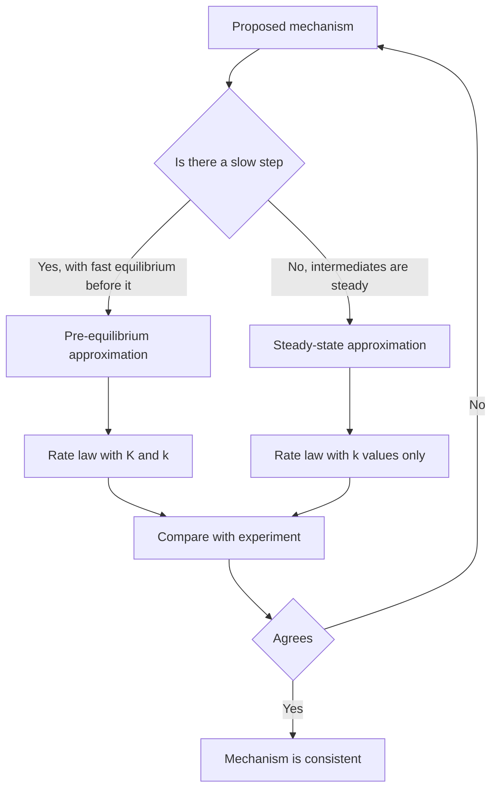
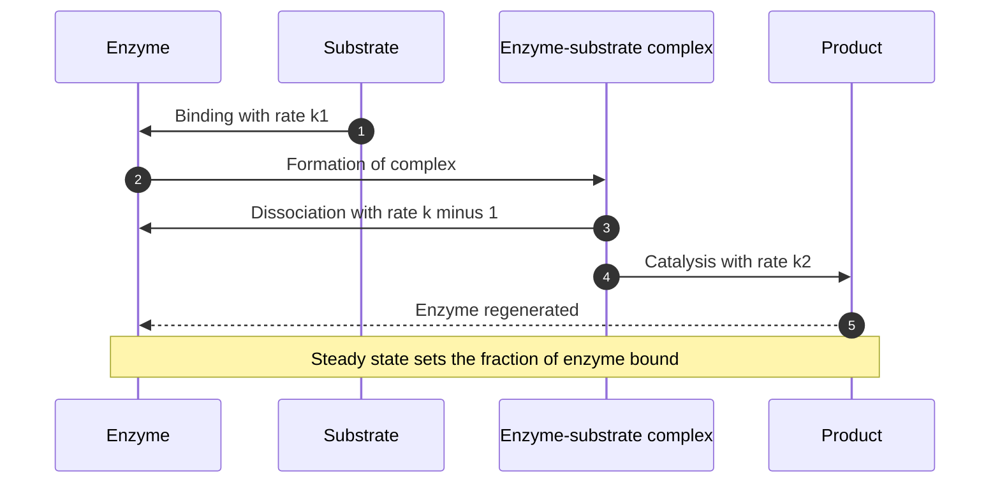
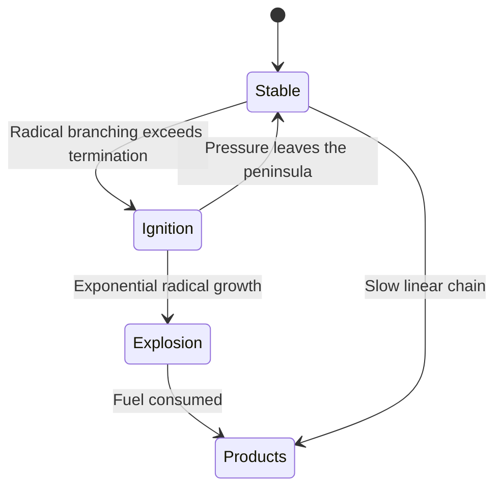
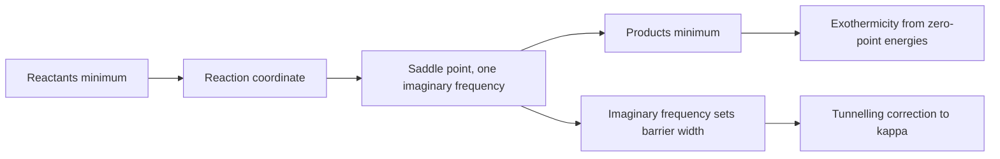

# Chapter 5 — Chemical Kinetics and Reaction Dynamics

> **Level:** Advanced (Level 6 — Physical Chemistry)
> **Estimated study time:** 10 hours (7 h reading + 3 h exercises)
> **Prerequisites:** [Reaction Rates](../03-intermediate-chemistry/09-reaction-rates.md); [Statistical Thermodynamics and Statistical Mechanics](02-statistical-thermodynamics-and-statistical-mechanics.md); elementary differential equations
> **Difficulty:** ★★★★★ (5/5)
> **Related chapters:** [Classical Thermodynamics](01-classical-thermodynamics.md), [Quantum Chemistry](03-quantum-chemistry.md), [Molecular Spectroscopy](04-molecular-spectroscopy.md)

---

## 1. Learning Objectives

After working through this chapter you will be able to:

- Define rate, rate law, order, molecularity and rate constant, and distinguish order from
  molecularity.
- Derive rate laws for complex mechanisms using the steady-state and pre-equilibrium
  approximations, and state when each is valid.
- Analyse chain reactions, including initiation, propagation, termination and the resulting
  half-order kinetics.
- Derive the Michaelis–Menten equation and linearise it as a Lineweaver–Burk plot.
- Extract activation energies from Arrhenius plots and relate the Arrhenius parameters to
  transition-state theory.
- Write the Eyring equation, interpret $\Delta G^\ddagger$, $\Delta H^\ddagger$ and
  $\Delta S^\ddagger$, and include the transmission coefficient.
- Describe potential energy surfaces, reaction coordinates and intrinsic reaction
  coordinates.
- Compute collision rates from hard-sphere and Langevin models and define the cross-section.
- Interpret molecular-beam experiments and differential cross-sections in terms of
  reaction mechanisms.
- Estimate diffusion-controlled rate constants with the Smoluchowski equation.
- Explain kinetic isotope effects and chain branching, including explosion limits.

---

## 2. Introduction

Thermodynamics says whether a reaction can happen; kinetics says how fast. The two answers
are independent. The oxidation of glucose is thermodynamically favourable and yet stable in
a sealed jar for years; the detonation of nitroglycerine is favourable and finishes in
microseconds. The difference is the barrier, and the study of barriers is the study of
mechanism.

Chemical kinetics proceeds in two directions. The macroscopic direction measures
concentrations against time, extracts rate laws, and infers mechanisms from the algebraic
form of those laws. The microscopic direction starts from a potential energy surface and
computes how often trajectories cross the barrier, what energy they need, and where the
products go. Transition-state theory and collision theory are the bridges between the two:
they express a rate constant in terms of molecular properties — partition functions,
masses, cross-sections — and thereby connect kinetics to spectroscopy and statistical
thermodynamics.

The chapter develops the macroscopic formalism first, because that is what an experiment
gives, and then the microscopic interpretation: a rate law summarises data, and several
mechanisms can produce the same law.

The treatment is quantitative throughout. Every rate constant carries units, every
approximation is stated with its range of validity, and every model is accompanied by the
observation that tests it. The closing sections connect the kinetics of simple collisions
to the dynamics of real encounters: steric factors, capture cross-sections, diffusion
control and the branching that produces explosions.

---

## 3. Fundamental Concepts

### 3.1 Rate, rate law and order

For a reaction $a\ce{A} + b\ce{B} \to$ products, the **rate of reaction** is

$$
v = -\frac{1}{a}\frac{\mathrm{d}[\ce{A}]}{\mathrm{d}t}
= \frac{1}{p}\frac{\mathrm{d}[\ce{P}]}{\mathrm{d}t},
$$

defined so that it is independent of which species is monitored. A **rate law** expresses
$v$ as a function of concentrations,

$$
v = k[\ce{A}]^{m}[\ce{B}]^{n},
$$

where $k$ is the **rate constant** and $m$, $n$ are the partial **orders**. The overall
order is $m + n$. Orders are experimental quantities: they may be zero, fractional or
negative, and they bear no necessary relation to the stoichiometric coefficients.

**Molecularity**, by contrast, is a property of an *elementary step* — the number of
species that collide to produce the event — and can only be one, two or (rarely) three.
An elementary step's rate law follows from its molecularity; a complex reaction's rate law
does not, and must be derived from the mechanism.

| Order | Integrated rate law | Half-life |
|---|---|---|
| Zero | $[\ce{A}] = [\ce{A}]_0 - kt$ | $[\ce{A}]_0/(2k)$ |
| First | $[\ce{A}] = [\ce{A}]_0e^{-kt}$ | $\ln 2/k$ |
| Second | $1/[\ce{A}] = 1/[\ce{A}]_0 + kt$ | $1/(k[\ce{A}]_0)$ |

### 3.2 The rate constant and its temperature dependence

The **Arrhenius equation**,

$$
k = A\,e^{-E_\mathrm{a}/RT},
$$

summarises an enormous body of data with two parameters: the pre-exponential factor $A$ and
the activation energy $E_\mathrm{a}$. A plot of $\ln k$ against $1/T$ has slope
$-E_\mathrm{a}/R$ and intercept $\ln A$. For a single barrier the Arrhenius plot is a
straight line; curvature signals a change of mechanism, quantum tunnelling, or a
temperature-dependent pre-exponential factor.

The **activation energy** is defined operationally as
$E_\mathrm{a} = RT^2\,\mathrm{d}\ln k/\mathrm{d}T$, which is the only definition that
survives when $A$ itself depends on temperature. Transition-state theory predicts
$A \propto T$ for a unimolecular step and $A \propto T^{-1/2}$ or $T^{1/2}$ for various
bimolecular steps, so the Arrhenius parameters are effective quantities rather than
fundamental constants.

### 3.3 Elementary steps, complex mechanisms and the rate-determining step

A **mechanism** is a sequence of elementary steps whose sum is the overall reaction. The
rate law of the overall reaction follows from the mechanism plus one of two approximations.

The **rate-determining step** approximation assumes that one step is much slower than the
others and that all preceding steps are at equilibrium. It is valid when the barrier of
that step exceeds every other barrier by several $RT$; it fails when two barriers are
comparable, in which case the steady-state treatment is required.

The **steady-state approximation** assumes that the concentrations of reactive
intermediates are small and constant:
$\mathrm{d}[\text{intermediate}]/\mathrm{d}t \approx 0$. It is valid when the intermediate
is consumed as fast as it is formed, which is the normal situation for radicals, carbocations
and enzyme–substrate complexes.

The **pre-equilibrium approximation** assumes a fast reversible step followed by a slow
one, so that the intermediate maintains its equilibrium concentration. It is the special
case of the steady-state treatment in which the reverse reaction of the first step is much
faster than the forward reaction of the second.

### 3.4 The potential energy surface

Within the Born–Oppenheimer approximation the energy of a molecule is a function of nuclear
coordinates, $V(\mathbf R)$. For a reaction the surface has minima at reactants, products
and intermediates, and saddle points between them. The **reaction coordinate** is the path
of minimum energy connecting two minima; the **transition state** is the saddle point of
highest energy along it, and the **intrinsic reaction coordinate** (IRC) is the steepest
descent path from the saddle point in mass-weighted coordinates.

A saddle point is characterised by its Hessian: one negative eigenvalue (the imaginary
frequency along the reaction coordinate) and all others positive. That single imaginary
frequency is the computational signature of a transition state, and its magnitude measures
the curvature of the barrier — a small imaginary frequency means a flat, loose transition
state and a large one means a stiff, tight barrier.

---

## 4. Detailed Scientific Explanation

### 4.1 The steady-state approximation and Lindemann–Hinshelwood theory

**Derivation 4.1 — unimolecular falloff.** A unimolecular reaction needs collisional
activation. The Lindemann mechanism is

$$
\ce{A + M ->[k_1] A^* + M}, \qquad
\ce{A^* + M ->[k_{-1}] A + M}, \qquad
\ce{A^* ->[k_2] P} .
$$

Applying the steady-state approximation to $\ce{A^*}$,

$$
\frac{\mathrm{d}[\ce{A^*}]}{\mathrm{d}t}
= k_1[\ce{A}][\ce{M}] - k_{-1}[\ce{A^*}][\ce{M}] - k_2[\ce{A^*}] = 0,
$$

so $[\ce{A^*}] = k_1[\ce{A}][\ce{M}]/(k_{-1}[\ce{M}] + k_2)$ and

$$
v = k_2[\ce{A^*}] = \frac{k_1k_2[\ce{M}]}{k_{-1}[\ce{M}] + k_2}[\ce{A}]
\equiv k_\text{uni}[\ce{A}] .
$$

$\square$

The effective first-order constant has two limits. At high pressure
$k_{-1}[\ce{M}] \gg k_2$, so $k_\text{uni} \to k_1k_2/k_{-1} = k_\infty$, independent of
$[\ce{M}]$. At low pressure $k_{-1}[\ce{M}] \ll k_2$, so $k_\text{uni} \to k_1[\ce{M}]$ and
the reaction is second order overall. Between the limits the rate constant falls with
decreasing pressure — the **falloff** region — and $k_\text{uni} = k_\infty/2$ when
$[\ce{M}] = k_2/k_{-1}$. The mechanism is qualitatively right but quantitatively too sharp;
the Rice–Ramsperger–Kassel–Marcus (RRKM) theory replaces $k_2$ by a rate constant that
depends on the internal energy of $\ce{A^*}$.

### 4.2 The pre-equilibrium approximation

If the first step is fast and reversible and the second is slow,

$$
\ce{A + B <=>[k_1][k_{-1}] C}, \qquad \ce{C ->[k_2] P},
$$

then $[\ce{C}] = K[\ce{A}][\ce{B}]$ with $K = k_1/k_{-1}$, and

$$
v = k_2[\ce{C}] = \frac{k_1k_2}{k_{-1}}[\ce{A}][\ce{B}] .
$$

This is the low-$[\ce{M}]$ limit of the steady-state result with the identification
$k_{-1}[\ce{M}] \gg k_2$. The distinction matters for interpretation: the pre-equilibrium
result contains an equilibrium constant and therefore a $\Delta G^\circ$, whereas the
steady-state result contains only rate constants. Acid catalysis of ester hydrolysis and
the S$_N$1 mechanism are standard applications, and the observed rate law
$v = k[\ce{RX}]$ with no dependence on the nucleophile is the diagnostic of the
pre-equilibrium carbocation.

### 4.3 Chain reactions

A chain reaction has initiation, propagation and termination steps. For the synthesis of
hydrogen bromide,

$$
\ce{Br2 ->[k_1] 2Br},
$$
$$
\ce{Br + H2 ->[k_2] HBr + H}, \qquad
\ce{H + Br2 ->[k_3] HBr + Br}, \qquad
\ce{H + HBr ->[k_4] H2 + Br},
$$
$$
\ce{2Br ->[k_5] Br2} .
$$

Applying the steady state to $\ce{H}$ and $\ce{Br}$ and eliminating the radical
concentrations gives the empirical law

$$
\frac{\mathrm{d}[\ce{HBr}]}{\mathrm{d}t}
= \frac{2k_2(k_1/k_5)^{1/2}[\ce{H_2}][\ce{Br_2}]^{1/2}}
{1 + k_4[\ce{HBr}]/(k_3[\ce{Br_2}])} .
$$

$\square$

Three features are worth reading off this expression. The half-order dependence on
$\ce{Br2}$ comes from the competition between initiation, which produces two radicals, and
termination, which consumes two, so $[\ce{Br}] \propto [\ce{Br_2}]^{1/2}$. The inhibition
term in the denominator reflects the reverse of the second propagation step, which
suppresses the rate as product accumulates. And the equation is a genuine prediction of a
mechanism, not a fit: it was the historical test case for the chain concept.

### 4.4 Enzyme kinetics

**Derivation 4.2 — the Michaelis–Menten equation.** With

$$
\ce{E + S <=>[k_1][k_{-1}] ES ->[k_2] E + P},
$$

the steady-state approximation for the complex gives

$$
\frac{\mathrm{d}[\ce{ES}]}{\mathrm{d}t}
= k_1[\ce{E}][\ce{S}] - (k_{-1}+k_2)[\ce{ES}] = 0 .
$$

Using the mass balance $[\ce{E}]_0 = [\ce{E}] + [\ce{ES}]$,

$$
[\ce{ES}] = \frac{[\ce{E}]_0[\ce{S}]}{K_\mathrm{M} + [\ce{S}]},
\qquad
K_\mathrm{M} = \frac{k_{-1}+k_2}{k_1},
$$

and the rate is

$$
v = k_2[\ce{ES}] = \frac{V_\text{max}[\ce{S}]}{K_\mathrm{M} + [\ce{S}]},
\qquad V_\text{max} = k_\text{cat}[\ce{E}]_0 .
$$

$\square$

The parameters have clear meanings. $V_\text{max}$ is the rate when every enzyme molecule
is working; $K_\mathrm{M}$ is the substrate concentration at half-saturation, an inverse
measure of binding affinity when $k_2 \ll k_{-1}$; $k_\text{cat}$ is the turnover number.
The **Lineweaver–Burk** transformation,

$$
\frac{1}{v} = \frac{K_\mathrm{M}}{V_\text{max}}\frac{1}{[\ce{S}]}
+ \frac{1}{V_\text{max}},
$$

gives a straight line with intercept $1/V_\text{max}$, slope $K_\mathrm{M}/V_\text{max}$
and $x$-intercept $-1/K_\mathrm{M}$. It is convenient but statistically poor, because it
weights small rates heavily; non-linear least squares on the untransformed data is
preferred. Competitive inhibition raises $K_\mathrm{M}$ at constant $V_\text{max}$,
non-competitive inhibition lowers $V_\text{max}$ at constant $K_\mathrm{M}$, and the
patterns on the reciprocal plot identify the mode.

### 4.5 Arrhenius and Eyring

Transition-state theory gives

$$
k = \kappa\frac{k_\mathrm{B}T}{h}e^{-\Delta G^\ddagger/RT}
= \kappa\frac{k_\mathrm{B}T}{h}
\exp\!\left(\frac{\Delta S^\ddagger}{R}\right)
\exp\!\left(-\frac{\Delta H^\ddagger}{RT}\right),
$$

the **Eyring equation**, with $\kappa$ the transmission coefficient. Comparing with
$k = Ae^{-E_\mathrm{a}/RT}$ and using $E_\mathrm{a} = RT^2\,\mathrm{d}\ln k/\mathrm{d}T$:

$$
E_\mathrm{a} = \Delta H^\ddagger + nRT,
\qquad
A = \kappa e^{n}\frac{k_\mathrm{B}T}{h}\exp\!\left(\frac{\Delta S^\ddagger}{R}\right),
$$

where $n = 1$ for a unimolecular reaction and $n = 2$ for a bimolecular gas-phase reaction.
The activation energy is therefore not exactly the barrier height; the difference is $RT$
or $2RT$, which at 300 K is 2.5 or 5.0 $\text{kJ mol}^{-1}$.

The value of the Eyring form is that it splits the barrier into an enthalpic and an
entropic part. A reaction with a large negative $\Delta S^\ddagger$ has a tight transition
state — two molecules combining into one — and a small pre-exponential factor; a reaction
with a positive $\Delta S^\ddagger$ has a loose transition state, typical of bond fission.

### 4.6 Transition-state theory in detail

For the bimolecular reaction $\ce{A + B -> P}$, the rate is the flux of systems through a
dividing surface at the top of the barrier. Writing the transition state as a species in
equilibrium with the reactants, and separating the reaction coordinate from the other
degrees of freedom,

$$
k = \kappa\frac{k_\mathrm{B}T}{h}\frac{q_\ddagger'}{q_\ce{A}q_\ce{B}}
e^{-\Delta E_0/RT},
$$

where $q_\ddagger'$ is the partition function of the transition state with the reaction
coordinate removed, $q_\ce{A}$ and $q_\ce{B}$ are the reactant partition functions per unit
volume, and $\Delta E_0$ is the difference of zero-point energies. The factor
$k_\mathrm{B}T/h$ is the universal frequency of passage across the barrier, about
$6.2\times10^{12}\ \text{s}^{-1}$ at 298 K.

The **transmission coefficient** $\kappa$ corrects for trajectories that cross the barrier
and recross it. Classically $\kappa \le 1$, typically 0.5–1 for reactions with a high
barrier; quantum mechanically $\kappa > 1$ is possible through tunnelling, which dominates
for hydrogen transfer at low temperature. The tunnelling correction is approximately
$\kappa \approx (2\pi\beta/\sin 2\pi\beta)$ with $\beta = \hbar\omega^\ddagger/(2k_\mathrm{B}T)$
for a parabolic barrier, and it is the reason the observed kinetic isotope effect for
C–H cleavage exceeds the semiclassical prediction at 77 K.

Transition-state theory assumes that the barrier is a well-defined saddle point, that
motion along the reaction coordinate is classical and separable, and that the transition
state is in equilibrium with reactants. It fails for barrierless reactions (radical
recombination), for very floppy transition states and at high temperature, where the
dividing surface is crossed repeatedly.

### 4.7 Potential energy surfaces and reaction coordinates

A computed surface provides the barrier height $\Delta V^\ddagger$, the transition-state
geometry and the imaginary frequency. The last is not a curiosity: it is what distinguishes
a saddle point from a minimum, and its magnitude sets the width of the barrier and hence the
tunnelling probability. The **intrinsic reaction coordinate** is obtained by following the
steepest-descent path from the saddle point in mass-weighted coordinates; it connects the
transition state to the two adjacent minima and is the computational definition of "the"
reaction path.

Real reactions have many coordinates, so the minimum energy path is not the dynamically
preferred path: trajectories with excess energy cut corners and recross the dividing
surface, and variational transition-state theory chooses the surface that minimises the
computed rate.

### 4.8 Collision theory and cross-sections

For hard spheres of diameter $d$ and relative speed $v_\text{rel}$, the collision
cross-section is $\sigma = \pi d^2$ and the collision frequency per unit volume is
$Z = \sigma\langle v_\text{rel}\rangle N_\ce{A}N_\ce{B}$. Only collisions with relative
energy above the barrier react, so

$$
k = \sigma\langle v_\text{rel}\rangle N_\mathrm{A}e^{-E_\mathrm{a}/RT}
= N_\mathrm{A}\pi d^2\sqrt{\frac{8k_\mathrm{B}T}{\pi\mu}}e^{-E_\mathrm{a}/RT},
$$

with $\mu$ the reduced mass. The predicted pre-exponential factor for typical small
molecules is of order $10^{11}\ \text{dm}^{3}\text{mol}^{-1}\text{s}^{-1}$, far above most
measured values, so a **steric factor** $P \ll 1$ is inserted:

$$
k = P\,\sigma\langle v_\text{rel}\rangle N_\mathrm{A}e^{-E_\mathrm{a}/RT} .
$$

$P$ ranges from about $10^{-6}$ for reactions requiring precise orientation to near unity
for radical recombinations. In transition-state language, $P$ is the ratio of the
transition-state partition function to the hard-sphere one: a tight, oriented transition
state has few accessible configurations and a small $P$.

### 4.9 Molecular beams and differential cross-sections

In a crossed-molecular-beam experiment two supersonic beams intersect, and the products are
detected as a function of angle and speed. The observable is the **differential
cross-section** $\mathrm{d}\sigma/\mathrm{d}\Omega$, the flux scattered into a solid angle,
and its angular distribution distinguishes mechanisms. A **stripping** mechanism gives
products forward-scattered along the incident direction with a narrow angular width; a
**rebound** mechanism gives backward scattering; a long-lived complex gives a symmetric
forward–backward distribution. The integral cross-section
$\sigma = \int(\mathrm{d}\sigma/\mathrm{d}\Omega)\,\mathrm{d}\Omega$ gives the rate
constant when averaged over the beam velocity distribution.

In $\ce{K + CH3I -> KI + CH3}$ the product angular distribution changes from backward to
forward as the collision energy rises, showing the transition from a rebound to a stripping
mechanism.

### 4.10 The Langevin and hard-sphere models

For ion–molecule reactions the long-range potential is attractive and the cross-section
exceeds the geometric one. The **Langevin model** treats the ion as a point charge
polarising a neutral of polarisability volume $\alpha$, giving the capture rate constant

$$
k_\mathrm{L} = 2\pi N_\mathrm{A}e\sqrt{\frac{\alpha}{4\pi\varepsilon_0\mu}} ,
$$

which is independent of temperature and typically of order
$10^{12}\ \text{dm}^{3}\text{mol}^{-1}\text{s}^{-1}$ — close to the measured values for
many ion–molecule reactions, which are therefore said to be capture-limited. The hard-sphere
model, by contrast, gives a temperature-dependent rate through
$\langle v_\text{rel}\rangle \propto T^{1/2}$ and underestimates the cross-section because
it ignores the attractive tail.

### 4.11 Diffusion-controlled reactions

In solution a reaction cannot be faster than the rate at which the reactants encounter each
other. **Smoluchowski** theory gives the encounter rate for spheres with diffusion
coefficients $D_\ce{A}$ and $D_\ce{B}$ and encounter distance $R$:

$$
k_\mathrm{d} = 4\pi N_\mathrm{A}(D_\ce{A} + D_\ce{B})R .
$$

With the Stokes–Einstein relation $D = k_\mathrm{B}T/(6\pi\eta a)$ for a sphere of radius
$a$ in a medium of viscosity $\eta$, the rate becomes

$$
k_\mathrm{d} = \frac{8RT}{3\eta},
$$

independent of the radii — a striking prediction confirmed for many reactions in water,
where $\eta = 0.89\ \text{mPa s}$ gives
$k_\mathrm{d} \approx 7\times10^{9}\ \text{dm}^{3}\text{mol}^{-1}\text{s}^{-1}$ at 298 K.

The observed rate constant combines encounter and chemical activation:
$1/k_\text{obs} = 1/k_\mathrm{d} + 1/k_\text{act}$. When $k_\text{act} \gg k_\mathrm{d}$ the
reaction is diffusion-controlled and $k_\text{obs} \approx k_\mathrm{d}$; when
$k_\text{act} \ll k_\mathrm{d}$ it is activation-controlled and the encounter step is
irrelevant. Fluorescence quenching, enzyme–substrate association and radical recombination
in liquids are typically diffusion-controlled.

### 4.12 Kinetic isotope effects

Substituting $\ce{H}$ by $\ce{D}$ doubles the reduced mass and therefore lowers the
zero-point energy of every bond to hydrogen. For a bond-breaking step whose transition state
has lost that zero-point energy,

$$
\frac{k_\ce{H}}{k_\ce{D}}
= \exp\!\left[\frac{hc(\tilde\nu_\ce{H} - \tilde\nu_\ce{D})}{2k_\mathrm{B}T}\right],
$$

which for a $3000\ \text{cm}^{-1}$ C–H stretch at 298 K gives about 8. The size of the effect
is diagnostic: a primary KIE of 5–8 signals that the bond breaks in the rate-determining
step, a secondary KIE of 1.1–1.3 signals a change in hybridisation at that carbon, and a
KIE near unity rules the bond out. At low temperature tunnelling inflates the ratio and
flattens its temperature dependence, which is the clearest experimental signature of
quantum-mechanical hydrogen transfer.

### 4.13 Chain branching and explosions

In a **linear chain** each propagation cycle consumes one radical and produces one, so the
radical concentration stays constant and the rate is steady. In a **branched chain** one
cycle produces two radicals, so the concentration grows exponentially:

$$
\frac{\mathrm{d}[R]}{\mathrm{d}t} = k_\text{branch}[R] - k_\text{term}[R]
\quad\Longrightarrow\quad
[R] = [R]_0e^{(k_\text{branch} - k_\text{term})t} .
$$

If branching outruns termination the reaction accelerates without limit until the fuel is
consumed — an explosion. The hydrogen–oxygen system shows this directly: the branching step
$\ce{H + O2 -> OH + O}$ competes with termination at the wall, which is diffusion-limited at
low pressure and therefore favoured by low pressure. The result is the characteristic
**explosion peninsula** of the $\ce{H2 + O2}$ system, with a lower pressure limit below
which wall termination wins, an intermediate region in which the mixture explodes, and an
upper limit above which three-body termination in the gas phase takes over. The same
competition explains the knock in an engine, the ignition of a coal seam and the safety
limits of hydrogen storage.

---

## 5. Visual Diagrams

**Figure 5.1 — Deriving a rate law from a mechanism.** The two approximations are not
alternatives to be chosen by taste: the steady-state result reduces to the pre-equilibrium
result in the limit where the reverse of the first step dominates. Consistency with
experiment never proves a mechanism, since several mechanisms can give the same law, but
inconsistency refutes one.

**Figure 5.2 — The Michaelis–Menten catalytic cycle.** The enzyme is regenerated each
turnover, which is why a small amount of catalyst supports an indefinite amount of reaction.
The steady state applies to the complex, not the substrate.

**Figure 5.3 — Branched-chain ignition as a state machine.** The transition between slow
reaction and explosion is controlled by branching versus termination, and wall termination
is diffusion-limited, so pressure moves the system across the boundary in either direction.

**Figure 5.4 — Reading a potential energy surface.** Barrier height, imaginary frequency and
the difference of zero-point energies are the three quantities a computed surface
contributes to a rate calculation, and the imaginary frequency proves the point is a
transition state.

---

## 6. Mathematical Formulas

$$
k = A e^{-E_\mathrm{a}/RT}, \qquad
k = \kappa\frac{k_\mathrm{B}T}{h}e^{-\Delta G^\ddagger/RT}, \qquad
v = \frac{V_\text{max}[\ce{S}]}{K_\mathrm{M} + [\ce{S}]}
$$

$$
k_\mathrm{d} = 4\pi N_\mathrm{A}(D_\ce{A}+D_\ce{B})R, \qquad
k = N_\mathrm{A}\pi d^2\sqrt{\frac{8k_\mathrm{B}T}{\pi\mu}}e^{-E_\mathrm{a}/RT}
$$

| Symbol | Meaning | SI unit |
|---|---|---|
| $v$ | rate of reaction | mol dm⁻³ s⁻¹ |
| $k$ | rate constant | depends on order |
| $A$ | pre-exponential factor | same as $k$ |
| $E_\mathrm{a}$ | activation energy | J mol⁻¹ |
| $\Delta G^\ddagger$, $\Delta H^\ddagger$, $\Delta S^\ddagger$ | activation Gibbs energy, enthalpy, entropy | J mol⁻¹, J mol⁻¹, J K⁻¹ mol⁻¹ |
| $\kappa$ | transmission coefficient | dimensionless |
| $K_\mathrm{M}$ | Michaelis constant | mol dm⁻³ |
| $k_\text{cat}$ | turnover number | s⁻¹ |
| $\sigma$ | cross-section | m² |
| $\mu$ | reduced mass | kg |
| $D$ | diffusion coefficient | m² s⁻¹ |

Assumptions: steady state for intermediates; ideal solutions; Arrhenius behaviour over the
measured range; transition-state equilibrium and a separable reaction coordinate; hard
spheres for collision theory; spherical diffusing species for Smoluchowski.

---

## 7. Chemical Equations

The Lindemann mechanism and the enzyme mechanism are written with their rate constants:

$$
\ce{A + M ->[k_1] A^* + M}, \qquad
\ce{A^* ->[k_2] P}
$$

$$
\ce{E + S <=>[k_1][k_{-1}] ES ->[k_2] E + P}
$$

A chain reaction with inhibition, the hydrogen–bromine system:

$$
\ce{Br2 ->[k_1] 2Br}, \qquad
\ce{Br + H2 ->[k_2] HBr + H}, \qquad
\ce{H + Br2 ->[k_3] HBr + Br}
$$

and a branched chain, whose competition with termination produces the explosion limits:

$$
\ce{H + O2 -> OH + O} \qquad \text{branching}
$$

$$
\ce{H + O2 + M -> HO2 + M} \qquad \text{termination at high pressure}
$$

---

## 8. Worked Examples

### Worked Example 8.1 — Lindemann falloff

**Problem.** For a Lindemann mechanism with $k_1 = 1.0\times10^{9}\
\text{dm}^{3}\text{mol}^{-1}\text{s}^{-1}$, $k_{-1} = 2.0\times10^{9}\
\text{dm}^{3}\text{mol}^{-1}\text{s}^{-1}$ and $k_2 = 5.0\times10^{4}\ \text{s}^{-1}$ at
600 K, compute $k_\infty$, $k_\text{uni}$ at $[\ce{M}] = 0.040\ \text{mol dm}^{-3}$, and
the pressure at which $k_\text{uni} = k_\infty/2$.

**Strategy.** Use $k_\text{uni} = k_1k_2[\ce{M}]/(k_{-1}[\ce{M}]+k_2)$ and identify the
half-falloff condition $k_{-1}[\ce{M}] = k_2$.

**Solution.** $k_\infty = k_1k_2/k_{-1} = (1.0\times10^{9})(5.0\times10^{4})/(2.0\times10^{9})
= 2.5\times10^{4}\ \text{s}^{-1}$.
At $[\ce{M}] = 0.040$:
$k_\text{uni} = (1.0\times10^{9})(5.0\times10^{4})(0.040)/[(2.0\times10^{9})(0.040) +
5.0\times10^{4}] = 2.0\times10^{12}/(8.0\times10^{7} + 5.0\times10^{4}) =
2.50\times10^{4}\ \text{s}^{-1}$.

Half falloff: $[\ce{M}] = k_2/k_{-1} = 5.0\times10^{4}/2.0\times10^{9} =
2.5\times10^{-5}\ \text{mol dm}^{-3} = 0.025\ \text{mol m}^{-3}$, so
$p = cRT = (0.025)(8.314)(600) = 1.2\times10^{2}$ Pa.

**Check.** At 0.040 mol dm⁻³ the pressure is about 200 kPa and the reaction is at its
high-pressure limit, as the numbers show: $k_\text{uni}$ is within 0.2 % of $k_\infty$. The
half-falloff pressure of 125 Pa is low, which is why falloff is studied at low pressure and
why the simple Lindemann form is adequate only as a first approximation.

### Worked Example 8.2 — Activation energy and pre-exponential factor

**Problem.** A first-order reaction has $k = 1.00\times10^{-3}\ \text{s}^{-1}$ at 300 K and
$4.00\times10^{-3}\ \text{s}^{-1}$ at 320 K. Compute $E_\mathrm{a}$, $A$ and $k$ at 310 K.

**Strategy.** Use $\ln(k_2/k_1) = -(E_\mathrm{a}/R)(1/T_2 - 1/T_1)$.

**Solution.**
$E_\mathrm{a} = R\ln 4/(1/300 - 1/320) = (8.314)(1.3863)/(2.0833\times10^{-4}) =
5.53\times10^{4}\ \text{J mol}^{-1}$.
$A = k_1e^{E_\mathrm{a}/RT_1} = (1.00\times10^{-3})\exp[55300/(8.314\times300)] =
(1.00\times10^{-3})(4.28\times10^{9}) = 4.28\times10^{6}\ \text{s}^{-1}$.
At 310 K: $k = (4.28\times10^{6})\exp[-55300/(8.314\times310)] =
(4.28\times10^{6})(4.74\times10^{-10}) = 2.03\times10^{-3}\ \text{s}^{-1}$.

**Check.** A doubling of the rate over 20 K corresponds to a $Q_{10}$ of about 2, the
familiar biological rule of thumb, and the interpolated value at 310 K lies between the two
measurements as it must. The pre-exponential factor of $4\times10^{6}\ \text{s}^{-1}$ is far
below $k_\mathrm{B}T/h = 6\times10^{12}\ \text{s}^{-1}$, implying a strongly negative
$\Delta S^\ddagger$ — a tight transition state.

### Worked Example 8.3 — Activation parameters from the Eyring equation

**Problem.** A first-order reaction has $k = 2.10\times10^{-4}\ \text{s}^{-1}$ at 298.15 K.
Compute $\Delta G^\ddagger$, and $\Delta S^\ddagger$ given $\Delta H^\ddagger =
88.0\ \text{kJ mol}^{-1}$.

**Strategy.** Use $\Delta G^\ddagger = RT\ln(k_\mathrm{B}T/hk)$, then
$\Delta S^\ddagger = (\Delta H^\ddagger - \Delta G^\ddagger)/T$.

**Solution.** $k_\mathrm{B}T/h = (1.381\times10^{-23})(298.15)/(6.626\times10^{-34}) =
6.21\times10^{12}\ \text{s}^{-1}$. The ratio
$6.21\times10^{12}/2.10\times10^{-4} = 2.96\times10^{16}$ and its logarithm is 37.91, so

$$
\Delta G^\ddagger = (8.314)(298.15)(37.91) = 9.40\times10^{4}\ \text{J mol}^{-1}.
$$

Then $\Delta S^\ddagger = (88\,000 - 94\,000)/298.15 = -20.1\ \text{J K}^{-1}\text{mol}^{-1}$.

**Check.** A negative entropy of activation of $-20\ \text{J K}^{-1}\text{mol}^{-1}$ is
typical of a unimolecular rearrangement that loses torsional freedom in a tight cyclic
transition state. Note that $\Delta G^\ddagger$ exceeds $\Delta H^\ddagger$ by
$6\ \text{kJ mol}^{-1}$, which is $T\Delta S^\ddagger$; ignoring the entropic term would
overestimate the rate by a factor of about 11.

### Worked Example 8.4 — Michaelis–Menten parameters

**Problem.** An enzyme ($[\ce{E}]_0 = 1.0\times10^{-8}\ \text{mol dm}^{-3}$) gives
$v = 2.5\times10^{-6}\ \text{mol dm}^{-3}\text{s}^{-1}$ at
$[\ce{S}] = 1.0\times10^{-3}\ \text{mol dm}^{-3}$ and
$v = 7.7\times10^{-6}\ \text{mol dm}^{-3}\text{s}^{-1}$ at
$[\ce{S}] = 1.0\times10^{-2}\ \text{mol dm}^{-3}$. Compute $K_\mathrm{M}$, $V_\text{max}$,
$k_\text{cat}$ and the catalytic efficiency.

**Strategy.** Use the Lineweaver–Burk form with two points, or solve the two simultaneous
Michaelis–Menten equations.

**Solution.** From $1/v = (K_\mathrm{M}/V_\text{max})(1/[\ce{S}]) + 1/V_\text{max}$:
point 1 has $1/v = 4.00\times10^{5}$ and $1/[\ce{S}] = 1000$; point 2 has
$1/v = 1.30\times10^{5}$ and $1/[\ce{S}] = 100$. The slope is
$(4.00 - 1.30)\times10^{5}/(900) = 3.00\times10^{2}\ \text{s}$, and the intercept is
$1.30\times10^{5} - (3.00\times10^{2})(100) = 1.00\times10^{5}$.
Hence $V_\text{max} = 1.0\times10^{-5}\ \text{mol dm}^{-3}\text{s}^{-1}$ and
$K_\mathrm{M} = \text{slope}\times V_\text{max} = 3.0\times10^{-3}\ \text{mol dm}^{-3}$.

$k_\text{cat} = V_\text{max}/[\ce{E}]_0 = 1.0\times10^{-5}/1.0\times10^{-8} =
1.0\times10^{3}\ \text{s}^{-1}$, and
$k_\text{cat}/K_\mathrm{M} = 1.0\times10^{3}/3.0\times10^{-3} =
3.3\times10^{5}\ \text{dm}^{3}\text{mol}^{-1}\text{s}^{-1}$.

**Check.** The catalytic efficiency is below the diffusion limit of about
$10^{9}\ \text{dm}^{3}\text{mol}^{-1}\text{s}^{-1}$, so the enzyme is not perfectly
evolved; the best enzymes reach $10^{8}$–$10^{9}$ and are then diffusion-controlled. The
computed $K_\mathrm{M}$ equals the substrate concentration at which the first measurement
would give half of $V_\text{max}$, which is a useful consistency check: at
$[\ce{S}] = K_\mathrm{M}$ the rate should be $5.0\times10^{-6}$.

### Worked Example 8.5 — A diffusion-controlled rate constant

**Problem.** Two neutral molecules with $D = 1.0\times10^{-9}\ \text{m}^{2}\text{s}^{-1}$
each react on encounter at a distance of $0.50$ nm. Compute $k_\mathrm{d}$ and compare it
with the Stokes–Einstein estimate in water at 298 K.

**Strategy.** Use $k_\mathrm{d} = 4\pi N_\mathrm{A}(D_\ce{A}+D_\ce{B})R$.

**Solution.**
$k_\mathrm{d} = 4\pi(6.022\times10^{23})(2.0\times10^{-9})(5.0\times10^{-10}) =
7.6\times10^{6}\ \text{m}^{3}\text{mol}^{-1}\text{s}^{-1} =
7.6\times10^{9}\ \text{dm}^{3}\text{mol}^{-1}\text{s}^{-1}$.

Stokes–Einstein: $k_\mathrm{d} = 8RT/(3\eta) = 8(8.314)(298)/[3(8.9\times10^{-4})] =
7.4\times10^{6}\ \text{m}^{3}\text{mol}^{-1}\text{s}^{-1}$, in agreement.

**Check.** The two estimates agree because the diffusion coefficients chosen are those of
small molecules in water, where the Stokes–Einstein relation holds. The value
$7\times10^{9}\ \text{dm}^{3}\text{mol}^{-1}\text{s}^{-1}$ is the accepted upper bound for a
bimolecular reaction in water, and any measured rate constant above it signals either a
different mechanism or a failure of the assumption that encounter is required.

---

## 9. Real-World Applications

**Drug metabolism and enzyme inhibition.** Michaelis–Menten parameters quantify how fast a
liver enzyme clears a drug, and shifts in $K_\mathrm{M}$ and $V_\text{max}$ identify
competitive and non-competitive inhibitors during lead optimisation.

**Combustion and atmospheric chemistry.** Chain branching governs ignition delay, flame
propagation and the explosion limits of hydrogen, while radical chain kinetics explains
ozone destruction and smog formation.

**Combustion, engines and safety.** Chain branching governs ignition delay in engines,
flame propagation in a gas burner and the explosion limits of hydrogen; the same kinetics
sets the design of flame arresters and the ventilation requirements of a hydrogen facility.

**Atmospheric and polymer chemistry.** Radical chain kinetics explains ozone destruction by
chlorofluorocarbons, smog formation and the curing of adhesives and paints, where the
competition between propagation and termination sets the molecular weight.

---

## 10. Common Mistakes

| Mistake | Why it happens | Correct approach |
|---|---|---|
| Equating order with stoichiometric coefficient | The coefficients are the visible numbers | Order is experimental; only elementary steps have molecularity equal to their coefficients |
| Using the steady state for a stable intermediate | The approximation looks universal | It requires a short-lived intermediate; stable intermediates need a full rate law |
| Reporting $E_\mathrm{a}$ as the barrier height | The two differ by $RT$ or $2RT$ | $E_\mathrm{a} = \Delta H^\ddagger + nRT$; state which quantity is meant |
| Ignoring units of $k$ | The numerical value looks dimensionless | Units are $\text{concentration}^{1-n}\text{s}^{-1}$; a missing unit signals a wrong order |
| Treating a Lineweaver–Burk fit as exact | The transformation is convenient | Reciprocal plots distort errors; fit the untransformed data by non-linear least squares |

---

## 11. Chapter Summary

- Rate laws are empirical: order is measured, molecularity belongs to elementary steps.
- The steady-state and pre-equilibrium approximations convert a mechanism into a rate law,
  and the second is the fast-first-step limit of the first.
- Lindemann–Hinshelwood gives first-order kinetics at high pressure and second order at low
  pressure; chains give half-order kinetics and branched chains give explosion.
- Michaelis–Menten follows from a steady state on the complex, with
  $K_\mathrm{M} = (k_{-1}+k_2)/k_1$ and $V_\text{max} = k_\text{cat}[\ce{E}]_0$.
- Arrhenius and Eyring are related by $E_\mathrm{a} = \Delta H^\ddagger + nRT$, and the
  Eyring form separates enthalpic and entropic contributions.
- Transition-state theory expresses $k$ through partition functions, $k_\mathrm{B}T/h$ and a
  transmission coefficient; collision theory needs a steric factor.
- In solution the Smoluchowski limit $k_\mathrm{d} = 8RT/3\eta$ caps bimolecular rates, and
  isotope effects diagnose which bond breaks.

---

## 12. Exercises

### 12.1 Conceptual questions

1. Why can the order of a reaction be fractional while its molecularity cannot?
2. Under what condition does the steady-state approximation reduce to the pre-equilibrium
   approximation?
3. Why is the diffusion limit independent of molecular radius in the Stokes–Einstein form?

### 12.2 Basic problems

4. A first-order reaction has $k = 2.0\times10^{-4}\ \text{s}^{-1}$. Compute its half-life.
5. Give the units of $k$ for zero-, first- and second-order reactions.
6. Write the rate law for a reaction that is first order in $\ce{A}$ and second order in
   $\ce{B}$, and give the units of $k$.

### 12.3 Intermediate problems

7. For the mechanism $\ce{A + B <=> C}$ (fast) and $\ce{C -> P}$ (slow), derive the rate
   law and identify the effective rate constant.
8. A reaction has $k = 1.5\times10^{-4}\ \text{s}^{-1}$ at 290 K and
   $6.0\times10^{-4}\ \text{s}^{-1}$ at 310 K. Compute $E_\mathrm{a}$ and $A$.
9. Estimate the primary kinetic isotope effect at 298 K for a C–H bond of
   $2900\ \text{cm}^{-1}$.

### 12.4 Advanced problems

10. Derive the Michaelis–Menten equation and show that $K_\mathrm{M}$ equals the substrate
    concentration at half-saturation.
11. Show that a branched chain gives exponential radical growth and define the condition for
    explosion.
12. Estimate the diffusion-controlled rate constant in ethanol at 298 K
    ($\eta = 1.1\ \text{mPa s}$) and compare it with water.

### 12.5 Calculation problems

13. For a reaction with $\Delta H^\ddagger = 60.0\ \text{kJ mol}^{-1}$ and
    $\Delta S^\ddagger = -40.0\ \text{J K}^{-1}\text{mol}^{-1}$, compute $k$ at 350 K.

### Answers

1. Order is an empirical exponent from the rate law; molecularity counts species in an
   elementary step and is a small integer.
2. When $k_{-1}[\ce{M}] \gg k_2$, so the intermediate is in equilibrium with the reactants.
3. The radius cancels because $D \propto 1/a$ while the encounter distance scales as $a$.
4. $t_{1/2} = \ln 2/k = 0.693/2.0\times10^{-4} = 3.5\times10^{3}$ s.
5. Zero: $\text{mol dm}^{-3}\text{s}^{-1}$; first: s⁻¹; second:
   $\text{dm}^{3}\text{mol}^{-1}\text{s}^{-1}$.
6. $v = k[\ce{A}][\ce{B}]^{2}$ with $k$ in $\text{dm}^{6}\text{mol}^{-2}\text{s}^{-1}$.
7. $v = (k_1k_2/k_{-1})[\ce{A}][\ce{B}]$, with effective constant $k_1k_2/k_{-1}$.
8. $E_\mathrm{a} = R\ln 4/(1/290 - 1/310) = 5.2\times10^{4}\ \text{J mol}^{-1}$;
   $A = 1.5\times10^{-4}\exp[52\,000/(8.314\times290)] = 3.6\times10^{5}\ \text{s}^{-1}$.
9. $\Delta\tilde\nu = 849\ \text{cm}^{-1}$, so $k_\ce{H}/k_\ce{D} \approx 7$.
10. Setting $\mathrm{d}[\ce{ES}]/\mathrm{d}t = 0$ with the enzyme mass balance gives
    $v = k_2[\ce{E}]_0[\ce{S}]/(K_\mathrm{M}+[\ce{S}])$; at $[\ce{S}] = K_\mathrm{M}$ the rate
    is $V_\text{max}/2$.
11. $\mathrm{d}[R]/\mathrm{d}t = (k_\text{branch}-k_\text{term})[R]$ gives exponential growth;
    explosion requires $k_\text{branch} > k_\text{term}$.
12. $k_\mathrm{d} = 8RT/3\eta = 6.0\times10^{6}\ \text{m}^{3}\text{mol}^{-1}\text{s}^{-1}$,
    about 20 % below the value in water.
13. $\Delta G^\ddagger = 46.0\ \text{kJ mol}^{-1}$, so
    $k = (7.29\times10^{12})e^{-15.81} = 1.0\times10^{6}\ \text{s}^{-1}$.

---

## 13. Further Reading

- Atkins, P. W., de Paula, J. and Keeler, J. *Atkins' Physical Chemistry*, 12th ed.,
  Oxford University Press, 2022. Chapters 17–19.
- McQuarrie, D. A. and Simon, J. D. *Physical Chemistry: A Molecular Approach*,
  University Science Books, 1997. Chapters 25–27.
- Levine, I. N. *Physical Chemistry*, 6th ed., McGraw-Hill, 2009. Chapters 17–19.

See [CURRICULUM.md](../CURRICULUM.md) and [REFERENCES.md](../REFERENCES.md).
