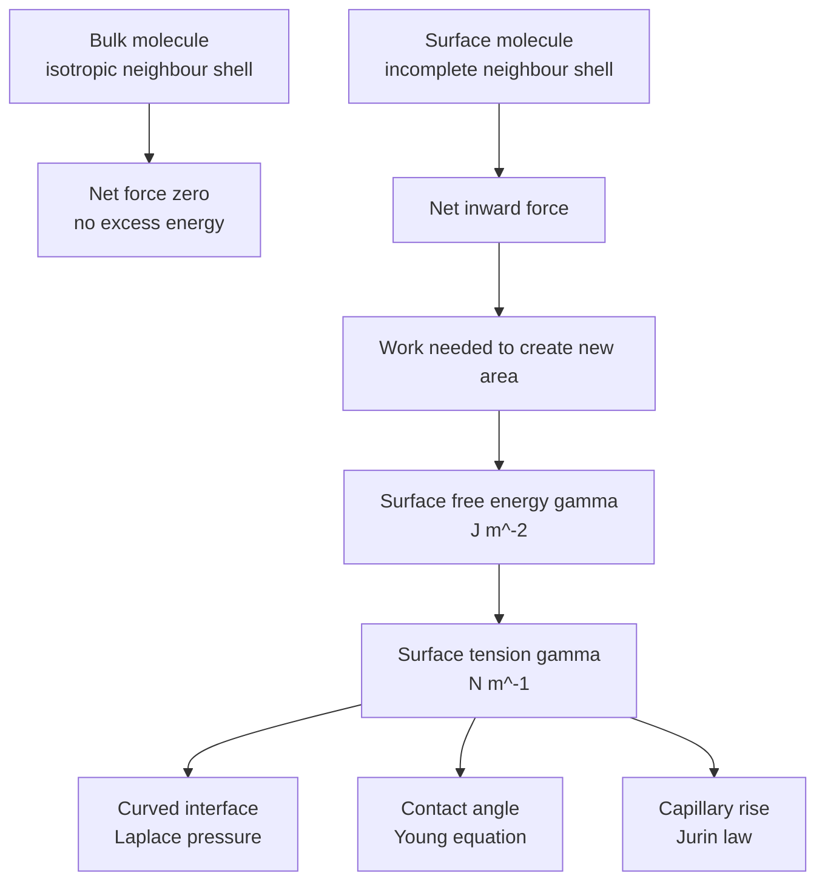
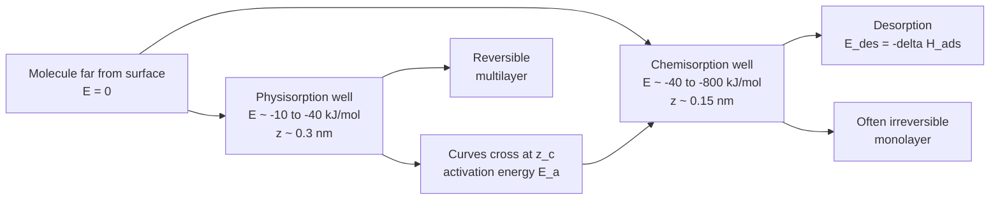
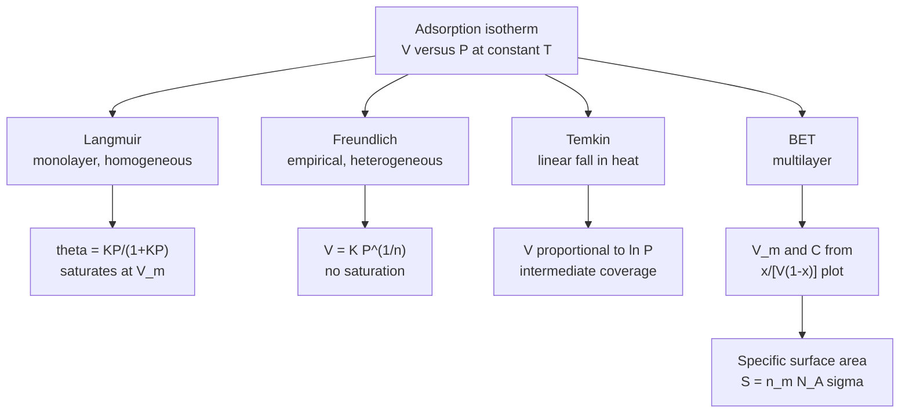
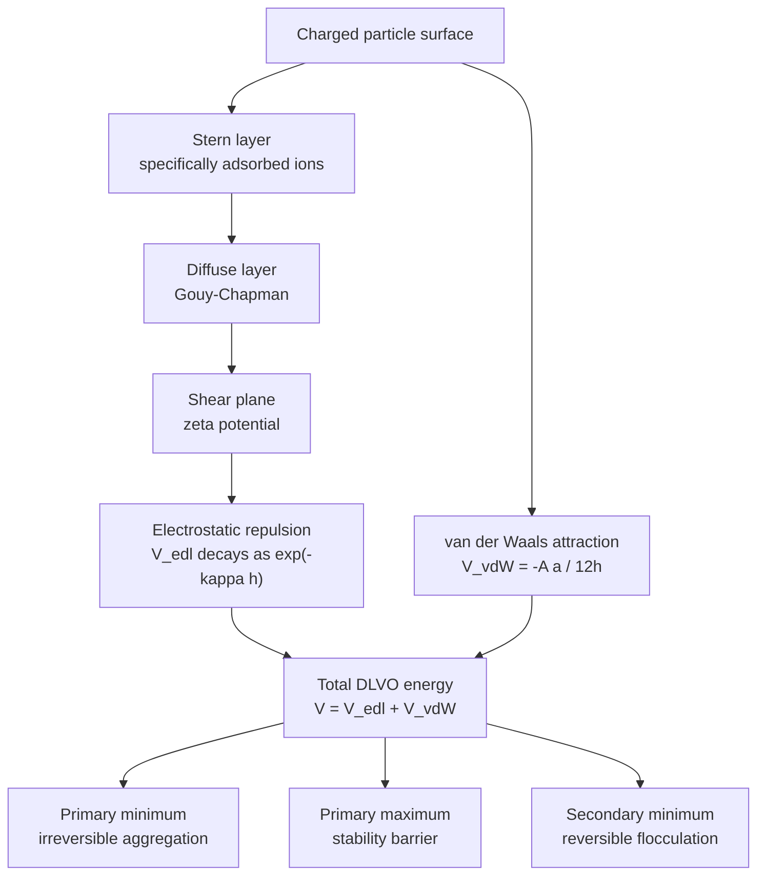
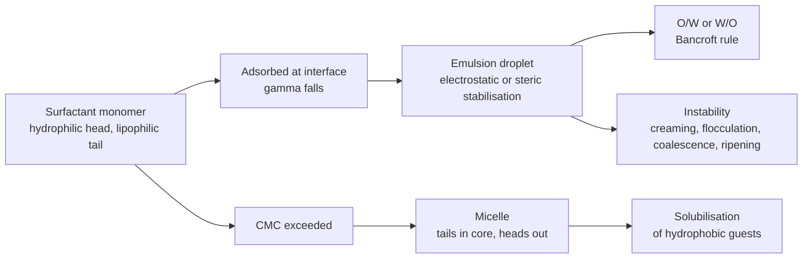

# Chapter 6 — Surface Chemistry and Colloids

> **Level:** University (Level 6 — Physical Chemistry)
> **Estimated study time:** 8 hours (6 hours reading + 2 hours exercises)
> **Prerequisites:** [Classical Thermodynamics](01-classical-thermodynamics.md); [Chemical Thermodynamics](../04-advanced-chemistry/04-chemical-thermodynamics.md); [Intermolecular Forces](../03-intermediate-chemistry/05-intermolecular-forces.md); [Catalysis](../04-advanced-chemistry/06-catalysis.md)
> **Related chapters:** [Level 6 index](README.md); [Classical Thermodynamics](01-classical-thermodynamics.md); [Chemical Kinetics and Reaction Dynamics](05-chemical-kinetics-and-reaction-dynamics.md); [Solid State Chemistry](../06-inorganic-chemistry/06-solid-state-chemistry-crystal-structures-and-defects.md)
> **Difficulty:** ★★★★★ (5/5)

---

## 1. Learning Objectives

After working through this chapter you will be able to:

- Define surface tension and surface free energy and show that they are numerically equal for a liquid–vapour interface.
- Apply the Young–Laplace equation to curved interfaces and Young's equation to a sessile drop; distinguish wetting from spreading.
- Calculate capillary rise, work of adhesion and spreading coefficients from contact-angle data.
- Distinguish adsorption from absorption and physisorption from chemisorption from potential-energy curves and adsorption enthalpies.
- Derive the Langmuir isotherm and fit Langmuir, Freundlich, Temkin and BET data by linear regression.
- Determine specific surface area from a nitrogen adsorption isotherm.
- Explain heterogeneous catalysis using active sites, the Sabatier principle and volcano plots, and derive Langmuir–Hinshelwood rate laws.
- State what XPS, Auger, LEED, AFM, STM and BET measure and match each technique to a surface question.
- Classify colloids and explain their kinetic and electrical stability.
- Calculate the Debye length, interpret zeta potential and apply DLVO theory and the Schulze–Hardy rule.
- Relate surfactant structure to micellisation, the CMC, the HLB scale and emulsion type.
- Apply surface and colloid principles to food, paints, pharmaceuticals, water treatment and nanotechnology.

---

## 2. Introduction

Matter ends somewhere. Every solid has a surface, every liquid an interface with its vapour, and every pair of immiscible liquids a boundary a few molecules thick. Molecules at those boundaries have fewer neighbours than molecules in the bulk, so they are held less strongly and carry excess energy. That excess energy — small per square metre, enormous per gram of finely divided material — governs how liquids spread, how solids adsorb gases, how catalysts work, why milk does not separate and why a turbid river eventually clears.

The scale is easily underestimated. A 1 cm cube of iron has a surface area of $6\ \text{cm}^2$; the same volume divided into 10 nm particles has an area near $600\ \text{m}^2$, roughly a football pitch. At that scale almost every atom lies on a surface or within a nanometre of one, and bulk thermodynamics no longer describes the material. Surface chemistry is the thermodynamics and kinetics of the interface as a distinct region; colloid science is its applied extension to particles between about 1 nm and 1 µm, where Brownian motion competes with gravity.

The chapter assumes the Gibbs energy, chemical potential and activity language of [Chemical Thermodynamics](../04-advanced-chemistry/04-chemical-thermodynamics.md) and the intermolecular forces of [Intermolecular Forces](../03-intermediate-chemistry/05-intermolecular-forces.md). It treats surface thermodynamics first, then adsorption and catalysis, then colloids. Two warnings frame it. Real surfaces reconstruct, carry steps and defects, and adsorb contamination. Colloid stability is usually kinetic rather than thermodynamic: a lyophobic colloid is metastable, and it persists because the barrier makes coagulation negligible on the observation timescale, not because coagulation is forbidden.

---

## 3. Fundamental Concepts

### 3.1 Surface tension and surface free energy

An **interface** is the region between two bulk phases where properties change from those of one phase to those of the other. Its thickness is a few molecular diameters, so a rigorous treatment replaces the gradual transition by an idealised **dividing surface** and assigns it an excess amount of each component. For a planar interface of area $A$, the surface excess of component $i$ is

$$ n_i^{\sigma} = n_i - c_i^{\alpha}V^{\alpha} - c_i^{\beta}V^{\beta}, $$

where $\alpha$ and $\beta$ label the bulk phases. The surface excess concentration is $\Gamma_i=n_i^{\sigma}/A$ (mol m⁻²), and the excess Gibbs energy per unit area is the **interfacial free energy** $\gamma$ (J m⁻²). For a pure liquid against its vapour, $\gamma$ is the **surface free energy**; viewed as a force per unit length along a line in the surface it is the **surface tension** (N m⁻¹). The units coincide because $\text{J m}^{-2}=\text{N m m}^{-2}=\text{N m}^{-1}$.

Inside a liquid the time-averaged force on a molecule is zero. At the surface the neighbour shell is incomplete, so the net force points inward and moving a molecule from the interior costs work. Creating area $\mathrm{d}A$ reversibly at constant $T$ and $p$ therefore costs $\mathrm{d}G=\gamma\,\mathrm{d}A$, so

$$ \gamma=\left(\frac{\partial G}{\partial A}\right)_{T,p}. $$

Surface tension falls with temperature because thermal motion reduces the cohesive advantage of the bulk. The empirical **Eötvös relation**, $\gamma V_m^{2/3}=k_E(T_c-T)$ with $k_E\approx2.1\times10^{-7}\ \text{J K}^{-1}\text{mol}^{-2/3}$, captures the trend but fails near the critical temperature. Typical values at 20–25 °C are 72 mN m⁻¹ for water, 22 for ethanol, 28 for benzene and 485 for mercury. Water's high value reflects hydrogen bonding and explains why it beads on wax.

### 3.2 Curvature, capillarity and wetting

A curved interface supports a pressure difference because surface tension acts along the boundary of every surface element. Equating the surface work for a spherical droplet to the volume work gives the **Young–Laplace equation**:

$$ \Delta p=p_{\text{in}}-p_{\text{out}}=\frac{2\gamma}{r}, \qquad
   \Delta p=\gamma\left(\frac{1}{R_1}+\frac{1}{R_2}\right), $$

where $R_1,R_2$ are the principal radii of curvature. The pressure is higher on the concave side, and the equation assumes a static interface with uniform tension. The **Kelvin equation** follows for a droplet:

$$ \ln\frac{p}{p_{\text{sat}}}=\frac{2\gamma V_m}{rRT}. $$

Small droplets therefore have higher vapour pressure than a flat surface, which drives **Ostwald ripening**: large droplets grow at the expense of small ones.

When a liquid wets a narrow tube, the meniscus is concave, the pressure beneath it is below atmospheric, and liquid rises until the hydrostatic head balances the Laplace pressure. For a tube of radius $r$,

$$ h=\frac{2\gamma\cos\theta}{\rho gr}, $$

which is **Jurin's law**; it assumes a cylindrical tube, a hemispherical meniscus and a static liquid. Mercury, with $\theta\approx140^\circ$, has $\cos\theta<0$ and is depressed rather than raised.

A drop on a smooth, rigid, homogeneous, insoluble solid satisfies **Young's equation**:

$$ \gamma_{SV}=\gamma_{SL}+\gamma_{LV}\cos\theta, $$

where $\theta$ is the **contact angle** measured through the liquid. If $\theta<90^\circ$ the liquid wets the solid; $\theta=0$ is complete wetting; water on paraffin gives about $110^\circ$. Real surfaces show **contact-angle hysteresis**: the advancing angle exceeds the receding angle because of roughness, heterogeneity and pinning. For a rough surface of roughness factor $r$, the **Wenzel** relation $\cos\theta^{*}=r\cos\theta$ amplifies the intrinsic behaviour. For a composite surface with solid fraction $f_1$ and trapped air fraction $f_2$, the **Cassie–Baxter** relation is $\cos\theta^{*}=f_1\cos\theta_1+f_2\cos\theta_2$; it explains superhydrophobicity ($\theta^{*}>150^\circ$).

The **work of adhesion** and **spreading coefficient** are

$$ W_{ad}=\gamma_{LV}(1+\cos\theta), \qquad S=\gamma_{LV}(\cos\theta-1). $$

For any finite contact angle $S<0$ and the liquid forms a drop; positive $S$ requires $\gamma_{SV}>\gamma_{SL}+\gamma_{LV}$ and gives complete spreading. Young's equation fails for deformable or reacting solids and for drops larger than the capillary length $\ell_c=\sqrt{\gamma/(\rho g)}$, about 2.7 mm for water.

### 3.3 Adsorption, absorption and the two adsorption mechanisms

**Adsorption** is accumulation at an interface; the substance is the **adsorbate**, the solid or liquid the **adsorbent**, and a surface position an **adsorption site**. **Absorption** is penetration into the bulk, as when water enters a sponge. Many materials do both, and **sorption** covers the pair. The **coverage** $\theta$ is the fraction of sites occupied, related to the adsorbed amount $n^{ads}$ and monolayer capacity $n_m$ by $\theta=n^{ads}/n_m$.

**Physisorption** uses van der Waals forces, is reversible, has $\Delta H_{ads}$ of about $-5$ to $-40\ \text{kJ mol}^{-1}$ (comparable with condensation), forms multilayers and needs no activation energy. **Chemisorption** involves a chemical bond, is often irreversible, has $\Delta H_{ads}$ of about $-40$ to $-800\ \text{kJ mol}^{-1}$, is restricted to a monolayer and may be activated. The boundary is not sharp: hydrogen on transition metals can physisorb at low temperature and chemisorb on warming.

A potential-energy diagram makes the distinction precise. A molecule approaching a surface feels a van der Waals attraction varying as $-C/z^6$ and a short-range repulsion varying as $B/z^{12}$; their sum is a shallow physisorption well at separation $z_{ph}$. The chemisorption curve is a deeper Morse-like well at $z_{ch}<z_{ph}$. The curves cross at $z_c$, and a physisorbed molecule must acquire the activation energy $E_a$ to enter the chemisorbed well; if the crossing lies below the zero of energy, chemisorption is non-activated. The well depth is the desorption energy $E_{des}=-\Delta H_{ads}$, and the desorption temperature in temperature-programmed desorption (TPD) is a rough measure of it: a peak near 500 K corresponds to about 120–150 kJ mol⁻¹ for a pre-exponential factor near $10^{13}\ \text{s}^{-1}$.

### 3.4 The Langmuir isotherm

The Langmuir isotherm (Irving Langmuir, 1918) assumes a fixed number of identical sites each holding at most one molecule, a homogeneous surface, no lateral interactions, elementary reversible adsorption in dynamic equilibrium, and a single monolayer. With $P$ the partial pressure, $k_a$ the adsorption rate constant per site per unit pressure and $k_d$ the desorption rate constant,

$$ k_aP(1-\theta)=k_d\theta \quad\Longrightarrow\quad \theta=\frac{KP}{1+KP}, \qquad K=\frac{k_a}{k_d}. $$

With $V$ the adsorbed volume at STP and $V_m$ the monolayer capacity, $V=V_mKP/(1+KP)$ and

$$ \frac{P}{V}=\frac{1}{KV_m}+\frac{P}{V_m}. $$

A plot of $P/V$ against $P$ has slope $1/V_m$ and intercept $1/(KV_m)$. Coverage is linear at low pressure ($\theta\approx KP$) and saturates at high pressure. For **dissociative adsorption**, as for $\ce{H2}$ on many metals, two sites are occupied per molecule, so $k_aP(1-\theta)^2=k_d\theta^2$ and

$$ \theta=\frac{(KP)^{1/2}}{1+(KP)^{1/2}}. $$

For **competitive adsorption** of $A$ and $B$ on the same sites,

$$ \theta_A=\frac{K_AP_A}{1+K_AP_A+K_BP_B}, \qquad
   \theta_B=\frac{K_BP_B}{1+K_AP_A+K_BP_B}. $$

The denominator is the **site balance**, with free sites $1-\theta_A-\theta_B$. The same algebra describes competitive inhibition in enzyme kinetics.

### 3.5 Freundlich, Temkin and BET isotherms

The **Freundlich isotherm** is empirical:

$$ \frac{x}{m}=K_FP^{1/n} \quad\Longrightarrow\quad
   \ln\frac{x}{m}=\ln K_F+\frac{1}{n}\ln P, $$

where $x$ is the mass adsorbed and $m$ the mass of adsorbent. Values $0.1<1/n<0.5$ indicate favourable adsorption; $1/n=1$ gives a linear isotherm; $1/n>1$ indicates cooperative adsorption. The model has no saturation limit, so it cannot be correct at high pressure, but it fits many heterogeneous surfaces over two or three decades of pressure. It follows from integrating the Langmuir isotherm over an exponential distribution of site energies: with $n(Q)=n_0e^{-Q/Q_0}$ and $K=K_0e^{Q/RT}$, integrating $\theta(P,Q)=KP/(1+KP)$ over $Q$ gives a power law with $1/n=RT/Q_0$, which measures the width of the distribution.

The **Temkin isotherm** assumes that the enthalpy of adsorption falls linearly with coverage, $\Delta H_{ads}(\theta)=\Delta H_{ads}^{0}(1-\alpha\theta)$. Integration of the Gibbs relation gives

$$ \theta=\frac{RT}{\alpha\Delta H_{ads}^{0}}\ln(K_TP), $$

so a plot of $V$ against $\ln P$ is linear over intermediate coverage. It is common for ammonia synthesis and for hydrogen on transition metals.

The **BET isotherm** (Brunauer, Emmett and Teller, 1938) extends Langmuir to multilayers. It assumes that the first layer adsorbs with heat $E_1$, later layers with the heat of liquefaction $E_L$, each layer obeys Langmuir statistics, and the number of layers is unlimited at the saturation pressure $P_0$. With $x=P/P_0$,

$$ V=\frac{V_mCx}{(1-x)[1+(C-1)x]}, \qquad
   C\approx\exp\left(\frac{E_1-E_L}{RT}\right), $$

and the linear form is

$$ \frac{x}{V(1-x)}=\frac{1}{V_mC}+\frac{C-1}{V_mC}x. $$

A plot over $0.05<x<0.30$ gives slope $s$ and intercept $i$, so $V_m=1/(s+i)$ and $C=s/i+1$. The specific surface area is

$$ S=\frac{V_m}{22\,414}N_A\sigma, $$

with $V_m$ in cm³ g⁻¹ at STP and $\sigma$ the molecular cross-section; for nitrogen at 77 K, $\sigma=0.162\ \text{nm}^2$.

### 3.6 Heterogeneous catalysis: active sites, Sabatier and volcano plots

A **heterogeneous catalyst** is a solid in contact with fluid reactants. The cycle occurs at **active sites** — steps, kinks, corners, defects or particular crystal faces — that bind reactants strongly enough to activate them but weakly enough to release products. The **turnover frequency** (TOF) is the number of cycles per site per second. A generic mechanism has five steps: diffusion of reactants to the surface, adsorption, surface reaction, desorption and diffusion of products away.

For a **Langmuir–Hinshelwood** reaction $A+B\to C$ with both species adsorbed on the same sites and surface reaction rate-determining,

$$ r=k\theta_A\theta_B=\frac{kK_AK_BP_AP_B}{(1+K_AP_A+K_BP_B)^2}. $$

The rate passes through a maximum with either partial pressure: at low pressure the numerator dominates and $r$ rises; at high pressure the denominator dominates and $r$ falls because one species saturates the sites. This is the **inhibition** seen in CO oxidation on platinum. In the **Eley–Rideal** mechanism a gas-phase molecule reacts directly with an adsorbed species, giving $r=k\theta_AP_B$.

The **Sabatier principle** states that the best catalyst binds the key intermediate neither too weakly nor too strongly. Plotting $\log(\text{TOF})$ against the adsorption energy of that intermediate gives a **volcano plot** with a maximum at intermediate binding. The principle is a heuristic, not a theorem, but it underpins computational catalyst screening: the binding energy of one descriptor, such as $\Delta G_H$, is calculated for many alloys and the volcano peak identifies promising compositions. The **d-band model** rationalises the trend by relating adsorption strength to the position of the metal d-band centre relative to the Fermi level. Catalysts deactivate by **coking**, **sintering**, **poisoning** and **leaching**; the Haber–Bosch catalyst is poisoned by sulfur and oxygenates, so synthesis gas is purified to ppb levels.

### 3.7 Surface-analysis techniques: what each measures

| Technique | Probe and detected signal | Information | Depth | Environment |
|---|---|---|---|---|
| XPS | X-rays in, photoelectrons out | Composition, oxidation state, chemical shift | 5–10 nm | UHV |
| Auger (AES) | Electrons in, Auger electrons out | Composition, mapping | 1–3 nm | UHV |
| LEED | Low-energy electrons in, diffracted out | Surface periodicity, reconstruction | 1–2 layers | UHV |
| STM | Bias voltage, tunnelling current | Atomic topography, local density of states | 0.1–1 nm | UHV, air, liquid |
| AFM | Force between tip and surface | Topography, roughness, mechanical properties | 0.1–100 nm | Air, liquid, vacuum |
| BET | Physisorption isotherm | Specific surface area, pore volume | Whole particle | Any |
| SIMS | Ion beam in, secondary ions out | Molecular fragments, depth profile | 1–10 nm | UHV |
| DLS | Laser scattering, intensity fluctuations | Hydrodynamic radius, size distribution | Whole dispersion | Liquid |

**XPS** uses the photoelectric effect: a photon of energy $h\nu$ ejects a core electron of binding energy $E_B$, and the measured kinetic energy is $E_K=h\nu-E_B-\phi$, with $\phi$ the spectrometer work function. Core binding energies identify the element and shift with oxidation state. The sampling depth is set by the inelastic mean free path, typically 1–3 nm for kinetic energies of a few hundred eV, so XPS is intrinsically surface-sensitive; quantification with sensitivity factors is semi-quantitative for rough or layered samples.

**Auger electron spectroscopy** creates a core hole with an electron beam; the hole is filled from a higher level and the excess energy ejects a second electron. The Auger kinetic energy depends on the three levels involved, not on the beam energy, which makes it useful for depth profiling with a sputter gun; spatial resolution is excellent and it is often combined with scanning electron microscopy. **LEED** bombards a surface with 20–500 eV electrons whose de Broglie wavelength is comparable with atomic spacings; the diffraction pattern reveals two-dimensional periodicity, reconstruction and adsorbate superstructures, and is sensitive to the outermost layers because low-energy electrons have a short mean free path.

**STM** measures the tunnelling current between a sharp tip and a conducting surface as the tip is rastered. The current depends exponentially on separation and on the local density of states at the Fermi level, so the image maps electronic structure as well as topography; atomic resolution is routine on metals and semiconductors. **AFM** measures the force between a tip on a cantilever and the surface. It works in air, liquid and vacuum, on insulators as well as conductors, and can map mechanical, electrical and magnetic properties; lateral resolution is set by the tip radius, typically 5–20 nm. **BET** averages over the whole sample and gives specific surface area, complementing the local, atomic-scale techniques.

### 3.8 Colloids, the Tyndall effect, Brownian motion and sedimentation

A **colloid** is a dispersion in which at least one dimension of the dispersed phase lies between about 1 nm and 1 µm. The dispersed and continuous phases may each be solid, liquid or gas, giving sols, emulsions, foams and aerosols. **Lyophilic** colloids are thermodynamically stable, with a solvated dispersed phase and low interfacial tension. **Lyophobic** colloids are metastable, with high interfacial tension, and require an electrical double layer or a steric polymer layer; gold sols, clay suspensions and most emulsions are of this type. **Association colloids** form spontaneously above the CMC by self-assembly of amphiphiles into micelles.

The size criterion is operational: a 500 nm dispersion is a colloid by its light scattering and Brownian motion even if it settles, while a 50 nm protein is a molecular solution by its thermodynamics even though it scatters light.

**The Tyndall effect** is the scattering of light by colloid-sized particles. For particles much smaller than the wavelength, Rayleigh scattering gives intensity proportional to $\lambda^{-4}$, so blue light scatters more strongly than red; this explains the blue sky and the red transmitted colour of a gold sol. The effect distinguishes a colloid from a true solution, which scatters too weakly to see, and from a coarse suspension, whose particles scatter and settle visibly.

**Brownian motion** is the random motion of colloid particles caused by unbalanced collisions with solvent molecules. For a sphere of radius $a$ in a liquid of viscosity $\eta$,

$$ D=\frac{k_BT}{6\pi\eta a}, \qquad \langle x^2\rangle=2Dt, $$

where $D$ is the diffusion coefficient and the second relation holds in one dimension. For a 1 µm particle in water at 25 °C, $D\approx2.2\times10^{-13}\ \text{m}^2\text{s}^{-1}$, so it wanders about 0.7 µm in one second. Brownian motion counteracts sedimentation and is why a colloid does not settle like sand.

**Sedimentation** of a dilute suspension of spheres under gravity obeys **Stokes' law**:

$$ v_s=\frac{2a^2(\rho_p-\rho_f)g}{9\eta}, $$

where $\rho_p$ and $\rho_f$ are particle and fluid densities. In a centrifuge $g$ is replaced by $\omega^2r$, and the **sedimentation coefficient** is $s=v/(\omega^2r)$, measured in svedbergs ($1\ \text{S}=10^{-13}\ \text{s}$). The competition between settling and diffusion is measured by the **Péclet number** $\mathrm{Pe}=v_sa/D$; $\mathrm{Pe}\gg1$ indicates a coarse suspension and $\mathrm{Pe}\ll1$ a colloidally stable dispersion.

### 3.9 The electrical double layer, DLVO theory and coagulation

Most colloid particles acquire surface charge in a polar medium by **ionisation** of surface groups (silica: $\ce{SiOH <=> SiO- + H+}$), **adsorption** of potential-determining ions (silver iodide: $\ce{Ag+}$ or $\ce{I-}$), **isomorphic substitution** (clay: $\ce{Al^3+}$ replacing $\ce{Si^4+}$) or **defects**. The charge attracts counter-ions and repels co-ions, forming an **electrical double layer** (EDL).

Three models describe the EDL with increasing realism. The **Helmholtz** model (1879) places a single compact layer of counter-ions at the surface, like a parallel-plate capacitor, with a linear potential drop. The **Gouy–Chapman** model (1910, 1913) treats a diffuse layer with Boltzmann-distributed ions and exponential potential decay at low potential; it overestimates capacitance because it ignores ion size. The **Stern** model (1924) adds a compact Stern layer of specifically adsorbed ions next to the diffuse layer, with the **Stern potential** $\psi_d$ at the outer Helmholtz plane.

The **Debye length** is the characteristic thickness of the diffuse layer:

$$ \kappa^{-1}=\sqrt{\frac{\varepsilon_r\varepsilon_0k_BT}{2N_Ae^2I}}, \qquad I=\frac12\sum_ic_iz_i^2, $$

with $I$ the ionic strength in mol m⁻³. In water at 25 °C, with $I$ in mol dm⁻³, $\kappa^{-1}\approx0.304/\sqrt{I}$ nm. At 1 mmol dm⁻³ the layer is about 10 nm thick; at 0.1 mol dm⁻³ it is about 1 nm. Adding electrolyte compresses the double layer, reduces the range of electrostatic repulsion and promotes coagulation.

The **zeta potential** $\zeta$ is the potential at the **shear plane**, the boundary between fluid moving with the particle and fluid moving with the bulk during electrophoresis. It is not the surface potential and is smaller in magnitude, but it is measurable and is used to predict stability. In the Smoluchowski limit ($\kappa a\gg1$), the electrophoretic mobility is $\mu_e=v/E=\varepsilon_r\varepsilon_0\zeta/\eta$. A zeta potential of magnitude above about 30 mV usually indicates electrostatic stabilisation; below 15 mV coagulation is likely; near zero the particles aggregate rapidly. Reported values must state pH, ionic strength, electrolyte and mobility model, because zeta potential is not a fixed material property.

**DLVO theory**, due to Derjaguin and Landau (1941) and Verwey and Overbeek (1948), adds an attractive van der Waals term and a repulsive double-layer term:

$$ V_{total}(h)=-\frac{A_Ha}{12h}+2\pi\varepsilon_r\varepsilon_0a\psi_d^2e^{-\kappa h}, $$

for equal spheres of radius $a$ at surface separation $h$, with $A_H$ the **Hamaker constant** (typically $10^{-20}$–$10^{-19}$ J for condensed phases in water). The sum has a deep **primary minimum** at contact, where particles aggregate irreversibly; a **primary maximum** at a few nanometres, the barrier that stabilises the colloid; and sometimes a shallow **secondary minimum** at larger separation, where particles flocculate reversibly. If the maximum is much larger than $kT$, thermal motion cannot surmount it. Adding electrolyte increases $\kappa$, compresses the double-layer term, lowers the maximum, and at a **critical coagulation concentration** (CCC) removes it. The **Schulze–Hardy rule** states that

$$ \text{CCC}\propto z^{-6}, $$

where $z$ is the counter-ion charge number. Experimentally the exponent ranges from about 2 to 6 because of specific adsorption, finite ion size and surface charge regulation, but the message is robust: divalent calcium coagulates a negative sol at roughly $2^6=64$ times lower concentration than monovalent sodium, and trivalent aluminium at roughly $3^6=729$ times lower again.

**Coagulation** is irreversible aggregation after the barrier is removed; **flocculation** is the reversible formation of looser aggregates, often induced by polymers that bridge particles or neutralise charge. DLVO theory ignores hydration forces within 1–2 nm of hydrophilic surfaces, steric forces from polymer layers, hydrophobic attraction and the discrete nature of the solvent, so it predicts trends rather than exact CCC values.

### 3.10 Emulsions, surfactants, HLB, micelles and the CMC

An **emulsion** is a dispersion of one liquid in another immiscible liquid, stabilised by a **surfactant**. Surfactants are amphiphiles with a hydrophilic head and a hydrophobic tail, usually a C8–C18 chain. They lower interfacial tension by adsorbing at the interface and stabilise droplets by electrostatic repulsion, steric repulsion or both. Emulsions are **oil-in-water (O/W)** or **water-in-oil (W/O)**; **Bancroft's rule** states that the continuous phase is the one in which the surfactant is more soluble.

The **hydrophilic–lipophilic balance (HLB)** quantifies the idea. For non-ionic ethoxylated surfactants, Griffin's definition is

$$ \text{HLB}=20\frac{M_h}{M}, $$

where $M_h$ is the molar mass of the hydrophilic portion and $M$ the total molar mass. The scale runs from 0 (lipophilic) to 20 (hydrophilic): 1–3 anti-foaming, 3–6 W/O emulsifier, 7–9 wetting agent, 8–18 O/W emulsifier, 13–15 detergent, 15–18 solubiliser. HLB is a screening parameter, not a thermodynamic quantity; mixture values are approximately additive by mass fraction, and temperature, salt and co-surfactant shift the effective balance.

Above the **critical micelle concentration (CMC)**, surfactants self-assemble into **micelles** with tails in a hydrocarbon core and heads at the aqueous interface. The CMC is typically $10^{-4}$–$10^{-2}\ \text{mol dm}^{-3}$ for single-chain ionic surfactants and lower for non-ionic ones. At the CMC, surface tension stops falling, conductivity changes slope, light scattering rises and solubilisation appears. The **aggregation number** is typically 50–100 for ionic and 1000–10 000 for non-ionic micelles.

Micellisation is driven by the **hydrophobic effect**: transferring a hydrocarbon chain from water to the micelle core releases ordered water, increasing the entropy of the solvent. The standard Gibbs energy per surfactant molecule is approximately

$$ \Delta G^{\circ}_{mic}\approx RT\ln(\text{CMC}), $$

with the CMC as a mole fraction for rigour. The enthalpy is small, so the process is entropy-driven at room temperature. The **packing parameter** $p=v/(a_0l_c)$, with $v$ the tail volume, $a_0$ the head-group area and $l_c$ the critical chain length, predicts spherical micelles for $p<1/3$, cylindrical micelles for $1/3<p<1/2$, bilayers and vesicles for $1/2<p<1$, and inverted structures for $p>1$. **Microemulsions** are thermodynamically stable, optically isotropic oil–water dispersions with droplets of 5–50 nm, stabilised by surfactant and often co-surfactant; they form spontaneously, unlike ordinary emulsions, which are kinetically stabilised and require homogenisation.

---

## 4. Detailed Scientific Explanation

### 4.1 Surface thermodynamics and the Gibbs adsorption isotherm

For a one-component surface phase,

$$ \mathrm{d}U^{\sigma}=T\,\mathrm{d}S^{\sigma}-p\,\mathrm{d}V^{\sigma}+\gamma\,\mathrm{d}A+\mu\,\mathrm{d}n^{\sigma}. $$

Choosing the dividing surface so that the surface excess of the component is zero (the **Gibbs dividing surface**) and using the Gibbs–Duhem relation gives the **Gibbs adsorption isotherm**:

$$ \mathrm{d}\gamma=-\sum_i\Gamma_i\,\mathrm{d}\mu_i=-RT\sum_i\Gamma_i\,\mathrm{d}\ln a_i. $$

For a dilute single surfactant, $\Gamma\approx-(1/RT)(\mathrm{d}\gamma/\mathrm{d}\ln c)$. A plot of $\gamma$ against $\ln c$ therefore gives the surface excess, and the area per molecule at the interface is $A_m=1/(\Gamma N_A)$. This is the standard measurement of surfactant packing. The isotherm also explains why added salt lowers the surface tension of an ionic surfactant solution: screening reduces head-group repulsion, allowing closer packing and a larger surface excess.

### 4.2 The limits of Young's equation

Young's equation is an equilibrium force balance, but it can also be derived by minimising the Gibbs energy of a drop of fixed volume with respect to contact radius. It fails when the solid is deformable, when the liquid dissolves or reacts with it, when gravity flattens a drop larger than the capillary length, when the drop is smaller than the scale of surface heterogeneity, or when the contact line is pinned. Contact-angle hysteresis means that a single equilibrium angle may not exist: the advancing angle reflects the barrier to wetting new surface, the receding angle the barrier to dewetting. Reporting one angle without stating whether it is advancing, receding or equilibrium is therefore incomplete.

### 4.3 Langmuir kinetics and the meaning of $K$

The Langmuir constant is an adsorption equilibrium constant, so

$$ \Delta G^{\circ}_{ads}=-RT\ln K, \qquad \left(\frac{\partial\ln K}{\partial T}\right)_p=\frac{\Delta H^{\circ}_{ads}}{RT^2}, $$

provided $K$ uses the correct standard state ($P^{\circ}=1$ bar for gases). A plot of $\ln K$ against $1/T$ gives $-\Delta H^{\circ}_{ads}/R$, the **isosteric heat of adsorption** when measured at constant coverage. For a homogeneous surface the isosteric heat is independent of coverage; a strong dependence signals heterogeneity or lateral interactions, which motivates the Temkin and Freundlich models. The model is **mean-field**: it replaces the actual arrangement of occupied sites by an average coverage and therefore ignores clustering, island formation and adsorbate–adsorbate interactions. It also assumes equilibrium at every instant, which fails when surface reaction or diffusion is rate-limiting. In catalysis the isotherm is used to derive rate laws, not to prove a mechanism: a good fit is necessary but not sufficient evidence for a homogeneous monolayer.

### 4.4 BET in practice

The BET equation is fitted over a restricted range because the model fails at both ends. At very low relative pressure, high-energy sites fill first and the isotherm is steeper than predicted; at high relative pressure, capillary condensation and bulk multilayer growth dominate. The IUPAC recommendation is to choose a range that gives a linear plot and a positive $C$, usually $0.05<x<0.30$ for mesoporous solids, and to report the range and correlation coefficient. The **single-point BET** method uses one measurement near $x=0.3$ and assumes $C\gg1$, so $V_m\approx V(1-x)$; it is quick but biased.

The BET area is not the geometric area: for a non-porous sphere of diameter $d$ and density $\rho$, $S_{geo}=6/(\rho d)$. A measured area much larger than $S_{geo}$ indicates porosity or roughness; a much smaller area indicates that the probe cannot access the whole surface. For microporous solids the **t-plot** or **Dubinin–Radushkevich** analysis is preferred, and pore-size distributions use **BJH** for mesopores or **NLDFT** for micro- and mesopores. Nitrogen at 77 K is standard; argon at 87 K is better for micropores because its quadrupole moment is smaller, and carbon dioxide at 273 K is used where nitrogen diffusion is slow.

### 4.5 Catalytic kinetics, apparent activation energy and volcano plots

For a single reactant, $r=kKP/(1+KP)$ rises to a plateau. For two reactants on the same sites the denominator is squared and the rate passes through a maximum. The apparent activation energy is not the true barrier: differentiating $\ln r$ against $1/T$ at fixed pressures gives

$$ E_{app}=E_a+\Delta H_{ads,A}+\Delta H_{ads,B}-2\frac{K_AP_A\Delta H_{ads,A}+K_BP_B\Delta H_{ads,B}}{1+K_AP_A+K_BP_B}, $$

which can be negative when adsorption is strong and exothermic. A negative apparent activation energy is therefore diagnostic of a surface saturated by a strongly bound intermediate, not of a barrierless reaction.

A **volcano plot** is constructed by calculating rates for a family of catalysts that differ in the binding energy of a key intermediate, using a microkinetic model with the Sabatier principle built in. The left branch is limited by the difficulty of activating the reactant, the right branch by the difficulty of desorbing the product, and the peak is the optimum. The width of the volcano sets the tolerance to composition changes, and the distance of a real catalyst from the peak measures its improvement potential.

### 4.6 The double layer and DLVO in quantitative form

The Gouy–Chapman model solves the Poisson–Boltzmann equation for a planar charged surface. For a $z:z$ electrolyte at low surface potential ($|ze\psi_0|\ll kT$), $\psi(x)=\psi_0e^{-\kappa x}$ with $\kappa$ from the Debye expression. Gauss's law, $\sigma=-\varepsilon_r\varepsilon_0(\mathrm{d}\psi/\mathrm{d}x)_{x=0}$, gives $\sigma=\varepsilon_r\varepsilon_0\kappa\psi_0$ in the linear regime, so the diffuse-layer capacitance is $C_d=\varepsilon_r\varepsilon_0\kappa$: adding electrolyte increases capacitance and compresses the layer. The Stern modification puts a compact layer of thickness $\delta$ and dielectric constant $\varepsilon_s$ in series with the diffuse layer:

$$ \frac{1}{C}=\frac{1}{C_s}+\frac{1}{C_d}=\frac{\delta}{\varepsilon_s\varepsilon_0}+\frac{1}{\varepsilon_r\varepsilon_0\kappa}. $$

The Stern capacitance is often 10–20 µF cm⁻², larger than the diffuse-layer capacitance at low ionic strength, so the compact layer dominates at high concentration. Zeta potential is measured by electrophoresis, streaming potential or electroacoustic methods. The Smoluchowski equation applies for $\kappa a\gg1$; for small particles or low ionic strength the **Hückel** limit applies instead, $\mu_e=2\varepsilon_r\varepsilon_0\zeta/(3\eta)$, and the transition is described by Henry's function, so the model used must always be stated.

The Derjaguin approximation relates the interaction of two spheres to that of flat plates: $V_{sphere}(h)=\pi a\int_h^{\infty}V_{plate}(x)\,\mathrm{d}x$ for equal spheres. For van der Waals attraction this gives $-A_Ha/(12h)$; for constant-potential electrostatics it gives approximately $2\pi\varepsilon_r\varepsilon_0a\psi_d^2e^{-\kappa h}$. The **Hamaker constant** can be calculated from Lifshitz theory or estimated from pair additivity, $A_H=\pi^2C\rho_1\rho_2$, with $C$ the London coefficient and $\rho$ the number density. For hydrocarbon–water–hydrocarbon, $A_H\approx0.5\times10^{-20}$ J; for silver–water–silver, $A_H\approx2.5\times10^{-19}$ J. It is positive for identical particles in vacuum but can be negative for dissimilar materials in a medium, giving a repulsive van der Waals force.

Setting $V_{max}=0$ and $\mathrm{d}V/\mathrm{d}h=0$ at the barrier gives, for a $z:z$ electrolyte,

$$ \text{CCC}=\frac{9.85\times10^{-26}\varepsilon_r^3(kT)^5}{A_H^2e^6z^6}\ \text{mol m}^{-3}, $$

which makes the $z^{-6}$ dependence explicit. The prefactor is not worth memorising; the scaling is. The derivation assumes constant surface potential, low potentials and a single ionic species, so the rule is semi-quantitative.

### 4.7 Surfactant self-assembly, emulsion stability and model limits

Micellisation is cooperative: $NS\rightleftharpoons M$ with $K=[M]/[S]^N$. The CMC is not a sharp thermodynamic transition but a narrow range, defined operationally as the intersection of the two linear regimes of a property–concentration plot. In water the **hydrophobic effect** dominates: transferring a methylene group from water to a non-polar environment has $\Delta G^{\circ}\approx-3\ \text{kJ mol}^{-1}$, mostly from release of structured water. The effect weakens with temperature, which is why some non-ionic surfactants phase-separate on heating (the **cloud point**).

Emulsion stability is kinetic. The principal mechanisms are **creaming or sedimentation** (density-driven migration without coalescence, reversible), **flocculation** (aggregation with interfaces intact, reversible), **coalescence** (merger into larger droplets, irreversible), **Ostwald ripening** (growth of large droplets at the expense of small ones through the Kelvin effect, irreversible) and **phase inversion** (exchange of continuous and dispersed phases). A good emulsifier slows all five: it lowers interfacial tension, provides an elastic interfacial film that resists drainage and, if ionic, adds an electrical double layer. Proteins and particles can stabilise emulsions by forming a viscoelastic film (Pickering emulsions).

Every model in this chapter is used beyond its derivation. **Langmuir** assumes homogeneous non-interacting sites, whereas real surfaces are heterogeneous and adsorbates cluster. **BET** assumes layer-by-layer stacking on a homogeneous surface, whereas microporous solids fill by volume. **DLVO** assumes a continuum solvent, smooth surfaces and no hydration or steric forces. **Schulze–Hardy** assumes point counter-ions and a planar double layer. **HLB** is empirical and ignores surfactant geometry and co-surfactants. A report that states the model, its range and its residuals is more useful than one that quotes a single number without context.

---

## 5. Visual Diagrams

### 5.1 The molecular origin of surface tension

**Figure 6.1 — Surface tension is excess Gibbs energy per unit area.** A molecule in the bulk is surrounded almost isotropically and pays no energy penalty for its position; a molecule at the surface has fewer neighbours on the vapour side, is pulled inward and stores excess energy. Creating new surface costs work, and the cost per unit area is the surface free energy. The same quantity viewed as a force along a line is the surface tension. Laplace pressure, contact angle and capillary rise are three mechanical consequences of that single excess energy.

### 5.2 Potential-energy curves for physisorption and chemisorption

**Figure 6.2 — One-dimensional potential-energy curves distinguish physisorption from chemisorption.** The physisorbed state is a shallow van der Waals well at larger separation; the chemisorbed state is a deep well at shorter separation, produced by electronic overlap and bond formation. Where the curves cross, a physisorbed molecule must acquire the activation energy $E_a$ to enter the chemisorbed well; if the crossing lies below the zero of energy, chemisorption is non-activated. The diagram is a one-dimensional section through a multidimensional surface, so the crossing is a seam rather than a point and the entropy change on adsorption is ignored.

### 5.3 The four adsorption isotherms

**Figure 6.3 — The four isotherms answer different questions.** Langmuir asks whether a monolayer forms on identical sites; BET asks how much adsorbate is needed to cover the surface with one layer, which gives the surface area; Freundlich and Temkin describe heterogeneous surfaces empirically. The choice of model must follow the physical question and the pressure range, not the quality of the straight-line fit alone. A Langmuir fit over a narrow low-pressure range can be excellent even when the true isotherm is BET.

### 5.4 The electrical double layer and the DLVO energy landscape

**Figure 6.4 — DLVO theory adds an attractive and a repulsive term.** The double-layer repulsion decays exponentially with a range set by the Debye length, while the van der Waals attraction decays algebraically and dominates at contact. Their sum gives a barrier (the primary maximum) that stabilises the dispersion, a deep primary minimum where particles aggregate irreversibly, and sometimes a secondary minimum where they flocculate reversibly. Adding electrolyte shrinks the Debye length, lowers the barrier and eventually allows coagulation — the microscopic basis of the Schulze–Hardy rule.

### 5.5 From surfactant monomer to emulsion

**Figure 6.5 — Surfactants act at interfaces and in bulk.** Below the CMC, monomers adsorb at the air–water or oil–water interface and lower the interfacial tension; above the CMC they assemble into micelles that solubilise hydrophobic molecules. At an oil–water interface the adsorbed film stabilises droplets, and the balance between hydrophilic and lipophilic character determines whether water or oil is continuous. The lower branch lists the routes by which an emulsion loses its kinetic stability.

---

## 6. Mathematical Formulas

### 6.1 Surface excess and surface free energy

$$ \Gamma_i=\frac{n_i^{\sigma}}{A}, \qquad \gamma=\left(\frac{\partial G}{\partial A}\right)_{T,p}. $$

| Symbol | Meaning | SI unit |
|---|---|---|
| $\Gamma_i$ | Surface excess concentration | mol m⁻² |
| $A$ | Interfacial area | m² |
| $\gamma$ | Surface free energy or tension | J m⁻² = N m⁻¹ |
| $G$ | Gibbs energy | J |

Assumptions: well-defined dividing surface, constant $T$ and $p$, one-component system.

### 6.2 Young–Laplace, Kelvin and Jurin

$$ \Delta p=\frac{2\gamma}{r}, \qquad \ln\frac{p}{p_{\text{sat}}}=\frac{2\gamma V_m}{rRT}, \qquad h=\frac{2\gamma\cos\theta}{\rho gr}. $$

| Symbol | Meaning | SI unit |
|---|---|---|
| $\Delta p$ | Pressure difference across interface | Pa |
| $r$ | Droplet or capillary radius | m |
| $V_m$ | Molar volume of liquid | m³ mol⁻¹ |
| $h$ | Capillary rise | m |
| $\rho$ | Liquid density | kg m⁻³ |

Assumptions: static interface, uniform tension, ideal vapour, cylindrical tube, hemispherical meniscus.

### 6.3 Young's equation, adhesion and spreading

$$ \gamma_{SV}=\gamma_{SL}+\gamma_{LV}\cos\theta, \qquad W_{ad}=\gamma_{LV}(1+\cos\theta), \qquad S=\gamma_{LV}(\cos\theta-1). $$

| Symbol | Meaning | SI unit |
|---|---|---|
| $\gamma_{SV},\gamma_{SL},\gamma_{LV}$ | Interfacial tensions | N m⁻¹ |
| $\theta$ | Contact angle through liquid | rad (reported in degrees) |
| $W_{ad}$ | Work of adhesion | J m⁻² |
| $S$ | Spreading coefficient | J m⁻² |

Assumptions: smooth, rigid, homogeneous, insoluble solid; equilibrium; negligible gravity and line tension.

### 6.4 Langmuir and its generalisations

$$ \theta=\frac{KP}{1+KP}, \qquad \frac{P}{V}=\frac{1}{KV_m}+\frac{P}{V_m}, \qquad \theta_{diss}=\frac{(KP)^{1/2}}{1+(KP)^{1/2}}. $$

| Symbol | Meaning | SI unit |
|---|---|---|
| $\theta$ | Fractional coverage | dimensionless |
| $K$ | Adsorption equilibrium constant | Pa⁻¹ |
| $P$ | Partial pressure | Pa |
| $V$ | Adsorbed volume at STP | m³ kg⁻¹ (often cm³ g⁻¹) |
| $V_m$ | Monolayer capacity | same as $V$ |

Assumptions: identical non-interacting sites, one molecule per site, monolayer, dynamic equilibrium.

### 6.5 Freundlich, Temkin and BET

$$ \frac{x}{m}=K_FP^{1/n}, \qquad V=a+b\ln P, \qquad \frac{x}{V(1-x)}=\frac{1}{V_mC}+\frac{C-1}{V_mC}x, $$

$$ V_m=\frac{1}{s+i}, \qquad C=\frac{s}{i}+1, \qquad S=\frac{V_m}{22\,414}N_A\sigma. $$

| Symbol | Meaning | SI unit |
|---|---|---|
| $x/m$ | Mass adsorbed per mass adsorbent | kg kg⁻¹ |
| $K_F,1/n$ | Freundlich constant and exponent | depends on $1/n$ |
| $a,b$ | Temkin constants | m³ kg⁻¹ |
| $x$ | Relative pressure $P/P_0$ | dimensionless |
| $C$ | BET constant | dimensionless |
| $s,i$ | Slope and intercept of BET plot | g cm⁻³ |
| $\sigma$ | Molecular cross-section | m² |

Assumptions: heterogeneous surfaces for Freundlich and Temkin; unrestricted multilayers for BET.

### 6.6 Gibbs adsorption isotherm

$$ \mathrm{d}\gamma=-RT\sum_i\Gamma_i\,\mathrm{d}\ln a_i. $$

| Symbol | Meaning | SI unit |
|---|---|---|
| $R$ | Gas constant | J K⁻¹ mol⁻¹ |
| $T$ | Thermodynamic temperature | K |
| $a_i$ | Activity of component $i$ | dimensionless |

Assumption: equilibrium at constant temperature with the Gibbs dividing surface.

### 6.7 Brownian motion, sedimentation and Péclet number

$$ D=\frac{k_BT}{6\pi\eta a}, \qquad v_s=\frac{2a^2(\rho_p-\rho_f)g}{9\eta}, \qquad \mathrm{Pe}=\frac{v_sa}{D}. $$

| Symbol | Meaning | SI unit |
|---|---|---|
| $D$ | Diffusion coefficient | m² s⁻¹ |
| $\eta$ | Dynamic viscosity | Pa s |
| $a$ | Particle radius | m |
| $v_s$ | Sedimentation velocity | m s⁻¹ |
| $\rho_p,\rho_f$ | Particle and fluid densities | kg m⁻³ |

Assumptions: dilute suspension, rigid spheres, low Reynolds number, no interactions.

### 6.8 Debye length, DLVO, Schulze–Hardy and HLB

$$ \kappa^{-1}=\sqrt{\frac{\varepsilon_r\varepsilon_0k_BT}{2N_Ae^2I}}, \qquad V_{total}=-\frac{A_Ha}{12h}+2\pi\varepsilon_r\varepsilon_0a\psi_d^2e^{-\kappa h}, $$

$$ \text{CCC}\propto z^{-6}, \qquad \text{HLB}=20\frac{M_h}{M}. $$

| Symbol | Meaning | SI unit |
|---|---|---|
| $\kappa^{-1}$ | Debye length | m |
| $I$ | Ionic strength | mol m⁻³ |
| $A_H$ | Hamaker constant | J |
| $\psi_d$ | Stern potential | V |
| $h$ | Surface separation | m |
| $z$ | Counter-ion charge number | dimensionless |
| $M_h,M$ | Hydrophilic and total molar mass | kg mol⁻¹ |

Assumptions: low potentials, constant potential, continuum solvent, symmetric electrolyte; HLB applies to non-ionic ethoxylates.

---

## 7. Chemical Equations

### 7.1 Surface protonation of silica

$$ \ce{SiOH + H+ <=> SiOH2+} \qquad \ce{SiOH <=> SiO- + H+} $$

The point of zero charge of silica is near pH 2–3, so the surface is negative over most of the natural pH range. Silica sols are electrostatically stabilised at neutral pH and coagulate when acidified.

### 7.2 Dissociative adsorption in the Haber–Bosch process

$$ \ce{N2(g) -> 2N(ads)} \qquad \ce{H2(g) -> 2H(ads)} \qquad \ce{N(ads) + 3H(ads) -> NH3(g)} $$

The first step is rate-determining on iron. The dissociative Langmuir isotherm describes nitrogen coverage, and the rate is approximately first order in $\ce{N2}$ at low pressure and zero order at high pressure.

### 7.3 Langmuir–Hinshelwood CO oxidation

$$ \ce{CO(g) -> CO(ads)} \qquad \ce{O2(g) -> 2O(ads)} \qquad \ce{CO(ads) + O(ads) -> CO2(g)} $$

The overall reaction is $\ce{2CO + O2 -> 2CO2}$. On platinum both species adsorb competitively, and the rate passes through a maximum with increasing CO pressure because CO poisons the surface at high coverage.

### 7.4 Coagulation with alum

$$ \ce{Al2(SO4)3 + 6H2O -> 2Al(OH)3(s) + 3H2SO4} $$

Hydrolysis products, including $\ce{[Al13O4(OH)24(H2O)12]^7+}$, adsorb on negatively charged clay particles and neutralise their charge. The equation is a teaching summary: it omits the hydrolysis equilibria and sulfate complexes that dominate at acidic pH.

### 7.5 Micellisation and sol–gel silica

$$ \ce{n C12H25OSO3- Na+ <=> (C12H25OSO3-)_{n} Na+_{n}} \qquad \ce{Si(OC2H5)4 + 2H2O -> SiO2 + 4C2H5OH} $$

The micelle equilibrium lies towards micelles above the CMC and towards monomers below it. The sol–gel reaction produces a silica network; in the Stöber process ammonia catalyses hydrolysis and controls particle size.

---

## 8. Worked Examples

### Worked Example 8.1 — Surface tension from capillary rise

**Problem.** Water rises 7.34 cm in a clean glass capillary of internal radius 0.200 mm at 20 °C. The contact angle is effectively zero and the density is 998 kg m⁻³. Calculate the surface tension.

**Strategy.** Rearrange Jurin's law for $\gamma$ and substitute SI values.

**Solution.**

$$ \gamma=\frac{\rho grh}{2\cos\theta}=\frac{(998)(9.81)(2.00\times10^{-4})(7.34\times10^{-2})}{2}. $$

The numerator is $998\times9.81=9.79\times10^3$; multiplying by $2.00\times10^{-4}$ gives 1.958; multiplying by $7.34\times10^{-2}$ gives 0.1437. Dividing by 2 gives $\gamma=7.19\times10^{-2}\ \text{N m}^{-1}=71.9\ \text{mN m}^{-1}$.

**Check.** The accepted value at 20 °C is 72.8 mN m⁻¹. The difference is consistent with a contact angle of a few degrees and with uncertainty in the capillary radius. A negative height would indicate $\theta>90^\circ$, as for mercury.

### Worked Example 8.2 — Contact angle, adhesion and spreading

**Problem.** A liquid of surface tension 72.0 mN m⁻¹ forms a contact angle of $110^\circ$ on a smooth polymer. Calculate the work of adhesion and the spreading coefficient. Does the liquid wet the surface?

**Strategy.** Use $W_{ad}=\gamma_{LV}(1+\cos\theta)$ and $S=\gamma_{LV}(\cos\theta-1)$.

**Solution.** $\cos110^\circ=-0.342$, so

$$ W_{ad}=72.0(1-0.342)=47.4\ \text{mJ m}^{-2}, \qquad S=72.0(-0.342-1)=-96.6\ \text{mJ m}^{-2}. $$

**Check.** Adhesion is favourable ($W_{ad}>0$), but $S<0$, so the liquid does not spread spontaneously; it forms a drop with $\theta>90^\circ$. Complete wetting would require $S>0$, hence $\gamma_{SV}>\gamma_{SL}+\gamma_{LV}$.

### Worked Example 8.3 — Langmuir fit and surface area

**Problem.** Nitrogen on silica at 77 K gives:

| $P/\text{kPa}$ | 10 | 20 | 40 | 60 | 80 | 100 |
|---|---|---|---|---|---|---|
| $V/(\text{cm}^3\text{g}^{-1})$ | 16.7 | 28.6 | 44.4 | 54.5 | 61.5 | 66.7 |

Test the Langmuir model, determine $V_m$ and $K$, and calculate the specific surface area for $\sigma=0.162\ \text{nm}^2$.

**Strategy.** Plot $P/V$ against $P$; the slope is $1/V_m$ and the intercept is $1/(KV_m)$.

**Solution.** The values of $P/V$ are 0.599, 0.699, 0.901, 1.101, 1.301 and 1.499 kPa g cm⁻³. A least-squares fit gives slope $1.00\times10^{-2}\ \text{g cm}^{-3}$ and intercept $0.500\ \text{kPa g cm}^{-3}$. Hence

$$ V_m=\frac{1}{0.0100}=100\ \text{cm}^3\text{g}^{-1}, \qquad K=\frac{0.0100}{0.500}=0.0200\ \text{kPa}^{-1}. $$

The monolayer contains $n_m=0.100/22\,414=4.46\times10^{-3}\ \text{mol g}^{-1}$, so

$$ S=n_mN_A\sigma=(4.46\times10^{-3})(6.022\times10^{23})(0.162\times10^{-18})=435\ \text{m}^2\text{g}^{-1}. $$

**Check.** The plot is linear, and $K$ corresponds to a physisorption energy of about 25 kJ mol⁻¹, reasonable for nitrogen on silica. The area is typical of a mesoporous silica.

### Worked Example 8.4 — BET surface area

**Problem.** A BET plot for nitrogen on alumina has slope $1.24\times10^{-2}\ \text{g cm}^{-3}$ and intercept $1.25\times10^{-4}\ \text{g cm}^{-3}$. Calculate $V_m$, $C$ and the specific surface area.

**Strategy.** Use $V_m=1/(s+i)$, $C=s/i+1$ and $S=(V_m/22\,414)N_A\sigma$.

**Solution.**

$$ V_m=\frac{1}{1.24\times10^{-2}+1.25\times10^{-4}}=79.8\ \text{cm}^3\text{g}^{-1}, $$

$$ C=\frac{1.24\times10^{-2}}{1.25\times10^{-4}}+1=100.2, \qquad S=\frac{79.8}{22\,414}(6.022\times10^{23})(0.162\times10^{-18})=347\ \text{m}^2\text{g}^{-1}. $$

**Check.** $C\approx100$ indicates strong adsorption and a well-defined monolayer; the area is plausible for a transition alumina. A negative intercept would invalidate the analysis.

### Worked Example 8.5 — Debye length and Schulze–Hardy prediction

**Problem.** A silver iodide sol is stabilised by adsorbed $\ce{I-}$. Estimate the Debye length in 1.0 mmol dm⁻³ and 0.10 mol dm⁻³ $\ce{NaNO3}$ at 25 °C. If the CCC for $\ce{Na+}$ is 100 mmol dm⁻³, predict the CCC for $\ce{Ca^2+}$ and $\ce{Al^3+}$.

**Strategy.** Use $\kappa^{-1}=0.304/\sqrt{I}$ nm with $I$ in mol dm⁻³, and $\text{CCC}\propto z^{-6}$.

**Solution.** For a 1:1 electrolyte $I=c$. At 1.0 mmol dm⁻³,

$$ \kappa^{-1}=\frac{0.304}{\sqrt{1.0\times10^{-3}}}=9.6\ \text{nm}; $$

at 0.10 mol dm⁻³, $\kappa^{-1}=0.304/\sqrt{0.10}=0.96\ \text{nm}$. For $\ce{Ca^2+}$, $\text{CCC}=100/2^6=1.6\ \text{mmol dm}^{-3}$; for $\ce{Al^3+}$, $\text{CCC}=100/3^6=0.14\ \text{mmol dm}^{-3}$.

**Check.** The predictions reproduce the observed order of magnitude. The rule overestimates the effect of strongly hydrolysing ions such as $\ce{Al^3+}$, which also neutralise charge by specific adsorption, so the experimental CCC may be higher at low pH.

### Worked Example 8.6 — Brownian motion versus sedimentation

**Problem.** A silica sphere of radius 1.0 µm and density 2650 kg m⁻³ is suspended in water at 25 °C ($\eta=8.90\times10^{-4}\ \text{Pa s}$, $\rho_f=997\ \text{kg m}^{-3}$). Calculate the Stokes velocity, the diffusion coefficient and the time to settle 1.0 cm. Compare settling with diffusion.

**Strategy.** Use Stokes' law and the Stokes–Einstein equation, then compare the settling time with the diffusive time $a^2/D$.

**Solution.**

$$ v_s=\frac{2(1.0\times10^{-6})^2(2650-997)(9.81)}{9(8.90\times10^{-4})}=4.05\times10^{-6}\ \text{m s}^{-1}. $$

The time to settle 1.0 cm is $t=1.0\times10^{-2}/4.05\times10^{-6}=2.5\times10^3\ \text{s}$, about 41 minutes.

$$ D=\frac{(1.381\times10^{-23})(298)}{6\pi(8.90\times10^{-4})(1.0\times10^{-6})}=2.45\times10^{-13}\ \text{m}^2\text{s}^{-1}. $$

The diffusive time over the particle radius is $a^2/D=4.1\ \text{s}$, far shorter than the settling time.

**Check.** $\mathrm{Pe}=v_sa/D=16.5$. Settling dominates over long distances, but diffusion randomises the position on short timescales. For a 100 nm particle, $v_s$ falls by a factor of 100 and $D$ rises by a factor of 10, so $\mathrm{Pe}$ falls by 1000 and the dispersion becomes colloidally stable.

---

## 9. Real-World Applications

**Food science.** Milk is an O/W emulsion of butterfat droplets stabilised by casein micelles; mayonnaise is an O/W emulsion stabilised by egg-yolk lecithin and protein; ice cream is a foam, an emulsion and a dispersion of ice crystals at once. Homogenisation reduces droplet size to about 1 µm and slows creaming, while stabilisers such as xanthan gum increase viscosity and slow sedimentation. The mouthfeel of a reduced-fat product depends on colloidal structure, not only on composition.

**Paints and coatings.** A latex paint is a dispersion of polymer particles (100–300 nm) and pigment particles (TiO₂, 200–300 nm) in water. Dispersants adsorb on the pigment and provide electrostatic or steric stabilisation; defoamers remove air bubbles; coalescing agents soften the polymer particles so that they fuse into a continuous film on drying. Hiding power depends on pigment refractive index and on particle size relative to the wavelength of light.

**Pharmaceuticals.** Suspensions, creams, ointments and liposomes are colloidal systems. Drug nanoparticles increase dissolution rate through surface area; liposomes encapsulate hydrophilic drugs in the aqueous core and hydrophobic drugs in the bilayer; polymeric micelles provide controlled release. Particle size, size distribution and zeta potential are critical quality attributes.

**Water treatment.** Coagulation with alum or ferric salts, followed by flocculation with polyacrylamide, removes turbidity, colour and microorganisms. Activated carbon adsorbs dissolved organics by physisorption, with surface areas of 800–1500 m² g⁻¹. Membrane filtration and dissolved air flotation are colloidal separation processes. The Schulze–Hardy rule guides coagulant dose and operating pH.

**Nanotechnology.** Gold nanoparticles are stabilised by citrate or thiol ligands and their colour depends on size and shape through localised surface plasmon resonance. Quantum dots are semiconductor nanocrystals whose band gap, and therefore emission colour, depends on size. Catalytic nanoparticles maximise active area per gram, but very small particles may sinter or show structure sensitivity. Surface functionalisation controls solubility, biocompatibility and targeting.

**Petroleum and minerals.** Enhanced oil recovery uses surfactants to lower interfacial tension and alter wettability; froth flotation separates minerals by selective adsorption of collectors; drilling fluids are colloidal suspensions whose rheology must be controlled.

---

## 10. Common Mistakes

| Mistake | Why it happens | Correct approach |
|---|---|---|
| Treating surface tension and surface free energy as different quantities | The units differ (N m⁻¹ vs J m⁻²), suggesting different physics | For a one-component liquid–vapour interface they are numerically equal; state the convention |
| Applying the Laplace equation with the wrong sign | Forgetting that pressure is higher on the concave side | Draw the interface and use $\Delta p=p_{concave}-p_{convex}$ |
| Using Young's equation on a rough or heterogeneous surface | The equation is taught as universal | Use Wenzel or Cassie–Baxter, or report advancing and receding angles |
| Calling any gas uptake "adsorption" | The distinction from absorption is invisible in a mass balance | Check surface-area dependence, reversibility and temperature dependence against a blank |
| Fitting Langmuir over the whole isotherm and claiming a monolayer | A good straight line can be fortuitous | Restrict the fit range, report residuals and compare with BET |
| Reporting a BET area without the pressure range or $C$ | Software outputs a number automatically | Report the range, $C$, the correlation coefficient and the adsorptive |
| Quoting a zeta potential without pH and ionic strength | Zeta potential is treated as a material constant | Report pH, ionic strength, electrolyte and the mobility model |
| Assuming DLVO explains polymer stabilisation | DLVO contains only van der Waals and electrostatic terms | Add steric, hydration and bridging terms, or state that DLVO is inapplicable |
| Using Schulze–Hardy quantitatively for hydrolysing ions | The $z^{-6}$ law assumes point charges and no specific adsorption | Use it for trends and measure the CCC at the actual pH |
| Treating a lyophobic colloid as thermodynamically stable | The dispersion looks permanent | Describe stability as kinetic, with a barrier height and an observation timescale |

---

## 11. Chapter Summary

- The interface is a thermodynamic region with excess Gibbs energy per unit area $\gamma$, numerically equal to surface tension for a liquid–vapour interface.
- Curvature produces a Laplace pressure $\Delta p=\gamma(1/R_1+1/R_2)$; the Kelvin equation and Ostwald ripening follow.
- Wetting is described by Young's equation; roughness and heterogeneity require Wenzel and Cassie–Baxter, and real surfaces show hysteresis.
- Capillary rise follows Jurin's law and provides a simple measurement of surface tension.
- Physisorption is weak, reversible and multilayer; chemisorption is strong, often irreversible and monolayer.
- Langmuir gives monolayer capacity for homogeneous sites; BET gives surface area; Freundlich and Temkin describe heterogeneous surfaces.
- Heterogeneous catalysis occurs at active sites; the Sabatier principle and volcano plots relate activity to intermediate binding, and Langmuir–Hinshelwood kinetics explains saturation and inhibition.
- XPS, Auger, LEED, STM, AFM and BET measure different aspects of a surface; the choice follows from the question and the required depth resolution.
- Colloids are lyophilic, lyophobic or association colloids; kinetic stability comes from Brownian motion and electrical stability from the double layer.
- DLVO theory combines van der Waals attraction and double-layer repulsion; the barrier controls coagulation, and Schulze–Hardy captures the charge dependence.
- Surfactants lower interfacial tension, self-assemble above the CMC and stabilise emulsions according to HLB and packing parameter.
- Every model here is an approximation; state its assumptions and range when reporting a result.

---

## 12. Exercises

### 12.1 Conceptual questions

1. Explain why the surface tension of water decreases with temperature, and why the Eötvös relation must fail near the critical point.
2. Distinguish physisorption from chemisorption in terms of the potential-energy curve, the enthalpy of adsorption, the number of layers and reversibility. Give one measurement that distinguishes them.
3. Why does the BET equation fail at high relative pressure, and why is $0.05<P/P_0<0.30$ recommended for mesoporous solids?
4. Explain why a lyophobic colloid can remain dispersed for years although aggregation would lower its Gibbs energy.
5. Why is the zeta potential not equal to the surface potential, and why is it used in practice to predict stability?

### 12.2 Basic problems

6. A liquid of surface tension 30 mN m⁻¹ forms a contact angle of $60^\circ$ on a solid. Calculate the work of adhesion and the spreading coefficient.
7. Calculate the Laplace pressure inside a water droplet of radius 1.0 µm at 25 °C ($\gamma=72\ \text{mN m}^{-1}$).
8. A monolayer experiment gives $V_m=50\ \text{cm}^3\text{g}^{-1}$ at STP. Calculate the specific surface area for $\sigma=0.162\ \text{nm}^2$.

### 12.3 Intermediate problems

9. Langmuir data at 25 °C: $P=5,10,20,40\ \text{kPa}$ and $V=12.5,20.0,30.8,40.0\ \text{cm}^3\text{g}^{-1}$. Determine $V_m$ and $K$ and comment on the fit.
10. A BET plot gives slope $8.0\times10^{-3}\ \text{g cm}^{-3}$ and intercept $2.0\times10^{-4}\ \text{g cm}^{-3}$. Calculate $V_m$, $C$ and the surface area.
11. Explain why a Langmuir–Hinshelwood reaction can show a negative apparent activation energy, and derive the condition for the rate maximum in $P_A$ for $r=kK_AP_AK_BP_B/(1+K_AP_A+K_BP_B)^2$ at fixed $P_B$.

### 12.4 Advanced problem

12. A 1:1 electrolyte is added until the Debye length falls from 20 nm to 2 nm. By what factor has the ionic strength increased? Explain why the experimental Schulze–Hardy exponent is often less than 6.

### 12.5 Answers

1. Thermal motion weakens the cohesive advantage of the bulk, so the excess energy per unit area falls; at $T_c$ the phases become identical and $\gamma\to0$, so a linear relation in $T$ cannot hold to the critical point.
2. Physisorption: shallow van der Waals well, $\Delta H_{ads}$ about $-5$ to $-40\ \text{kJ mol}^{-1}$, multilayer, reversible. Chemisorption: deep well with chemical bonding, $-40$ to $-800\ \text{kJ mol}^{-1}$, monolayer, often irreversible. Temperature-programmed desorption distinguishes them by desorption temperature and by multilayer peaks.
3. At high $P/P_0$, capillary condensation and bulk multilayer growth dominate, and the assumption of independent Langmuir layers fails. The recommended range avoids high-energy sites at low pressure and condensation at high pressure.
4. Aggregation lowers the Gibbs energy, but the DLVO barrier is much larger than $kT$, so the crossing rate is negligible on the observation timescale. The dispersion is metastable, not at equilibrium.
5. The surface potential is the potential at the charged surface; the zeta potential is the potential at the shear plane, which lies inside the diffuse layer, so $|\zeta|<|\psi_0|$. Zeta is measurable by electrophoresis and controls the electrostatic repulsion between approaching particles.
6. $W_{ad}=30(1+0.5)=45\ \text{mJ m}^{-2}$; $S=30(0.5-1)=-15\ \text{mJ m}^{-2}$.
7. $\Delta p=2(0.072)/(1.0\times10^{-6})=1.44\times10^5\ \text{Pa}$, about 1.4 atm above the external pressure.
8. $n_m=50/22\,414=2.23\times10^{-3}\ \text{mol g}^{-1}$; $S=(2.23\times10^{-3})(6.022\times10^{23})(0.162\times10^{-18})=218\ \text{m}^2\text{g}^{-1}$.
9. The $P/V$ values are 0.400, 0.500, 0.649 and 1.000; the points scatter about a straight line rather than following it closely. A least-squares fit gives $V_m\approx59\ \text{cm}^3\text{g}^{-1}$ and $K\approx0.053\ \text{kPa}^{-1}$; the scatter suggests heterogeneity or a change in mechanism.
10. $V_m=1/(8.0\times10^{-3}+2.0\times10^{-4})=122\ \text{cm}^3\text{g}^{-1}$; $C=8.0\times10^{-3}/2.0\times10^{-4}+1=41$; $S=(122/22\,414)(6.022\times10^{23})(0.162\times10^{-18})=531\ \text{m}^2\text{g}^{-1}$.
11. The apparent activation energy contains the adsorption enthalpies, which are negative; strong adsorption makes the denominator large and can make $\mathrm{d}\ln r/\mathrm{d}(1/T)$ negative. The maximum in $P_A$ occurs when $K_AP_A=1+K_BP_B$.
12. $\kappa^{-1}\propto I^{-1/2}$, so a factor of 10 decrease in $\kappa^{-1}$ requires a factor of 100 increase in $I$. The exponent is often less than 6 because of specific adsorption, finite ion size and surface charge regulation, which flatten the dependence.

---

## 13. Further Reading

- Atkins, P.; de Paula, J.; Keeler, J. *Atkins' Physical Chemistry*, 11th ed., Oxford University Press, 2018. Surface thermodynamics, adsorption and colloids.
- Atkins, P.; de Paula, J.; Keeler, J. *Atkins' Physical Chemistry*, 12th ed., Oxford University Press, 2022. Later edition with updated surface analysis and catalysis.
- Israelachvili, J. N. *Intermolecular and Surface Forces*, 3rd ed., Academic Press, 2011. The standard reference for van der Waals, double-layer, steric and hydration forces.
- Butt, H.-J.; Graf, K.; Kappl, M. *Physics and Chemistry of Interfaces*, 3rd ed., Wiley-VCH, 2013. A concise quantitative introduction to interfacial phenomena.
- Hunter, R. J. *Foundations of Colloid Science*, 2nd ed., Oxford University Press, 2001. Double-layer theory, zeta potential and colloid stability.
- Lyklema, J. *Fundamentals of Interface and Colloid Science*, Vol. I: Fundamentals, Academic Press, 1991; Vol. II: Solid–Liquid Interfaces, 1995. Comprehensive derivations.
- Somorjai, G. A.; Li, Y. *Introduction to Surface Chemistry and Catalysis*, 2nd ed., Wiley, 2010. Surface structure, spectroscopy and catalysis.
- Chorkendorff, I.; Niemantsverdriet, J. W. *Concepts of Modern Catalysis and Kinetics*, 3rd ed., Wiley-VCH, 2017. Microkinetics, volcano plots and catalyst characterisation.
- Adamson, A. W.; Gast, A. P. *Physical Chemistry of Surfaces*, 6th ed., Wiley, 1997. Classical treatment of wetting, capillarity and adsorption.
- Brunauer, S.; Emmett, P. H.; Teller, E. "Adsorption of gases in multimolecular layers." *Journal of the American Chemical Society*, 1938, 60, 309–319. The original BET paper.
- Langmuir, I. "The adsorption of gases on plane surfaces of glass, mica and platinum." *Journal of the American Chemical Society*, 1918, 40, 1361–1403. The original Langmuir isotherm.
- Verwey, E. J. W.; Overbeek, J. Th. G. *Theory of the Stability of Lyophobic Colloids*, Elsevier, 1948. The foundational DLVO monograph.
- IUPAC. *Compendium of Chemical Terminology* (the "Gold Book"), 2nd ed. (corrected version). <https://goldbook.iupac.org/>
- NIST. *CODATA Internationally Recommended Values of the Fundamental Physical Constants*. <https://physics.nist.gov/cuu/Constants/>
- [CURRICULUM.md](../CURRICULUM.md) — where this chapter sits in the full programme.
- [REFERENCES.md](../REFERENCES.md) — the repository's verified source list.

> Only sources that can be checked are cited here. No DOI, page number or edition is invented.
