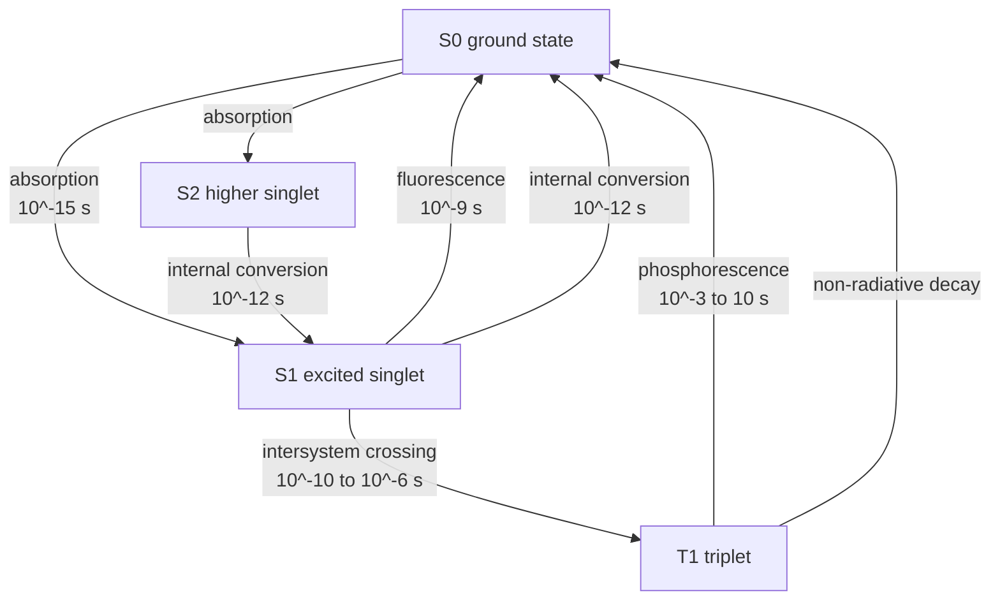
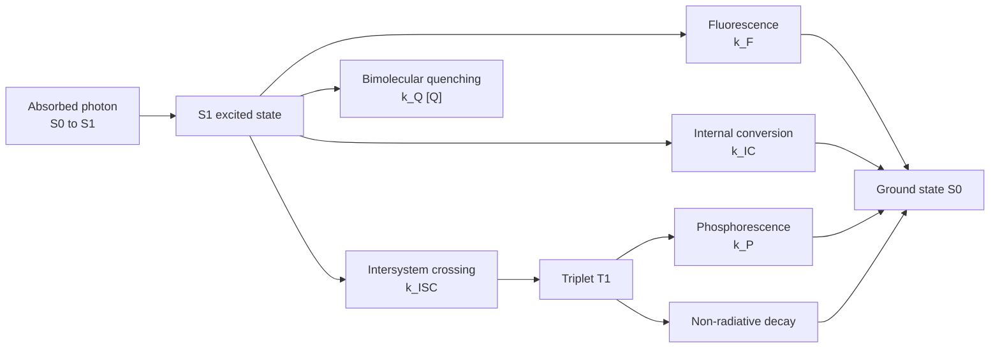
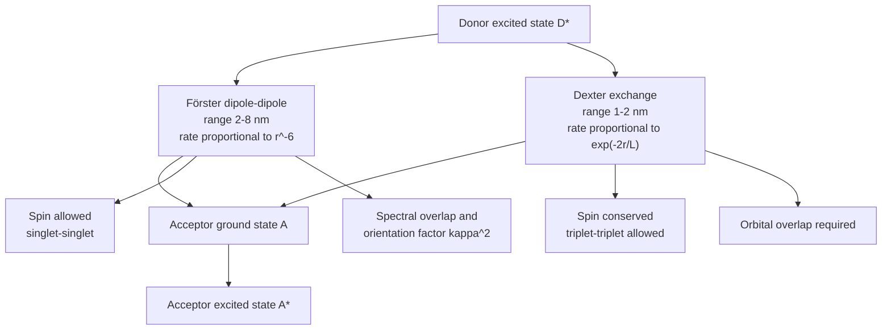
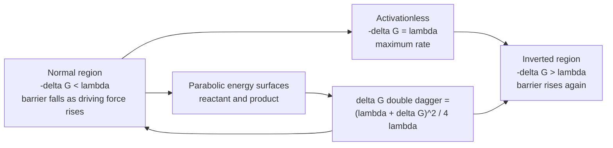
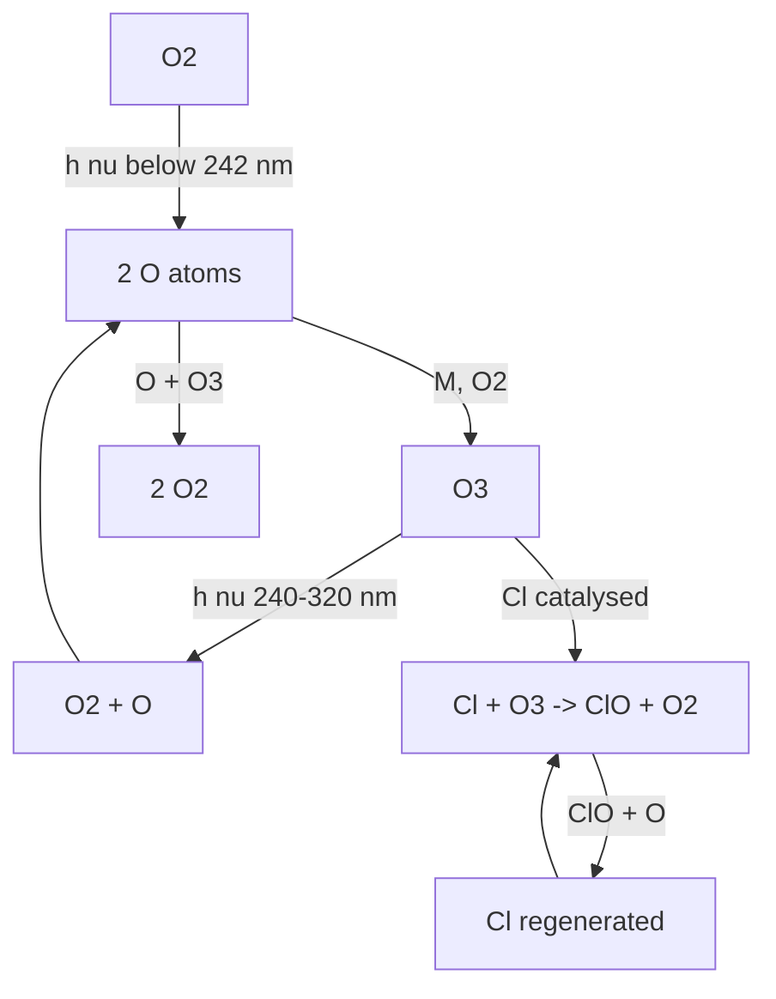

# Chapter 7 — Photochemistry

> **Level:** University (Level 6 — Physical Chemistry)
> **Estimated study time:** 8 hours (6 hours reading + 2 hours exercises)
> **Prerequisites:** [Classical Thermodynamics](01-classical-thermodynamics.md); [Quantum Mechanics Foundations](../04-advanced-chemistry/01-quantum-mechanics-foundations.md); [Molecular Orbital Theory](../04-advanced-chemistry/03-molecular-orbital-theory.md)
> **Related chapters:** [Level 6 index](README.md); [Quantum Chemistry](03-quantum-chemistry.md); [Molecular Spectroscopy](04-molecular-spectroscopy.md); [Biochemistry](../09-biochemistry/README.md); [Environmental Chemistry](../11-environmental-chemistry/README.md)
> **Difficulty:** ★★★★★ (5/5)

---

## 1. Learning Objectives

After working through this chapter you will be able to:

- Distinguish thermal from photochemical activation in terms of Boltzmann populations and photon energy.
- State the Grotthuss–Draper and Stark–Einstein laws and apply them to quantum-yield data.
- Interpret absorption spectra with the Franck–Condon principle and the Beer–Lambert law.
- Draw and explain a Jablonski diagram, naming every radiative and non-radiative pathway and its timescale.
- Apply Kasha's rule and distinguish fluorescence from phosphorescence by spin selection and lifetime.
- Define quantum yield and excited-state lifetime and interpret them as competition between rate constants.
- Describe Förster and Dexter energy transfer and the distance and spin requirements of each.
- Apply Marcus theory and the Rehm–Weller equation to excited-state electron transfer.
- Explain the photochemistry of vision and photosynthesis, and the chemistry of photopolymerisation.
- Outline the Chapman cycle and the catalytic destruction of stratospheric ozone.
- Describe flash photolysis, transient absorption and chemical actinometry, and state the safety requirements for UV work and photochemical scale-up.

---

## 2. Introduction

A photochemical reaction is driven by light rather than heat. The distinction is not semantic. Heating a molecule populates its vibrational and rotational levels and only a tiny fraction of molecules reaches an electronic excited state; irradiating it delivers quanta of energy that can excite a specific chromophore directly, at room temperature, with spatial and temporal control. This is why vision works in milliseconds, why photosynthesis stores solar energy in chemical bonds, why a UV-cured coating hardens in seconds and why atmospheric ozone absorbs the ultraviolet radiation that would otherwise reach the surface.

The energy scale is set by the photon. One mole of 300 nm photons carries about
$400\ \text{kJ mol}^{-1}$, comparable with a C–C bond; one mole of 700 nm photons carries about $171\ \text{kJ mol}^{-1}$, enough for many isomerisations but not for bond homolysis. Photochemistry is therefore the chemistry of electronically excited states: species with different geometries, dipole moments, acidities and redox potentials from their ground states. An excited molecule is not simply a hot ground-state molecule.

The chapter builds from the fate of an absorbed photon to the kinetics of excited states, then to energy and electron transfer, then to the great natural photochemical systems and to laboratory methods. It assumes the quantum mechanics of
[Quantum Mechanics Foundations](../04-advanced-chemistry/01-quantum-mechanics-foundations.md),
the orbital language of
[Molecular Orbital Theory](../04-advanced-chemistry/03-molecular-orbital-theory.md)
and the spectroscopy of Chapter 4. The treatment is quantitative but stops short of
full excited-state quantum dynamics; the aim is to make the rate-constant language
of photochemistry usable.

Two conventions are used throughout. Energies are quoted per mole when comparing with bond energies and per photon when counting quanta; the conversion is $E_{\text{mol}}=N_Ahc/\lambda$. Rate constants carry their usual units, and quantum yields are dimensionless. Where a value depends strongly on solvent, temperature or excitation wavelength, the conditions are stated.

---

## 3. Fundamental Concepts

### 3.1 Thermal versus photochemical activation

For a thermal reaction with activation energy $E_a$, the rate constant is
$k=A\exp(-E_a/RT)$. At 298 K, $RT=2.48\ \text{kJ mol}^{-1}$, so an activation energy of $100\ \text{kJ mol}^{-1}$ gives $\exp(-100/2.48)\approx3\times10^{-18}$: only a vanishing fraction of collisions is productive. Raising the temperature increases the fraction, but non-selectively, and many bonds decompose before the desired reaction becomes fast.

Photochemical activation bypasses the Boltzmann tail. A photon of energy $h\nu$ is absorbed by a chromophore in a single vertical transition, producing an electronically excited state with a well-defined energy and, often, a specific orbital occupation. The excited state is a distinct chemical species: it has its own potential-energy surface, its own equilibrium geometry and its own reactivity. The **first law of photochemistry** (Grotthuss–Draper) states that only absorbed light can produce chemical change; the **second law** (Stark–Einstein) states that one photon is absorbed per molecule activated, so the primary quantum yield is at most one.

Thermal and photochemical routes can lead to different products from the same reactants because the excited-state surface may correlate with a different transition state. The classic example is the dimerisation of anthracene, which is photochemical but thermally reversed, and the cis–trans isomerisation of stilbene, which proceeds photochemically but is slow thermally at room temperature. A photochemical reaction is not simply a thermal reaction run hotter.

### 3.2 The Grotthuss–Draper and Stark–Einstein laws

The **Grotthuss–Draper law** (1817, 1842) states that light must be absorbed for a photochemical change to occur. Light that passes through a system unchanged cannot drive reaction; scattering and reflection are losses. This is why action spectra — plots of reaction rate against wavelength — must match absorption spectra for a direct photochemical process. A mismatch indicates a sensitised reaction, a multiphoton process or a secondary thermal reaction.

The **Stark–Einstein law** (1908–1913) states that each absorbed photon activates one molecule in the primary step. It gives the upper limit $\phi\le1$ for the primary quantum yield, but overall quantum yields can exceed one when a primary photochemical event initiates a chain reaction, as in the photochlorination of methane or in radical polymerisation. A quantum yield of $10^3$ is not a violation of the law; it means that one photon produced a chain carrier that ran a thousand cycles.

The two laws together define the logic of photochemical kinetics: measure the absorbed photon flux, measure the rate of product formation, and take the ratio. The measurement of photon flux is **actinometry** (Section 4.7), and the ratio is the **quantum yield** (Section 3.6).

### 3.3 Absorption, the Beer–Lambert law and the Franck–Condon principle

Absorption of a photon promotes an electron from an occupied molecular orbital to an unoccupied one. The **absorption spectrum** plots absorbance or molar absorption coefficient against wavelength. The **Beer–Lambert law** is

$$ A=\log_{10}\frac{I_0}{I}=\varepsilon cl, $$

where $A$ is absorbance (dimensionless), $I_0$ and $I$ are incident and transmitted intensities, $\varepsilon$ is the molar absorption coefficient (M⁻¹ cm⁻¹), $c$ is concentration (M) and $l$ is path length (cm). The law assumes dilute, non-interacting chromophores, monochromatic light and no scattering. Deviations occur at high concentration, in strongly scattering media and when the chromophore associates.

The **oscillator strength** $f$ measures the intrinsic probability of a transition and is related to the integrated absorption band:

$$ f=\frac{4\varepsilon_0mc^2}{N_Ae^2}\int\varepsilon(\tilde\nu)\,\mathrm{d}\tilde\nu, $$

where $\tilde\nu$ is wavenumber and $\varepsilon$ is expressed in m² mol⁻¹ to keep the expression in SI units. Allowed transitions ($\varepsilon\sim10^4$–$10^5$) have $f$ near 1; forbidden transitions have $f\ll1$ and long radiative lifetimes. Spin selection rules make singlet–triplet absorption formally forbidden, which is why phosphorescence is weak and slow and why intersystem crossing is needed to populate triplet states efficiently.

The **Franck–Condon principle** states that electronic transitions are vertical: the nuclei do not move during the transition, because electronic motion is much faster than nuclear motion. The transition probability is proportional to the square of the overlap integral between the vibrational wavefunctions of the initial and final states. At room temperature most molecules are in the lowest vibrational level of the ground state, so the absorption envelope maps the vibrational overlap with the excited-state levels. A large geometry change between ground and excited states gives a broad, structured band with a long vibrational progression; a small change gives a narrow band.

After absorption, the excited molecule relaxes vibrationally to the lowest vibrational level of the excited state. **Emission** then occurs from that level to various vibrational levels of the ground state, so fluorescence is typically red-shifted relative to absorption (**Stokes shift**). The mirror-image relationship between absorption and fluorescence spectra, when it holds, indicates that the excited-state geometry is similar to the ground-state geometry.

### 3.4 The Jablonski diagram and the decay pathways

A **Jablonski diagram** arranges electronic states vertically by energy and shows the radiative and non-radiative transitions between them. The states are singlets $S_0,S_1,S_2,\ldots$ and triplets $T_1,T_2,\ldots$; superscripts indicate spin multiplicity. The key processes are:

- **Absorption** $S_0\to S_n$: $10^{-15}\ \text{s}$, spin-allowed and fast.
- **Vibrational relaxation** within a state: $10^{-12}$–$10^{-10}\ \text{s}$, non-radiative, releases heat to the solvent.
- **Internal conversion** (IC) between states of the same spin: $10^{-12}$–$10^{-10}\ \text{s}$.
- **Fluorescence** $S_1\to S_0$: $10^{-9}$–$10^{-7}\ \text{s}$, spin-allowed radiative.
- **Intersystem crossing** (ISC) $S_1\to T_1$: $10^{-10}$–$10^{-6}\ \text{s}$, spin-forbidden but enhanced by heavy atoms and by $n\pi^*$ character.
- **Phosphorescence** $T_1\to S_0$: $10^{-3}$–$10\ \text{s}$, spin-forbidden radiative.
- **Delayed fluorescence**: emission from $S_1$ populated by reverse intersystem crossing or triplet–triplet annihilation, on the phosphorescence timescale.

In condensed phases, vibrational relaxation and internal conversion are usually much faster than fluorescence, so emission is observed from the lowest excited state of a given multiplicity. This is the microscopic origin of Kasha's rule. The triplet state lies below the corresponding singlet because exchange interaction stabilises parallel spins, so phosphorescence is red-shifted relative to fluorescence.

The **heavy-atom effect** increases the rate of intersystem crossing because spin–orbit coupling scales roughly with $Z^4$. Iodine, bromine and heavy transition metals are therefore common triplet sensitisers. The **paramagnetic effect** of dissolved oxygen also quenches triplets efficiently, which is why phosphorescence is usually measured in deoxygenated, rigid media at low temperature.

### 3.5 Kasha's rule, fluorescence and phosphorescence

**Kasha's rule** states that emission occurs from the lowest vibrational level of the lowest excited state of a given multiplicity, regardless of which higher state was initially populated. The rule holds because internal conversion and vibrational relaxation are faster than radiative decay for higher excited states. It has important exceptions: azulene emits from $S_2$, and some molecules with large energy gaps or weak coupling show anti-Kasha emission. The rule is a kinetic generalisation, not a conservation law.

**Fluorescence** is spin-allowed emission from $S_1$ to $S_0$, with a lifetime of nanoseconds and a quantum yield that depends on the competition between radiative and non-radiative decay. **Phosphorescence** is spin-forbidden emission from $T_1$ to $S_0$, with a lifetime of milliseconds to seconds and a much lower probability. The long lifetime makes phosphorescence sensitive to quenching by oxygen, heavy atoms and molecular motion; in rigid glasses at 77 K it can be observed even for weak emitters.

The **Stokes shift** between absorption and emission maxima reflects vibrational relaxation and solvent reorganisation in the excited state. A large shift indicates a large geometry change or strong solvent stabilization of the excited state. **Solvatochromism** — the dependence of emission energy on solvent polarity — is used to probe excited-state dipole moments and to design fluorescent probes.

### 3.6 Quantum yields and excited-state lifetimes

The **quantum yield** $\phi$ of a photochemical process is the number of molecules undergoing that process divided by the number of photons absorbed:

$$ \phi=\frac{\text{amount transformed}}{\text{amount of light absorbed}}. $$

For a photophysical process, the **fluorescence quantum yield** is

$$ \phi_F=\frac{k_F}{k_F+k_{IC}+k_{ISC}+k_Q[Q]}=\frac{k_F}{k_{tot}}, $$

where $k_F$ is the radiative rate constant, $k_{IC}$ and $k_{ISC}$ are non-radiative rate constants, and $k_Q[Q]$ accounts for bimolecular quenching. The **excited-state lifetime** is

$$ \tau=\frac{1}{k_{tot}}, \qquad \phi_F=k_F\tau. $$

The natural radiative lifetime is $\tau_0=1/k_F$, so $\phi_F=\tau/\tau_0$. A quantum yield near one means that radiative decay dominates; a yield near zero means that non-radiative or bimolecular processes dominate. The lifetime is the reciprocal of the sum of all first-order and pseudo-first-order rate constants, and it is the quantity measured directly in time-resolved fluorescence.

For a reaction, the quantum yield is the product of the primary quantum yield and the probability that the primary intermediate proceeds to product. If the primary step is bond homolysis with yield $\phi_{prim}$ and the radical escapes the solvent cage with probability $p$, then $\phi_{prod}=\phi_{prim}p$. Chain reactions multiply this by the chain length.

### 3.7 Förster and Dexter energy transfer

An excited donor $D^*$ can transfer energy to an acceptor $A$ without emitting a photon. Two mechanisms dominate:

**Förster resonance energy transfer (FRET)** is a through-space dipole–dipole mechanism. The rate is

$$ k_{FRET}=\frac{1}{\tau_D}\left(\frac{R_0}{r}\right)^6, $$

where $r$ is the donor–acceptor distance, $\tau_D$ the donor lifetime and $R_0$ the **Förster radius**, typically 2–8 nm. The sixth-power dependence makes FRET a molecular ruler over 1–10 nm. $R_0$ depends on the donor quantum yield, the spectral overlap between donor emission and acceptor absorption, the relative orientation of the transition dipoles ($\kappa^2$) and the refractive index. FRET does not require orbital overlap and is spin-allowed for singlet–singlet transfer.

**Dexter energy transfer** is a through-bond or through-space exchange mechanism requiring orbital overlap. Its rate falls exponentially with distance,

$$ k_{Dexter}\propto\exp\left(-\frac{2r}{L}\right), $$

with $L$ a decay length of about 0.1 nm, so it operates only over 1–2 nm. Dexter transfer requires spin conservation; triplet–triplet transfer is allowed because the overall spin is conserved. It is the mechanism behind triplet sensitisation and triplet–triplet annihilation upconversion.

The **FRET efficiency** is

$$ E_{FRET}=\frac{R_0^6}{R_0^6+r^6}, $$

so a 50 % efficiency is achieved at $r=R_0$. FRET is widely used in fluorescence microscopy, DNA hybridisation assays and protein conformational studies; Dexter transfer is important in organic light-emitting diodes, triplet sensitisers and photoredox catalysis.

### 3.8 Electron transfer in excited states: Marcus theory and the Rehm–Weller equation

An excited molecule is both a stronger oxidant and a stronger reductant than its ground state, because it can donate an electron from a high-energy orbital or accept one into a low-energy hole. Photoinduced electron transfer (PET) is therefore possible between partners whose ground-state redox potentials forbid it.

The **Rehm–Weller equation** estimates the Gibbs energy of PET:

$$ \Delta G_{ET}=E^{\circ}(D^{+}/D)-E^{\circ}(A/A^{-})-E^{*}+w, $$

where $E^{\circ}(D^{+}/D)$ is the oxidation potential of the donor, $E^{\circ}(A/A^{-})$ the reduction potential of the acceptor, $E^{*}$ the excited-state energy (usually the 0–0 energy $E_{00}$) and $w$ the work term for bringing the ions together, often neglected in polar solvents. A negative $\Delta G_{ET}$ indicates favourable transfer. The equation assumes outer-sphere transfer and uses the same solvent and reference electrode for both potentials.

**Marcus theory** relates the rate of electron transfer to the driving force and the **reorganisation energy** $\lambda$:

$$ \Delta G^{\ddagger}=\frac{(\lambda+\Delta G^{\circ})^2}{4\lambda}, \qquad
   k_{ET}=A\exp\left(-\frac{\Delta G^{\ddagger}}{k_BT}\right). $$

The parabolic dependence predicts three regimes. When $-\Delta G^{\circ}<\lambda$, the rate increases with driving force (**normal region**). When $-\Delta G^{\circ}=\lambda$, the barrier vanishes and the rate is maximal (**activationless region**). When $-\Delta G^{\circ}>\lambda$, the rate decreases with increasing driving force (**inverted region**). The inverted region was experimentally confirmed in the 1980s and is a signature of non-adiabatic electron transfer. The reorganisation energy has an inner contribution from bond-length changes and an outer contribution from solvent repolarisation; polar solvents increase $\lambda_{out}$.

### 3.9 Photoredox catalysis

**Photoredox catalysis** uses a transition-metal complex or an organic dye to absorb visible light and then transfer an electron to or from a substrate. The most common catalysts are polypyridyl complexes of ruthenium and iridium, such as $\ce{[Ru(bpy)3]^2+}$ and fac-$\ce{Ir(ppy)3}$, and organic dyes such as eosin Y and 4CzIPN.

The catalytic cycle has three stages. First, absorption populates a metal-to-ligand charge-transfer (MLCT) state; for $\ce{[Ru(bpy)3]^2+}$ this occurs near 450 nm. Second, the excited state undergoes **oxidative quenching** (donating an electron to a substrate) or **reductive quenching** (accepting an electron from a sacrificial donor), generating a reduced or oxidised form of the catalyst. Third, the catalyst returns to its resting state by a complementary electron transfer, closing the cycle. The excited state is both a stronger oxidant and a stronger reductant than the ground state, so a single photocatalyst can drive thermodynamically uphill reactions using visible light.

Photoredox catalysis has transformed organic synthesis because it generates radicals under mild conditions, enables C–H functionalisation and cross-coupling, and couples well with nickel or cobalt catalysis. The quantum yield of a photoredox cycle can exceed one when a radical chain propagates, so careful mechanistic analysis is needed to distinguish true photocatalysis from photoinitiated chain chemistry.

### 3.10 Atmospheric photochemistry: the ozone layer

Stratospheric ozone is maintained by the **Chapman cycle**:

$$ \ce{O2 ->[hv] 2O} \qquad (\lambda<242\ \text{nm}), $$

$$ \ce{O + O2 + M -> O3 + M}, \qquad
   \ce{O3 ->[hv] O2 + O} \qquad (\lambda\approx240\text{–}320\ \text{nm}), $$

$$ \ce{O + O3 -> 2O2}. $$

The first step requires ultraviolet light shorter than 242 nm, which is supplied by the sun above the ozone layer. The third step is the only significant destruction of ozone in the unpolluted stratosphere. The steady-state ozone concentration is set by the balance between production and destruction, and it peaks at about 25 km altitude. The ozone layer absorbs the 240–320 nm ultraviolet that would otherwise damage DNA and proteins.

Chlorofluorocarbons (CFCs) destroy ozone catalytically. They are photolysed in the stratosphere to release chlorine atoms:

$$ \ce{CFCl3 ->[hv] CFCl2 + Cl}, \qquad
   \ce{Cl + O3 -> ClO + O2}, \qquad
   \ce{ClO + O -> Cl + O2}. $$

The net result is $\ce{O3 + O -> 2O2}$ with chlorine regenerated, so one chlorine atom can destroy thousands of ozone molecules before it is removed as $\ce{HCl}$ or $\ce{ClONO2}$. Nitrogen oxides and bromine compounds act similarly. The Montreal Protocol (1987) phased out CFCs, and stratospheric chlorine is now declining slowly; ozone recovery is expected later this century. The chemistry is a clear case in which a small photochemical quantum yield per molecule produces a large environmental effect through chain cycling.

---

## 4. Detailed Scientific Explanation

### 4.1 Excited-state kinetics and Stern–Volmer quenching

For a fluorophore with total first-order decay rate $k_{tot}=k_F+k_{IC}+k_{ISC}$ and a quencher $Q$ with bimolecular rate constant $k_q$, the steady-state quantum yield is

$$ \phi_F=\frac{k_F}{k_{tot}+k_q[Q]}, \qquad
   \frac{\phi_F^0}{\phi_F}=1+\frac{k_q}{k_{tot}}[Q]=1+K_{SV}[Q], $$

where $\phi_F^0$ is the yield in the absence of quencher and $K_{SV}=k_q\tau_0$ is the **Stern–Volmer constant**. The same relation holds for fluorescence intensity, because intensity is proportional to quantum yield at fixed absorbance. A plot of $I_0/I$ against $[Q]$ is linear with intercept one and slope $K_{SV}$; departure from linearity indicates static quenching, a mixture of lifetimes or a diffusion-limited process.

Time-resolved measurements separate static from dynamic quenching. In dynamic quenching the lifetime shortens according to $\tau_0/\tau=1+K_{SV}[Q]$; in static quenching the lifetime is unchanged because the quenched complex is non-fluorescent before excitation. Combining both gives upward-curving Stern–Volmer plots.

The **diffusion-limited rate constant** in water at 25 °C is about
$7\times10^9\ \text{M}^{-1}\text{s}^{-1}$ for small molecules. A measured $k_q$ close to this value indicates that every encounter quenches; a much smaller value indicates that only a fraction of encounters is productive. The quenching rate can be used to estimate the lifetime if $K_{SV}$ is measured and $k_q$ is known, or vice versa.

### 4.2 FRET in quantitative form

The Förster radius is defined by

$$ R_0^6=\frac{9\ln10\,\kappa^2\phi_D}{128\pi^5N_An^4}J, $$

where $\kappa^2$ is the orientation factor (2/3 for rapidly rotating dipoles), $\phi_D$ the donor quantum yield, $n$ the refractive index and $J$ the spectral overlap integral,

$$ J=\int F_D(\lambda)\varepsilon_A(\lambda)\lambda^4\,\mathrm{d}\lambda, $$

with $F_D$ the normalised donor emission spectrum and $\varepsilon_A$ the acceptor molar absorption coefficient. $R_0$ is typically 2–8 nm. The strong dependence on $\phi_D$ means that a low-yield donor gives a small Förster radius and a short useful range.

The **FRET efficiency** can be measured by donor lifetime or intensity:

$$ E_{FRET}=1-\frac{\tau_{DA}}{\tau_D}=1-\frac{I_{DA}}{I_D}=\frac{R_0^6}{R_0^6+r^6}. $$

The measurement is ratiometric and therefore robust against concentration differences, which is why FRET is so widely used in live-cell imaging. The **orientation factor** is the largest uncertainty: if the dipoles are static and not averaged, $\kappa^2$ can range from 0 to 4, and assuming 2/3 can introduce large errors. Anisotropy measurements can bound the uncertainty.

FRET is a **through-space** process and does not require contact, but it requires spectral overlap and favourable orientation. **Dexter transfer** requires orbital overlap and is therefore limited to 1–2 nm; it is the mechanism for triplet sensitisation, where a triplet donor transfers to a triplet acceptor and the spin is conserved. In **triplet–triplet annihilation upconversion**, two triplet acceptors annihilate to produce one singlet emitter, converting low-energy photons into higher-energy ones.

### 4.3 Marcus theory and the inverted region

Marcus theory treats electron transfer as a transition between two parabolic free-energy surfaces — the reactant and product states — along a collective solvent coordinate. The two parabolas have the same curvature in the simplest model, and the activation energy is the height of their intersection above the reactant minimum:

$$ \Delta G^{\ddagger}=\frac{(\lambda+\Delta G^{\circ})^2}{4\lambda}. $$

The reorganisation energy $\lambda$ is the energy required to distort the reactants and solvent into the product equilibrium configuration without transferring the electron. It has an inner part $\lambda_i$ from bond-length changes and an outer part $\lambda_o$ from solvent repolarisation. The **outer-sphere** contribution can be estimated from the Born model:

$$ \lambda_o=\frac{e^2}{4\pi\varepsilon_0}\left(\frac{1}{2r_D}+\frac{1}{2r_A}-\frac{1}{r_{DA}}\right)\left(\frac{1}{\varepsilon_{op}}-\frac{1}{\varepsilon_s}\right), $$

where $r_D$ and $r_A$ are the donor and acceptor radii, $r_{DA}$ their separation, $\varepsilon_{op}$ the optical dielectric constant and $\varepsilon_s$ the static dielectric constant. The form shows that polar solvents with a large difference between $\varepsilon_s$ and $\varepsilon_{op}$ give large $\lambda_o$ and therefore slow transfer in the normal region, but can also bring the reaction into the inverted region.

The rate in the non-adiabatic limit is

$$ k_{ET}=\frac{2\pi}{\hbar}\frac{H_{DA}^2}{\sqrt{4\pi\lambda k_BT}}
   \exp\left(-\frac{(\lambda+\Delta G^{\circ})^2}{4\lambda k_BT}\right), $$

where $H_{DA}$ is the electronic coupling. The **inverted region** is the decrease of rate with increasing driving force when $-\Delta G^{\circ}>\lambda$. It was controversial because classical transition-state theory predicts a monotonic increase; its experimental confirmation by Miller, Calcaterra and Closs (1984) established Marcus theory as the standard framework. The **energy-gap law** for non-radiative decay has a similar exponential dependence on the energy gap and is the photophysical analogue of the inverted region.

### 4.4 The photochemistry of vision

Vision begins with the absorption of a photon by **rhodopsin**, a G-protein-coupled receptor in the retinal rod cells. The chromophore is **11-cis-retinal**, bound covalently to a lysine residue through a protonated Schiff base. Absorption at about 500 nm drives **photoisomerisation** to all-trans-retinal:

$$ \text{11-}\textit{cis}\text{-retinal} \xrightarrow{h\nu} \text{all-}\textit{trans}\text{-retinal}. $$

The reaction is ultrafast: the excited state decays through a conical intersection in about 200 fs, with a quantum yield of about 0.65. The isomerisation changes the shape of the chromophore and forces a conformational change in the protein, which activates the G-protein transducin and triggers the visual signal cascade. The protein environment tunes the absorption wavelength and suppresses competing pathways, which is why the quantum yield is so high.

The **conical intersection** is a point where the excited-state and ground-state potential-energy surfaces touch. Near it, the Born–Oppenheimer approximation breaks down and the molecule can pass from one surface to the other without emission. Conical intersections are now recognised as central to photochemistry: they provide ultrafast, non-radiative funnels that convert electronic energy into vibrational motion and products. The retinal case is the best-studied example and the reason vision is both fast and efficient.

After isomerisation, the all-trans-retinal is released, reduced to retinol and recycled; the rod cell adapts by regenerating rhodopsin. The photochemistry is therefore a switch, not a catalytic cycle, and the protein pays the energetic cost of resetting it.

### 4.5 Photosynthesis: a brief photochemical overview

Oxygenic photosynthesis converts light into chemical energy with an overall reaction

$$ \ce{6CO2 + 6H2O -> C6H12O6 + 6O2}, \qquad \Delta G^{\circ}\approx+2870\ \text{kJ mol}^{-1}. $$

The energy is supplied by two photosystems connected in series. **Photosystem II** (PSII) uses light absorbed by chlorophyll a and accessory pigments to drive the oxidation of water at a manganese–calcium cluster, producing oxygen and protons:

$$ \ce{2H2O -> O2 + 4H+ + 4e-}. $$

The electrons pass through a plastoquinone pool, the cytochrome $b_6f$ complex and plastocyanin to **Photosystem I**, which is re-excited and reduces ferredoxin and then NADP⁺. The proton gradient across the thylakoid membrane drives ATP synthesis. The **Z-scheme** describes the two light-driven steps: PSII raises the electron to a sufficiently negative potential to reduce plastoquinone, and PSI raises it again to reduce ferredoxin, with the energy gap between the two photosystems supplied by a second photon.

**Antenna complexes** contain hundreds of chlorophyll molecules that absorb light and transfer energy to the reaction centre by FRET. The reaction centre performs **charge separation** in picoseconds, and the resulting radical pair is stabilised by the protein environment, which prevents back electron transfer. The quantum yield of charge separation is close to one, one of the most efficient photochemical processes known. The detailed biochemistry belongs to [Biochemistry](../09-biochemistry/README.md); here the essential point is that photosynthesis is a photochemical electron-transfer chain driven by two sequential absorptions.

### 4.6 Photopolymerisation

**Photopolymerisation** uses light to initiate polymerisation. A **photoinitiator** absorbs UV or visible light and fragments into radicals, which add to monomer:

$$ \ce{I ->[hv] 2R.}, \qquad \ce{R. + M -> RM.}, \qquad \ce{RM. + nM -> P.}. $$

The most common systems are acrylates and methacrylates initiated by radicals, and epoxides initiated by photogenerated acids. **Norrish type I** photoinitiators undergo $\alpha$-cleavage; **Norrish type II** initiators abstract a hydrogen from a co-initiator. The rate of polymerisation is proportional to the square root of the light intensity in a simple radical system, because termination is bimolecular.

Photopolymerisation is the basis of UV-curable coatings, adhesives, dental composites, photoresists and 3D printing. In **stereolithography** and **digital light processing**, a laser or projector patterns the light and solidifies a resin layer by layer. The spatial resolution is set by the optics, the resin absorption and the shrinkage on cure. Oxygen inhibits radical polymerisation at the surface, which is why curing is often performed under nitrogen or with high-intensity lamps.

### 4.7 Experimental methods: flash photolysis, transient absorption and actinometry

**Flash photolysis**, developed by Norrish and Porter (1949), uses a short, intense flash to create a population of excited states or radicals and a second, delayed probe pulse to measure their absorption. The technique opened the study of microsecond and later nanosecond intermediates and won the 1967 Nobel Prize. Modern versions use pulsed lasers with femtosecond to nanosecond resolution; **transient absorption** measures the change in absorbance $\Delta A$ as a function of delay time, giving species spectra and kinetics.

A transient absorption experiment has three beams: a pump pulse that excites the sample, a probe pulse that measures absorption and a reference beam that corrects for pulse-to-pulse fluctuations. The signal is $\Delta A=-\log(I/I_0)$ and can be positive (excited-state absorption) or negative (ground-state bleach or stimulated emission). Global analysis fits the decay-associated spectra to a kinetic model.

**Chemical actinometry** measures the photon flux. The most common actinometer is **potassium ferrioxalate**, which photolyses to Fe(II) with a well-known quantum yield; the Fe(II) is determined colorimetrically with 1,10-phenanthroline. Other actinometers include uranyl oxalate and iodide/iodate. The photon flux is

$$ \Phi=\frac{n_{\text{product}}}{\phi_{\text{actinometer}}t}, $$

where $n_{\text{product}}$ is the moles of actinometric product, $\phi$ the known quantum yield and $t$ the irradiation time. Without actinometry, a quantum yield is only a relative number.

**Time-correlated single-photon counting** (TCSPC) measures fluorescence lifetimes by timing the arrival of emitted photons relative to the excitation pulse. **Streak cameras** and **upconversion** extend the resolution to femtoseconds. **Cryogenic matrix isolation** stabilises reactive intermediates for spectroscopic study. The choice of method follows from the timescale of the process: femtoseconds for vibrational relaxation and conical intersections, picoseconds for charge separation, nanoseconds for fluorescence, microseconds to seconds for phosphorescence and radical reactions.

### 4.8 Safety and scale-up

Ultraviolet radiation is hazardous. UV-C (200–280 nm) is strongly absorbed by proteins and DNA and can cause corneal damage (photokeratitis) and skin erythema; UV-B (280–315 nm) causes sunburn and long-term skin damage; UV-A (315–400 nm) penetrates deeper and generates reactive oxygen species. Enclosures, interlocks, face shields and UV-blocking screens are mandatory. Ozone is generated by UV lamps in air and is a respiratory irritant, so enclosures must be ventilated.

Photochemical reactions can be exothermic and can accelerate unexpectedly when a lamp is switched on. A large batch reactor has a small surface-to-volume ratio for light penetration, so the illuminated volume may overheat while the bulk remains cool; the result is a runaway in the lit region. **Scale-up** therefore uses flow reactors with narrow channels, controlled light-emitting diodes, inline temperature sensing and residence-time control. The **Beer–Lambert law** sets the penetration depth: at high absorbance, only a thin layer is illuminated, so mixing and channel width must match the optical depth.

Photochemical reactions often involve hazardous reagents (mercury, ozone, halogens) and reactive intermediates (radicals, singlet oxygen). The usual rules apply: know the quantum yield and the heat of reaction, use blast shields, quench lamps before opening the reactor, and never look into a collimated UV beam. Laser safety adds the risk of eye damage from direct or specular beams; laser classes and eyewear must match the wavelength.

---

## 5. Visual Diagrams

### 5.1 The Jablonski diagram

**Figure 7.1 — The Jablonski diagram organises the fate of an absorbed photon.** Absorption is vertical and fast, typically reaching a higher vibrational level of $S_1$ or $S_2$. Vibrational relaxation and internal conversion then funnel the molecule to the lowest vibrational level of $S_1$ within picoseconds. From there it can fluoresce, convert internally to $S_0$, or undergo intersystem crossing to $T_1$; the triplet can phosphoresce or decay non-radiatively. The branching ratios between these pathways determine the quantum yields and lifetimes, and the spin-forbidden nature of intersystem crossing and phosphorescence explains why triplet processes are slow and sensitive to heavy atoms and oxygen.

### 5.2 Competition between deactivation pathways

**Figure 7.2 — Every excited state decays by competing first-order and pseudo-first-order channels.** The fluorescence quantum yield is the radiative rate divided by the sum of all rates, and the lifetime is the reciprocal of that sum. Adding a quencher increases the denominator and shortens the lifetime without changing the radiative rate, which is why Stern–Volmer analysis can separate dynamic quenching from static complexation. The diagram also shows why phosphorescence is usually weak in fluid solution: the triplet has a long lifetime and many non-radiative and bimolecular routes compete with emission.

### 5.3 Förster versus Dexter energy transfer

**Figure 7.3 — Two mechanisms transfer electronic energy without a photon.** Förster transfer is a Coulombic dipole–dipole interaction that operates over several nanometres and depends on the overlap between donor emission and acceptor absorption, the orientation factor and the donor quantum yield. Dexter transfer is an exchange interaction that requires orbital overlap and therefore acts only over about 1 nm; it conserves spin, so triplet–triplet transfer is allowed. The distance dependence is the practical distinction: a measured energy-transfer rate that falls as $r^{-6}$ indicates Förster, while an exponential fall over a short range indicates Dexter.

### 5.4 Marcus parabolas and the inverted region

**Figure 7.4 — Marcus theory predicts a parabolic barrier and an inverted region.** The reactant and product free-energy surfaces are approximated as parabolas of equal curvature, displaced vertically by $\Delta G^{\circ}$ and horizontally by the reorganisation coordinate. The barrier is the intersection height, which falls to zero when the driving force equals the reorganisation energy and then rises again when the driving force exceeds it. The inverted region is the counter-intuitive prediction that a more exergonic transfer can be slower; its experimental confirmation established the theory and it explains why highly exergonic charge recombination in photosynthesis is slow enough to be useful.

### 5.5 The Chapman cycle and catalytic ozone destruction

**Figure 7.5 — The Chapman cycle balances ozone production and destruction, and chlorine catalyses the destruction.** Ultraviolet light below 242 nm photolyses oxygen, and the resulting oxygen atoms combine with molecular oxygen to form ozone. Ozone itself absorbs 240–320 nm light and is destroyed by reaction with oxygen atoms. In the unpolluted stratosphere these steps set a steady-state concentration with a maximum near 25 km. Chlorine atoms from CFC photolysis insert a catalytic cycle that converts ozone and oxygen atoms to oxygen molecules while regenerating chlorine, so a trace of CFC can destroy a large amount of ozone.

---

## 6. Mathematical Formulas

### 6.1 Photon energy and molar photon energy

$$ E=h\nu=\frac{hc}{\lambda}, \qquad E_{\text{mol}}=\frac{N_Ahc}{\lambda}. $$

| Symbol | Meaning | SI unit |
|---|---|---|
| $E$ | Energy of one photon | J |
| $h$ | Planck constant | J s |
| $\nu$ | Frequency | Hz |
| $\lambda$ | Wavelength | m |
| $E_{\text{mol}}$ | Energy per mole of photons | J mol⁻¹ |

Assumption: monochromatic light; the conversion uses $N_A$ and is exact for one mole of identical photons.

### 6.2 Beer–Lambert law and oscillator strength

$$ A=\log_{10}\frac{I_0}{I}=\varepsilon cl, \qquad
   f=\frac{4\varepsilon_0mc^2}{N_Ae^2}\int\varepsilon(\tilde\nu)\,\mathrm{d}\tilde\nu. $$

| Symbol | Meaning | SI unit |
|---|---|---|
| $A$ | Absorbance | dimensionless |
| $\varepsilon$ | Molar absorption coefficient | M⁻¹ cm⁻¹ |
| $c$ | Concentration | mol dm⁻³ |
| $l$ | Path length | cm |
| $f$ | Oscillator strength | dimensionless |
| $\tilde\nu$ | Wavenumber | m⁻¹ (often cm⁻¹) |

Assumptions: dilute solution, non-interacting chromophores, monochromatic light, negligible scattering.

### 6.3 Quantum yield and lifetime

$$ \phi=\frac{\text{molecules transformed}}{\text{photons absorbed}}, \qquad
   \phi_F=\frac{k_F}{k_F+k_{IC}+k_{ISC}+k_Q[Q]}, \qquad
   \tau=\frac{1}{k_F+k_{IC}+k_{ISC}+k_Q[Q]}. $$

| Symbol | Meaning | SI unit |
|---|---|---|
| $\phi$ | Quantum yield | dimensionless |
| $k_F$ | Radiative rate constant | s⁻¹ |
| $k_{IC}$ | Internal conversion rate constant | s⁻¹ |
| $k_{ISC}$ | Intersystem crossing rate constant | s⁻¹ |
| $k_Q$ | Bimolecular quenching rate constant | M⁻¹ s⁻¹ |
| $\tau$ | Excited-state lifetime | s |

Assumptions: first-order decay of a homogeneous excited-state population, no migration or aggregation, quencher in large excess.

### 6.4 Stern–Volmer quenching

$$ \frac{\phi_F^0}{\phi_F}=\frac{I_0}{I}=1+K_{SV}[Q], \qquad K_{SV}=k_q\tau_0. $$

| Symbol | Meaning | SI unit |
|---|---|---|
| $\phi_F^0,I_0$ | Quantum yield and intensity without quencher | dimensionless, arbitrary |
| $K_{SV}$ | Stern–Volmer constant | M⁻¹ |
| $k_q$ | Quenching rate constant | M⁻¹ s⁻¹ |
| $\tau_0$ | Lifetime without quencher | s |

Assumptions: dynamic quenching only, homogeneous fluorophore, quencher concentration much greater than excited-state concentration.

### 6.5 Förster and Dexter transfer

$$ k_{FRET}=\frac{1}{\tau_D}\left(\frac{R_0}{r}\right)^6, \qquad
   E_{FRET}=\frac{R_0^6}{R_0^6+r^6}, \qquad
   k_{Dexter}\propto e^{-2r/L}. $$

| Symbol | Meaning | SI unit |
|---|---|---|
| $R_0$ | Förster radius | m |
| $r$ | Donor–acceptor distance | m |
| $\tau_D$ | Donor lifetime | s |
| $E_{FRET}$ | Transfer efficiency | dimensionless |
| $L$ | Dexter decay length | m |

Assumptions: Förster point-dipole approximation, rapid orientational averaging, spectral overlap; Dexter requires orbital overlap and spin conservation.

### 6.6 Rehm–Weller and Marcus

$$ \Delta G_{ET}=E^{\circ}(D^{+}/D)-E^{\circ}(A/A^{-})-E^{*}+w, \qquad
   \Delta G^{\ddagger}=\frac{(\lambda+\Delta G^{\circ})^2}{4\lambda}, $$

$$ k_{ET}=A\exp\left(-\frac{\Delta G^{\ddagger}}{k_BT}\right). $$

| Symbol | Meaning | SI unit |
|---|---|---|
| $\Delta G_{ET}$ | Gibbs energy of electron transfer | eV or J |
| $E^{\circ}$ | Standard electrode potential | V |
| $E^{*}$ | Excited-state energy | eV |
| $w$ | Work term for ion pairing | eV |
| $\lambda$ | Reorganisation energy | eV |
| $\Delta G^{\ddagger}$ | Activation Gibbs energy | eV |
| $A$ | Pre-exponential factor | s⁻¹ |

Assumptions: outer-sphere transfer, same solvent and reference electrode for both potentials, parabolic surfaces of equal curvature, classical solvent modes.

### 6.7 Ozone photostationary state

$$ \frac{\mathrm{d}[\ce{O3}]}{\mathrm{d}t}=k_2[\ce{O}][\ce{O2}][M]-J[\ce{O3}]-k_4[\ce{O}][\ce{O3}], $$

where $J$ is the local photolysis rate coefficient (absorption cross-section times quantum yield times actinic flux). At steady state the production and loss terms balance. The equation is a simplified Chapman cycle; the stratosphere also contains HOₓ, NOₓ, ClOₓ and BrOₓ cycles that couple to it.

| Symbol | Meaning | SI unit |
|---|---|---|
| $[\ce{O3}]$ | Ozone number density | molecules m⁻³ |
| $k_2$ | Three-body rate coefficient | m⁶ molecule⁻² s⁻¹ |
| $J$ | Photolysis rate coefficient | s⁻¹ |
| $M$ | Third body (N₂ or O₂) | molecules m⁻³ |

Assumption: local steady state, no transport, fixed temperature and actinic flux.

---

## 7. Chemical Equations

### 7.1 Photodissociation of chlorine

$$ \ce{Cl2 ->[hv] 2Cl.} \qquad \lambda<494\ \text{nm} $$

The bond dissociation energy of $\ce{Cl2}$ is 242 kJ mol⁻¹, corresponding to a photon wavelength of about 494 nm. Visible light is therefore sufficient; the reaction is the primary step in the photochlorination of alkanes and in the atmospheric chemistry of chlorine.

### 7.2 Chapman cycle

$$ \ce{O2 ->[hv] 2O} \qquad (\lambda<242\ \text{nm}), $$

$$ \ce{O + O2 + M -> O3 + M}, \qquad
   \ce{O3 ->[hv] O2 + O} \qquad (\lambda=240\text{–}320\ \text{nm}), $$

$$ \ce{O + O3 -> 2O2}. $$

The first step is the only significant natural source of ozone; the third is its main natural sink. The cycle is a simplification because it omits HOₓ, NOₓ and halogen cycles, but it captures the altitude dependence and the ultraviolet screening.

### 7.3 Catalytic ozone destruction by chlorine

$$ \ce{CFCl3 ->[hv] CFCl2 + Cl}, \qquad
   \ce{Cl + O3 -> ClO + O2}, \qquad
   \ce{ClO + O -> Cl + O2}. $$

Summing the last two steps gives $\ce{O3 + O -> 2O2}$ with chlorine regenerated. One chlorine atom can destroy thousands of ozone molecules before it is removed as $\ce{HCl}$ or $\ce{ClONO2}$.

### 7.4 Retinal photoisomerisation

$$ \text{11-}\textit{cis}\text{-retinal} \xrightarrow{h\nu} \text{all-}\textit{trans}\text{-retinal} $$

The reaction occurs in rhodopsin on a femtosecond timescale through a conical intersection. It is a photochemical switch, not a catalytic cycle; the protein regenerates the 11-cis isomer in the dark.

### 7.5 Photosynthesis

$$ \ce{6CO2 + 6H2O -> C6H12O6 + 6O2} \qquad \Delta G^{\circ}\approx+2870\ \text{kJ mol}^{-1} $$

The reaction is driven by light absorbed by chlorophyll in photosystems I and II. Water is oxidised at the oxygen-evolving complex, and the electrons reduce NADP⁺ to NADPH; the proton gradient drives ATP synthesis.

### 7.6 Radical photopolymerisation

$$ \ce{I ->[hv] 2R.}, \qquad \ce{R. + CH2=CHR' -> R-CH2-CHR'.}, \qquad
   \ce{R-CH2-CHR'. + n CH2=CHR' -> polymer}. $$

The initiation step produces radicals; propagation adds monomer units; termination combines or disproportionates radicals. The rate is proportional to the square root of the light intensity when termination is bimolecular.

### 7.7 Photoredox cycle of $\ce{[Ru(bpy)3]^2+}$

$$ \ce{[Ru(bpy)3]^2+} \xrightarrow{h\nu} \ce{[Ru(bpy)3]^{2+}}^{*}, \qquad
   \ce{[Ru(bpy)3]^{2+}}^{*} + \ce{A} -> \ce{[Ru(bpy)3]^3+} + \ce{A^{-}}, \qquad
   \ce{[Ru(bpy)3]^3+ + D -> [Ru(bpy)3]^2+ + D^{+}}. $$

The excited state is a stronger oxidant and a stronger reductant than the ground state. Oxidative quenching by acceptor $A$ generates the Ru(III) complex, which is returned to Ru(II) by donor $D$. The cycle converts light into a sequence of electron transfers.

---

## 8. Worked Examples

### Worked Example 8.1 — Photon energy and bond dissociation

**Problem.** Calculate the energy of one mole of 300 nm photons. Is this sufficient to break a C–C bond (about 350 kJ mol⁻¹) or an O–O bond (about 210 kJ mol⁻¹)?

**Strategy.** Use $E_{\text{mol}}=N_Ahc/\lambda$ and compare with the bond energies.

**Solution.**

$$ E_{\text{mol}}=\frac{(6.022\times10^{23})(6.626\times10^{-34})(2.998\times10^8)}{300\times10^{-9}}
=3.99\times10^5\ \text{J mol}^{-1}=399\ \text{kJ mol}^{-1}. $$

**Check.** 399 kJ mol⁻¹ exceeds both bond energies, so 300 nm light can break either bond in a single photon. The C–C bond requires $\lambda<342$ nm and the O–O bond $\lambda<570$ nm; the difference is why UV-B is more damaging than visible light.

### Worked Example 8.2 — Beer–Lambert law and quantum yield

**Problem.** A solution of a photochromic compound ($\varepsilon=1.5\times10^4\ \text{M}^{-1}\text{cm}^{-1}$) at $2.0\times10^{-5}\ \text{M}$ is irradiated in a 1.0 cm cuvette with a 355 nm laser of 10 mW for 10.0 s. After irradiation, 3.0 mL of solution contains $2.0\times10^{-5}\ \text{M}$ product. Calculate the absorbance, the fraction of light absorbed and the quantum yield.

**Strategy.** Use $A=\varepsilon cl$, $T=10^{-A}$, and divide the moles of product by the moles of photons absorbed.

**Solution.** $A=(1.5\times10^4)(2.0\times10^{-5})(1.0)=0.30$, so $T=10^{-0.30}=0.501$ and 49.9 % of the light is absorbed. The laser energy is $0.010\times10.0=0.100\ \text{J}$. The photon energy at 355 nm is

$$ E=\frac{(6.626\times10^{-34})(2.998\times10^8)}{355\times10^{-9}}
=5.60\times10^{-19}\ \text{J}, $$

so the number of incident photons is $0.100/5.60\times10^{-19}=1.79\times10^{17}$ and the number absorbed is $8.91\times10^{16}$. The product amount is $2.0\times10^{-5}\times0.0030=6.0\times10^{-8}\ \text{mol}$, or $3.61\times10^{16}$ molecules. Hence

$$ \phi=\frac{3.61\times10^{16}}{8.91\times10^{16}}=0.41. $$

**Check.** The quantum yield is below one, as required for a simple photochemical reaction. A value above one would indicate a chain reaction or an error in actinometry.

### Worked Example 8.3 — Fluorescence lifetime and rate constants

**Problem.** A fluorophore has a fluorescence quantum yield of 0.35 and a lifetime of 4.0 ns. Calculate the radiative and total non-radiative rate constants.

**Strategy.** Use $\phi_F=k_F\tau$ and $k_{nr}=1/\tau-k_F$.

**Solution.**

$$ k_F=\frac{\phi_F}{\tau}=\frac{0.35}{4.0\times10^{-9}}=8.75\times10^7\ \text{s}^{-1}, $$

$$ k_{nr}=\frac{1}{\tau}-k_F=\frac{1}{4.0\times10^{-9}}-8.75\times10^7
=1.63\times10^8\ \text{s}^{-1}. $$

**Check.** The non-radiative rate is about twice the radiative rate, consistent with $\phi_F=0.35$. The natural radiative lifetime is $1/k_F=11.4$ ns, so the measured lifetime is shortened by non-radiative decay.

### Worked Example 8.4 — Stern–Volmer quenching

**Problem.** A fluorophore has a lifetime of 5.0 ns in the absence of quencher. Addition of 0.020 M quencher reduces the fluorescence intensity by a factor of 1.20. Calculate the Stern–Volmer constant and the quenching rate constant.

**Strategy.** Use $I_0/I=1+K_{SV}[Q]$ and $K_{SV}=k_q\tau_0$.

**Solution.** $1.20=1+K_{SV}(0.020)$, so $K_{SV}=0.20/0.020=10\ \text{M}^{-1}$. Then

$$ k_q=\frac{K_{SV}}{\tau_0}=\frac{10}{5.0\times10^{-9}}=2.0\times10^9\ \text{M}^{-1}\text{s}^{-1}. $$

**Check.** The value is below the diffusion limit in water (about $7\times10^9\ \text{M}^{-1}\text{s}^{-1}$), so quenching is not fully diffusion-controlled; only about 30 % of encounters are productive. A value above the diffusion limit would indicate static quenching or an error.

### Worked Example 8.5 — Marcus barrier and inverted region

**Problem.** For an electron-transfer reaction with reorganisation energy 0.80 eV, calculate the activation Gibbs energy and the relative rate for $\Delta G^{\circ}=-0.40$ eV and $\Delta G^{\circ}=-1.60$ eV. Take $A=1.0\times10^{13}\ \text{s}^{-1}$ and $T=298$ K.

**Strategy.** Use $\Delta G^{\ddagger}=(\lambda+\Delta G^{\circ})^2/(4\lambda)$ and $k=A\exp(-\Delta G^{\ddagger}/k_BT)$.

**Solution.** For $\Delta G^{\circ}=-0.40$ eV,

$$ \Delta G^{\ddagger}=\frac{(0.80-0.40)^2}{4(0.80)}=\frac{0.16}{3.20}=0.050\ \text{eV}, $$

$$ k=10^{13}\exp\left(-\frac{0.050}{0.0257}\right)=10^{13}(0.143)=1.4\times10^{12}\ \text{s}^{-1}. $$

For $\Delta G^{\circ}=-1.60$ eV,

$$ \Delta G^{\ddagger}=\frac{(0.80-1.60)^2}{3.20}=\frac{0.64}{3.20}=0.20\ \text{eV}, $$

$$ k=10^{13}\exp\left(-\frac{0.20}{0.0257}\right)=10^{13}(4.2\times10^{-4})=4.2\times10^{9}\ \text{s}^{-1}. $$

**Check.** The second reaction is more exergonic but about 300 times slower: it lies in the inverted region because $-\Delta G^{\circ}>\lambda$. The maximum rate occurs at $\Delta G^{\circ}=-\lambda=-0.80$ eV, where the barrier vanishes.

### Worked Example 8.6 — Rehm–Weller feasibility

**Problem.** A donor has $E^{\circ}(D^{+}/D)=+1.00$ V and an acceptor has $E^{\circ}(A/A^{-})=-1.50$ V (both versus the same reference). The excited-state energy is 2.00 eV. Estimate $\Delta G_{ET}$ and decide whether photoinduced electron transfer is favourable. Repeat for an excited-state energy of 2.80 eV.

**Strategy.** Use $\Delta G_{ET}=E^{\circ}(D^{+}/D)-E^{\circ}(A/A^{-})-E^{*}$, neglecting the work term.

**Solution.** For $E^{*}=2.00$ eV,

$$ \Delta G_{ET}=1.00-(-1.50)-2.00=+0.50\ \text{eV}, $$

so transfer is uphill and not favourable. For $E^{*}=2.80$ eV,

$$ \Delta G_{ET}=1.00+1.50-2.80=-0.30\ \text{eV}, $$

so transfer is favourable.

**Check.** The excited state adds 2.80 eV to the redox driving force, converting a 0.50 eV deficit into a 0.30 eV driving force. The work term for ion pairing in a polar solvent is small, so neglecting it is reasonable; in a non-polar solvent it would need to be included.

---

## 9. Real-World Applications

**Vision and photobiology.** Rhodopsin's ultrafast isomerisation is the primary event of vision; related retinal proteins such as bacteriorhodopsin pump protons, and cryptochromes and phytochromes regulate plant growth and circadian rhythms. Ultraviolet damage to DNA produces cyclobutane pyrimidine dimers and 6–4 photoproducts, which are repaired by photolyases or nucleotide excision repair; sunscreen agents absorb UV before it reaches DNA.

**Photosynthesis and solar fuels.** Natural photosynthesis fixes about 100 gigatonnes of carbon per year. Artificial photosynthesis aims to split water or reduce carbon dioxide using sunlight, with systems based on molecular chromophores, semiconductor photoelectrodes and catalysts. The principles are the same: light absorption, charge separation, catalytic turnover and prevention of back electron transfer.

**Photopolymerisation and manufacturing.** UV-curable coatings, inks, adhesives and dental composites set in seconds; photoresists define nanometre features in semiconductor lithography; stereolithography and digital light processing build three-dimensional objects layer by layer. The formulation must balance photoinitiator absorption, monomer reactivity, oxygen inhibition and shrinkage.

**Photodynamic therapy.** A photosensitiser accumulates in tumour tissue, is excited by red light and transfers energy to dissolved oxygen, generating singlet oxygen that damages cells. The technique exploits the long triplet lifetime of the sensitiser and the high reactivity of singlet oxygen; selectivity comes from preferential uptake and from confining the light to the tumour.

**Photoredox synthesis.** Visible-light photocatalysts enable mild radical reactions, late-stage functionalisation of drugs and cross-coupling that is difficult by classical methods. The technique has been adopted widely in medicinal chemistry because it avoids harsh oxidants and reduces protecting-group manipulation.

**Atmospheric and environmental chemistry.** Ozone photochemistry protects the biosphere, but tropospheric ozone is a pollutant formed by the photolysis of nitrogen dioxide and the oxidation of volatile organic compounds. Photolysis also controls the fate of pesticides, pharmaceuticals and plastic debris in sunlit surface waters.

**Photography and photochromism.** Silver halide photography depends on the photolysis of AgBr and the development of latent images; photochromic lenses and molecular switches rely on reversible photoisomerisation or bond breaking. These applications exploit the same primary processes at different timescales.

---

## 10. Common Mistakes

| Mistake | Why it happens | Correct approach |
|---|---|---|
| Assuming a reaction cannot occur because it is thermodynamically uphill | Ground-state thermodynamics is applied to the excited state | Use the excited-state energy in the Rehm–Weller equation; the excited state is a different species |
| Equating absorbed light with incident light | The Beer–Lambert law is applied without measuring transmission | Measure absorbance and calculate the absorbed fraction; use actinometry for the photon flux |
| Reporting a quantum yield above one for a simple reaction | The photon count is wrong or a chain reaction is present | Check actinometry and look for chain propagation; a primary yield cannot exceed one |
| Assigning phosphorescence to a singlet–triplet transition without checking the spectrum | Emission spectra alone do not identify the state | Measure the lifetime and the effect of oxygen and heavy atoms; triplet emission is long-lived and quenched by O₂ |
| Ignoring the heavy-atom effect | Intersystem crossing is treated as a fixed property | Recognise that spin–orbit coupling increases with $Z^4$ and changes the singlet–triplet branching |
| Using FRET to measure distances beyond 10 nm | The $r^{-6}$ dependence is extrapolated | FRET is reliable over 1–10 nm; use another method outside that range |
| Assuming the inverted region violates energy conservation | Faster reactions are expected with larger driving force | The rate depends on the barrier, not directly on $\Delta G^{\circ}$; the inverted region is a consequence of the parabolic surfaces |
| Irradiating a concentrated or opaque sample and assuming uniform reaction | The penetration depth is short at high absorbance | Use a thin film, flow reactor or lower concentration; stir and control temperature |
| Using a UV lamp without eye protection | UV is invisible and the hazard is not obvious | Use interlocks, enclosures, UV-blocking eyewear and ozone ventilation |
| Scaling a photochemical reaction by increasing lamp power | More power does not penetrate a larger volume | Match the optical depth, use flow or multiple thin channels, and control temperature |

---

## 11. Chapter Summary

- Photochemical activation uses photons to populate electronic excited states directly; thermal activation relies on the Boltzmann tail and is non-selective.
- The Grotthuss–Draper law requires absorbed light, and the Stark–Einstein law sets a primary quantum yield of at most one per photon.
- Absorption is described by the Beer–Lambert law and the Franck–Condon principle; emission is usually red-shifted by vibrational relaxation.
- The Jablonski diagram organises absorption, vibrational relaxation, internal conversion, fluorescence, intersystem crossing and phosphorescence.
- Kasha's rule states that emission occurs from the lowest excited state of a given multiplicity; exceptions exist and are informative.
- Quantum yields and lifetimes are ratios of rate constants; Stern–Volmer analysis separates dynamic quenching from static complexation.
- Förster transfer is a through-space dipole–dipole process over 2–8 nm; Dexter transfer requires orbital overlap over 1–2 nm and conserves spin.
- Marcus theory predicts a parabolic barrier and an inverted region; the Rehm–Weller equation estimates the driving force for photoinduced electron transfer.
- Vision uses ultrafast retinal isomerisation through a conical intersection; photosynthesis uses two photosystems and ultrafast charge separation.
- Photopolymerisation and photoredox catalysis exploit radical and electron-transfer chemistry initiated by light.
- Stratospheric ozone is maintained by the Chapman cycle and destroyed catalytically by chlorine, nitrogen and bromine radicals.
- Flash photolysis, transient absorption and actinometry are the core experimental methods; UV safety and optical penetration govern scale-up.

---

## 12. Exercises

### 12.1 Conceptual questions

1. Explain why a photochemical reaction can give a different product from the same reaction run thermally, using an excited-state potential-energy surface.
2. State the Grotthuss–Draper and Stark–Einstein laws. Why can an overall quantum yield exceed one without violating either law?
3. Why is phosphorescence usually observed only at low temperature or in rigid media, whereas fluorescence is observed in fluid solution at room temperature?
4. Explain Kasha's rule in terms of rate constants, and give one class of exception.
5. Why does FRET depend on the sixth power of distance while Dexter transfer depends exponentially on distance?

### 12.2 Basic problems

6. Calculate the energy per mole of 250 nm photons and compare it with the C–Cl bond energy of about 330 kJ mol⁻¹.
7. A solution has absorbance 0.60 in a 1.0 cm cell. Calculate the fraction of light transmitted and absorbed.
8. A fluorophore has $\phi_F=0.20$ and $\tau=2.0$ ns. Calculate $k_F$ and the total non-radiative rate.

### 12.3 Intermediate problems

9. A Stern–Volmer plot has slope $15\ \text{M}^{-1}$ and the unquenched lifetime is 4.0 ns. Calculate $k_q$ and state whether quenching is diffusion-controlled.
10. A donor–acceptor pair has $R_0=5.0$ nm. Calculate the FRET efficiency at $r=5.0$ nm and at $r=10.0$ nm.
11. For $\lambda=0.70$ eV and $\Delta G^{\circ}=-0.35$ eV, calculate the Marcus barrier and the rate relative to the activationless case.

### 12.4 Advanced problems

12. Estimate $\Delta G_{ET}$ for a donor with $E^{\circ}(D^{+}/D)=+0.90$ V, an acceptor with $E^{\circ}(A/A^{-})=-1.20$ V and $E^{*}=2.40$ eV. Is transfer favourable? What happens if the solvent stabilises the ions by 0.20 eV?

### 12.5 Answers

1. The excited state has its own potential-energy surface and equilibrium geometry, so the accessible transition states and products differ from those on the ground-state surface. The reaction is not simply a hotter ground state.
2. Grotthuss–Draper: only absorbed light acts. Stark–Einstein: one photon activates one molecule in the primary step. A chain reaction can multiply the primary event, so the overall yield exceeds one while the primary yield remains at most one.
3. Phosphorescence is spin-forbidden and slow, so non-radiative decay and oxygen quenching compete effectively in fluid solution at room temperature. Rigid media and low temperature suppress those pathways.
4. Internal conversion and vibrational relaxation from higher excited states are faster than radiative decay, so emission occurs from the lowest vibrational level of $S_1$ (or $T_1$). Azulene is a classic exception, emitting from $S_2$.
5. Förster is a dipole–dipole Coulomb interaction, whose rate falls as $r^{-6}$; Dexter requires orbital overlap, whose wavefunction overlap falls exponentially with distance.
6. $E_{\text{mol}}=(6.022\times10^{23})(6.626\times10^{-34})(2.998\times10^8)/(250\times10^{-9})=4.78\times10^5\ \text{J mol}^{-1}=478\ \text{kJ mol}^{-1}$, greater than the C–Cl bond energy, so 250 nm light can break it.
7. $T=10^{-0.60}=0.251$, so 25.1 % is transmitted and 74.9 % is absorbed.
8. $k_F=\phi_F/\tau=0.20/2.0\times10^{-9}=1.0\times10^8\ \text{s}^{-1}$; $k_{nr}=1/\tau-k_F=4.0\times10^8\ \text{s}^{-1}$.
9. $k_q=K_{SV}/\tau_0=15/4.0\times10^{-9}=3.75\times10^9\ \text{M}^{-1}\text{s}^{-1}$, below the diffusion limit of about $7\times10^9\ \text{M}^{-1}\text{s}^{-1}$, so quenching is not fully diffusion-controlled.
10. At $r=R_0$, $E=0.5$; at $r=10$ nm, $E=5^6/(5^6+10^6)=15\,625/1\,015\,625=0.0154$, or 1.5 %.
11. $\Delta G^{\ddagger}=(0.70-0.35)^2/(4\times0.70)=0.1225/2.80=0.0438$ eV; $k/k_{act}=\exp(-0.0438/0.0257)=0.181$, so the rate is about 18 % of the activationless rate.
12. $\Delta G_{ET}=0.90-(-1.20)-2.40=-0.30$ eV, so transfer is favourable. Stabilising the ions by 0.20 eV makes $\Delta G_{ET}=-0.50$ eV; the work term $w$ is negative, so the driving force increases and transfer remains favourable.

---

## 13. Further Reading

- Atkins, P.; de Paula, J.; Keeler, J. *Atkins' Physical Chemistry*, 11th ed., Oxford University Press, 2018. Photochemistry and molecular spectroscopy.
- Turro, N. J.; Ramamurthy, V.; Scaiano, J. C. *Modern Molecular Photochemistry of Organic Molecules*, University Science Books, 2010. The standard advanced treatment of organic photochemistry.
- Balzani, V.; Ceroni, P.; Juris, A. *Photochemistry and Photophysics: Concepts, Research, Applications*, Wiley-VCH, 2014. A broad modern survey.
- Wayne, C. E.; Wayne, R. P. *Photochemistry*, Oxford University Press, 2005. A concise primer with atmospheric examples.
- Lakowicz, J. R. *Principles of Fluorescence Spectroscopy*, 3rd ed., Springer, 2006. Fluorescence, FRET and lifetime measurements.
- Braslavsky, S. E. "Glossary of terms used in photochemistry, 3rd edition." *Pure and Applied Chemistry*, 2007, 79, 293–465. IUPAC definitions and symbols.
- Prier, C. K.; Rankic, D. A.; MacMillan, D. W. C. "Visible light photoredox catalysis with transition metal complexes: applications in organic synthesis." *Chemical Reviews*, 2013, 113, 5322–5363. A widely cited review of photoredox catalysis.
- Norrish, R. G. W.; Porter, G. "Chemical reactions produced by very high light intensities." *Nature*, 1949, 164, 658. The original flash photolysis paper.
- Molina, M. J.; Rowland, F. S. "Stratospheric sink for chlorofluoromethanes: chlorine atom-catalysed destruction of ozone." *Nature*, 1974, 249, 810–812. The paper linking CFCs to ozone depletion.
- Kasha, M. "Characterization of electronic transitions in complex molecules." *Discussions of the Faraday Society*, 1950, 9, 14–19. The origin of Kasha's rule.
- Marcus, R. A. "On the theory of oxidation–reduction reactions involving electron transfer." *Journal of Chemical Physics*, 1956, 24, 966–978. The foundational Marcus paper.
- Förster, T. "Transfer mechanisms of electronic excitation." *Discussions of the Faraday Society*, 1959, 27, 7–17. The original FRET treatment.
- IUPAC. *Compendium of Chemical Terminology* (the "Gold Book"), 2nd ed. (corrected version). <https://goldbook.iupac.org/>
- [CURRICULUM.md](../CURRICULUM.md) — where this chapter sits in the full programme.
- [REFERENCES.md](../REFERENCES.md) — the repository's verified source list.

> Only sources that can be checked are cited here. No DOI, page number or edition is invented.
