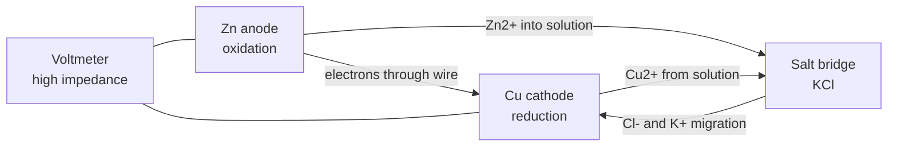
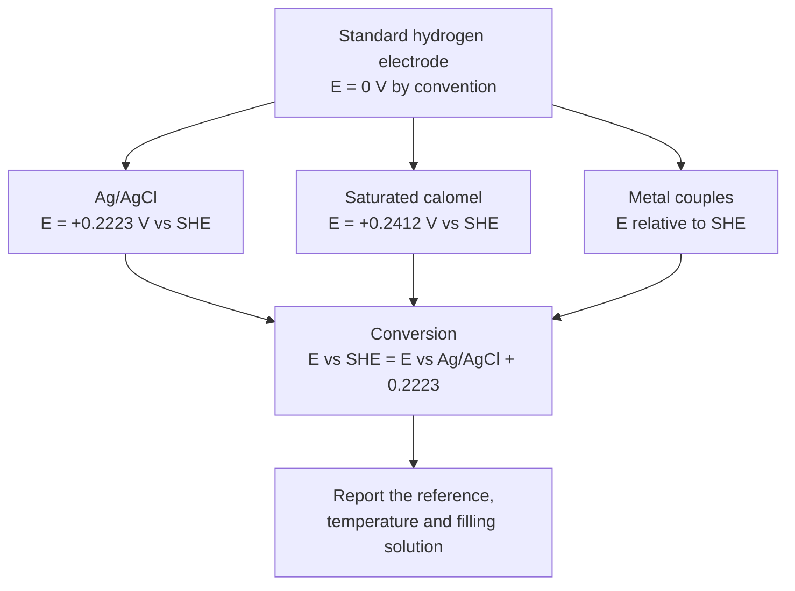
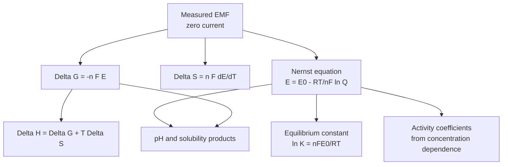
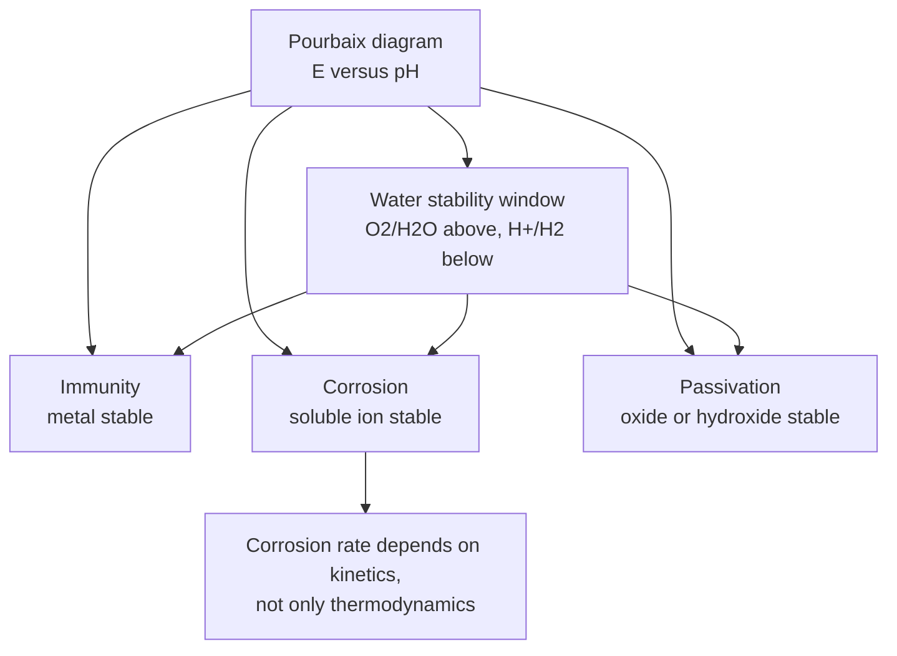

# Chapter 8 — Electrochemical Thermodynamics

> **Level:** University (Level 6 — Physical Chemistry)
> **Estimated study time:** 8 hours (6 hours reading + 2 hours exercises)
> **Prerequisites:** [Classical Thermodynamics](01-classical-thermodynamics.md); [Chemical Thermodynamics](../04-advanced-chemistry/04-chemical-thermodynamics.md); [Electrochemical Cells, Nernst Equation and Electrolysis](../04-advanced-chemistry/08-electrochemical-cells-nernst-equation-and-electrolysis.md)
> **Related chapters:** [Level 6 index](README.md); [Classical Thermodynamics](01-classical-thermodynamics.md); [Acid–Base Chemistry and pH](../03-intermediate-chemistry/11-acid-base-chemistry-and-ph.md); [Analytical Chemistry](../08-analytical-chemistry/README.md)
> **Difficulty:** ★★★★★ (5/5)

---

## 1. Learning Objectives

After working through this chapter you will be able to:

- Describe the components of an electrochemical cell and explain how EMF is measured without drawing significant current.
- Derive $\Delta G=-nFE$ and $\Delta G^{\circ}=-nFE^{\circ}$ from the chemical potential of the cell reaction.
- Explain the thermodynamics of the electrode–electrolyte interface using electrochemical potentials and the Fermi level.
- Construct electrode potentials on the hydrogen scale and convert between reference electrodes.
- Write the Nernst equation in rigorous form with activities and mean ionic activity coefficients.
- Relate the temperature coefficient of EMF to the entropy and enthalpy of reaction.
- Distinguish cells with and without liquid junction, and estimate liquid junction potentials.
- Determine activity coefficients, solubility products, pH and transport numbers from EMF measurements.
- Derive and apply the Debye–Hückel limiting law and its extended form.
- Explain the operational definition of pH and the errors caused by junction potentials and electrode non-ideality.
- Distinguish thermodynamic cell voltage from kinetic overpotential and electrochemical irreversibility.
- Construct and interpret Pourbaix diagrams and identify immunity, corrosion and passivation regions.

---

## 2. Introduction

An electrochemical cell converts chemical free energy into electrical work, or the reverse. The conversion is not incidental: the cell voltage is a direct, measurable expression of the Gibbs energy of the cell reaction, and a potentiometer can therefore be used as a thermodynamic instrument. The same measurement yields activity coefficients, solubility products, pH values, transport numbers and entropies of reaction, often with a precision that calorimetry or spectroscopy cannot match.

The subject has two faces. Thermodynamics tells us the voltage a cell would show at equilibrium, from the Gibbs energy of reaction and the activities of every species. Kinetics tells us what voltage is actually needed to drive a current, which can be much larger because of **overpotential**. Confusing the two is the most common error in electrochemistry: a measured cell voltage under load is not a thermodynamic quantity, and an electrode that "does not work" may be thermodynamically capable but kinetically slow. This chapter keeps the distinction explicit, especially in Sections 3.11 and 4.7.

The chapter assumes the Gibbs energy and chemical potential of [Classical Thermodynamics](01-classical-thermodynamics.md) and the Nernst equation at the introductory level of [Electrochemical Cells, Nernst Equation and Electrolysis](../04-advanced-chemistry/08-electrochemical-cells-nernst-equation-and-electrolysis.md). It develops the rigorous activity treatment, the thermodynamics of the interface and the operational conventions that make electrochemical measurements reproducible. The treatment is aqueous unless stated otherwise, and the standard state is the hypothetical ideal solution at unit activity, 1 bar for gases.

Electrochemistry is also an engineering subject. Batteries, fuel cells, corrosion, electroplating, electrolysis and sensors all depend on the same equations, but each imposes its own constraints of current density, mass transport and materials stability. The chapter therefore includes Pourbaix diagrams, which map thermodynamic stability as a function of potential and pH, and a kinetic section on Butler–Volmer and Tafel behaviour, which explains why real electrodes operate away from equilibrium.

---

## 3. Fundamental Concepts

### 3.1 Electrochemical cells and the measurement of EMF

An **electrochemical cell** contains two **electrodes** — electronic conductors — separated by an **electrolyte** through which ions move. The electrode at which oxidation occurs is the **anode**; the electrode at which reduction occurs is the **cathode**. In a **galvanic cell** the reactions are spontaneous and the cell delivers electrical work; in an **electrolytic cell** an external supply drives a non-spontaneous reaction. The **electromotive force** (EMF) is the potential difference between the terminals when no current flows, so that every interface is at equilibrium.

A cell is written with the anode on the left and the cathode on the right, phases separated by vertical bars, and a salt bridge or junction by a double bar or a dashed line. For the Daniell cell:

$$ \ce{Zn(s) | ZnSO4(aq) || CuSO4(aq) | Cu(s)}. $$

The **cell reaction** is the sum of the anode oxidation and the cathode reduction:

$$ \ce{Zn(s) -> Zn^2+(aq) + 2e-}, \qquad
   \ce{Cu^2+(aq) + 2e- -> Cu(s)}, $$

$$ \ce{Zn(s) + Cu^2+(aq) -> Zn^2+(aq) + Cu(s)}. $$

EMF is measured with a **potentiometer** or a high-input-impedance voltmeter. A classical potentiometer balances the unknown EMF against a known potential difference in a bridge circuit, so the cell draws essentially zero current. A modern pH meter or electrometer has an input impedance of $10^{12}$–$10^{14}\ \Omega$, which is sufficient for glass electrodes whose resistance is $10^8$–$10^9\ \Omega$. A low-impedance voltmeter draws current, polarises the electrodes and measures something between the equilibrium EMF and the short-circuit voltage.

The **sign convention** used here is that $E$ is positive when the cell as written is spontaneous: the right-hand electrode is the cathode and the left-hand electrode is the anode. The IUPAC convention for electrode potentials is the **reduction potential**: the potential of the electrode relative to the standard hydrogen electrode when the electrode is the cathode. Reversing the cell reverses the sign of $E$.

A **salt bridge** (concentrated KCl or KNO₃ in agar) connects the two half-cells and limits the liquid junction potential. The ions must be mobile and must not react with the solutions; KCl is chosen because $\ce{K+}$ and $\ce{Cl-}$ have nearly equal transport numbers, which makes the junction potential small. A **sinter** or **frit** separates the half-cells in compact electrodes, and a **Luggin capillary** places the reference electrode close to the working electrode without blocking the current path.

### 3.2 EMF and Gibbs energy

For a reversible cell at constant temperature and pressure, the electrical work done when $n$ moles of electrons pass through the external circuit is $-nFE$, where $F=96\,485.332\ \text{C mol}^{-1}$ is the Faraday constant. At constant $T$ and $p$, the maximum non-expansion work equals the decrease in Gibbs energy, so

$$ \Delta G=-nFE, \qquad \Delta G^{\circ}=-nFE^{\circ}. $$

The equation assumes a reversible electrochemical process, no current flow, and that the only work is electrical. The number of electrons $n$ is the stoichiometric number in the balanced cell reaction; it must be counted after cancelling the electrons. For the Daniell cell, $n=2$.

Dividing by $-nF$ gives the **Nernst equation** for the cell:

$$ E=E^{\circ}-\frac{RT}{nF}\ln Q, $$

where $Q$ is the reaction quotient expressed in activities. At equilibrium $E=0$ and $Q=K$, so

$$ E^{\circ}=\frac{RT}{nF}\ln K, \qquad \Delta G^{\circ}=-RT\ln K. $$

The two expressions are equivalent, which is why a cell voltage can be used to determine an equilibrium constant. A positive $E^{\circ}$ means $K>1$ and a spontaneous reaction under standard conditions; a negative $E^{\circ}$ means the reverse reaction is spontaneous.

The relation also shows the sensitivity of the measurement. At 298 K, $RT/F=25.69\ \text{mV}$, so a tenfold change in $Q$ changes $E$ by $59.16/n\ \text{mV}$. A voltmeter with 0.1 mV resolution can therefore resolve about a 0.4 % change in $Q$ for a one-electron reaction.

### 3.3 The electrode–electrolyte interface and the electrochemical potential

A charged interface cannot be described by the chemical potential alone. The **electrochemical potential** of species $i$ is

$$ \tilde\mu_i=\mu_i+z_iF\phi, $$

where $\mu_i$ is the chemical potential, $z_i$ the charge number and $\phi$ the local electric potential (the **inner potential** or Galvani potential). At equilibrium the electrochemical potential of every species is uniform across the interface:

$$ \tilde\mu_i^{\alpha}=\tilde\mu_i^{\beta}. $$

For an electron in a metal, $\tilde\mu_e=\mu_e-F\phi$. The **Fermi level** is the electrochemical potential of the electrons, and the **work function** is the energy needed to remove an electron from the Fermi level to vacuum. When two metals are in contact, electrons flow until their Fermi levels align; the resulting **contact potential** is the difference in work functions divided by $e$. The same principle applies at an electrode–electrolyte interface: equilibrium means the Fermi level of the electrode equals the electrochemical potential of the redox couple in solution.

The interface region contains a **double layer**: a charged electrode surface, a compact Helmholtz layer of oriented solvent and specifically adsorbed ions, and a diffuse Gouy–Chapman layer extending into the solution. The **potential of zero charge** is the electrode potential at which the surface charge is zero; it depends on the metal and on the electrolyte. The double-layer capacitance is typically $10$–$40\ \mu\text{F cm}^{-2}$ and is the reason an electrode–electrolyte interface behaves like a capacitor in impedance measurements.

The **absolute electrode potential** — the potential difference between the electrode and the solution — cannot be measured in isolation, because any measurement requires a second interface. Only differences between electrodes are measurable. This is why electrode potentials are defined relative to a reference, and why the hydrogen scale is a convention rather than a fundamental constant.

### 3.4 Electrode potentials and the hydrogen scale

The **standard hydrogen electrode** (SHE) is

$$ \ce{Pt(s) | H2(g, 1 bar) | H+(aq, a=1)}, $$

with the reaction $\ce{2H+(aq) + 2e- -> H2(g)}$. Its standard potential is defined as exactly $E^{\circ}=0\ \text{V}$ at all temperatures. Standard electrode potentials are reduction potentials relative to the SHE, measured with the electrode of interest as the cathode and the SHE as the anode. The **standard electrode potential** $E^{\circ}$ of a couple is therefore the EMF of the cell

$$ \ce{Pt(s) | H2(g, 1 bar) | H+(aq, a=1) || M^{n+}(aq, a=1) | M(s)}. $$

The **electrochemical series** orders couples by $E^{\circ}$: a more positive potential means a stronger oxidising agent. Fluorine ($\ce{F2/F-}$, $+2.87\ \text{V}$) is at the top; lithium ($\ce{Li+/Li}$, $-3.04\ \text{V}$) is at the bottom. A species higher in the series oxidises a species lower down, provided the kinetics are favourable.

Reference electrodes are practical realisations of fixed potentials. The **silver–silver chloride electrode** is

$$ \ce{Ag(s) | AgCl(s) | Cl-(aq)}, \qquad
   \ce{AgCl(s) + e- -> Ag(s) + Cl-(aq)}, $$

with $E=+0.2223\ \text{V}$ versus SHE at 25 °C when $a_{\ce{Cl-}}=1$. The **saturated calomel electrode** (SCE) is

$$ \ce{Hg(l) | Hg2Cl2(s) | KCl(sat)}, \qquad E=+0.2412\ \text{V}. $$

The SCE is convenient but contains mercury and is being replaced by Ag/AgCl. Conversion between references is a simple addition:

$$ E_{\text{vs SHE}}=E_{\text{vs Ag/AgCl}}+0.2223\ \text{V}
   =E_{\text{vs SCE}}+0.2412\ \text{V}. $$

The equation assumes the same temperature and the stated filling solution; a Ag/AgCl electrode filled with 3 M KCl has a different potential from one filled with saturated KCl, so the filling solution must always be reported.

### 3.5 Activities and the rigorous Nernst equation

The Nernst equation uses **activities**, not concentrations. For a species $i$,

$$ a_i=\gamma_i\frac{m_i}{m^{\circ}}, $$

where $m_i$ is the molality, $m^{\circ}=1\ \text{mol kg}^{-1}$ the standard molality and $\gamma_i$ the activity coefficient on the molal scale. For a strong electrolyte $\ce{M_{\nu_+}X_{\nu_-}}$ that dissociates completely, individual ion activities cannot be measured independently, so one defines the **mean ionic activity**

$$ a_{\pm}=\left(a_+^{\nu_+}a_-^{\nu_-}\right)^{1/\nu}, \qquad \nu=\nu_++\nu_-, $$

and the **mean ionic activity coefficient**

$$ \gamma_{\pm}=\left(\gamma_+^{\nu_+}\gamma_-^{\nu_-}\right)^{1/\nu}. $$

For a 1:1 electrolyte, $a_{\pm}=\gamma_{\pm}m/m^{\circ}$ and $a_+a_-=a_{\pm}^2$. For a 2:1 electrolyte such as $\ce{CaCl2}$, $\nu_+=1$, $\nu_-=2$, $\nu=3$, and $a_{\pm}=4^{1/3}\gamma_{\pm}m/m^{\circ}$, with $a_+a_-^2=4\gamma_{\pm}^3(m/m^{\circ})^3$ if the stoichiometric molality is used. The factor 4 comes from $m_+=m$ and $m_-=2m$.

The rigorous Nernst equation for the cell reaction

$$ \ce{aA + bB -> cC + dD} $$

is

$$ E=E^{\circ}-\frac{RT}{nF}\ln\frac{a_C^c a_D^d}{a_A^a a_B^b}. $$

For the cell $\ce{Pt | H2 | HCl | AgCl | Ag}$, the reaction is
$\ce{AgCl(s) + 1/2 H2(g) -> Ag(s) + H+(aq) + Cl-(aq)}$ with $n=1$, so

$$ E=E^{\circ}-\frac{RT}{F}\ln(a_{\ce{H+}}a_{\ce{Cl-}})
   =E^{\circ}-\frac{2RT}{F}\ln(\gamma_{\pm}m/m^{\circ}). $$

The second form uses $a_{\ce{H+}}a_{\ce{Cl-}}=a_{\pm}^2$ for a 1:1 electrolyte. A plot of $E$ against $\ln m$ therefore gives $\gamma_{\pm}$ once $E^{\circ}$ is known, or $E^{\circ}$ and $\gamma_{\pm}$ together if the Debye–Hückel limiting law is used to extrapolate to infinite dilution.

### 3.6 Temperature dependence of EMF and the entropy of reaction

Differentiating $\Delta G=-nFE$ with respect to temperature at constant pressure gives

$$ \left(\frac{\partial\Delta G}{\partial T}\right)_p=-\Delta S
   =-nF\left(\frac{\partial E}{\partial T}\right)_p, $$

so

$$ \Delta S=nF\left(\frac{\partial E}{\partial T}\right)_p. $$

The enthalpy of reaction follows from $\Delta G=\Delta H-T\Delta S$:

$$ \Delta H=-nFE+nFT\left(\frac{\partial E}{\partial T}\right)_p. $$

These equations are exact for a reversible cell at constant pressure. The **temperature coefficient** $(\partial E/\partial T)_p$ is typically $10^{-5}$ to $10^{-3}\ \text{V K}^{-1}$, so it must be measured carefully, usually by measuring EMF at several temperatures in a thermostat and fitting a polynomial. A positive coefficient means the cell reaction is endothermic in the direction written; a negative coefficient means it is exothermic.

For the Daniell cell at 25 °C, $E^{\circ}=1.10\ \text{V}$ and $(\partial E/\partial T)_p\approx-1.0\times10^{-4}\ \text{V K}^{-1}$, giving $\Delta G^{\circ}\approx-212\ \text{kJ mol}^{-1}$, $\Delta S^{\circ}\approx-19\ \text{J K}^{-1}\text{mol}^{-1}$ and $\Delta H^{\circ}\approx-218\ \text{kJ mol}^{-1}$. The reaction is exothermic and decreases the entropy of the system, as expected when a dissolved ion is replaced by a solid metal.

### 3.7 Cells with and without liquid junction; liquid junction potentials

A **cell without liquid junction** has a single electrolyte composition between the electrodes, or two electrolytes separated by a salt bridge whose junction potential is negligible. The cell $\ce{Pt | H2 | HCl | AgCl | Ag}$ is the standard example: both electrodes dip into the same HCl solution, so there is no junction potential and the EMF is exactly related to the activity of HCl. Such cells are the basis of precise thermodynamic measurements.

A **cell with transference** has two electrolyte solutions of different composition in contact, so ions move across the boundary and a **liquid junction potential** $E_j$ develops. The junction potential arises because different ions diffuse at different rates: the faster ion carries charge ahead and creates a small electric field that slows it and accelerates the slower ion, until the two fluxes are coupled. The potential difference is typically a few millivolts, but it can be tens of millivolts when the mobilities are very different.

The **Henderson equation** estimates the junction potential between two solutions of the same electrolyte at concentrations $c_1$ and $c_2$:

$$ E_j=\frac{RT}{F}\frac{(u_+-u_-)}{(u_++u_-)}\ln\frac{c_2}{c_1}, $$

where $u_+$ and $u_-$ are the ionic mobilities. For HCl, $\ce{H+}$ is much more mobile than $\ce{Cl-}$, so the junction potential is significant; for KCl, $u_+\approx u_-$, so $E_j\approx0$. This is why KCl is used in salt bridges. The equation assumes ideal solutions and a sharp boundary; real junctions are diffuse and time-dependent, so $E_j$ is uncertain at the millivolt level.

A **salt bridge** reduces $E_j$ by providing a concentrated solution of ions with nearly equal mobilities. The bridge also prevents mixing of the two half-cell solutions. A **double junction** reference electrode adds a second chamber to prevent chloride leakage into the sample, which matters when the sample contains $\ce{Ag+}$ or when chloride interferes.

### 3.8 Concentration cells and transport numbers

A **concentration cell** has identical electrodes in solutions of different activity. For the cell

$$ \ce{Ag(s) | Ag+(aq, a1) || Ag+(aq, a2) | Ag(s)}, $$

the cell reaction is $\ce{Ag+(a2) -> Ag+(a1)}$ if $a_2>a_1$, and

$$ E=\frac{RT}{F}\ln\frac{a_2}{a_1}. $$

The standard potential cancels because both electrodes are the same couple. A tenfold activity ratio gives $59.16\ \text{mV}$ at 25 °C for a one-electron transfer. Concentration cells are used to measure activity coefficients, because the ratio $a_2/a_1$ can be varied systematically.

A concentration cell **with transference** includes a junction between the two solutions. For the cell

$$ \ce{Ag(s) | AgCl(s) | HCl(m1) || HCl(m2) | AgCl(s) | Ag(s)}, $$

the EMF is

$$ E=2t_+\frac{RT}{F}\ln\frac{a_2}{a_1}, $$

where $t_+$ is the transport number of the cation. The factor 2 arises because the electrode reaction transfers one electron but the junction transfers both ions. For the anion-reversible Ag/AgCl electrodes shown, the relevant transport number is that of the cation; for cation-reversible electrodes the same expression holds with $t_-$. For HCl, $t_+\approx0.83$ at moderate concentration, so the EMF is larger by a factor of about 1.7 than for the corresponding cell without transference.

**Transport numbers** describe the fraction of current carried by each ion:

$$ t_+=\frac{u_+}{u_++u_-}, \qquad t_-=\frac{u_-}{u_++u_-}, \qquad t_++t_-=1. $$

They can be measured by the Hittorf method, by moving-boundary electrophoresis or by EMF measurements on concentration cells with transference. The transport number depends on concentration because ionic mobilities depend on ionic strength and ion pairing.

### 3.9 Debye–Hückel theory and mean ionic activity coefficients

The **Debye–Hückel limiting law** relates the mean ionic activity coefficient to ionic strength:

$$ \log_{10}\gamma_{\pm}=-A|z_+z_-|\sqrt{I}, \qquad
   I=\frac12\sum_im_iz_i^2, $$

where $A=0.509\ \text{mol}^{-1/2}\text{kg}^{1/2}$ for water at 25 °C and $I$ is the molal ionic strength. The law assumes point ions, a continuum solvent and electrostatic interactions only. It is exact in the limit $I\to0$ and fails above about $10^{-2}\ \text{mol kg}^{-1}$ for most electrolytes.

The **extended Debye–Hückel equation** accounts for finite ion size:

$$ \log_{10}\gamma_{\pm}=-\frac{A|z_+z_-|\sqrt{I}}{1+Ba\sqrt{I}}, $$

where $a$ is the ion-size parameter (typically 0.3–0.5 nm) and $B=3.29\ \text{nm}^{-1}\text{mol}^{-1/2}\text{kg}^{1/2}$ at 25 °C in water. The extended form fits activity coefficients up to about $0.1\ \text{mol kg}^{-1}$; above that, specific ion interactions and solvation require empirical models such as Pitzer or the mean spherical approximation.

The **ionic strength** is dominated by multiply charged ions because of the $z_i^2$ weighting. A 0.01 M solution of $\ce{Al2(SO4)3}$ has $I=0.01\times(2\times9+3\times4)/2=0.15\ \text{mol kg}^{-1}$, fifteen times higher than a 0.01 M 1:1 electrolyte. This is why trivalent ions have large effects on activity coefficients, colloid stability and electrochemical measurements.

### 3.10 Potentiometric pH and its operational definition

A **glass electrode** is a thin glass membrane that responds selectively to $\ce{H+}$. The potential across the membrane is proportional to the difference in hydrogen ion activity between the internal filling solution and the sample. Combined with a reference electrode, the cell potential is

$$ E=E_{\text{ref}}+E_{\text{glass}}=E^{\circ\prime}+\frac{RT}{F}\ln a_{\ce{H+}}, $$

so

$$ \text{pH}=-\log_{10}a_{\ce{H+}}=\frac{E-E^{\circ\prime}}{(RT/F)\ln10}. $$

The proportionality constant $RT\ln10/F$ is $59.16\ \text{mV}$ per pH unit at 25 °C. The **Nernstian slope** is the ideal slope; real electrodes approach it but may deviate at extreme pH.

The **operational definition of pH**, recommended by IUPAC, avoids the unknown single-ion activity coefficient and the unknown reference potential. One calibrates the electrode with a **primary standard buffer** of assigned pH, then measures the sample:

$$ \text{pH}(X)=\text{pH}(S)+\frac{E_S-E_X}{(RT/F)\ln10}, $$

where $S$ denotes the standard buffer and $X$ the sample. The result is an operational pH, not a thermodynamic single-ion activity. The assigned pH of the standard buffer is itself based on a convention (the Bates–Guggenheim convention), so pH is defined by the measurement protocol rather than by first principles.

The operational definition has consequences. The **residual liquid junction potential** between the sample and the reference is assumed to be the same as between the buffer and the reference; when the sample has a different ionic strength or composition, the assumption fails. **Alkaline error** occurs above pH 10 because the glass membrane responds to $\ce{Na+}$ as well as $\ce{H+}$, making the measured pH too low. **Acid error** occurs below pH 1 because of the activity of water and the asymmetry potential. The **asymmetry potential** is a small offset that develops across the glass membrane even when both sides have the same solution; it is removed by calibration.

### 3.11 Overpotential and electrochemical irreversibility

Thermodynamics fixes the equilibrium potential $E_{eq}$ of an electrode. When a current flows, the electrode potential shifts away from $E_{eq}$; the difference is the **overpotential**:

$$ \eta=E-E_{eq}. $$

A positive overpotential drives oxidation (anodic), a negative one drives reduction (cathodic). The overpotential is a kinetic quantity: it is the extra voltage needed to make the reaction proceed at a finite rate. It is not a thermodynamic property and cannot be obtained from $\Delta G$.

The **Butler–Volmer equation** relates current density to overpotential for a one-electron transfer:

$$ j=j_0\left[\exp\left(\frac{(1-\alpha)F\eta}{RT}\right)
   -\exp\left(-\frac{\alpha F\eta}{RT}\right)\right], $$

where $j_0$ is the **exchange current density**, $\alpha$ the transfer coefficient (usually 0.3–0.7) and $j$ the current density. At small overpotential the equation linearises to $j=j_0F\eta/(RT)$, giving a charge-transfer resistance $RT/(j_0F)$. At large overpotential one term dominates and the **Tafel equation** holds:

$$ \eta=a+b\log_{10}|j|, \qquad b=\frac{2.303RT}{\alpha F}. $$

At 25 °C, $b=59.2/\alpha\ \text{mV}$ per decade, typically 60–120 mV per decade. A high exchange current density means a fast, reversible electrode; a low one means a sluggish electrode with a large overpotential.

**Electrochemical irreversibility** means that the electrode reaction is slow compared with the timescale of the measurement, so the measured potential depends on current and history. A **reversible** electrode has a well-defined Nernstian potential and a high exchange current density; a **polarisable** electrode has a low exchange current density and can be held at potentials far from equilibrium. The terms refer to kinetics, not to the thermodynamic reversibility of the overall reaction.

### 3.12 Pourbaix diagrams and stability regions

A **Pourbaix diagram** (potential–pH diagram) plots the equilibrium potential of a redox couple against pH for a given total concentration of the element. It shows which species are thermodynamically stable in each region of potential and pH, and it is the electrochemical analogue of a phase diagram. The boundaries are calculated from the Nernst equation for the relevant equilibria.

For a reaction involving $m$ protons and $n$ electrons,

$$ E=E^{\circ}-\frac{2.303RT}{nF}\left(\log Q_{\text{other}}+m\,\text{pH}\right), $$

so the slope of the boundary is $-59.16\,m/n\ \text{mV}$ per pH unit at 25 °C. A boundary with no protons is horizontal; a boundary with no electrons is vertical. The **water stability window** is bounded by

$$ \ce{O2 + 4H+ + 4e- -> 2H2O}, \qquad E=1.229-0.0591\,\text{pH}, $$

$$ \ce{2H+ + 2e- -> H2}, \qquad E=-0.0591\,\text{pH}. $$

The region between these lines is the thermodynamic stability range of water. A metal whose equilibrium potential lies below the hydrogen line can reduce water to hydrogen and is thermodynamically unstable in aqueous solution; a metal above the oxygen line can oxidise water.

For iron, the Pourbaix diagram has three important regions. At low potential and low pH, $\ce{Fe^2+}$ is stable (**corrosion** region). At high potential, $\ce{Fe2O3}$ or $\ce{FeOOH}$ is stable (**passivation** region), and the oxide film protects the metal. At very negative potentials, the metal itself is stable (**immunity** region). The diagram explains why iron corrodes in acid but passivates in concentrated nitric acid, and why cathodic protection works: lowering the potential moves the metal into the immunity region.

Pourbaix diagrams are thermodynamic maps, not kinetic ones. They say nothing about the rate of corrosion or the thickness of a passive film, and they assume equilibrium, a fixed total concentration and a specified set of species. Real systems may be kinetically stabilised or may contain complexes not included in the diagram.

---

## 4. Detailed Scientific Explanation

### 4.1 Derivation of $\Delta G=-nFE$ and the temperature coefficients

For a reversible cell, the electrical work done on the surroundings when $n$ moles of electrons pass is $nFE$, where $E$ is the cell EMF. At constant $T$ and $p$, the maximum non-expansion work is $-\Delta G$, so $\Delta G=-nFE$. The derivation assumes that the cell operates reversibly, that the only work is electrical, and that the cell reaction is balanced for $n$ electrons.

The temperature dependence follows from the Gibbs–Helmholtz equation:

$$ \Delta G=\Delta H-T\Delta S, \qquad
   \left(\frac{\partial(\Delta G/T)}{\partial T}\right)_p=-\frac{\Delta H}{T^2}. $$

Substituting $\Delta G=-nFE$ gives

$$ \Delta H=-nFE+nFT\left(\frac{\partial E}{\partial T}\right)_p, \qquad
   \Delta S=nF\left(\frac{\partial E}{\partial T}\right)_p. $$

The equations are exact for a reversible cell, but the temperature coefficient must be measured at constant composition. In practice the electrolyte composition changes with temperature through expansion and dissociation, so the measured coefficient includes those effects; a rigorous measurement uses a cell with a fixed electrolyte and corrects for thermal expansion.

The **temperature coefficient** is also related to the **entropy of the cell reaction**. A positive coefficient means the reaction produces more entropy as it proceeds and the cell cools on discharge (if adiabatic); a negative coefficient means it heats. The Daniell cell has a small negative coefficient, so it heats slightly on discharge. The effect is small but measurable and is used to obtain entropies of ionic reactions that are difficult to measure calorimetrically.

### 4.2 The interface, Galvani potential and the Fermi level

The **Galvani potential** $\phi$ is the electric potential inside a phase. The **Volta potential** $\psi$ is the potential just outside the phase, in vacuum. The difference between them is the surface dipole layer. Only differences in Galvani potential between phases of the same composition are measurable; the absolute Galvani potential of a single phase is not.

For an electron in a metal, the electrochemical potential is $\tilde\mu_e=\mu_e-F\phi$. The **Fermi level** $E_F$ is the energy of the highest occupied electronic state at zero temperature, and $\tilde\mu_e=-E_F$ relative to vacuum. When an electrode is immersed in an electrolyte, electrons transfer until the Fermi level of the metal equals the electrochemical potential of the redox couple:

$$ E_F=-e\phi_M=\mu_e^{\text{redox}}-e\phi_S. $$

The difference $\phi_M-\phi_S$ is the **electrode potential** on the absolute scale. It cannot be measured directly, but it is the physical quantity that changes when the electrode is polarised.

The **double layer** at the interface stores charge. The **differential capacitance** $C_{dl}=\mathrm{d}\sigma/\mathrm{d}E$ is measured by impedance spectroscopy or cyclic voltammetry. At the potential of zero charge, the surface charge is zero and the capacitance is a minimum for a simple metal electrode. The double-layer structure affects the rate of electron transfer because the reacting species must approach the electrode through the double layer, and the local potential at the reaction plane (the **Frumkin correction**) differs from the potential in the bulk.

The **Fermi level picture** explains why electrode potentials are intensive and why they shift with composition. For a redox couple in solution, the Fermi level is set by the ratio of oxidised to reduced species; for a metal electrode, it is set by the applied potential. Equilibrium means the two Fermi levels align. When a current flows, the Fermi levels are driven apart by the overpotential, and the resulting gradient drives electron transfer.

### 4.3 Liquid junction potentials in detail

The liquid junction potential arises from the difference in diffusion coefficients of ions. Consider a boundary between concentrated and dilute HCl. $\ce{H+}$ diffuses faster than $\ce{Cl-}$, so the dilute side becomes positively charged relative to the concentrated side, creating an electric field that slows $\ce{H+}$ and speeds $\ce{Cl-}$. At steady state the two ions diffuse together with a common velocity, and the potential difference is the junction potential.

The **Planck equation** treats the junction as a continuous transition and gives

$$ E_j=-\frac{RT}{F}\int_{1}^{2}\sum_i\frac{t_i}{z_i}\,\mathrm{d}\ln a_i, $$

where $t_i$ is the transport number of ion $i$ at position $x$. For a single 1:1 electrolyte with constant transport numbers, this integrates to the Henderson form. The equation shows that $E_j$ vanishes when $t_+=t_-$ (as for KCl) or when the activities are equal. It also shows that $E_j$ depends on the ionic composition, not just on the concentration difference.

Junction potentials are the largest source of error in pH measurements and in cells with transference. A **salt bridge** with concentrated KCl reduces $E_j$ to about 1–3 mV, but it cannot eliminate it. A **double junction** adds a second electrolyte to protect the sample, at the cost of a second junction potential. The **residual junction potential** is the difference between the junction potential in the calibration buffer and in the sample; it is the quantity that matters for pH measurement, and it is why pH is operationally defined.

### 4.4 Thermodynamic properties from EMF

EMF measurements give activity coefficients, solubility products, pH and equilibrium constants. The general method is to measure the cell EMF as a function of concentration and extrapolate to infinite dilution, where the Debye–Hückel limiting law provides the activity coefficient.

For the cell $\ce{Pt | H2 | HCl | AgCl | Ag}$, the EMF is

$$ E=E^{\circ}-\frac{2RT}{F}\ln(\gamma_{\pm}m/m^{\circ}). $$

Rearranging,

$$ E+\frac{2RT}{F}\ln(m/m^{\circ})=E^{\circ}-\frac{2RT}{F}\ln\gamma_{\pm}. $$

The left-hand side is measurable; the right-hand side tends to $E^{\circ}$ as $m\to0$ because $\gamma_{\pm}\to1$. A plot against $\sqrt{m}$ and extrapolation to zero gives $E^{\circ}$; then $\gamma_{\pm}$ follows at each concentration. This is the standard method for determining mean ionic activity coefficients.

For a **solubility product**, one constructs a cell in which the metal ion and the anion are the potential-determining species. For AgCl, the cell

$$ \ce{Ag(s) | AgCl(s) | Cl-(aq) || Ag+(aq) | Ag(s)} $$

has the reaction $\ce{Ag+(aq) + Cl-(aq) -> AgCl(s)}$ and EMF

$$ E=E^{\circ}-\frac{RT}{F}\ln\frac{1}{a_{\ce{Ag+}}a_{\ce{Cl-}}}
   =E^{\circ}+\frac{RT}{F}\ln(a_{\ce{Ag+}}a_{\ce{Cl-}}). $$

At equilibrium with solid AgCl, $a_{\ce{Ag+}}a_{\ce{Cl-}}=K_{sp}$, so the EMF at zero current gives $K_{sp}$ directly once $E^{\circ}$ is known. Alternatively, the standard potentials of the Ag/AgCl and Ag⁺/Ag couples give

$$ E^{\circ}(\ce{AgCl/Ag})=E^{\circ}(\ce{Ag+/Ag})+\frac{RT}{F}\ln K_{sp}. $$

For **pH**, the cell $\ce{Pt | H2 | H+(aq) | reference}$ has an EMF that depends on $a_{\ce{H+}}$. The hydrogen electrode is the primary standard, but it is inconvenient; glass electrodes are used in practice and calibrated against buffers. The **operational pH** is defined by the calibration equation in Section 3.10.

For **equilibrium constants**, the EMF at standard conditions gives $\Delta G^{\circ}$ and hence $K$. For a reaction with $n$ electrons, $\ln K=nFE^{\circ}/(RT)$. This is one of the most precise ways to determine an equilibrium constant, provided the cell is reversible and the activities are known.

### 4.5 Transport numbers from concentration cells

The transport number is the fraction of current carried by an ion. In a concentration cell with transference, the junction potential contributes to the EMF, so for the HCl cell of Section 3.8, $E=2t_+(RT/F)\ln(a_2/a_1)$. If the activities are known from a cell without transference, the ratio of the two EMFs gives $t_+$:

$$ t_+=\frac{E_{\text{with transference}}}{2(RT/F)\ln(a_2/a_1)}. $$

For HCl, $t_{\ce{H+}}\approx0.83$ at 0.1 M because the proton hops along the hydrogen-bond network (the Grotthuss mechanism), while $t_{\ce{Cl-}}\approx0.17$. For KCl, $t_{\ce{K+}}\approx t_{\ce{Cl-}}\approx0.5$, which is why KCl is used in salt bridges. Transport numbers are also measured by the Hittorf method, which analyses concentration changes in the electrode compartments, and by moving-boundary electrophoresis.

### 4.6 Debye–Hückel theory: assumptions and limits

The Debye–Hückel theory treats the electrolyte as a continuum dielectric containing point ions that interact through Coulomb forces. Each ion is surrounded by an **ionic atmosphere** of opposite charge, with a characteristic thickness $\kappa^{-1}$, and the activity coefficient is the work required to charge the ion in that atmosphere:

$$ \ln\gamma_{\pm}=-\frac{|z_+z_-|e^2\kappa}{8\pi\varepsilon_r\varepsilon_0k_BT}. $$

The derivation assumes point ions, a continuum solvent of uniform dielectric constant, only Coulombic interactions, and a dilute solution in which the atmosphere is much larger than the ion. The first assumption fails at moderate concentration, where ion size matters and the extended equation adds the $Ba\sqrt{I}$ term. The third fails for ions that form complexes or are strongly hydrated. At high concentration, **ion pairing** reduces the effective charge and the activity coefficient may rise again; empirical models such as Pitzer or specific ion interaction theory are then used.

### 4.7 Butler–Volmer kinetics and the meaning of overpotential

The **Butler–Volmer equation** describes the current–potential relation for an elementary electron-transfer step. The forward (cathodic) rate depends on the activation energy lowered by $\alpha F\eta$, and the reverse (anodic) rate on the barrier lowered by $(1-\alpha)F\eta$:

$$ j=j_0\left[\exp\left(\frac{(1-\alpha)F\eta}{RT}\right)
   -\exp\left(-\frac{\alpha F\eta}{RT}\right)\right]. $$

At equilibrium $\eta=0$ and $j=0$; the exchange current density $j_0$ is the rate of the forward and reverse reactions at equilibrium. A large $j_0$ means fast kinetics and a reversible electrode; a small $j_0$ means slow kinetics and a polarisable electrode.

At large negative overpotential (cathodic), the first term vanishes and

$$ j=-j_0\exp\left(-\frac{\alpha F\eta}{RT}\right), \qquad
   \eta=\frac{RT}{\alpha F}\ln\frac{|j|}{j_0}. $$

At large positive overpotential (anodic), the second term vanishes and

$$ j=j_0\exp\left(\frac{(1-\alpha)F\eta}{RT}\right), \qquad
   \eta=-\frac{RT}{(1-\alpha)F}\ln\frac{j}{j_0}. $$

These are the **Tafel equations**. A plot of $\eta$ against $\log|j|$ is linear with slope $2.303RT/(\alpha F)$ for the cathodic branch and $-2.303RT/((1-\alpha)F)$ for the anodic branch. The exchange current density is obtained by extrapolating to $\eta=0$.

The **transfer coefficient** $\alpha$ measures the symmetry of the activation barrier. For a simple one-electron transfer it is about 0.5; for a multistep reaction it is an apparent value that may depend on potential. The **Tafel slope** is therefore diagnostic: 120 mV per decade suggests $\alpha=0.5$ for a one-electron step, while 60 mV per decade suggests a different mechanism or a two-electron step.

Overpotential is not the same as **IR drop**. The measured cell voltage under current includes the ohmic drop through the electrolyte and the electrodes, the concentration overpotential from mass transport, and the charge-transfer overpotential. Separating them requires impedance spectroscopy, current-interrupt measurements or a Luggin capillary to minimise the uncompensated resistance.

### 4.8 Pourbaix diagrams: construction and interpretation

A Pourbaix diagram is constructed from the Nernst equation for every relevant equilibrium, using a fixed total concentration of the element (often $10^{-6}\ \text{M}$ for corrosion studies). Boundaries are horizontal for a redox equilibrium with no protons, vertical for an acid–base or precipitation equilibrium with no electrons, and sloped for a redox equilibrium involving protons, with slope $-59.16\,m/n\ \text{mV}$ per pH.

For iron, the relevant equilibria include

$$ \ce{Fe^2+ + 2e- -> Fe(s)}, \qquad E=-0.44+0.0296\log a_{\ce{Fe^2+}}, $$

$$ \ce{Fe^3+ + e- -> Fe^2+}, \qquad E=0.77+0.0591\log\frac{a_{\ce{Fe^3+}}}{a_{\ce{Fe^2+}}}, $$

$$ \ce{Fe(OH)3(s) + 3H+ -> Fe^3+ + 3H2O}, \qquad \log a_{\ce{Fe^3+}}=4.0-3\,\text{pH}. $$

The **immunity** region is where the metal is stable, the **corrosion** region where a soluble ion is stable, and the **passivation** region where an insoluble oxide or hydroxide is stable. The **water stability window** is bounded by $E=1.229-0.0591\,\text{pH}$ for oxygen evolution and $E=-0.0591\,\text{pH}$ for hydrogen evolution; its width is 1.229 V at every pH, only its position shifts. Pourbaix diagrams are sensitive to the species included: adding chloride introduces $\ce{FeCl+}$ and shifts the boundaries, so a diagram from one source may not apply to another system.

### 4.9 Operational pH and its error budget

The operational pH equation is $\text{pH}(X)=\text{pH}(S)+(E_S-E_X)/k$ with $k=(RT/F)\ln10$. Its uncertainty has several contributions: calibration of the standard buffer (±0.005), slope error (a 1 % slope error gives 0.07 pH over 7 units), residual junction potential (0.01–0.05 pH, larger at low ionic strength), alkaline error above pH 10 where the glass responds to $\ce{Na+}$, acid error below pH 1, temperature drift of the Nernst slope, and the asymmetry potential, which calibration removes but which drifts with age and fouling.

The **Bates–Guggenheim convention** assigns the single-ion activity coefficient of chloride in the standard buffer using the Debye–Hückel equation, which fixes the pH scale. The convention is pragmatic rather than thermodynamic, and it is why pH values are traceable to a defined standard rather than to first principles. For accurate work, bracket the sample with two buffers, adjust the ionic strength, calibrate at the measurement temperature and prefer a hydrogen electrode or a pH-sensitive field-effect transistor at extreme pH. Potentiometric titration, which extracts an equivalence point from the curve shape, is more robust than a single-point measurement.

---

## 5. Visual Diagrams

### 5.1 The Daniell cell and the direction of electron flow

**Figure 8.1 — A galvanic cell separates oxidation and reduction into two half-cells.** Zinc dissolves at the anode, releasing electrons that travel through the external circuit to the copper cathode, where copper ions are reduced. The salt bridge completes the circuit by allowing ions to migrate: anions move towards the anode and cations towards the cathode. The voltmeter measures the EMF only when the current is negligible; a low-impedance meter would polarise the electrodes and read a smaller, current-dependent voltage. The cell notation places the anode on the left and the cathode on the right.

### 5.2 The hydrogen scale and reference electrodes

**Figure 8.2 — All electrode potentials are differences from a chosen reference.** The standard hydrogen electrode defines zero, and every other couple is reported relative to it. Practical reference electrodes such as Ag/AgCl and the saturated calomel electrode have fixed but nonzero potentials, so a reading taken against them must be converted before comparison with tabulated values. The conversion is a constant offset only when the temperature and filling solution match the tabulated conditions; otherwise the reference potential must be recalculated.

### 5.3 From EMF to thermodynamic properties

**Figure 8.3 — A single EMF measurement can yield several thermodynamic quantities.** The Gibbs energy follows directly from the cell potential, the entropy from its temperature coefficient and the enthalpy from their combination. The Nernst equation connects the potential to activities and hence to equilibrium constants, activity coefficients, solubility products and pH. The arrows show why EMF measurements are so valuable: they convert an electrical quantity into chemical thermodynamics without the need for calorimetry or composition analysis.

### 5.4 Potential–pH stability regions

**Figure 8.4 — Pourbaix diagrams map thermodynamic stability, not corrosion rate.** The three regions correspond to immunity, corrosion and passivation. The water stability window is bounded by the oxygen and hydrogen lines; a metal outside the window can decompose water. The diagram is a guide to which species are stable at equilibrium, but the rate of corrosion, the protectiveness of a passive film and the effects of chloride or carbonate require kinetic and specific-ion data that the diagram does not contain.

---

## 6. Mathematical Formulas

### 6.1 EMF, Gibbs energy and equilibrium constant

$$ \Delta G=-nFE, \qquad \Delta G^{\circ}=-nFE^{\circ}, \qquad
   E^{\circ}=\frac{RT}{nF}\ln K. $$

| Symbol | Meaning | SI unit |
|---|---|---|
| $\Delta G$ | Gibbs energy of cell reaction | J mol⁻¹ |
| $n$ | Number of electrons transferred | dimensionless |
| $F$ | Faraday constant | C mol⁻¹ |
| $E$ | Cell EMF | V |
| $E^{\circ}$ | Standard cell EMF | V |
| $K$ | Equilibrium constant | dimensionless |

Assumptions: reversible cell, constant $T$ and $p$, only electrical work, activities in the standard state.

### 6.2 Nernst equation

$$ E=E^{\circ}-\frac{RT}{nF}\ln Q, \qquad
   Q=\prod_i a_i^{\nu_i}. $$

| Symbol | Meaning | SI unit |
|---|---|---|
| $R$ | Gas constant | J K⁻¹ mol⁻¹ |
| $T$ | Thermodynamic temperature | K |
| $Q$ | Reaction quotient | dimensionless |
| $a_i$ | Activity of species $i$ | dimensionless |
| $\nu_i$ | Stoichiometric coefficient | dimensionless |

Assumptions: equilibrium at each electrode, negligible current, activities referred to the same standard state.

### 6.3 Temperature dependence

$$ \Delta S=nF\left(\frac{\partial E}{\partial T}\right)_p, \qquad
   \Delta H=-nFE+nFT\left(\frac{\partial E}{\partial T}\right)_p. $$

| Symbol | Meaning | SI unit |
|---|---|---|
| $\Delta S$ | Entropy of cell reaction | J K⁻¹ mol⁻¹ |
| $\Delta H$ | Enthalpy of cell reaction | J mol⁻¹ |
| $(\partial E/\partial T)_p$ | Temperature coefficient of EMF | V K⁻¹ |

Assumptions: reversible cell, constant pressure, composition fixed, no thermal gradients.

### 6.4 Mean ionic activity and Debye–Hückel

$$ a_{\pm}=\left(a_+^{\nu_+}a_-^{\nu_-}\right)^{1/\nu}, \qquad
   \log_{10}\gamma_{\pm}=-A|z_+z_-|\sqrt{I}, \qquad
   I=\frac12\sum_im_iz_i^2. $$

| Symbol | Meaning | SI unit |
|---|---|---|
| $a_{\pm}$ | Mean ionic activity | dimensionless |
| $\gamma_{\pm}$ | Mean ionic activity coefficient | dimensionless |
| $A$ | Debye–Hückel constant, 0.509 at 25 °C in water | mol⁻¹/² kg¹/² |
| $I$ | Molal ionic strength | mol kg⁻¹ |
| $m_i$ | Molality of ion $i$ | mol kg⁻¹ |

Assumptions: point ions, continuum solvent, Coulomb interactions only, dilute solution.

### 6.5 Liquid junction potential and concentration cells

$$ E_j=\frac{RT}{F}\frac{u_+-u_-}{u_++u_-}\ln\frac{c_2}{c_1}, \qquad
   E=2t_+\frac{RT}{F}\ln\frac{a_2}{a_1}. $$

| Symbol | Meaning | SI unit |
|---|---|---|
| $E_j$ | Liquid junction potential | V |
| $u_+,u_-$ | Ionic mobilities | m² V⁻¹ s⁻¹ |
| $c_1,c_2$ | Electrolyte concentrations | mol m⁻³ |
| $t_+$ | Cation transport number | dimensionless |
| $a_1,a_2$ | Electrolyte activities | dimensionless |

Assumptions: Henderson form assumes ideal solutions, constant transport numbers and a sharp boundary; the concentration-cell equation assumes a 1:1 electrolyte and reversible electrodes.

### 6.6 Butler–Volmer and Tafel equations

$$ j=j_0\left[\exp\left(\frac{(1-\alpha)F\eta}{RT}\right)
   -\exp\left(-\frac{\alpha F\eta}{RT}\right)\right], \qquad
   \eta=a+b\log_{10}|j|. $$

| Symbol | Meaning | SI unit |
|---|---|---|
| $j$ | Current density | A m⁻² |
| $j_0$ | Exchange current density | A m⁻² |
| $\eta$ | Overpotential | V |
| $\alpha$ | Transfer coefficient | dimensionless |
| $b$ | Tafel slope | V decade⁻¹ |

Assumptions: one-electron elementary step, Butler–Volmer kinetics, negligible mass transport, uniform current distribution.

### 6.7 Potentiometric pH

$$ \text{pH}(X)=\text{pH}(S)+\frac{E_S-E_X}{(RT/F)\ln10}, \qquad
   \frac{RT}{F}\ln10=0.05916\ \text{V at 25 °C}. $$

| Symbol | Meaning | SI unit |
|---|---|---|
| $\text{pH}(X)$ | Operational pH of sample | dimensionless |
| $\text{pH}(S)$ | Assigned pH of standard buffer | dimensionless |
| $E_S,E_X$ | Cell EMF for buffer and sample | V |

Assumptions: Nernstian electrode slope, identical residual junction potential in buffer and sample, constant temperature.

### 6.8 Pourbaix boundary slope

$$ \left(\frac{\partial E}{\partial\text{pH}}\right)_{T,p}
   =-\frac{2.303RT}{nF}m. $$

| Symbol | Meaning | SI unit |
|---|---|---|
| $m$ | Number of protons in the half-reaction | dimensionless |
| $n$ | Number of electrons | dimensionless |
| Slope at 25 °C | $-0.05916\,m/n$ | V per pH unit |

Assumption: Nernstian equilibrium, fixed total concentration of the element, no complexation beyond the species included.

---

## 7. Chemical Equations

### 7.1 The Daniell cell

$$ \ce{Zn(s) -> Zn^2+(aq) + 2e-} \qquad
   \ce{Cu^2+(aq) + 2e- -> Cu(s)} $$

$$ \ce{Zn(s) + Cu^2+(aq) -> Zn^2+(aq) + Cu(s)} \qquad E^{\circ}=1.10\ \text{V} $$

The cell is spontaneous as written, with zinc as the anode and copper as the cathode. The standard EMF is the difference between the copper and zinc reduction potentials.

### 7.2 The hydrogen electrode

$$ \ce{2H+(aq) + 2e- -> H2(g)} \qquad E^{\circ}=0\ \text{V by definition} $$

The standard hydrogen electrode uses platinum plated with platinum black, hydrogen at 1 bar and $\ce{H+}$ at unit activity. It is the primary reference for all standard electrode potentials.

### 7.3 The silver–silver chloride electrode

$$ \ce{AgCl(s) + e- -> Ag(s) + Cl-(aq)} \qquad E^{\circ}=+0.2223\ \text{V} $$

The potential depends on chloride activity through the Nernst equation. The electrode is used as a reference in pH meters and as a chloride sensor; it is more robust and less toxic than the calomel electrode.

### 7.4 Water stability

$$ \ce{O2(g) + 4H+(aq) + 4e- -> 2H2O(l)} \qquad E^{\circ}=+1.229\ \text{V}, $$

$$ \ce{2H+(aq) + 2e- -> H2(g)} \qquad E^{\circ}=0\ \text{V}. $$

The equilibrium potentials depend on pH: the oxygen line is $1.229-0.0591\,\text{pH}$ and the hydrogen line is $-0.0591\,\text{pH}$. The region between them is the thermodynamic stability window of water.

### 7.5 Iron corrosion and passivation

$$ \ce{Fe(s) -> Fe^2+(aq) + 2e-} \qquad E^{\circ}=-0.44\ \text{V}, $$

$$ \ce{O2(g) + 2H2O(l) + 4e- -> 4OH-(aq)} \qquad E^{\circ}=+0.401\ \text{V}, $$

$$ \ce{4Fe(OH)2(s) + O2(g) + 2H2O(l) -> 4Fe(OH)3(s)}. $$

The first reaction is the anodic dissolution of iron; the second is the cathodic oxygen reduction. The combined process forms hydrated iron oxides, which may passivate the surface if they are adherent and continuous.

### 7.6 Solubility product from standard potentials

$$ \ce{AgCl(s) + e- -> Ag(s) + Cl-(aq)} \qquad E^{\circ}=+0.2223\ \text{V}, $$

$$ \ce{Ag+(aq) + e- -> Ag(s)} \qquad E^{\circ}=+0.7996\ \text{V}. $$

Subtracting the second from the first gives $\ce{AgCl(s) -> Ag+(aq) + Cl-(aq)}$, for which $\Delta G^{\circ}=-F(0.2223-0.7996)=+55.7\ \text{kJ mol}^{-1}$ and $K_{sp}=1.7\times10^{-10}$.

### 7.7 Electrolysis of water

$$ \ce{2H2O(l) -> 2H2(g) + O2(g)} \qquad E^{\circ}_{\text{cell}}=-1.229\ \text{V}. $$

The negative cell potential means the reaction is non-spontaneous; an external voltage of at least 1.229 V is required thermodynamically, and more in practice because of the oxygen and hydrogen overpotentials.

---

## 8. Worked Examples

### Worked Example 8.1 — Gibbs energy, entropy and enthalpy from EMF

**Problem.** The Daniell cell has $E^{\circ}=1.10\ \text{V}$ at 25 °C and $(\partial E/\partial T)_p=-1.0\times10^{-4}\ \text{V K}^{-1}$. Calculate $\Delta G^{\circ}$, $\Delta S^{\circ}$ and $\Delta H^{\circ}$ for the cell reaction.

**Strategy.** Use $\Delta G^{\circ}=-nFE^{\circ}$, $\Delta S^{\circ}=nF(\partial E/\partial T)_p$ and $\Delta H^{\circ}=\Delta G^{\circ}+T\Delta S^{\circ}$.

**Solution.** With $n=2$,

$$ \Delta G^{\circ}=-2(96\,485)(1.10)=-2.12\times10^5\ \text{J mol}^{-1}=-212\ \text{kJ mol}^{-1}, $$

$$ \Delta S^{\circ}=2(96\,485)(-1.0\times10^{-4})=-19.3\ \text{J K}^{-1}\text{mol}^{-1}, $$

$$ \Delta H^{\circ}=-2.12\times10^5+298(-19.3)=-2.18\times10^5\ \text{J mol}^{-1}=-218\ \text{kJ mol}^{-1}. $$

**Check.** The reaction is spontaneous ($\Delta G^{\circ}<0$), exothermic ($\Delta H^{\circ}<0$) and decreases the entropy of the system, as expected when a dissolved ion is replaced by a solid metal. The entropy term is small compared with the enthalpy term, so the cell voltage is dominated by $\Delta H$.

### Worked Example 8.2 — Nernst equation with activity coefficients

**Problem.** For the cell $\ce{Pt | H2(g, 1 bar) | HCl(aq, 0.0100 mol kg^-1) | AgCl(s) | Ag(s)}$ at 25 °C, $E^{\circ}=0.2223\ \text{V}$ and $\gamma_{\pm}=0.796$. Calculate the cell EMF.

**Strategy.** The cell reaction is $\ce{AgCl(s) + 1/2 H2(g) -> Ag(s) + H+(aq) + Cl-(aq)}$ with $n=1$. Use $E=E^{\circ}-(2RT/F)\ln(\gamma_{\pm}m/m^{\circ})$.

**Solution.**

$$ a_{\pm}=\gamma_{\pm}m/m^{\circ}=0.796\times0.0100=7.96\times10^{-3}, $$

$$ E=0.2223-\frac{2(8.314)(298)}{96\,485}\ln(7.96\times10^{-3}). $$

The factor $2RT/F=0.05139\ \text{V}$ and $\ln(7.96\times10^{-3})=-4.833$, so

$$ E=0.2223-0.05139(-4.833)=0.2223+0.2484=0.4707\ \text{V}. $$

**Check.** The EMF is positive, so the cell as written is spontaneous: AgCl is reduced and hydrogen is oxidised. The potential is reasonable for a dilute HCl cell against Ag/AgCl; at unit chloride activity the cell would have $E=0.2223\ \text{V}$.

### Worked Example 8.3 — Solubility product from standard potentials

**Problem.** $E^{\circ}(\ce{AgCl/Ag})=+0.2223\ \text{V}$ and $E^{\circ}(\ce{Ag+/Ag})=+0.7996\ \text{V}$. Calculate $K_{sp}$ of AgCl at 25 °C.

**Strategy.** Use $E^{\circ}(\ce{AgCl/Ag})=E^{\circ}(\ce{Ag+/Ag})+(RT/F)\ln K_{sp}$, or calculate $\Delta G^{\circ}$ for the dissolution reaction.

**Solution.**

$$ \ln K_{sp}=\frac{F}{RT}\left[E^{\circ}(\ce{AgCl/Ag})-E^{\circ}(\ce{Ag+/Ag})\right]
   =\frac{96\,485}{8.314(298)}(0.2223-0.7996). $$

The prefactor is $38.92\ \text{V}^{-1}$ and the potential difference is $-0.5773\ \text{V}$, so $\ln K_{sp}=-22.47$ and

$$ K_{sp}=1.74\times10^{-10}. $$

**Check.** The accepted value at 25 °C is $1.8\times10^{-10}$, so the result is correct to the precision of the standard potentials. A positive $E^{\circ}$ difference would imply $K_{sp}>1$, which would mean AgCl is soluble, contrary to observation.

### Worked Example 8.4 — Operational pH from a glass electrode

**Problem.** A glass electrode is calibrated with a phosphate buffer of pH 6.865, giving $E_S=0.1500\ \text{V}$. A sample gives $E_X=0.2092\ \text{V}$ at 25 °C. Calculate the operational pH of the sample.

**Strategy.** Use $\text{pH}(X)=\text{pH}(S)+(E_S-E_X)/0.05916$.

**Solution.**

$$ \text{pH}(X)=6.865+\frac{0.1500-0.2092}{0.05916}
   =6.865+\frac{-0.0592}{0.05916}=6.865-1.000=5.865. $$

**Check.** The sample potential is 59.2 mV more positive than the buffer, which corresponds to one pH unit lower, so pH 5.865 is consistent. The result is operational: it assumes the residual junction potential is the same in buffer and sample.

### Worked Example 8.5 — Concentration cell and transport number

**Problem.** A concentration cell with transference, $\ce{Ag | AgCl | HCl(0.0100 m) || HCl(0.100 m) | AgCl | Ag}$, gives $E=0.0887\ \text{V}$ at 25 °C. Taking the mean activity coefficient ratio as 0.80, calculate the cation transport number.

**Strategy.** Use $E=2t_+(RT/F)\ln(a_2/a_1)$.

**Solution.** The activity ratio is $(0.100\times\gamma_2)/(0.0100\times\gamma_1)=10\times0.80=8.00$, so $\ln(a_2/a_1)=\ln8=2.079$. Then

$$ 0.0887=2t_+(0.02569)(2.079)=0.1068\,t_+, $$

$$ t_+=\frac{0.0887}{0.1068}=0.830. $$

**Check.** The value is close to the known transport number of $\ce{H+}$ in dilute HCl (about 0.83), and $t_-=0.17$. The cation carries most of the current because the proton has unusually high mobility.

### Worked Example 8.6 — Tafel overpotential

**Problem.** An electrode has an exchange current density of $1.0\times10^{-6}\ \text{A cm}^{-2}$ and a cathodic Tafel slope of 0.118 V per decade. Calculate the current density at an overpotential of $-0.200\ \text{V}$.

**Strategy.** Use $\eta=b\log_{10}(|j|/j_0)$.

**Solution.**

$$ \log_{10}\frac{|j|}{j_0}=\frac{\eta}{b}=\frac{-0.200}{0.118}=-1.695, $$

$$ |j|=1.0\times10^{-6}\times10^{-1.695}=2.02\times10^{-8}\ \text{A cm}^{-2}. $$

**Check.** The current is small because the overpotential is only 0.2 V and the exchange current density is low. Extrapolating to $\eta=0$ gives $j_0$, as required. A Tafel slope of 0.118 V per decade corresponds to $\alpha\approx0.5$ at 25 °C.

---

## 9. Real-World Applications

**Batteries and fuel cells.** Lithium-ion cells use intercalation electrodes with potentials that differ by about 3.7 V; the cell voltage is the difference between the electrode Fermi levels, and the capacity is set by the number of available sites. Fuel cells convert hydrogen and oxygen directly, with a thermodynamic cell voltage of 1.229 V; the practical voltage is lower because of activation, ohmic and concentration overpotentials. Flow batteries decouple power from energy by storing electrolytes in external tanks.

**Corrosion and protection.** Pourbaix diagrams identify the potential and pH ranges in which iron, aluminium or copper is immune, corroding or passivated. Cathodic protection lowers the potential into the immunity region; anodic protection holds the metal in the passive region. Corrosion inhibitors adsorb on the surface and raise the overpotential for the anodic or cathodic reaction. The rate is controlled by kinetics, so a thermodynamically unstable metal can last for decades if the kinetics are slow.

**Sensors and analysis.** pH meters, ion-selective electrodes, oxygen sensors and glucose biosensors convert a chemical activity into a potential. The glass electrode is the most common pH sensor; solid-contact electrodes and field-effect transistors are replacing it in miniaturised devices. Potentiometric titrations use the same electrodes to locate equivalence points, and coulometric titrations use Faraday's law to generate a reagent with high precision.

**Electrolysis and industrial chemistry.** Chlor-alkali electrolysis produces chlorine and sodium hydroxide; aluminium is produced by the Hall–Héroult process at about 4 V per cell; water electrolysis produces hydrogen for ammonia synthesis and for energy storage. The thermodynamic decomposition voltage is a lower bound, and the overpotential determines the energy efficiency.

**Electroplating and surface finishing.** Metal deposition requires a cathodic overpotential to nucleate and grow a film. Additives adsorb on the growing surface and control grain size, brightness and stress. The Nernst equation sets the equilibrium potential, but the morphology is controlled by kinetics and mass transport.

**Bioelectrochemistry and medicine.** Nerve impulses are electrochemical potentials across cell membranes; the Nernst potential for $\ce{K+}$ and $\ce{Na+}$ sets the resting potential. Electrocardiograms and electroencephalograms measure potential differences at the body surface. Pacemakers and neurostimulators deliver controlled currents through electrodes, where the safe charge injection limit is set by the onset of irreversible faradaic reactions.

**Environmental treatment.** Electrocoagulation, electrodialysis and electrochemical oxidation remove pollutants from water. The applied voltage must exceed the thermodynamic cell voltage and the overpotentials, and the selectivity depends on the electrode material and the potential window of water.

---

## 10. Common Mistakes

| Mistake | Why it happens | Correct approach |
|---|---|---|
| Using a measured voltage under load as the cell EMF | The voltmeter draws current and the electrodes polarise | Measure with a high-impedance instrument at zero current, or correct for IR drop and overpotential |
| Forgetting the sign convention | Anode and cathode are confused with positive and negative terminals | Use $E_{\text{cell}}=E_{\text{cathode}}-E_{\text{anode}}$ for reduction potentials; the anode is where oxidation occurs |
| Using concentrations instead of activities in the Nernst equation | Concentrations are easier to measure | Calculate activity coefficients from ionic strength, especially above 0.01 m |
| Treating a single-ion activity coefficient as measurable | The thermodynamics of single ions cannot be separated | Use mean ionic activity coefficients and state the convention |
| Ignoring the liquid junction potential | The salt bridge is assumed to eliminate it | Use a concentrated equitransferent bridge, estimate $E_j$, and report the residual |
| Taking the temperature coefficient from a single pair of temperatures | The coefficient varies with temperature | Fit EMF against $T$ over a range and evaluate the derivative at the working temperature |
| Applying the Nernst equation to a corroding electrode | The measured corrosion potential is a mixed potential | Use mixed-potential theory and kinetics; the Nernst equation applies only to a reversible couple |
| Confusing overpotential with resistance | Both reduce the measured voltage | Separate charge-transfer, mass-transport and ohmic contributions by impedance or current interruption |
| Reporting pH without calibration details | pH is treated as an absolute quantity | Report buffers, temperature, electrode type and the operational definition |
| Using a Pourbaix diagram as a corrosion-rate map | The diagram is thermodynamic | Combine it with kinetic data and specify the total concentration and species included |

---

## 11. Chapter Summary

- An electrochemical cell converts chemical Gibbs energy into electrical work; the EMF is measured at zero current with a high-impedance instrument.
- $\Delta G=-nFE$ and $\Delta G^{\circ}=-nFE^{\circ}$ link cell potential to thermodynamics, and $E^{\circ}=(RT/nF)\ln K$.
- The electrode–electrolyte interface is described by electrochemical potentials; equilibrium means the Fermi level of the electrode equals the redox potential in solution.
- Electrode potentials are reduction potentials on the hydrogen scale; practical references such as Ag/AgCl and SCE require conversion.
- The Nernst equation uses activities and mean ionic activity coefficients; the Debye–Hückel limiting law gives the low-concentration behaviour.
- The temperature coefficient of EMF gives the entropy and enthalpy of the cell reaction.
- Cells without liquid junction are exact thermodynamic instruments; cells with transference include a junction potential and can be used to measure transport numbers.
- EMF measurements yield activity coefficients, solubility products, pH and equilibrium constants.
- pH is operationally defined by calibration against standard buffers; residual junction potentials, alkaline error and slope errors limit accuracy.
- Overpotential is a kinetic quantity that measures the departure from equilibrium; Butler–Volmer and Tafel equations describe it.
- Pourbaix diagrams map immunity, corrosion and passivation regions as functions of potential and pH, but they are thermodynamic and not rate maps.
- Every electrochemical measurement must state the reference electrode, temperature, electrolyte composition and convention.

---

## 12. Exercises

### 12.1 Conceptual questions

1. Why can the absolute potential of a single electrode not be measured, and how does the hydrogen scale resolve the problem?
2. Distinguish a cell with transference from a cell without transference, and explain why the former is less useful for precise thermodynamic measurements.
3. Explain why pH is operationally defined rather than thermodynamically defined.
4. Distinguish overpotential from the thermodynamic cell voltage, and give one measurement that separates them.

### 12.2 Basic problems

5. Calculate $\Delta G^{\circ}$ for a cell with $n=2$ and $E^{\circ}=1.10\ \text{V}$.
6. Calculate the EMF of a cell whose standard potential is 0.2223 V and whose reaction quotient is $1.0\times10^{-4}$ at 25 °C, with $n=1$.
7. Convert $E=+0.150\ \text{V}$ versus Ag/AgCl to the SHE scale at 25 °C.

### 12.3 Intermediate problems

8. For the Daniell cell, $E^{\circ}=1.10\ \text{V}$ and $(\partial E/\partial T)_p=-1.0\times10^{-4}\ \text{V K}^{-1}$. Calculate $\Delta S^{\circ}$ and $\Delta H^{\circ}$.
9. Calculate the mean ionic activity coefficient of 0.0010 m NaCl using the Debye–Hückel limiting law at 25 °C.
10. A Tafel plot has a slope of 0.118 V per decade and $j_0=2.0\times10^{-6}\ \text{A cm}^{-2}$. Calculate the current density at $\eta=-0.150\ \text{V}$.

### 12.4 Advanced problems

11. Derive the relation between $E^{\circ}(\ce{AgCl/Ag})$, $E^{\circ}(\ce{Ag+/Ag})$ and $K_{sp}$ of AgCl, and calculate $K_{sp}$ from the standard potentials.
12. The boundary for $\ce{Fe(OH)3(s) + 3H+ + e- -> Fe^2+ + 3H2O}$ in a Pourbaix diagram has what slope in V per pH unit at 25 °C? If $E=0.20\ \text{V}$ at pH 2, estimate $E$ at pH 5.

### 12.5 Answers

1. Any measurement requires a second interface, so only potential differences are measurable. The hydrogen scale fixes one electrode at zero by convention, making all other potentials relative and comparable.
2. A cell with transference has a liquid junction between different electrolyte solutions; the junction potential depends on ionic mobilities and composition. A cell without transference has a single electrolyte, so its EMF depends only on the activities and is more precise.
3. pH depends on the single-ion activity of $\ce{H+}$, which is not separately measurable. The operational definition fixes the scale through standard buffers and a convention for the chloride activity coefficient.
4. Overpotential is the kinetic shift of an electrode from its equilibrium potential when current flows; the thermodynamic voltage is the zero-current EMF. Current-interrupt or impedance measurements separate the two.
5. $\Delta G^{\circ}=-2(96\,485)(1.10)=-212\ \text{kJ mol}^{-1}$.
6. $E=0.2223-(0.02569)\ln(1.0\times10^{-4})=0.2223+0.2366=0.4589\ \text{V}$.
7. $E_{\text{SHE}}=0.150+0.2223=0.3723\ \text{V}$.
8. $\Delta S^{\circ}=2(96\,485)(-1.0\times10^{-4})=-19.3\ \text{J K}^{-1}\text{mol}^{-1}$; $\Delta H^{\circ}=-212\,000+298(-19.3)=-218\ \text{kJ mol}^{-1}$.
9. $I=0.0010$, $\sqrt{I}=0.0316$, $\log\gamma_{\pm}=-0.509(0.0316)=-0.0161$, so $\gamma_{\pm}=0.964$.
10. $\log(|j|/j_0)=-0.150/0.118=-1.271$; $|j|=2.0\times10^{-6}\times0.0536=1.07\times10^{-7}\ \text{A cm}^{-2}$.
11. $\ce{AgCl(s) + e- -> Ag(s) + Cl-}$ and $\ce{Ag+ + e- -> Ag(s)}$; subtracting gives $\ce{AgCl(s) -> Ag+ + Cl-}$ with $\Delta G^{\circ}=-F[E^{\circ}(\ce{AgCl/Ag})-E^{\circ}(\ce{Ag+/Ag})]$. Since $\Delta G^{\circ}=-RT\ln K_{sp}$, $\ln K_{sp}=(F/RT)[E^{\circ}(\ce{AgCl/Ag})-E^{\circ}(\ce{Ag+/Ag})]$. With $0.2223-0.7996=-0.5773\ \text{V}$, $K_{sp}=1.74\times10^{-10}$.
12. $E=E^{\circ}-(0.05916)(3/1)\,\text{pH}$, so the slope is $-0.177\ \text{V}$ per pH unit. From pH 2 to pH 5, $E$ falls by $3(0.177)=0.532\ \text{V}$, giving $E\approx0.20-0.53=-0.33\ \text{V}$.

---

## 13. Further Reading

- Atkins, P.; de Paula, J.; Keeler, J. *Atkins' Physical Chemistry*, 11th ed., Oxford University Press, 2018. Thermodynamics of cells and electrode potentials.
- Bard, A. J.; Faulkner, L. R. *Electrochemical Methods: Fundamentals and Applications*, 2nd ed., Wiley, 2001. The standard reference for electrode kinetics and measurement.
- Bockris, J. O'M.; Reddy, A. K. N. *Modern Electrochemistry*, Vol. 1: Ionics, 2nd ed., Plenum, 1998; Vol. 2: Electrodics, 2nd ed., Kluwer, 2000. Comprehensive treatment of interfaces and transport.
- Hamann, C. H.; Hamnett, A.; Vielstich, W. *Electrochemistry*, 2nd ed., Wiley-VCH, 2007. A balanced introduction to thermodynamics and kinetics.
- Newman, J.; Thomas-Alyea, K. E. *Electrochemical Systems*, 3rd ed., Wiley, 2004. Transport, current distribution and cell design.
- Bates, R. G. *Determination of pH: Theory and Practice*, 2nd ed., Wiley, 1973. The standard monograph on pH measurement and conventions.
- Pourbaix, M. *Atlas of Electrochemical Equilibria in Aqueous Solutions*, 2nd ed., National Association of Corrosion Engineers, 1974. The original compilation of potential–pH diagrams.
- Debye, P.; Hückel, E. "Zur Theorie der Elektrolyte." *Physikalische Zeitschrift*, 1923, 24, 185–206. The original Debye–Hückel theory.
- Buck, R. P.; Rondinini, S.; Covington, A. K.; Baucke, F. G. K.; Brett, C. M. A.; Camoes, M. F.; Milton, M. J. T.; Mussini, T.; Naumann, R.; Pratt, K. W.; Spitzer, P.; Wilson, G. S. "Measurement of pH: definition, standards, and procedures." *Pure and Applied Chemistry*, 2002, 74, 2169–2200. The IUPAC recommendation.
- IUPAC. *Compendium of Chemical Terminology* (the "Gold Book"), 2nd ed. (corrected version). <https://goldbook.iupac.org/>
- NIST. *CODATA Internationally Recommended Values of the Fundamental Physical Constants*. <https://physics.nist.gov/cuu/Constants/>
- [CURRICULUM.md](../CURRICULUM.md) — where this chapter sits in the full programme.
- [REFERENCES.md](../REFERENCES.md) — the repository's verified source list.

> Only sources that can be checked are cited here. No DOI, page number or edition is invented.
