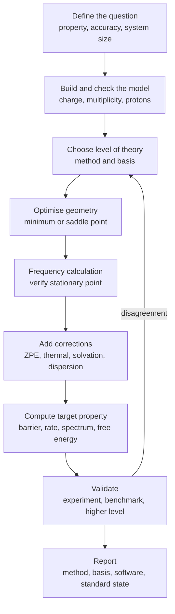
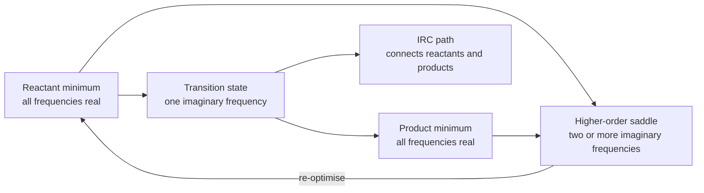
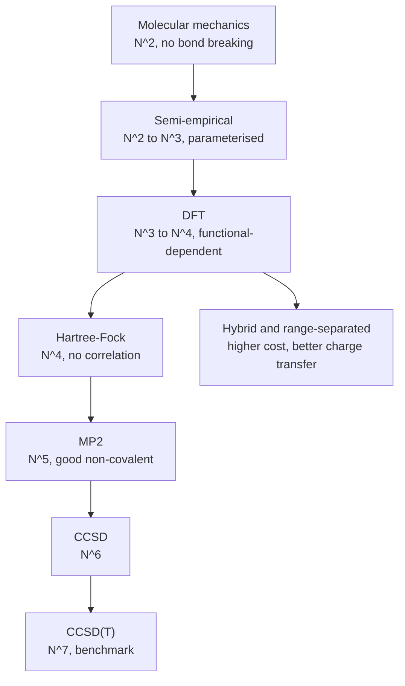
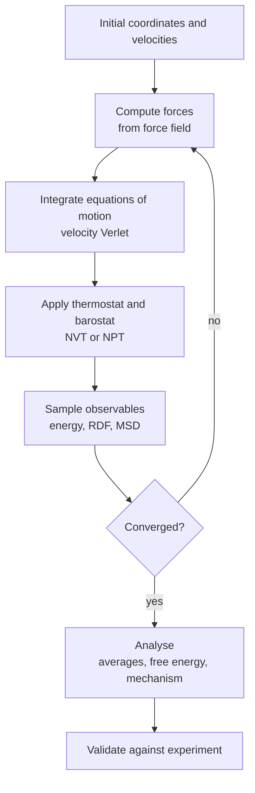
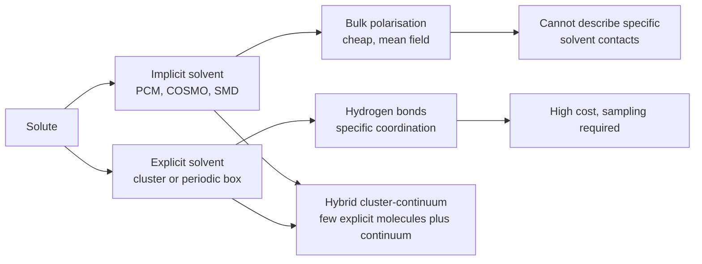

# Chapter 9 — Computational Physical Chemistry

> **Level:** University (Level 6 — Physical Chemistry)
> **Estimated study time:** 9 hours (7 hours reading + 2 hours exercises)
> **Prerequisites:** [Classical Thermodynamics](01-classical-thermodynamics.md); [Quantum Mechanics Foundations](../04-advanced-chemistry/01-quantum-mechanics-foundations.md); [Molecular Orbital Theory](../04-advanced-chemistry/03-molecular-orbital-theory.md)
> **Related chapters:** [Level 6 index](README.md); [Quantum Chemistry](03-quantum-chemistry.md); [Statistical Thermodynamics](02-statistical-thermodynamics-and-statistical-mechanics.md); [Organic Chemistry](../05-organic-chemistry/README.md)
> **Difficulty:** ★★★★★ (5/5)

---

## 1. Learning Objectives

After working through this chapter you will be able to:

- Describe a complete computational chemistry workflow, from problem definition to validation and reporting.
- Explain the Born–Oppenheimer approximation and the concept of a potential energy surface.
- Distinguish Hartree–Fock, post-Hartree–Fock and density functional methods, and state their computational scaling.
- Explain the Kohn–Sham approach and the role of the exchange–correlation functional without reproducing its full derivation.
- Choose between molecular mechanics, semi-empirical, density functional and wavefunction methods for a given problem.
- Select a basis set or plane-wave/pseudopotential setup appropriate to the system and property.
- Locate minima and transition states on a potential energy surface and verify them by frequency analysis.
- Compute zero-point energy, thermal corrections and standard Gibbs energies.
- Include solvation with implicit and explicit models and state the limitations of each.
- Calculate reaction barriers and rate constants with transition-state theory and tunnelling corrections.
- Describe molecular dynamics and Monte Carlo methods, their ensembles, integrators and thermostats.
- Report computational results to literature standard, including method, basis, software, standard state and known uncertainties.

---

## 2. Introduction

Computational chemistry is the use of quantum mechanics, statistical mechanics and classical mechanics to calculate the properties of molecules and materials. It has become a third mode of chemical investigation alongside experiment and theory: it can examine transition states that exist for femtoseconds, screen thousands of catalysts before synthesis, assign vibrational spectra and predict the stability of materials that have not been made.

The central object is the **potential energy surface** (PES), the energy of a collection of nuclei as a function of their positions after the electrons have relaxed. Chemical structure, reaction barriers, vibrational frequencies and thermodynamic functions are all properties of that surface. The electronic-structure method determines how accurately the surface is computed; the nuclear methods — geometry optimisation, frequency analysis, molecular dynamics, Monte Carlo — determine how the surface is explored. A calculation is only as good as both halves.

The chapter assumes the quantum mechanics of [Quantum Mechanics Foundations](../04-advanced-chemistry/01-quantum-mechanics-foundations.md), the orbital picture of [Molecular Orbital Theory](../04-advanced-chemistry/03-molecular-orbital-theory.md) and the thermodynamics of [Classical Thermodynamics](01-classical-thermodynamics.md). It introduces density functional theory at the level needed to use it responsibly; the detailed theory belongs to Level 10. It also treats molecular dynamics and Monte Carlo at a high level, enough to interpret a simulation and to avoid the common errors.

A warning governs the whole chapter. Computational numbers are not measurements. A geometry that looks plausible may be a saddle point, a barrier may change by tens of kilojoules per mole when the functional changes, and a gas-phase result may not survive solvation. The final section is therefore a reporting checklist, and the worked examples state their assumptions explicitly. The aim is not to turn every reader into a method developer but to make every reader a competent consumer and producer of computational evidence.

---

## 3. Fundamental Concepts

### 3.1 The computational workflow

A defensible calculation follows a sequence:

1. **Define the question.** Is it a conformer energy, a reaction barrier, a spectrum, a binding affinity or a bulk property? The question fixes the method, the model system and the accuracy required.
2. **Build and check the model.** Start from an experimental crystal structure, a database entry or a chemically sensible guess. Check bond lengths, charges, multiplicities and protonation states.
3. **Choose the level of theory.** Balance accuracy against cost. A geometry optimisation may use a modest method, followed by a single-point calculation at a higher level.
4. **Optimise the geometry.** Minimise the energy to a stationary point; for a transition state, optimise to a first-order saddle point.
5. **Verify the stationary point.** Compute frequencies: all real for a minimum, exactly one imaginary frequency for a transition state.
6. **Add corrections.** Zero-point energy, thermal contributions, solvation, relativistic effects and dispersion, as required.
7. **Compute the target property.** Barrier, rate constant, spectrum, free energy or population.
8. **Validate.** Compare with experiment, with higher-level theory or with a benchmark set; estimate the uncertainty.
9. **Report.** State method, basis, software, version, standard state, corrections and known limitations.

Skipping step 5 is the most common source of wrong conclusions: an unverified geometry may be a saddle point, and an unverified transition state may connect the wrong reactants and products.

### 3.2 Potential energy surfaces and the Born–Oppenheimer approximation

The **Born–Oppenheimer approximation** separates the motion of electrons from that of nuclei because the nuclei are much heavier. The total wavefunction is written

$$ \Psi(\mathbf r,\mathbf R)\approx\psi_e(\mathbf r;\mathbf R)\chi_N(\mathbf R), $$

where $\mathbf r$ denotes electronic coordinates, $\mathbf R$ nuclear coordinates, $\psi_e$ the electronic wavefunction at fixed nuclei and $\chi_N$ the nuclear wavefunction. Solving the electronic Schrödinger equation at each $\mathbf R$ gives the **electronic energy** $E_e(\mathbf R)$, which acts as the potential for nuclear motion. The **potential energy surface** is $E_e(\mathbf R)$ plus the nuclear repulsion.

The approximation fails near **conical intersections**, where two electronic states become degenerate and the electronic and nuclear motions couple strongly. It also fails for very light nuclei, where tunnelling and zero-point motion are large, and in systems with strong spin–orbit coupling. For most ground-state organic and main-group chemistry it is excellent; for photochemistry and transition-metal magnetism it must be used with care.

A **stationary point** on the PES has zero gradient. A **minimum** has all Hessian eigenvalues positive; a **first-order saddle point** (transition state) has exactly one negative eigenvalue; a higher-order saddle point has more. The **Hessian** is the matrix of second derivatives of the energy with respect to nuclear coordinates, and its eigenvalues determine the curvature and the harmonic frequencies.

### 3.3 Hartree–Fock theory and electron correlation

**Hartree–Fock (HF)** theory approximates the many-electron wavefunction by a single Slater determinant of molecular orbitals. The orbitals are found by solving the Fock equations self-consistently; in a finite basis set they become the **Roothaan–Hall** equations

$$ \mathbf{FC}=\mathbf{SC\varepsilon}, $$

where $\mathbf F$ is the Fock matrix, $\mathbf C$ the orbital coefficients, $\mathbf S$ the overlap matrix and $\boldsymbol\varepsilon$ the orbital energies. The HF energy is

$$ E_{HF}=\sum_i h_i+\frac12\sum_{ij}(J_{ij}-K_{ij}), $$

with $h_i$ the one-electron energy, $J_{ij}$ the Coulomb integral and $K_{ij}$ the exchange integral. The sum runs over occupied orbitals.

HF includes exchange exactly but neglects **electron correlation**: the correlated motion of electrons that keeps them apart beyond the mean field. The **correlation energy** is defined as

$$ E_{corr}=E_{exact}-E_{HF}, $$

and is negative. It is small in absolute terms for closed-shell organic molecules (about 1 % of the total energy) but comparable with reaction energies and barriers, so it cannot be ignored for quantitative work. HF also fails for dispersion-bound complexes, because the mean-field description misses the long-range correlation that produces London dispersion.

### 3.4 Post-Hartree–Fock methods and their scaling

Post-HF methods add correlation by expanding the wavefunction in determinants or by perturbation theory.

**Møller–Plesset perturbation theory** treats the difference between the Fock operator and the exact Hamiltonian as a perturbation. Second order, **MP2**, is the cheapest useful correlation method:

$$ E_{MP2}=\sum_{ij}^{occ}\sum_{ab}^{vir}
   \frac{|\langle ij||ab\rangle|^2}{\varepsilon_i+\varepsilon_j-\varepsilon_a-\varepsilon_b}, $$

where $i,j$ are occupied orbitals, $a,b$ virtual orbitals and $\langle ij||ab\rangle$ antisymmetrised two-electron integrals. MP2 recovers about 80–90 % of the correlation energy for many closed-shell molecules and gives good geometries and non-covalent interaction energies, but it overestimates dispersion and fails when the reference is not a single determinant.

**Configuration interaction (CI)** expands the wavefunction in determinants obtained by exciting electrons from the reference. CISD (single and double excitations) is size-inconsistent; the **coupled-cluster** exponential ansatz,

$$ |\Psi_{CC}\rangle=e^{\hat T}|\Phi_0\rangle, \qquad
   \hat T=\hat T_1+\hat T_2+\cdots, $$

is size-consistent. CCSD includes single and double excitations; **CCSD(T)** adds a perturbative estimate of triple excitations and is often called the "gold standard" of single-reference quantum chemistry, with an accuracy of a few kJ mol⁻¹ for reaction energies and barriers.

The cost scales steeply with the number of basis functions $N$: HF as $N^4$, MP2 as $N^5$, CISD and CCSD as $N^6$, CCSD(T) as $N^7$. A system that takes a minute at HF can take days at CCSD(T). This is why production calculations use composite schemes: a high-level single-point energy at a cheap geometry, with corrections for basis set, correlation and solvation.

### 3.5 Density functional theory

**Density functional theory (DFT)** reformulates the electronic problem in terms of the electron density $\rho(\mathbf r)$ rather than the wavefunction. The **Hohenberg–Kohn theorems** state that the ground-state density determines the external potential and hence all ground-state properties, and that the exact energy is a functional of the density. A full derivation of the Hohenberg–Kohn theorems, the adiabatic connection and the construction of exchange–correlation functionals belongs to Level 10; here the aim is to use DFT responsibly. The **Kohn–Sham** construction introduces a non-interacting reference system with the same density, whose orbitals satisfy

$$ \left[-\frac12\nabla^2+v_{ext}(\mathbf r)+v_H(\mathbf r)+v_{xc}(\mathbf r)\right]\phi_i=\varepsilon_i\phi_i, $$

where $v_H$ is the Hartree potential and $v_{xc}=\delta E_{xc}/\delta\rho$ the exchange–correlation potential. The total energy is

$$ E[\rho]=T_s[\rho]+\int v_{ext}\rho\,\mathrm{d}\mathbf r
   +\frac12\iint\frac{\rho(\mathbf r)\rho(\mathbf r')}{|\mathbf r-\mathbf r'|}
   \,\mathrm{d}\mathbf r\,\mathrm{d}\mathbf r'+E_{xc}[\rho]. $$

The **exchange–correlation functional** $E_{xc}$ contains everything not captured by the non-interacting kinetic energy and the classical Hartree term. Its exact form is unknown, so practical DFT uses approximations:

- **LDA** (local density approximation): depends only on $\rho$; good for uniform systems, poor for molecules.
- **GGA** (generalized gradient approximation): depends on $\rho$ and $\nabla\rho$; PBE and BLYP are common.
- **meta-GGA**: adds the kinetic energy density; TPSS and M06-L.
- **Hybrid**: mixes a fraction of exact HF exchange with a GGA; B3LYP (20 % HF) and PBE0 (25 %) are widely used.
- **Range-separated hybrids**: use different exchange at short and long range; ωB97X-D and CAM-B3LYP improve charge-transfer and Rydberg excitations.
- **Double hybrids**: add MP2-like correlation; B2PLYP.

DFT scales as $N^3$–$N^4$ and often gives geometries and thermochemistry comparable with MP2 at lower cost. Its weaknesses are **self-interaction error** (an electron repels itself), the **band-gap problem** in solids, poor description of charge-transfer and strongly correlated states, and a strong dependence on the functional. Dispersion is not included in conventional GGAs and must be added explicitly, for example with **D3** or **D4** corrections or a functional designed for non-covalent interactions.

### 3.6 Semi-empirical methods, molecular mechanics and QM/MM

**Semi-empirical methods** use a simplified Hamiltonian with parameters fitted to experiment or high-level theory. They treat only valence electrons and neglect many integrals. Examples include AM1, PM3, PM6 and PM7, and the density-functional tight-binding family (DFTB). They are fast enough for thousands of molecules and are useful for screening and for very large systems, but their accuracy is limited to the parameterisation set.

**Molecular mechanics (MM)** treats atoms as balls and bonds as springs, with a **force field** containing bond stretching, angle bending, torsion and non-bonded terms:

$$ E_{MM}=\sum_{bonds}k_b(r-r_0)^2+\sum_{angles}k_\theta(\theta-\theta_0)^2
   +\sum_{torsions}V_n[1+\cos(n\phi-\gamma)]+\sum_{i<j}\left[\frac{A_{ij}}{r_{ij}^{12}}-\frac{B_{ij}}{r_{ij}^6}\right]+\sum_{i<j}\frac{q_iq_j}{4\pi\varepsilon_0r_{ij}}. $$

Common force fields are OPLS, AMBER, CHARMM and GROMOS for biomolecules, and UFF or COMPASS for general materials. MM is fast and can handle millions of atoms, but it cannot break bonds, describe electronic excited states or change protonation. It is only as good as its parameters.

**QM/MM** partitions the system into a quantum region treated by HF/DFT and a classical region treated by MM. It is the standard approach for enzyme catalysis, where the active site is small but the protein environment matters. The coupling between the regions can be mechanical (no charge transfer) or electrostatic (the MM charges polarise the QM wavefunction). The main difficulty is the choice of the boundary and the treatment of link atoms.

### 3.7 Basis sets and pseudopotentials

A **basis set** is the set of functions used to expand the molecular orbitals. The choice controls the accuracy and the cost.

- **STO-3G** is a minimal basis: one function per core and valence orbital, each Slater orbital approximated by three Gaussians. It is useful for teaching and for very large systems, but it gives poor geometries and energies.
- **Pople basis sets** use split-valence contractions: 6-31G has a double-zeta valence; 6-31G(d) adds polarization functions on heavy atoms; 6-311++G(d,p) adds diffuse functions and polarization on hydrogen. They are common for organic chemistry.
- **Dunning correlation-consistent basis sets** (cc-pVDZ, cc-pVTZ, cc-pVQZ; aug- for diffuse) are designed for systematic convergence to the complete basis set (CBS) limit. They are the standard for benchmark calculations.
- **Plane waves** are used for periodic solids and surfaces. The basis is controlled by a kinetic-energy cutoff, and the core electrons are replaced by **pseudopotentials** or the projector-augmented wave (PAW) method. Convergence with cutoff and k-point sampling must be tested.

**Basis set superposition error (BSSE)** arises when two fragments in a complex borrow basis functions from each other, artificially lowering the interaction energy. The **counterpoise correction** recomputes each fragment in the full basis of the complex. BSSE is largest for small basis sets and for weak interactions; it decreases with larger basis sets but should be checked.

### 3.8 Geometry optimisation and stationary points

Geometry optimisation minimises the energy with respect to nuclear coordinates. The simplest algorithm is **steepest descent**, which follows the negative gradient; it is robust but slow near the minimum because the gradient vanishes. **Newton–Raphson** uses the Hessian to take a quadratic step:

$$ \mathbf R_{new}=\mathbf R_{old}-\mathbf H^{-1}\mathbf g, $$

where $\mathbf g$ is the gradient and $\mathbf H$ the Hessian. It converges quadratically near a minimum but requires the Hessian, which is expensive. **Quasi-Newton** methods such as BFGS build an approximate Hessian from successive gradients; they are the workhorse of molecular optimisation.

A **transition-state search** must locate a first-order saddle point, not a minimum. Methods include the **Berny algorithm** (eigenvector following), the **dimer method**, the **nudged elastic band** (NEB) and the **string method**. A good practice is to scan a reaction coordinate, optimise the highest point, then refine with a saddle-point optimiser. The **intrinsic reaction coordinate** (IRC) follows the steepest-descent path from the transition state to reactants and products; it is the strongest evidence that a transition state connects the intended states.

Convergence criteria matter. A geometry is converged when the maximum force and the root-mean-square force fall below thresholds and the displacement is small. Default thresholds differ between programs; a loose optimisation followed by a frequency calculation can give spurious imaginary frequencies. Tight convergence is essential for frequencies and for weak interactions.

### 3.9 Frequency calculations and thermochemistry

A **frequency calculation** computes the Hessian at the stationary point and diagonalises it to give the normal modes. The harmonic frequencies are

$$ \nu_i=\frac{1}{2\pi}\sqrt{\frac{k_i}{\mu_i}}, $$

where $k_i$ is the force constant and $\mu_i$ the reduced mass of the mode. The **zero-point energy** is

$$ E_{ZPE}=\frac12\sum_i h\nu_i, $$

summed over all real modes. For a transition state, the imaginary frequency corresponds to the reaction coordinate and is excluded from the ZPE.

The **thermal correction** to the Gibbs energy uses the rigid-rotor–harmonic-oscillator (RRHO) approximation:

$$ G(T)=E_{elec}+E_{ZPE}+G_{trans}+G_{rot}+G_{vib}+G_{elec}, $$

where the translational, rotational and vibrational contributions are calculated from statistical mechanics. The standard state must be stated: 1 atm or 1 bar, 298.15 K, and the ideal-gas approximation. For reactions in solution, a 1 M standard state requires a correction of $RT\ln(24.5)$ (about 7.9 kJ mol⁻¹ at 298 K) when converting from 1 atm.

Harmonic frequencies are systematically too high because the potential is anharmonic. Empirical **scaling factors** (about 0.96–0.98 for B3LYP/6-31G(d)) correct the ZPE and vibrational entropy; the factor depends on the method and basis set and must be reported. Low-frequency modes (below about 100 cm⁻¹) are poorly described by the harmonic approximation and can dominate the vibrational entropy; they are often treated with a quasi-harmonic correction or excluded.

### 3.10 Solvation models

**Implicit solvation** treats the solvent as a continuous dielectric. The solute is placed in a cavity, and the solvent polarisation is represented by a surface charge distribution. The **polarisable continuum model (PCM)** and **conductor-like screening model (COSMO)** are the most common; **SMD** adds a semi-empirical correction for cavitation, dispersion and specific solvent effects. The electrostatic contribution is computed self-consistently with the solute wavefunction, so the method captures bulk polarisation and solvatochromism.

Implicit models are cheap and often accurate for bulk effects, but they cannot describe specific hydrogen bonds, solvent coordination or proton transfer. They also require a cavity definition and atomic radii; results depend on the parameter set. For aqueous ions and strongly hydrogen-bonded systems, implicit models can be qualitatively wrong.

**Explicit solvation** places individual solvent molecules around the solute. A cluster of 10–100 waters can capture the first solvation shell; periodic boundaries and molecular dynamics can capture the bulk. The cost is much higher, and the configurational average is essential: a single optimised cluster is not a solvation free energy. **Hybrid cluster–continuum** models combine a few explicit molecules with an implicit continuum and are often the best compromise.

### 3.11 Reaction barriers and rate constants

The **transition-state theory** (TST) rate constant is

$$ k=\kappa\frac{k_BT}{h}\exp\left(-\frac{\Delta G^{\ddagger}}{RT}\right), $$

where $\Delta G^{\ddagger}$ is the standard Gibbs energy of activation, $\kappa$ the transmission coefficient and $k_BT/h$ the frequency factor ($6.21\times10^{12}\ \text{s}^{-1}$ at 298 K). The equation assumes that the transition state is in equilibrium with the reactants, that recrossing is negligible and that the reaction coordinate is separable. **Variational TST** minimises the rate with respect to the dividing surface and gives a better estimate when the barrier is broad or the transition state is loose.

**Tunnelling** is important for light atoms, especially hydrogen. The **Wigner correction** is

$$ \kappa=1+\frac{1}{24}\left(\frac{h\nu^{\ddagger}}{k_BT}\right)^2, $$

where $\nu^{\ddagger}$ is the imaginary frequency of the transition state. It is valid when tunnelling is weak; for strong tunnelling, an **Eckart barrier** or a **small-curvature tunnelling** correction is used. Tunnelling can increase a rate by orders of magnitude at low temperature and can change kinetic isotope effects.

The **Eyring plot** of $\ln(k/T)$ against $1/T$ gives $\Delta H^{\ddagger}$ and $\Delta S^{\ddagger}$. A negative $\Delta S^{\ddagger}$ indicates a tight transition state; a positive value indicates a loose one. The activation energy $E_a$ and the activation enthalpy differ by $RT$ for a unimolecular reaction and by more for bimolecular reactions, so the quantity being reported must be stated.

### 3.12 Molecular dynamics and Monte Carlo

**Molecular dynamics (MD)** integrates Newton's equations of motion for the nuclei. The **velocity Verlet** algorithm is standard:

$$ \mathbf r(t+\Delta t)=\mathbf r(t)+\mathbf v(t)\Delta t+\frac12\mathbf a(t)\Delta t^2, $$

$$ \mathbf v(t+\Delta t)=\mathbf v(t)+\frac12[\mathbf a(t)+\mathbf a(t+\Delta t)]\Delta t. $$

It is time-reversible and conserves energy well. The timestep must be smaller than the fastest motion: about 1 fs for X–H stretches, 2 fs with bond constraints (SHAKE or LINCS). **Periodic boundary conditions** avoid surface effects, and **Ewald summation** or particle-mesh Ewald handles long-range electrostatics.

MD is run in an **ensemble**. The **NVE** ensemble conserves energy and is used to check the integrator. The **NVT** ensemble controls temperature with a thermostat (Nosé–Hoover, Langevin or Berendsen); the **NPT** ensemble controls pressure with a barostat (Parrinello–Rahman or Berendsen). The choice of thermostat affects the dynamics, especially for small systems; a Langevin thermostat is robust but perturbs the dynamics, while Nosé–Hoover preserves the canonical distribution.

**Enhanced sampling** methods overcome the timescale problem: umbrella sampling, metadynamics, replica exchange and steered MD. They add a bias to explore rare events and then reweight to recover the free-energy landscape. The choice of collective variable is the critical decision.

**Monte Carlo (MC)** samples configurations according to the Boltzmann distribution without integrating trajectories. The **Metropolis algorithm** proposes a move and accepts it with probability

$$ P_{acc}=\min\left(1,e^{-\Delta U/k_BT}\right), $$

where $\Delta U$ is the energy change. Repeated moves generate a Markov chain whose stationary distribution is the Boltzmann distribution. MC is efficient for configurational integrals, adsorption isotherms (grand canonical MC) and lattice models; it does not give dynamics, only equilibrium averages.

### 3.13 Visualisation, validation and reporting

**Visualisation** is not decoration. Molecular viewers reveal bad geometries, misplaced protons, overlapping atoms and unrealistic bond lengths. Orbital and density plots show where charge is localised; electrostatic potential maps show likely hydrogen-bond acceptors; vibration animations confirm that an imaginary mode corresponds to the expected reaction coordinate.

**Validation** compares the calculation with experiment or with higher-level theory. Benchmarks such as GMTKN55, the S22 non-covalent set and the MOBH35 barrier set quantify the performance of methods. A single comparison is not validation; a method that works for one reaction may fail for another. Error cancellation can make a mediocre method look excellent for a particular property, so the validation set must resemble the target system.

**Reporting** must include: software and version; method and functional; basis set; dispersion correction; solvent model; charge and multiplicity; geometry source and convergence criteria; frequency scaling factor; standard state and temperature; energies with enough digits; zero-point and thermal corrections; and the treatment of tunnelling or relativity. The coordinates and absolute energies should be deposited as supplementary information so that the result can be reproduced. A reader should be able to repeat the calculation from the reported information alone.

---

## 4. Detailed Scientific Explanation

### 4.1 The Hartree–Fock self-consistent field

The HF equations are nonlinear because the Fock operator depends on the orbitals it determines. The **self-consistent field (SCF)** procedure starts with a guess density, constructs the Fock matrix, diagonalises it to obtain new orbitals, and repeats until the energy and density stop changing. Convergence is accelerated by **DIIS** (direct inversion in the iterative subspace) and by level shifting.

The HF wavefunction is a single Slater determinant, so it describes exchange but not correlation. **Restricted** HF (RHF) uses the same spatial orbital for paired electrons; **unrestricted** HF (UHF) allows different orbitals for α and β spins and is used for open-shell systems, at the cost of spin contamination. **Restricted open-shell** HF (ROHF) is a compromise. The choice matters for radicals and transition-metal complexes.

The **basis set limit** of HF is the **Hartree–Fock limit**, which is still above the exact non-relativistic energy because correlation is missing. For a molecule like water, the HF limit is about 0.3 hartree above the exact energy, while the total energy is about 76 hartree; the correlation energy is small relative to the total but large relative to chemical differences.

### 4.2 Correlation methods and their accuracy

MP2 is the workhorse for non-covalent interactions and for geometries, but it is not a variational method and can diverge when the HF reference is poor. **Spin-component-scaled MP2** (SCS-MP2) improves interaction energies by scaling same-spin and opposite-spin contributions differently. **RI-MP2** approximates the two-electron integrals with a resolution-of-identity auxiliary basis, reducing the cost dramatically.

Coupled cluster theory is more robust. CCSD includes connected singles and doubles; CCSD(T) adds triples perturbatively and is accurate for closed-shell molecules near equilibrium. It fails for bond breaking, diradicals and strongly correlated systems, where a multireference method such as **CASSCF** or **MRCI** is required. **Local correlation** methods exploit the short-range nature of correlation to reduce scaling, and **DLPNO-CCSD(T)** can treat hundreds of atoms.

The accuracy hierarchy is roughly: HF (poor for barriers and dispersion), MP2 (good for non-covalent, variable for barriers), CCSD (good), CCSD(T) (excellent for single-reference). DFT sits between MP2 and CCSD(T) for many properties, at much lower cost, but its accuracy is system-dependent.

### 4.3 Kohn–Sham DFT in practice

The Kohn–Sham equations are solved self-consistently in a basis set, just like HF. The cost is dominated by the construction of the Coulomb potential, which scales as $N^3$ with density fitting or $N^4$ without. Hybrid functionals add exact exchange, which is more expensive and can scale as $N^4$ or worse.

The choice of functional is the most consequential decision in a DFT calculation:

- **B3LYP** is accurate for organic thermochemistry and geometries but poor for dispersion, charge transfer and transition metals. It should be paired with a dispersion correction.
- **PBE0** is a parameter-free hybrid with similar performance and better solid-state behaviour.
- **M06-2X** is designed for non-covalent interactions and main-group thermochemistry; it has a high fraction of HF exchange (54 %) and can overestimate barrier heights.
- **ωB97X-D** is a range-separated hybrid with dispersion; it is robust for charge transfer and non-covalent systems.
- **PBE** and **PBEsol** are GGA functionals for solids; they underestimate band gaps and need a Hubbard $U$ correction for strongly correlated oxides.

DFT is not systematically improvable in the way that wavefunction methods are. A larger basis set improves the density, but a different functional can change the answer by more than the basis set. Benchmark studies are essential. For reaction barriers, typical DFT errors are 4–20 kJ mol⁻¹, and the spread between functionals can be larger than the barrier itself for difficult cases.

**Dispersion corrections** are essential for non-covalent interactions. The D3 correction adds pairwise $C_6/r^6$ terms with damping; D4 adds many-body effects and charge-dependent coefficients. Alternatively, a functional with non-local correlation (e.g. VV10, MBD) can be used. Without a dispersion correction, a GGA or hybrid functional will often predict a bound complex that is too weakly bound or not bound at all.

### 4.4 Basis-set convergence and BSSE

The basis-set error decreases smoothly with the cardinal number of a correlation-consistent basis. For a property $P$, the convergence is often extrapolated as

$$ P(n)=P_{\infty}+\frac{A}{n^3}, $$

where $n$ is the cardinal number (D=2, T=3, Q=4). Two-point extrapolation using $n=3$ and $n=4$ gives a good estimate of the CBS limit. The extrapolation is empirical, but it is more reliable than a single large-basis calculation.

BSSE is computed by the **counterpoise** method: the energy of each fragment is recalculated in the full basis of the complex, with the ghost orbitals of the other fragment. The corrected interaction energy is

$$ \Delta E_{int}^{CP}=\Delta E_{int}^{raw}+E_{BSSE}, $$

where $E_{BSSE}$ is the sum of the fragment stabilisations by the ghost orbitals. The correction is essential for small basis sets and for weak complexes; with large basis sets it is small but not negligible.

For periodic solids, the basis is plane waves and the convergence parameters are the cutoff energy and the k-point mesh. The **cutoff** must be increased until the total energy and forces converge; the **k-point mesh** must be dense enough for the Brillouin-zone integral. Pseudopotentials introduce their own errors, especially for transition metals and for properties that depend on the core region.

### 4.5 Geometry optimisation algorithms and saddle-point searches

The **BFGS** algorithm updates an approximate inverse Hessian:

$$ \mathbf H_{k+1}=\mathbf H_k+
   \frac{\mathbf s\mathbf s^T}{\mathbf s^T\mathbf y}
   -\frac{\mathbf H_k\mathbf y\mathbf y^T\mathbf H_k}{\mathbf y^T\mathbf H_k\mathbf y}, $$

where $\mathbf s=\mathbf R_{k+1}-\mathbf R_k$ and $\mathbf y=\mathbf g_{k+1}-\mathbf g_k$. It converges superlinearly and is the default in most programs. **Trust-radius** methods restrict the step to a region where the quadratic model is reliable, which improves robustness for poor starting geometries.

Transition-state optimisation is harder because the Hessian has one negative eigenvalue. **Eigenvector following** takes a step along the mode with the negative eigenvalue uphill and along all other modes downhill. The **dimer method** requires only gradients and is useful for large systems. **NEB** optimises a chain of images between reactants and products; **climbing-image NEB** places one image at the saddle point. The **IRC** calculation then confirms the connection.

A common failure is a transition state that collapses to a minimum during optimisation because the initial Hessian was poor. Starting from a scan along the reaction coordinate, or from a chemically sensible guess with constraints, is more reliable than guessing coordinates. Frequency analysis of the final structure is mandatory.

### 4.6 Thermochemistry and standard states

The RRHO approximation treats translation, rotation and vibration independently. The translational partition function gives the Sackur–Tetrode entropy; the rotational partition function depends on the principal moments of inertia; the vibrational partition function is a product of harmonic oscillators. The resulting Gibbs energy is

$$ G=E_{elec}+E_{ZPE}+k_BT\ln Q_{trans}+k_BT\ln Q_{rot}
   +k_BT\ln Q_{vib}+pV. $$

The standard state is a gas at 1 bar (or 1 atm) and an ideal solution at 1 M. The conversion between the two for a solute is

$$ G^{\circ}_{1\,\text{M}}=G^{\circ}_{1\,\text{atm}}
   +RT\ln\left(\frac{RT}{p^{\circ}}\right), $$

which is about $+7.9\ \text{kJ mol}^{-1}$ at 298 K for a 1 M ideal solution. Mixing standard states in a thermodynamic cycle is a common source of errors of this size.

Low-frequency vibrational modes are the largest source of error in RRHO thermochemistry. A frequency of 20 cm⁻¹ contributes a large entropy, and the harmonic approximation is poor. **Quasi-harmonic** corrections replace low frequencies with a floor or use a free-rotor model. The treatment must be stated, because it can change $\Delta G$ by several kJ mol⁻¹.

### 4.7 Transition-state theory and tunnelling

TST assumes a dividing surface at the saddle point and an equilibrium population of transition states. The rate is the flux through the surface divided by the reactant partition function. The resulting expression is the Eyring equation. The **transmission coefficient** $\kappa$ corrects for recrossing and tunnelling; in variational TST, the dividing surface is chosen to minimise the rate.

For a parabolic barrier, the **Wigner correction** is the leading quantum correction. It overestimates tunnelling for low barriers and underestimates it for strong tunnelling. The **Eckart barrier** is a more realistic one-dimensional potential; the **small-curvature tunnelling** (SCT) approximation includes the coupling between the reaction coordinate and the transverse modes. For enzymatic hydrogen transfer, these corrections can change the rate by orders of magnitude and are essential for interpreting kinetic isotope effects.

The **kinetic isotope effect** (KIE) is the ratio of rates for H and D transfer. A classical KIE from zero-point energy differences is about 7 at 298 K for a C–H bond; a larger KIE indicates tunnelling. The KIE is therefore a probe of both barrier height and quantum effects.

### 4.8 Molecular dynamics in practice

The **force field** determines the accuracy of an MD simulation. Bonded terms are parameterised against vibrational spectra and crystal structures; non-bonded terms against thermodynamic properties. Water models illustrate the trade-off: TIP3P is cheap and reproduces the density and dielectric constant reasonably, but has a low viscosity and a high diffusion coefficient; TIP4P/2005 and OPC are more accurate but more expensive. The choice must match the property being studied.

The **integrator** must conserve energy in NVE. Velocity Verlet is standard; it is symplectic and time-reversible. The **timestep** is limited by the fastest vibration; with SHAKE constraints on X–H bonds, 2 fs is common, and with hydrogen mass repartitioning, 4 fs is possible. A timestep that is too large causes energy drift and instability.

**Thermostats** and **barostats** control temperature and pressure but can perturb the dynamics. The **Nosé–Hoover** thermostat produces the canonical ensemble and is preferred for equilibrium properties; the **Langevin** thermostat is robust for equilibration but adds friction; the **Berendsen** thermostat is fast but does not produce the correct fluctuations. The **Parrinello–Rahman** barostat is standard for NPT.

**Periodic boundary conditions** introduce finite-size effects and the need for corrections. Long-range electrostatics are treated with Ewald summation or particle-mesh Ewald; the cutoff and the mesh must be converged. **Free-energy calculations** use thermodynamic integration, free-energy perturbation or umbrella sampling; the choice depends on the overlap between the end states.

### 4.9 Monte Carlo and enhanced sampling

The **Metropolis** algorithm is simple but can be slow when the energy landscape has high barriers. **Parallel tempering** (replica exchange) runs several replicas at different temperatures and swaps configurations, improving sampling. **Wang–Landau** sampling flattens the density of states. **Grand canonical MC** varies the number of particles and is used for adsorption isotherms and phase equilibria.

**Umbrella sampling** adds a harmonic bias along a collective variable and combines the windows with the weighted histogram analysis method (WHAM). **Metadynamics** adds a history-dependent bias that fills free-energy basins; it is efficient for rare events but requires careful choice of collective variables and bias parameters. **Steered MD** pulls the system along a coordinate and gives a nonequilibrium estimate that can be corrected with Jarzynski's equality.

The **potential of mean force** (PMF) is the free energy along a collective variable. It is the quantity to compare with experiment for binding, permeation and conformational changes. A PMF is only as meaningful as the collective variable; a poor choice hides the relevant degrees of freedom.

### 4.10 Validation, error cancellation and reporting standards

Computational results are validated by comparison with experiment, with higher-level theory and with independent software. **Error cancellation** is common: a method that underestimates the reactant energy and the transition-state energy by the same amount gives a good barrier. This is why a method can predict barriers well but absolute energies poorly, and why benchmarks must test the property of interest.

The **GMTKN55** database contains 55 benchmark sets for general main-group thermochemistry, kinetics and non-covalent interactions. The **S22** and **S66** sets test non-covalent interactions; the **MOBH35** set tests barrier heights; the **W4-11** set tests total atomisation energies. A method should be selected on the basis of its performance on a set that resembles the target.

Reporting standards have converged on a checklist: method, basis, software, version, dispersion, solvent, charge, multiplicity, geometry, frequencies, standard state, and the treatment of low-frequency modes. The **coordinates** and **absolute energies** should be provided, along with the **input files** or enough detail to reconstruct them. A computational result without these details is not reproducible and should not be published as evidence.

---

## 5. Visual Diagrams

### 5.1 The computational chemistry workflow

**Figure 9.1 — A defensible calculation is a loop, not a single job.** The question fixes the model and the method, and the frequency calculation verifies that the optimised structure is the intended stationary point. Corrections are added before the target property is computed, and validation may send the calculation back to an earlier step. The loop is the reason computational chemistry is iterative: a result that fails validation is not a result but a diagnostic.

### 5.2 The potential energy surface and its stationary points

**Figure 9.2 — Minima and saddle points are distinguished by the curvature of the surface.** A minimum has positive curvature in every direction; a first-order saddle point has one negative direction, the reaction coordinate, and positive curvature in all others. The imaginary frequency of the transition state is the signature of that negative curvature. An IRC calculation follows the steepest-descent path from the saddle point to the two minima, confirming that the transition state connects the intended reactants and products rather than an unrelated pair.

### 5.3 The hierarchy of electronic-structure methods

**Figure 9.3 — Accuracy and cost rise together, but not uniformly.** Molecular mechanics is the cheapest and can treat millions of atoms, but it cannot break bonds. Semi-empirical methods are parameterised and fast. DFT offers a good compromise for many properties but its accuracy depends on the functional. Hartree–Fock includes exchange exactly but no correlation. MP2, CCSD and CCSD(T) add correlation systematically, at steeply increasing cost. The practical choice is the cheapest method that has been validated for the target property.

### 5.4 The molecular dynamics loop

**Figure 9.4 — Molecular dynamics is a repeated force-and-integrate cycle.** Forces are computed from the force field, the integrator advances positions and velocities, and the thermostat or barostat controls the ensemble. Observables are accumulated as averages over the trajectory. Convergence is judged by the stability of the averages and by comparison of independent runs, not by the length of the trajectory alone. The final analysis must account for correlation times and statistical uncertainty.

### 5.5 Implicit versus explicit solvation

**Figure 9.5 — Solvation models trade specificity against cost.** Implicit models represent the solvent as a dielectric continuum and capture bulk polarisation cheaply, but they cannot describe specific hydrogen bonds or solvent coordination. Explicit models place individual molecules around the solute and capture those contacts, at a much higher cost and with a need for configurational sampling. Hybrid cluster–continuum models combine a few explicit molecules with a continuum and are often the best compromise for reactions in solution.

---

## 6. Mathematical Formulas

### 6.1 Born–Oppenheimer separation

$$ \Psi(\mathbf r,\mathbf R)\approx\psi_e(\mathbf r;\mathbf R)\chi_N(\mathbf R), \qquad
   \hat H_e\psi_e=E_e(\mathbf R)\psi_e. $$

| Symbol | Meaning | SI unit |
|---|---|---|
| $\Psi$ | Total molecular wavefunction | dimensionless |
| $\psi_e$ | Electronic wavefunction | dimensionless |
| $\chi_N$ | Nuclear wavefunction | dimensionless |
| $E_e$ | Electronic energy at fixed nuclei | J |
| $\mathbf R$ | Nuclear coordinates | m |

Assumption: nuclei much heavier than electrons, no strong non-adiabatic coupling; fails near conical intersections.

### 6.2 Hartree–Fock and Roothaan–Hall

$$ \mathbf{FC}=\mathbf{SC\varepsilon}, \qquad
   E_{HF}=\sum_i h_i+\frac12\sum_{ij}(J_{ij}-K_{ij}). $$

| Symbol | Meaning | SI unit |
|---|---|---|
| $\mathbf F$ | Fock matrix | J |
| $\mathbf C$ | Orbital coefficient matrix | dimensionless |
| $\mathbf S$ | Overlap matrix | dimensionless |
| $\varepsilon_i$ | Orbital energy | J |
| $J_{ij}$ | Coulomb integral | J |
| $K_{ij}$ | Exchange integral | J |

Assumption: single Slater determinant, Born–Oppenheimer, finite basis set.

### 6.3 MP2 correlation energy

$$ E_{MP2}=\sum_{ij}^{occ}\sum_{ab}^{vir}
   \frac{|\langle ij||ab\rangle|^2}{\varepsilon_i+\varepsilon_j-\varepsilon_a-\varepsilon_b}. $$

| Symbol | Meaning | SI unit |
|---|---|---|
| $i,j$ | Occupied spin orbitals | dimensionless |
| $a,b$ | Virtual spin orbitals | dimensionless |
| $\langle ij||ab\rangle$ | Antisymmetrised two-electron integral | J |
| $\varepsilon$ | Orbital energy | J |

Assumption: HF reference is a good starting point; weak correlation; no near-degeneracies.

### 6.4 Kohn–Sham energy

$$ E[\rho]=T_s[\rho]+\int v_{ext}\rho\,\mathrm{d}\mathbf r
   +\frac12\iint\frac{\rho(\mathbf r)\rho(\mathbf r')}{|\mathbf r-\mathbf r'|}
   \,\mathrm{d}\mathbf r\,\mathrm{d}\mathbf r'+E_{xc}[\rho]. $$

| Symbol | Meaning | SI unit |
|---|---|---|
| $\rho$ | Electron density | m⁻³ |
| $T_s$ | Non-interacting kinetic energy | J |
| $v_{ext}$ | External potential | J |
| $E_{xc}$ | Exchange–correlation energy | J |

Assumption: exact functional is unknown; practical calculations use LDA, GGA, meta-GGA, hybrid or range-separated approximations.

### 6.5 Zero-point energy and thermal correction

$$ E_{ZPE}=\frac12\sum_i h\nu_i, \qquad
   G(T)=E_{elec}+E_{ZPE}+G_{trans}+G_{rot}+G_{vib}. $$

| Symbol | Meaning | SI unit |
|---|---|---|
| $\nu_i$ | Harmonic vibrational frequency | Hz |
| $E_{ZPE}$ | Zero-point energy | J |
| $G_{trans}$ | Translational Gibbs energy | J |
| $G_{rot}$ | Rotational Gibbs energy | J |
| $G_{vib}$ | Vibrational Gibbs energy | J |

Assumption: RRHO approximation, ideal gas, harmonic potential, rigid rotor; low-frequency modes need special treatment.

### 6.6 Eyring transition-state theory

$$ k=\kappa\frac{k_BT}{h}\exp\left(-\frac{\Delta G^{\ddagger}}{RT}\right), \qquad
   \kappa_{Wigner}=1+\frac{1}{24}\left(\frac{h\nu^{\ddagger}}{k_BT}\right)^2. $$

| Symbol | Meaning | SI unit |
|---|---|---|
| $k$ | Rate constant | s⁻¹ |
| $\kappa$ | Transmission coefficient | dimensionless |
| $\Delta G^{\ddagger}$ | Standard Gibbs energy of activation | J mol⁻¹ |
| $\nu^{\ddagger}$ | Imaginary frequency at the transition state | Hz |

Assumptions: transition state in equilibrium with reactants, no recrossing, separable reaction coordinate, parabolic barrier for the Wigner correction.

### 6.7 Velocity Verlet and Metropolis

$$ \mathbf r(t+\Delta t)=\mathbf r(t)+\mathbf v(t)\Delta t+\frac12\mathbf a(t)\Delta t^2, \qquad
   P_{acc}=\min\left(1,e^{-\Delta U/k_BT}\right). $$

| Symbol | Meaning | SI unit |
|---|---|---|
| $\mathbf r$ | Position | m |
| $\mathbf v$ | Velocity | m s⁻¹ |
| $\mathbf a$ | Acceleration | m s⁻² |
| $\Delta t$ | Timestep | s |
| $\Delta U$ | Energy change of a Monte Carlo move | J |

Assumptions: classical nuclei, smooth potential, timestep small compared with the fastest vibration; Metropolis moves are ergodic and satisfy detailed balance.

### 6.8 Computational scaling

$$ \text{HF}:N^4, \quad \text{MP2}:N^5, \quad \text{CCSD}:N^6, \quad \text{CCSD(T)}:N^7, \quad \text{DFT}:N^3\text{–}N^4. $$

| Symbol | Meaning | SI unit |
|---|---|---|
| $N$ | Number of basis functions | dimensionless |
| Scaling exponent | Asymptotic cost exponent | dimensionless |

Assumption: large-system limit, dense matrix algebra, no local approximations or density fitting. Actual exponents can be lower with modern algorithms, but the ordering is robust.

---

## 7. Chemical Equations

### 7.1 Conformational equilibrium of butane

$$ \ce{CH3-CH2-CH2-CH3 <=> CH3-CH2-CH2-CH3} $$

The two structures are the anti and gauche conformers of the same molecule; the equation is a schematic reminder that the "reaction" is a rotation about the central C–C bond, not a change in connectivity. The energy difference is a few kJ mol⁻¹, and the population ratio follows the Boltzmann distribution.

### 7.2 A gas-phase SN2 reaction

$$ \ce{OH- + CH3Br -> CH3OH + Br-} $$

The reaction proceeds through a trigonal-bipyramidal transition state with the nucleophile and leaving group axial. The barrier is sensitive to solvation: a polar solvent stabilises the separated ions and lowers the barrier relative to the gas phase, while a protic solvent can hydrogen-bond to the nucleophile and raise it.

### 7.3 Hydrogen abstraction by chlorine

$$ \ce{CH4 + Cl. -> CH3. + HCl} $$

The reaction is a classic radical abstraction with a late transition state. The barrier and the H/D kinetic isotope effect are sensitive to tunnelling, which makes this system a test case for transition-state theory with quantum corrections.

### 7.4 Combustion of butane

$$ \ce{C4H10 + 13/2 O2 -> 4CO2 + 5H2O} \qquad \Delta H^{\circ}=-2877\ \text{kJ mol}^{-1} $$

The reaction is used as a thermochemical benchmark: the enthalpy of combustion can be computed from the difference between product and reactant energies, and the result tests the method's treatment of bond energies and correlation.

### 7.5 Proton transfer in water

$$ \ce{H2O + H3O+ -> H3O+ + H2O} $$

The identity proton transfer is a model for acid–base chemistry in water. It involves hydrogen bonding, a low barrier and strong nuclear quantum effects; it is a stringent test for DFT, semi-empirical methods and force fields.

---

## 8. Worked Examples

### Worked Example 8.1 — Boltzmann populations of butane conformers

**Problem.** A calculation gives the anti conformer of butane as 3.15 kJ mol⁻¹ more stable than each gauche conformer at 298 K. Calculate the equilibrium populations at 298 K and at 1000 K.

**Strategy.** Use $n_i\propto g_i e^{-E_i/RT}$, with $g_{anti}=1$ and $g_{gauche}=2$ (two equivalent gauche conformers).

**Solution.** At 298 K, $RT=2.479\ \text{kJ mol}^{-1}$ and

$$ \frac{n_{gauche}}{n_{anti}}=2e^{-3.15/2.479}=2(0.2807)=0.561. $$

The total is $1+0.561=1.561$, so $x_{anti}=1/1.561=0.641$ and $x_{gauche}=0.359$ (0.180 for each conformer). At 1000 K, $RT=8.314\ \text{kJ mol}^{-1}$ and

$$ \frac{n_{gauche}}{n_{anti}}=2e^{-3.15/8.314}=2(0.685)=1.369, $$

so $x_{anti}=0.422$ and $x_{gauche}=0.578$.

**Check.** The gauche population rises with temperature, as entropy favours the two degenerate gauche states. The low-temperature result is consistent with the experimental observation that the anti conformer dominates at room temperature. The calculation assumes a harmonic model and ignores solvent; in the liquid, the populations shift.

### Worked Example 8.2 — Energy units and zero-point correction

**Problem.** A calculation gives an electronic energy difference of $0.00320\ E_h$ between two conformers. The zero-point energy of the higher conformer is $0.00010\ E_h$ lower than that of the lower one. Calculate the energy difference in kJ mol⁻¹ and kcal mol⁻¹ after the ZPE correction.

**Strategy.** Use $1\ E_h=2625.50\ \text{kJ mol}^{-1}$ and $1\ \text{kcal}=4.184\ \text{kJ}$.

**Solution.** The electronic difference is

$$ 0.00320\times2625.50=8.40\ \text{kJ mol}^{-1}=2.01\ \text{kcal mol}^{-1}. $$

The ZPE correction is $-0.00010\times2625.50=-0.263\ \text{kJ mol}^{-1}$, so the corrected difference is $8.14\ \text{kJ mol}^{-1}=1.95\ \text{kcal mol}^{-1}$.

**Check.** The ZPE correction is small but not negligible; for a conformational difference of a few kJ mol⁻¹ it changes the population ratio by about 3 %. The hartree is an atomic unit, not an SI unit; energies should be converted before comparing with experimental values.

### Worked Example 8.3 — Rate constant from a computed barrier

**Problem.** A calculation gives $\Delta G^{\ddagger}=42.0\ \text{kJ mol}^{-1}$ at 298 K and an imaginary frequency of $500\ \text{cm}^{-1}$ at the transition state. Calculate the TST rate constant and the Wigner-corrected rate.

**Strategy.** Use $k=(k_BT/h)\exp(-\Delta G^{\ddagger}/RT)$ with $k_BT/h=6.21\times10^{12}\ \text{s}^{-1}$, then multiply by the Wigner factor.

**Solution.**

$$ k=6.21\times10^{12}\exp\left(-\frac{42\,000}{8.314(298)}\right)
   =6.21\times10^{12}\exp(-16.94)=2.7\times10^5\ \text{s}^{-1}. $$

The Wigner factor is

$$ \frac{h\nu^{\ddagger}}{k_BT}=\frac{(6.626\times10^{-34})(500)(2.998\times10^{10})}
   {(1.381\times10^{-23})(298)}=2.41, $$

$$ \kappa=1+\frac{(2.41)^2}{24}=1.24, \qquad k_{corr}=1.24(2.7\times10^5)=3.4\times10^5\ \text{s}^{-1}. $$

**Check.** The barrier is modest, so the rate is fast at room temperature. The Wigner correction increases the rate by 24 %, which is typical for a 500 cm⁻¹ imaginary mode; for a lower frequency the correction would be smaller, and for a higher frequency it would be larger.

### Worked Example 8.4 — Basis-set scaling

**Problem.** A molecule has 20 heavy atoms and requires about 400 basis functions. Estimate the relative cost of HF, MP2, CCSD and CCSD(T) calculations, taking HF as 1.

**Strategy.** Use the asymptotic scaling $N^4$, $N^5$, $N^6$ and $N^7$ and form ratios.

**Solution.** With $N=400$:

$$ \text{HF}\propto N^4=2.56\times10^{10}, \qquad
   \text{MP2}\propto N^5=1.02\times10^{13}, $$

$$ \text{CCSD}\propto N^6=4.10\times10^{15}, \qquad
   \text{CCSD(T)}\propto N^7=1.64\times10^{18}. $$

Relative to HF, the costs are $1$, $400$, $1.6\times10^5$ and $6.4\times10^7$. If HF takes one minute, MP2 takes about 6.7 hours, CCSD about 4 months and CCSD(T) about 120 years at the same hardware efficiency.

**Check.** The estimate is asymptotic and ignores prefactors, density fitting and local approximations, which can reduce the cost by orders of magnitude. It nevertheless explains why CCSD(T) is used for single-point energies on small models rather than for routine geometry optimisation.

### Worked Example 8.5 — Zero-point energy from harmonic frequencies

**Problem.** A molecule has harmonic frequencies (in cm⁻¹) of 3000, 2900, 1500, 1400, 1000 and 800. Calculate the zero-point energy in kJ mol⁻¹.

**Strategy.** Use $E_{ZPE}=\frac12\sum_i hc\tilde\nu_i$, with $hc=0.0119627\ \text{kJ mol}^{-1}$ per cm⁻¹.

**Solution.** The sum of the frequencies is $10\,600\ \text{cm}^{-1}$, so

$$ E_{ZPE}=\frac12(10\,600)(0.0119627)=63.4\ \text{kJ mol}^{-1}. $$

**Check.** The ZPE is a substantial fraction of a typical bond energy and must be included in any comparison of computed and experimental reaction energies. The harmonic approximation overestimates the ZPE; a scaling factor of about 0.96–0.98 is often applied.

### Worked Example 8.6 — Choosing an MD timestep

**Problem.** The highest vibrational frequency in a simulation is $3000\ \text{cm}^{-1}$. Estimate the period of the vibration and recommend a timestep for MD with and without bond constraints.

**Strategy.** Convert the wavenumber to frequency, take the reciprocal for the period, and choose a timestep of about one tenth of the period.

**Solution.** $\nu=c\tilde\nu=(2.998\times10^{10})(3000)=8.99\times10^{13}\ \text{s}^{-1}$, so the period is $1/\nu=1.11\times10^{-14}\ \text{s}=11.1\ \text{fs}$. A timestep of 1 fs resolves the vibration with about 11 points per period, which is adequate. With SHAKE constraints on X–H bonds, the fastest remaining motions are slower and a 2 fs timestep is standard.

**Check.** A 5 fs timestep would give only two points per period and cause energy drift. The timestep must be tested by checking energy conservation in NVE; if the total energy drifts, the timestep is too large or the constraints are inadequate.

### Worked Example 8.7 — A reaction barrier from electronic energies

**Problem.** A gas-phase SN2 calculation gives electronic energies of $-500.000000\ E_h$ for the reactant complex and $-499.980000\ E_h$ for the transition state. The zero-point energies are 0.100000 and 0.098000 $E_h$, and the thermal Gibbs corrections beyond the ZPE are 0.020000 and 0.018000 $E_h$ at 298 K. Compute $\Delta E^{\ddagger}$, $\Delta G^{\ddagger}$ and the TST rate constant. A second functional gives an electronic barrier of 0.024000 $E_h$; estimate the change in rate.

**Strategy.** Form the differences in hartree, convert to kJ mol⁻¹, add the ZPE and thermal corrections, then use the Eyring equation.

**Solution.**

$$ \Delta E^{\ddagger}=(-499.980000)-(-500.000000)=0.020000\ E_h=52.50\ \text{kJ mol}^{-1}, $$

$$ \Delta E_{ZPE}=(0.098000-0.100000)=-0.002000\ E_h=-5.25\ \text{kJ mol}^{-1}, $$

$$ \Delta G_{th}=(0.018000-0.020000)=-0.002000\ E_h=-5.25\ \text{kJ mol}^{-1}, $$

so $\Delta G^{\ddagger}=52.50-5.25-5.25=42.00\ \text{kJ mol}^{-1}$. The rate is

$$ k=6.21\times10^{12}\exp\left(-\frac{42\,000}{2478.9}\right)=2.7\times10^5\ \text{s}^{-1}. $$

For the second functional, $\Delta E^{\ddagger}=0.024000\ E_h=63.01\ \text{kJ mol}^{-1}$, so $\Delta G^{\ddagger}=52.51\ \text{kJ mol}^{-1}$ and

$$ k=6.21\times10^{12}\exp\left(-\frac{52\,510}{2478.9}\right)=3.9\times10^3\ \text{s}^{-1}. $$

**Check.** The two functionals differ by 10.5 kJ mol⁻¹ in $\Delta G^{\ddagger}$, and the rate changes by a factor of about 70. The example is illustrative; a real study would repeat the calculation with a range-separated hybrid or a wavefunction method, report the spread and state which value is used in the kinetic model.

---

## 9. Real-World Applications

**Drug discovery.** Computational chemistry guides hit identification, lead optimisation and ADMET prediction. Docking and free-energy perturbation estimate binding affinities; QM/MM studies enzyme mechanisms; DFT calculates pKa values and metabolic soft spots. The accuracy required is high because a 1 kcal mol⁻¹ error in binding free energy corresponds to a factor of 5 in affinity.

**Catalysis.** DFT screening of binding energies on metal and oxide surfaces identifies promising catalysts before synthesis. Microkinetic models built on computed barriers predict turnover frequencies, and volcano plots connect the results to the Sabatier principle. Machine-learned potentials now allow molecular dynamics with near-DFT accuracy on nanosecond timescales.

**Materials science.** Band structures, defect formation energies and diffusion barriers are computed with periodic DFT. Battery electrolytes, solar absorbers, thermoelectrics and magnets are screened in silico. The accuracy of the band gap is a known limitation of semilocal DFT, and hybrid functionals or GW calculations are used when it matters.

**Atmospheric and combustion chemistry.** Rate constants for radical reactions are computed with TST and tunnelling corrections, then used in atmospheric and combustion models. The OH radical reactions that control the lifetime of pollutants are a standard application; uncertainty in the barrier translates directly into uncertainty in the atmospheric lifetime.

**Spectroscopy.** Vibrational frequencies, IR and Raman intensities, NMR chemical shifts and electronic excitation energies are computed and compared with experiment. TD-DFT is the workhorse for UV–visible spectra of organic molecules, with the caveat that charge-transfer states require range-separated functionals.

**Education and communication.** Visualisation of orbitals, potential energy surfaces and reaction paths makes abstract quantum chemistry tangible. Computational exercises teach students to test hypotheses, to recognise artifacts and to report uncertainty, skills that transfer to experimental work.

---

## 10. Common Mistakes

| Mistake | Why it happens | Correct approach |
|---|---|---|
| Reporting a geometry without a frequency calculation | The optimisation converged, so it looks finished | Compute frequencies; all real for a minimum, one imaginary for a transition state |
| Using one functional and assuming the result is method-independent | DFT is treated as a single method | Repeat key results with a second functional or a wavefunction method and report the spread |
| Forgetting dispersion corrections | Standard functionals omit long-range correlation | Add D3/D4 or use a functional with non-local correlation for non-covalent systems |
| Mixing standard states | Gas-phase and solution calculations use different conventions | Convert to a common standard state and state it explicitly |
| Comparing absolute energies across methods or basis sets | Total energies are large and method-dependent | Compare energy differences and validate against a benchmark |
| Ignoring BSSE in weak complexes | The interaction energy looks reasonable | Apply the counterpoise correction or use a large basis set |
| Using a gas-phase calculation for a solution reaction | The model is simpler and cheaper | Include implicit or explicit solvation, and test the sensitivity |
| Over-interpreting a transition state without an IRC | One imaginary frequency seems sufficient | Follow the IRC to confirm the reactant and product connectivity |
| Using an unconverged or loose optimisation for frequencies | The job runs faster | Use tight convergence and check for small imaginary frequencies |
| Treating a classical MD trajectory as quantitative without validation | The force field is assumed to be accurate | Validate against experimental densities, diffusion coefficients or free energies; report the force field version |

---

## 11. Chapter Summary

- Computational chemistry combines an electronic-structure method with a nuclear method; both determine the quality of the result.
- The Born–Oppenheimer approximation defines the potential energy surface on which structure and reactivity are described.
- Hartree–Fock includes exchange but not correlation; MP2, CI and coupled cluster add correlation at increasing cost.
- DFT is the workhorse for large systems, but its accuracy depends on the exchange–correlation functional and on dispersion corrections.
- Semi-empirical and molecular mechanics methods are fast but parameterised; QM/MM combines quantum accuracy with classical efficiency.
- Basis sets range from minimal STO-3G to correlation-consistent Dunning sets and plane waves; BSSE and basis-set convergence must be checked.
- Geometry optimisation locates minima and saddle points; frequency analysis verifies them and gives ZPE and thermal corrections.
- Solvation can be implicit, explicit or hybrid; the choice depends on the chemistry and the property.
- Transition-state theory with tunnelling corrections connects computed barriers to rate constants.
- Molecular dynamics and Monte Carlo sample configurations and free energies; ensembles, thermostats and timesteps must be chosen carefully.
- Validation against experiment, benchmarks and higher-level theory is mandatory, and reporting must include every parameter needed for reproduction.
- Functional choice can change a barrier by more than 20 kJ mol⁻¹; a single number without a method and uncertainty is not evidence.

---

## 12. Exercises

### 12.1 Conceptual questions

1. Why does the Born–Oppenheimer approximation fail near a conical intersection, and what are the consequences for photochemistry?
2. Explain the difference between Hartree–Fock and DFT in terms of what is approximated and what is exact.
3. Why is CCSD(T) called the gold standard, and why is it not used for routine geometry optimisation?
4. Why must a transition state have exactly one imaginary frequency, and what does a second imaginary frequency indicate?

### 12.2 Basic problems

5. Convert an energy difference of $0.00400\ E_h$ to kJ mol⁻¹.
6. A calculation gives a barrier of 60.0 kJ mol⁻¹ at 298 K. Calculate the TST rate constant.
7. A frequency calculation gives a single imaginary frequency of $400\ \text{cm}^{-1}$. Is the structure a minimum, a transition state or a higher-order saddle?

### 12.3 Intermediate problems

8. For a molecule with 30 heavy atoms and 600 basis functions, estimate the ratio of CCSD(T) to MP2 cost using $N^7$ and $N^5$.
9. A butane calculation gives anti at 0.0 kJ mol⁻¹ and each gauche at 3.40 kJ mol⁻¹. Calculate the populations at 298 K.
10. A reaction has $\Delta H^{\ddagger}=50\ \text{kJ mol}^{-1}$ and $\Delta S^{\ddagger}=-80\ \text{J K}^{-1}\text{mol}^{-1}$ at 298 K. Calculate $\Delta G^{\ddagger}$ and the TST rate constant.
11. A simulation uses a 2 fs timestep with SHAKE constraints. The fastest unconstrained frequency is $1500\ \text{cm}^{-1}$. How many timesteps per vibrational period does this give?

### 12.4 Advanced problem

12. A DFT calculation with B3LYP gives a barrier of 55 kJ mol⁻¹, while ωB97X-D gives 70 kJ mol⁻¹. Discuss the possible reasons for the difference and how you would decide which value to report.

### 12.5 Answers

1. Near a conical intersection the electronic states are degenerate and the nuclear and electronic motions couple strongly, so the single-surface picture breaks down. The molecule can pass non-radiatively between surfaces, which is essential for ultrafast photochemistry such as retinal isomerisation.
2. HF uses a single Slater determinant and treats exchange exactly but correlation approximately (not at all beyond the mean field). DFT uses the exact density functional in principle, but the exchange–correlation functional is approximated; the non-interacting kinetic energy is exact for the Kohn–Sham system.
3. CCSD(T) includes connected singles and doubles plus a perturbative estimate of triples, giving accuracy of a few kJ mol⁻¹ for single-reference systems. Its $N^7$ scaling makes it impractical for geometry optimisation of large molecules, so it is used for single-point energies on small models.
4. A minimum has positive curvature in all directions; a first-order saddle has one negative curvature direction, the reaction coordinate. A second imaginary frequency means a higher-order saddle, not a transition state between two minima.
5. $0.00400\times2625.50=10.50\ \text{kJ mol}^{-1}$.
6. $k=6.21\times10^{12}\exp(-60\,000/(8.314\times298))=6.21\times10^{12}\exp(-24.22)=1.9\times10^2\ \text{s}^{-1}$.
7. One imaginary frequency means a first-order saddle point, i.e. a transition state candidate; the IRC must confirm the connectivity.
8. $(600)^7/(600)^5=(600)^2=3.6\times10^5$.
9. $RT=2.479\ \text{kJ mol}^{-1}$; $n_{gauche}/n_{anti}=2e^{-3.40/2.479}=2(0.254)=0.508$; $x_{anti}=1/1.508=0.663$, $x_{gauche}=0.337$.
10. $\Delta G^{\ddagger}=50-298(0.080)=50-23.8=26.2\ \text{kJ mol}^{-1}$; $k=6.21\times10^{12}\exp(-26\,200/2478.9)=6.21\times10^{12}\exp(-10.57)=1.6\times10^8\ \text{s}^{-1}$.
11. $\nu=(2.998\times10^{10})(1500)=4.50\times10^{13}\ \text{s}^{-1}$; period $=2.22\times10^{-14}\ \text{s}=22.2\ \text{fs}$; a 2 fs timestep gives about 11 steps per period.
12. The difference may come from the treatment of dispersion, the fraction of HF exchange, self-interaction error, the basis set or the solvation model. Report both values with their methods, compare with a benchmark or higher-level calculation, and state the uncertainty; if the choice changes the conclusion, do not report a single barrier as definitive.

---

## 13. Further Reading

- Cramer, C. J. *Essentials of Computational Chemistry: Theories and Models*, 2nd ed., Wiley, 2004. A clear introduction to methods, basis sets and applications.
- Jensen, F. *Introduction to Computational Chemistry*, 3rd ed., Wiley, 2017. A comprehensive textbook covering wavefunction and density functional methods.
- Szabo, A.; Ostlund, N. S. *Modern Quantum Chemistry: Introduction to Advanced Electronic Structure Theory*, Dover, 1996. The standard derivation of Hartree–Fock and post-Hartree–Fock theory.
- Martin, R. M. *Electronic Structure: Basic Theory and Practical Methods*, 2nd ed., Cambridge University Press, 2020. A rigorous treatment of DFT, plane waves and pseudopotentials.
- Sholl, D. S.; Steckel, J. A. *Density Functional Theory: A Practical Introduction*, Wiley, 2009. A practical guide for periodic and molecular calculations.
- Leach, A. R. *Molecular Modelling: Principles and Applications*, 2nd ed., Pearson, 2001. Force fields, molecular dynamics and Monte Carlo.
- Frenkel, D.; Smit, B. *Understanding Molecular Simulation: From Algorithms to Applications*, 2nd ed., Academic Press, 2002. The standard text on simulation methods.
- Allen, M. P.; Tildesley, D. J. *Computer Simulation of Liquids*, 2nd ed., Oxford University Press, 2017. A rigorous treatment of MD and MC.
- Hohenberg, P.; Kohn, W. "Inhomogeneous electron gas." *Physical Review*, 1964, 136, B864–B871. The foundation of DFT.
- Kohn, W.; Sham, L. J. "Self-consistent equations including exchange and correlation effects." *Physical Review*, 1965, 140, A1133–A1138. The Kohn–Sham construction.
- Becke, A. D. "Density-functional thermochemistry. III. The role of exact exchange." *Journal of Chemical Physics*, 1993, 98, 5648–5652. The B3LYP functional.
- Grimme, S.; Antony, J.; Ehrlich, S.; Krieg, H. "A consistent and accurate ab initio parametrization of density functional dispersion correction (DFT-D) for the 94 elements H–Pu." *Journal of Chemical Physics*, 2010, 132, 154104. The D3 dispersion correction.
- Eyring, H. "The activated complex in chemical reactions." *Journal of Chemical Physics*, 1935, 3, 107–115. The origin of transition-state theory.
- IUPAC. *Compendium of Chemical Terminology* (the "Gold Book"), 2nd ed. (corrected version). <https://goldbook.iupac.org/>
- [CURRICULUM.md](../CURRICULUM.md) — where this chapter sits in the full programme.
- [REFERENCES.md](../REFERENCES.md) — the repository's verified source list.

> Only sources that can be checked are cited here. No DOI, page number or edition is invented.
