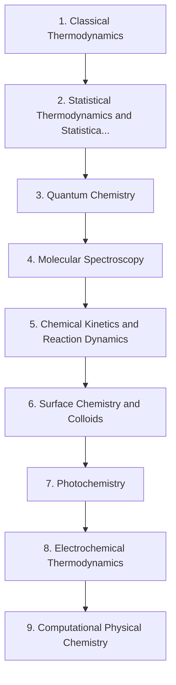

# Level 6 — Physical Chemistry

> **Audience:** Advanced undergraduate / postgraduate entry  
> **Chapters:** 9  
> **Estimated study time:** ≈ 87 h  
> **Difficulty:** ★★★★★ – ★★★★★

The quantitative framework: classical and statistical thermodynamics, quantum chemistry, molecular spectroscopy, reaction dynamics, surfaces, colloids, photochemistry and computational methods.

Physical chemistry is the derivation-heavy core of the discipline. Level 6 expects mathematical maturity: partial derivatives, integrals, probability and linear algebra are used as tools, not taught from scratch.

---

## Chapters

| # | Chapter | Difficulty | Hours | Prerequisites |
|---|---|---|---|---|
| 1 | [Classical Thermodynamics](01-classical-thermodynamics.md) | ★★★★★ | 11 | Level 3 Ch. 4; multivariable calculus |
| 2 | [Statistical Thermodynamics and Statistical Mechanics](02-statistical-thermodynamics-and-statistical-mechanics.md) | ★★★★★ | 11 | Ch. 1; Level 3 Ch. 1 |
| 3 | [Quantum Chemistry](03-quantum-chemistry.md) | ★★★★★ | 12 | Level 3 Ch. 1–3; linear algebra |
| 4 | [Molecular Spectroscopy](04-molecular-spectroscopy.md) | ★★★★★ | 10 | Ch. 3; Level 3 Ch. 10 |
| 5 | [Chemical Kinetics and Reaction Dynamics](05-chemical-kinetics-and-reaction-dynamics.md) | ★★★★★ | 10 | Level 3 Ch. 5; Ch. 2 |
| 6 | [Surface Chemistry and Colloids](06-surface-chemistry-and-colloids.md) | ★★★★★ | 8 | Ch. 1 |
| 7 | [Photochemistry](07-photochemistry.md) | ★★★★★ | 8 | Ch. 3–4 |
| 8 | [Electrochemical Thermodynamics](08-electrochemical-thermodynamics.md) | ★★★★★ | 8 | Ch. 1; Level 3 Ch. 8 |
| 9 | [Computational Physical Chemistry](09-computational-physical-chemistry.md) | ★★★★★ | 9 | Ch. 3; Ch. 2 |

---

## Knowledge map

The chain is the *recommended* order. Chapters that share prerequisites can be
read out of order; the table above tells you what each one actually needs.

---

## Study routine for this level

1. Read the chapter once without taking notes, to see the shape of the argument.
2. Re-read with the chapter's learning objectives in front of you and answer them in writing.
3. Reproduce every Mermaid diagram from memory, then check it.
4. Do the exercises **before** opening the solutions file.
5. Record every mistake in a log; re-test yourself on those specific items a week later.

---

## Practice

- Exercise set: [`exercises/level-6-exercises.md`](exercises/level-6-exercises.md)
- Worked solutions: [`solutions/level-6-solutions.md`](solutions/level-6-solutions.md)

---

## Navigation

- Level index: [CURRICULUM.md](../CURRICULUM.md)
- Study methods: [00-learning-guide](../00-learning-guide/learning-path.md)
- Terminology: [GLOSSARY.md](../GLOSSARY.md)
- Sources: [REFERENCES.md](../REFERENCES.md)
