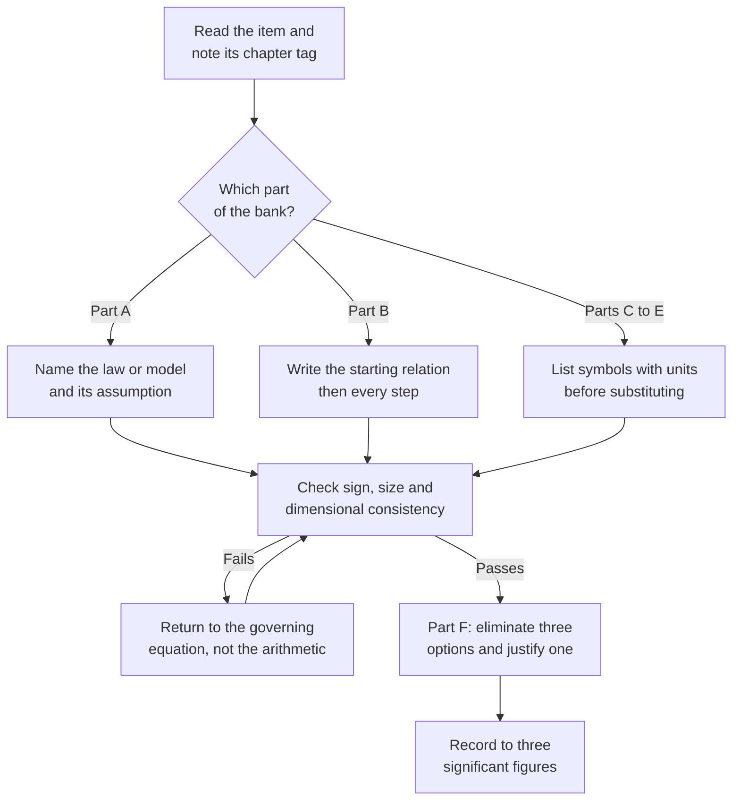

# Level 6 — Exercise Bank: Physical Chemistry

> **Level:** Advanced (Level 6 — Physical Chemistry)
> **Estimated time:** 300 minutes
> **Items:** 50
> **Covers:** [Ch. 1](../01-classical-thermodynamics.md), [Ch. 2](../02-statistical-thermodynamics-and-statistical-mechanics.md), [Ch. 3](../03-quantum-chemistry.md), [Ch. 4](../04-molecular-spectroscopy.md), [Ch. 5](../05-chemical-kinetics-and-reaction-dynamics.md), [Ch. 7](../07-photochemistry.md)
> **Solutions:** [`../solutions/level-6-solutions.md`](../solutions/level-6-solutions.md)

Every item names the chapter that supplies the method. Derivations in Part B must
state the starting relation and every assumption; a result quoted without its
assumption earns no credit. Numerical answers are required to three significant
figures unless the data justify fewer, with units carried through the substitution.

**Figure 1 — Working order for this bank.** The feedback loop is the one that
earns marks: a failed check sends you back to the equation, never to the calculator.

---

## Data sheet

| Constant or quantity | Value |
|---|---|
| Gas constant, $R$ | $8.314462618\ \text{J mol}^{-1}\ \text{K}^{-1}$ |
| Faraday constant, $F$ | $96\,485.33212\ \text{C mol}^{-1}$ |
| Avogadro constant, $N_{\text{A}}$ | $6.02214076\times10^{23}\ \text{mol}^{-1}$ |
| Planck constant, $h$ | $6.62607015\times10^{-34}\ \text{J s}$ |
| Reduced Planck constant, $\hbar$ | $1.054571817\times10^{-34}\ \text{J s}$ |
| Speed of light, $c$ | $2.99792458\times10^{8}\ \text{m s}^{-1}$ |
| Boltzmann constant, $k_{\text{B}}$ | $1.380649\times10^{-23}\ \text{J K}^{-1}$ |
| Electron mass, $m_{\text{e}}$ | $9.1093837015\times10^{-31}\ \text{kg}$ |
| Atomic mass constant, $m_{\text{u}}$ | $1.66053906660\times10^{-27}\ \text{kg}$ |
| Elementary charge, $e$ | $1.602176634\times10^{-19}\ \text{C}$ |
| $hc$ | $1.98644586\times10^{-23}\ \text{J cm}$ |

Standard molar entropies at 298.15 K: $\ce{Ar(g)}$ $154.84\ \text{J K}^{-1}\ \text{mol}^{-1}$;
$\ce{CO(g)}$ $197.67\ \text{J K}^{-1}\ \text{mol}^{-1}$.

---

## Part A — Conceptual questions

1. **[Ch. 1]** State each of the four laws of thermodynamics in one sentence and
   identify the new physical content that each adds to the laws before it. Explain
   why the second law cannot be derived from the first.

2. **[Ch. 1]** A differential $M(x,y)\,\mathrm{d}x + N(x,y)\,\mathrm{d}y$ is exact
   when $(\partial M/\partial y)_x = (\partial N/\partial x)_y$.
   (a) Explain why exactness is the mathematical signature of a state function.
   (b) Show that $\delta q$ is inexact for an ideal gas, and that $1/T$ is an
   integrating factor.
   (c) Test $\mathrm{d}f = y\,\mathrm{d}x - x\,\mathrm{d}y$ for exactness and state
   what the result means physically.

3. **[Ch. 1]** Starting from $\mathrm{d}A = -S\,\mathrm{d}T - p\,\mathrm{d}V$,
   derive the Maxwell relation $\left(\partial S/\partial V\right)_T =
   \left(\partial p/\partial T\right)_V$. Explain what this relation allows an
   experimentalist to replace, and why that replacement matters in calorimetry.

4. **[Ch. 1]** (a) Define the degrees of freedom $F$, the number of components $C$
   and the number of phases $P$, and derive $F = C - P + 2$ by counting intensive
   variables. (b) Apply the rule to (i) water at its triple point, (ii) liquid water
   in equilibrium with its vapour, and (iii) aqueous $\ce{NaCl}$ solution in
   equilibrium with its vapour. (c) Explain why the rule becomes $F = C - P + 1$
   when the pressure is fixed.

5. **[Ch. 2]** Compare Maxwell–Boltzmann, Fermi–Dirac and Bose–Einstein statistics.
   State the condition $n\Lambda^3 \ll 1$ for the classical limit, explain why it is
   the relevant criterion, and give one phenomenon that each quantum distribution
   explains and the classical one cannot.

6. **[Ch. 3]** State the postulates of quantum mechanics as they are used in this
   course. Explain why observables are represented by Hermitian operators, what the
   commutator $[\hat x, \hat p_x] = i\hbar$ forbids, and what the measurement
   postulate says about the state immediately after a measurement.

7. **[Ch. 3]** State the Born–Oppenheimer approximation, justify it with the
   electron-to-nucleus mass ratio, explain how it defines a potential energy surface,
   and describe two situations in which it fails.

8. **[Ch. 7]** Describe the Jablonski diagram: the states, the radiative and
   non-radiative transitions, and the order of magnitude of each timescale. Explain
   Kasha's rule, why phosphorescence is red-shifted relative to fluorescence, and
   define the fluorescence quantum yield and the excited-state lifetime.

---

## Part B — Derivations

9. **[Ch. 1]** Starting from the first law for a closed system doing only $pV$ work,
   and from the second law for a reversible path, derive
   $\mathrm{d}U = T\,\mathrm{d}S - p\,\mathrm{d}V$. State every assumption. Use
   cross-differentiation to obtain the Maxwell relation
   $\left(\partial T/\partial V\right)_S =
   -\left(\partial p/\partial S\right)_V$.

10. **[Ch. 1]** Derive $C_p - C_V = nR$ for an ideal gas. Identify the two places
    where ideality enters, and state what happens to the result for a real gas.

11. **[Ch. 1]** Derive the Clapeyron equation from the equality of the chemical
    potentials of two phases in equilibrium. Integrate it to the Clausius–Clapeyron
    equation, stating every assumption made in the integration.

12. **[Ch. 2]** Derive the Boltzmann distribution by maximising
    $\ln W = \ln N! - \sum_i \ln n_i!$ subject to fixed total particle number and
    fixed total energy. Define $\beta$, the molecular partition function $q$ and the
    canonical partition function $Q$, and show that $\beta = 1/k_{\text{B}}T$.

13. **[Ch. 2]** Derive the translational partition function
    $q_{\text{trans}} = V/\Lambda^3$ by replacing the sum over translational states
    by an integral over momentum. Give the expression for $\Lambda$ and state the
    condition under which the replacement is legitimate.

14. **[Ch. 3]** Solve the time-independent Schrödinger equation for a particle of
    mass $m$ in a one-dimensional box of length $L$ with infinite walls. Derive the
    energies, the normalised wavefunctions and the number of nodes of level $n$.

15. **[Ch. 3]** Prove the variational theorem: for any normalised trial function
    $\phi$, the expectation value $\langle\phi|\hat H|\phi\rangle$ is greater than or
    equal to the true ground-state energy $E_0$. Explain how the linear variational
    method produces a secular determinant, and why its roots bracket the true
    energies.

16. **[Ch. 5]** Derive the Eyring equation
    $k = \kappa (k_{\text{B}}T/h)\exp(-\Delta G^\ddagger/RT)$ from the
    transition-state equilibrium. Define the transmission coefficient, state the
    assumptions, and show how the result reduces to the Arrhenius form with
    $E_{\text{a}} = \Delta H^\ddagger + nRT$ for a bimolecular reaction.

---

## Part C — Basic calculations

17. **[Ch. 1]** $2.00\ \text{mol}$ of a perfect gas expands reversibly and
    isothermally at $298.15\ \text{K}$ from $10.0\ \text{dm}^3$ to
    $30.0\ \text{dm}^3$. Calculate $q$, $w$, $\Delta U$, $\Delta H$ and $\Delta S$
    for the gas, and the total entropy change of the universe.

18. **[Ch. 1]** $1.00\ \text{mol}$ of argon, for which $C_{V,\text{m}} = \tfrac{3}{2}R$,
    at $300.0\ \text{K}$ and $5.00\ \text{bar}$ expands reversibly and adiabatically
    to $1.00\ \text{bar}$. Calculate the final temperature, the final volume, $w$ and
    $\Delta H$.

19. **[Ch. 1]** For the combustion of methane,

    $$
    \ce{CH4(g) + 2O2(g) -> CO2(g) + 2H2O(l)}
    $$

    the standard enthalpy of reaction at
    $298.15\ \text{K}$ is $-890.3\ \text{kJ mol}^{-1}$. Using
    $C_{p,\text{m}}/\text{J K}^{-1}\text{mol}^{-1}$: $\ce{CH4}$ 35.7, $\ce{O2}$ 29.4,
    $\ce{CO2}$ 37.1, $\ce{H2O(l)}$ 75.3, calculate $\Delta_\text{r}H^\circ$ at
    $373.15\ \text{K}$, assuming the heat capacities are constant.

20. **[Ch. 1]** The enthalpy of vaporisation of water is
    $40.7\ \text{kJ mol}^{-1}$ and its normal boiling point is $373.15\ \text{K}$.
    Using the Clausius–Clapeyron equation, estimate the vapour pressure at
    $363.15\ \text{K}$.

21. **[Ch. 2]** A system has two non-degenerate levels separated by
    $100.0\ \text{cm}^{-1}$. At $300.0\ \text{K}$, calculate the ratio of the
    populations $n_1/n_0$ and the fraction of molecules in the upper level.

22. **[Ch. 2]** Calculate the translational partition function of argon at
    $298.15\ \text{K}$ in a volume of $1.00\ \text{dm}^3$. Use
    $M = 39.948\ \text{g mol}^{-1}$.

23. **[Ch. 2]** For carbon monoxide, $B = 1.931\ \text{cm}^{-1}$ and
    $\tilde\nu = 2143\ \text{cm}^{-1}$. Calculate the characteristic rotational and
    vibrational temperatures, $q_{\text{rot}}$ (with $\sigma = 1$) and
    $q_{\text{vib}}$ at $298.15\ \text{K}$.

24. **[Ch. 3]** An electron is confined to a one-dimensional box of length
    $1.00\ \text{nm}$. Calculate (a) the ground-state energy in J and eV, (b) the
    energy gap between $n = 1$ and $n = 2$ in J and eV, and (c) the wavelength of
    the photon emitted in the $n = 2 \to 1$ transition. (d) The hydrogen atom has
    $E_n = -13.6\ \text{eV}/n^2$; calculate the wavelength of the $n = 2 \to 1$
    transition and compare it with the box result.

25. **[Ch. 3]** For $\ce{HCl}$, $\tilde\nu = 2886\ \text{cm}^{-1}$. Taking
    $m(^{1}\ce{H}) = 1.0078\ \text{u}$ and $m(^{35}\ce{Cl}) = 34.9689\ \text{u}$,
    calculate the reduced mass, the force constant and the zero-point energy in
    $\text{kJ mol}^{-1}$.

26. **[Ch. 4]** The pure rotational spectrum of $\ce{CO}$ shows lines equally spaced
    by $3.862\ \text{cm}^{-1}$. Calculate the rotational constant $B$, the moment of
    inertia and the bond length. Use $^{12}\ce{C} = 12.000\ \text{u}$ and
    $^{16}\ce{O} = 15.9949\ \text{u}$.

---

## Part D — Intermediate problems

27. **[Ch. 1]** A gas occupies $1.00\ \text{dm}^3$ at $298.15\ \text{K}$ with
    isobaric expansivity $\alpha = 2.0\times10^{-4}\ \text{K}^{-1}$. It is compressed
    isothermally from $1.00\ \text{bar}$ to $10.0\ \text{bar}$. Using the Maxwell
    relation $\left(\partial S/\partial p\right)_T = -V\alpha$, and treating $V$ and
    $\alpha$ as constant over the interval, calculate $\Delta S$, the reversible heat
    $q_{\text{rev}}$ and $\Delta H$.

28. **[Ch. 1]** The Henry's law constant for carbon dioxide in water at
    $298.15\ \text{K}$ is $K_{\text{H}} = 1.67\times10^{3}\ \text{bar}$ on the
    mole-fraction scale. (a) Calculate the solubility $x_{\ce{CO2}}$ at
    $p_{\ce{CO2}} = 1.00\ \text{bar}$. (b) Calculate $\mu - \mu^\circ$ for the
    dissolved gas on the Henry's law standard state. (c) Repeat at
    $0.100\ \text{bar}$ and show that the difference between the two chemical
    potentials equals $RT\ln 10$.

29. **[Ch. 1]** Ice melts at $273.15\ \text{K}$ under $1.00\ \text{bar}$. The
    densities of ice and liquid water are $0.9168$ and $0.9998\ \text{g cm}^{-3}$,
    $M = 18.015\ \text{g mol}^{-1}$ and
    $\Delta_{\text{fus}}H = 6.008\ \text{kJ mol}^{-1}$. Using the Clapeyron
    equation, calculate the change in melting temperature at $100\ \text{bar}$ and
    comment on the sign.

30. **[Ch. 2]** Calculate the standard molar entropy of argon at
    $298.15\ \text{K}$ and $1\ \text{bar}$ from the Sackur–Tetrode equation and
    compare it with the calorimetric value of
    $154.84\ \text{J K}^{-1}\ \text{mol}^{-1}$.

31. **[Ch. 3]** A two-function basis gives
    $H_{11} = -10.0\ \text{eV}$, $H_{22} = -8.0\ \text{eV}$,
    $H_{12} = H_{21} = -2.5\ \text{eV}$ and $S_{12} = 0.200$. (a) Write the secular
    determinant. (b) Solve for both energy roots. (c) Determine the normalised
    coefficients of the lower state. (d) Compare each root with the corresponding
    diagonal element and explain the direction of the shift.

32. **[Ch. 3]** A two-level system has unperturbed energies $0$ and
    $\varepsilon = 10.0\ \text{eV}$ and a perturbation with
    $V_{12} = V_{21} = 2.0\ \text{eV}$, $V_{11} = V_{22} = 0$.
    (a) Diagonalise the Hamiltonian exactly. (b) Calculate the energies to second
    order in perturbation theory. (c) Compare and comment on the sign of each
    correction.

33. **[Ch. 4]** For $\ce{CO}$ the fundamental band is at
    $\tilde\nu_{0\to1} = 2143\ \text{cm}^{-1}$ and the first overtone at
    $\tilde\nu_{0\to2} = 4260\ \text{cm}^{-1}$. Using the Morse oscillator,
    calculate $\omega_e$, $\omega_e x_e$, the well depth $D_e$ in
    $\text{cm}^{-1}$ and $\text{kJ mol}^{-1}$, and the dissociation energy $D_0$.

34. **[Ch. 4]** A solution of a dye in a $1.00\ \text{cm}$ cell has absorbance
    $0.842$ at $520\ \text{nm}$, with
    $\varepsilon = 1.42\times10^{4}\ \text{dm}^3\ \text{mol}^{-1}\ \text{cm}^{-1}$.
    (a) Calculate the concentration. (b) Calculate the transmittance. (c) Calculate
    the volume of this solution needed to prepare $100.0\ \text{cm}^3$ of a
    $2.00\times10^{-5}\ \text{mol dm}^{-3}$ solution.

35. **[Ch. 5]** An enzyme-catalysed reaction follows Michaelis–Menten kinetics:

    $$
    \ce{E + S <=>[k_1][k_{-1}] ES ->[k_2] E + P}
    $$

    The initial rate is $1.20\ \mu\text{mol dm}^{-3}\ \text{s}^{-1}$ at
    $[\ce{S}] = 2.00\times10^{-4}\ \text{mol dm}^{-3}$ and
    $2.00\ \mu\text{mol dm}^{-3}\ \text{s}^{-1}$ at
    $[\ce{S}] = 8.00\times10^{-4}\ \text{mol dm}^{-3}$. (a) Derive the rate law from
    the steady-state approximation. (b) Calculate $K_{\text{M}}$ and $V_{\text{max}}$
    without plotting. (c) Calculate $k_{\text{cat}}$ if
    $[\ce{E}]_0 = 2.00\times10^{-9}\ \text{mol dm}^{-3}$. (d) Show that the
    rate law reduces to the pre-equilibrium form when
    $k_2 \ll k_{-1}$.

36. **[Ch. 5]** A first-order reaction has $k = 1.00\times10^{-3}\ \text{s}^{-1}$ at
    $298.15\ \text{K}$. Using transition-state theory with $\kappa = 1$, calculate
    $\Delta G^\ddagger$. If $\Delta H^\ddagger = 80.0\ \text{kJ mol}^{-1}$, calculate
    $\Delta S^\ddagger$ and predict $k$ at $308.15\ \text{K}$, assuming
    $\Delta H^\ddagger$ and $\Delta S^\ddagger$ are constant.

---

## Part E — Advanced problems

37. **[Ch. 1]** For a condensed phase, $\alpha = 2.00\times10^{-4}\ \text{K}^{-1}$
    and $\kappa_T = 5.00\times10^{-5}\ \text{bar}^{-1}$ are constant. A sample
    occupies $V_0 = 1.00\ \text{dm}^3$ at $1.00\ \text{bar}$ and
    $298.15\ \text{K}$. Calculate $\Delta S$ and $\Delta H$ for isothermal
    compression to $100\ \text{bar}$, using
    $\left(\partial H/\partial p\right)_T = V - T\left(\partial V/\partial T\right)_p$.
    Compare the exact integration of $V(p) = V_0\exp[-\kappa_T(p-p_0)]$ with the
    linear approximation.

38. **[Ch. 1]** A binary system of A and B at fixed pressure has, at a given
    temperature, a liquid phase containing $25\ \text{mol}\ \%$ B and a solid phase
    containing $70\ \text{mol}\ \%$ B. The overall composition is
    $40\ \text{mol}\ \%$ B. (a) State the number of degrees of freedom. (b) Calculate
    the mole fraction of liquid and of solid. (c) State what happens to the amounts
    as the overall composition approaches the solid composition.

39. **[Ch. 2]** Sodium has one conduction electron per atom and a density of
    $0.968\ \text{g cm}^{-3}$ ($M = 22.99\ \text{g mol}^{-1}$). (a) Calculate the
    electron number density. (b) Calculate the Fermi energy in J and eV using the
    free-electron model. (c) Calculate the Fermi–Dirac occupation of a state
    $0.10\ \text{eV}$ above the Fermi level at $300\ \text{K}$ and at
    $1000\ \text{K}$. (d) Explain why the occupation changes so much with
    temperature while the Fermi energy barely does.

40. **[Ch. 2]** For the isotope-exchange reaction

    $$
    \ce{H2(g) + D2(g) <=> 2HD(g)}
    $$

    the vibrational wavenumbers are
    $4401$, $3817$ and $3116\ \text{cm}^{-1}$ for $\ce{H2}$, $\ce{HD}$ and
    $\ce{D2}$. Take the molar masses as $2.016$, $3.022$ and
    $4.028\ \text{g mol}^{-1}$, assume equal bond lengths, and neglect electronic
    excitation. (a) Write the equilibrium constant in terms of molecular partition
    functions. (b) Evaluate the translational, rotational and symmetry factors.
    (c) Evaluate $\Delta E_0$ and $K$ at $298.15\ \text{K}$ and at
    $500.0\ \text{K}$. (d) Explain why $K$ exceeds 1 and why it tends to a constant
    above about $1000\ \text{K}$.

41. **[Ch. 3]** For helium, the sum of the two $1s$ orbital energies is
    $-108.8\ \text{eV}$ and the first-order electron–electron repulsion is
    $+34.0\ \text{eV}$. (a) Calculate the first-order total energy. (b) Compare it
    with the exact non-relativistic energy of $-79.0\ \text{eV}$ and express the
    error as a percentage. (c) Explain why the first-order result lies above the
    exact value and what a variational calculation would do with the same trial
    function.

42. **[Ch. 7]** A fluorophore has $\tau_0 = 5.0\ \text{ns}$ and
    $\phi_{\text{F}} = 0.35$ in the absence of quencher. A quencher with
    $k_q = 5.0\times10^{9}\ \text{dm}^3\ \text{mol}^{-1}\ \text{s}^{-1}$ is added to
    $5.0\ \text{mmol dm}^{-3}$. (a) Calculate $k_{\text{F}}$ and the total
    non-radiative rate constant. (b) Calculate $K_{\text{SV}}$ and $I_0/I$.
    (c) Calculate the lifetime in the presence of the quencher. (d) State whether the
    quenching is diffusion-controlled, given
    $k_{\text{d}} \approx 7\times10^{9}\ \text{dm}^3\ \text{mol}^{-1}\ \text{s}^{-1}$
    in water.

43. **[Ch. 5]** For water at $298.15\ \text{K}$, $\eta = 8.90\times10^{-4}\ \text{Pa s}$.
    (a) Calculate the Smoluchowski encounter rate constant. (b) A reaction in water
    has $k_{\text{obs}} = 1.20\times10^{9}\ \text{dm}^3\ \text{mol}^{-1}\ \text{s}^{-1}$.
    Using $1/k_{\text{obs}} = 1/k_{\text{d}} + 1/k_{\text{act}}$, calculate
    $k_{\text{act}}$. (c) Calculate the probability that an encounter leads to
    reaction, and state whether the reaction is diffusion-controlled or
    activation-controlled.

44. **[Ch. 5]** For a gas-phase reaction $\ce{A + B -> P}$, $M_{\text{A}} = 30.0\ \text{g mol}^{-1}$,
    $M_{\text{B}} = 46.0\ \text{g mol}^{-1}$, the hard-sphere collision diameter is
    $0.35\ \text{nm}$ and $E_{\text{a}} = 25.0\ \text{kJ mol}^{-1}$. At
    $600\ \text{K}$ the experimental rate constant is
    $2.0\times10^{6}\ \text{dm}^3\ \text{mol}^{-1}\ \text{s}^{-1}$.
    (a) Calculate the collision-theory pre-exponential factor. (b) Calculate the
    steric factor $P$. (c) Calculate the experimental pre-exponential factor.
    (d) Explain what a steric factor of this size implies about the transition state.

---

## Part F — Multiple-choice self-check

45. **[Ch. 1]** For an ideal gas at constant temperature, which derivative is zero?
    - A. $\left(\partial U/\partial V\right)_T$
    - B. $\left(\partial U/\partial T\right)_V$
    - C. $\left(\partial S/\partial T\right)_V$
    - D. $\left(\partial G/\partial T\right)_p$

46. **[Ch. 2]** Fermi–Dirac statistics applies to:
    - A. electrons in a metal
    - B. photons in a cavity
    - C. $\ce{^4He}$ below its lambda point
    - D. argon at $300\ \text{K}$ and $1\ \text{bar}$

47. **[Ch. 3]** The commutator $[\hat x, \hat p_x] = i\hbar$ implies that:
    - A. $x$ and $p_x$ can both be measured exactly in the same experiment
    - B. the product of their uncertainties has a positive lower bound
    - C. energy is quantised in every system
    - D. angular momentum is conserved

48. **[Ch. 4]** Which vibration is infrared inactive but Raman active?
    - A. the symmetric stretch of $\ce{CO2}$ at $1388\ \text{cm}^{-1}$
    - B. the asymmetric stretch of $\ce{CO2}$ at $2349\ \text{cm}^{-1}$
    - C. the bend of $\ce{H2O}$ at $1595\ \text{cm}^{-1}$
    - D. the stretch of $\ce{HCl}$ at $2886\ \text{cm}^{-1}$

49. **[Ch. 5]** The diffusion-controlled rate constant for a bimolecular reaction in
    water at $298\ \text{K}$ is approximately:
    - A. $7\times10^{9}\ \text{dm}^3\ \text{mol}^{-1}\ \text{s}^{-1}$
    - B. $7\times10^{6}\ \text{dm}^3\ \text{mol}^{-1}\ \text{s}^{-1}$
    - C. $7\times10^{3}\ \text{dm}^3\ \text{mol}^{-1}\ \text{s}^{-1}$
    - D. $7\times10^{12}\ \text{dm}^3\ \text{mol}^{-1}\ \text{s}^{-1}$

50. **[Ch. 7]** Phosphorescence is:
    - A. emission from $S_1$ to $S_0$ on a nanosecond timescale
    - B. emission from $T_1$ to $S_0$, spin-forbidden and long-lived
    - C. emission from $S_1$ to $S_0$, red-shifted relative to fluorescence
    - D. a non-radiative process that competes with internal conversion

---

## Marks

| Part | Type | Items | Marks per item | Total |
|---|---|---|---|---|
| A | Conceptual | 8 | 2 | 16 |
| B | Derivations | 8 | 6 | 48 |
| C | Basic calculations | 10 | 4 | 40 |
| D | Intermediate problems | 10 | 8 | 80 |
| E | Advanced problems | 8 | 12 | 96 |
| F | Multiple-choice | 6 | 2 | 12 |
| **Total** | | **50** | | **292** |

**Total marks: 292**

**Solutions:** [`../solutions/level-6-solutions.md`](../solutions/level-6-solutions.md)
