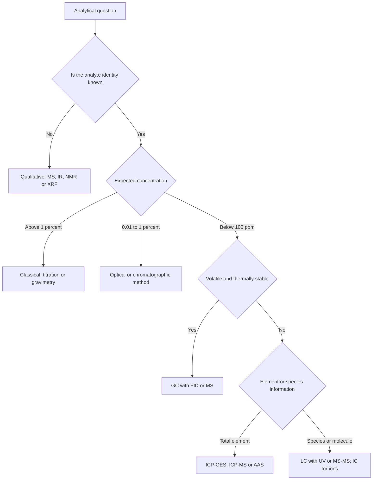
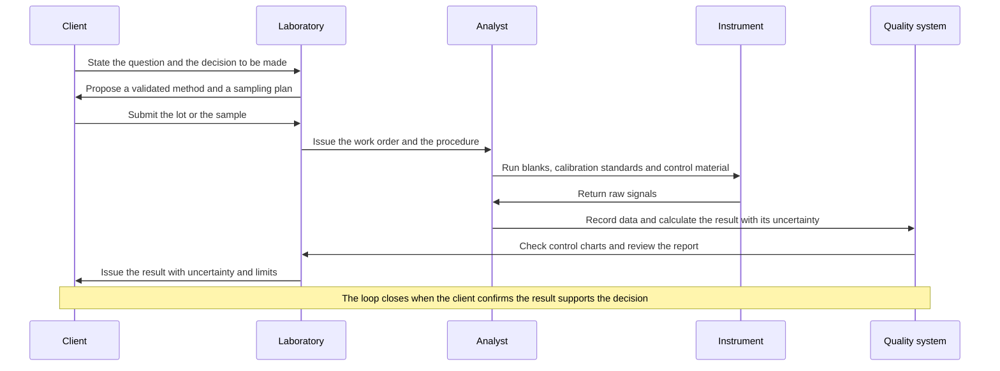
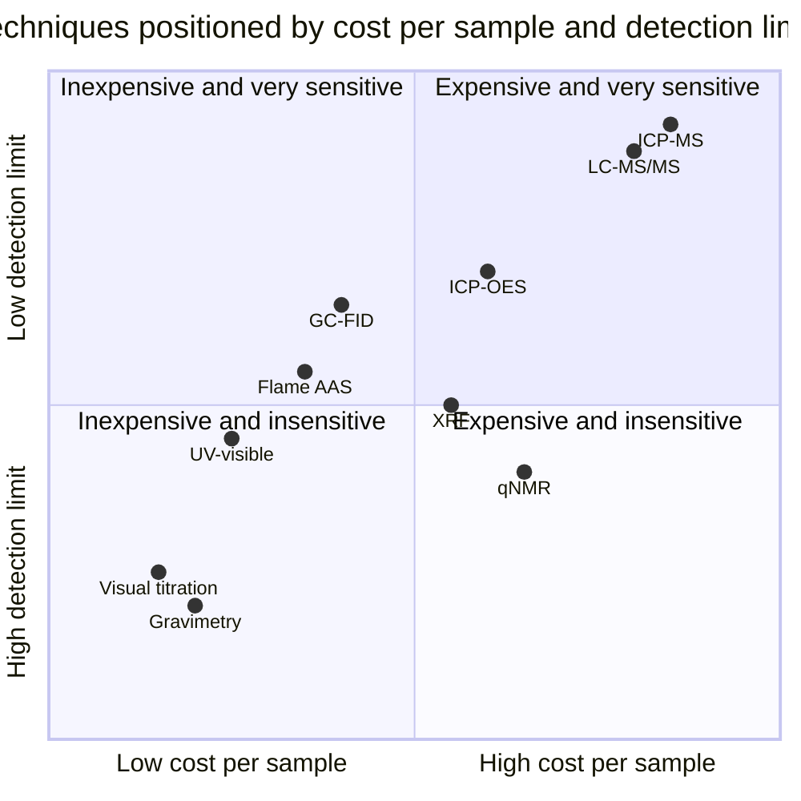

# Chapter 1 — Introduction to Analytical Chemistry

> **Level:** Level 7 — Analytical Chemistry (undergraduate / practising analyst)
> **Estimated study time:** 5 hours (reading) + 2 hours (exercises)
> **Prerequisites:** [Level 2 — Elementary Chemistry](../02-elementary-chemistry/README.md); [The Mole Concept](../03-intermediate-chemistry/01-the-mole-concept.md); [Solutions, Concentration and Dilution](../03-intermediate-chemistry/03-solutions-concentration-and-dilution.md)
> **Difficulty:** ★★★☆☆ (3/5)
> **Related chapters:** [Sampling and Sample Preparation](02-sampling-and-sample-preparation.md), [Errors, Uncertainty and Statistical Data Treatment](03-errors-uncertainty-and-statistical-data-treatment.md), [Calibration, Validation and Quantitative Analysis](04-calibration-validation-and-quantitative-analysis.md), [Level 7 module index](README.md)

---

## 1. Learning Objectives

After working through this chapter you will be able to:

- Describe the analytical process and identify where each link can fail.
- Distinguish qualitative from quantitative, and screening from confirmatory, analysis.
- Compare classical and instrumental methods on uncertainty, selectivity, cost and
  throughput.
- Define sensitivity, selectivity, LOD, LOQ, dynamic range, resolution, precision,
  trueness, accuracy and robustness.
- Distinguish technique, method, procedure and protocol, and classify analyses by
  concentration level.
- Explain the matrix and the error budget, apply fitness for purpose, ISO/IEC 17025 and
  Shewhart rules, and select a technique for a given problem.

---

## 2. Introduction

A hospital reports blood lithium at $0.82\ \text{mmol dm}^{-3}$; a customs laboratory
reports $62\,\%$ cocaine base in a seized powder; a steelworks reports $0.031\,\%$ carbon in
a heat of steel; an environmental laboratory reports $2.4 \pm 0.5\ \mu\text{g dm}^{-3}$
cadmium in a river. Each is a *number with a claim attached*, and analytical chemistry
decides whether the claim is worth anything.

The subject is often taught as a catalogue of techniques — titration, chromatography,
spectroscopy, electrochemistry. That framing is backwards. Techniques serve a
question, and the question arrives with constraints: a decision, a legal limit, a
process to be controlled, a diagnosis. An analyst who can run a perfect separation but
cannot say whether the number is fit for the decision has mastered the craft and
missed the discipline.

Three ideas organise what follows. **First, the result is a distribution, not a number:**
reporting $2.4\ \mu\text{g dm}^{-3}$ without an uncertainty conceals that twenty replicates
would not agree. **Second, the sample is not the lot:** a river is not a 250 cm³ bottle,
and sampling may contribute more uncertainty than the instrument. **Third, a method is
only as good as its validation:** a technique that works on a clean standard may fail in
blood, soil or food.

This chapter supplies the vocabulary and the map. It defines the figures of merit
used quantitatively in later chapters, explains how analytical work is organised and
quality-assured, and ends with a procedure for choosing a technique. The prerequisites
are the mole, concentration units, stoichiometry and acid–base equilibria from
Levels 2 and 3; what is new is not the chemistry but the epistemology — how a
measurement becomes evidence.

---

## 3. Fundamental Concepts

### 3.1 The analytical question and the measurand

Every analysis begins with a question in ordinary language: *Is this water safe?*
*Does this batch comply?* The first task is to convert it into a **measurand** — the
specific quantity to be measured, including analyte, matrix, concentration level and
required uncertainty. The **analyte** is the species sought; the **matrix** is
everything else. A measurand might be "the mass fraction of cadmium in the dry matter
of this sediment, in $\mu\text{g kg}^{-1}$, with a target expanded uncertainty of
$20\,\%$ ($k = 2$)"; that statement, not "measure cadmium", is what a laboratory
validates against.

### 3.2 Qualitative and quantitative analysis

**Qualitative analysis** establishes identity — which elements, ions, functional groups
or compounds are present. **Quantitative analysis** establishes amount, as mass
fraction, amount fraction, concentration or mass concentration. The distinction is not
absolute: every qualitative test has a detection limit, so "absent" means "below the
LOD of this method".

Two categories cut across the pair. A **screening method** sorts samples rapidly into
"probably negative" and "possibly positive"; it tolerates false positives, confirmed
later, but must have a very low false-negative rate. A **confirmatory method** provides
structural evidence of identity, usually by mass spectrometry or an orthogonal
technique. A qualitative result also carries uncertainty, so "not detected" must be
reported with its detection limit.

### 3.3 Classical and instrumental methods

**Classical (wet) methods** obtain the result from a mass or a volume measured
directly: gravimetry weighs a precipitate, titrimetry measures the volume of a standard
solution. **Instrumental methods** obtain it from a physical signal — absorbance,
emission intensity, current, conductivity, retention time — calibrated against standards
of known composition.

| Criterion | Classical methods | Instrumental methods |
|---|---|---|
| Basis of measurement | Mass or volume, traceable to SI directly | Calibrated signal, traceable through standards |
| Typical uncertainty | $0.1$–$0.3\,\%$ relative for a good titration | $0.5$–$5\,\%$ relative, often $1$–$2\,\%$ |
| Limit of detection | Poor; usually $\ge 0.01\,\%$ of sample mass | Down to ng kg⁻¹ |
| Selectivity | Achieved by chemical separation | Achieved by the physical principle or by separation |
| Matrix sensitivity | Low to moderate | High; matrix effects are the central problem |
| Throughput and cost | Low throughput, very low capital cost | High throughput, low to very high capital cost |
| Multi-analyte capability | Essentially none | Often high |
| Best use | Major and minor components, reference methods | Trace analysis, multi-analyte panels, monitoring |

The families are complementary: a titration is often the *reference method* against which
an instrumental method is validated, because its uncertainty is small and directly
traceable to mass and volume, and an ICP–MS measuring forty elements still needs standards
whose concentrations were established by weighing.

### 3.4 Figures of merit

A **figure of merit** is a quantitative performance characteristic used to compare
methods; definitions follow the VIM and IUPAC recommendations.

**Sensitivity** is the slope of the calibration function, $b = \partial y/\partial x$,
in response units per concentration unit; because slope says nothing about noise, IUPAC
also defines **analytical sensitivity** $\gamma = b/s_y$, in inverse concentration.

**Selectivity** is the degree to which a method determines one analyte in a mixture
without interference, quantified by a **selectivity coefficient** — the response per
unit concentration of interferent divided by that of analyte. A coefficient of
$10^{-3}$ means a thousand-fold excess of interferent mimics one unit of analyte;
*specificity*, strictly, means that only one species responds at all, which is rare.

**Limit of detection (LOD)** is the smallest amount detectable with stated
false-positive ($\alpha$) and false-negative ($\beta$) probabilities. For a calibration
of slope $b$ and residual standard deviation $s_{y/x}$,

$$
\text{LOD} = \frac{3.3\,s_{y/x}}{b},
$$

the ICH convention for $\alpha = \beta = 0.05$; the convention must be stated, because
the number changes threefold with a different definition. The **limit of quantification
(LOQ)** is the lowest concentration giving acceptable trueness and precision,
conventionally $10\,s_{y/x}/b$. Between LOD and LOQ the analyte is detected but not
measured, and results there are reported as "less than the LOQ".

**Dynamic range** is the interval over which the response changes usefully with
concentration; **linear range** is the sub-interval over which it is proportional within
a stated tolerance, so it is always the smaller. Above the upper limit the detector
saturates; below the lower limit the signal is indistinguishable from noise.

**Resolution** is the smallest difference in a quantity that can be distinguished: in
chromatography $R_s = 2(t_{R,2} - t_{R,1})/(w_1 + w_2)$, with $1.5$ taken as baseline
resolution; in spectroscopy it is the smallest wavelength difference yielding
distinguishable features, set by the instrument bandwidth.

**Precision** is the closeness of agreement between replicate values, expressed as a
standard deviation or relative standard deviation, and is purely a statement about
dispersion: **repeatability** (same analyst, instrument, laboratory, short interval),
**intermediate precision** (same laboratory, different analyst, day or instrument) and
**reproducibility** (different laboratories). **Trueness** is the closeness of the mean of
many replicates to a reference value, expressed as **bias**. **Accuracy** is the closeness
of a measured value to the true value; in the VIM it is qualitative and cannot be given a
number, although ISO 5725 treats it as trueness and precision combined. One may say
"accurate for this purpose", not "accuracy is $1.2\,\%$" — the latter is a bias or total
error.

**Robustness** is the capacity of a method to remain unaffected by small deliberate
variations in pH, temperature, flow rate, column batch or reagent lot; **ruggedness** is
the older USP term for the same property across laboratories and analysts. A method can be
precise but biased (a worn pipette delivering consistently low volumes), accurate on
average but imprecise (large random error that averages out), or neither.

### 3.5 The analytical hierarchy

A **technique** is a scientific principle: atomic absorption, reversed-phase liquid
chromatography, potentiometry. A **method** applies a technique to a defined analyte in
a defined matrix — "determination of lead in drinking water by graphite-furnace atomic
absorption spectrometry". A **procedure** is the written instruction allowing a competent
analyst to carry out the method: volumes, temperatures, timings, calibration points,
acceptance criteria. A **protocol** is the formal plan for a study or validation: which
samples, how many replicates, which criteria, who signs off. A method can be valid in
general while the procedure is wrong for a particular laboratory, because procedures
encode local equipment, water quality and reagent grades; method transfer is therefore a
formal exercise with its own acceptance criteria.

### 3.6 Types of analysis by concentration level

Methods are classified by the amount of analyte relative to the sample. The boundaries
are conventions; the scheme below is the one used in this curriculum.

| Category | Mass fraction | Mass concentration, dilute aqueous | Typical methods |
|---|---|---|---|
| Major | $> 1\,\%$ | $> 10\ \text{g dm}^{-3}$ | Titration, gravimetry, XRF |
| Minor | $0.01$–$1\,\%$ | $0.1$–$10\ \text{g dm}^{-3}$ | Titration, UV–visible, ICP–OES |
| Trace | $1\ \mu\text{g kg}^{-1}$–$100\ \text{mg kg}^{-1}$ | $1\ \mu\text{g dm}^{-3}$–$0.1\ \text{g dm}^{-3}$ | AAS, ICP–OES, GC, HPLC |
| Ultratrace | $< 1\ \mu\text{g kg}^{-1}$ | $< 1\ \mu\text{g dm}^{-3}$ | ICP–MS, GC–MS/MS, LC–MS/MS |

Difficulty is not linear in concentration: measuring $30\,\%$ iron in an ore is routine,
while $3\ \text{ng kg}^{-1}$ of dioxin in soil needs clean rooms and isotope-labelled
internal standards. At trace levels contamination from the laboratory becomes
first-order — the sodium of a fingerprint, the boron of borosilicate glass and the lead
in dust are all measurable.

### 3.7 The matrix

The matrix acts in three ways. **Physical effects:** viscosity and surface tension change
nebulisation efficiency and flame temperature, so a sample with $20\,\%$ dissolved solids
nebulises differently from a dilute standard. **Chemical effects:** matrix components
suppress or enhance atomisation, form volatile compounds or shift an equilibrium —
classically, phosphate suppresses calcium absorbance by forming refractory calcium
phosphate. **Spectral effects:** overlapping bands, scattered light, isobaric
interferences and co-eluting peaks add signal that is not analyte. Matrix effects are why
a calibration in pure water is not automatically valid for blood or a soil digest;
Chapter [4](04-calibration-validation-and-quantitative-analysis.md) treats the remedies.

### 3.8 The total error budget

Because a result passes through a chain, its uncertainty is a sum of contributions from
every link. The **error budget** lists them and combines them in quadrature when they
are independent:

$$
u_c^2 = u_{\text{sampling}}^2 + u_{\text{preparation}}^2 + u_{\text{calibration}}^2 + u_{\text{instrument}}^2 + u_{\text{data}}^2 .
$$

The purpose is not bookkeeping but *allocation of effort*: if sampling contributes
$70\,\%$ of the variance, a better instrument is a waste of money. Sampling and
preparation dominate the budgets of solid and heterogeneous materials; calibration
dominates those of clean liquids measured by a stable instrument.

### 3.9 Fitness for purpose

A method is **fit for purpose** when its performance meets the requirement of the
decision it informs, at acceptable cost. Fitness is a relationship, not a property: the
same method can be fit for monitoring a process stream and unfit for enforcing a statutory
limit. Requirements take one of three forms: a **target uncertainty**, often a fraction of
the regulatory limit (a common rule of thumb is one third to one half of the limit); a
**tolerance interval** around a specification; or a **decision rule**, for example
"compliant if the measured value plus the expanded uncertainty does not exceed the
limit". The third form matters legally: laboratories reporting $0.099$ and
$0.101\ \text{mg kg}^{-1}$ against a limit of $0.100\ \text{mg kg}^{-1}$ may reach
opposite conclusions once their uncertainties are declared.

### 3.10 Accreditation to ISO/IEC 17025

**ISO/IEC 17025** specifies general requirements for the competence of testing and
calibration laboratories. Accreditation is third-party attestation, by a national
accreditation body, that a laboratory operates a management system and demonstrates
technical competence for defined *scopes* of testing. The standard covers impartiality and
confidentiality; personnel, facilities, equipment and metrological traceability; review of
requests, method selection and verification, sampling, handling of items, technical records,
evaluation of measurement uncertainty, validity of results and reporting; and document
control, internal audit and management review.

Three points are frequently misunderstood. Accreditation is **scope-limited**: a
laboratory accredited for lead in water is not thereby accredited for lead in blood. It
attests **competence, not the correctness of any particular result**. And it is **not
certification**: ISO 9001 attests conformity of a management system and says nothing
specific about technical competence, whereas ISO/IEC 17025 includes both management and
technical requirements.

### 3.11 Quality control and Shewhart charts

Internal quality control is the routine, prospective check that a measurement system
remains in statistical control. Its instrument is a **control material**: a stable,
homogeneous material with an assigned value and uncertainty, analysed with every batch.
Results are plotted on a **Shewhart chart**, usually a Levey–Jennings chart, with a centre
line at the mean, warning limits at $\pm 2s$ and action limits at $\pm 3s$, separating
**random** variation, expected and bounded, from **assignable** variation.

| Rule | Pattern | Interpretation |
|---|---|---|
| 1 | One point beyond $\pm 3s$ | Gross error or sudden shift; reject the batch |
| 2 | Two of three consecutive points beyond $\pm 2s$ on one side | Moderate systematic shift |
| 3 | Seven consecutive points on one side of the centre line | Bias has developed |
| 4 | Six consecutive points steadily rising or falling | Trend: reagent ageing, lamp drift, column degradation |

The chart is a decision tool, not a decoration: a laboratory that plots control data but
never acts on a rule violation has the cost of quality control without its benefit.

---

## 4. Detailed Scientific Explanation

### 4.1 The analytical process as a chain

The process transforms a question into a decision through a sequence of
representations, and at each step information is lost or corrupted.

**Specification** converts the need into a measurand with a target uncertainty and a
decision rule; errors here cannot be recovered. **Sampling** removes a portion from the lot
and introduces the sampling error, often the largest budget term for heterogeneous solids.
**Preparation** adds dilution and recovery uncertainty and the risk of contamination.
**Measurement** converts a signal to concentration through a calibration that itself carries
uncertainty. **Data treatment** blank-corrects, averages, tests outliers and converts to the
reporting basis; statistics add no information. **Reporting** states the result with
uncertainty, units, basis and limitations and compares it with the specification.

The chain metaphor is exact in one respect: total uncertainty is dominated by the
weakest link. Six links each contributing $1\,\%$ give $2.4\,\%$; one link at $5\,\%$ in
the same chain gives $5.2\,\%$.

### 4.2 Why the result is a distribution

Twenty replicates of one homogeneous solution differ because of **random error**
(electronic noise, injection-volume variation, flame flicker), **drift** (lamp intensity,
temperature, reagent activity) and **systematic error** (a miscalibrated standard, an
uncorrected blank). The first two produce a distribution described by a mean and a standard
deviation; the third shifts the whole distribution and is invisible in the replicates.
**Random error is estimable from replicates; systematic error is not:** detecting bias
requires a certified reference material, a reference method or a proficiency test.

### 4.3 The signal, the calibration function and the inverse problem

All instrumental analysis solves an inverse problem: the instrument measures a signal
$y$, and the analyst wants a concentration $x$. The forward relationship $y = f(x) + e$ is
established with standards of known $x$, and the inverse $x = f^{-1}(y)$ is applied to
samples. The calibration is an *estimate*, so $x$ inherits the uncertainty of slope,
intercept and residuals; the inverse problem amplifies error where the slope is small; and
extrapolation beyond the calibrated range is unsupported by the model.

$$
\frac{u(x)}{x} \approx \sqrt{\left(\frac{u(y)}{y}\right)^2 + \left(\frac{u(b)}{b}\right)^2 + \left(\frac{u(y_{\text{blank}})}{y}\right)^2}
$$

Near the detection limit the last term dominates, which is why the relative uncertainty
of a trace result is large even with an excellent instrument: at
$y \approx 3s_{\text{blank}}$ the blank uncertainty is a third of the signal.

### 4.4 Selectivity, interference and the orthogonal method

Interference is classified by mechanism: **spectral** (overlap in the measured domain —
another species absorbing at the same wavelength, an isobaric ion at the same $m/z$);
**chemical** (a change in the analyte's form or in atomisation efficiency); **physical**
(a change in transport or nebulisation); and **memory or carry-over** (analyte from a
previous sample).

The most reliable test of selectivity is a **placebo matrix**: the full matrix without the
analyte, spiked at the expected level, compared with a pure standard. If recovery differs
significantly from $100\,\%$, the method must be calibrated in the matrix, by standard
addition, or with an internal standard. When two methods based on different physical
principles agree, the result is far more credible than either alone — the logic of
**orthogonal confirmation**; disagreement is decisive evidence that one is wrong.

### 4.5 Traceability and the unbroken chain to the mole

**Metrological traceability** is the property of a result whereby it can be related to a
reference through a documented unbroken chain of calibrations, each contributing to the
uncertainty. In chemistry the reference is ultimately the SI unit of amount of substance,
realised through the mole, or a stated reference material. A chain for cadmium runs from a
certified reference solution issued by a national metrology institute, through a working
standard prepared by mass, through the calibration curve, to the sample result. A standard
bought without a certificate, diluted in uncalibrated glassware, breaks the chain.

### 4.6 Validation, verification and "the method works"

**Validation** demonstrates that a method is fit for its intended purpose by establishing
performance characteristics experimentally in the intended matrix; it is required when a
method is new, applied to a new matrix, or used outside its validated scope.
**Verification** demonstrates that a laboratory can reproduce the published performance of
an already-validated method under its own conditions, with fewer experiments and
acceptance criteria taken from the method source. Adopting an international standard
method requires verification; developing a method for a new biomarker requires validation.

### 4.7 Screening, confirmation and the two error rates

Any decision based on a measurement has two failure modes: a **false positive**
(reporting a violation that is not there) and a **false negative** (missing one that is).
Their probabilities are the $\alpha$ and $\beta$ of statistical testing, and they trade
off. For screening, a false negative is usually far more costly, because a positive can be
confirmed later while a negative enters the record unchallenged. Screening methods are
therefore biased towards sensitivity: the **decision limit** is set below the regulatory
limit. This decision-theoretic argument explains why identical analytical performance can
be adequate in one regulatory context and inadequate in another.

### 4.8 Reporting: what a defensible result contains

A result is complete when it states the analyte, including its chemical form if speciation
matters; the matrix and the basis (dry mass, as received, per litre); the value with its
unit; the **expanded uncertainty** with coverage factor; the method; the **limit of
detection** and, where relevant, the limit of quantification; any deviation and any
qualification; and the laboratory's identification with, for accredited work, a statement
of accreditation.

---

## 5. Visual Diagrams

**Figure 1.1 — Choosing a technique.** The first branch separates qualitative from
quantitative work, the second fixes the concentration regime — which excludes most techniques
at a stroke — and the third separates elemental from molecular information. The chart is a
first filter, not an algorithm: matrix, sample size, cost and turnaround refine the choice,
and the figures of merit of Section 3.4 decide between the survivors.

**Figure 1.2 — Information flow through an accredited analysis.** The client owns the
question and the decision, the analyst owns the measurement, and the quality system owns
the evidence that the measurement was under control. Conflating them is how laboratories
report numbers nobody can defend.

**Figure 1.3 — Techniques positioned by cost and detection limit.** The vertical axis is
inverted so that better detection limits lie upwards. The upper-left quadrant — cheap and
sensitive — contains flame atomic absorption and UV–visible detection, which remain the
workhorses of routine laboratories; the upper-right quadrant contains the multi-element and
multi-residue instruments, justified by throughput or speciation. Positions are indicative
order-of-magnitude placements, not specifications.

---

## 6. Mathematical Formulas

### 6.1 Sensitivity, analytical sensitivity and selectivity

$$
b = \frac{\partial y}{\partial x}, \qquad \gamma = \frac{b}{s_y}, \qquad
k_{\text{sel}} = \frac{(\partial y/\partial c)_{\text{interferent}}}{(\partial y/\partial c)_{\text{analyte}}}
$$

**Assumptions.** A linear calibration over the working range and a response standard
deviation independent of concentration; otherwise analytical sensitivity is evaluated
locally. A selectivity coefficient much below one indicates good discrimination, but as a
ratio of slopes it says nothing about detection limits.

### 6.2 Detection limit, quantification limit and signal-to-noise ratio

$$
\text{LOD} = \frac{3.3\,s_{y/x}}{b}, \qquad \text{LOQ} = \frac{10\,s_{y/x}}{b},
\qquad \frac{S}{N} = \frac{y_{\text{signal}} - y_{\text{blank}}}{s_{\text{blank}}}
$$

| Symbol | Meaning | SI unit |
|---|---|---|
| $s_{y/x}$ | Residual standard deviation of the calibration | response unit |
| $b$ | Slope of the calibration | response unit per concentration unit |
| $y_{\text{signal}}$, $y_{\text{blank}}$ | Analyte and mean blank response | response unit |
| $s_{\text{blank}}$ | Standard deviation of blank replicates | response unit |
| LOD, LOQ | Detection and quantification limits | concentration unit |

**Assumptions.** Linear calibration through the origin region, normally distributed
residuals of constant variance, and blank signal included in the regression. The factor
$3.3$ corresponds to $\alpha = \beta = 0.05$; other error rates need an appropriate
multiplier. $S/N = 3$ and $S/N = 10$ are the classical detection and quantification
criteria.

### 6.3 Chromatographic resolution

$$
R_s = \frac{2(t_{R,2} - t_{R,1})}{w_1 + w_2} \approx \frac{1.18\,\Delta t_R}{w_{0.5,1} + w_{0.5,2}}
$$

**Assumptions.** Gaussian peaks of similar height; the second form uses widths at half
maximum. For equal Gaussian peaks $R_s = 1.5$ corresponds to about $0.1\,\%$ overlap of
peak areas. At fixed selectivity $R_s \propto \sqrt{N}$, so resolution can be bought with
plate number at the price of run time.

### 6.4 Combining uncertainty and testing a bias

$$
u_c = \sqrt{\sum_i u_i^2}, \qquad U = k\,u_c, \qquad
t = \frac{\bar{x} - \mu}{s/\sqrt{n}}
$$

| Symbol | Meaning | SI unit |
|---|---|---|
| $u_i$ | Standard uncertainty of contribution $i$ | unit of the result |
| $u_c$ | Combined standard uncertainty | unit of the result |
| $U$ | Expanded uncertainty | unit of the result |
| $k$ | Coverage factor, $k = 2$ for approximately $95\,\%$ | dimensionless |
| $\bar{x}$, $\mu$ | Mean of $n$ replicates and reference value | concentration unit |
| $s$ | Sample standard deviation | concentration unit |

**Assumptions.** Independent contributions with approximately normal or rectangular
distributions; correlated contributions need covariances. For multiplicative models,
$u_c(C)/C = \sqrt{\sum_i [u(x_i)/x_i]^2}$. The $t$ statistic assumes independent replicates
and a reference uncertainty negligible against $s/\sqrt{n}$.

---

## 7. Chemical Equations

The reactions below underlie the classical and reference methods discussed here; they are
balanced because the stoichiometric ratio links the measured quantity to the amount of
analyte.

$$
\ce{Na2CO3(aq) + 2HCl(aq) -> 2NaCl(aq) + CO2(g) + H2O(l)}
$$

Two moles of acid are consumed per mole of carbonate; the endpoint is detected with methyl
orange, and carbon dioxide must be removed or the endpoint drifts, which is why the solution
is boiled or titrated slowly near the endpoint.

$$
\ce{Ag+(aq) + Cl-(aq) -> AgCl(s)}
\qquad
\ce{Ba^2+(aq) + SO4^2-(aq) -> BaSO4(s)}
$$

Silver chloride is precipitated in dilute nitric acid in the dark, being light-sensitive
and slightly soluble; the solubility gives a small negative bias estimated during
validation. Barium sulfate is precipitated from hot, dilute, acidic solution to obtain
large crystals that filter cleanly, the acid preventing co-precipitation of barium
carbonate.

$$
\ce{MnO4-(aq) + 5Fe^2+(aq) + 8H+(aq) -> Mn^2+(aq) + 5Fe^3+(aq) + 4H2O(l)}
$$

The reaction is self-indicating: the first excess of permanganate gives a persistent
pale pink. The solution must be acidic to prevent formation of manganese dioxide.

$$
\ce{Ca^2+(aq) + EDTA^4-(aq) -> [Ca(EDTA)]^2-(aq)}
$$

The formation constant is large enough for a sharp endpoint with Eriochrome Black T at
pH 10 in an ammonia buffer.

$$
\ce{CH2O(s) + 2HNO3(aq) -> CO2(g) + 2NO2(g) + 2H2O(l)}
$$

This represents formally the oxidation of carbohydrate by hot concentrated nitric acid,
releasing metals into solution. In practice it is carried out in a fume cupboard or a
closed microwave vessel **under supervision**, and the stoichiometry depends on the organic
material; Chapter [2](02-sampling-and-sample-preparation.md) discusses the principles and
the safety requirements.

---

## 8. Worked Examples

### Worked Example 8.1 — Trueness, precision and a certified reference material

**Problem.** A method for cadmium in sediment is tested with a certified reference material
of certified mass fraction $12.30 \pm 0.05\ \text{mg kg}^{-1}$ (expanded, $k = 2$). Six
replicates give a mean of $12.48\ \text{mg kg}^{-1}$ and a standard deviation of
$0.045\ \text{mg kg}^{-1}$. The fitness criterion is that the absolute bias must not exceed
$1.0\,\%$ of the certified value. Is the method fit for purpose?

**Strategy.** Separate precision from trueness: compute the bias, test it for significance,
then compare its size with the practical criterion.

**Solution.** The bias is $b = +0.18\ \text{mg kg}^{-1}$, or
$b_{\text{rel}} = 0.18/12.30 \times 100\,\% = +1.46\,\%$. The standard uncertainty of the
mean is $s/\sqrt{6} = 0.0184\ \text{mg kg}^{-1}$ and that of the certified value is
$0.025\ \text{mg kg}^{-1}$, so

$$
u_b = \sqrt{0.0184^2 + 0.025^2} = 0.0310\ \text{mg kg}^{-1},
\qquad t = \frac{0.18}{0.0310} = 5.8 .
$$

With about five degrees of freedom the two-tailed critical value at $95\,\%$ is $2.57$, so
the bias is statistically significant; the relative bias of $+1.46\,\%$ also exceeds the
fitness criterion of $1.0\,\%$.

**Check.** Precision is excellent — the relative standard deviation is $0.36\,\%$, far
better than the $2\,\%$ typical of trace analysis — so the method is *precise but biased*,
the signature of a calibration error or a contaminated blank. The right action is to
investigate standards and blank, not to improve replication. A bias of $1.46\,\%$ would be
acceptable against a criterion of $2\,\%$: significance asks whether a bias exists, fitness
asks whether it matters.

### Worked Example 8.2 — Constructing and interpreting an error budget

**Problem.** For lead in soil, the relative standard uncertainties are $2.5\,\%$
(sampling), $1.0\,\%$ (preparation), $1.2\,\%$ (calibration) and $0.3\,\%$ (instrument).
Calculate the combined relative and expanded uncertainty ($k = 2$), then evaluate two
proposals: halving the sampling uncertainty, and eliminating the instrument contribution.

**Solution.**

$$
u_{c,\text{rel}} = \sqrt{2.5^2 + 1.0^2 + 1.2^2 + 0.3^2}
= \sqrt{6.25 + 1.00 + 1.44 + 0.09} = \sqrt{8.78} = 2.96\,\%,
$$

so $U = 2 \times 2.96 = 5.9\,\%$. The variance shares are $71.2\,\%$ sampling,
$11.4\,\%$ preparation, $16.4\,\%$ calibration and $1.0\,\%$ instrument.

Halving the sampling uncertainty to $1.25\,\%$ gives
$\sqrt{1.5625 + 1.00 + 1.44 + 0.09} = 2.02\,\%$, a reduction of almost one third;
eliminating the instrument term gives $\sqrt{8.69} = 2.95\,\%$, a reduction of
$0.01$ percentage points.

**Check.** The variance shares sum to $100\,\%$. A large investment in the instrument would
change nothing, while a better sampling plan would cut the expanded uncertainty from
$5.9\,\%$ to $4.0\,\%$. The instrument cannot be eliminated, so the second calculation is a
sensitivity test, not a proposal.

### Worked Example 8.3 — Limit of detection and limit of quantification

**Problem.** A caffeine calibration by HPLC–UV uses six standards between $1.0$ and
$50.0\ \mu\text{g dm}^{-3}$. Regression gives a slope of
$0.0432\ \text{AU dm}^{3}\ \mu\text{g}^{-1}$, an intercept of $0.0018\ \text{AU}$ and
$s_{y/x} = 0.0018\ \text{AU}$. Calculate the LOD and LOQ and decide whether the lowest
standard is usable for quantification.

**Solution.**

$$
\text{LOD} = \frac{3.3 \times 0.0018}{0.0432} = 0.138\ \mu\text{g dm}^{-3},
\qquad
\text{LOQ} = \frac{10 \times 0.0018}{0.0432} = 0.417\ \mu\text{g dm}^{-3}.
$$

The lowest standard, $1.0\ \mu\text{g dm}^{-3}$, lies above the LOQ and is usable; the LOD
is about seven times lower.

**Check.** The signal at the LOD is $3.3$ times the residual standard deviation, as
defined. An independent estimate from blank replicates with $s_{\text{blank}} =
0.0021\ \text{AU}$ gives $3.3 \times 0.0021/0.0432 = 0.160\ \mu\text{g dm}^{-3}$, in good
agreement: the residuals are dominated by noise, not curvature or an outlier.

### Worked Example 8.4 — Resolution and the cost of a faster separation

**Problem.** A separation gives retention times of $12.10$ and $12.84\ \text{min}$ with
baseline widths of $0.68$ and $0.62\ \text{min}$, but the method requires $R_s \ge 1.5$.
Calculate the resolution; if selectivity cannot be changed, what increase in plate number is
needed, and what does that cost in run time?

**Solution.**

$$
R_s = \frac{2(12.84 - 12.10)}{0.68 + 0.62} = \frac{1.48}{1.30} = 1.14 .
$$

From $N = 16(t_R/w)^2$ the plate counts are $5.07 \times 10^3$ and $6.86 \times 10^3$;
taking $N \approx 6.0 \times 10^3$,
$N_{\text{req}} = 6.0 \times 10^3 (1.5/1.14)^2 = 1.04 \times 10^4$.

**Check.** The required plate number is $1.7$ times the observed value, and since
$N \propto L$ at fixed chemistry the column must be about $70\,\%$ longer. Run time scales
roughly with $L$, so the analysis lengthens from about $15\ \text{min}$ to
$25\ \text{min}$ — a $65\,\%$ loss of throughput. The alternative is a change in selectivity
(stationary phase, modifier or pH), which can raise $R_s$ without lengthening the run.

---

## 9. Real-World Applications

**Clinical chemistry.** A hospital laboratory reports sodium, potassium, chloride,
bicarbonate, urea, creatinine and glucose on one plasma sample within an hour by automated
indirect potentiometry, enzymatic spectrophotometry and colorimetry, calibrated daily and
controlled at two levels. A $2\,\%$ error in potassium can change treatment, so the
requirement is set by clinical decision limits, not by instrument capability.

**Pharmaceutical quality control.** Every batch is tested for identity, assay, related
substances and dissolution by validated pharmacopoeial methods under good manufacturing
practice. The result is a legal statement about product release, and the documentation is
as important as the chemistry.

**Environmental monitoring.** Regulatory monitoring of rivers, groundwater and air uses
accredited methods with defined detection limits, often at or below
$1\ \mu\text{g dm}^{-3}$. Portable X-ray fluorescence or immunoassay screens candidate
sites; confirmatory analysis produces the numbers that appear in permits.

**Food safety and authenticity.** Pesticide residues are screened by gas and liquid
chromatography with mass spectrometric detection against maximum residue limits of
$10$–$100\ \mu\text{g kg}^{-1}$; authenticity testing uses stable-isotope ratios,
trace-element patterns and metabolite profiling.

---

## 10. Common Mistakes

| Mistake | Why it happens | Correct approach |
|---|---|---|
| Reporting a result without an uncertainty | Software outputs a single number; uncertainty feels optional | Report the expanded uncertainty with $k$; if it has not been estimated, say so |
| Treating precision as accuracy | Replicates agree closely, so the result is assumed correct | Test trueness separately against a certified reference material or reference method |
| Quoting the lowest calibration standard as the detection limit | The standard was measurable, so it is assumed to define the limit | Calculate the LOD from blank noise or calibration residuals and state the convention |
| Extrapolating a calibration curve | The sample response lies just outside the calibrated range | Dilute into range, or extend the calibration with standards at the required level |
| Using an aqueous calibration for a complex matrix | Standards are easier to prepare in water | Use matrix-matched standards, standard addition or an internal standard |
| Confusing accreditation with a guarantee of correctness | The certificate is displayed as a quality claim | State the accredited scope; accreditation attests competence, not infallibility |
| Ignoring sampling uncertainty | Instrument time is visible, sampling is not | Build the error budget first; sampling usually dominates for solids |
| Rejecting an outlier because it "looks wrong" | The value disturbs a tidy result | Apply a defined test and record the decision before removal |
| Reporting "not detected" as zero | Zero is convenient for a database | Report "less than the LOD" with the numerical LOD |

---

## 11. Chapter Summary

- Analytical chemistry converts a question into a measurand, a measurement and a
  decision; every link contributes uncertainty.
- Qualitative analysis establishes identity and quantitative analysis amount;
  screening and confirmatory methods serve different decision rules.
- Classical methods derive the result from mass or volume and are directly traceable;
  instrumental methods derive it from a calibrated signal and reach far lower
  detection limits.
- Figures of merit are defined quantities with units, and they interact rather than
  vary independently.
- The hierarchy technique → method → procedure → protocol separates the scientific
  principle from the document an analyst follows.
- Analysis is classified as major, minor, trace or ultratrace, and the class changes the
  required cleanliness, calibration strategy and cost.
- The matrix acts physically, chemically and spectrally, and an error budget allocates
  effort to the largest variance term rather than the most expensive instrument.
- Fitness for purpose is a relationship between performance and the decision requirement;
  ISO/IEC 17025 accreditation attests competence within a defined scope.
- A defensible result states the analyte, matrix, basis, value, unit, uncertainty, method,
  detection limit and any qualification.

---

## 12. Exercises

### 12.1 Conceptual questions

1. Distinguish, with one example each, a technique, a method, a procedure and a
   protocol.
2. Explain why precision can be estimated from replicates but trueness cannot.
3. A method has a very high sensitivity but a poor limit of detection. Is that possible?
   Explain using the definitions of sensitivity and analytical sensitivity.

### 12.2 Basic problems

4. Classify each as major, minor, trace or ultratrace analysis: (a) $45\,\%$ iron in an
   ore; (b) $0.4\,\%$ manganese in steel; (c) $35\ \mu\text{g kg}^{-1}$ selenium in soil;
   (d) $0.6\ \text{ng kg}^{-1}$ dioxin in fish.
5. A calibration has slope $0.085\ \text{AU dm}^{3}\ \text{mg}^{-1}$ and residual
   standard deviation $0.0025\ \text{AU}$. Calculate the LOD and LOQ.
6. Two peaks elute at $8.42$ and $8.95\ \text{min}$ with baseline widths of $0.24$ and
   $0.26\ \text{min}$. Calculate $R_s$ and state whether the separation is adequate.

### 12.3 Intermediate problems

7. A control chart has a mean of $50.2\ \mu\text{g dm}^{-3}$ and a standard deviation of
   $1.1\ \mu\text{g dm}^{-3}$. The last nine results were $51.4$, $51.8$, $50.9$, $51.6$,
   $52.2$, $51.1$, $52.0$, $51.7$ and $51.9\ \mu\text{g dm}^{-3}$. Apply the rules of
   Section 3.11 and state your conclusion.
8. An error budget has contributions of $1.8\,\%$ (sampling), $1.2\,\%$ (preparation),
   $0.9\,\%$ (calibration) and $0.5\,\%$ (instrument). Calculate the combined relative
   uncertainty, the expanded uncertainty at $k = 2$, and the percentage of the variance
   due to sampling.
9. A laboratory reports $0.098\ \text{mg kg}^{-1}$ against a limit of
   $0.100\ \text{mg kg}^{-1}$ with an expanded uncertainty of $0.006\ \text{mg kg}^{-1}$.
   Under a decision rule requiring the measured value *plus* the expanded uncertainty to lie
   below the limit, is the sample compliant? What if the rule uses the measured value alone?

### 12.4 Advanced problems

10. Two accredited laboratories analyse the same proficiency-test sample and report
    $12.4 \pm 1.1$ and $15.9 \pm 1.3\ \mu\text{g dm}^{-3}$ ($k = 2$). The assigned value is
    $14.0\ \mu\text{g dm}^{-3}$ with a standard deviation for proficiency assessment of
    $1.5\ \mu\text{g dm}^{-3}$. Calculate both $z$-scores and assess the difference.

### 12.5 Calculation problems

12. A gravimetric determination of sulfate gives a mean of $12.84\,\%$ from five
    replicates with $s = 0.09\,\%$. The certified value is $13.02\,\%$ with a standard
    uncertainty of $0.03\,\%$. Test the bias at the $95\,\%$ level and state whether the
    method is fit for a specification of $\pm 0.25\,\%$ absolute.

### 12.6 Answers

1. Technique: atomic absorption spectrometry. Method: determination of lead in drinking
   water by graphite-furnace AAS. Procedure: the written instruction with injection volume,
   pyrolysis temperature and calibration points. Protocol: the validation plan.
2. Replicates share the same systematic influences, so their scatter reveals only random
   error; trueness needs an external reference independent of the measurement system.
3. Yes: sensitivity is the slope, and if the noise rises proportionally the slope-to-noise
   ratio remains poor, so a noisier detector with larger gain has a higher slope but no
   better detection limit.
4. (a) Major; (b) minor; (c) trace; (d) ultratrace.
5. $\text{LOD} = 0.097\ \text{mg dm}^{-3}$; $\text{LOQ} = 0.29\ \text{mg dm}^{-3}$.
6. $R_s = 2.12$, so the separation exceeds the $1.5$ criterion and is adequate.
7. The mean of the nine values is $51.6\ \mu\text{g dm}^{-3}$, $1.27s$ above the centre
   line, and all nine lie above it. Rule 3 is violated, so the system is out of control and
   the batch must be investigated even though no point exceeds $\pm 3s$.
8. $u_{c,\text{rel}} = 2.40\,\%$; $U = 4.8\,\%$; sampling contributes $56.4\,\%$ of the
   variance.
9. Measured value plus expanded uncertainty is $0.104\ \text{mg kg}^{-1}$, above the limit,
   so the sample is not demonstrated compliant; the measured-value rule alone would call it
   compliant. The decision rule must be fixed in advance.
10. $z_1 = -1.07$ and $z_2 = +1.27$: both within $\pm 2$ and satisfactory, though the second
    is outside $\pm 1$ and should be watched. The difference is $3.5\ \mu\text{g dm}^{-3}$
    with a combined standard uncertainty of $0.85$, so $z = 4.1$ — larger than the stated
    uncertainties allow, suggesting one laboratory underestimated its uncertainty.
11. $2.37\,\%$ against $8.31\,\%$ before: a factor of $3.5$, not $10$, because sampling and
    preparation now dominate.
12. Bias $= -0.18\,\%$; $s/\sqrt{5} = 0.0402$; $u_b = 0.0502$; $t = 3.59$, significant
    against a critical value of $2.78$ with four degrees of freedom. The bias lies within
    the $\pm 0.25\,\%$ specification but consumes most of the tolerance, so the method is
    fit only if the bias is corrected or the uncertainty is included in the decision.

---

## 13. Further Reading

- Harris, D. C.; Lucy, C. A. *Quantitative Chemical Analysis*, 10th ed., W. H. Freeman.
  Chapters 1 ("The Analytical Process") and 5 ("Quality Assurance and Calibration
  Methods").
- Skoog, D. A.; West, D. M.; Holler, F. J.; Crouch, S. R. *Fundamentals of Analytical
  Chemistry*, 9th ed., Cengage Learning. Chapter 1 covers the scope of analytical
  chemistry and the classical–instrumental distinction.
- Eurachem. *The Fitness for Purpose of Analytical Methods: A Laboratory Guide to Method
  Validation and Related Topics*, 2nd ed., 2014, and Eurachem/CITAC. *Quantifying
  Uncertainty in Analytical Measurement* (QUAM), 3rd ed., 2012.
  <https://www.eurachem.org/>

> Only sources that can be checked are cited here. No DOI, page number or edition is
> invented.
