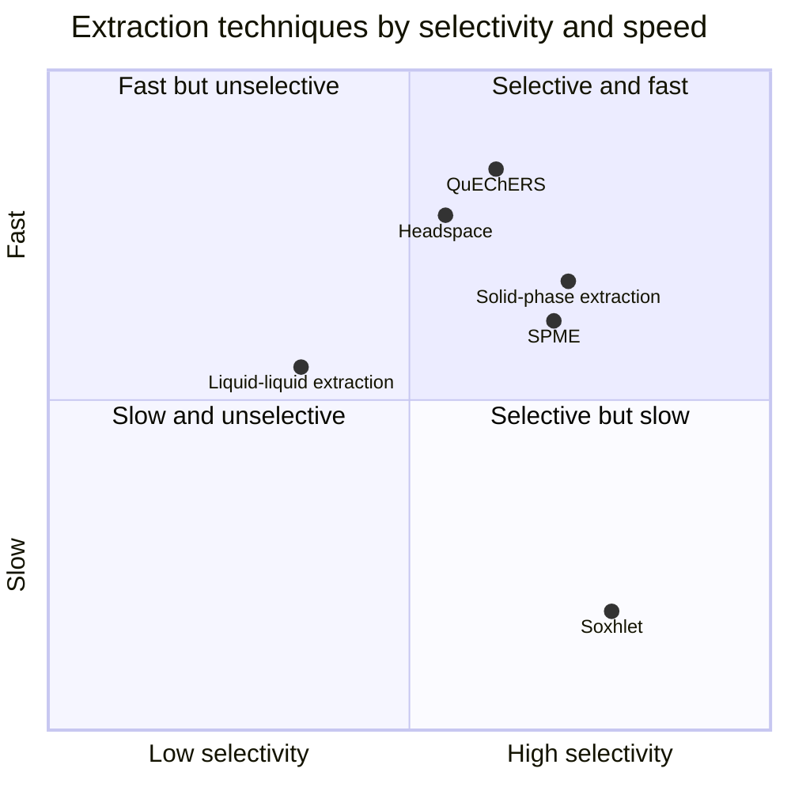
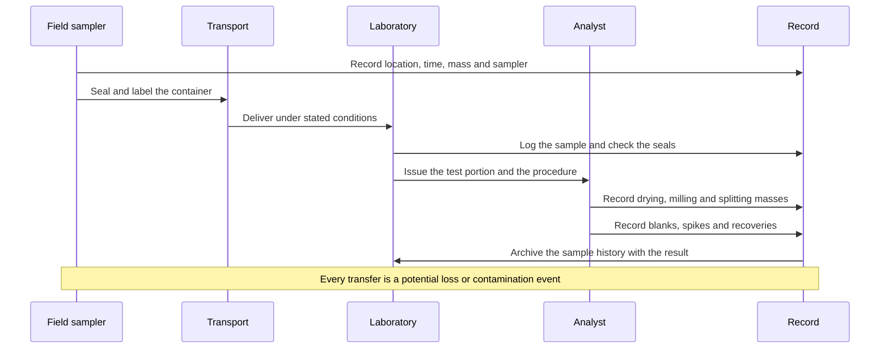
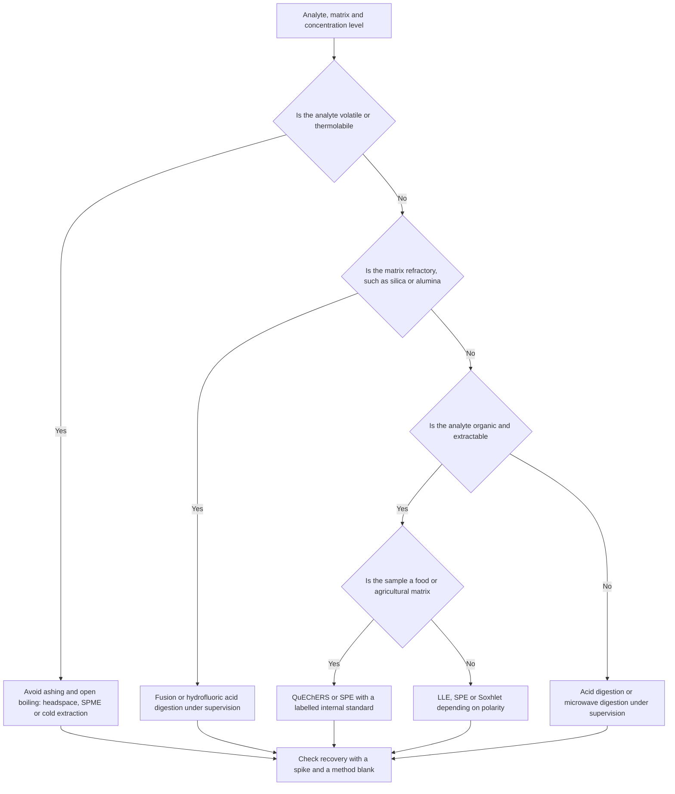

# Chapter 2 — Sampling and Sample Preparation

> **Level:** Level 7 — Analytical Chemistry (undergraduate / practising analyst)
> **Estimated study time:** 6 hours (reading) + 2 hours (exercises)
> **Prerequisites:** [Introduction to Analytical Chemistry](01-introduction-to-analytical-chemistry.md); [Solutions, Concentration and Dilution](../03-intermediate-chemistry/03-solutions-concentration-and-dilution.md)
> **Difficulty:** ★★★★☆ (4/5)
> **Related chapters:** [Errors, Uncertainty and Statistical Data Treatment](03-errors-uncertainty-and-statistical-data-treatment.md), [Calibration, Validation and Quantitative Analysis](04-calibration-validation-and-quantitative-analysis.md), [Level 7 module index](README.md)

---

## 1. Learning Objectives

After working through this chapter you will be able to:

- Explain why sampling error frequently dominates the total uncertainty budget.
- Distinguish population from sample, and define the sampling unit and increment.
- Compare random, systematic, stratified, composite and convenience sampling.
- Calculate the number of increments needed for a stated uncertainty.
- Use the sampling constant to estimate the mass required for a target precision.
- Explain homogeneity, the nugget effect and particulate segregation.
- Outline Gy's theory of sampling and its three error components.
- Divide a sample correctly by riffle splitting or coning and quartering.
- Describe drying, grinding, sieving and weighing as preparation steps with their
  error sources.
- Explain storage, preservation and analyte-stability requirements.
- Compare digestion, ashing and fusion as routes to solution, and state their safety
  requirements.
- Select an extraction technique and justify blanks, spikes, surrogates and internal
  standards.

---

## 2. Introduction

A laboratory measures a 1 g subsample and reports the concentration in a 20-tonne lorry
load of ore. Everything between those two objects is sampling, and it is the part of the
measurement that the laboratory does not see. When a result is challenged, the dispute is
almost always about the sample, not the instrument.

The arithmetic is brutal. For a heterogeneous solid, the variance between increments is
commonly ten to a hundred times the variance of the analytical measurement, so replicate
analysis of one bottle produces a beautiful precision figure that describes the bottle,
not the material. Chapter [1](01-introduction-to-analytical-chemistry.md) introduced the
error budget; this chapter populates its largest term.

Sampling is also where chemistry meets statistics under physical constraints. A powder
segregates by particle size when poured; a water sample adsorbs analytes onto its
container; a soil sample loses volatile mercury as it dries; a blood sample's glucose
concentration falls while the tube waits. Each is a chemical process that must be
controlled before any instrument is switched on.

The chapter follows the sample as it travels: from the population, through sampling and
division, physical preparation, storage and chemical preparation, to the aliquot placed in
the instrument. Safety is part of the design: acid digestion, microwave heating and ashing
are described as principles requiring trained supervision, never as unsupervised
procedures.

---

## 3. Fundamental Concepts

### 3.1 Population, sample, increment and unit

The **population** (or *lot*) is the entire material about which a statement is to be made:
a batch, a lorry load, a river over a season, a patient's blood over a day. The **sample**
is the portion actually taken. The **sampling unit** is the smallest entity that can be
selected independently; the **increment** (or *primary sample*) is the quantity removed in
one operation; a **composite** is several increments combined; the **laboratory sample** is
the portion sent to the laboratory; the **test sample** is the portion prepared for
analysis; the **test portion** (or *aliquot*) is the quantity actually measured.

These distinctions are not pedantry. An uncertainty statement attached to a result must
say which of these units it refers to. "The concentration of this bottle" and "the
concentration of this lorry load" require different variances.

### 3.2 Sampling error and why it dominates

Two independent contributions arise before the instrument is reached:

- the **sampling error**, arising because the increments differ in composition from the
  population and from each other;
- the **analytical error**, arising in preparation and measurement.

For $n$ independent increments analysed separately, the variance of the mean is

$$
\sigma_{\text{total}}^2 = \frac{\sigma_{\text{sampling}}^2}{n} + \sigma_{\text{analysis}}^2 .
$$

Because the first term is divided by $n$ but not by a large number in practice, and because
$\sigma_{\text{sampling}}$ is often large, the first term usually dominates. Reducing
analytical error below the sampling error is wasted effort — the principle already met in
the error budget of Chapter [1](01-introduction-to-analytical-chemistry.md).

### 3.3 Probability and non-probability sampling

**Random sampling** gives every unit a known, non-zero probability of selection, usually
equal; it is the basis of statistical inference and protects against unconscious bias.
**Systematic sampling** takes units at a fixed interval — every tenth bag, every hour — and
is often more precise for a spatially ordered population, but fails if the interval
resonates with a periodicity in the material. **Stratified sampling** divides the population
into internally homogeneous strata (top, middle and bottom of a silo) and samples each in
proportion, reducing variance when strata differ. **Composite sampling** combines increments
into one sample, reducing analytical cost at the price of losing information about
variability; it suits compliance averages and fails when a single high value must be
detected. **Convenience sampling** takes whatever is available and supports no valid
uncertainty.

### 3.4 Sample size and the sampling constant

The mass required for a stated precision is described by the **sampling constant**. In
Ingamells' form,

$$
K_s = m R^2,
$$

| Symbol | Meaning | SI unit |
|---|---|---|
| $K_s$ | Sampling constant, characteristic of the material | g (percent)² |
| $m$ | Mass of the test sample | g |
| $R$ | Relative standard deviation of the analyte mass fraction | % |

**Assumptions.** The material is well mixed at the scale of the test sample, the analyte
is randomly distributed among particles, and $R$ is small enough that the relative
standard deviation is a good measure of dispersion. The constant is determined
experimentally for each material by measuring $R$ at two or more masses.

The practical content is that $R$ falls only as $1/\sqrt{m}$: reducing the relative
standard deviation by a factor of two requires four times the mass, and by a factor of ten
requires a hundred times the mass. This is why laboratories grind and split rather than
simply weighing more.

For a specified target $R_{\text{target}}$,

$$
m_{\text{req}} = \frac{K_s}{R_{\text{target}}^2}.
$$

### 3.5 Homogeneity and the nugget effect

A material is **homogeneous** with respect to an analyte when the variance between test
portions of a given mass is no greater than the variance of the analytical method. Note
the two qualifications: with respect to a particular analyte, and at a particular mass.
A sample can be homogeneous for iron and heterogeneous for gold, because gold occurs as
discrete flakes.

The **nugget effect** is the extreme case where the analyte is concentrated in rare,
high-grade particles. A single 20 µm gold particle in a 1 g sample changes the result by
tens of milligrams per kilogram. The distribution of results is then highly skewed, the
mean of a few replicates is unstable, and the only remedies are finer grinding, larger
samples, or both. The name comes from gold mining, where the "nugget" is literal.

### 3.6 Gy's theory of sampling in outline

Pierre Gy's theory decomposes the error of a sampling operation into components, each with
a cause and a remedy.

**Fundamental error (FE).** The irreducible variance arising because a sample of finite mass
contains a finite number of particles of varying composition. It is a property of the
material and the sample mass, not of the sampler's skill:

$$
\sigma_{\text{FE}}^2 \approx \frac{K\,d^3}{M_s},
$$

where $d$ is the nominal top particle size, $M_s$ the sample mass and $K$ a material
constant combining density, shape and composition variability. The cube of the particle
size is the crucial term: halving $d$ reduces the fundamental error by $2^{1.5} \approx 2.8$.

**Segregation error.** Arises when particles of different size or density separate during
pouring, vibration or storage. It is not random but a systematic structure, minimised by
taking increments from many positions and avoiding free-falling streams.

**Grouping, weighting, delimitation and extraction errors.** Arise when increments are not
independent, when sampling is not weighted by mass, when the tool does not cut the whole
cross-section of the stream, or when part of the increment is lost or contaminated.

The engineering conclusion: correct sampling takes the **whole stream**, at many times, with
a tool that does not discriminate by particle size.

### 3.7 Sample division

A laboratory sample of kilograms must be reduced to grams without changing composition.
**Riffle splitting** passes the material through alternate chutes into two pans, so every
particle has an equal chance of entering either half; it is the preferred method for
free-flowing powders and can be repeated. **Coning and quartering** forms a cone, flattens
it, divides it into quadrants and keeps opposite quadrants; it is traditional and adequate
for coarse material but susceptible to segregation and operator bias. **Rotary dividers**
feed material onto a rotating turntable and are the reference methods for fine powders.
The rule governing all of them: never split an unmixed sample, and never take a
"representative" scoop from a container.

### 3.8 Physical preparation

**Drying** removes surface moisture but changes the basis of the result: air drying is
gentle, oven drying at $105\ ^\circ\text{C}$ gives a defined dry-mass basis but drives off
mercury, and freeze drying preserves volatile species. The result must state the basis.
**Grinding** reduces particle size, lowering the fundamental error and improving
homogeneity, at the cost of heat, contamination from the mill and loss of volatiles.
**Sieving** produces a defined size fraction, and the coarse fraction must not be discarded
because it often carries a different composition. **Weighing** is a direct input to every
mass-fraction result, so balance calibration and static charge matter at the milligram
level.

### 3.9 Storage and preservation

Between sampling and analysis the sample changes through **adsorption** onto container
walls, **leaching** from the container, **volatilisation** of mercury, ammonia and
low-boiling organics, **photochemical decomposition**, **microbial action** and
**speciation change** as pH or redox conditions shift. Standard precautions follow: fill
containers completely to exclude headspace, acidify metals to pH below 2, cool to
$4\ ^\circ\text{C}$ in the dark, analyse within a defined holding time, and record every
step. A preserved sample is not an unchanged sample; it is one whose changes have been
slowed to a stated, validated rate.

### 3.10 Dissolution: digestion, ashing and fusion

Most instrumental methods require a homogeneous solution. Three routes are used, and each
is a **principle requiring trained supervision and a fume cupboard or closed vessel**; none
should be attempted unsupervised.

**Acid digestion** oxidises the matrix and releases metals into solution. Nitric acid suits
many environmental samples; hydrochloric acid dissolves carbonates and some oxides;
hydrofluoric acid dissolves silicates and requires PTFE vessels; aqua regia (3:1
hydrochloric:nitric) dissolves most metals and alloys; perchloric acid is avoided where
organic matter may dry out, because it can form explosive perchlorates.

**Microwave digestion** uses closed vessels and controlled heating to reach higher
temperature and pressure than open digestion, with less volatilisation and contamination.
Vessels must be rated for the pressure, vented correctly and cooled before opening; sealed
digestion of unknown organic material is hazardous because of rapid pressure rise.

**Dry ashing** burns organic matter at $450$–$550\ ^\circ\text{C}$, leaving a residue that
is dissolved in acid; it is unsuitable for volatile elements such as mercury and selenium.
**Fusion** melts the sample with lithium metaborate or sodium peroxide at
$900$–$1200\ ^\circ\text{C}$, giving complete decomposition of refractory minerals at the
cost of dilution and high dissolved solids.

**Safety note.** Every route involves hot concentrated reagents, high pressure or both.
Work under supervision, in the specified containment, with safety data available and the
waste stream defined before the first vessel is opened.

### 3.11 Extraction and isolation

When the analyte is dilute and the matrix complex, it is isolated and often preconcentrated.

**Liquid–liquid extraction** partitions the analyte between two immiscible phases. The
distribution ratio $D = C_{\text{org}}/C_{\text{aq}}$ determines the fraction extracted, and
repeated small volumes are more efficient than one large volume. **Solid-phase extraction**
retains the analyte on a sorbent and elutes it in a small volume, giving high
preconcentration with little solvent. **Soxhlet extraction** cycles solvent through a
thimble containing the solid; it is exhaustive and cheap but slow and unsuitable for
thermolabile analytes. **QuEChERS** extracts pesticides from food with acetonitrile and
salts, then cleans the extract by dispersive SPE. **Headspace and purge-and-trap** sample
the vapour phase, ideal for volatile analytes and matrices that must not be injected.
**Solid-phase microextraction** uses a coated fibre, is solvent-free and automated, and
depends on partition coefficients that vary with matrix.

### 3.12 Derivatisation

**Derivatisation** converts an analyte into a form that is more volatile, more stable or
more detectable. Silylation makes alcohols and acids volatile for gas chromatography;
acylation and alkylation reduce polarity; dansylation and fluorescamine labelling add
fluorophores for liquid chromatography; chiral derivatisation resolves enantiomers.

Derivatisation adds uncertainty: the reaction may be incomplete, may produce more than one
product, or may vary with matrix. A derivatisation yield must therefore be established,
usually with a labelled internal standard that derivatises alongside the analyte.

### 3.13 Blanks, spikes, surrogates and internal standards

Four controls detect and correct the errors of preparation.

| Control | What it is | What it detects |
|---|---|---|
| Method blank | Full procedure with solvent instead of sample | Contamination from reagents, vessels and air |
| Spike | Known analyte added to a sample before preparation | Recovery of the method in that matrix |
| Surrogate | Labelled or similar compound added before preparation | Recovery of the procedure |
| Internal standard | Compound added to every standard and sample before measurement | Variation in injection, ionisation and response |

Recovery is

$$
R = \frac{C_{\text{spiked}} - C_{\text{native}}}{C_{\text{added}}} \times 100\,\%,
$$

with the three concentrations in the same units. Acceptable recovery is method-dependent: a
common regulatory window for trace organic analysis is $70$–$120\,\%$. A surrogate differs
from an internal standard in *when* it is added: the surrogate measures recovery, the
internal standard measures only the measurement step. A labelled analogue added before
preparation does both, which is the logic of isotope-dilution mass spectrometry.

---

## 4. Detailed Scientific Explanation

### 4.1 The sampling plan as an experimental design

A sampling plan states the population, the sampling units, the number and location of
increments, the mass of each, the method of combining and the acceptance criteria. It is an
experimental design with a cost function and should be written before the first sample is
taken. Three questions determine it: *what decision will the result inform* (a compliance
decision needs representativeness; a hotspot survey needs spatial resolution), *what is the
scale of heterogeneity* (which fixes the number of increments), and *what precision is
required* (which fixes the mass through the sampling constant).

### 4.2 Number of increments

If the variance between increments is $s_b^2$ and the required standard uncertainty of the
mean is $u$, then $n = (s_b/u)^2$. When analytical variance is not negligible, the sampling
term follows from the total budget:

$$
u^2 = \frac{s_b^2}{n} + u_{\text{analysis}}^2
\quad\Longrightarrow\quad
n = \frac{s_b^2}{u^2 - u_{\text{analysis}}^2}.
$$

The denominator must be positive; if $u \le u_{\text{analysis}}$ no number of increments
can meet the target and the analytical method must improve first.

### 4.3 Why grinding is more powerful than adding increments

The fundamental error scales with $d^3$. Reducing top size from $2\ \text{mm}$ to
$0.25\ \text{mm}$ reduces $d^3$ by a factor of $512$, so the same mass gives a fundamental
error smaller by about $23$. Adding increments reduces the sampling variance only as $1/n$,
so the same reduction by increments alone would need $n = 512$. Grinding is therefore the
cheapest route to precision for solids, provided it neither contaminates nor alters the
analyte — which is why reputable laboratories crush and mill to a specified size before
subsampling.

### 4.4 Segregation in practice

Segregation is driven by differences in particle size, density and shape under gravity or
vibration. In a poured heap, coarse particles roll to the edge (the *perimeter effect*)
while fines remain at the apex; in a vibrating container, coarse particles rise. Samples
taken from the edge or top are therefore not representative, and the bias can exceed the
fundamental error. Countermeasures are mechanical: sample the moving stream, take the whole
cross-section, use a cutter wider than three times the largest particle, and avoid free
fall.

### 4.5 Contamination and loss during preparation

Typical contaminants are sodium and potassium from skin and glass, calcium and magnesium
from water, iron and chromium from steel tools, silica from glass and boron from
borosilicate. Typical losses are adsorption onto vessel walls, volatilisation during drying
and aerosol formation during boiling. The controls are procedural: dedicated tools per
analyte class, acid-washed PTFE vessels, laminar-flow benches for ultratrace work, closed
digestion vessels, and method blanks processed through every step.

### 4.6 Speciation and the meaning of "total"

A result for "chromium" is ambiguous: chromium(III) is an essential nutrient and
chromium(VI) is carcinogenic. **Speciation analysis** determines individual chemical forms
and cannot use a method that destroys them: acid digestion measures total element after
oxidation, while speciation requires mild extraction, chromatographic separation and
element-specific detection, with preservation to prevent interconversion. Drying can
oxidise, acidification can reduce, and storage can convert one species into another, so a
sampling plan for speciation is a different design from one for total-element analysis.

### 4.7 Deciding on a preparation route

The choice follows from four facts: the analyte's volatility, its thermal stability, the
matrix's solubility and the concentration level. Volatile analytes exclude dry ashing and
open boiling; thermolabile analytes exclude high-temperature ashing and hot acid;
refractory matrices require fusion or hydrofluoric acid; ultratrace work requires clean
benches and minimal handling. The diagram in Section 5 encodes this logic, and the
discipline is to record the reason for each choice rather than inheriting habits.

### 4.8 Subsampling and the "sample of the sample"

The laboratory receives $2\ \text{kg}$ of soil and needs $0.5\ \text{g}$, a reduction by a
factor of $4000$ that must be done with the same rigour as the original sampling. The
sequence is: dry, crush coarsely, riffle-split to about $200\ \text{g}$, mill to below
$250\ \mu\text{m}$, riffle-split to $20\ \text{g}$, and take the test portion from the
milled, mixed powder. Each split is a sampling operation with its own fundamental error, so
the laboratory sample has a *pedigree* — a chain of masses and particle sizes — and a
defensible result reports the final particle size and test-portion mass.

---

## 5. Visual Diagrams

**Figure 2.1 — Extraction techniques by selectivity and speed.** Selectivity is the ability
to isolate the analyte from matrix components; speed includes the number of samples that can
be handled per day. Soxhlet is exhaustive but slow and solvent-intensive, which places it in
the lower right. QuEChERS and headspace occupy the fast end. SPE and SPME are tunable: the
sorbent or fibre chemistry moves them along the selectivity axis, which is why they serve
both screening and confirmatory work.

**Figure 2.2 — The sample lifecycle.** Chain of custody is not bureaucracy: each transfer
is a point at which a sample can be mixed up, lost, contaminated or allowed to degrade.
Recording the mass at every splitting step also allows the analyst to reconstruct the
dilution factor if a result is later questioned.

**Figure 2.3 — Choosing a sample-preparation route.** The first branch protects volatile
and thermolabile analytes from destruction; the second deals with matrices that resist
acid attack; the third divides organic analysis by extraction mechanism. Every path ends
at the same control step, because no preparation route is trusted without a blank and a
recovery check.

---

## 6. Mathematical Formulas

### 6.1 Variance of a mean from increments

$$
\sigma_{\text{total}}^2 = \frac{\sigma_{\text{sampling}}^2}{n} + \sigma_{\text{analysis}}^2,
\qquad
n = \left(\frac{s_b}{u}\right)^2
$$

| Symbol | Meaning | SI unit |
|---|---|---|
| $\sigma_{\text{total}}$ | Standard uncertainty of the reported mean | mass fraction or concentration |
| $\sigma_{\text{sampling}}$ | Standard deviation between increments | mass fraction or concentration |
| $\sigma_{\text{analysis}}$ | Standard deviation of the analytical procedure | mass fraction or concentration |
| $n$ | Number of increments | dimensionless |
| $u$ | Required standard uncertainty of the mean | mass fraction or concentration |

**Assumptions.** Increments are independent and drawn from the same population, and the
analytical variance is the same for every increment. When increments are combined into a
single composite and analysed once, the analytical variance is not divided by $n$; the
formula then overestimates precision unless the composite is analysed in replicate.

### 6.2 The sampling constant

$$
K_s = m R^2, \qquad m_{\text{req}} = \frac{K_s}{R_{\text{target}}^2}
$$

| Symbol | Meaning | SI unit |
|---|---|---|
| $K_s$ | Sampling constant | g (percent)² |
| $m$ | Test-portion mass | g |
| $R$ | Relative standard deviation of the mass fraction | % |

**Assumptions.** Random distribution of analyte among particles, and a test-portion mass
large compared with the mass of a single particle. The constant is material-specific and
must be determined experimentally; published values are indicative only.

### 6.3 Fundamental error of a sampling operation

$$
\sigma_{\text{FE}}^2 \approx \frac{K\,d^3}{M_s}
$$

| Symbol | Meaning | SI unit |
|---|---|---|
| $\sigma_{\text{FE}}$ | Relative standard deviation due to fundamental error | dimensionless |
| $K$ | Material constant from density, shape and composition variance | dimensionless |
| $d$ | Nominal top particle size | m |
| $M_s$ | Sample mass | kg |

**Assumptions.** A simplified form of Gy's expression, adequate for order-of-magnitude
decisions. The full theory adds shape, size-distribution and liberation factors, and the
constant must be calibrated for the material. The practical content — error falls with the
cube of particle size and the inverse of sample mass — holds regardless.

### 6.4 Recovery, preconcentration and dilution

$$
R = \frac{C_{\text{spiked}} - C_{\text{native}}}{C_{\text{added}}} \times 100\,\%,
\qquad
C_{\text{final}} = \frac{C_{\text{initial}}\,V_{\text{initial}}}{V_{\text{final}}}
$$

| Symbol | Meaning | SI unit |
|---|---|---|
| $R$ | Recovery | % |
| $C_{\text{spiked}}$, $C_{\text{native}}$, $C_{\text{added}}$ | Measured fortified, native and added concentrations | $\mu\text{g dm}^{-3}$ or mg kg⁻¹ |
| $V_{\text{initial}}$, $V_{\text{final}}$ | Volume before and after transfer | dm³ or mL |

**Assumptions.** The spike equilibrates with the matrix before extraction, the native and
added analyte behave identically, and volumes are additive. Recovery near $100\,\%$ does
not prove accuracy: a spike added as a free standard may be extracted more easily than
analyte bound within the matrix, so aged or incurred samples are the better test.

---

## 7. Chemical Equations

The equations below represent the chemistry of preparation, written in balanced form.
They are principles, not instructions; every operation requires supervision and the
containment described in Section 3.10.

**Acid dissolution of a carbonate matrix.**

$$
\ce{CaCO3(s) + 2HNO3(aq) -> Ca(NO3)2(aq) + CO2(g) + H2O(l)}
$$

Effervescence is vigorous and can cause loss of sample by foaming; the acid is therefore
added slowly and in a vessel large enough to contain the foam.

**Oxidation of organic matter by nitric acid.**

$$
\ce{CH2O(s) + 2HNO3(aq) -> CO2(g) + 2NO2(g) + 2H2O(l)}
$$

Hot concentrated nitric acid oxidises organic material to carbon dioxide, releasing metals
into solution. Nitrogen dioxide is toxic and the reaction must be contained.

**Dissolution of silica by hydrofluoric acid.**

$$
\ce{SiO2(s) + 6HF(aq) -> H2SiF6(aq) + 2H2O(l)}
$$

Hydrofluoric acid attacks glass, so PTFE vessels are required; it also attacks bone and
must never contact skin.

**Aqua regia dissolution of a metal.**

$$
\ce{Au(s) + 4HCl(aq) + HNO3(aq) -> HAuCl4(aq) + NO(g) + 2H2O(l)}
$$

The oxidising mixture dissolves gold, which neither acid achieves alone; the nitric acid
is the oxidant and the hydrochloric acid provides the complexing chloride.

**Fusion of a refractory oxide with lithium metaborate.**

$$
\ce{Al2O3(s) + LiBO2(s) -> 2LiAlO2(s) + B2O3(l)}
$$

The flux lowers the melting temperature and produces a glass that dissolves in dilute acid;
the reaction is carried out at about $1000\ ^\circ\text{C}$ in a platinum crucible.

---

## 8. Worked Examples

### Worked Example 2.1 — How many increments are needed?

**Problem.** A heap of contaminated soil has a between-increment standard deviation of
$1.2\,\%$ (relative). The analytical procedure contributes $0.4\,\%$. The regulatory
decision requires the standard uncertainty of the mean to be no more than $0.5\,\%$. How
many increments are required?

**Strategy.** Solve the variance budget for the sampling term, then for $n$.

**Solution.** The sampling term must satisfy

$$
u_{\text{sampling}}^2 = 0.5^2 - 0.4^2 = 0.25 - 0.16 = 0.09,
\qquad u_{\text{sampling}} = 0.30\,\%,
$$

so

$$
n = \left(\frac{1.2}{0.30}\right)^2 = 16 .
$$

**Check.** With $n = 16$ the total is
$\sqrt{1.44/16 + 0.16} = \sqrt{0.09 + 0.16} = 0.50\,\%$, as required. Note that the
denominator $u^2 - u_{\text{analysis}}^2$ would be negative if the analysis contributed
$0.6\,\%$: then no number of increments could meet the target, and the analytical method
would have to improve first. That is a useful diagnostic before any fieldwork begins.

### Worked Example 2.2 — Using the sampling constant

**Problem.** A soil has a sampling constant of $K_s = 250\ \text{g (percent)}^{-2}$.
(a) What mass gives a relative standard deviation of $2.0\,\%$? (b) What mass gives
$1.0\,\%$? (c) Comment on the practicality of the answers.

**Strategy.** Apply $m = K_s/R^2$ and compare the two masses.

**Solution.**

$$
m_{2.0} = \frac{250}{2.0^2} = 62.5\ \text{g},
\qquad
m_{1.0} = \frac{250}{1.0^2} = 250\ \text{g}.
$$

**Check.** Halving the relative standard deviation quadruples the mass, exactly as the
inverse-square relation requires. A $250\ \text{g}$ test portion is impractical for routine
analysis, so the correct response is to grind finer and re-determine $K_s$: because
$K_s$ falls with $d^3$, milling from $2\ \text{mm}$ to $0.25\ \text{mm}$ reduces it by a
factor of about $500$, making $1.0\,\%$ achievable from a few grams.

### Worked Example 2.3 — Recovery and the corrected result

**Problem.** A sample of fish tissue contains $8.4\ \mu\text{g kg}^{-1}$ of a pesticide as
measured in an unfortified portion. A second portion, fortified with
$10.0\ \mu\text{g kg}^{-1}$ before extraction, gives $18.9\ \mu\text{g kg}^{-1}$. Calculate
the recovery and the recovery-corrected result, and state whether the recovery is
acceptable against a criterion of $70$–$120\,\%$.

**Strategy.** Apply the recovery equation, then divide the measured native concentration by
the recovery expressed as a fraction.

**Solution.**

$$
R = \frac{18.9 - 8.4}{10.0} \times 100\,\% = 105\,\%,
\qquad
C_{\text{corrected}} = \frac{8.4}{1.05} = 8.0\ \mu\text{g kg}^{-1}.
$$

**Check.** The recovery lies within the criterion and is close to $100\,\%$, so the
correction is small. Note two limitations: a spike added as a free standard may be
extracted more readily than incurred residue bound in tissue, so $105\,\%$ may be
optimistic; and a recovery outside the criterion does not license an arbitrary correction —
it requires investigation of the method.

### Worked Example 2.4 — Preconcentration and the detection limit

**Problem.** A method extracts $250\ \text{cm}^3$ of water into a final volume of
$2.0\ \text{cm}^3$. The detector's limit of detection in the extract is
$0.40\ \mu\text{g dm}^{-3}$. Calculate the preconcentration factor and the method detection
limit in the original water, assuming $100\,\%$ recovery.

**Strategy.** The preconcentration factor is the ratio of volumes; the method detection
limit is the extract detection limit divided by that factor.

**Solution.**

$$
f = \frac{250}{2.0} = 125,
\qquad
\text{LOD}_{\text{method}} = \frac{0.40}{125} = 0.0032\ \mu\text{g dm}^{-3}.
$$

**Check.** The improvement is exactly the volume ratio, which is the ideal case. In
practice a recovery of $85\,\%$ would raise the method limit to
$0.0032/0.85 = 0.0038\ \mu\text{g dm}^{-3}$, and contamination during the extraction would
raise it further. A preconcentration factor is therefore a design target, not a guaranteed
performance.

---

## 9. Real-World Applications

**Mining and metallurgy.** Ore grade is determined on a few grams taken from hundreds of
tonnes; the sampling constant and particle size decide whether the assay is trustworthy.

**Environmental monitoring.** Composite samples over a discharge period give an average
load; discrete samples reveal the peaks that a composite would hide.

**Food safety.** Maximum residue limits apply to the edible portion, so sampling must define
the portion, clean it consistently and homogenise the whole sample.

**Clinical analysis.** Blood glucose falls in an unpreserved tube, plasma potassium rises as
cells leak and trace metals adsorb onto glass, so the sampling protocol is part of the method
and reference intervals are valid only for that protocol.

**Pharmaceutical manufacturing.** Sampling of powders and blends must demonstrate
homogeneity, and the plan is part of process validation: a blend uniform at the top of the
bin and stratified at the bottom fails content uniformity even though a grab sample assays
correctly.

---

## 10. Common Mistakes

| Mistake | Why it happens | Correct approach |
|---|---|---|
| Taking a "representative" scoop from a heap | It looks mixed and saves time | Sample the moving stream, or take many increments and composite |
| Reporting analytical precision as the uncertainty of the lot | Replicates of one bottle are easy to obtain | Separate sampling and analytical variance in the budget |
| Drying at $105\ ^\circ\text{C}$ for volatile analytes | It is the standard procedure | Use freeze drying or air drying and state the basis |
| Storing trace metals in glass | Glass is inert and available | Use acid-washed PTFE or high-density polyethylene, acidified |
| Correcting a poor recovery by arithmetic | The correction restores a plausible number | Investigate the method; correct only within a validated recovery range |
| Using a surrogate as an internal standard | Both are labelled compounds | Add the surrogate before preparation and the internal standard before measurement, or use a labelled analogue for both |

---

## 11. Chapter Summary

- Sampling error frequently dominates the uncertainty budget for solid and heterogeneous
  materials; analytical precision cannot repair it.
- Population, sample, increment, composite, laboratory sample and test portion are distinct
  units, and an uncertainty statement must say which one it refers to.
- Random, systematic, stratified and composite sampling answer different questions;
  convenience sampling supports no valid uncertainty.
- Increment number follows from the variance budget; required mass follows from the sampling
  constant, which falls with the cube of particle size.
- Homogeneity is analyte-specific and mass-specific; the nugget effect is its extreme
  form.
- Gy's theory separates fundamental, segregation and grouping errors, and shows that
  correct sampling means taking the whole stream, many times.
- Division by riffle splitting is preferred; coning and quartering is acceptable but
  operator-sensitive.
- Drying, grinding, sieving and weighing each introduce contamination, loss or segregation;
  storage adds adsorption, leaching, volatilisation and microbial change.
- Digestion, ashing and fusion are principles requiring supervision, containment and
  defined waste handling.
- Extraction and derivatisation isolate and concentrate the analyte at the cost of
  recovery uncertainty, which blanks, spikes and labelled standards quantify.

---

## 12. Exercises

### 12.1 Conceptual questions

1. Explain why a 1 g test portion cannot be representative of a 20-tonne lot of coarse ore.
2. Distinguish a surrogate from an internal standard, and state when a single labelled
   analogue serves both purposes.
3. Why does the fundamental error depend on the cube of the particle size?

### 12.2 Basic problems

4. A sample has a between-increment standard deviation of $2.4\,\%$ and the analysis
   contributes $0.6\,\%$. How many increments are needed for a standard uncertainty of the
   mean of $0.8\,\%$?
5. A material has $K_s = 80\ \text{g (percent)}^{-2}$. What mass gives a relative standard
   deviation of $1.5\,\%$?
6. An extraction concentrates $500\ \text{cm}^3$ into $5.0\ \text{cm}^3$ with $92\,\%$
   recovery. The extract LOD is $0.25\ \mu\text{g dm}^{-3}$. Calculate the method LOD.

### 12.3 Intermediate problems

7. A method blank contains $0.8\ \mu\text{g kg}^{-1}$ of the analyte, and the sample result
   is $6.2\ \mu\text{g kg}^{-1}$. What is the blank-corrected result, and why is subtracting
   a blank near the detection limit problematic?
8. A sample is dried at $105\ ^\circ\text{C}$ and loses $8.2\,\%$ of its mass. The
   as-received result is $12.4\ \text{mg kg}^{-1}$. Calculate the dry-mass result.
9. A riffle splitter divides $500\ \text{g}$ into two portions. Explain why repeating the
   split four times is preferable to taking a $30\ \text{g}$ scoop from the original.

### 12.4 Advanced problems

10. A laboratory reports $4.6 \pm 0.3\ \text{mg kg}^{-1}$ from triplicate analysis of one
    bottle, but the sampling standard deviation is known to be $18\,\%$ relative. Estimate
    the uncertainty of the mean for the lot and comment on the reported figure.
11. A method recovers $62\,\%$ of a spike. The laboratory corrects the result by dividing
    by $0.62$. Explain why this is unsafe and what should be done instead.

### 12.5 Calculation problems

12. A sample contains $3.2\ \mu\text{g kg}^{-1}$ natively. A portion fortified with
    $5.0\ \mu\text{g kg}^{-1}$ gives $7.6\ \mu\text{g kg}^{-1}$. Calculate the recovery and
    the recovery-corrected concentration.

### 12.6 Answers

1. The mass is far too small to contain a representative number of coarse particles; the
   fundamental error scales as $d^3/M_s$, so coarse material requires either a much larger
   sample or much finer grinding.
2. A surrogate is added before preparation and measures recovery; an internal standard,
   added before measurement, measures response variation. A labelled analogue serves both.
3. Because the number of particles in a given mass scales with $d^{-3}$, so the variance
   from particle-to-particle composition differences scales with $d^3$.
4. $u_{\text{sampling}} = \sqrt{0.64 - 0.36} = 0.529\,\%$;
   $n = (2.4/0.529)^2 = 20.6$, so 21 increments.
5. $m = 80/1.5^2 = 35.6\ \text{g}$.
6. Preconcentration factor $= 100$; ideal LOD $= 0.0025\ \mu\text{g dm}^{-3}$; with $92\,\%$
   recovery, $0.0027\ \mu\text{g dm}^{-3}$.
7. Blank-corrected result $= 5.4\ \mu\text{g kg}^{-1}$. Subtracting a blank comparable with
   the result doubles the relative uncertainty and can produce negative values; the blank
   must be small relative to the result, and the correction documented.
8. $12.4/(1 - 0.082) = 13.5\ \text{mg kg}^{-1}$ on a dry-mass basis.
9. Each split is a sampling operation with its own fundamental error; repeated splitting
   reduces the mass while keeping every particle's chance of selection equal, whereas a
   scoop from a segregated bulk selects preferentially.
10. The reported $\pm 0.3$ describes the bottle, not the lot. The sampling contribution is
    $18\,\%$ of $4.6$, or $0.83\ \text{mg kg}^{-1}$, so the lot uncertainty is at least
    $\pm 0.9\ \text{mg kg}^{-1}$ ($k = 2$): the result is precise and unrepresentative.
11. A recovery of $62\,\%$ lies outside normal acceptance and indicates a method fault —
    incomplete extraction, analyte loss or a matrix effect. Correcting by division inflates
    the result by $61\,\%$ and conceals the fault; the method must be investigated, and the
    result reported as indicative only.
12. $R = (7.6 - 3.2)/5.0 \times 100\,\% = 88\,\%$; corrected concentration
    $= 3.2/0.88 = 3.6\ \mu\text{g kg}^{-1}$.

---

## 13. Further Reading

- Harris, D. C.; Lucy, C. A. *Quantitative Chemical Analysis*, 10th ed., W. H. Freeman.
  Chapter 27 ("Sampling, Standardization and Calibration") and the sections on sample
  preparation.
- Skoog, D. A.; West, D. M.; Holler, F. J.; Crouch, S. R. *Fundamentals of Analytical
  Chemistry*, 9th ed., Cengage Learning. Chapters on sampling and sample preparation.
- Miller, J. N.; Miller, J. C. *Statistics and Chemometrics for Analytical Chemistry*,
  6th ed., Pearson. Chapter 1 on errors and the sampling contribution.
- Gy, P. *Sampling for Analytical Purposes*, Wiley, 1998. The primary exposition of the
  theory of sampling.
- Eurachem. *The Fitness for Purpose of Analytical Methods*, 2nd ed., 2014, and the
  Eurachem/CITAC guide *Quantifying Uncertainty in Analytical Measurement*, 3rd ed., 2012.
  <https://www.eurachem.org/>
- ISO 17025:2017, *General requirements for the competence of testing and calibration
  laboratories* — requirements for sampling and handling of test items.
- NIST. *NIST/SEMATECH e-Handbook of Statistical Methods*, sections on measurement process
  characterisation. <https://www.itl.nist.gov/div898/handbook/>
- [CURRICULUM.md](../CURRICULUM.md) and [REFERENCES.md](../REFERENCES.md) — where this
  chapter sits in the programme, and the repository's verified source list.

> Only sources that can be checked are cited here. No DOI, page number or edition is
> invented.
