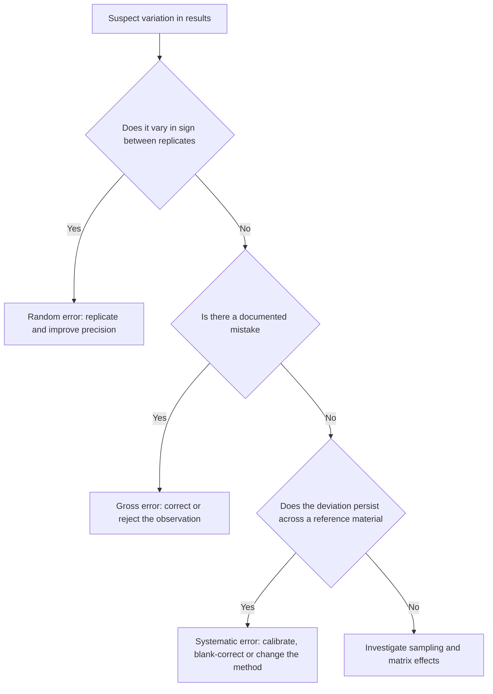
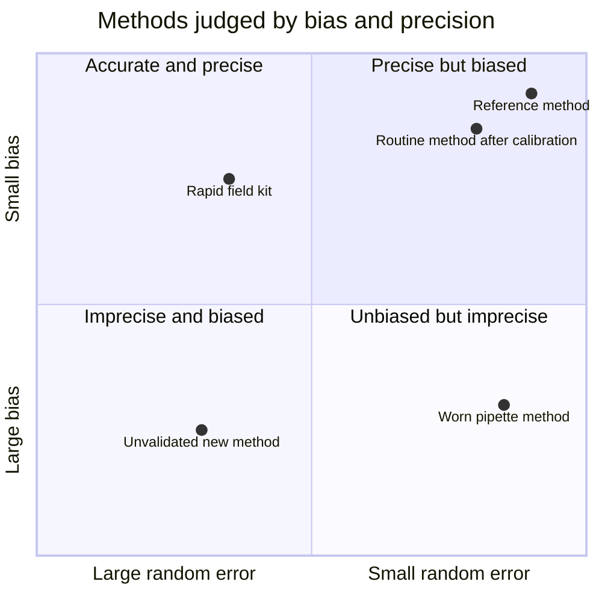
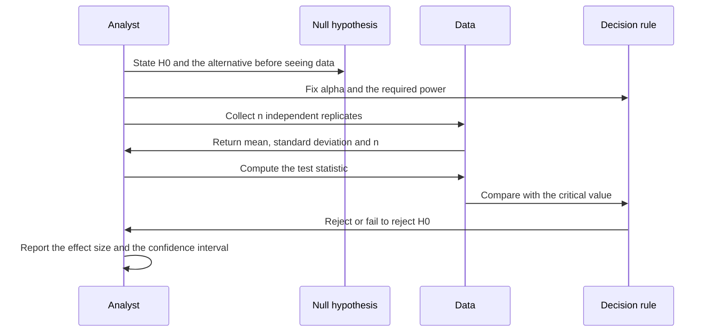

# Chapter 3 — Errors, Uncertainty and Statistical Data Treatment

> **Level:** Level 7 — Analytical Chemistry (undergraduate / practising analyst)
> **Estimated study time:** 8 hours (reading) + 3 hours (exercises)
> **Prerequisites:** [Introduction to Analytical Chemistry](01-introduction-to-analytical-chemistry.md); basic algebra and descriptive statistics
> **Difficulty:** ★★★★☆ (4/5)
> **Related chapters:** [Sampling and Sample Preparation](02-sampling-and-sample-preparation.md), [Calibration, Validation and Quantitative Analysis](04-calibration-validation-and-quantitative-analysis.md), [Level 7 module index](README.md)

---

## 1. Learning Objectives

After working through this chapter you will be able to:

- Distinguish random, systematic and gross error, and choose a detection strategy for
  each.
- Separate accuracy, trueness and precision operationally.
- Propagate uncertainty through sums, differences, products, quotients, powers and
  logarithms.
- Calculate and interpret a confidence interval using the $t$ distribution.
- Explain what a $p$-value does and does not mean.
- Compare two means by the $t$ test, paired data by the paired $t$ test, and two variances
  by the $F$ test.
- Carry out and interpret a one-way analysis of variance.
- Apply the Dixon $Q$ test and Grubbs' test, and state the case against routine outlier
  rejection.
- Fit and diagnose a least-squares calibration, including weighted regression, and derive
  the limits of detection and quantification from it.
- Report an uncertainty consistent with the GUM and round a result correctly.

---

## 2. Introduction

Two analysts measure the same certified reference material. Analyst A obtains
$10.02$, $10.03$, $10.01$ and $10.02\ \text{mg kg}^{-1}$ against a certified value of
$10.00$; analyst B obtains $9.62$, $10.45$, $9.88$ and $10.05$. Both means are close to the
certified value, and the two analysts will make different claims about their competence.
The first has a small random error and a small bias; the second has a large random error
and, on this evidence, no detectable bias at all.

This chapter builds the machinery for making such statements quantitative. It begins with
the taxonomy of error, because the remedies differ: random error is reduced by replication,
systematic error only by calibration or by changing the method, and gross error only by
rejecting the affected observation and finding its cause.

The statistical treatment that follows is not an optional add-on. A result reported as
$10.02\ \text{mg kg}^{-1}$ is a point estimate from a distribution, and the width of that
distribution determines what the number can support. Confidence intervals, hypothesis
tests, regression diagnostics and uncertainty budgets are different views of the same
underlying variability.

The chapter is deliberately practical: every formula is followed by its assumptions, and every
test by the question it answers and the question it does not. The commonest misuse of
statistics here is a category error — treating a non-significant difference as proof of
equivalence.

---

## 3. Fundamental Concepts

### 3.1 Error, uncertainty and the true value

The **true value** of a measurand is unknowable; the best approximation is a reference
value, realised by a certified reference material, a primary method or a consensus of
laboratories. The **error** is the measured value minus the true value and has a sign. The
**uncertainty** characterises the dispersion of values attributable to the measurand, has no
sign, and is expressed as a standard uncertainty $u$ or an expanded uncertainty $U = ku$.
"The bias is $+0.02\ \text{mg kg}^{-1}$" is a statement about error, made relative to a
reference; "the result is $10.02 \pm 0.05\ \text{mg kg}^{-1}$" is a statement about
uncertainty, made without claiming to know the true value.

### 3.2 Random error and the normal distribution

**Random error** varies in sign and magnitude between replicates and cannot be predicted
from the previous result. Its sources are electronic noise, thermal fluctuation, variation in
injected volume and counting statistics. The **normal distribution**,

$$
f(x) = \frac{1}{\sigma\sqrt{2\pi}}\exp\!\left[-\frac{(x-\mu)^2}{2\sigma^2}\right],
$$

places about $68\,\%$ of values within $\pm 1\sigma$, $95\,\%$ within $\pm 1.96\sigma$ and
$99.7\,\%$ within $\pm 3\sigma$; the last is the origin of the $\pm 3s$ action limits of the
Shewhart chart. With $n$ measurements, $\bar{x}$ estimates $\mu$ and $s$ estimates $\sigma$,
and the **standard deviation of the mean** is $s/\sqrt{n}$ — the quantity that appears in
every uncertainty statement, and the reason quadrupling the replicates halves the random
contribution.

### 3.3 Systematic error

**Systematic error** (bias) is constant in sign and reproducible for a given method. It
shifts the whole distribution and is invisible in replicate precision. Its forms are
**additive** (independent of concentration: a contaminated blank, a flask delivering a fixed
extra volume), **proportional** (scaling with concentration: a standard of incorrect
concentration, a slope in error by a fixed fraction) and **non-linear** (changing magnitude
across the range: detector saturation, concentration-dependent recovery).

Detection follows from the form. A **certified reference material** at the concentration of
interest detects additive and proportional bias; **standard addition** detects proportional
bias in a matrix; a **blank** detects additive bias from reagents and vessels; **recovery
experiments** detect extraction losses. The key asymmetry remains: random error is estimated
from replicates, bias requires an external reference.

### 3.4 Gross errors and outliers

A **gross error** is a mistake — a transcription error, a dropped aliquot, a mislabelled
tube, a bubble in a flow cell. The affected observation is an **outlier**, lying far from the
rest of the distribution. Not every outlier is a gross error: heavy-tailed distributions, a
heterogeneous sample or an unsuspected second population can produce extreme values
legitimately. The correct sequence is to inspect the raw record for a documented cause, and
only then to apply a statistical test (Section 4.6) and report the decision.

### 3.5 Accuracy, trueness and precision

**Precision** is dispersion between replicates — repeatability, intermediate precision or
reproducibility according to conditions. **Trueness** is the closeness of the mean of many
replicates to a reference value, expressed as **bias**. **Accuracy** is the closeness of a
measured value to the true value and, in the VIM, is qualitative.

| | Small random error | Large random error |
|---|---|---|
| **Small bias** | Accurate and precise | Unbiased but imprecise: improve replication or sensitivity |
| **Large bias** | Precise but biased: calibrate or change the method | Neither: rebuild the method |

### 3.6 Significant figures and rounding

**Significant figures** are the digits that carry information. Leading zeros are not
significant ($0.0042$ has two), trailing zeros after a decimal point are ($0.00420$ has
three), and trailing zeros in an integer are ambiguous ($4200$ may have two, three or four).
The uncertainty is quoted to one or two significant figures, the result is rounded to the
same decimal place, and rounding happens once, at the end. A digit of exactly 5 is rounded
to the nearest even digit to avoid upward drift. Thus $10.0234 \pm 0.0512$ becomes
$10.02 \pm 0.05$, and $0.03456 \pm 0.0012$ becomes $0.0346 \pm 0.0012$.

### 3.7 Type A and Type B uncertainty

The GUM classifies contributions by how they are evaluated. **Type A** evaluations use
statistical analysis of repeated observations: the standard deviation of the mean, the
residual standard deviation of a calibration, the scatter of replicate recoveries. **Type B**
evaluations use other information: a manufacturer's tolerance, a certificate or scientific
judgement. A certificate stating $99.5 \pm 0.5\,\%$ with no coverage factor is usually treated
as rectangular, giving $u = 0.29\,\%$; a balance tolerance of $\pm 0.1\ \text{mg}$ gives
$u = 0.058\ \text{mg}$. These conversions are conventions and must be stated.

---

## 4. Detailed Scientific Explanation

### 4.1 Propagation of uncertainty

If a result $y$ is calculated from independent measured quantities $x_i$, each with standard
uncertainty $u(x_i)$, then to first order

$$
u^2(y) = \sum_i \left(\frac{\partial y}{\partial x_i}\right)^2 u^2(x_i),
$$

where each partial derivative is a **sensitivity coefficient** converting the uncertainty of
an input into the uncertainty of the output.

**Sums and differences.** For $y = a + b - c$, the derivatives are $1$, $1$ and $-1$, so

$$
u^2(y) = u^2(a) + u^2(b) + u^2(c).
$$

Absolute uncertainties add in quadrature and the sign of a term does not matter, because it
is squared. A difference of two large numbers therefore has a large *relative* uncertainty:
$100.0 \pm 0.1$ minus $99.0 \pm 0.1$ gives $1.0 \pm 0.14$, or $14\,\%$.

**Products and quotients.** Logarithmic differentiation of $y = ab/c$ gives
$dy/y = da/a + db/b - dc/c$, hence

$$
\left(\frac{u(y)}{y}\right)^2 = \left(\frac{u(a)}{a}\right)^2 + \left(\frac{u(b)}{b}\right)^2 + \left(\frac{u(c)}{c}\right)^2 .
$$

Relative uncertainties add in quadrature — the form used for concentrations calculated from
mass and volume, and for serial dilutions.

**Powers.** For $y = a^n$, $dy/y = n\,da/a$, so $u(y)/y = |n|\,u(a)/a$: a quantity cubed
carries three times the relative uncertainty of its base. The volume of a sphere calculated
from a diameter known to $1\,\%$ therefore carries about $3\,\%$.

**Logarithms.** For $y = \log_{10} a$, $dy/da = 1/(a\ln 10) = 0.434/a$, so
$u(y) = 0.434\,u(a)/a$; for $y = \ln a$, $u(y) = u(a)/a$. A concentration known to
$1\,\%$ therefore corresponds to a $\text{pH}$ known to about $0.004$ units.

**Assumptions.** The expansion requires small relative uncertainties (so the function is
approximately linear over the uncertainty interval), independent inputs (so covariances
vanish) and a single dominant distribution (so the central limit theorem applies). When the
same balance or flask is used for sample and standard, the covariance term
$2(\partial y/\partial x_i)(\partial y/\partial x_j)\text{cov}(x_i,x_j)$ must be included;
ignoring it understates the uncertainty.

### 4.2 Confidence intervals and the $t$ distribution

When $\sigma$ is unknown and estimated by $s$ from $n$ measurements, the ratio
$t = (\bar{x}-\mu)/(s/\sqrt{n})$ follows Student's $t$ distribution with $n-1$ degrees of
freedom, and the $100(1-\alpha)\,\%$ confidence interval is

$$
\bar{x} \pm t_{\alpha/2,\,n-1}\frac{s}{\sqrt{n}} .
$$

The $t$ distribution is heavier-tailed than the normal, and the difference matters for small
$n$: at $95\,\%$ the critical value is $4.30$ for $n = 3$, $2.57$ for $n = 6$ and approaches
$1.96$ as $n \to \infty$. Using $1.96$ for triplicate data understates the interval by more
than a factor of two. The interpretation is also subtle: if the whole experiment were
repeated many times, $95\,\%$ of the intervals so constructed would contain $\mu$; it is not
a statement that a particular interval has a $95\,\%$ probability of containing $\mu$.

### 4.3 Hypothesis testing and the meaning of $p$

A significance test compares a **null hypothesis** $H_0$ — usually "no difference" or "no
bias" — with an alternative. The test statistic is calculated from the data, and its
distribution under $H_0$ gives the **$p$-value**: the probability of a statistic at least as
extreme as that observed, assuming $H_0$ is true. If $p < \alpha$, $H_0$ is rejected.

Three misinterpretations are endemic. **First**, $p$ is not the probability that $H_0$ is
true; it is a probability of the data, conditional on $H_0$. **Second**, a large $p$ does not
prove $H_0$: failure to detect a difference may reflect insufficient power. **Third**,
statistical significance is not practical importance — with enough replicates a bias of
$0.01\,\%$ becomes significant and may still be irrelevant. The **power** of a test is the
probability of rejecting $H_0$ when it is false; it rises with sample size and effect size,
and inadequate power is the commonest reason a validation study misses a real problem.

### 4.4 Comparing means and variances

**Unpaired $t$ test.** For independent sets of $n_1$ and $n_2$ measurements with means
$\bar{x}_1$, $\bar{x}_2$ and standard deviations $s_1$, $s_2$,

$$
s_p^2 = \frac{(n_1-1)s_1^2 + (n_2-1)s_2^2}{n_1+n_2-2},
\qquad
t = \frac{|\bar{x}_1 - \bar{x}_2|}{s_p\sqrt{1/n_1 + 1/n_2}},
$$

with $n_1+n_2-2$ degrees of freedom. The test assumes independence, approximate normality
and equal variances; if the variances differ substantially, Welch's version with adjusted
degrees of freedom should be used.

**Paired $t$ test.** When the same samples are measured by two methods, or before and after
a treatment, the differences $d_i$ are analysed: $t = \bar{d}/(s_d/\sqrt{n})$ with $n-1$
degrees of freedom. Pairing removes between-sample variation and is far more powerful than an
unpaired test when samples differ widely.

**$F$ test.** To compare two variances, $F = s_1^2/s_2^2$ with the larger variance in the
numerator and degrees of freedom $n_1-1$ and $n_2-1$. It is sensitive to non-normality and is
best used as a preliminary check before choosing between pooled and Welch $t$ tests.

### 4.5 Analysis of variance

When more than two groups are compared, repeated $t$ tests inflate the false-positive rate.
**Analysis of variance** partitions the total variation into between-group and within-group
components:

$$
SS_{\text{between}} = \sum_k n_k(\bar{x}_k-\bar{x})^2,
\qquad
SS_{\text{within}} = \sum_k\sum_i (x_{ki}-\bar{x}_k)^2,
\qquad
F = \frac{SS_{\text{between}}/(k-1)}{SS_{\text{within}}/(N-k)} .
$$

A large $F$ means that between-group variation exceeds what within-group variation would
produce by chance. One-way ANOVA is used to test analyst, day and instrument effects, and its
variance components feed directly into intermediate precision and the uncertainty budget. It
assumes normality, independence and equal variances; it is robust to moderate non-normality
but not to unequal variances combined with unequal group sizes.

### 4.6 Outlier tests and the controversy

**Dixon's $Q$ test** compares the suspect value with its nearest neighbour,

$$
Q = \frac{|x_{\text{suspect}} - x_{\text{nearest}}|}{x_{\text{max}} - x_{\text{min}}},
$$

with critical values at $90\,\%$ of $0.970$, $0.829$, $0.717$, $0.621$, $0.568$, $0.526$ and
$0.493$ for $n = 3$ to $9$. **Grubbs' test** compares it with the mean and standard deviation
of the whole set,

$$
G = \frac{|x_{\text{suspect}} - \bar{x}|}{s},
$$

with critical values at $95\,\%$ of $1.154$, $1.481$, $1.715$, $1.887$, $2.020$, $2.126$,
$2.215$ and $2.290$ for $n = 3$ to $10$. Grubbs is more powerful for a single extreme value;
$Q$ is simpler and less sensitive to the rest of the distribution.

The controversy is real. The tests assume normality and a single outlier, they are applied
after seeing the data (which invalidates the nominal error rate), and repeated application
rejects legitimate values and understates the uncertainty. The defensible position is that
outliers must be investigated, not merely deleted; a test may support a decision but never
replaces a documented cause; and every rejected value, with the test applied, must be
reported.

### 4.7 Least-squares regression and its diagnostics

For a calibration of response $y$ against concentration $x$, the least-squares line
$y = a + bx$ minimises the sum of squared residuals:

$$
b = \frac{\sum (x_i-\bar{x})(y_i-\bar{y})}{\sum (x_i-\bar{x})^2},
\qquad a = \bar{y} - b\bar{x},
\qquad
s_{y/x} = \sqrt{\frac{\sum (y_i-\hat{y}_i)^2}{n-2}} .
$$

The standard errors are

$$
s_b = \frac{s_{y/x}}{\sqrt{\sum (x_i-\bar{x})^2}},
\qquad
s_a = s_{y/x}\sqrt{\frac{\sum x_i^2}{n\sum (x_i-\bar{x})^2}} .
$$

The coefficient of determination $r^2 = 1 - SS_{\text{res}}/SS_{\text{tot}}$ measures the
fraction of variance explained, but it is a poor diagnostic: a calibration with slight
curvature can have $r^2 = 0.999$ and still produce biased results. **Residual plots** against
concentration reveal curvature, heteroscedasticity and outliers that $r^2$ conceals.

**Weighted regression** suits data whose variance changes with $x$, as it does for counting
detectors and much chromatographic data. Each point is weighted by $w_i = 1/s_i^2$:

$$
b = \frac{\sum w_i x_i y_i - \frac{(\sum w_i x_i)(\sum w_i y_i)}{\sum w_i}}
{\sum w_i x_i^2 - \frac{(\sum w_i x_i)^2}{\sum w_i}} .
$$

Unweighted regression on heteroscedastic data over-weights the high standards, where the
absolute variance is largest, and biases the low-concentration end — exactly where the
detection limit is defined.

### 4.8 Detection and quantification limits

$$
\text{LOD} = \frac{3.3\,s_{y/x}}{b}, \qquad \text{LOQ} = \frac{10\,s_{y/x}}{b},
$$

the ICH convention for $\alpha = \beta = 0.05$. The factors derive from the requirement that
the critical value (above which a blank is declared non-blank) and the detection limit (the
true concentration exceeding it with probability $1-\beta$) be separated by
$2 \times 1.645 = 3.29$ standard deviations. When blank variability dominates, $n \ge 10$
blank replicates and $\text{LOD} = 3.3\,s_{\text{blank}}/b$ give an independent estimate;
the two should agree within a factor of about two, and a larger discrepancy means the
residuals are not dominated by blank noise. Neither limit is a property of the instrument
alone: both depend on matrix, preparation and calibration design.

### 4.9 Reporting uncertainty

The GUM procedure specifies the measurand and the model, identifies all sources, quantifies
each as a standard uncertainty, combines them and multiplies by a coverage factor:

$$
u_c^2(y) = \sum_i \left(\frac{\partial y}{\partial x_i}\right)^2 u^2(x_i),
\qquad U = k\,u_c,
$$

with $k = 2$ giving approximately $95\,\%$ coverage for a normal distribution. For a
multiplicative model the relative form is easier:
$u_c(y)/y = \sqrt{\sum_i [u(x_i)/x_i]^2}$. Two practical rules follow: only the dominant
terms matter, since a contribution below one third of the largest changes $u_c$ by less than
$6\,\%$; and the budget is a tool for prioritising improvement, not a document for its own
sake.

---

## 5. Visual Diagrams

**Figure 3.1 — Classifying variation before choosing a remedy.** The first branch separates
random from non-random variation; the second separates a mistake from a bias. Extra replicates
never remove a bias, and recalibration never removes scatter.

**Figure 3.2 — Accuracy and precision are independent axes.** The horizontal axis is
precision, the vertical axis trueness. Only a study with an external reference can place a
method in the upper-right quadrant; the field kit sits below it, unbiased on average but too
scattered for single-sample decisions.

**Figure 3.3 — A significance test in the correct order.** Fixing $\alpha$ before seeing the
data prevents choosing a test to fit the result. The final step matters most: a decision is
uninformative without the size of the effect and its interval.

---

## 6. Mathematical Formulas

### 6.1 Propagation rules

$$
\begin{aligned}
y &= a \pm b - c: & u^2(y) &= u^2(a) + u^2(b) + u^2(c),\\
y &= \frac{ab}{c}: & \left(\frac{u(y)}{y}\right)^2 &= \left(\frac{u(a)}{a}\right)^2 + \left(\frac{u(b)}{b}\right)^2 + \left(\frac{u(c)}{c}\right)^2,\\
y &= a^n: & \frac{u(y)}{y} &= |n|\,\frac{u(a)}{a},\\
y &= \log_{10} a: & u(y) &= \frac{0.434\,u(a)}{a}.
\end{aligned}
$$

| Symbol | Meaning | SI unit |
|---|---|---|
| $y$ | Calculated result | unit of the result |
| $a$, $b$, $c$ | Measured inputs | their own units |
| $u(\cdot)$ | Standard uncertainty | unit of the quantity |
| $n$ | Exponent | dimensionless |

**Assumptions.** Small relative uncertainties, independent inputs and approximate linearity
over the uncertainty interval; relative forms apply only to positive quantities.

### 6.2 Confidence interval, $t$ test and $F$ test

$$
\bar{x} \pm t_{\alpha/2,\,n-1}\frac{s}{\sqrt{n}},
\qquad
t = \frac{|\bar{x}_1-\bar{x}_2|}{s_p\sqrt{1/n_1 + 1/n_2}},
\qquad
F = \frac{s_1^2}{s_2^2}
$$

| Symbol | Meaning | SI unit |
|---|---|---|
| $\bar{x}$ | Sample mean | unit of the measurand |
| $s$ | Sample standard deviation | unit of the measurand |
| $n$ | Number of replicates | dimensionless |
| $t$, $F$ | Test statistics | dimensionless |
| $s_p$ | Pooled standard deviation | unit of the measurand |

**Assumptions.** Independent, approximately normal observations; equal variances for the pooled
$t$ and $F$ tests, with the larger variance in the numerator.

### 6.3 ANOVA and regression

$$
F = \frac{MS_{\text{between}}}{MS_{\text{within}}},
\qquad
s_{y/x} = \sqrt{\frac{\sum (y_i-\hat{y}_i)^2}{n-2}},
\qquad
s_b = \frac{s_{y/x}}{\sqrt{\sum (x_i-\bar{x})^2}}
$$

| Symbol | Meaning | SI unit |
|---|---|---|
| $MS$ | Mean square, a sum of squares divided by its degrees of freedom | (unit)² |
| $s_{y/x}$ | Residual standard deviation of the calibration | response unit |
| $s_b$ | Standard error of the slope | response unit per concentration unit |
| $\hat{y}_i$ | Fitted response | response unit |

**Assumptions.** ANOVA: normality, independence and equal variances. Regression: linearity,
independent residuals, constant variance and negligible uncertainty in $x$ compared with $y$.

### 6.4 Detection limit and combined uncertainty

$$
\text{LOD} = \frac{3.3\,s_{y/x}}{b},
\qquad
u_c = \sqrt{\sum_i u_i^2},
\qquad
U = k\,u_c
$$

| Symbol | Meaning | SI unit |
|---|---|---|
| $b$ | Calibration slope | response unit per concentration unit |
| $s_{y/x}$ | Residual standard deviation | response unit |
| $u_i$ | Standard uncertainty of contribution $i$ | unit of the result |
| $k$ | Coverage factor | dimensionless |

**Assumptions.** Linear calibration with homoscedastic residuals; independent uncertainty
contributions; $k = 2$ for approximately $95\,\%$ coverage. The detection limit is a property
of the whole method, not of the detector alone.

---

## 7. Chemical Equations

Statistical treatment begins with a chemical measurement, and the equations below are the
ones that generate the numbers in the worked examples: a standardisation, a redox titration
and a complexometric titration.

**Standardisation of sodium hydroxide with potassium hydrogen phthalate.**

$$
\ce{KHC8H4O4(aq) + NaOH(aq) -> NaKC8H4O4(aq) + H2O(l)}
$$

One mole of phthalate consumes one mole of hydroxide, which is why potassium hydrogen
phthalate is a primary standard: it is obtainable pure, stable and of high molar mass, so
the weighing uncertainty is small relative to the amount.

**Redox titration of iron with permanganate.**

$$
\ce{MnO4-(aq) + 5Fe^2+(aq) + 8H+(aq) -> Mn^2+(aq) + 5Fe^3+(aq) + 4H2O(l)}
$$

The 1:5 stoichiometry must be exact, because a proportional error in the standard's
concentration propagates directly into every result — an example of multiplicative bias.

**Complexometric titration of calcium with EDTA.**

$$
\ce{Ca^2+(aq) + EDTA^4-(aq) -> [Ca(EDTA)]^2-(aq)}
$$

The formation constant is large enough for a sharp endpoint at pH 10, and the 1:1
stoichiometry simplifies the calculation of amount concentration.

---

## 8. Worked Examples

### Worked Example 3.1 — Propagating uncertainty through a density determination

**Problem.** A metal cylinder has mass $m = 2.1456 \pm 0.0002\ \text{g}$ and volume
$V = 1.842 \pm 0.004\ \text{cm}^3$. Calculate the density and its standard uncertainty, and
state which measurement dominates.

**Strategy.** Density is a quotient, so relative uncertainties combine in quadrature.

**Solution.**

$$
\rho = \frac{m}{V} = \frac{2.1456}{1.842} = 1.1648\ \text{g cm}^{-3}.
$$

$$
\frac{u(\rho)}{\rho} = \sqrt{\left(\frac{0.0002}{2.1456}\right)^2 + \left(\frac{0.004}{1.842}\right)^2}
= \sqrt{(9.3\times10^{-5})^2 + (2.17\times10^{-3})^2} = 2.17\times10^{-3},
$$

so $u(\rho) = 1.1648 \times 2.17\times10^{-3} = 0.0025\ \text{g cm}^{-3}$ and
$\rho = 1.1648 \pm 0.0025\ \text{g cm}^{-3}$ ($k = 1$), or
$1.165 \pm 0.005\ \text{g cm}^{-3}$ ($k = 2$).

**Check.** The volume term is 23 times larger than the mass term, so the volume dominates
completely; improving the balance would change nothing. This is the propagation analogue of
the error budget: the largest relative contribution, not the largest absolute one, controls
the result.

### Worked Example 3.2 — Confidence interval and comparison of two methods

**Problem.** Method A gives $24.25$, $24.38$, $24.22$, $24.41$ and $24.29\,\%$ ($n = 5$);
method B gives $24.15$, $24.32$, $24.08$, $24.27$, $24.19$ and $24.22\,\%$ ($n = 6$).
Calculate the $95\,\%$ confidence interval for each mean and test whether the methods differ.

**Strategy.** Compute means and standard deviations, form the intervals with the appropriate
$t$ values, then apply the pooled $t$ test.

**Solution.** Method A: $\bar{x} = 24.31\,\%$, $s = 0.082\,\%$, $t_{0.025,4} = 2.776$, so
the interval is $24.31 \pm 2.776(0.082/\sqrt{5}) = 24.31 \pm 0.10\,\%$. Method B:
$\bar{x} = 24.205\,\%$, $s = 0.085\,\%$, $t_{0.025,5} = 2.571$, so the interval is
$24.21 \pm 0.09\,\%$.

The pooled standard deviation is

$$
s_p = \sqrt{\frac{4(0.082)^2 + 5(0.085)^2}{9}} = 0.084\,\%,
$$

and

$$
t = \frac{24.31 - 24.21}{0.084\sqrt{1/5 + 1/6}} = \frac{0.10}{0.0502} = 2.06 .
$$

With nine degrees of freedom the critical value is $2.262$, so $t < t_{\text{crit}}$ and the
difference is not significant at the $95\,\%$ level.

**Check.** The intervals overlap, consistent with the test. "Not significant" does not mean
"identical": a difference of $0.1\,\%$ may be real but undetectable with these sample sizes.

### Worked Example 3.3 — Outlier tests

**Problem.** Five replicate results are $10.12$, $10.15$, $10.16$, $10.18$ and
$10.45\,\%$. Apply Dixon's $Q$ test and Grubbs' test at the $95\,\%$ level and comment.

**Strategy.** Apply both tests to the suspect value $10.45$, then compare the conclusions.

**Solution.** For $Q$:

$$
Q = \frac{10.45 - 10.18}{10.45 - 10.12} = \frac{0.27}{0.33} = 0.818,
$$

against a critical value of $0.717$ for $n = 5$ at $90\,\%$, so the value is rejected. For
Grubbs, $\bar{x} = 10.212\,\%$ and $s = 0.1348\,\%$, so

$$
G = \frac{10.45 - 10.212}{0.1348} = 1.77,
$$

against a critical value of $1.715$ for $n = 5$, so the value is also rejected.

**Check.** Both tests agree, which is reassuring but not decisive. The raw record should be
inspected for a cause; if none is found, the rejection is reported with the test used.

### Worked Example 3.4 — Calibration, regression diagnostics and the detection limit

**Problem.** A calibration by HPLC–UV gives:

| $c$ / $\mu\text{g dm}^{-3}$ | 1.0 | 5.0 | 10.0 | 20.0 | 30.0 | 40.0 |
|---|---|---|---|---|---|---|
| $A$ / AU | 0.050 | 0.170 | 0.330 | 0.650 | 0.970 | 1.290 |

Fit the line, calculate $s_{y/x}$, $r^2$, the standard error of the slope, and the LOD and
LOQ. Is the lowest standard usable for quantification?

**Strategy.** Apply the least-squares equations, then the detection-limit formulas.

**Solution.** The slope is $b = 0.03188\ \text{AU dm}^{3}\ \mu\text{g}^{-1}$, the intercept
$a = 0.0134\ \text{AU}$, and

$$
s_{y/x} = \sqrt{\frac{\sum (y_i - \hat{y}_i)^2}{4}} = 0.0031\ \text{AU},
\qquad
r^2 = 0.99997 .
$$

With $\sum (x_i - \bar{x})^2 = 1215$,
$s_b = 0.0031/\sqrt{1215} = 8.9\times10^{-5}\ \text{AU dm}^{3}\ \mu\text{g}^{-1}$, so the
slope is $0.03188 \pm 0.00009$ ($k = 1$).

$$
\text{LOD} = \frac{3.3 \times 0.0031}{0.03188} = 0.32\ \mu\text{g dm}^{-3},
\qquad
\text{LOQ} = \frac{10 \times 0.0031}{0.03188} = 0.97\ \mu\text{g dm}^{-3}.
$$

**Check.** The LOQ is just below the lowest standard, so that standard is usable but only
marginally; a laboratory reporting near $1\ \mu\text{g dm}^{-3}$ should add a standard at
$0.5\ \mu\text{g dm}^{-3}$. The residual plot shows no curvature, and $r^2$ is high — but
$r^2$ alone would not have revealed curvature.

### Worked Example 3.5 — One-way ANOVA of an analyst effect

**Problem.** Three analysts each analyse four portions of a homogeneous material, giving
means of $24.315$, $24.163$ and $24.280\,\%$. The between-group sum of squares is
$0.0511$ and the within-group sum of squares is $0.0554$. Test for an analyst effect at the
$95\,\%$ level.

**Strategy.** Compute the mean squares and the $F$ ratio with $2$ and $9$ degrees of
freedom.

**Solution.**

$$
MS_{\text{between}} = \frac{0.0511}{2} = 0.0256,
\qquad
MS_{\text{within}} = \frac{0.0554}{9} = 0.00615,
\qquad
F = \frac{0.0256}{0.00615} = 4.15 .
$$

The critical value $F_{0.05,2,9}$ is $4.26$, so $F < F_{\text{crit}}$ and there is no
significant analyst effect at the $95\,\%$ level.

**Check.** The result is close to the critical value, so the study has limited power: a real
difference of the size suggested would often escape detection with four replicates per
analyst. "No effect detected, with limited power" is the accurate statement.

---

## 9. Real-World Applications

**Method validation.** Acceptance criteria for accuracy, precision, linearity and LOD are
confidence or tolerance intervals; a report quoting a mean without one is incomplete.

**Clinical decision-making.** Reference intervals, cut-offs and quality-control rules are
built from distributions: a result inside a reference interval is a probabilistic statement
about a population, not a diagnosis about an individual.

**Pharmaceutical release testing.** Content uniformity compares the standard deviation with a
pharmacopoeial acceptance value, and an out-of-specification result triggers investigation.

**Environmental compliance.** Decision rules at a regulatory limit require the uncertainty of
the result, and the treatment of "less than" results affects the calculated mean.

**Industrial process control.** Control charts apply the same $2s$ and $3s$ logic to a
production stream, balancing the cost of a false alarm against that of a missed shift.

---

## 10. Common Mistakes

| Mistake | Why it happens | Correct approach |
|---|---|---|
| Reporting $s$ as the uncertainty of the mean | The standard deviation is what software prints | Divide by $\sqrt{n}$; report $s/\sqrt{n}$ for the mean |
| Using $1.96$ for a small sample | It is the familiar normal value | Use the $t$ value for $n-1$ degrees of freedom |
| Treating $p > 0.05$ as proof of equivalence | A non-significant result feels like a positive finding | Report the confidence interval and the power |
| Applying an outlier test repeatedly until the data are tidy | The tidied set looks more precise | Investigate first; report the test and any rejection |
| Quoting $r^2$ as proof of linearity | $r^2$ is easy to compute and usually high | Examine residual plots across the range |
| Ignoring heteroscedasticity in calibration | Software defaults to unweighted regression | Use weighted regression when variance grows with concentration |
| Combining uncertainty contributions arithmetically | Worst-case addition feels conservative | Combine in quadrature unless the inputs are correlated |

---

## 11. Chapter Summary

- Error has a sign and a true value; uncertainty has neither, and the two are reported
  differently.
- Random error is reduced by replication; systematic error requires an external reference;
  gross error requires investigation.
- Absolute uncertainties combine in quadrature for sums and differences, relative
  uncertainties for products and quotients; powers multiply the relative uncertainty.
- Confidence intervals use the $t$ distribution, much wider than the normal for small samples,
  and a $p$-value is the probability of the data given the null hypothesis, not the
  probability that the hypothesis is true.
- Paired tests are more powerful than unpaired tests when samples can be matched; ANOVA
  replaces multiple $t$ tests when more than two groups are compared.
- Outlier tests support, but do not replace, a documented investigation.
- Least-squares calibration is diagnosed by residuals, not by $r^2$ alone; weighted regression
  is required when variance grows with concentration, and the detection limits follow from the
  slope and residual standard deviation.
- The GUM combines standard uncertainties in quadrature and expands with $k = 2$; the
  dominant term determines the result.

---

## 12. Exercises

### 12.1 Conceptual questions

1. Explain why a systematic error cannot be detected by replicating a measurement.
2. A result is reported as $5.234 \pm 0.12$. Is the rounding correct? What should it be?
3. Why does the $t$ distribution approach the normal distribution as $n$ increases?

### 12.2 Basic problems

4. Calculate $y = 4.62 \pm 0.05$ divided by $1.84 \pm 0.02$, with its standard uncertainty.
5. A mean of $12.45$ is obtained from five replicates with $s = 0.18$. Calculate the $95\,\%$
   confidence interval.
6. Two variances are $s_1^2 = 0.0042$ ($n_1 = 6$) and $s_2^2 = 0.0011$ ($n_2 = 7$).
   Calculate $F$ and its degrees of freedom.

### 12.3 Intermediate problems

7. A calibration has $b = 0.0520$, $s_{y/x} = 0.0021$ and $\sum(x_i-\bar{x})^2 = 480$.
   Calculate the standard error of the slope and the $95\,\%$ confidence interval for the
   slope with $n = 6$.
8. Three groups give $SS_{\text{between}} = 0.084$ and $SS_{\text{within}} = 0.126$ with
   $k = 3$ and $N = 12$. Calculate $F$ and interpret it against $F_{0.05,2,9} = 4.26$.
9. A set of seven results has mean $50.12$ and $s = 0.42$. One value is $51.30$. Calculate
   Grubbs' $G$ and compare it with the critical value $2.020$.

### 12.4 Advanced problems

10. A method is validated over one day with $s = 0.08\,\%$ and over five days with
    $s = 0.19\,\%$. Explain which figure belongs in the uncertainty budget and why.
11. In a heteroscedastic calibration the response standard deviation triples between the lowest
    and highest standards. Explain the bias introduced by unweighted regression.

### 12.5 Calculation problems

12. A standard solution is prepared from $0.5124 \pm 0.0003\ \text{g}$ of a salt of molar mass
    $204.22\ \text{g mol}^{-1}$ in a $250.0 \pm 0.12\ \text{cm}^3$ flask. Calculate the amount
    concentration and its standard uncertainty.

### 12.6 Answers

1. Replicates share the same systematic influence, so they scatter around the biased value
   and reveal only random error.
2. No: the uncertainty has two significant figures, so the result should be quoted to the
   same decimal place, $5.23 \pm 0.12$.
3. Because $s$ becomes a better estimate of $\sigma$ as $n$ grows, and the uncertainty in $s$
   shrinks; the $t$ distribution converges to the normal.
4. $y = 2.51$; relative uncertainty $1.52\,\%$; $u = 0.038$, so $y = 2.51 \pm 0.04$.
5. $t_{0.025,4} = 2.776$; interval $= 12.45 \pm 2.776(0.18/\sqrt{5}) = 12.45 \pm 0.22$.
6. $F = 0.0042/0.0011 = 3.82$ with $5$ and $6$ degrees of freedom.
7. $s_b = 0.0021/\sqrt{480} = 9.6\times10^{-5}$; with $t_{0.025,4} = 2.776$ the interval is
   $0.0520 \pm 0.00027$.
8. $MS_{\text{between}} = 0.042$, $MS_{\text{within}} = 0.014$, $F = 3.0$, below $4.26$: no
   significant group effect.
9. $G = (51.30 - 50.12)/0.42 = 2.81$, above $2.020$, so the value would be rejected.
10. The five-day figure, which includes day-to-day variation and represents intermediate
    precision; the one-day figure understates the uncertainty of a result from an arbitrary day.
11. Unweighted regression over-weights the high standards, so the line is pulled towards them;
    the slope is slightly underestimated and the detection limit overestimated.
12. $n = 2.5091\times10^{-3}\ \text{mol}$ and $c = 0.010036\ \text{mol dm}^{-3}$. Relative
    uncertainty $= \sqrt{(5.86\times10^{-4})^2 + (4.8\times10^{-4})^2} = 7.6\times10^{-4}$, so
    $c = 0.010036 \pm 0.000008\ \text{mol dm}^{-3}$.

---

## 13. Further Reading

- Miller, J. N.; Miller, J. C. *Statistics and Chemometrics for Analytical Chemistry*,
  6th ed., Pearson. The standard text for the material in Sections 4 and 6.
- Harris, D. C.; Lucy, C. A. *Quantitative Chemical Analysis*, 10th ed., W. H. Freeman.
  Chapters 3–5 on error, statistics and calibration.
- Skoog, D. A.; West, D. M.; Holler, F. J.; Crouch, S. R. *Fundamentals of Analytical
  Chemistry*, 9th ed., Cengage Learning. Chapters on errors and the evaluation of
  analytical data.
- Eurachem/CITAC. *Quantifying Uncertainty in Analytical Measurement* (QUAM), 3rd ed., 2012,
  and JCGM 100:2008, *Evaluation of Measurement Data — Guide to the Expression of Uncertainty
  in Measurement* (GUM). <https://www.eurachem.org/>
- ISO 5725 series, *Accuracy (trueness and precision) of measurement methods and results*.
- NIST. *NIST/SEMATECH e-Handbook of Statistical Methods*, sections on measures of scale,
  hypothesis testing and regression. <https://www.itl.nist.gov/div898/handbook/>
- IUPAC. *Compendium of Chemical Terminology* (the "Gold Book"), 2nd ed. (corrected
  version), entries "error", "uncertainty", "limit of detection".
  <https://goldbook.iupac.org/>
- [CURRICULUM.md](../CURRICULUM.md) and [REFERENCES.md](../REFERENCES.md) — where this
  chapter sits in the programme, and the repository's verified source list.

> Only sources that can be checked are cited here. No DOI, page number or edition is
> invented.
