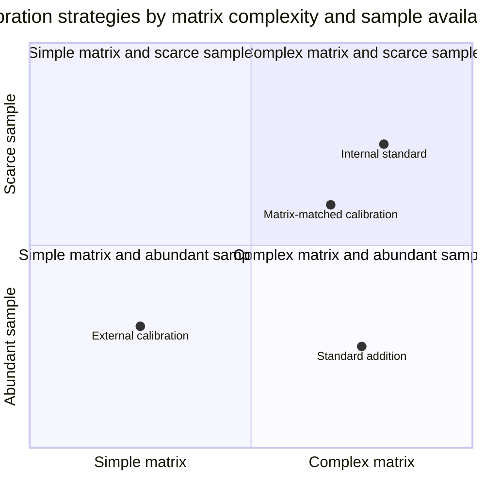
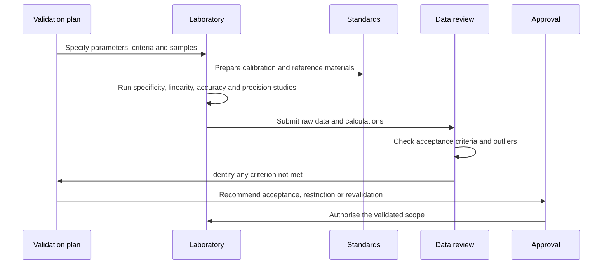
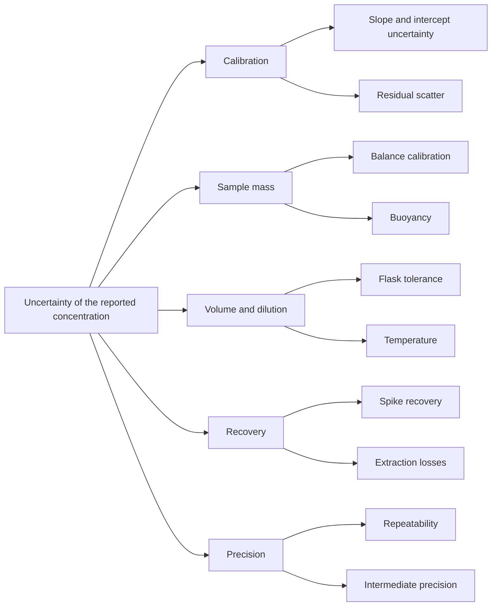

# Chapter 4 — Calibration, Validation and Quantitative Analysis

> **Level:** Level 7 — Analytical Chemistry (undergraduate / practising analyst)
> **Estimated study time:** 8 hours (reading) + 3 hours (exercises)
> **Prerequisites:** [Introduction to Analytical Chemistry](01-introduction-to-analytical-chemistry.md); [Errors, Uncertainty and Statistical Data Treatment](03-errors-uncertainty-and-statistical-data-treatment.md)
> **Difficulty:** ★★★★☆ (4/5)
> **Related chapters:** [Sampling and Sample Preparation](02-sampling-and-sample-preparation.md), [Level 7 module index](README.md), [Level 8 index](../09-biochemistry/README.md)

---

## 1. Learning Objectives

After working through this chapter you will be able to:

- Construct a calibration curve and justify the choice of standards.
- Compare external, internal-standard and standard-addition calibration, and select the
  right one for a given matrix.
- Derive and apply the method of standard additions, including the single-point form.
- Explain matrix effects and the remedies available for them.
- Correct for blanks and explain when correction is unsafe.
- Test linearity and interpret residual plots.
- Define and determine the validation parameters with acceptance criteria.
- Explain the difference between validation and verification.
- Interpret proficiency-testing $z$-scores and interlaboratory precision.
- Explain the role of certified reference materials in traceability.
- Construct a measurement uncertainty budget from a cause-and-effect diagram.
- Write a validation plan for a specified method.

---

## 2. Introduction

A calibration curve is a translation device: it converts an instrument response into a
concentration. Whether the translation is correct depends on three things — the standards,
the matrix and the model. Get any of them wrong and the instrument will still produce
beautiful numbers.

The classic failure is a calibration in dilute acid used to quantify an analyte in a
digested soil, a serum sample or a fruit juice. The instrument responds to the matrix as well
as to the analyte, and the resulting bias can be tens of per cent. The classic remedy is
either to calibrate in the matrix or to add the analyte to the sample itself, and the choice
between them is the first decision of quantitative analysis.

The second decision is how much validation is enough: a method for a major component at
$40\,\%$ needs a different demonstration from a method for a pesticide at
$0.01\ \text{mg kg}^{-1}$. Validation is evidence that the method is fit for its intended
purpose, and its extent should be proportional to the consequence of being wrong.

This chapter closes the methodological core of the level: the later chapters apply these
principles to particular techniques, and here they are stated once, in general form.

---

## 3. Fundamental Concepts

### 3.1 Calibration curves and standards

A **calibration curve** (or calibration function) relates the instrument response $y$ to the
analyte concentration $x$ using standards of known composition. The **standards** may be
prepared from a primary standard — a highly pure, stable substance weighed directly — or
from a certified reference solution whose concentration is traceable to a national metrology
institute.

A **calibration standard** is a solution of known concentration used to define the response
function. A **check standard** is an independent standard, prepared from a different stock,
used to verify that the curve is still valid; a **continuing calibration verification**
standard is analysed at intervals during a run to detect drift. The distinction matters: a
curve checked only against the standards used to build it can be internally consistent and
externally wrong.

### 3.2 External calibration

**External calibration** measures standards separately from the samples and applies the
resulting function to the sample response. It is the default method for clean matrices and
for techniques with low matrix sensitivity.

The concentration follows from inverting the calibration, $x = (y-a)/b$ for a linear
calibration $y = a + bx$. The standard uncertainty of $x$ is approximately

$$
u(x) \approx \frac{s_{y/x}}{b}\sqrt{\frac{1}{m} + \frac{1}{n} + \frac{(y-\bar{y})^2}{b^2\sum (x_i-\bar{x})^2}},
$$

with $m$ sample replicates and $n$ calibration points. The third term grows as the sample
response moves away from the centre of the calibration, which is why an extrapolated result is
less certain than an interpolated one. External calibration is simple, cheap and suitable for
high throughput; it fails when the matrix changes the response.

### 3.3 Internal-standard calibration

**Internal-standard calibration** adds a fixed amount of an **internal standard** — a
compound chemically similar to the analyte but absent from the sample — to every standard and
every sample. The response ratio replaces the raw response:

$$
\frac{A_{\text{analyte}}}{A_{\text{IS}}} = F\,\frac{C_{\text{analyte}}}{C_{\text{IS}}},
$$

where $F$ is a response factor determined from standards. Because both compounds experience
the same injection volume, ionisation efficiency and detector drift, the ratio is insensitive
to those variations.

An internal standard controls variation in *sample introduction and detection*, but not
losses during preparation unless it is added before preparation. It must be absent from the
sample, must not react with matrix components, must elute in a clear region and must be
chemically similar enough to track the analyte. **Isotope dilution** is the limiting case: a
labelled analogue is added before preparation and the isotope ratio is measured by mass
spectrometry, so recovery is corrected almost exactly and the result approaches a primary
method.

### 3.4 Standard addition

**Standard addition** adds known amounts of analyte to portions of the sample itself, so that
the analyte is calibrated in its own matrix. The response is plotted against the added
concentration, and the unknown concentration is the negative intercept on the $x$-axis.

The method corrects proportional matrix effects and recovery losses, because the added
analyte experiences the same treatment as the native analyte. It does not correct additive
interferences unless a blank is subtracted, and it assumes that added and native analyte are
in the same chemical form. It requires several portions of sample and amplifies any error in
the spiked amount.

### 3.5 Matrix effects and matrix-matched calibration

A **matrix effect** is any change in response caused by components of the sample other than
the analyte. It may suppress or enhance the signal, and it may be additive (a background
signal) or multiplicative (a change in slope).

The standard diagnostic compares the slope of a calibration in solvent with that in matrix: a
ratio of $0.86$ means $14\,\%$ suppression, a ratio of $1.10$ enhancement. Four remedies
exist. **Matrix-matched calibration** prepares standards in a matrix as similar
as possible to the samples — often a blank matrix or a pooled sample. **Standard addition**
calibrates within each sample. **Internal standards** correct for variation in the
introduction and detection steps. **Selective extraction** removes the interfering matrix
before measurement. In practice, combinations are used: an internal standard for instrument
variation plus matrix-matched standards for the residual matrix effect.

### 3.6 Blank correction

A **blank** is a sample containing everything except the analyte. The **method blank** is
carried through the whole procedure; the **reagent blank** contains the reagents only; the
**instrument blank** is the solvent injected into the instrument.

Blank correction subtracts the blank signal or concentration from the sample result. It is
valid when the blank is small relative to the sample signal and when the blank is measured
with adequate replication. It is unsafe when the blank is comparable to the sample, because
the uncertainty of the correction then dominates: subtracting $0.8$ from $0.9$ leaves
$0.1$ with a relative uncertainty that may exceed $100\,\%$. A negative result after blank
correction is not a mistake in arithmetic; it is evidence that the result lies below the
limit of quantification.

### 3.7 Calibration range and linearity

The **calibration range** is the interval between the lowest and highest standards, and it
must bracket every sample result. The **linear range** is the sub-interval over which the
response is proportional to concentration within a stated tolerance.

**Linearity** is assessed by fitting the calibration and examining residuals, not by
quoting $r^2$. A common acceptance criterion is that the residuals show no trend and that
the back-calculated concentration of each standard lies within $\pm 10$–$15\,\%$ of its
nominal value at the low end and $\pm 5\,\%$ at the high end. A **lack-of-fit test** compares
the residual variance of a linear fit with the variance of replicate standards; a
significant $F$ ratio indicates curvature.

### 3.8 Validation and verification

**Validation** is the process of demonstrating that a method is fit for its intended purpose.
It is required when the method is new, when it is applied to a new matrix, when it is used
outside its validated range, or when a significant change is made.

**Verification** is the demonstration that a laboratory can reproduce the performance of a
method already validated elsewhere — usually a standard method. It requires fewer
experiments and uses acceptance criteria taken from the method source.

**Revalidation** is required after a change in instrument, column chemistry, reagent supplier
or sample preparation. The extent of revalidation is proportional to the change: a new column
of the same chemistry may need only a check of resolution and a control-material result,
whereas a change of derivatisation reagent requires full revalidation.

### 3.9 Reference materials and traceability

A **certified reference material (CRM)** carries a certified value with an uncertainty
statement and a statement of metrological traceability; a **reference material** lacks the
certification but is useful for precision checks. CRMs calibrate empirical methods such as
X-ray fluorescence, verify trueness and anchor traceability. Traceability itself requires an
unbroken chain of calibrations: a CRM establishes it only if the CRM is traceable and the
procedure preserves the chain through calibrated balances, calibrated glassware and documented
dilutions.

### 3.10 Proficiency testing and $z$-scores

**Proficiency testing** distributes homogeneous samples to participating laboratories and
compares their results with an assigned value. The **$z$-score** is

$$
z = \frac{x - x_{\text{pt}}}{\sigma_{\text{pt}}},
$$

where $x$ is the laboratory's result, $x_{\text{pt}}$ the assigned value and
$\sigma_{\text{pt}}$ the standard deviation for proficiency assessment, set by the scheme
organiser from previous rounds or from a fitness-for-purpose criterion.

Conventional interpretation: $|z| \le 2$ is satisfactory, $2 < |z| < 3$ is questionable and
$|z| \ge 3$ is unsatisfactory. A $z$-score says nothing about the uncertainty a laboratory
claims, only about its agreement with the assigned value; a laboratory can be accurate and
over-confident, or imprecise and honest.

### 3.11 Measurement uncertainty and the fishbone diagram

An **uncertainty budget** lists the contributions to the uncertainty of a result and combines
them. Its construction is best begun with a **cause-and-effect diagram** (a fishbone or
Ishikawa diagram), which forces the analyst to enumerate sources that would otherwise be
forgotten: sample mass, volume, purity of the standard, calibration curve, recovery,
precision, matrix effects and operator effects.

The budget then quantifies each contribution as a standard uncertainty and combines them in
quadrature. The dominating terms determine where improvement is worthwhile.

---

## 4. Detailed Scientific Explanation

### 4.1 Deriving the method of standard additions

Consider a sample of volume $V_x$ containing analyte at unknown concentration $C_x$. A spike
of volume $V_s$ and concentration $C_s$ is added. The measured signals before and after the
addition are $A_1 = kC_x$ and

$$
A_2 = k\,\frac{C_xV_x + C_sV_s}{V_x + V_s},
$$

where $k$ is the response factor, assumed identical for native and added analyte. Dividing,

$$
\frac{A_2}{A_1} = \frac{C_xV_x + C_sV_s}{C_x(V_x + V_s)} .
$$

Solving for $C_x$:

$$
C_x = \frac{C_sV_sA_1}{A_2(V_x+V_s) - A_1V_x} .
$$

When $V_s \ll V_x$, the denominator simplifies and the classical single-point formula
$C_x = C_sV_sA_1/[V_x(A_2 - A_1)]$ is recovered.

For several additions, the signal is plotted against the added concentration *in the final
solution*, $C_{\text{added}} = C_sV_s/(V_x+V_s)$, and the line is extrapolated to $A = 0$.
The negative intercept is $-C_x$ expressed in the same diluted basis. The multiple-addition
form is preferred because it averages the calibration over several points and reveals
non-linearity.

**Assumptions.** The response is linear over the range spanned by the native concentration
and the additions; the added analyte equilibrates with the native form; the spike volume is
negligible or is accounted for; and the blank signal is constant.

### 4.2 Internal standards and isotope dilution

For an internal standard, the ratio $R = A_{\text{analyte}}/A_{\text{IS}}$ is proportional to
the concentration ratio, so a single calibration of $R$ against $C_{\text{analyte}}/
C_{\text{IS}}$ serves all samples. The response factor $F$ must be determined experimentally;
it depends on the detector, on the wavelength or $m/z$ used, and, for mass spectrometry, on
the ionisation efficiencies of the two species.

**Isotope dilution mass spectrometry** uses the isotope ratio itself as the measured quantity.
A known mass $m_y$ of a spike of mass fraction $w_y$ and known isotope ratio $R_y$ is added
to a sample of mass $m_x$ with ratio $R_x$. After equilibration the blend has ratio $R_b$:

$$
C_x = \frac{m_y w_y}{m_x}\cdot\frac{R_y - R_b}{R_b - R_x}\cdot\frac{M_x}{M_y},
$$

where $M_x$ and $M_y$ are the molar masses of the natural and labelled analyte. The equation
assumes complete equilibration, no isotope fractionation, a spike of known purity and a mass
bias correction applied to the measured ratios. Under these conditions the result is largely
independent of recovery, which is why isotope dilution is regarded as a primary method for
trace analysis.

### 4.3 Testing linearity

Linearity is tested in three steps. First, plot the residuals $y_i - \hat{y}_i$ against $x$
and inspect for curvature, funnel shapes (heteroscedasticity) or isolated large residuals.
Second, apply a **lack-of-fit** test: prepare replicate standards at several concentrations,
fit the line, and compare the variance due to lack of fit with the pure error variance using
an $F$ test. Third, examine the **back-calculated concentrations**: each standard's response
is converted back to a concentration, and the deviation from nominal is expressed as a
percentage.

Curvature has physical causes: detector saturation at high concentration, incomplete
ionisation, self-absorption in atomic spectroscopy, or a change in speciation. The remedy is
to narrow the range, to dilute the sample, or to fit a non-linear model — never to discard
the high standards because they spoil the line.

### 4.4 Validation parameters and acceptance criteria

| Parameter | What is demonstrated | Typical acceptance criterion |
|---|---|---|
| Specificity | The method measures the intended analyte in the presence of matrix and related substances | No interfering response above the LOQ at the analyte's retention time or wavelength; peak purity or mass-spectrometric confirmation |
| Linearity | Response is proportional to concentration across the range | $r^2 \ge 0.995$; residuals random; back-calculated deviations within $\pm 15\,\%$ at the LOQ and $\pm 10\,\%$ elsewhere |
| Range | The method is validated between stated limits | Lowest standard at or above the LOQ; highest standard below saturation |
| Accuracy (trueness) | Agreement with a reference value | Recovery $80$–$110\,\%$ for major components, $70$–$120\,\%$ for trace analysis, or bias within a stated fraction of the target uncertainty |
| Precision | Repeatability and intermediate precision | Relative standard deviation $\le 2\,\%$ at $1\,\%$ concentration, $\le 5$–$10\,\%$ at trace levels, $\le 20\,\%$ at the LOQ |
| LOD | Detection capability | $3.3\,s_{y/x}/b$, confirmed by spiked samples at the limit |
| LOQ | Quantification capability | $10\,s_{y/x}/b$; precision and recovery acceptable at that level |
| Robustness | Insensitivity to small deliberate changes | No significant change in result when pH, temperature, flow or reagent lot is varied within stated limits |
| Ruggedness | Reproducibility across laboratories, analysts and days | Intermediate precision within the stated criterion |

The criteria are conventions, and they must be justified against the decision the method
serves. A criterion of $\pm 2\,\%$ is meaningless for a method whose regulatory limit is
$\pm 20\,\%$, and a criterion of $\pm 20\,\%$ is indefensible for a referee method.

### 4.5 A validation plan

A validation plan is written before the experiments and states what will be done, by whom,
with what materials and against what criteria.

| Section | Content |
|---|---|
| Purpose and scope | Analyte, matrix, concentration range, decision served |
| Method summary | Principle, instrument, key reagents, sample preparation |
| Reference materials | CRM identity, certified value, uncertainty, intended use |
| Specificity study | Blank matrix, related substances, interference spikes, acceptance criteria |
| Linearity and range | Number and levels of standards, replication, model, criteria |
| Accuracy study | Spike levels, replicates, CRM analysis, recovery criteria |
| Precision study | Repeatability ($n \ge 6$), intermediate precision across days and analysts |
| LOD and LOQ | Method of determination, confirmation level, acceptance criteria |
| Robustness | Parameters to vary, ranges, experimental design |
| Uncertainty budget | Sources, quantification, combination, target expanded uncertainty |
| Acceptance and reporting | Decision rule, sign-off, records to be retained |

### 4.6 Interlaboratory studies

A **proficiency test** assesses a laboratory against its peers on a sample of known but
undisclosed composition. A **collaborative trial** assesses the method itself, producing
estimates of repeatability and reproducibility standard deviations that become part of the
method's published performance.

The reproducibility standard deviation $s_R$ combines the repeatability $s_r$ with the
between-laboratory component $s_L$:

$$
s_R^2 = s_r^2 + s_L^2 .
$$

Interlaboratory precision is usually larger than a single laboratory expects, because it
includes differences in calibration, equipment, reagent lots and interpretation. A method
with excellent in-house precision can still perform poorly in a trial, and the discrepancy is
diagnostic: it points to a step that is insufficiently specified in the procedure.

### 4.7 Constructing the uncertainty budget

The budget is built from the measurement equation. For a result calculated as

$$
C = \frac{C_{\text{cal}}\,V_{\text{final}}\,f_{\text{dil}}}{m\,R},
$$

where $C_{\text{cal}}$ comes from the calibration, $V$ is the final volume, $f$ the dilution
factor, $m$ the sample mass and $R$ the recovery, the relative uncertainties combine:

$$
\left(\frac{u(C)}{C}\right)^2 = \left(\frac{u(C_{\text{cal}})}{C_{\text{cal}}}\right)^2 + \left(\frac{u(V)}{V}\right)^2 + \left(\frac{u(f)}{f}\right)^2 + \left(\frac{u(m)}{m}\right)^2 + \left(\frac{u(R)}{R}\right)^2 .
$$

Each term is evaluated separately: $u(C_{\text{cal}})$ from the calibration statistics,
$u(V)$ from the flask tolerance and temperature, $u(m)$ from the balance calibration,
$u(R)$ from spike recovery experiments. The result is a standard uncertainty, expanded by
$k = 2$.

---

## 5. Visual Diagrams

**Figure 4.1 — Choosing a calibration strategy.** External calibration occupies the
simple-matrix region and is the default. Standard addition moves down: it handles a complex
matrix but consumes several portions of sample. Matrix-matched calibration and internal
standards serve the scarce-sample region, and the two are often combined, with the internal
standard correcting instrument variation and the matrix-matched standards correcting the
residual matrix effect.

**Figure 4.2 — The validation workflow.** The plan precedes the experiments, and the review
compares results with criteria fixed in advance. A criterion that fails is not negotiated
afterwards; it either restricts the validated scope or triggers revalidation.

**Figure 4.3 — Cause-and-effect diagram for a concentration result.** Each branch is a source
of uncertainty that must be either quantified or shown to be negligible. The diagram is built
before the numbers, because its purpose is to prevent a source being forgotten rather than to
display the ones already measured.

---

## 6. Mathematical Formulas

### 6.1 Calibration and the inverse problem

$$
y = a + bx, \qquad x = \frac{y-a}{b}
$$

| Symbol | Meaning | SI unit |
|---|---|---|
| $y$ | Instrument response | AU, counts, A or V |
| $x$ | Analyte concentration | $\text{mol dm}^{-3}$ or mg dm⁻³ |
| $a$ | Intercept | response unit |
| $b$ | Slope | response unit per concentration unit |

**Assumptions.** Linearity over the working range, homoscedastic residuals and negligible
uncertainty in $x$. The inverse estimate $x$ inherits the uncertainties of $a$ and $b$, and
the relative uncertainty grows as $y$ approaches $a$.

### 6.2 Standard addition

$$
C_x = \frac{C_sV_sA_1}{A_2(V_x+V_s) - A_1V_x}
$$

| Symbol | Meaning | SI unit |
|---|---|---|
| $C_x$ | Analyte concentration in the sample | mg dm⁻³ |
| $C_s$ | Spike concentration | mg dm⁻³ |
| $V_s$ | Spike volume | mL |
| $V_x$ | Sample volume | mL |
| $A_1$, $A_2$ | Signals before and after the addition | response unit |

**Assumptions.** Linear response over the native-plus-added range, identical response factor
for native and added analyte, complete equilibration and a constant blank.

### 6.3 Internal standard and isotope dilution

$$
\frac{A_{\text{a}}}{A_{\text{IS}}} = F\frac{C_{\text{a}}}{C_{\text{IS}}},
\qquad
C_x = \frac{m_yw_y}{m_x}\cdot\frac{R_y - R_b}{R_b - R_x}\cdot\frac{M_x}{M_y}
$$

| Symbol | Meaning | SI unit |
|---|---|---|
| $A_{\text{a}}$, $A_{\text{IS}}$ | Analyte and internal-standard responses | response unit |
| $F$ | Response factor | dimensionless |
| $C_{\text{a}}$, $C_{\text{IS}}$ | Analyte and internal-standard concentrations | mg dm⁻³ |
| $m_x$, $m_y$ | Sample and spike masses | g |
| $w_y$ | Spike mass fraction | g g⁻¹ |
| $R_x$, $R_y$, $R_b$ | Isotope ratios in sample, spike and blend | dimensionless |

**Assumptions.** For the internal standard: $F$ constant across the run and the standard
absent from the sample. For isotope dilution: complete equilibration, no fractionation,
known spike purity and a mass-bias-corrected ratio measurement.

### 6.4 Proficiency $z$-score and combined uncertainty

$$
z = \frac{x - x_{\text{pt}}}{\sigma_{\text{pt}}},
\qquad
u_c = \sqrt{\sum_i u_i^2},
\qquad U = k\,u_c
$$

| Symbol | Meaning | SI unit |
|---|---|---|
| $x$ | Laboratory result | mg kg⁻¹ |
| $x_{\text{pt}}$ | Assigned value | mg kg⁻¹ |
| $\sigma_{\text{pt}}$ | Standard deviation for proficiency assessment | mg kg⁻¹ |
| $u_i$ | Standard uncertainty of contribution $i$ | unit of the result |
| $k$ | Coverage factor | dimensionless |

**Assumptions.** The assigned value is traceable and its uncertainty is small compared with
$\sigma_{\text{pt}}$; the contributions to $u_c$ are independent; $k = 2$ gives approximately
$95\,\%$ coverage.

---

## 7. Chemical Equations

Calibration and validation rest on reactions whose stoichiometry defines the standard.

**Preparation of a primary standard by drying and weighing.**

$$
\ce{Na2CO3(s) + 2HCl(aq) -> 2NaCl(aq) + CO2(g) + H2O(l)}
$$

Sodium carbonate dried at $260\ ^\circ\text{C}$ is a primary standard for acidimetry: the
1:2 stoichiometry and the high molar mass give a small relative uncertainty on the weighed
amount.

**Standardisation of permanganate with oxalate.**

$$
\ce{2MnO4-(aq) + 5C2O4^2-(aq) + 16H+(aq) -> 2Mn^2+(aq) + 10CO2(g) + 8H2O(l)}
$$

The reaction is slow at room temperature and is accelerated by the manganese(II) produced —
autocatalysis — which is why the titration is warmed and the endpoint approached slowly.

**Complexometric standardisation with a metal-ion indicator.**

$$
\ce{Ca^2+(aq) + EDTA^4-(aq) -> [Ca(EDTA)]^2-(aq)}
$$

The 1:1 stoichiometry makes EDTA a convenient titrant, and the conditional formation
constant at pH 10 determines the sharpness of the endpoint.

---

## 8. Worked Examples

### Worked Example 4.1 — External calibration with a dilution factor

**Problem.** A calibration gives $y = 0.0450x + 0.0032$ with $x$ in mg dm⁻³ and $y$ in
absorbance. A sample diluted tenfold gives an absorbance of $0.286$. Calculate the
concentration in the original sample.

**Strategy.** Invert the calibration for the diluted solution, then multiply by the dilution
factor.

**Solution.**

$$
x_{\text{diluted}} = \frac{0.286 - 0.0032}{0.0450} = 6.28\ \text{mg dm}^{-3},
\qquad
x_{\text{original}} = 6.28 \times 10 = 62.8\ \text{mg dm}^{-3}.
$$

**Check.** The absorbance lies near the middle of a typical $0$–$1$ calibration range, where
interpolation is most reliable. The dilution factor is exact only if the volumetric glassware
is calibrated; a $1\,\%$ error in the dilution is a $1\,\%$ error in the result, which is why
dilution uncertainty appears explicitly in the budget of Section 4.7.

### Worked Example 4.2 — Single-point standard addition

**Problem.** A $10.00\ \text{cm}^3$ sample gives a signal of $0.215$. After adding
$0.200\ \text{cm}^3$ of a $500\ \text{mg dm}^{-3}$ standard, the signal is $0.386$. Calculate
the concentration in the sample.

**Strategy.** Apply the single-point standard-addition equation, taking care with the volume
change.

**Solution.**

$$
C_x = \frac{(500)(0.200)(0.215)}{(0.386)(10.00 + 0.200) - (0.215)(10.00)}
= \frac{21.5}{3.937 - 2.150} = 12.0\ \text{mg dm}^{-3}.
$$

**Check.** The spike raises the concentration by
$500 \times 0.200/10.20 = 9.80\ \text{mg dm}^{-3}$, so the spiked solution contains about
$21.8\ \text{mg dm}^{-3}$ against $12.0$ in the original — a ratio of $1.82$, consistent with
the signal ratio $0.386/0.215 = 1.80$. The small difference is rounding.

### Worked Example 4.3 — Multiple standard additions

**Problem.** Four portions of a sample are spiked to give added concentrations of $0$, $2.0$,
$5.0$ and $10.0\ \text{mg dm}^{-3}$, with signals $0.208$, $0.320$, $0.479$ and $0.748$.
Determine the native concentration and the residual standard deviation.

**Strategy.** Regress signal on added concentration and extrapolate to zero signal.

**Solution.** The regression gives slope $0.0539$, intercept $0.2099$ and

$$
s_{y/x} = \sqrt{\frac{\sum (y_i-\hat{y}_i)^2}{2}} = 0.0022 .
$$

The $x$-intercept is $-0.2099/0.0539 = -3.89\ \text{mg dm}^{-3}$, so the native concentration
is $3.9\ \text{mg dm}^{-3}$.

**Check.** The slope of the additions, $0.0539$, is close to the external calibration slope of
$0.0450$ in Example 4.1, suggesting a modest matrix enhancement of about $20\,\%$ — which is
exactly why standard addition was used. The detection limit from this curve is
$3.3(0.0022)/0.0539 = 0.13\ \text{mg dm}^{-3}$, well below the native concentration.

### Worked Example 4.4 — Internal standard

**Problem.** An internal standard at $20.0\ \text{mg dm}^{-3}$ gives a response ratio
$A_{\text{a}}/A_{\text{IS}} = 0.62$. The response factor determined from standards is $0.85$.
Calculate the analyte concentration.

**Strategy.** Rearrange the internal-standard equation for $C_{\text{a}}$.

**Solution.**

$$
C_{\text{a}} = \frac{0.62}{0.85} \times 20.0 = 14.6\ \text{mg dm}^{-3}.
$$

**Check.** The response factor below unity means the analyte responds less strongly than the
internal standard per unit concentration, so the concentration must exceed the ratio times
$C_{\text{IS}}$. If the injection volume fell by $10\,\%$, both responses would fall by
$10\,\%$ and the ratio would be unchanged — the point of the method.

### Worked Example 4.5 — Matrix effect and recovery-corrected result

**Problem.** A calibration in solvent gives a slope of $0.0450$; a calibration in matrix
gives $0.0388$. A sample measured against the solvent calibration gives
$62.8\ \text{mg dm}^{-3}$. Calculate the matrix suppression and the result after correction.

**Strategy.** Express the slope ratio as a percentage, then divide by the recovery factor.

**Solution.** Suppression is

$$
\left(1 - \frac{0.0388}{0.0450}\right) \times 100\,\% = 13.8\,\%.
$$

The corrected concentration is $62.8/0.862 = 72.9\ \text{mg dm}^{-3}$.

**Check.** A $14\,\%$ suppression is large enough to matter and small enough to be missed if
only a check standard in solvent were used. Correcting arithmetically is acceptable only if
the recovery is stable and validated; otherwise the method should be recalibrated in matrix,
because a variable recovery cannot be corrected by a constant factor.

### Worked Example 4.6 — Uncertainty budget and $z$-score

**Problem.** A result of $62.8\ \text{mg kg}^{-1}$ has relative standard uncertainties of
$2.0\,\%$ (recovery), $1.5\,\%$ (calibration), $1.2\,\%$ (precision), $0.15\,\%$ (mass) and
$0.30\,\%$ (volume). Calculate the combined and expanded uncertainty. A proficiency test
assigns $60.0\ \text{mg kg}^{-1}$ with $\sigma_{\text{pt}} = 2.1\ \text{mg kg}^{-1}$;
calculate the $z$-score.

**Strategy.** Combine in quadrature, expand with $k = 2$, then apply the $z$-score equation.

**Solution.**

$$
u_{c,\text{rel}} = \sqrt{2.0^2 + 1.5^2 + 1.2^2 + 0.15^2 + 0.30^2} = \sqrt{7.65} = 2.77\,\%,
$$

so $U = 5.5\,\%$ and the result is $62.8 \pm 3.5\ \text{mg kg}^{-1}$ ($k = 2$). The $z$-score
is

$$
z = \frac{62.8 - 60.0}{2.1} = +1.33 .
$$

**Check.** Recovery contributes $52\,\%$ of the variance and calibration $29\,\%$, so
improving the balance or the volumetric glassware would be pointless. The $z$-score is within
$\pm 2$, so the result is satisfactory, but the positive sign and the stated uncertainty
($\pm 3.5$) are consistent with a small positive bias that the scheme's tolerance would not
flag.

---

## 9. Real-World Applications

**Pharmaceutical analysis.** Assay by HPLC uses external calibration with a check standard,
because the matrix is well defined and the active ingredient is present at a high
concentration; impurity methods use matrix-matched or standard-addition approaches at much
lower levels.

**Environmental trace analysis.** Isotope dilution with GC–MS/MS or LC–MS/MS is the reference
approach for dioxins and pesticides, because recovery correction is almost exact and the
result is traceable to a gravimetric spike.

**Clinical chemistry.** Immunoassays are calibrated against a reference material and verified
by proficiency testing; serum is so variable that matrix-matched standards are routine.

**Geological analysis.** X-ray fluorescence is calibrated with certified reference materials
whose matrix matches the unknown, because the technique is empirical and matrix-dependent.

**Food and feed analysis.** Proficiency-testing schemes for mycotoxins and veterinary drug
residues are mandatory in many jurisdictions and form part of accreditation.

---

## 10. Common Mistakes

| Mistake | Why it happens | Correct approach |
|---|---|---|
| Calibrating in solvent for a complex matrix | Standards are easier to prepare | Verify the slope in matrix; use matrix-matched standards or standard addition |
| Using $r^2$ as the only linearity check | It is printed by the software | Examine residuals and back-calculated concentrations |
| Adding the internal standard after extraction | It is convenient | Add before preparation if recovery correction is intended |
| Correcting a variable recovery with a constant factor | The arithmetic restores a plausible number | Investigate the method; correct only a stable, validated recovery |
| Reporting a result below the LOQ as a number | The instrument produced a value | Report "less than the LOQ" |
| Treating a $z$-score within $\pm 2$ as proof of accuracy | It is a satisfactory result | Combine with the uncertainty statement and the CRM data |
| Validating without pre-specified criteria | Criteria are set after seeing the data | Write the plan and the acceptance criteria first |

---

## 11. Chapter Summary

- A calibration curve translates response into concentration; its validity depends on
  standards, matrix and model.
- External calibration is simple and adequate for clean matrices; matrix-matched calibration
  and standard addition correct proportional matrix effects.
- Standard addition calibrates inside each sample and derives from the ratio of signals
  before and after a spike.
- Internal standards correct for variation in sample introduction and detection; isotope
  dilution extends the correction to the whole procedure.
- Blank correction is valid only when the blank is small relative to the sample.
- Linearity is diagnosed by residuals and back-calculated concentrations, not by $r^2$.
- Validation parameters have conventional acceptance criteria that must be justified against
  the decision the method serves.
- Verification confirms that a laboratory can reproduce a validated method; validation
  establishes fitness for purpose.
- Proficiency testing expresses agreement as a $z$-score; interlaboratory precision always
  exceeds in-house precision, and certified reference materials anchor trueness.
- An uncertainty budget, built from a cause-and-effect diagram, identifies the dominant terms
  and directs improvement.

---

## 12. Exercises

### 12.1 Conceptual questions

1. Explain why an internal standard added after extraction cannot correct for losses during
   extraction.
2. Why is standard addition unsuitable for a sample that is available only once?
3. Distinguish validation, verification and revalidation.

### 12.2 Basic problems

4. A calibration is $y = 0.0620x + 0.0040$. A sample gives $y = 0.317$ after a fivefold
   dilution. Calculate the original concentration.
5. A $25.00\ \text{cm}^3$ sample gives a signal of $0.180$; after adding
   $0.500\ \text{cm}^3$ of $200\ \text{mg dm}^{-3}$ standard the signal is $0.345$. Calculate
   the concentration.
6. A proficiency test gives $x = 4.62$, $x_{\text{pt}} = 4.40$ and
   $\sigma_{\text{pt}} = 0.18$. Calculate the $z$-score and interpret it.

### 12.3 Intermediate problems

7. A solvent calibration has a slope of $0.0520$ and a matrix calibration $0.0442$. Calculate
   the suppression and the recovery-corrected result for an uncorrected value of
   $18.4\ \mu\text{g dm}^{-3}$.
8. A method has relative uncertainties of $3.0\,\%$ (recovery), $2.0\,\%$ (calibration) and
   $1.0\,\%$ (precision). Calculate $U$ at $k = 2$ and the percentage of variance due to
   recovery.
9. Back-calculated concentrations from a five-point calibration are $102.4$, $97.1$, $103.8$,
   $96.2$ and $100.5\,\%$ of nominal. Comment on the linearity.

### 12.4 Advanced problems

10. A laboratory's in-house repeatability is $1.2\,\%$ and the reproducibility from a
    collaborative trial is $4.8\,\%$. Estimate the between-laboratory component and explain
    its practical meaning.
11. An isotope-dilution result is independent of recovery. Explain why, and state two
    conditions that must hold for this to be true.

### 12.5 Calculation problems

12. A calibration gives $b = 0.0480$, $a = 0.0060$ and $s_{y/x} = 0.0032$. Calculate the LOD
    and LOQ, and state whether a standard at $0.05\ \text{mg dm}^{-3}$ lies in the
    quantifiable range.

### 12.6 Answers

1. The internal standard would not experience the extraction, so its ratio would not reflect
   analyte lost before it was added.
2. Standard addition consumes several portions of the same sample, so a single portion cannot
   be spiked at several levels.
3. Validation establishes fitness for purpose; verification confirms reproduction of a
   validated method; revalidation repeats part or all of the validation after a change.
4. $x_{\text{diluted}} = (0.317-0.0040)/0.0620 = 5.05$; original $= 25.3\ \text{mg dm}^{-3}$.
5. $C_x = (200)(0.500)(0.180)/[(0.345)(25.50) - (0.180)(25.00)] = 18.0/(8.798-4.500) =
   4.19\ \text{mg dm}^{-3}$.
6. $z = (4.62-4.40)/0.18 = +1.22$: within $\pm 2$, satisfactory.
7. Suppression $= 15.0\,\%$; corrected $= 18.4/0.850 = 21.6\ \mu\text{g dm}^{-3}$.
8. $u_c = \sqrt{9+4+1} = 3.74\,\%$; $U = 7.5\,\%$; recovery contributes
   $9/14 = 64\,\%$ of the variance.
9. Deviations lie within $\pm 4\,\%$, with no monotonic trend, so linearity is acceptable;
   the residuals should still be plotted to confirm the absence of curvature.
10. $s_L = \sqrt{4.8^2-1.2^2} = 4.65\,\%$: most of the variability arises between laboratories,
    from calibration, equipment and procedure interpretation.
11. The labelled spike is added before preparation, so it experiences the same losses and the
    ratio is unaffected by recovery. Conditions: complete equilibration, and no isotope
    fractionation or mass-bias error.
12. $\text{LOD} = 0.22$ and $\text{LOQ} = 0.67\ \text{mg dm}^{-3}$, so a standard at
    $0.05\ \text{mg dm}^{-3}$ lies below the LOD and is not quantifiable.

---

## 13. Further Reading

- Harris, D. C.; Lucy, C. A. *Quantitative Chemical Analysis*, 10th ed., W. H. Freeman.
  Chapter 5 ("Quality Assurance and Calibration Methods") covers external, internal-standard
  and standard-addition calibration.
- Skoog, D. A.; West, D. M.; Holler, F. J.; Crouch, S. R. *Fundamentals of Analytical
  Chemistry*, 9th ed., Cengage Learning. Chapters on calibration and validation.
- Miller, J. N.; Miller, J. C. *Statistics and Chemometrics for Analytical Chemistry*,
  6th ed., Pearson. Chapters on calibration and regression.
- Eurachem. *The Fitness for Purpose of Analytical Methods: A Laboratory Guide to Method
  Validation and Related Topics*, 2nd ed., 2014. <https://www.eurachem.org/>
- Eurachem/CITAC. *Quantifying Uncertainty in Analytical Measurement* (QUAM), 3rd ed., 2012,
  and *Use of Certified Reference Materials*. <https://www.eurachem.org/>
- ISO/IEC 17025:2017, *General requirements for the competence of testing and calibration
  laboratories*, clauses on method validation and measurement uncertainty.
- ISO 5725 series, *Accuracy (trueness and precision) of measurement methods and results*,
  and ISO 13528, *Statistical methods for use in proficiency testing by interlaboratory
  comparison*.
- NIST. *NIST/SEMATECH e-Handbook of Statistical Methods*, sections on calibration and
  measurement uncertainty. <https://www.itl.nist.gov/div898/handbook/>
- [CURRICULUM.md](../CURRICULUM.md) and [REFERENCES.md](../REFERENCES.md) — where this
  chapter sits in the programme, and the repository's verified source list.

> Only sources that can be checked are cited here. No DOI, page number or edition is
> invented.
