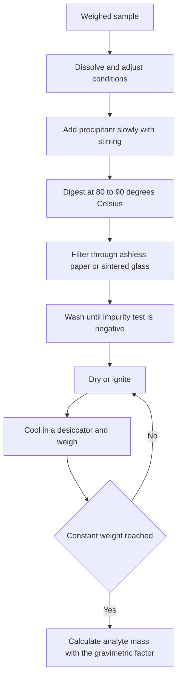
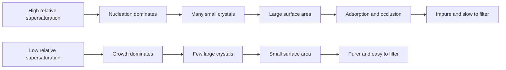
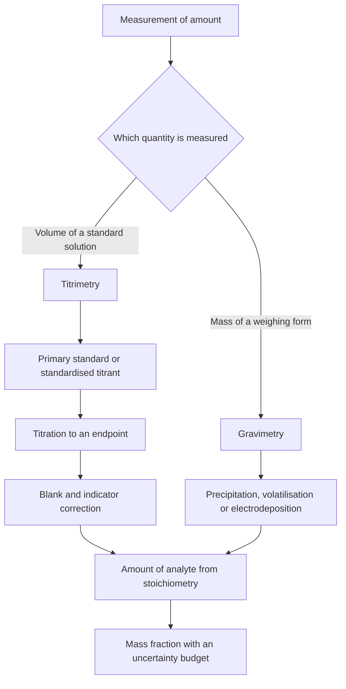

# Chapter 5 — Gravimetric and Volumetric Analysis

> **Level:** Advanced (Level 7 — Analytical Chemistry)
> **Estimated study time:** 5 hours (reading) + 2 hours (exercises)
> **Prerequisites:** [Solutions, Concentration and Dilution](../03-intermediate-chemistry/03-solutions-concentration-and-dilution.md); [Chemical Equilibrium and Le Châtelier's Principle](../03-intermediate-chemistry/10-chemical-equilibrium-and-le-chateliers-principle.md); Chapters 2–4 of this level
> **Related chapters:** [Titrations](06-titrations.md), [Chromatography](07-chromatography.md), [Spectroscopic Analysis](08-spectroscopic-analysis.md), [Electroanalytical Chemistry and Potentiometry](09-electroanalytical-chemistry-and-potentiometry.md)
> **Difficulty:** ★★★★☆ (4/5)

---

## 1. Learning Objectives

After working through this chapter you will be able to:

- Explain why gravimetry and titrimetry are *primary* methods and what that status
  implies for traceability and for method validation.
- Design a precipitation gravimetry: choose precipitant, weighing form and
  ignition temperature, and justify each choice chemically.
- Distinguish co-precipitation from post-precipitation, and adsorption from
  occlusion and inclusion, naming the remedy appropriate to each.
- Calculate a gravimetric factor from a balanced equation and use it to convert a
  weighing-form mass into an analyte mass fraction.
- Explain constant weight and decide when a drying or ignition cycle is complete.
- Calibrate volumetric glassware gravimetrically, with the buoyancy correction,
  and test it against its Class A tolerance.
- Select a primary standard for acid–base, redox, precipitation or complexometric
  work, and standardise a titrant against it.
- Distinguish the equivalence point from the endpoint and correct a titre for the
  reagent and indicator blanks.
- Build an uncertainty budget for a gravimetric or volumetric result.
- Perform the worked determinations of chloride, sulfate, iron, nickel, sodium
  hydroxide and water hardness reproduced in this chapter.

---

## 2. Introduction

Two balances and a burette settled most of the quantitative chemistry of the
nineteenth century. Before spectroscopy and chromatography, chemists established
the composition of minerals, alloys, waters and drugs by converting a weighed
sample into a weighed product, or by measuring the volume of a solution of known
strength that just completed a reaction. Those methods are still taught first, and
still used, because they rest on the definitions of the mole, the kilogram and the
litre rather than on a calibration curve traceable to somebody else's instrument.

The distinction matters in practice. A laboratory that reports 35.46 % chloride by
precipitation as silver chloride can defend that number from first principles: the
sample and the precipitate were weighed, and the stoichiometry is fixed. A laboratory
that reports the same chloride by an ion-selective electrode must also defend a
calibration, a slope and a matrix match. Both can be fit for purpose, but the first
is easier to audit, which is why gravimetry survives in reference materials.

The chapter is also where analytical chemistry becomes quantitative in the operative
sense: the balance is an instrument with a buoyancy correction, the flask a vessel
with a tolerance, and the endpoint an observation displaced from the equivalence
point. The arithmetic is elementary; the discipline lies in the error budget.

Prerequisites are the mole, concentration and dilution, equilibrium and solubility
product, and the statistical vocabulary of Chapters 2–4. The titration chemistry
introduced here — neutralisation, precipitation, redox and complex formation — is
developed systematically in [Chapter 6](06-titrations.md); this chapter concentrates
on the measurement rather than on the reaction.

---

## 3. Fundamental Concepts

### 3.1 Analysis, determination and measurement

A **measurement** is a single observation with an instrument: a mass, a volume, an
absorbance. A **determination** is the complete procedure that converts observations
into the mass fraction of one analyte in one sample. An **analysis** is the whole
service — sampling, determination, quality control, reporting and interpretation.
The **analyte** is the species sought; the **matrix** is everything else. A method is
**selective** if it responds to the analyte in the presence of the matrix and
**specific** if it responds to nothing else.

### 3.2 Three forms of gravimetry

**Gravimetric analysis** measures the mass of a product whose composition is known
and whose amount is stoichiometrically related to the analyte. In **precipitation
gravimetry** the analyte becomes a sparingly soluble compound that is filtered,
washed, dried or ignited to a **weighing form** and weighed. In **volatilisation
gravimetry** the analyte is driven off as a volatile compound and either the loss in
mass or the mass trapped by an absorbent is measured. In **electrodeposition
gravimetry** the analyte is plated onto a pre-weighed electrode and the gain in mass
is measured.

The weighing form need not be the precipitate form first formed. Iron is
precipitated as hydrous iron(III) oxide and weighed as iron(III) oxide after
ignition; nickel is precipitated and weighed as the bis(dimethylglyoximato)nickel(II)
complex.

### 3.3 The balance and the meaning of a weighing

An analytical balance has a readability of 0.1 mg and a repeatability of about
0.1 mg. Two weighings are needed for a sample by difference, so the combined standard
uncertainty of a sample mass is roughly 0.14 mg. For a 0.5 g sample that is 0.028 %
relative; for a 50 mg sample it is 0.28 %.

The reading is an **apparent mass** in air against steel weights. Air buoyancy
reduces it by about 0.1 %, because water (0.998 g cm⁻³) is much denser than steel
(about 8.0 g cm⁻³). For a 0.5 g sample the effect is 0.5 mg, which exceeds the
readability and must be corrected when the highest accuracy is claimed. The
correction is folded into the Z factor used for glassware calibration in Section
4.8. **Weighing by difference** — tare the vessel, add sample, reweigh — avoids
transfer losses and keeps the balance over a small part of its range.

### 3.4 Solubility and the solubility product

A precipitate is quantitative only if its solubility is negligible under the
conditions of precipitation. For a 1:1 salt,

$$
\ce{AgCl(s) <=> Ag+(aq) + Cl-(aq)}, \qquad K_{sp} = a(\ce{Ag+})\,a(\ce{Cl-}).
$$

At 25 °C, $K_{sp}(\ce{AgCl}) = 1.8\times10^{-10}$ and the solubility in pure water is
$s = \sqrt{K_{sp}} = 1.3\times10^{-5}\ \text{mol dm}^{-3}$. In a 300 cm³ filtrate that
is $4.0\times10^{-6}$ mol, or 0.57 mg of silver chloride — about 0.08 % of a 0.7 g
precipitate. A small excess of precipitant suppresses the loss by the common-ion
effect: at $[\ce{Cl-}] = 10^{-3}$ mol dm⁻³, $[\ce{Ag+}] = 1.8\times10^{-7}$ mol dm⁻³
and the loss falls to $5.4\times10^{-8}$ mol.

The same arithmetic explains why barium sulfate
($K_{sp} = 1.1\times10^{-10}$) is an excellent weighing form, and why calcium
oxalate ($K_{sp} = 2.3\times10^{-9}$) must be precipitated in neutral or ammoniacal
solution and washed sparingly.

### 3.5 Requirements for a quantitative precipitate

A precipitate suitable for gravimetry must have (i) low solubility, so that the
filtrate loss is below the target uncertainty, typically 0.1 mg; (ii) good
filterability and washability, which in practice means a crystalline rather than a
gelatinous solid; (iii) a known and stable composition after drying or ignition;
(iv) purity, with co-precipitated material either negligible or volatile on
ignition; (v) a high molar mass in the weighing form, which reduces the relative
contribution of the balance uncertainty; and (vi) selective precipitation, so that
the reagent does not carry down the matrix.

### 3.6 The gravimetric factor

The **gravimetric factor** converts the mass of weighing form into the mass of
analyte:

$$
GF = \frac{a\,M_r(\text{analyte})}{b\,M_r(\text{weighing form})},
$$

where $a$ and $b$ put analyte and weighing form in the same amount of the element of
interest. For chloride as silver chloride, $GF = 35.45/143.32 = 0.2474$. For iron as
$\ce{Fe2O3}$, two iron atoms occur in one formula unit, so
$GF = 2(55.845)/159.69 = 0.6994$. The factor is a pure number, calculated once and
checked against the balanced equation.

### 3.7 Volumetric fundamentals, equivalence and standards

**Volumetric analysis** determines the amount of analyte from the volume of a
standard solution that reacts with it completely:

$$
n(\text{analyte}) = \frac{\nu(\text{analyte})}{\nu(\text{titrant})}\,
c(\text{titrant})\,V(\text{titrant}),
$$

with $\nu$ the stoichiometric coefficients. It requires a reaction that is
quantitative, rapid and selective; a titrant of known concentration; a means of
detecting the equivalence point; and glassware of known delivered volume.

The **equivalence point** is the stoichiometric point, a property of the chemistry
and usually unknown. The **endpoint** is the observed change used as its proxy. Their
difference, expressed as a volume, is the **titration error**
$E_t = (V_{\text{end}} - V_{\text{eq}})/V_{\text{eq}}$. A **blank** measures the
titrant needed to produce the same endpoint in a solution containing everything but
the analyte; subtracting it corrects for reagent impurities and for the indicator's
own consumption.

A **primary standard** is a substance of known high purity that can be weighed
directly to prepare a solution of accurately known concentration. It must be
available at 99.9 % purity or better, stable on drying and storage, non-hygroscopic,
readily soluble, of high equivalent mass, and it must react stoichiometrically and
rapidly. A **secondary standard** is a solution standardised against a primary
standard. Sodium hydroxide, hydrochloric acid, potassium permanganate, sodium
thiosulfate and silver nitrate are secondary standards: they absorb water or carbon
dioxide, decompose, or are not available pure.

---

## 4. Detailed Scientific Explanation

### 4.1 The gravimetric sequence

Every precipitation gravimetry follows eight steps: dissolve the sample; adjust pH,
temperature, oxidation state and masking; add the precipitant; digest; filter; wash;
dry or ignite to constant weight; calculate. The order is not arbitrary. Conditions
are adjusted before precipitation so that the first particles form under the
conditions that will govern their purity; digestion precedes filtration so that
small particles dissolve and large ones grow; washing follows filtration because
mother liquor must be removed before drying fixes impurities in place.

### 4.2 Nucleation, growth and relative supersaturation

Precipitation begins when the concentration of the sparingly soluble species exceeds
its solubility. The excess drives **nucleation**, the formation of new particles, and
**crystal growth**, the deposition of material on existing particles. von Weimarn
expressed the driving force as the **relative supersaturation**

$$
RSS = \frac{Q - S}{S},
$$

where $Q$ is the instantaneous concentration of the precipitating species and $S$ its
solubility. Large $RSS$ means nucleation dominates and the product is a shower of
tiny particles with a huge surface area. Small $RSS$ means growth dominates and the
product is a small number of large, well-formed crystals. Low $RSS$ is achieved by
adding the precipitant slowly, with stirring, to a hot dilute solution: heat raises
$S$, dilution lowers $Q$, and slow addition prevents local excesses. These are the
practical rules that turn a gelatinous mess into a filterable precipitate.

### 4.3 Co-precipitation and post-precipitation

**Co-precipitation** is the incorporation of soluble impurities during precipitate
formation, and it is the dominant gravimetric error. It takes four forms.

- **Surface adsorption.** Ions adsorb on the crystal surface in the layer adjacent to
  the lattice. Silver chloride adsorbs excess chloride or silver ion, and the
  adsorbed layer attracts counter-ions. Adsorption is greatest for small particles
  and for ions that form sparingly soluble compounds with the lattice ion. Remedies:
  digest to grow larger crystals, wash with an ion-exchange liquid, avoid a large
  excess of precipitant.
- **Occlusion.** Mother liquor is trapped in pockets within a growing crystal. Rapid
  growth favours it; slow growth and digestion reduce it. Occluded impurities cannot
  be washed out, so reprecipitation may be needed.
- **Inclusion.** An impurity ion of similar size and charge replaces a lattice ion.
  Strontium replaces barium in barium sulfate; potassium replaces ammonium in
  magnesium ammonium phosphate. Inclusion is isomorphous substitution and is the
  hardest form to remove.
- **Post-precipitation.** A second, more soluble compound deposits on the first
  *after* it has formed. Magnesium hydroxide post-precipitates on calcium oxalate
  when the ammonia concentration is too high; barium carbonate post-precipitates on
  barium sulfate in alkaline solution. Precipitate under conditions where the second
  compound is soluble, and filter promptly.

### 4.4 Digestion, washing and peptisation

**Digestion** keeps the precipitate in contact with the mother liquor, usually at
80–90 °C for 30–60 minutes. It allows Ostwald ripening: small particles, which have
higher surface energy and therefore higher apparent solubility, dissolve and
redeposit on larger particles. The result is a purer, more filterable solid, and
recrystallisation expels some occluded impurity.

**Washing** removes mother liquor from the precipitate and the filter. The wash
liquid must dissolve the impurity without dissolving the precipitate, and must not
cause **peptisation** — the deflocculation of a colloidal precipitate back into
suspension. Electrolyte-containing wash liquids suppress peptisation by compressing
the electrical double layer, and the electrolyte must be volatile so that it
disappears on ignition. Dilute nitric acid is used for silver chloride, hot water for
barium sulfate, and dilute ammonium nitrate for hydrous iron(III) oxide. Washing
continues until a test for the principal impurity in the filtrate is negative — for
example, until the filtrate gives no turbidity with silver nitrate.

### 4.5 Drying, ignition and constant weight

The weighed form must be brought to a reproducible composition. **Drying** removes
water and solvent below the decomposition temperature; **ignition** converts the
precipitate to a stable oxide or salt and burns away the filter paper.

| Weighing form | Treatment | Precaution |
|---|---|---|
| $\ce{AgCl}$ | 110–130 °C | Protect from light; higher temperatures cause decomposition |
| $\ce{BaSO4}$ | 800–900 °C | Carbon from the filter can reduce sulfate to sulfide |
| $\ce{Fe2O3}$ | 800–1000 °C | Hygroscopic; cool in a desiccator and weigh promptly |
| $\ce{Ni(C4H7N2O2)2}$ | 110–120 °C | Decomposes on ignition; do not overheat |
| $\ce{Al2O3}$ | 1000–1200 °C | Requires a muffle furnace for complete conversion |

**Constant weight** means that successive heating, cooling and weighing cycles agree
within a stated tolerance, usually 0.2–0.3 mg. Heat for the specified time, cool in a
desiccator, weigh, reheat for a shorter period, cool, weigh; the cycle is complete
when the last two masses differ by no more than the tolerance. Cooling in a
desiccator matters because a warm object convects air and because many weighing forms
are hygroscopic.

### 4.6 Volatilisation and electrodeposition

In **volatilisation gravimetry** the analyte is driven off and either the residue or
the absorbent is weighed. Moisture is determined by drying at 105 °C to constant
weight; carbonate carbon is determined by acidification and absorption of the
evolved carbon dioxide in a weighed hydroxide tube. The indirect method — weighing
the loss — is simpler but less selective, because any other volatile component is
counted as analyte.

**Electrodeposition** plates the analyte onto a pre-weighed platinum electrode. The
mass follows Faraday's law, $m = ItM/(zF)$, with $Q = It$ in coulombs, $M$ the molar
mass, $z$ the electrons per ion and $F = 96\,485\ \text{C mol}^{-1}$. The electrode is
weighed before and after deposition; completeness is verified by testing the
electrolyte for residual metal.

### 4.7 Sources of error in gravimetry

Gravimetric errors fall into five groups: **solubility loss** (controlled by
common-ion excess and minimal wash volume); **co-precipitation** (controlled by low
$RSS$, digestion, washing and reprecipitation); **mechanical loss** (particles
passing the filter, creeping over its edge, or spattering during ignition);
**incomplete conversion** (insufficient drying or ignition, or decomposition on
overheating); and **weighing errors** (buoyancy, electrostatic charge, moisture
uptake, fingerprints, use outside the linear range).

A representative budget for the chloride determination in Worked Example 5.1 is:
sample weighing 0.1 mg, precipitate weighing 0.1 mg, solubility loss 0.3 mg,
co-precipitation 0.2 mg and ignition 0.1 mg. The combined uncertainty is about
0.4 mg on a 0.177 g chloride mass, or 0.23 % relative — realistic for a careful
gravimetric determination.

### 4.8 Volumetric glassware: accuracy, calibration and use

Volumetric glassware is manufactured to international tolerances. For Class A ware,
typical values are:

| Vessel | Nominal volume | Tolerance | Scale division |
|---|---|---|---|
| Burette | 50 cm³ | ±0.05 cm³ | 0.1 cm³, read to 0.01 cm³ |
| Single-volume pipette | 25 cm³ | ±0.03 cm³ | — |
| One-mark volumetric flask | 250 cm³ | ±0.15 cm³ | — |

The tolerances are defined at 20 °C by ISO 648, ISO 385 and ISO 1042. A 25 cm³
pipette that delivers 25.00 cm³ at 20 °C delivers
$25.00[1 + 2.1\times10^{-4}(25 - 20)] = 25.03$ cm³ at 25 °C, because water expands
about ten times more than borosilicate glass. The 0.1 % change is small but not
always negligible.

**Calibration** weighs the water delivered or contained, converts apparent mass to
volume with the Z factor, and compares with the nominal volume:

$$
V_{20} = m_{\text{app}} Z(T), \qquad Z(20\ ^\circ\text{C}) = 1.0029\ \text{cm}^3\ \text{g}^{-1}.
$$

The factor combines the density of water at the calibration temperature with the
buoyancy correction for weighing in air. It is tabulated in ISO 4787 and in standard
texts. Using it converts a mass in air into a volume at 20 °C in one multiplication,
and it explains why a 100 cm³ flask containing 99.78 g of water is not 0.22 cm³
short: buoyancy and the density of water almost cancel.

Correct use matters as much as calibration. A pipette is rinsed with the solution,
filled above the mark, adjusted with the meniscus at eye level, and drained
vertically with the tip touching the receiving wall; it is not blown out unless
marked "blow-out". A burette is rinsed with titrant, freed of air bubbles, read at the
bottom of the meniscus, and allowed to drain for 20–30 s before the final reading. A
volumetric flask is filled to the mark with the meniscus on the line and inverted at
least ten times; incomplete mixing is a common and silent source of error.

### 4.9 Preparing and standardising solutions

A solution of accurately known concentration is either prepared directly from a
primary standard, by weighing the dried solid and dissolving it to volume, or
standardised against a weighed portion of a primary standard. Sodium hydroxide is
always standardised: it absorbs carbon dioxide to form carbonate, which consumes acid
and shifts the endpoint. It is prepared carbonate-free by dilution of a saturated
solution, in which carbonate is insoluble, and stored in polyethylene. Hydrochloric
acid is standardised because it is volatile. Potassium permanganate is standardised
because it decomposes slowly to manganese dioxide, especially in light. Sodium
thiosulfate is standardised because it is oxidised by air and attacked by bacteria;
the solution is boiled, cooled and stored in the dark. Silver nitrate is standardised
because it is hygroscopic and light-sensitive.

A useful practical quantity is the **titre**, the mass of analyte equivalent to
1 cm³ of titrant. For 0.1000 mol dm⁻³ sodium hydroxide the titre for acetic acid is
$0.1000 \times 60.05/1000 = 6.005\ \text{mg cm}^{-3}$.

### 4.10 Blank, indicator correction and back-titration

The equivalence point is fixed by stoichiometry; the endpoint is chosen by the
analyst. For a visual indicator the endpoint is the first persistent colour change,
observed against a white background with a reference flask beside it. The volume
read includes titrant consumed by the indicator and by reactive impurities.

The **reagent blank** is measured by carrying out the whole procedure on water and
reagents. The **indicator blank** is the volume needed to produce the colour change
in a solution containing everything except the analyte. In routine work a single
combined blank is subtracted:

$$
V_{\text{corrected}} = V_{\text{observed}} - V_{\text{blank}}.
$$

The blank must be small compared with the titre — usually below 0.5 % — and measured
under the same conditions, because indicator colour depends on ionic strength,
temperature and carbon dioxide. A **back-titration** is used when the direct reaction
is slow or the endpoint unclear: a measured excess of reagent is added, allowed to
react completely, and the remainder is titrated. The analyte amount is the difference
between the amount added and the amount left.

---

## 5. Visual Diagrams

**Figure 5.1 — The gravimetric sequence.** The loop on the right is the operational
definition of constant weight: the analyst does not assume that one ignition is
enough, but proves reproducibility by repeating the cycle until successive masses
agree. Every step before filtration exists to control particle size and purity;
every step after it exists to preserve the composition of the weighing form.

**Figure 5.2 — von Weimarn control of particle size.** The two branches are the same
chemistry under different physical conditions. Slow addition, stirring, heat and
dilution move the system down the lower branch; rapid addition into a concentrated
solution moves it up the upper branch. The diagram is the reason gravimetric
procedures specify dropwise addition and digestion rather than merely naming a
reagent.

**Figure 5.3 — Two routes from a measurement to an amount.** Gravimetry converts the
unknown amount into a mass that is read directly; titrimetry converts it into a
volume of reagent whose concentration is known. Both routes end in the same
stoichiometric calculation, and both require a blank or a calibration that is
traceable to a primary standard.

---

## 6. Mathematical Formulas

$$
GF = \frac{a\,M_r(\text{analyte})}{b\,M_r(\text{weighing form})}, \qquad
w(\text{analyte}) = \frac{m_{\text{weighing form}}\,GF}{m_{\text{sample}}}, \qquad
RSS = \frac{Q - S}{S}.
$$

| Symbol | Meaning | SI unit |
|---|---|---|
| $GF$ | Gravimetric factor | dimensionless |
| $a,\ b$ | Stoichiometric coefficients of analyte and weighing form | dimensionless |
| $M_r$ | Relative molar mass | g mol⁻¹ |
| $m_{\text{weighing form}}$ | Mass of dried or ignited product | kg |
| $m_{\text{sample}}$ | Mass of sample taken | kg |
| $w$ | Mass fraction of analyte | dimensionless |
| $Q$ | Instantaneous concentration of precipitating species | mol dm⁻³ |
| $S$ | Solubility at equilibrium | mol dm⁻³ |
| $RSS$ | Relative supersaturation | dimensionless |

*Assumptions.* The weighing form is pure, stoichiometric and anhydrous; dissolution
was complete; no analyte was lost before precipitation; $Q$ is the local
concentration at the point of mixing, not the bulk average.

The solubility product and the volumetric relation are:

$$
K_{sp} = [\ce{Ag+}][\ce{Cl-}], \qquad s = \sqrt{K_{sp}}, \qquad
n(\text{analyte}) = \frac{\nu(\text{analyte})}{\nu(\text{titrant})}\,
c(\text{titrant})\,V(\text{titrant}).
$$

| Symbol | Meaning | SI unit |
|---|---|---|
| $K_{sp}$ | Thermodynamic solubility product | depends on stoichiometry |
| $s$ | Molar solubility | mol dm⁻³ |
| $n$ | Amount of substance | mol |
| $c$ | Amount concentration of titrant | mol dm⁻³ |
| $V$ | Volume delivered, blank-corrected | dm³ |

*Assumptions.* Activities are replaced by concentrations (valid for
$I < 0.01$ mol dm⁻³); no hydrolysis or complexation; the solid is present; the
titration reaction is quantitative with a single stoichiometry.

Glassware calibration and uncertainty propagation complete the set:

$$
V_{20} = m_{\text{app}} Z(T), \qquad
V_{T} = V_{20}\left[1 + \alpha_{\text{water}}(T - 20)\right],
$$

$$
\frac{u(w)}{w} = \sqrt{\left(\frac{u(m_{\text{sample}})}{m_{\text{sample}}}\right)^2
+ \left(\frac{u(m_{\text{product}})}{m_{\text{product}}}\right)^2
+ \left(\frac{u(V)}{V}\right)^2 + \left(\frac{u(c)}{c}\right)^2}.
$$

| Symbol | Meaning | SI unit |
|---|---|---|
| $V_{20}$ | Volume at 20 °C | cm³ |
| $m_{\text{app}}$ | Apparent mass of water in air | g |
| $Z(T)$ | Buoyancy and density factor | cm³ g⁻¹ |
| $\alpha_{\text{water}}$ | Cubic expansion coefficient of water | K⁻¹ |
| $u(x)$ | Standard uncertainty of $x$ | unit of $x$ |

*Assumptions.* Water is at $T$; glass expansion is negligible
($\alpha_{\text{glass}} \approx 1.0\times10^{-5}\ \text{K}^{-1}$); the uncertainty
terms are independent and small enough for first-order propagation.

---

## 7. Chemical Equations

Chloride is precipitated from acidic nitrate solution and dried below its melting
point:

$$
\ce{Ag+(aq) + Cl-(aq) -> AgCl(s) v}
$$

Sulfate is precipitated from hot dilute hydrochloric acid:

$$
\ce{Ba^2+(aq) + SO4^2-(aq) -> BaSO4(s) v}
$$

Iron is precipitated as the hydrous oxide and ignited to the oxide:

$$
\ce{Fe^3+(aq) + 3NH3(aq) + 3H2O(l) -> Fe(OH)3(s) v + 3NH4+(aq)}
$$

$$
\ce{2Fe(OH)3(s) ->[\Delta] Fe2O3(s) + 3H2O(g)}
$$

Nickel is precipitated with dimethylglyoxime in ammoniacal solution and dried, not
ignited:

$$
\ce{Ni^2+(aq) + 2C4H8N2O2(aq) -> Ni(C4H7N2O2)2(s) v + 2H+(aq)}
$$

Carbon dioxide is absorbed in hydroxide, and copper is deposited at the cathode:

$$
\ce{CO2(g) + 2OH-(aq) -> CO3^2-(aq) + H2O(l)}
$$

$$
\ce{Cu^2+(aq) + 2e- -> Cu(s)}
$$

Potassium hydrogen phthalate standardises sodium hydroxide, and carbonate is
titrated in two proton steps:

$$
\ce{KC8H4O4(aq) + NaOH(aq) -> NaKC8H4O4(aq) + H2O(l)}
$$

$$
\ce{CO3^2-(aq) + H+(aq) -> HCO3-(aq)}
$$

$$
\ce{HCO3-(aq) + H+(aq) -> H2CO3(aq) <=> CO2(g) + H2O(l)}
$$

The argentometric finish with thiocyanate is:

$$
\ce{Ag+(aq) + SCN-(aq) -> AgSCN(s) v}
$$

Each equation balances in atoms and charge. The phase labels matter: a precipitate
must be solid to be weighed, and a gas must leave the system for a volatilisation
result to be quantitative.

---

## 8. Worked Examples

### Worked Example 5.1 — Chloride as silver chloride

**Problem.** A 0.5000 g sample of a soluble chloride is acidified with nitric acid
and treated with excess silver nitrate; the dried precipitate weighs 0.7168 g.
Calculate the mass fraction of chloride.

**Strategy.** The weighing form is $\ce{AgCl}$ ($M_r = 143.32$), so
$GF = 35.45/143.32$.

**Solution.**
$$
GF = \frac{35.45}{143.32} = 0.2474, \qquad
m(\ce{Cl}) = 0.7168 \times 0.2474 = 0.1773\ \text{g}
$$
$$
w(\ce{Cl}) = \frac{0.1773}{0.5000} = 0.3546, \qquad \text{i.e. } 35.46\ \%.
$$

**Check.** Silver chloride is 24.7 % chloride, so 0.72 g cannot contain more than
0.18 g; a pure alkali-metal chloride would be 40–60 %.

### Worked Example 5.2 — Sulfate as barium sulfate, with a solubility correction

**Problem.** A 0.7500 g sample gives 0.4386 g of $\ce{BaSO4}$ after washing with
300 cm³ of water. Calculate the sulfate mass fraction, correcting for solubility
($K_{sp} = 1.1\times10^{-10}$).

**Strategy.** Use $GF = 96.06/233.39$; the loss is $sV$ moles with
$s = \sqrt{K_{sp}}$.

**Solution.**
$$
GF = \frac{96.06}{233.39} = 0.4116, \qquad
m(\ce{SO4}) = 0.4386 \times 0.4116 = 0.1805\ \text{g}
$$
$$
s = 1.05\times10^{-5}\ \text{mol dm}^{-3}, \qquad
m_{\text{lost}} = 1.05\times10^{-5} \times 0.300 \times 96.06 = 0.30\ \text{mg}.
$$
Adding the loss gives 0.1808 g and $w = 24.11$ %; the uncorrected value is 24.07 %.

**Check.** The correction is 0.04 % relative, below the gravimetric uncertainty, so
the uncorrected value is normally reported.

### Worked Example 5.3 — Iron as iron(III) oxide

**Problem.** A 1.0000 g ore sample is dissolved, the iron oxidised and precipitated
as the hydrous oxide, then ignited to $\ce{Fe2O3}$ weighing 0.2450 g. Calculate the
mass fraction of iron.

**Strategy.** Two iron atoms occur in each $\ce{Fe2O3}$ unit, so
$GF = 2(55.845)/159.69 = 0.6994$.

**Solution.**
$$
m(\ce{Fe}) = 0.2450 \times 0.6994 = 0.1714\ \text{g}, \qquad
w(\ce{Fe}) = \frac{0.1714}{1.0000} = 17.14\ \%.
$$

**Check.** The factor is close to 0.7, the familiar iron content of $\ce{Fe2O3}$.

### Worked Example 5.4 — Nickel as the dimethylglyoxime complex

**Problem.** A 0.5000 g alloy sample gives 0.3216 g of dried
$\ce{Ni(C4H7N2O2)2}$. Calculate the mass fraction of nickel.

**Strategy.** $M_r$ of the complex is $58.69 + 2(115.11) = 288.91$, so
$GF = 58.69/288.91$.

**Solution.**
$$
m(\ce{Ni}) = 0.3216 \times 0.2031 = 0.06533\ \text{g}, \qquad
w(\ce{Ni}) = \frac{0.06533}{0.5000} = 13.07\ \%.
$$

**Check.** The complex is 20.3 % nickel, so 0.32 g corresponds to about 65 mg,
typical of a stainless steel; igniting the complex would destroy the weighing form.

### Worked Example 5.5 — Standardising sodium hydroxide

**Problem.** A 0.5000 g portion of dried potassium hydrogen phthalate
($M_r = 204.22$) requires 24.85 cm³ of sodium hydroxide to the phenolphthalein
endpoint; the blank is 0.12 cm³. Calculate the concentration.

**Strategy.** The reaction is 1:1; subtract the blank, then divide the amount of KHP
by the corrected volume.

**Solution.**
$$
V_{\text{corr}} = 24.73\ \text{cm}^3, \qquad
n(\ce{KHP}) = \frac{0.5000}{204.22} = 2.448\times10^{-3}\ \text{mol}
$$
$$
c(\ce{NaOH}) = \frac{2.448\times10^{-3}}{0.02473} = 0.09900\ \text{mol dm}^{-3}.
$$

**Check.** Without the blank the result is 0.09852 mol dm⁻³, a 0.5 % bias — larger
than the glassware tolerance, so the blank cannot be neglected.

### Worked Example 5.6 — Chloride by Mohr titration

**Problem.** A 25.00 cm³ water sample is titrated with 0.05000 mol dm⁻³ silver
nitrate to the chromate endpoint at 18.42 cm³; the blank is 0.06 cm³. Calculate the
chloride concentration in mg dm⁻³.

**Strategy.** Silver ion reacts 1:1 with chloride; subtract the blank and convert
moles to mass.

**Solution.**
$$
n(\ce{Cl-}) = 0.05000 \times 0.01836 = 9.180\times10^{-4}\ \text{mol}
$$
$$
\rho(\ce{Cl-}) = \frac{9.180\times10^{-4} \times 35.45}{0.02500}
= 1.302\ \text{g dm}^{-3} = 1302\ \text{mg dm}^{-3}.
$$

**Check.** The value is high for drinking water but plausible for brackish water;
the blank is 0.3 % of the titre.

---

## 9. Real-World Applications

**Water and wastewater.** Chloride is determined gravimetrically as silver chloride
in reference methods and titrimetrically by Mohr or Volhard in routine work. Sulfate
is determined as barium sulfate in drinking water, mine drainage and seawater; the
gravimetric method is slow but free of the calibration problems that affect
turbidimetric alternatives.

**Metallurgy and pharmaceuticals.** Iron in ore is determined as $\ce{Fe2O3}$,
nickel in alloys as the dimethylglyoxime complex, and copper by electrodeposition;
these are referee methods against which instrumental analyses are validated. Loss on
drying, residue on ignition and gravimetric assays remain in pharmacopoeial
monographs, because water changes the mass of active ingredient per dose.

**Safety.** Silver nitrate is an oxidiser that stains skin, barium salts are toxic and
concentrated nitric acid is corrosive; these determinations require supervision,
gloves and fume extraction.

---

## 10. Common Mistakes

| Mistake | Why it happens | Correct approach |
|---|---|---|
| Using the precipitate formula instead of the weighing form | The two are assumed identical | Ignite to the actual weighing form and derive $GF$ from that formula |
| Inverting the gravimetric factor | Ratio written from memory | Put the analyte on top and check that $GF < 1$ for a heavy weighing form |
| Filtering before digestion | Saves time | Digest to grow crystals and expel occluded impurity |
| Washing a gelatinous precipitate with pure water | Water is the obvious solvent | Use a volatile electrolyte such as ammonium nitrate to prevent peptisation |
| Weighing a warm crucible | The balance settles quickly | Cool in a desiccator; convection and moisture uptake bias the mass |

---

## 11. Chapter Summary

- Gravimetry and titrimetry are primary methods: they rest on mass, volume and
  stoichiometry rather than on an empirical calibration.
- A quantitative precipitate is sparingly soluble, filterable, pure, of known
  composition, of high molar mass and selectively formed.
- Particle size is controlled by relative supersaturation; slow addition into a hot
  dilute solution, with stirring and digestion, gives large, pure crystals.
- Co-precipitation comprises adsorption, occlusion, inclusion and post-precipitation;
  only occlusion and inclusion may require reprecipitation.
- The gravimetric factor converts weighing-form mass into analyte mass and must be
  derived from the balanced equation.
- Constant weight is an operational criterion: successive ignition cycles agree
  within 0.2–0.3 mg.
- A primary standard is pure, stable, non-hygroscopic, soluble and of high equivalent
  mass; sodium hydroxide and silver nitrate are secondary standards. The blank converts
  the endpoint into the equivalence point and must be small compared with the titre.

---

## 12. Exercises

### 12.1 Conceptual questions

1. Explain why a gravimetric determination is a primary method, and state one
   consequence for method validation.
2. Distinguish occlusion from adsorption, and explain why only one is removed by
   washing.
3. Why is potassium hydrogen phthalate a primary standard while sodium hydroxide is
   not?

### 12.2 Basic problems

4. Calculate the gravimetric factor for (a) $\ce{Cl}$ as $\ce{AgCl}$, (b) $\ce{S}$ as
   $\ce{BaSO4}$, (c) $\ce{Fe3O4}$ as $\ce{Fe2O3}$.
5. A 0.4000 g sample gives 0.2850 g of $\ce{BaSO4}$. Calculate the mass fraction of
   sulfate.
6. What volume of 0.1000 mol dm⁻³ $\ce{NaOH}$ neutralises 0.2500 g of potassium hydrogen phthalate?

### 12.3 Intermediate problems

7. A 1.200 g limestone sample gives 0.5432 g of $\ce{CaO}$ after ignition of the
   oxalate. Calculate the mass fraction of calcium carbonate.
8. A 0.5000 g alloy gives 0.3120 g of $\ce{Fe2O3}$. Calculate the mass fraction of
   iron, and of $\ce{Fe3O4}$ if all the iron is magnetite.
9. A 25.00 cm³ pipette delivers 24.912 g of water at 20 °C. Calculate its true volume
   and test it against a Class A tolerance of ±0.03 cm³.

### 12.4 Advanced problems

10. Derive the gravimetric factor for phosphorus weighed as $\ce{Mg2P2O7}$, and
    calculate the mass fraction of $\ce{P2O5}$ when 0.5000 g of sample gives
    0.2500 g of pyrophosphate.
11. A 0.7500 g sample of impure $\ce{NaCl}$ gives 1.6520 g of $\ce{AgCl}$; the sample
    also contains 2.0 % w/w insoluble material. Calculate the purity of the sodium
    chloride, of the whole sample and of the soluble portion.

### 12.5 Calculation problem

12. A 0.2000 g sample of $\ce{Na2CO3}$ requires 22.40 cm³ of hydrochloric acid; the
    same acid required 11.20 cm³ to titrate 0.1000 g of $\ce{Na2CO3}$. Calculate the
    acid concentration and the purity of the sample.

### Answers

1. It depends only on mass, volume and stoichiometry; validation then focuses on recovery, selectivity and precision.
2. Occlusion traps mother liquor inside the crystal; adsorption holds ions on the surface, so only adsorption is removed by washing.
3. KHP is pure, stable, non-hygroscopic and of high molar mass; sodium hydroxide
   absorbs carbon dioxide and water and is not available pure.
4. (a) 0.2474; (b) 0.1374; (c) 0.9666.
5. $0.2850 \times 0.4116/0.4000 = 0.2933$, or 29.33 %.
6. $0.2500/204.22 = 1.224\times10^{-3}$ mol, so 12.24 cm³.
7. $GF = 100.09/56.08 = 1.785$; $0.5432 \times 1.785/1.200 = 0.808$, or 80.8 %.
8. Fe: $0.3120 \times 0.6994/0.5000 = 43.64$ %; $\ce{Fe3O4}$: $0.3120 \times (2 \times 231.54)/(3 \times 159.69)/0.5000 = 60.3$ %.
9. $24.912 \times 1.0029 = 24.984$ cm³, 0.016 cm³ below nominal: within tolerance.
10. $GF = 141.94/222.55 = 0.6378$; $0.2500 \times 0.6378/0.5000 = 31.9$ %.
11. $1.6520 \times 0.2474 = 0.4087$ g $\ce{Cl}$, equivalent to 0.6738 g $\ce{NaCl}$;
    purity is 89.8 % of the whole sample and 91.7 % of the soluble portion.
12. $c = 0.1000/(105.99 \times 0.01120) = 0.08427$ mol dm⁻³; the sample contains
    $9.438\times10^{-4}$ mol, so the purity is
    $(9.438\times10^{-4} \times 105.99)/0.2000 = 0.500$, or 50.0 %.

---

## 13. Further Reading

- Harris, D. C.; Lucy, C. A. *Quantitative Chemical Analysis*, 9th ed., W. H.
  Freeman, 2015.
- Skoog, D. A.; West, D. M.; Holler, F. J.; Crouch, S. R. *Fundamentals of
  Analytical Chemistry*, 9th ed., Cengage, 2013.
- IUPAC. *Compendium of Analytical Nomenclature* (the "Orange Book"), 3rd ed.
  <https://publications.iupac.org/orangebook/>
- Eurachem. *The Fitness for Purpose of Analytical Methods: A Laboratory Guide to
  Method Validation*, 2nd ed., 2014. <https://www.eurachem.org/>
- ISO/IEC 17025:2017. *General requirements for the competence of testing and calibration laboratories*.
