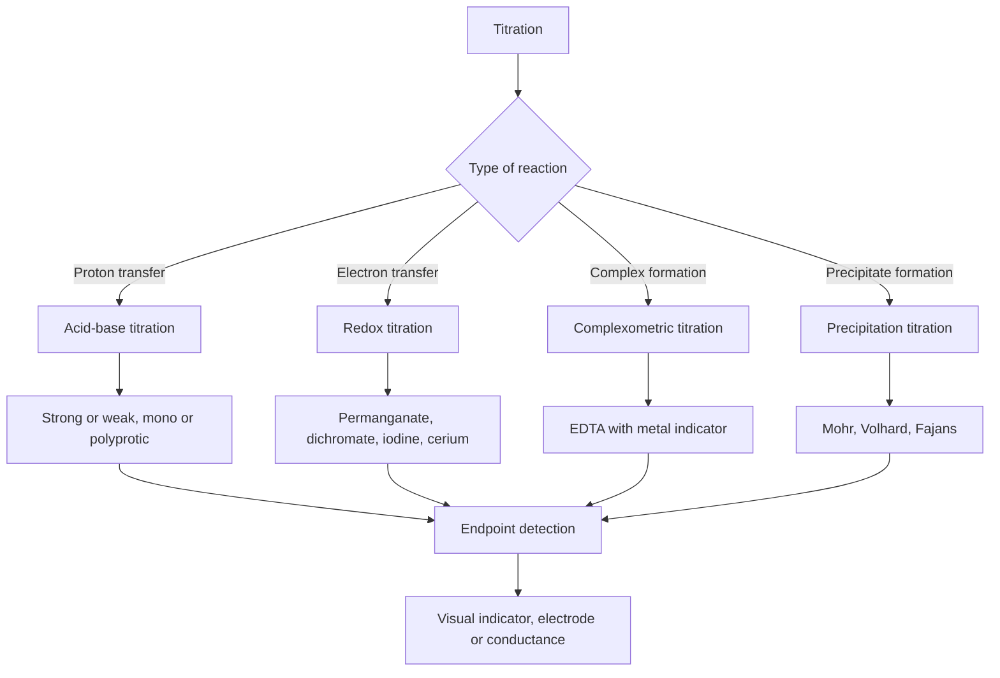
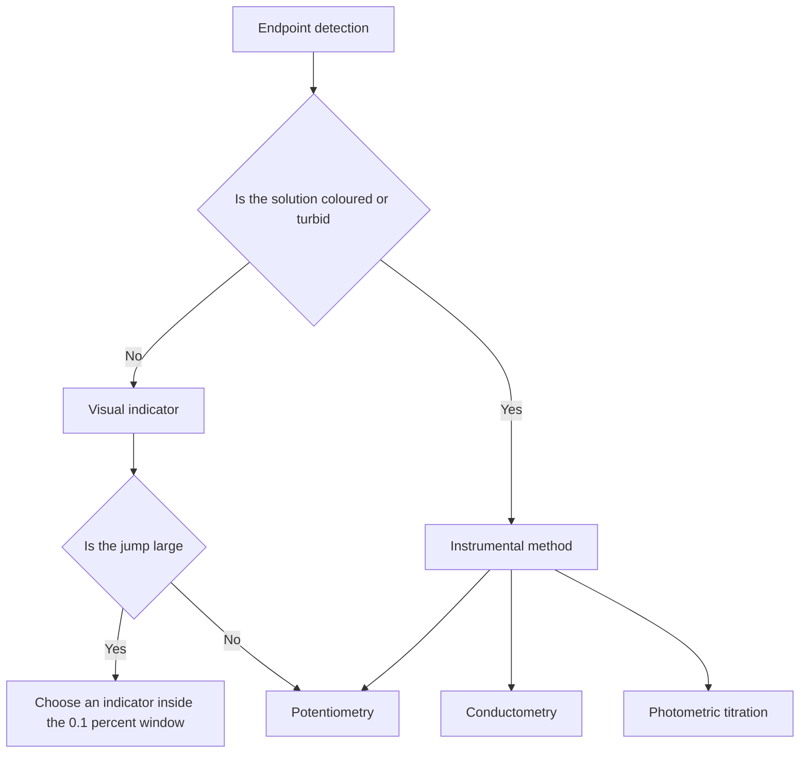

# Chapter 6 — Titrations: Acid–Base, Redox and Complexometric

> **Level:** Advanced (Level 7 — Analytical Chemistry)
> **Estimated study time:** 6 hours (reading) + 2 hours (exercises)
> **Prerequisites:** [Acid–Base Chemistry, pH and pOH](../03-intermediate-chemistry/11-acid-base-chemistry-and-ph.md); [Redox Reactions and Electrochemistry Fundamentals](../03-intermediate-chemistry/12-redox-reactions-and-electrochemistry-fundamentals.md); [Advanced Equilibrium, Buffers and Solubility Product](../04-advanced-chemistry/07-advanced-equilibrium-buffers-and-solubility-product.md); [Electrochemical Cells, the Nernst Equation and Electrolysis](../04-advanced-chemistry/08-electrochemical-cells-nernst-equation-and-electrolysis.md); [Chapter 5](05-gravimetric-and-volumetric-analysis.md)
> **Related chapters:** [Chromatography](07-chromatography.md), [Spectroscopic Analysis](08-spectroscopic-analysis.md), [Electroanalytical Chemistry and Potentiometry](09-electroanalytical-chemistry-and-potentiometry.md)
> **Difficulty:** ★★★★☆ (4/5)

---

## 1. Learning Objectives

After working through this chapter you will be able to:

- Define titrant, analyte, equivalence point, endpoint, indicator and standard
  solution, and use each term precisely.
- Classify titrations as acid–base, redox, complexometric or precipitation, and
  choose the class appropriate to a given analyte.
- Calculate the pH throughout a strong acid–strong base, weak acid–strong base,
  weak base–strong acid and polyprotic titration, including dilution.
- Explain the buffer region and derive the pH at the equivalence point from the
  hydrolysis of the conjugate species.
- Apply the 0.1 % rule to select an indicator, and calculate the indicator error
  when the endpoint differs from the equivalence point.
- Write balanced redox half-equations and use the Nernst equation to predict
  titration feasibility and the equivalence potential.
- Calculate conditional formation constants for EDTA titrations and explain the
  role of pH, masking agents and back-titration.
- Interpret potentiometric and conductometric titration curves and choose an
  endpoint-detection method for a coloured or turbid sample.

---

## 2. Introduction

A titration is the most economical quantitative measurement in chemistry: a burette,
a flask, a standard solution and a reaction that goes to completion. Its precision
can rival gravimetry, its speed is minutes rather than hours, and its chemistry
spans every class of reaction. The skill lies not in turning the stopcock but in
knowing *where* the equivalence point is, *how far* the observed endpoint is from
it, and *why* the reaction is quantitative under the chosen conditions.

The subject is also a lesson in equilibrium. A titration curve is an equilibrium
calculation drawn as a graph: every point on it satisfies mass balance, charge
balance and the relevant equilibrium constants. The dramatic pH jump at the
equivalence point of a strong acid is not a special property of strong acids; it is
what happens when the analyte is exhausted and the titrant is in excess. A weak
acid shows a smaller jump because the conjugate base buffers the solution, and a
polyprotic acid shows two jumps only when its successive dissociation constants are
sufficiently separated.

This chapter develops the treatment systematically: exact charge-balance equations,
computed curves for the four standard cases, and the indicator choice those curves
justify. Redox titrations are treated through the Nernst equation and complexometric
titrations through conditional formation constants — the two places where titration
calculations most often go wrong. It closes with precipitation titrations and
instrumental endpoint detection.

The prerequisites are acid–base equilibrium, buffers, solubility product and the
Nernst equation; [Chapter 5](05-gravimetric-and-volumetric-analysis.md) supplies the glassware and blanks.

---

## 3. Fundamental Concepts

### 3.1 Vocabulary

The **titrant** is the solution of known concentration, delivered from a burette. The
**analyte** is the substance being determined. The **equivalence point** is the point
at which the amount of titrant is exactly the stoichiometric amount required by the
analyte. The **endpoint** is the observable change used to locate it. An **indicator**
is a species whose colour or other property changes near the equivalence point. A
**standard solution** is one whose concentration is known to the required uncertainty.

A **direct titration** adds titrant to the analyte until the endpoint. A
**back-titration** adds a measured excess of reagent, lets it react, and titrates the
remainder; it is used when the direct reaction is slow or the endpoint is obscure. A
**displacement titration** liberates a stoichiometric amount of a second species that
is then titrated. A **blank** is a titration of everything except the analyte, and its
volume is subtracted.

### 3.2 Classification

Acid–base titrations transfer protons; their curves are pH versus volume. Redox
titrations transfer electrons; their curves are potential versus volume. Complexometric
titrations form a stable complex, usually with EDTA; their curves are pM versus
volume. Precipitation titrations form a sparingly soluble salt; their curves are pAg
or pCl versus volume. Each class has its own indicators and its own feasibility
criteria, but the stoichiometric and blank corrections are common to all.

### 3.3 The titration curve

A **titration curve** plots a logarithmic function of the analyte concentration — pH,
pM, or electrode potential — against the volume of titrant. Its shape is governed by
three regions. Before the equivalence point the analyte or its conjugate controls the
value; near half-equivalence a buffer region is often nearly flat; at the equivalence
point the controlled species changes and the curve steepens; beyond it the excess
titrant controls the value.

The steepness at equivalence determines whether a visual indicator can be used. A
steep jump of several pH units tolerates an indicator whose transition range is
anywhere inside the jump. A shallow curve requires an instrumental method or a
carefully calculated indicator correction.

### 3.4 Concentration, activity and equilibrium

Thermodynamic equilibrium constants are written in activities, but titrimetric
calculations usually use concentrations. The approximation is acceptable in dilute
solution, but it fails when the ionic strength exceeds about 0.1 mol dm⁻³, when the
analyte is a weak acid near its pKa, or when the titrant is concentrated. In those
cases an activity coefficient from the Debye–Hückel equation, or a conditional
constant measured in the same medium, is required.

The **conditional constant** is the equilibrium constant expressed in concentrations
for a specified medium. It is the natural language of complexometric titrations,
where the fraction of EDTA present as $\ce{Y^4-}$ depends strongly on pH.

### 3.5 Indicators

An **acid–base indicator** is a weak acid or base whose protonated and deprotonated
forms have different colours. Its transition range is approximately
$\mathrm{p}K_a \pm 1$. A **redox indicator** changes colour when the solution
potential crosses its formal potential; ferroin, diphenylamine and starch are
examples. A **metal indicator** forms a coloured complex with the metal and releases
the colour when EDTA sequesters the metal; murexide and Eriochrome Black T are the
classic examples. An **adsorption indicator** is adsorbed on a precipitate at the
endpoint and changes colour; fluorescein and dichlorofluorescein are used in
argentometry.

### 3.6 Titration error, blank and indicator correction

The **titration error** is the difference between the endpoint and equivalence
volumes, expressed as a fraction. It has three sources: the indicator's own
transition, the reagent blank, and the volume reading. The blank is measured by
titrating a solution of all reagents except the analyte to the same endpoint; the
indicator correction is the part attributable to the indicator. In a well-designed
method the total blank is below 0.1 % of the titre.

---

## 4. Detailed Scientific Explanation

### 4.1 Strong acid–strong base: the exact calculation

For $V_a$ cm³ of a strong acid of concentration $C_a$ titrated with a strong base of
concentration $C_b$, the charge balance is

$$
[\ce{H+}] + [\ce{Na+}] = [\ce{OH-}] + [\ce{Cl-}],
$$

so that

$$
[\ce{H+}] - [\ce{OH-}] = \frac{C_aV_a - C_bV_b}{V_a + V_b}.
$$

Before equivalence the hydroxide term is negligible and
$[\ce{H+}] = (C_aV_a - C_bV_b)/(V_a+V_b)$. After equivalence the hydrogen term is
negligible and $[\ce{OH-}] = (C_bV_b - C_aV_a)/(V_a+V_b)$. At equivalence the only
source of hydrogen and hydroxide is water, so pH = 7.00 at 25 °C.

The equation is exact because concentrations are amounts divided by the *total* volume;
ignoring dilution is the commonest error in hand-drawn curves, especially near
equivalence, where the volume has changed by 10–100 %.

### 4.2 Weak acid–strong base: buffers and hydrolysis

For a monoprotic weak acid HA with dissociation constant $K_a$, the buffer region is
described to good approximation by

$$
\mathrm{pH} = \mathrm{p}K_a + \log_{10}\frac{[\ce{A-}]}{[\ce{HA}]}
= \mathrm{p}K_a + \log_{10}\frac{V_b}{V_{\text{eq}} - V_b},
$$

where $V_{\text{eq}}$ is the equivalence volume. At half-equivalence the ratio is one,
so pH = pKa. This is the most accurate way to read a pKa from a titration curve.

At the equivalence point the solution contains the conjugate base $\ce{A-}$, which
hydrolyses:

$$
\ce{A-(aq) + H2O(l) <=> HA(aq) + OH-(aq)}, \qquad
K_b = \frac{K_w}{K_a}.
$$

For a concentration $C$ of $\ce{A-}$, $[\ce{OH-}] = \sqrt{K_bC}$ when hydrolysis is
small, and the pH is above 7. The weaker the acid, the more basic the equivalence
point and the smaller the pH jump.

### 4.3 Weak base–strong acid

The treatment is the mirror image. Before equivalence the buffer is
$\ce{B}/\ce{BH+}$ and

$$
\mathrm{pOH} = \mathrm{p}K_b + \log_{10}\frac{[\ce{B}]}{[\ce{BH+}]},
$$

so at half-equivalence pOH = pKb. At equivalence the conjugate acid hydrolyses with
$K_a = K_w/K_b$, giving a pH below 7. The jump is smaller than for a strong base and
lies on the acid side, which is why methyl red or methyl orange is used rather than
phenolphthalein.

### 4.4 Polyprotic systems

A diprotic acid shows two equivalence points only if the successive constants differ
by a factor of about $10^4$ or more. Phosphoric acid
($\mathrm{p}K_{a1} = 2.15$, $\mathrm{p}K_{a2} = 7.20$, $\mathrm{p}K_{a3} = 12.35$)
shows two usable jumps; carbonic acid ($\mathrm{p}K_{a1} = 6.35$,
$\mathrm{p}K_{a2} = 10.33$) shows two jumps when titrated as carbonate with a strong
acid, but the first is shallow.

At the first equivalence point of a diprotic acid the **amphiprotic** species
$\ce{HA-}$ is present, and its pH is approximately

$$
\mathrm{pH} = \tfrac{1}{2}\left(\mathrm{p}K_{a1} + \mathrm{p}K_{a2}\right).
$$

For carbonate this gives pH 8.34; for phosphate, pH 4.68.

### 4.5 The 0.1 % rule

An indicator is acceptable if its transition range lies entirely within the pH change
produced by ±0.1 % of the equivalence volume. This is the **0.1 % rule**. It is a
design criterion, not a law: it guarantees that the indicator error is below about
0.1 %, which is comparable with the glassware tolerance.

The table gives charge-balance values for 50.00 cm³ of 0.1000 mol dm⁻³ analyte
titrated with 0.1000 mol dm⁻³ titrant, with $f = V/V_{\text{eq}}$:

| $f$ | Strong acid | Weak acid | Weak base |
|---|---|---|---|
| 0.00 | 1.00 | 2.88 | 11.12 |
| 0.999 | 4.30 | 7.76 | 12.25 |
| 1.000 | 7.00 | 8.73 | 5.28 |
| 1.001 | 9.70 | 9.70 | 4.00 |
| 1.20 | 11.96 | 11.96 | 2.04 |

For the strong acid the ±0.1 % window spans pH 4.30–9.70, for the weak acid it narrows
to 7.76–9.70, and for the weak base it runs from 12.25 down to 4.00.

### 4.6 Indicator theory

An indicator is itself a weak acid:

$$
\ce{HIn(aq) <=> H+(aq) + In-(aq)}, \qquad
K_{\text{In}} = \frac{[\ce{H+}][\ce{In-}]}{[\ce{HIn}]}.
$$

Rearranging gives

$$
\mathrm{pH} = \mathrm{p}K_{\text{In}} + \log_{10}\frac{[\ce{In-}]}{[\ce{HIn}]}.
$$

The eye detects a colour change when the ratio of the two forms lies between about
1:10 and 10:1, so the **transition range** is $\mathrm{p}K_{\text{In}} \pm 1$. The
range is a property of the indicator, not of the titration; a good indicator is one
whose range coincides with the steep part of the curve.

### 4.7 Non-aqueous titrations

Water is a levelling solvent: it protonates strong bases and deprotonates strong
acids, so weak bases such as amines cannot be titrated sharply in water. In glacial
acetic acid, a differentiating solvent, the same amines are protonated strongly
enough to be titrated with perchloric acid. The titrant is a standard solution of
$\ce{HClO4}$ in acetic acid, standardised against potassium hydrogen phthalate, and
the indicator is crystal violet or oracet blue.

Non-aqueous titration is routine in the pharmaceutical industry for bases and for
salts of weak acids; water must be excluded because it competes for the titrant.

### 4.8 Redox titrations

A redox titration is feasible when the reaction is quantitative and fast, and when
the potential change at equivalence is large enough for an indicator or an electrode.
The **Nernst equation** for a half-reaction $\ce{Ox + ne- <=> Red}$ is

$$
E = E^\circ - \frac{2.303RT}{nF}\log_{10}\frac{a_{\text{Red}}}{a_{\text{Ox}}},
$$

which at 25 °C becomes $E = E^\circ - (0.05916/n)\log_{10}(a_{\text{Red}}/a_{\text{Ox}})$.
The equivalence potential of a reaction between two couples is the weighted mean of
their formal potentials:

$$
E_{\text{eq}} = \frac{n_1E_1^\circ + n_2E_2^\circ}{n_1 + n_2}.
$$

**Permanganate** ($\ce{MnO4- + 8H+ + 5e- -> Mn2+ + 4H2O}$, $E^\circ = 1.51$ V) is a
strong, self-indicating and cheap oxidant in acid, but it is unstable. **Dichromate** ($\ce{Cr2O7^2- + 14H+ + 6e- -> 2Cr3+ + 7H2O}$,
$E^\circ = 1.33$ V) is stable and primary-standard grade, but it is toxic and its
green endpoint is less sharp. **Iodine** ($\ce{I2 + 2e- -> 2I-}$, $E^\circ = 0.535$ V)
is used in **iodimetry** (direct titration with iodine) and **iodometry** (liberation
of iodine by the analyte, then titration with thiosulfate). **Bromate** generates
bromine in situ and is used for phenol and aniline determinations. **Cerium(IV)** is a
strong, stable oxidant in perchloric or sulfuric acid. **Karl Fischer** titration
determines water with iodine, sulfur dioxide and an alcohol in the presence of a base;
one mole of iodine consumes one mole of water.

### 4.9 Complexometric titrations with EDTA

EDTA is a hexadentate ligand that forms 1:1 complexes with most metal ions. Its four
acid dissociation constants are $\mathrm{p}K_{a1} = 2.0$, $\mathrm{p}K_{a2} = 2.7$,
$\mathrm{p}K_{a3} = 6.16$ and $\mathrm{p}K_{a4} = 10.26$. Only $\ce{Y^4-}$ binds
strongly, so the **conditional formation constant** is

$$
K' = K_f\,\alpha_{\ce{Y^4-}},
$$

where $\alpha_{\ce{Y^4-}}$ is the fraction of total EDTA present as $\ce{Y^4-}$ at the
chosen pH. At pH 10, $\alpha = 0.35$; at pH 12, 0.98; at pH 5, about
$3.5\times10^{-7}$. A titration is feasible when $K'C \gtrsim 10^6$, which corresponds
to an endpoint error of about 0.1 % for a 1:1 complex.

The pH selects which metals can be titrated: calcium needs pH 10 or above, magnesium
needs pH 10, and iron(III) ($\log K_f = 25.1$) can be titrated at pH 2.

**Metal indicators** are dyes that form a coloured complex with the metal. Murexide
is used for calcium at pH 11–12; Eriochrome Black T for magnesium and for
calcium plus magnesium at pH 10; xylenol orange for zinc, lead and bismuth; PAN for
copper and zinc. The indicator must bind the metal less strongly than EDTA, so that
it is displaced at the endpoint.

**Masking agents** remove interfering metals without removing the analyte. Cyanide
masks zinc, copper, nickel, cadmium and mercury; fluoride masks aluminium, iron(III)
and titanium; triethanolamine masks aluminium and iron; ascorbic acid reduces
iron(III) to iron(II). A **back-titration** with a standard zinc or magnesium
solution is used when the metal blocks the indicator or reacts slowly, as with
aluminium.

### 4.10 Precipitation titrations

**Mohr titration** determines chloride with silver nitrate and potassium chromate
indicator. Silver chloride precipitates first; after equivalence, silver ion reacts
with chromate to give red silver chromate. The solution must be neutral to slightly
alkaline (pH 6.5–9): acid dissolves the chromate indicator, and alkali precipitates
silver oxide.

**Volhard titration** adds a measured excess of silver nitrate, then back-titrates
the excess with potassium thiocyanate using iron(III) as indicator; the endpoint is
the red iron(III) thiocyanate complex. The solution must be acidic to prevent
hydrolysis of iron(III). Chloride interferes because silver chloride is more soluble
than silver thiocyanate, so nitrobenzene is added to coat the chloride precipitate.

**Fajans titration** uses an adsorption indicator such as fluorescein. Before
equivalence the precipitate adsorbs the excess lattice ion; after equivalence it
adsorbs the indicator anion and the colour changes; the pH must keep it anionic.

### 4.11 Potentiometric and conductometric detection

In **potentiometric titration** an indicator electrode follows the activity of the
analyte or titrant, and the endpoint is the inflection of the $E$–$V$ curve. The
first derivative $\Delta E/\Delta V$ is maximal at the equivalence point, and the
second derivative crosses zero there. A **Gran plot** linearises the region before or
after equivalence and gives the equivalence volume from the intercept, which is more
precise than a graphical inflection.

In **conductometric titration** the conductance is plotted against volume. Before
equivalence the conductance changes as ions are replaced; after equivalence it
changes with the excess titrant. The result is two straight lines whose intersection
is the equivalence point. The method works for coloured and turbid solutions and for
very dilute analytes, but it is less selective than potentiometry.

### 4.12 Automated titrators

An automatic titrator combines a motor-driven burette, stirrer, electrode and
controller; it records the curve and stops at a preset potential, slope or second
derivative, with dynamic dosing near the endpoint and a stored audit trail.

### 4.13 Comparison of titration types

| Type | Titrant | Indicator | Typical application |
|---|---|---|---|
| Acid–base | $\ce{NaOH}$ or $\ce{HCl}$ | Phenolphthalein, methyl red | Acidity, alkalinity, drug salts |
| Redox | $\ce{KMnO4}$, $\ce{I2}$, $\ce{Ce^4+}$ | Self-indicating, starch, ferroin | Oxidisable and reducible analytes |
| Complexometric | EDTA | Murexide, Eriochrome Black T | Water hardness, metal salts |
| Precipitation | $\ce{AgNO3}$ | Chromate, iron(III), adsorption dyes | Chloride and other halides |

---

## 5. Visual Diagrams

**Figure 6.1 — Classification of titrations.** The four chemical classes differ in
the quantity that changes at equivalence — pH, potential, pM or pX — but they share
the same stoichiometric logic. The diagram is a route map for method selection: the
reaction class determines the titrant, the indicator and the shape of the curve.

**Figure 6.2 — The titration workflow.** Standardisation precedes the sample because
the titrant concentration is the largest single source of systematic error. The blank
is measured under the same conditions as the sample, so that indicator and reagent
effects cancel rather than accumulate.

**Figure 6.3 — Choosing an endpoint method.** A visual indicator is the first choice
when the solution is clear and the curve is steep. When the sample is coloured, the
curve is shallow, or the analyte is very dilute, an electrode or a conductance cell
replaces the eye, and the endpoint is computed from the curve rather than observed.

---

## 6. Mathematical Formulas

### 6.1 Charge balance and exact pH

$$
[\ce{H+}] - [\ce{OH-}] = \frac{C_aV_a - C_bV_b}{V_a + V_b}, \qquad
[\ce{H+}][\ce{OH-}] = K_w.
$$

| Symbol | Meaning | SI unit |
|---|---|---|
| $C_a,\ C_b$ | Amount concentrations of acid and base | mol dm⁻³ |
| $V_a,\ V_b$ | Volumes of acid and base | dm³ |
| $K_w$ | Ionic product of water, $1.0\times10^{-14}$ at 25 °C | mol² dm⁻⁶ |
| $[\ ]$ | Equilibrium concentration | mol dm⁻³ |

*Assumptions.* Strong electrolyte, complete dissociation, activities replaced by
concentrations, temperature 25 °C, no other acid or base present.

### 6.2 Weak acid and buffer

$$
K_a = \frac{[\ce{H+}][\ce{A-}]}{[\ce{HA}]}, \qquad
\mathrm{pH} = \mathrm{p}K_a + \log_{10}\frac{[\ce{A-}]}{[\ce{HA}]}, \qquad
K_b = \frac{K_w}{K_a}.
$$

| Symbol | Meaning | SI unit |
|---|---|---|
| $K_a$ | Acid dissociation constant | mol dm⁻³ |
| $K_b$ | Base hydrolysis constant | mol dm⁻³ |
| $\mathrm{p}K_a$ | $-\log_{10}(K_a/\text{mol dm}^{-3})$ | dimensionless |
| $[\ce{HA}],[\ce{A-}]$ | Acid and conjugate-base concentrations | mol dm⁻³ |

*Assumptions.* The buffer ratio is approximated by the stoichiometric amounts, which
is valid when the acid is weak and neither hydrolysis nor dilution is extreme; the
activity coefficients are taken as unity.

### 6.3 Indicator and titration error

$$
\mathrm{pH} = \mathrm{p}K_{\text{In}} + \log_{10}\frac{[\ce{In-}]}{[\ce{HIn}]},
\qquad
E_t = \frac{V_{\text{end}} - V_{\text{eq}}}{V_{\text{eq}}}, \qquad
V_{\text{corr}} = V_{\text{obs}} - V_{\text{blank}}.
$$

| Symbol | Meaning | SI unit |
|---|---|---|
| $E_t$ | Relative titration error | dimensionless |
| $V_{\text{end}}$ | Endpoint volume | dm³ |
| $V_{\text{eq}}$ | Equivalence volume | dm³ |
| $V_{\text{blank}}$ | Blank volume | dm³ |

*Assumptions.* The indicator is present at low concentration and does not perturb the
equilibrium; the endpoint is detected at the same colour intensity in sample and
blank.

### 6.4 Redox potentials

$$
E = E^\circ - \frac{2.303RT}{nF}\log_{10}\frac{a_{\text{Red}}}{a_{\text{Ox}}},
\qquad
E_{\text{eq}} = \frac{n_1E_1^\circ + n_2E_2^\circ}{n_1 + n_2}.
$$

| Symbol | Meaning | SI unit |
|---|---|---|
| $E$ | Electrode potential | V |
| $E^\circ$ | Standard potential | V |
| $n$ | Number of electrons transferred | dimensionless |
| $R$ | Gas constant, 8.314 | J K⁻¹ mol⁻¹ |
| $T$ | Thermodynamic temperature | K |
| $F$ | Faraday constant, 96 485 | C mol⁻¹ |

*Assumptions.* Reversible couple, 25 °C, activities replaced by concentrations, the
reaction is stoichiometric and both couples are soluble.

### 6.5 Complexometric conditional constant

$$
K' = K_f\,\alpha_{\ce{Y^4-}}, \qquad
\alpha_{\ce{Y^4-}} = \frac{K_{a1}K_{a2}K_{a3}K_{a4}}
{[\ce{H+}]^4 + K_{a1}[\ce{H+}]^3 + K_{a1}K_{a2}[\ce{H+}]^2
+ K_{a1}K_{a2}K_{a3}[\ce{H+}] + K_{a1}K_{a2}K_{a3}K_{a4}}.
$$

| Symbol | Meaning | SI unit |
|---|---|---|
| $K_f$ | Formation constant of the metal–EDTA complex | dm³ mol⁻¹ |
| $K'$ | Conditional formation constant | dm³ mol⁻¹ |
| $\alpha_{\ce{Y^4-}}$ | Fraction of EDTA present as $\ce{Y^4-}$ | dimensionless |
| $K_{a1}$–$K_{a4}$ | EDTA dissociation constants | mol dm⁻³ |

*Assumptions.* 1:1 metal–EDTA stoichiometry, no competing ligand other than
hydroxide, and the metal is not hydrolysed to a significant extent at the chosen pH.

---

## 7. Chemical Equations

Strong acid with strong base:

$$
\ce{HCl(aq) + NaOH(aq) -> NaCl(aq) + H2O(l)}
$$

Weak acid with strong base:

$$
\ce{CH3COOH(aq) + OH-(aq) -> CH3COO-(aq) + H2O(l)}
$$

Weak base with strong acid:

$$
\ce{NH3(aq) + H+(aq) -> NH4+(aq)}
$$

Carbonate is titrated in two proton steps:

$$
\ce{CO3^2-(aq) + H+(aq) -> HCO3-(aq)}
$$

$$
\ce{HCO3-(aq) + H+(aq) -> H2CO3(aq) <=> CO2(g) + H2O(l)}
$$

Permanganate oxidises hydrogen peroxide in acid:

$$
\ce{2MnO4-(aq) + 5H2O2(aq) + 6H+(aq) -> 2Mn2+(aq) + 5O2(g) + 8H2O(l)}
$$

Dichromate oxidises iron(II):

$$
\ce{Cr2O7^2-(aq) + 6Fe^2+(aq) + 14H+(aq) -> 2Cr^3+(aq) + 6Fe^3+(aq) + 7H2O(l)}
$$

Iodate liberates iodine, which is titrated with thiosulfate:

$$
\ce{IO3-(aq) + 5I-(aq) + 6H+(aq) -> 3I2(aq) + 3H2O(l)}
$$

$$
\ce{I2(aq) + 2S2O3^2-(aq) -> 2I-(aq) + S4O6^2-(aq)}
$$

Ascorbic acid is oxidised by iodine:

$$
\ce{C6H8O6(aq) + I2(aq) -> C6H6O6(aq) + 2I-(aq) + 2H+(aq)}
$$

Karl Fischer titration consumes water and iodine in a 1:1 ratio:

$$
\ce{I2 + SO2 + CH3OH + H2O + 3C3H4N2 -> 2C3H5N2+I- + C3H5N2+CH3OSO3-}
$$

EDTA complexes calcium:

$$
\ce{Ca^2+(aq) + Y^4-(aq) -> CaY^2-(aq)}
$$

Mohr and Volhard endpoints:

$$
\ce{Ag+(aq) + Cl-(aq) -> AgCl(s) v}
$$

$$
\ce{Ag+(aq) + SCN-(aq) -> AgSCN(s) v}
$$

Every equation is balanced in atoms and charge. The redox equations are balanced by
half-reactions, and the complexometric equation is written for the fully deprotonated
ligand even though the reacting fraction at pH 10 is only about 35 %.

---

## 8. Worked Examples

### Worked Example 6.1 — Strong acid–strong base near equivalence

**Problem.** 50.00 cm³ of 0.1000 mol dm⁻³ $\ce{HCl}$ is titrated with
0.1000 mol dm⁻³ $\ce{NaOH}$. Calculate the pH at 49.90 and 50.10 cm³, and the window
corresponding to ±0.1 % of the equivalence volume.

**Strategy.** Apply the charge balance with the total volume at each point.

**Solution.**
$$
[\ce{H+}] = \frac{0.1000(50.00 - 49.90)}{99.90} = 1.00\times10^{-4},\ \mathrm{pH} = 4.00
$$
$$
[\ce{OH-}] = \frac{0.1000(50.10 - 50.00)}{100.10} = 9.99\times10^{-5},\ \mathrm{pH} = 10.00
$$
At ±0.1 % the values are 4.30 and 9.70, a window of 5.4 pH units.

**Check.** The points are symmetrical about pH 7, as they must be for equal concentrations.

### Worked Example 6.2 — Weak acid: equivalence pH and indicator choice

**Problem.** 50.00 cm³ of 0.1000 mol dm⁻³ acetic acid ($\mathrm{p}K_a = 4.757$) is
titrated with 0.1000 mol dm⁻³ $\ce{NaOH}$. Calculate the initial pH, the pH at
half-equivalence and at equivalence, and select an indicator.

**Strategy.** Use the quadratic initially, $\mathrm{pH} = \mathrm{p}K_a$ at
half-equivalence, and acetate hydrolysis at equivalence.

**Solution.** Initially
$[\ce{H+}] = (-\!K_a + \sqrt{K_a^2 + 4K_aC})/2 = 1.31\times10^{-3}$, pH 2.88; at
25.00 cm³, pH 4.76. At equivalence 5.000 mmol of acetate in 100.00 cm³ gives
$C = 0.05000$ mol dm⁻³ and $K_b = 5.71\times10^{-10}$, so
$[\ce{OH-}] = \sqrt{K_bC} = 5.34\times10^{-6}$ and pH 8.73.

**Check.** The equivalence pH is basic; phenolphthalein (8.2–10.0) lies inside the
7.8–9.7 window, whereas methyl red (4.4–6.2) does not.

### Worked Example 6.3 — Permanganate determination of hydrogen peroxide

**Problem.** 10.00 cm³ of peroxide is diluted to 250.0 cm³; a 25.00 cm³ aliquot
requires 18.50 cm³ of 0.02000 mol dm⁻³ $\ce{KMnO4}$. Calculate the concentration in
g dm⁻³ and the oxygen volume released per volume of solution.

**Strategy.** Use the 2:5 permanganate–peroxide stoichiometry and scale by ten.

**Solution.**
$$
n(\ce{MnO4-}) = 3.700\times10^{-4}\ \text{mol}, \qquad
n(\ce{H2O2}) = \tfrac{5}{2}(3.700\times10^{-4}) = 9.250\times10^{-4}\ \text{mol}
$$
Ten aliquots contain 0.3146 g in 10.00 cm³, i.e. **31.46 g dm⁻³** (3.15 % w/v);
the oxygen is $4.625\times10^{-3}$ mol, or 111 cm³ at 24.0 dm³ mol⁻¹ (11.1 volumes).

**Check.** Commercial 3 % peroxide is about 10 volumes, so the result is consistent.

### Worked Example 6.4 — Iodometric determination of ascorbic acid

**Problem.** 25.00 cm³ of juice requires 8.42 cm³ of 0.05000 mol dm⁻³ iodine to the
starch endpoint. Calculate the ascorbic acid concentration in g dm⁻³.

**Strategy.** Ascorbic acid reacts 1:1 with iodine.

**Solution.**
$$
\rho = \frac{0.05000 \times 0.00842 \times 176.12}{0.02500} = 2.966\ \text{g dm}^{-3}.
$$

**Check.** The value is high for a juice but plausible for a concentrate; the blank
must be subtracted because iodine is volatile.

### Worked Example 6.5 — Complexometric determination of calcium

**Problem.** 50.00 cm³ of water requires 12.36 cm³ of 0.01000 mol dm⁻³ EDTA at pH 10.
Calculate calcium in mg dm⁻³ and as $\ce{CaCO3}$, and estimate pCa at equivalence
($\log K_f = 10.65$, $\alpha_{\ce{Y^4-}} = 0.35$).

**Strategy.** 1:1 stoichiometry; $K' = K_f\alpha$ and
$[\ce{Ca^2+}] \approx \sqrt{C/K'}$ at equivalence.

**Solution.**
$$
\rho(\ce{Ca}) = \frac{1.236\times10^{-4} \times 40.078}{0.05000} = 99.1\ \text{mg dm}^{-3}
$$
As $\ce{CaCO3}$: 247.4 mg dm⁻³. With $\log K' = 10.19$ and
$C = 1.98\times10^{-3}$ mol dm⁻³, $[\ce{Ca^2+}] = 3.6\times10^{-7}$ and pCa = 6.45.

**Check.** $K'C \approx 3\times10^7$, above the $10^6$ threshold, so the endpoint is sharp.

### Worked Example 6.6 — Back-titration of aluminium

**Problem.** A 0.5000 g sample is treated with 25.00 cm³ of 0.05000 mol dm⁻³ EDTA
and the excess requires 12.40 cm³ of 0.02000 mol dm⁻³ $\ce{Zn^2+}$. Calculate the
mass fraction of aluminium.

**Strategy.** Subtract the zinc consumed from the EDTA added; the complex is 1:1.

**Solution.**
$$
n(\ce{Al}) = 1.250\times10^{-3} - 2.480\times10^{-4} = 1.002\times10^{-3}\ \text{mol}
$$
$$
w(\ce{Al}) = \frac{1.002\times10^{-3} \times 26.982}{0.5000} = 5.41\ \%.
$$

**Check.** A blank cancels in the difference; 5.4 % aluminium is typical of a light
alloy.

---

## 9. Real-World Applications

**Water and wastewater.** Total hardness is titrated with EDTA at pH 10, alkalinity
with acid, and chloride by Mohr or Volhard titration.

**Clinical and food analysis.** Plasma bicarbonate and juice acidity are measured by
acid–base titration, sulfite in wine by iodometry, and vitamin C by iodine.

**Safety.** Cyanide masking agents, dichromate and methanolic Karl Fischer reagents
are highly hazardous; use them only under supervision in a fume hood.

---

## 10. Common Mistakes

| Mistake | Why it happens | Correct approach |
|---|---|---|
| Ignoring dilution in the curve | Concentrations treated as constant | Divide amounts by the total volume at every point |
| Taking pH 7 as the equivalence point of a weak acid | Strong-acid intuition | Calculate hydrolysis of the conjugate base |
| Choosing an indicator outside the steep region | Colour is attractive | Apply the 0.1 % rule to the computed curve |
| Titrating calcium with EDTA at pH 5 | EDTA assumed pH-independent | Calculate $\alpha_{\ce{Y^4-}}$; calcium needs pH 10 or above |
| Reading the burette the instant colour appears | The endpoint fades on standing | Add 0.05 cm³ increments near the endpoint and wait |

---

## 11. Chapter Summary

- A titration measures analyte amount from the volume of a standard solution; the
  equivalence point is fixed by stoichiometry, the endpoint is observed, and the
  difference is the titration error, corrected by a blank.
- Strong acid–strong base curves are symmetric about pH 7; weak acid and weak base
  curves are buffered, with $\mathrm{pH} = \mathrm{p}K_a$ at half-equivalence.
- Polyprotic acids show separate equivalence points only when successive
  $\mathrm{p}K_a$ values differ by about $10^4$; the 0.1 % rule then matches an
  indicator whose range, $\mathrm{p}K_{\text{In}} \pm 1$, lies in the steep part.

---

## 12. Exercises

### 12.1 Conceptual questions

1. Explain why the equivalence point of a weak acid titration is basic and that of a
   weak base titration acidic.
2. Why is the jump for a strong acid–strong base titration steeper than for a weak
   acid–strong base titration?
3. State three requirements for a quantitative redox titration.

### 12.2 Basic problems

4. Calculate the pH at 0, 25.00 and 50.00 cm³ when 50.00 cm³ of 0.1000 mol dm⁻³
   $\ce{NaOH}$ is titrated with 0.1000 mol dm⁻³ $\ce{HCl}$.
5. A 25.00 cm³ vinegar sample requires 18.40 cm³ of 0.1000 mol dm⁻³ $\ce{NaOH}$.
   Calculate the acetic acid concentration in g dm⁻³.
6. What volume of 0.02000 mol dm⁻³ $\ce{KMnO4}$ oxidises 0.1000 g of
   $\ce{FeSO4.7H2O}$ in acid?

### 12.3 Intermediate problems

7. 50.00 cm³ of 0.05000 mol dm⁻³ $\ce{Na2CO3}$ is titrated with 0.1000 mol dm⁻³
   $\ce{HCl}$. Calculate the pH at the first and second equivalence points.
8. Calculate the equivalence potential for iron(II) with cerium(IV), given
   $E^\circ(\ce{Fe^3+/Fe^2+}) = 0.771$ V and $E^\circ(\ce{Ce^4+/Ce^3+}) = 1.61$ V.
9. A 50.00 cm³ water sample requires 9.84 cm³ of 0.01000 mol dm⁻³ EDTA at pH 10.
   Calculate the total hardness as mg dm⁻³ $\ce{CaCO3}$.

### 12.4 Advanced problems

10. Calculate the conditional formation constant of calcium–EDTA at pH 9, given
    $\log K_f = 10.65$ and $\alpha_{\ce{Y^4-}} = 0.052$, and decide whether
    0.0100 mol dm⁻³ calcium can be titrated sharply.
11. A 0.4000 g $\ce{NaCl}$ sample is treated with 50.00 cm³ of 0.1000 mol dm⁻³
    $\ce{AgNO3}$, and the excess requires 12.50 cm³ of 0.08000 mol dm⁻³ $\ce{KSCN}$.
    Calculate the mass fraction of chloride.
12. A 0.2500 g organic base requires 21.30 cm³ of 0.1000 mol dm⁻³ $\ce{HClO4}$.
    Calculate its molar mass, assuming one basic site per molecule.

### Answers

1. The conjugate base hydrolyses to hydroxide; the conjugate acid to hydrogen ion.
2. Weak acid and conjugate base buffer both sides, so the change is gradual.
3. A large potential change, a fast stoichiometric reaction, and a responsive indicator or electrode.
4. 13.00, 12.52 and 7.00.
5. $0.1000 \times 0.01840 \times 60.05/0.02500 = 4.42$ g dm⁻³.
6. $3.597\times10^{-4}$ mol $\ce{Fe^2+}$ needs 3.60 cm³ of permanganate.
7. First: pH 8.34; second: pH 3.92.
8. $(0.771 + 1.61)/2 = 1.19$ V.
9. $9.84\times10^{-3} \times 0.01000 \times 100.09/0.05000 = 19.7$ mg dm⁻³.
10. $\log K' = 9.37$ and $K'C = 2.3\times10^7$, so the titration is feasible.
11. $n(\ce{Ag}) = 4.000$ mmol, so $w(\ce{Cl}) = 35.45$ %.
12. $M = 0.2500/(0.1000 \times 0.02130) = 117.4$ g mol⁻¹.

---

## 13. Further Reading

- Harris, D. C.; Lucy, C. A. *Quantitative Chemical Analysis*, 9th ed., W. H. Freeman, 2015.
- Skoog, D. A.; West, D. M.; Holler, F. J.; Crouch, S. R. *Fundamentals of
  Analytical Chemistry*, 9th ed., Cengage, 2013.
- IUPAC. *Compendium of Analytical Nomenclature* (the "Orange Book"), 3rd ed.
  <https://publications.iupac.org/orangebook/>
- Eurachem. *The Fitness for Purpose of Analytical Methods: A Laboratory Guide to
  Method Validation*, 2nd ed., 2014. <https://www.eurachem.org/>
- ISO/IEC 17025:2017. *General requirements for the competence of testing and calibration laboratories*.
