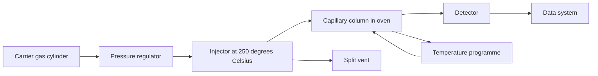
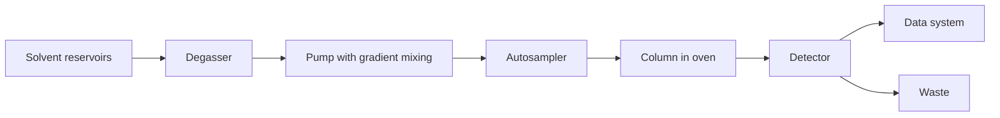
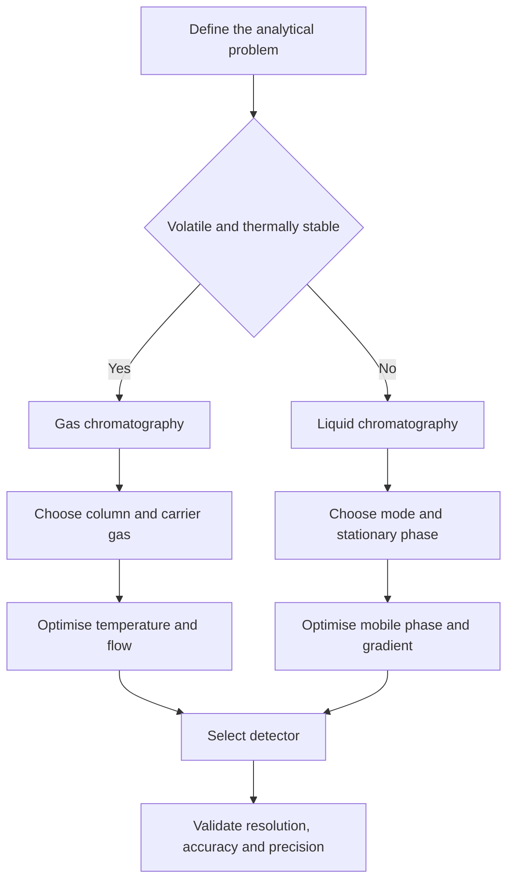

# Chapter 7 — Chromatography: GC, LC and HPLC

> **Level:** Advanced (Level 7 — Analytical Chemistry)
> **Estimated study time:** 7 hours (reading) + 3 hours (exercises)
> **Prerequisites:** [Intermolecular Forces](../03-intermediate-chemistry/05-intermolecular-forces.md); [Functional Groups and IUPAC Nomenclature](../05-organic-chemistry/02-functional-groups-and-iupac-nomenclature.md); Chapters 2–4 of this level
> **Related chapters:** [Gravimetric and Volumetric Analysis](05-gravimetric-and-volumetric-analysis.md), [Titrations](06-titrations.md), [Spectroscopic Analysis](08-spectroscopic-analysis.md), [Electroanalytical Chemistry and Potentiometry](09-electroanalytical-chemistry-and-potentiometry.md)
> **Difficulty:** ★★★★★ (5/5)

---

## 1. Learning Objectives

After working through this chapter you will be able to:

- Explain the partition and adsorption mechanisms that separate solutes in a
  chromatographic column.
- Read a chromatogram: identify $t_R$, $t_M$, $t_R'$, $k$, $\alpha$ and $R_s$, and
  calculate each from retention data.
- Apply plate theory to calculate the number of theoretical plates and the height
  equivalent to a theoretical plate.
- Use the van Deemter equation to explain the effect of flow rate on plate height,
  and distinguish plate theory from rate theory.
- Diagnose peak asymmetry and tailing from their physical causes.
- Select a carrier gas, injector mode, column and detector for a gas-chromatographic
  separation.
- Select a stationary phase and mobile phase for normal-phase, reversed-phase, ion-exchange,
  size-exclusion, HILIC or chiral liquid chromatography.
- Explain gradient elution and the role of each module in an HPLC instrument.
- Describe ion chromatography, size-exclusion, affinity and supercritical fluid
  chromatography, and the use of thin-layer chromatography.
- Follow a method-development workflow and troubleshoot retention shifts and peak
  distortion.

---

## 2. Introduction

Chromatography is the separation method that made modern analytical chemistry
possible. A mixture is carried through a stationary phase by a mobile phase;
components that interact more strongly with the stationary phase travel more slowly
and emerge later. The result is a succession of bands, each corresponding to a
component, which a detector converts into a peak whose position identifies the
substance and whose area quantifies it.

The technique is unusual in its reach. Gas chromatography separates volatile
compounds with boiling points up to about 500 °C, from permanent gases to fatty acid
methyl esters. Liquid chromatography separates involatile, thermally labile and
ionic compounds, from pharmaceuticals to proteins. Supercritical fluid chromatography
occupies the space between, and thin-layer chromatography remains the cheapest
screening method in the laboratory.

This chapter is organised around the physical chemistry of the column. Sections 3 and
4 develop retention, selectivity and band broadening, because every method-development
decision is an attempt to increase resolution without increasing analysis time. The
instrumental sections then show how those principles are realised in gas and liquid
systems, and the final sections cover method development and troubleshooting — the
two activities that occupy most practising chromatographers.

Prerequisites are intermolecular forces, the mole and concentration, and the
statistical vocabulary of Chapter 3. No prior chromatography is assumed.

---

## 3. Fundamental Concepts

### 3.1 The chromatographic process

Chromatography separates components by distributing them between two phases, one
**stationary** and one **mobile**. In **partition chromatography** the stationary phase
is a liquid coated on a solid support or bonded to its surface, and solutes dissolve
in it. In **adsorption chromatography** the stationary phase is a solid with an active
surface, and solutes compete for adsorption sites. Both mechanisms operate in most
columns, but one usually dominates.

The **distribution constant** for a solute between the two phases is

$$
K_D = \frac{[A]_{\text{stationary}}}{[A]_{\text{mobile}}},
$$

and the **retention factor** is the amount in the stationary phase divided by the
amount in the mobile phase, $k = K_D(V_s/V_m)$, where $V_s$ and $V_m$ are the phase
volumes. A solute with $k = 0$ moves with the mobile phase and is not retained; a
solute with $k = 10$ spends ten times as long in the stationary phase as in the
mobile phase.

### 3.2 The chromatogram

A **chromatogram** is a plot of detector signal against time. The **retention time**
$t_R$ is the time from injection to the peak maximum. The **dead time** $t_M$ is the
time for an unretained solute to pass through the column. The **adjusted retention
time** is $t_R' = t_R - t_M$. The **peak width** $w$ is measured at the baseline
between the tangents, and $w_{1/2}$ at half height.

The **retention factor** is

$$
k = \frac{t_R - t_M}{t_M},
$$

the **selectivity** (or separation factor) between two peaks is

$$
\alpha = \frac{k_2}{k_1} = \frac{t_{R2} - t_M}{t_{R1} - t_M},
$$

and the **resolution** is

$$
R_s = \frac{2(t_{R2} - t_{R1})}{w_1 + w_2}.
$$

A resolution of 1.5 corresponds to baseline separation for two peaks of equal width;
a value of 1.0 is marginal, and 2.0 is comfortable.

### 3.3 Plate theory

**Plate theory** treats the column as a series of discrete equilibrium stages. The
number of **theoretical plates** is

$$
N = 16\left(\frac{t_R}{w}\right)^2 = 5.54\left(\frac{t_R}{w_{1/2}}\right)^2,
$$

and the **height equivalent to a theoretical plate** is $H = L/N$, where $L$ is the
column length. A larger $N$ means a narrower peak for a given retention time.

Plate theory is a bookkeeping device: it describes the *consequence* of band
broadening without explaining its cause. It cannot predict how $N$ changes with flow
rate, particle size or film thickness; that requires rate theory.

### 3.4 Rate theory and the van Deemter equation

**Rate theory** describes the kinetic processes that broaden a band. The
**van Deemter equation** combines three terms:

$$
H = A + \frac{B}{u} + Cu,
$$

where $u$ is the linear velocity of the mobile phase. The $A$ term is **eddy
diffusion**, the multiple paths available through a packed bed; it is proportional to
the particle diameter. The $B$ term is **longitudinal diffusion**, the spreading of
the band along the column axis; it dominates at low flow rates. The $C$ term is
**mass transfer resistance**, the finite time a solute needs to equilibrate between
the phases; it dominates at high flow rates.

The minimum plate height occurs at $u_{\text{opt}} = \sqrt{B/C}$, where
$H_{\min} = A + 2\sqrt{BC}$. In capillary GC the $A$ term vanishes because there is no
packed bed, and the Golay equation replaces the van Deemter equation.

### 3.5 Peak shape and asymmetry

An ideal peak is Gaussian. Real peaks tail, front or split. The **asymmetry factor**
is $A_s = b/a$, where $a$ and $b$ are the widths of the leading and trailing halves at
10 % of peak height; the **tailing factor** used in pharmacopoeias is
$T = (A + B)/(2A)$ at 5 % height, where $A$ is the leading half-width.

Tailing usually indicates secondary interactions: silanol groups on a silica surface
binding basic analytes, metal contamination, or a mismatched injection solvent.
Fronting usually indicates column overload or a solvent stronger than the mobile
phase. A split peak indicates two forms of the analyte or an injection problem.

### 3.6 Qualitative and quantitative information

Retention time identifies a peak only provisionally, because many compounds can
co-elute. Confirmation requires a second column, a selective detector, or a
spectroscopic detector such as mass spectrometry. Quantification uses peak area
(preferred) or peak height, calibrated with standards. **Internal standardisation**
compensates for injection volume variation; **external standardisation** is simpler
but less robust.

---

## 4. Detailed Scientific Explanation

### 4.1 Gas chromatography: carrier gas and flow

In **gas chromatography** the mobile phase is a gas. The carrier must be inert, dry
and oxygen-free. Nitrogen is cheap and gives good resolution at low flow rates;
helium is inert and compatible with most detectors; hydrogen gives the fastest
diffusion and the flattest van Deemter curve, but it forms explosive mixtures and is
restricted in some laboratories. Argon–methane is used with electron-capture
detection.

The flow rate is set to the van Deemter optimum for the carrier and column. In
capillary GC the optimum linear velocity is typically 20–40 cm s⁻¹ for helium and
higher for hydrogen; in packed GC it is lower. Flow or pressure programming
compensates for the increase in gas viscosity as the oven heats.

### 4.2 Injectors

The **split/splitless injector** is the workhorse. In **split mode** a fraction of the
vaporised sample enters the column and the rest is vented; the **split ratio** is the
vent flow divided by the column flow, typically 1:10 to 1:100. Split injection gives
narrow bands and protects the column from overload, but it discriminates against
high-boiling components. In **splitless mode** the split vent is closed for 0.5–2 min
while the sample transfers to the column, which is necessary for trace analysis; the
solvent must then be purged before it reaches the detector.

Other injectors include **programmed-temperature vaporisation** (PTV), which allows
large volumes and thermal focusing, and **on-column** injection, which avoids
discrimination but requires a clean sample. The injection port is kept 20–50 °C above
the highest boiling component.

### 4.3 Columns and stationary phases

**Packed columns** are 1–3 m long, 2–4 mm internal diameter, filled with a solid
support coated with 5–10 % stationary phase. They are robust and have high sample
capacity but low efficiency. **Capillary columns** are 15–60 m long, 0.25–0.53 mm
internal diameter, with a film of stationary phase 0.1–5 µm thick on the inner wall.
They give 10⁴–10⁵ plates and are now standard.

Stationary phase polarity must match the analytes. **Polydimethylsiloxane** is
non-polar and separates hydrocarbons and volatile organics; **5 % phenyl** is slightly
polar; **50 % phenyl** is more polar and separates aromatic compounds; **polyethylene
glycol** is polar and separates alcohols, acids and amines; **cyanopropyl** separates
fatty acid methyl esters; **trifluoropropyl** is selective for halogenated compounds.
Chiral phases based on cyclodextrins separate enantiomers.

### 4.4 Temperature programming

A constant oven temperature separates only a narrow boiling range; early peaks are
sharp and late peaks are broad. **Temperature programming** raises the oven temperature
at 5–20 °C min⁻¹, which sharpens late peaks and shortens the run. The initial
temperature is held long enough to separate the volatile components, and the final
temperature is held to bake off heavy residues. The programme must not exceed the
column's maximum temperature, or the stationary phase bleeds.

### 4.5 Gas-chromatographic detectors

| Detector | Selectivity | Typical detection limit | Notes |
|---|---|---|---|
| Flame ionisation (FID) | Carbon–hydrogen compounds | 10⁻¹² g s⁻¹ | Robust, universal for organics |
| Thermal conductivity (TCD) | All compounds | 10⁻⁸ g cm⁻³ | Universal, low sensitivity |
| Electron capture (ECD) | Halogens, nitro, organometallic | 10⁻¹⁵ g | Very sensitive but selective |
| Nitrogen–phosphorus (NPD) | Nitrogen and phosphorus | 10⁻¹³ g | Selective for pesticides and drugs |
| Photoionisation (PID) | Aromatics, alkenes | 10⁻¹² g | Portable, selective |
| Mass spectrometry (MS) | Structure-specific | 10⁻¹⁵ g | Confirmation and identification |

The FID burns the eluate in hydrogen–air and measures the ions formed; it is
insensitive to water, carbon dioxide and noble gases. The TCD measures the change in
thermal conductivity of the carrier and is universal but concentration-dependent. The
ECD uses a radioactive source to ionise the carrier and measures the capture of
electrons by electronegative analytes. The NPD uses a rubidium bead and is selective
for nitrogen and phosphorus. The MS ionises the eluate and records a mass spectrum,
which provides both quantification and identification.

### 4.6 Liquid chromatography: normal and reversed phase

In **normal-phase chromatography** the stationary phase is polar (silica, alumina or
a polar bonded phase) and the mobile phase is non-polar (hexane with ethyl acetate or
isopropanol). Polar analytes are retained more strongly. In **reversed-phase
chromatography** the stationary phase is non-polar (C18, C8, C4, phenyl) and the
mobile phase is polar (water with acetonitrile or methanol). Non-polar analytes are
retained more strongly. Reversed phase accounts for most pharmaceutical and
environmental HPLC.

Mobile-phase selection follows the analyte polarity. For reversed phase, the organic
modifier controls elution strength: increasing acetonitrile or methanol decreases
retention. The pH controls ionisation of acids and bases; a buffer at pH 2–3 suppresses
silanol interactions and sharpens basic peaks, while pH 7–8 is used for neutral
compounds. Ion-pairing reagents extend reversed phase to charged analytes.

### 4.7 Gradient elution

In **isocratic** elution the mobile-phase composition is constant. In **gradient**
elution the organic fraction increases with time, which compresses the elution window
for mixtures of widely differing polarity. Gradient elution sharpens late peaks,
reduces run time and improves detection limits, but it requires a pump capable of
proportional mixing and a column that re-equilibrates between runs.

The gradient is described by its start and end composition, its duration and its
flow rate. A **linear gradient** from 5 % to 95 % organic over 20 min is common for
pharmaceuticals. **Step gradients** are used for cleaning and for ion-exchange
separations.

### 4.8 Stationary phases for liquid chromatography

| Phase | Mechanism | Typical use |
|---|---|---|
| C18 (octadecylsilica) | Hydrophobic partition | General reversed phase |
| C8 (octylsilica) | Hydrophobic partition | Faster elution of non-polar compounds |
| Phenyl | π–π and hydrophobic | Aromatic compounds |
| Silica | Adsorption and hydrogen bonding | Normal phase, isomers |
| Strong/weak cation exchange | Electrostatic | Inorganic cations, proteins |
| Strong/weak anion exchange | Electrostatic | Anions, nucleotides |
| Size-exclusion | Pore exclusion | Polymers, proteins |
| HILIC | Partition with water-rich layer | Polar compounds in high organic |
| Chiral | Stereoselective binding | Enantiomers |

**HILIC** (hydrophilic interaction liquid chromatography) uses a polar stationary
phase with a high-organic mobile phase; it retains polar compounds that reversed
phase would not retain. **Chiral** phases include cyclodextrins, amylose and cellulose
derivatives, and proteins; they separate enantiomers by forming diastereomeric
complexes.

### 4.9 HPLC instrumentation

A modern HPLC system comprises solvent reservoirs, a degasser, a pump, an injector, a
column oven, a detector and a data system. The **pump** delivers a pulse-free flow at
0.1–5 cm³ min⁻¹ and pressures up to 400–600 bar; binary or quaternary mixing allows
gradients. The **injector** is a six-port valve with a sample loop, or an autosampler
that draws 1–100 µL. The **column oven** holds the temperature to ±0.1 °C, because
retention depends on temperature.

Detectors include **UV–Vis** (single or variable wavelength), **diode array** (DAD,
which records a full spectrum at each point), **fluorescence** (very sensitive for
fluorescent analytes), **refractive index** (universal but insensitive), **evaporative
light scattering** (ELSD, for non-volatile analytes without chromophores), and **mass
spectrometry** (structure and trace quantification).

### 4.10 Ion chromatography

**Ion chromatography** separates ions on an ion-exchange column and detects them by
conductivity after a suppressor removes the eluent ions. Anion exchange with a
carbonate–bicarbonate eluent separates chloride, nitrate, sulfate and phosphate;
cation exchange with a methanesulfonic acid eluent separates lithium, sodium,
ammonium, potassium, magnesium and calcium. Suppressed conductivity gives low
background and detection limits in the µg dm⁻³ range.

### 4.11 Size-exclusion, affinity and supercritical fluid chromatography

**Size-exclusion chromatography** separates molecules by size. Large molecules cannot
enter the pores and elute first; small molecules enter the pores and elute later.
There is no interaction with the stationary phase, so the method is gentle and is used
for proteins and polymers. Calibration uses narrow-distribution standards.

**Affinity chromatography** uses a biospecific interaction — an antibody, a receptor,
an immobilised metal ion or Protein A — to bind a target selectively. Elution changes
pH, ionic strength or a competing ligand. It is the most selective liquid
chromatography and is used for antibody purification.

**Supercritical fluid chromatography** uses carbon dioxide above its critical point
(31.1 °C, 73.8 bar) as the mobile phase, often with a methanol modifier. It has low
viscosity, high diffusivity and fast separations, and is used for chiral and
lipophilic compounds.

### 4.12 Thin-layer chromatography

In **thin-layer chromatography** the stationary phase is a thin layer of silica or
alumina on a plate, and the mobile phase climbs by capillary action. The **retention
factor** is

$$
R_f = \frac{\text{distance travelled by the spot}}{\text{distance travelled by the solvent front}},
$$

which lies between 0 and 1. Visualisation uses UV light at 254 nm for absorbing
compounds, iodine vapour, ninhydrin for amines and amino acids, or permanganate for
oxidizable compounds. TLC is cheap, fast and parallel, and is used for reaction
monitoring and screening.

### 4.13 Method development

Method development starts with the analyte: its polarity, acidity, volatility,
thermal stability and concentration. The sequence is: choose the mode (GC for volatile
and thermally stable, LC for involatile or labile); choose the column and stationary
phase; choose the mobile phase or carrier gas; optimise flow, temperature or gradient;
choose the detector; then validate.

The goal is resolution of at least 1.5 between the critical pair in the shortest
time. Experimental design — changing organic fraction, pH, temperature and gradient
slope systematically — is more efficient than one-factor-at-a-time optimisation.

### 4.14 Troubleshooting

**Retention shifts** arise from mobile-phase composition or pH drift, temperature
change, column ageing or contamination, and ion-pairing reagent depletion. Check the
mobile-phase preparation first, then the column history.

**Peak shape problems** have distinct causes. Tailing of basic compounds indicates
silanol interactions or a pH outside the buffered range; fronting indicates overload;
split peaks indicate a solvent stronger than the mobile phase or two forms of the
analyte; a void at the column inlet causes distortion of early peaks. **Ghost peaks**
come from carryover, contaminated mobile phase or septum bleed. **Baseline drift** in
gradient HPLC comes from absorbance changes in the mobile phase or detector lamp
ageing.

---

## 5. Visual Diagrams

**Figure 7.1 — Gas chromatograph.** The carrier gas carries the vaporised sample
through the column; the oven programme controls retention; the split vent protects the
column from overload. The detector sits at the column outlet and must be hot enough to
prevent condensation.

**Figure 7.2 — HPLC system.** The pump establishes flow and composition; the
autosampler injects a fixed volume; the column separates; the detector records. Each
module contributes to retention and band broadening, and extra-column volume between
the injector and detector must be minimised.

**Figure 7.3 — Method-development workflow.** The first decision is volatility and
thermal stability, because it eliminates an entire technique. The remaining choices
are optimisation steps around a critical pair, not independent decisions.

---

## 6. Mathematical Formulas

### 6.1 Retention, selectivity and resolution

$$
k = \frac{t_R - t_M}{t_M}, \qquad
\alpha = \frac{k_2}{k_1}, \qquad
R_s = \frac{2(t_{R2} - t_{R1})}{w_1 + w_2}.
$$

| Symbol | Meaning | SI unit |
|---|---|---|
| $t_R$ | Retention time | s |
| $t_M$ | Dead time | s |
| $k$ | Retention factor | dimensionless |
| $\alpha$ | Selectivity factor | dimensionless |
| $R_s$ | Resolution | dimensionless |
| $w$ | Peak width at baseline | s |

*Assumptions.* Peaks are approximately Gaussian and of similar width; $t_M$ is
measured with an unretained marker; the flow rate is constant.

### 6.2 Plate number and plate height

$$
N = 16\left(\frac{t_R}{w}\right)^2 = 5.54\left(\frac{t_R}{w_{1/2}}\right)^2,
\qquad H = \frac{L}{N}.
$$

| Symbol | Meaning | SI unit |
|---|---|---|
| $N$ | Number of theoretical plates | dimensionless |
| $w_{1/2}$ | Peak width at half height | s |
| $H$ | Height equivalent to a theoretical plate | m |
| $L$ | Column length | m |

*Assumptions.* The peak is Gaussian; the column is isothermal or the programme is
slow compared with the peak width; $N$ is constant along the column.

### 6.3 van Deemter equation

$$
H = A + \frac{B}{u} + Cu, \qquad
u_{\text{opt}} = \sqrt{\frac{B}{C}}, \qquad
H_{\min} = A + 2\sqrt{BC}.
$$

| Symbol | Meaning | SI unit |
|---|---|---|
| $A$ | Eddy diffusion term | m |
| $B$ | Longitudinal diffusion coefficient | m² s⁻¹ |
| $C$ | Mass-transfer coefficient | s |
| $u$ | Linear velocity of mobile phase | m s⁻¹ |

*Assumptions.* The column is a packed bed of uniform particles; the isotherm is
linear; the mobile phase is incompressible. In capillary GC, $A = 0$ and the Golay
equation applies.

### 6.4 Resolution equation and detection limit

$$
R_s = \frac{\sqrt{N}}{4}(\alpha - 1)\frac{k}{1 + k}, \qquad
\mathrm{LOD} = \frac{3\sigma}{S},
$$

where $S$ is the calibration slope and $\sigma$ the standard deviation of the blank.

| Symbol | Meaning | SI unit |
|---|---|---|
| $S$ | Calibration sensitivity | signal per concentration |
| $\sigma$ | Standard deviation of blank | signal |
| $\mathrm{LOD}$ | Limit of detection | concentration |

*Assumptions.* The calibration is linear near the detection limit; the blank noise is
normally distributed; the peaks are Gaussian.

### 6.5 Thin-layer retention

$$
R_f = \frac{d_{\text{spot}}}{d_{\text{solvent}}}.
$$

| Symbol | Meaning | SI unit |
|---|---|---|
| $R_f$ | Retention factor | dimensionless |
| $d_{\text{spot}}$ | Distance from origin to spot centre | m |
| $d_{\text{solvent}}$ | Distance from origin to solvent front | m |

*Assumptions.* The plate is developed in a saturated tank; the stationary phase is
uniform; temperature and humidity are controlled.

---

## 7. Chemical Equations

Chromatography is a physical separation, so most of its chemistry is derivatisation
and detection rather than the separation itself.

The flame ionisation detector burns eluted organic molecules to carbon dioxide and
water, producing ions:

$$
\ce{CH4(g) + 2O2(g) -> CO2(g) + 2H2O(g)}
$$

Alcohols are converted to volatile silyl ethers before GC:

$$
\ce{ROH(l) + (CH3)3SiCl(l) -> ROSi(CH3)3(l) + HCl(g)}
$$

Carboxylic acids are converted to methyl esters:

$$
\ce{RCOOH(l) + CH3OH(l) <=>[H+] RCOOCH3(l) + H2O(l)}
$$

Ion-exchange chromatography exchanges the counter-ion:

$$
\ce{R-SO3-H+(s) + Na+(aq) <=> R-SO3-Na+(s) + H+(aq)}
$$

Ninhydrin visualises amino acids on TLC by oxidative deamination; the visible product
is the purple dye Ruhemann's purple. The overall stoichiometry is complex and is not
represented by a single balanced equation.

In reversed-phase HPLC, residual silanol groups on silica hydrogen-bond basic
analytes, which is the cause of peak tailing; end-capping the silica or buffering the
mobile phase at low pH suppresses the interaction.

Supercritical carbon dioxide is a non-polar mobile phase; methanol modifies its
polarity by hydrogen bonding, a physical solvation rather than a reaction.

---

## 8. Worked Examples

### Worked Example 7.1 — Plate number and plate height

**Problem.** A 25.0 cm column gives a peak at $t_R = 8.42$ min with baseline width
0.42 min; the dead time is 1.25 min. Calculate the retention factor, the plate number
and the plate height.

**Strategy.** Use $k = (t_R - t_M)/t_M$, $N = 16(t_R/w)^2$ and $H = L/N$.

**Solution.**
$$
k = \frac{8.42 - 1.25}{1.25} = 5.74, \qquad
N = 16\left(\frac{8.42}{0.42}\right)^2 = 6.43\times10^3
$$
$$
H = \frac{250\ \text{mm}}{6.43\times10^3} = 0.0389\ \text{mm}.
$$

**Check.** The column generates about $2.6\times10^4$ plates per metre, typical of a
modern capillary or a well-packed 5 µm HPLC column.

### Worked Example 7.2 — Resolution and the plates required

**Problem.** Two peaks have $t_{R1} = 8.42$ min, $t_{R2} = 9.31$ min,
$w_1 = 0.42$ min and $w_2 = 0.46$ min, with $t_M = 1.25$ min. Calculate the resolution
and the plate number needed to reach $R_s = 1.5$ at the same selectivity.

**Strategy.** Use $R_s = 2\Delta t_R/(w_1 + w_2)$ and
$R_s = (\sqrt{N}/4)(\alpha - 1)k/(1 + k)$.

**Solution.**
$$
R_s = \frac{2(9.31 - 8.42)}{0.42 + 0.46} = 2.02, \qquad
\alpha = \frac{9.31 - 1.25}{8.42 - 1.25} = 1.124
$$
With $\bar{k} = 6.09$ and $R_s = 1.5$:
$$
N = \left[\frac{4(1.5)}{0.124}\times\frac{7.09}{6.09}\right]^2 = 3.2\times10^3.
$$

**Check.** The existing column has 6 431 plates, twice the requirement, so the
separation is comfortable; halving the column length would still give $R_s > 1.5$.

### Worked Example 7.3 — The van Deemter optimum

**Problem.** A column has $A = 0.50$ mm, $B = 2.0$ mm cm s⁻¹ and
$C = 0.010$ mm s cm⁻¹. Calculate the optimum velocity, the minimum plate height and
the plate number for a 25 cm column.

**Strategy.** Differentiate $H = A + B/u + Cu$ and set the derivative to zero.

**Solution.**
$$
u_{\text{opt}} = \sqrt{\frac{B}{C}} = \sqrt{\frac{2.0}{0.010}} = 14.1\ \text{cm s}^{-1}
$$
$$
H_{\min} = 0.50 + 2\sqrt{(2.0)(0.010)} = 0.783\ \text{mm}, \qquad
N = \frac{250}{0.783} = 319.
$$

**Check.** At 2 and 40 cm s⁻¹ the plate height rises to about 1.5 and 0.95 mm, so the
optimum is shallow, as the equation predicts for a well-packed column.

### Worked Example 7.4 — Resolution from the plate number

**Problem.** A column has $N = 10\,000$, $\alpha = 1.05$ and $k = 5.0$. Calculate the
resolution and the plate number needed for $R_s = 1.5$.

**Strategy.** Use $R_s = (\sqrt{N}/4)(\alpha - 1)k/(1 + k)$ and rearrange for $N$.

**Solution.**
$$
R_s = \frac{100}{4}(0.05)\frac{5}{6} = 1.04
$$
$$
N = \left[\frac{4(1.5)}{0.05}\times\frac{6}{5}\right]^2 = 2.07\times10^4.
$$

**Check.** A 5 % change in selectivity has a large effect: doubling $N$ from 10 000 to
20 700 is needed for baseline resolution, which is why selectivity is optimised before
efficiency.

### Worked Example 7.5 — Limit of detection from signal-to-noise

**Problem.** A calibration line for a pesticide has a slope of
$2.5\times10^4$ area units per mg dm⁻³ and the blank noise is 0.80 area units.
Calculate the limit of detection and the limit of quantification.

**Strategy.** Use $\mathrm{LOD} = 3\sigma/S$ and $\mathrm{LOQ} = 10\sigma/S$.

**Solution.**
$$
\mathrm{LOD} = \frac{3(0.80)}{2.5\times10^4} = 9.6\times10^{-5}\ \text{mg dm}^{-3}
= 0.096\ \mu\text{g dm}^{-3}
$$
$$
\mathrm{LOQ} = \frac{10(0.80)}{2.5\times10^4} = 3.2\times10^{-4}\ \text{mg dm}^{-3}.
$$

**Check.** At 1 µg dm⁻³ the signal-to-noise ratio is about 31, comfortably above the
usual method-validation requirement of 10 for quantification.

---

## 9. Real-World Applications

**Petroleum and energy.** Simulated distillation by GC separates hydrocarbons by
boiling point and reports the fuel's boiling range; refinery gas analysers use
multidimensional GC to quantify sulfur and oxygenates.

**Environmental analysis.** GC–MS determines polycyclic aromatic hydrocarbons,
pesticides and polychlorinated biphenyls at ng dm⁻³ levels; LC–MS/MS determines
pharmaceutical residues and herbicides in water and soil.

**Clinical and forensic.** Therapeutic drug monitoring, newborn screening for metabolic
disorders, doping control and forensic toxicology rely on GC–MS and LC–MS/MS. The
combination of retention time and mass spectrum is far more specific than either alone.

**Food and flavour.** GC–olfactometry identifies aroma compounds; HPLC determines
vitamins, preservatives and artificial colours; amino acid analysis uses ion-exchange
chromatography with ninhydrin detection.

**Pharmaceuticals and biotechnology.** Reversed-phase HPLC is the standard purity and
assay method for drug substances; chiral HPLC separates enantiomers; size-exclusion
chromatography measures aggregation of proteins; affinity chromatography purifies
antibodies.

**Materials.** SEC determines the molecular-weight distribution of polymers; TLC
monitors reactions; SFC separates lipophilic compounds with low solvent consumption.

**Safety.** Hydrogen carrier gas, acetonitrile, methanol and hexane are flammable or
toxic; work under supervision with ventilation and gas-leak checks.

---

## 10. Common Mistakes

| Mistake | Why it happens | Correct approach |
|---|---|---|
| Using $t_R$ instead of $t_R - t_M$ in $k$ | Dead time is overlooked | Subtract $t_M$ before dividing |
| Measuring peak width at half height for $N = 16(t_R/w)^2$ | Both formulas look alike | Use $w$ at baseline for 16, $w_{1/2}$ with 5.54 |
| Reporting resolution below 1.5 as adequate | The peaks look separated | Require 1.5 for baseline separation, 2.0 for robustness |
| Choosing a polar column for non-polar analytes | Polarity rules are confusing | Match stationary-phase polarity to analyte polarity |
| Running a temperature programme above the column limit | Faster analysis seems desirable | Respect the maximum temperature or the phase bleeds |
| Using pure water as the mobile phase on C18 | Water is the obvious solvent | Add 5–10 % organic to wet the phase and stabilise retention |

---

## 11. Chapter Summary

- Chromatography separates by partition or adsorption between a stationary and a
  mobile phase; the retention factor is the ratio of time spent in each phase.
- Retention time, dead time, retention factor, selectivity and resolution are the
  basic descriptors of a chromatogram.
- Plate theory converts a peak width into a plate number and a plate height; it
  describes but does not explain band broadening.
- Rate theory, expressed by the van Deemter equation, explains the three broadening
  terms and predicts an optimum flow rate.
- Peak asymmetry and tailing point to secondary interactions, overload or injection
  problems.
- GC requires volatile, thermally stable analytes; carrier gas, injector, column and
  detector are chosen for the boiling range and the functional groups present.
- LC covers involatile and labile analytes; reversed phase dominates, with normal
  phase, ion exchange, SEC, HILIC, chiral and affinity modes for special cases.
- Gradient elution compresses the elution window and sharpens late peaks.
- Ion chromatography, SEC, affinity chromatography and SFC extend the technique to
  ions, polymers, biomolecules and lipophilic compounds.
- Method development optimises selectivity before efficiency, and troubleshooting
  begins with the mobile phase and the column history.

---

## 12. Exercises

### 12.1 Conceptual questions

1. Distinguish partition chromatography from adsorption chromatography, and give one
   example of each.
2. Why does plate theory fail to predict the effect of flow rate on plate height?
3. Explain why a temperature programme sharpens late-eluting peaks in GC.

### 12.2 Basic problems

4. A peak has $t_R = 6.40$ min and $t_M = 1.20$ min. Calculate $k$.
5. Two peaks have $k_1 = 2.0$ and $k_2 = 2.4$. Calculate the selectivity.
6. A 30.0 cm column has $N = 12\,000$. Calculate the plate height in mm.

### 12.3 Intermediate problems

7. A peak at 5.60 min has a baseline width of 0.28 min and $t_M = 1.10$ min. Calculate
   $N$, $H$ for a 15 cm column, and $k$.
8. Two peaks are separated by 0.45 min with widths 0.30 and 0.32 min. Calculate the
   resolution and state whether it is adequate.
9. A column gives $N = 8\,000$ with $\alpha = 1.08$ and $k = 4.0$. Calculate the
   resolution.

### 12.4 Advanced problems

10. For $A = 0.40$ mm, $B = 1.8$ mm cm s⁻¹ and $C = 0.012$ mm s cm⁻¹, calculate
    $u_{\text{opt}}$, $H_{\min}$ and the plate number for a 20 cm column.
11. A GC method has a retention time of 12.4 min and a dead time of 1.2 min on a
    30 m column. Calculate $k$ and the plate number if $w = 0.30$ min.
12. A TLC plate develops a spot 4.2 cm from the origin while the solvent front moves
    7.5 cm. Calculate $R_f$ and explain what a value above 0.8 would imply.

### Answers

1. Partition uses a liquid stationary phase; adsorption uses a solid surface. Examples: C18 HPLC and silica TLC.
2. Plate theory treats the column as discrete equilibrium stages and has no kinetic
   term, so it cannot describe diffusion or mass transfer.
3. Raising the temperature increases volatility and speeds mass transfer, so late peaks elute faster and stay narrow.
4. $(6.40 - 1.20)/1.20 = 4.33$.
5. $2.4/2.0 = 1.20$.
6. $300/12\,000 = 0.025$ mm.
7. $N = 16(5.60/0.28)^2 = 6\,400$; $H = 150/6\,400 = 0.0234$ mm;
   $k = 4.09$.
8. $R_s = 2(0.45)/(0.62) = 1.45$, marginally below the 1.5 criterion.
9. $R_s = (\sqrt{8\,000}/4)(0.08)(4/5) = 1.43$.
10. $u_{\text{opt}} = 12.2$ cm s⁻¹; $H_{\min} = 0.694$ mm; $N = 288$.
11. $k = 9.33$; $N = 16(12.4/0.30)^2 = 2.73\times10^4$.
12. $R_f = 4.2/7.5 = 0.56$; above 0.8 the spot is barely retained and resolution from
    the solvent front is poor.

---

## 13. Further Reading

- Harris, D. C.; Lucy, C. A. *Quantitative Chemical Analysis*, 9th ed., W. H.
  Freeman, 2015. Chromatography and instrumental analysis.
- Skoog, D. A.; Holler, F. J.; Crouch, S. R. *Principles of Instrumental Analysis*,
  7th ed., Cengage, 2017. Gas and liquid chromatography.
- IUPAC. *Compendium of Analytical Nomenclature* (the "Orange Book"), 3rd ed.
  <https://publications.iupac.org/orangebook/>
- Eurachem. *The Fitness for Purpose of Analytical Methods: A Laboratory Guide to
  Method Validation*, 2nd ed., 2014. <https://www.eurachem.org/>
- ISO/IEC 17025:2017. *General requirements for the competence of testing and
  calibration laboratories*.
